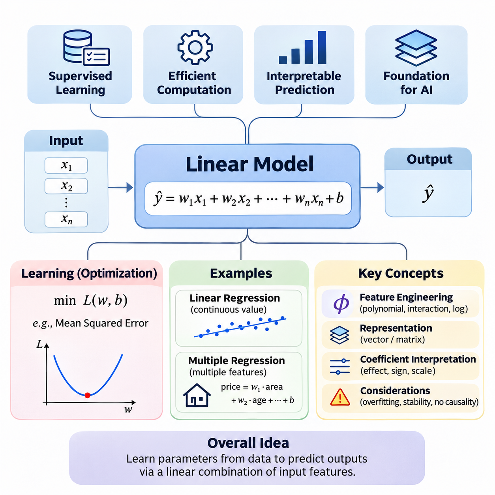
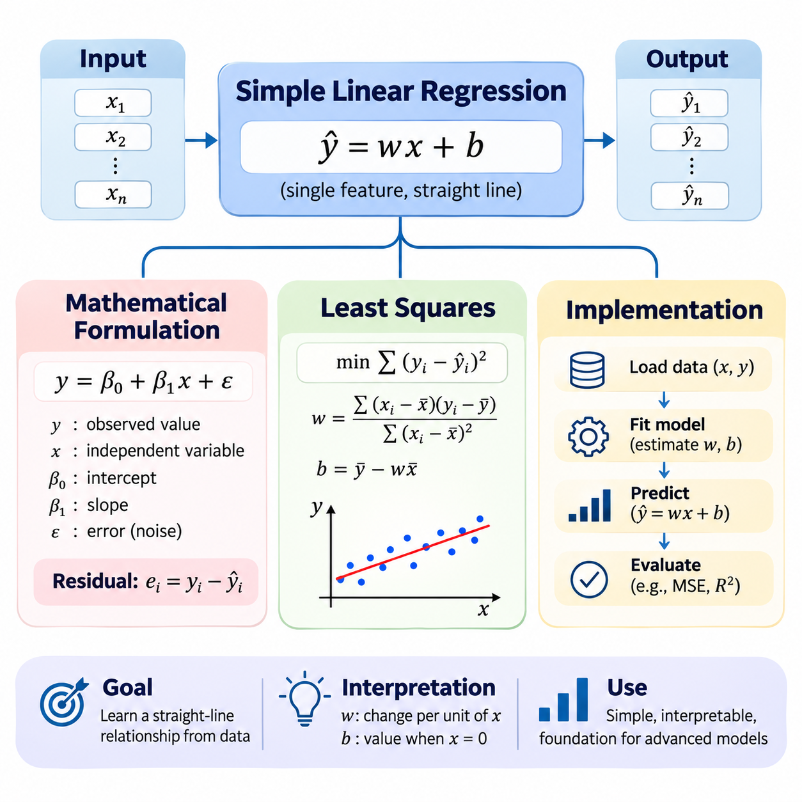
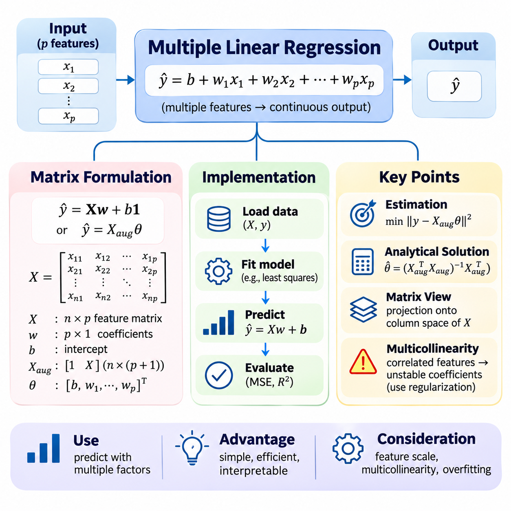
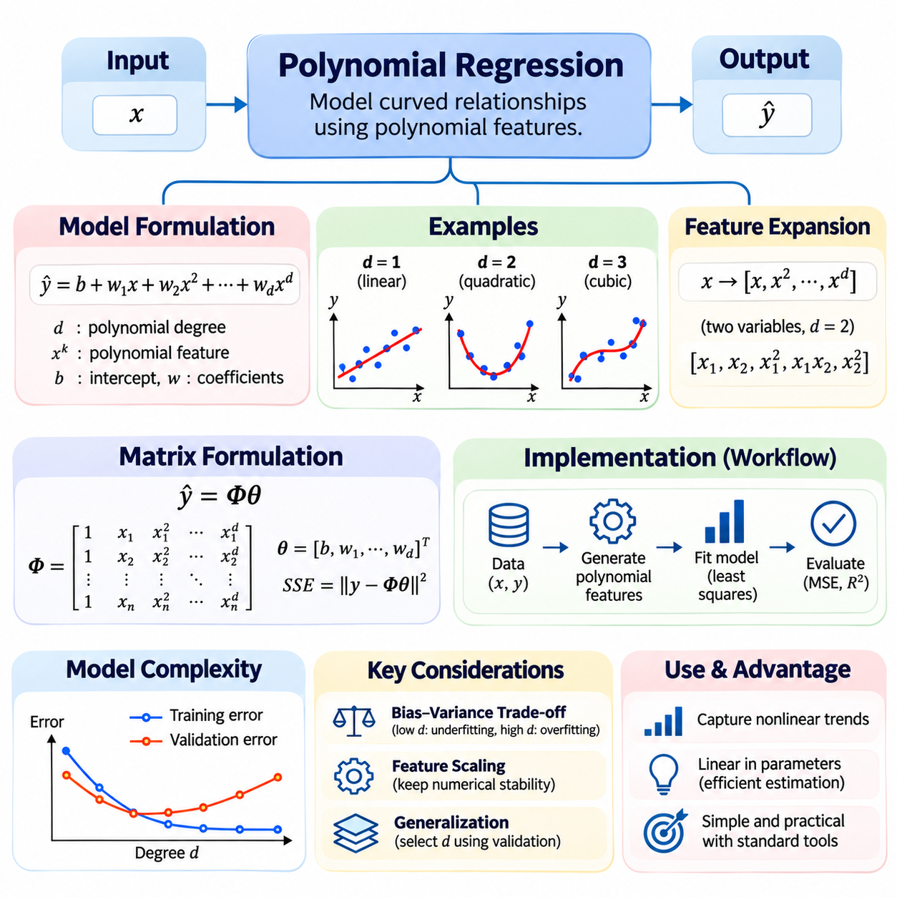
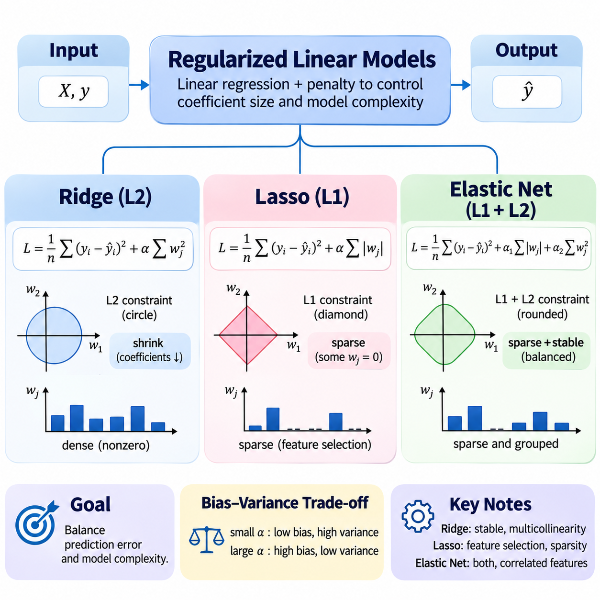
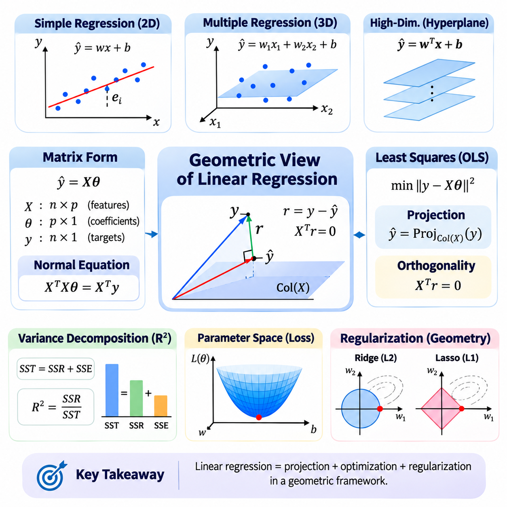
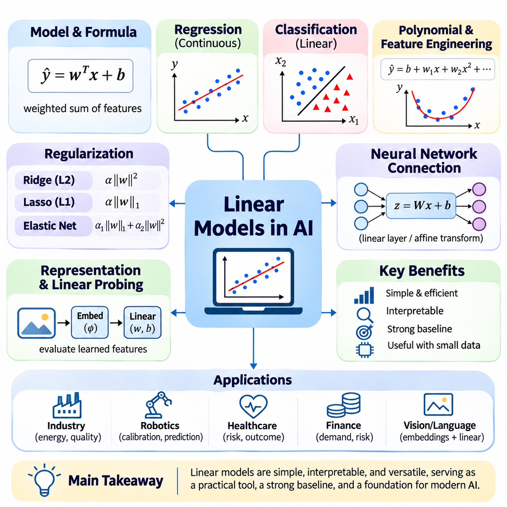

**Volume 08. Supervised Learning**


# 01. Linear Models

## 01.00 Introduction to Linear Models

{width="7.268055555555556in" height="7.268055555555556in"}

Linear models represent one of the most fundamental approaches in supervised machine learning. They describe relationships between input variables and predicted outputs through weighted combinations of numerical features. Despite their mathematical simplicity, linear models remain essential in modern artificial intelligence because they provide efficient computation, interpretable predictions, and a strong foundation for understanding more advanced learning algorithms.

The central assumption of a linear model is that the predicted output can be expressed as a linear combination of input features and learned parameters. Each feature contributes to the prediction according to an associated coefficient, while an intercept represents the baseline prediction. During training, the learning algorithm adjusts these parameters to reduce the difference between predicted values and observed targets.

A general linear prediction function can be written as y_hat = w1x1 + w2x2 + \... + wnxn + b, where x represents input features, w represents learned weights, and b denotes the intercept. The predicted value y_hat is determined by combining feature contributions. This formulation provides a compact mathematical representation that can be extended from a single input variable to datasets containing hundreds or thousands of features.

In supervised learning, linear models learn from labeled examples containing both input observations and corresponding target values. The training process identifies parameter values that best explain the observed relationships. Once trained, the model applies these parameters to previously unseen observations. Its effectiveness depends on whether the relationships learned from training data remain sufficiently consistent across new samples.

Linear regression is the most familiar example of this modeling approach. It predicts continuous numerical quantities such as temperature, energy consumption, product demand, or manufacturing cost. For example, a model may estimate electricity usage from operating hours and equipment load. The learned coefficients describe how each input contributes to the predicted consumption while other included variables remain unchanged.

The simplest linear regression model uses one explanatory variable and produces predictions along a straight line. Its slope indicates how the predicted output changes when the input increases by one unit, while its intercept specifies the predicted output when the input equals zero. Although this representation is straightforward, it introduces essential concepts of parameter estimation, prediction error, and statistical interpretation.

Multiple linear regression extends the same principle to several explanatory variables. A housing price model, for instance, may consider floor area, building age, distance from transportation, and neighborhood characteristics. Each feature receives an individual coefficient, allowing the model to combine different sources of information. This extension makes linear regression useful for many practical datasets containing multiple measurements.

The process of estimating model parameters is commonly formulated as an optimization problem. A loss function measures the disagreement between predictions and observed targets, and training seeks parameters that minimize this loss. Mean squared error is frequently used because it penalizes larger prediction errors more strongly. This objective connects linear regression with the broader mathematical framework of optimization in machine learning.

Ordinary least squares provides a classical method for estimating linear regression parameters. It minimizes the sum of squared differences between observed and predicted values. Under suitable mathematical conditions, the solution can be calculated directly through matrix operations. Alternatively, iterative optimization methods such as gradient descent can estimate parameters when direct computation is inconvenient or computationally expensive.

Linear models also provide an important introduction to vector and matrix representations. Instead of calculating each prediction separately, an entire dataset can be represented as a matrix of observations and features. Model parameters form a weight vector, and predictions are obtained through matrix multiplication. This representation supports efficient numerical computation and establishes concepts used throughout neural networks and deep learning.

An important distinction exists between linearity in input variables and linearity in model parameters. A model can include transformed inputs such as squared values, interaction terms, or logarithmic features while remaining linear in its learned coefficients. Polynomial regression demonstrates this principle by introducing nonlinear feature transformations without abandoning the underlying linear parameter structure.

Feature engineering therefore plays a significant role in determining the expressive power of linear models. Carefully selected transformations can reveal relationships that are difficult to represent using original variables alone. Interaction features can describe how two inputs jointly influence an output, while polynomial features can capture curved trends. However, additional features increase complexity and may introduce overfitting or numerical instability.

One major advantage of linear models is interpretability. Their coefficients provide a relatively transparent description of how features contribute to predictions. Positive coefficients indicate increasing predicted values as corresponding features increase, while negative coefficients indicate decreasing predictions, holding other features fixed. Nevertheless, these associations should not automatically be interpreted as causal relationships.

Coefficient interpretation also requires attention to feature scales and dependencies. A coefficient associated with distance measured in meters cannot be compared directly with one associated with temperature measured in degrees. Strong correlations among explanatory variables can make individual coefficients unstable. Standardization and careful examination of multicollinearity help improve numerical behavior and support more meaningful analysis.

Regularization addresses another important limitation by discouraging unnecessarily large or complex parameter values. Ridge regression introduces an L2 penalty that shrinks coefficients, while Lasso regression uses an L1 penalty that can set selected coefficients to zero. Elastic Net combines both approaches. These methods help control model complexity and can improve generalization when features are numerous or strongly correlated.

The geometric interpretation of linear models provides additional insight into their behavior. In a space containing input features, a linear prediction function defines a line, plane, or higher-dimensional hyperplane. Parameter estimation determines the position and orientation of this geometric structure. This perspective connects regression with linear algebra, projection, optimization, and the geometric foundations of other machine learning algorithms.

The performance of a linear model depends on assumptions about the underlying data-generating process. A simple linear relationship may be insufficient when the target depends on complex interactions or nonlinear mechanisms. Outliers can substantially influence least-squares estimates, and changing data distributions can reduce predictive reliability. These limitations motivate diagnostic analysis, robust estimation, and alternative modeling approaches.

Statistical assumptions become particularly important when linear regression is used for inference rather than prediction alone. Independent errors, appropriate functional relationships, and suitable variance assumptions influence the reliability of conventional confidence intervals and hypothesis tests. Normality of errors is useful for certain finite-sample inference procedures, but it is not generally required to calculate least-squares estimates.

Evaluating linear models requires separating training performance from generalization performance. A model may fit observed examples closely while producing inaccurate predictions on unseen data. Training, validation, and test datasets help measure this distinction. Common regression metrics include mean absolute error, mean squared error, root mean squared error, and the coefficient of determination, each emphasizing different aspects of predictive quality.

Residual analysis provides another valuable evaluation technique. Residuals represent differences between observed targets and model predictions. Examining their distribution and relationship with input variables can reveal systematic patterns, changing error variance, unusual observations, or missing nonlinear structure. Ideally, residuals should not display systematic patterns that indicate important relationships left unexplained by the model.

Linear models are especially attractive when computational resources are limited. Training and inference often require relatively modest memory and processing power compared with complex nonlinear architectures. This efficiency makes them useful for embedded systems, industrial monitoring, edge computing, and applications requiring rapid updates. Their predictable computational structure also simplifies implementation, testing, and operational maintenance.

In industrial artificial intelligence, linear models frequently serve as baseline predictors and interpretable components within larger systems. They can estimate equipment energy consumption, predict manufacturing measurements, or approximate relationships between operating conditions and sensor outputs. Even when more advanced algorithms ultimately provide higher accuracy, linear models establish a reference against which additional complexity can be justified.

Linear modeling also introduces the concept of the bias-variance tradeoff. A model with insufficient flexibility may exhibit high bias because it cannot represent important patterns. Increasing feature complexity may reduce this limitation but can increase variance and sensitivity to training data. Regularization, feature selection, and validation help balance these competing effects and support reliable predictions beyond the training dataset.

The relationship between linear models and neural networks is particularly significant. A neural network layer typically begins with a weighted linear transformation followed by an optional nonlinear activation function. Understanding weights, biases, matrix multiplication, and gradient-based optimization in linear regression therefore prepares learners for more sophisticated architectures. Linear models provide a conceptual bridge between classical statistical learning and modern deep learning.

Although linear models cannot represent every relationship directly, their simplicity remains a practical strength rather than merely a limitation. They allow researchers to establish transparent baselines, examine feature relationships, identify data problems, and evaluate whether more complex algorithms are necessary. A well-designed linear model can sometimes outperform sophisticated alternatives when data is limited, noisy, or approximately linear.

Understanding linear models establishes the foundation for subsequent topics in supervised learning. Simple and multiple linear regression introduce parameter estimation, polynomial regression expands feature representations, and regularized models address complexity and generalization. Geometric interpretation connects these methods with mathematical intuition, while practical applications demonstrate their continuing relevance in modern artificial intelligence systems.

선형 모델(Linear Models)은 지도 머신러닝(Supervised Machine Learning)에서 가장 기본적인 접근 방법 중 하나이다. 선형 모델은 수치형 특징(Numerical Features)의 가중 결합(Weighted Combination)을 통해 입력 변수(Input Variables)와 예측 출력(Predicted Outputs) 사이의 관계를 표현한다. 수학적으로 단순하지만 계산 효율성(Computational Efficiency), 예측 해석 가능성(Interpretability), 고급 학습 알고리즘(Advanced Learning Algorithms)의 기초를 제공한다는 점에서 현대 인공지능(Artificial Intelligence)의 핵심적인 역할을 수행한다.

선형 모델(Linear Model)의 핵심 가정은 예측 출력(Predicted Output)이 입력 특징(Input Features)과 학습된 매개변수(Learned Parameters)의 선형 결합(Linear Combination)으로 표현될 수 있다는 것이다. 각 특징은 해당 계수(Coefficient)에 따라 예측에 기여하며, 절편(Intercept)은 기준 예측값(Baseline Prediction)을 나타낸다. 학습 과정(Training Process)에서는 예측값과 실제 목표값(Observed Targets) 사이의 차이를 줄이도록 매개변수를 조정한다.

일반적인 선형 예측 함수(Linear Prediction Function)는 y_hat = w1x1 + w2x2 + \... + wnxn + b로 표현할 수 있다. 여기서 x는 입력 특징(Input Features), w는 학습된 가중치(Learned Weights), b는 절편(Intercept)을 의미한다. 예측값(Predicted Value) y_hat은 각 특징의 기여도를 결합하여 결정된다. 이러한 수학적 표현(Mathematical Representation)은 단일 입력 변수부터 수백 개 또는 수천 개의 특징을 포함하는 데이터셋(Dataset)까지 확장할 수 있다.

지도학습(Supervised Learning)에서 선형 모델은 입력 관측값(Input Observations)과 대응하는 목표값(Target Values)을 포함한 레이블 데이터(Labeled Data)로부터 학습한다. 학습 과정에서는 관측된 관계를 가장 잘 설명하는 매개변수(Parameter)를 찾는다. 학습이 완료되면 이전에 관측하지 않은 데이터(Unseen Data)에 동일한 매개변수를 적용한다. 모델의 효과는 학습 데이터에서 발견한 관계가 새로운 데이터에서도 충분히 유지되는지에 따라 결정된다.

선형 회귀(Linear Regression)는 이러한 모델링 접근 방법의 가장 대표적인 사례이다. 선형 회귀는 온도(Temperature), 에너지 소비량(Energy Consumption), 제품 수요(Product Demand), 제조 비용(Manufacturing Cost)과 같은 연속적인 수치(Continuous Numerical Values)를 예측한다. 예를 들어 장비 가동 시간(Operating Hours)과 부하(Equipment Load)를 이용해 전력 사용량을 추정할 수 있다. 학습된 계수는 다른 변수가 일정할 때 각 입력이 예측 소비량에 미치는 영향을 나타낸다.

가장 단순한 선형 회귀 모델(Simple Linear Regression Model)은 하나의 설명 변수(Explanatory Variable)를 사용하여 직선(Straight Line) 형태의 예측을 생성한다. 기울기(Slope)는 입력값이 한 단위 증가할 때 예측 출력이 얼마나 변하는지를 나타내며, 절편(Intercept)은 입력값이 0일 때의 예측값을 의미한다. 이러한 단순한 표현은 매개변수 추정(Parameter Estimation), 예측 오차(Prediction Error), 통계적 해석(Statistical Interpretation)의 핵심 개념을 이해하는 출발점이 된다.

다중 선형 회귀(Multiple Linear Regression)는 동일한 원리를 여러 설명 변수(Explanatory Variables)로 확장한다. 예를 들어 주택 가격 예측 모델(Housing Price Prediction Model)은 면적(Floor Area), 건물 연식(Building Age), 교통 접근성(Transportation Accessibility), 지역 특성(Neighborhood Characteristics)을 고려할 수 있다. 각 특징에는 개별 계수(Coefficient)가 할당되며, 모델은 서로 다른 정보들을 결합하여 예측한다. 이러한 확장은 여러 측정값을 포함하는 실제 데이터셋에서 선형 회귀의 활용도를 높인다.

모델 매개변수(Model Parameters)를 추정하는 과정은 일반적으로 최적화 문제(Optimization Problem)로 정의된다. 손실 함수(Loss Function)는 예측값과 관측된 목표값 사이의 불일치를 측정하며, 학습은 이러한 손실을 최소화하는 매개변수를 찾는 과정이다. 평균 제곱 오차(Mean Squared Error)는 큰 예측 오차에 더 높은 벌점을 부여하기 때문에 자주 사용된다. 이러한 목적 함수(Objective Function)는 선형 회귀를 머신러닝의 일반적인 최적화 프레임워크(Optimization Framework)와 연결한다.

보통 최소제곱법(Ordinary Least Squares)은 선형 회귀 매개변수를 추정하는 전통적인 방법이다. 이 방법은 관측값과 예측값 사이의 차이를 제곱한 값들의 합을 최소화한다. 적절한 수학적 조건(Mathematical Conditions)이 충족되면 행렬 연산(Matrix Operations)을 통해 해를 직접 계산할 수 있다. 반면 직접 계산이 어렵거나 계산 비용이 높은 경우에는 경사하강법(Gradient Descent)과 같은 반복 최적화 방법(Iterative Optimization Methods)을 이용하여 매개변수를 추정할 수 있다.

선형 모델은 벡터(Vector)와 행렬(Matrix) 표현을 이해하는 데에도 중요한 기초를 제공한다. 각 예측값을 개별적으로 계산하는 대신 전체 데이터셋을 관측값과 특징으로 구성된 행렬로 표현할 수 있다. 모델 매개변수는 가중치 벡터(Weight Vector)를 형성하며, 예측값은 행렬 곱셈(Matrix Multiplication)을 통해 계산된다. 이러한 표현은 효율적인 수치 계산(Numerical Computation)을 지원하고 신경망(Neural Networks)과 딥러닝(Deep Learning) 전반에서 활용되는 개념적 기반을 형성한다.

입력 변수(Input Variables)에 대한 선형성과 모델 매개변수(Model Parameters)에 대한 선형성은 구분해야 한다. 모델은 제곱항(Squared Terms), 상호작용항(Interaction Terms), 로그 특징(Logarithmic Features)과 같은 변환된 입력을 포함하면서도 학습 계수에 대해서는 선형성을 유지할 수 있다. 다항 회귀(Polynomial Regression)는 이러한 원리를 보여 주며, 기본적인 선형 매개변수 구조(Linear Parameter Structure)를 유지하면서 비선형 특징 변환(Nonlinear Feature Transformations)을 도입한다.

따라서 특징 공학(Feature Engineering)은 선형 모델의 표현 능력(Expressive Power)을 결정하는 중요한 요소이다. 적절하게 선택한 특징 변환(Feature Transformations)은 원래 변수만으로 표현하기 어려운 관계를 드러낼 수 있다. 상호작용 특징(Interaction Features)은 두 입력이 출력에 공동으로 미치는 영향을 설명하고, 다항 특징(Polynomial Features)은 곡선 형태의 추세(Curved Trends)를 포착할 수 있다. 그러나 특징이 증가하면 모델 복잡도(Model Complexity)가 높아지고 과적합(Overfitting)이나 수치적 불안정성(Numerical Instability)이 발생할 수 있다.

선형 모델의 주요 장점 중 하나는 해석 가능성(Interpretability)이다. 모델 계수(Model Coefficients)는 각 특징이 예측에 어떻게 기여하는지 비교적 투명하게 설명한다. 양의 계수(Positive Coefficient)는 다른 특징이 일정할 때 해당 특징이 증가하면 예측값도 증가함을 의미하며, 음의 계수(Negative Coefficient)는 예측값이 감소함을 의미한다. 그러나 이러한 통계적 연관성(Statistical Association)을 반드시 인과관계(Causal Relationship)로 해석해서는 안 된다.

계수 해석(Coefficient Interpretation)에서는 특징의 척도(Feature Scales)와 변수 간 의존성(Dependencies)도 고려해야 한다. 미터 단위로 측정한 거리의 계수와 온도 단위로 측정한 변수의 계수를 직접 비교하는 것은 적절하지 않다. 설명 변수 사이에 강한 상관관계(Strong Correlation)가 존재하면 개별 계수가 불안정해질 수 있다. 표준화(Standardization)와 다중공선성(Multicollinearity)에 대한 분석은 수치적 안정성을 개선하고 의미 있는 해석을 지원한다.

정규화(Regularization)는 불필요하게 크거나 복잡한 매개변수 값을 억제하여 또 다른 중요한 한계를 해결한다. 릿지 회귀(Ridge Regression)는 계수를 축소하는 L2 벌점(L2 Penalty)을 도입하며, 라쏘 회귀(Lasso Regression)는 일부 계수를 0으로 만들 수 있는 L1 벌점(L1 Penalty)을 사용한다. 엘라스틱 넷(Elastic Net)은 두 방법을 결합한다. 이러한 기법은 특징 수가 많거나 특징 사이의 상관관계가 강한 경우 모델 복잡도를 제어하고 일반화 성능(Generalization Performance)을 개선하는 데 도움이 된다.

선형 모델의 기하학적 해석(Geometric Interpretation)은 모델의 동작을 이해하는 또 다른 관점을 제공한다. 입력 특징으로 구성된 공간(Feature Space)에서 선형 예측 함수는 직선(Line), 평면(Plane), 또는 고차원 초평면(Higher-Dimensional Hyperplane)을 정의한다. 매개변수 추정(Parameter Estimation)은 이러한 기하학적 구조의 위치와 방향을 결정한다. 이 관점은 회귀 분석을 선형대수학(Linear Algebra), 투영(Projection), 최적화(Optimization), 다른 머신러닝 알고리즘의 기하학적 기초와 연결한다.

선형 모델의 성능은 데이터를 생성하는 실제 과정(Data-Generating Process)에 대한 가정에 영향을 받는다. 목표값이 복잡한 상호작용(Complex Interactions)이나 비선형 메커니즘(Nonlinear Mechanisms)에 의존한다면 단순한 선형 관계만으로는 충분하지 않을 수 있다. 이상치(Outliers)는 최소제곱 추정(Least-Squares Estimation)에 큰 영향을 줄 수 있으며, 데이터 분포(Data Distribution)의 변화는 예측 신뢰성을 낮출 수 있다. 이러한 한계는 진단 분석(Diagnostic Analysis), 강건한 추정(Robust Estimation), 대안 모델링(Alternative Modeling)의 필요성을 보여 준다.

선형 회귀를 단순한 예측이 아니라 통계적 추론(Statistical Inference)에 활용할 때는 통계적 가정(Statistical Assumptions)이 특히 중요하다. 오차의 독립성(Independent Errors), 적절한 함수 관계(Functional Relationships), 적합한 분산 가정(Variance Assumptions)은 일반적인 신뢰구간(Confidence Intervals)과 가설검정(Hypothesis Tests)의 신뢰성에 영향을 준다. 오차의 정규성(Normality of Errors)은 일부 유한 표본 추론(Finite-Sample Inference)에 유용하지만 최소제곱 추정값 자체를 계산하는 데 반드시 필요한 조건은 아니다.

선형 모델을 평가할 때는 학습 성능(Training Performance)과 일반화 성능(Generalization Performance)을 구분해야 한다. 모델이 관측된 학습 데이터에는 잘 적합하더라도 새로운 데이터에서는 부정확한 예측을 생성할 수 있다. 학습 데이터(Training Data), 검증 데이터(Validation Data), 테스트 데이터(Test Data)를 분리하면 이러한 차이를 측정할 수 있다. 대표적인 회귀 평가 지표(Regression Evaluation Metrics)에는 평균 절대 오차(Mean Absolute Error), 평균 제곱 오차(Mean Squared Error), 평균 제곱근 오차(Root Mean Squared Error), 결정계수(Coefficient of Determination)가 있다.

잔차 분석(Residual Analysis)은 또 다른 중요한 평가 방법이다. 잔차(Residuals)는 관측된 목표값과 모델 예측값 사이의 차이를 나타낸다. 잔차의 분포(Residual Distribution)와 입력 변수와의 관계를 분석하면 체계적인 패턴(Systematic Patterns), 변화하는 오차 분산(Changing Error Variance), 비정상적인 관측값(Unusual Observations), 누락된 비선형 구조(Missing Nonlinear Structure)를 발견할 수 있다. 이상적으로 잔차에는 모델이 설명하지 못한 중요한 관계를 나타내는 체계적인 패턴이 없어야 한다.

선형 모델은 계산 자원(Computational Resources)이 제한된 환경에서 특히 유용하다. 학습과 추론(Training and Inference)에 필요한 메모리와 처리 능력이 복잡한 비선형 구조(Nonlinear Architectures)에 비해 상대적으로 작기 때문이다. 이러한 효율성은 임베디드 시스템(Embedded Systems), 산업 모니터링(Industrial Monitoring), 엣지 컴퓨팅(Edge Computing), 빠른 모델 갱신이 필요한 응용 분야에서 장점이 된다. 예측 가능한 계산 구조는 구현, 테스트, 운영 유지보수도 단순화한다.

산업 인공지능(Industrial Artificial Intelligence)에서 선형 모델은 더 큰 시스템의 기준 예측기(Baseline Predictors)이자 해석 가능한 구성 요소(Interpretable Components)로 자주 활용된다. 장비의 에너지 소비량을 추정하거나 제조 측정값을 예측하고, 운전 조건(Operating Conditions)과 센서 출력(Sensor Outputs) 사이의 관계를 근사할 수 있다. 고급 알고리즘이 최종적으로 더 높은 정확도를 제공하더라도 선형 모델은 추가적인 복잡성이 정당한지 판단할 수 있는 비교 기준(Reference Baseline)을 제공한다.

선형 모델링은 편향-분산 절충(Bias-Variance Tradeoff)의 개념도 소개한다. 유연성이 부족한 모델은 중요한 패턴을 표현하지 못해 높은 편향(High Bias)을 나타낼 수 있다. 특징의 복잡도를 증가시키면 이러한 한계를 줄일 수 있지만, 분산(Variance)과 학습 데이터에 대한 민감도가 증가할 수 있다. 정규화(Regularization), 특징 선택(Feature Selection), 검증(Validation)은 이러한 상충 관계의 균형을 조절하고 학습 데이터 외부에서도 신뢰할 수 있는 예측을 지원한다.

선형 모델과 신경망(Neural Networks)의 관계는 특히 중요하다. 신경망 계층(Neural Network Layer)은 일반적으로 가중 선형 변환(Weighted Linear Transformation)을 수행한 뒤 필요에 따라 비선형 활성화 함수(Nonlinear Activation Function)를 적용한다. 따라서 선형 회귀에서 가중치(Weights), 편향(Biases), 행렬 곱셈(Matrix Multiplication), 경사 기반 최적화(Gradient-Based Optimization)를 이해하면 더욱 복잡한 신경망 구조를 학습할 준비가 된다. 선형 모델은 고전적인 통계 학습(Classical Statistical Learning)과 현대 딥러닝(Modern Deep Learning)을 연결하는 개념적 다리 역할을 한다.

선형 모델이 모든 관계를 직접 표현할 수 있는 것은 아니지만, 단순성(Simplicity)은 단순한 한계가 아니라 실용적인 강점이다. 선형 모델을 통해 연구자는 투명한 기준 모델(Transparent Baselines)을 구축하고, 특징 사이의 관계를 분석하며, 데이터 문제(Data Problems)를 발견하고, 더 복잡한 알고리즘이 필요한지 평가할 수 있다. 데이터가 제한적이거나 잡음(Noise)이 많거나 관계가 대체로 선형적인 경우에는 잘 설계된 선형 모델이 복잡한 대안보다 더 좋은 성능을 제공할 수도 있다.

선형 모델에 대한 이해는 이후 지도학습(Supervised Learning)의 주요 주제를 학습하기 위한 기초가 된다. 단순 선형 회귀(Simple Linear Regression)와 다중 선형 회귀(Multiple Linear Regression)는 매개변수 추정(Parameter Estimation)을 소개하고, 다항 회귀(Polynomial Regression)는 특징 표현(Feature Representations)을 확장하며, 정규화 선형 모델(Regularized Linear Models)은 복잡도와 일반화 문제를 다룬다. 기하학적 해석(Geometric Interpretation)은 수학적 직관(Mathematical Intuition)을 제공하고, 실제 응용(Practical Applications)은 현대 인공지능 시스템에서 선형 모델의 지속적인 중요성을 보여 준다.

## 01.01 Simple Linear Regression

{width="7.268055555555556in" height="7.268055555555556in"}

Simple linear regression is one of the most fundamental algorithms in supervised machine learning. It describes the relationship between a single independent variable and a continuous dependent variable using a straight-line function. By learning this relationship from observed data, the model can estimate numerical outcomes for previously unseen inputs. Its simplicity makes it an essential starting point for understanding regression, statistical estimation, and predictive modeling.

The mathematical formulation of simple linear regression begins with the equation y_hat = wx + b, where x represents the independent variable, w denotes the slope, and b represents the intercept. The predicted output y_hat changes linearly with the input. The slope determines how much the prediction changes for a one-unit increase in x, while the intercept specifies the predicted value when x equals zero.

A more complete statistical formulation includes an error term and is expressed as y = beta0 + beta1\\\*x + epsilon. Here, beta0 and beta1 represent the underlying population parameters, while epsilon captures unexplained variation, measurement noise, and other influences not represented by the input variable. The regression algorithm estimates these unknown parameters using observed training examples rather than assuming their values are already known.

The distinction between observed values and predicted values is central to regression analysis. An observed target contains the actual measured outcome, whereas a prediction represents the model\'s estimated outcome. Their difference is called a residual and can be written as e_i = y_i - y_hat_i. Residuals indicate how closely the fitted line represents individual observations and provide essential information for evaluating model quality.

The slope has a direct interpretation in the original measurement units. For example, if a regression model predicts electricity consumption from equipment operating hours, a slope of 2.5 indicates that each additional operating hour corresponds to an increase of 2.5 consumption units in the predicted value. This interpretation assumes that the fitted relationship is appropriate within the relevant operating range.

The intercept represents the predicted output when the independent variable equals zero. In some applications, this value has a meaningful physical interpretation, such as baseline energy consumption when equipment is inactive. In other situations, zero may lie outside the observed input range, making the intercept primarily a mathematical parameter. Consequently, coefficient interpretation should always consider the actual measurement context.

Simple linear regression can also be expressed geometrically. Each observation corresponds to a point in a two-dimensional coordinate system, with the independent variable on the horizontal axis and the dependent variable on the vertical axis. The fitted regression line passes through the feature space in a position determined by its slope and intercept. Training adjusts these parameters to represent the overall pattern of observations.

The most common parameter estimation approach is ordinary least squares, which identifies the line that minimizes the sum of squared residuals. Its objective function is SSE = sum((y_i - y_hat_i)\^2), where the summation covers all training observations. Squaring the residuals prevents positive and negative errors from canceling and assigns greater penalties to larger deviations from the fitted regression line.

The least-squares objective can also be expressed using mean squared error, MSE = (1/n)\\\*sum((y_i - y_hat_i)\^2). Dividing the sum of squared errors by the number of observations changes the scale of the objective but not its minimizing parameters. Mean squared error is particularly useful for comparing training performance across datasets and connecting classical regression with optimization methods used in machine learning.

For simple linear regression with an intercept, the least-squares slope has a closed-form solution. It can be written as w = sum((x_i - x_mean)\\\*(y_i - y_mean)) / sum((x_i - x_mean)\^2). This expression measures how the input and output vary together relative to the variation in the input. It requires nonzero variation in x, because identical input values cannot determine a unique slope.

After calculating the slope, the intercept is obtained from b = y_mean - w\\\*x_mean. This relationship ensures that the fitted regression line passes through the point defined by the sample means of the input and output variables. Together, these two equations provide a direct analytical solution to ordinary least squares without requiring iterative parameter updates or complex numerical optimization.

The closed-form solution reveals the connection between regression and statistical covariance. The slope equals the sample covariance between x and y divided by the sample variance of x, provided consistent normalization is used. A positive covariance produces a positive slope, while a negative covariance produces a negative slope. However, the magnitude of the slope depends on measurement units and should not be interpreted as a standardized correlation coefficient.

Least squares is attractive because its objective function is convex with respect to the slope and intercept. When the input values contain sufficient variation, the objective has a unique global minimum. This property allows reliable parameter estimation without the local-minimum difficulties associated with many nonlinear optimization problems. Nevertheless, convexity does not guarantee that the resulting model accurately represents the underlying relationship.

Gradient descent offers an alternative method for estimating regression parameters. Instead of calculating the analytical solution directly, it begins with initial values for the slope and intercept and repeatedly updates them using gradients of the loss function. For MSE, the gradients are proportional to prediction errors multiplied by input values for the slope, and to prediction errors for the intercept.

The gradient descent update rules can be written as w_new = w_old - alpha\\\*dMSE/dw and b_new = b_old - alpha\\\*dMSE/db. The learning rate alpha controls the size of each update. A very small learning rate may produce slow convergence, while an excessively large value can cause oscillation or divergence. Appropriate feature scaling and learning-rate selection improve numerical stability during iterative optimization.

Implementing simple linear regression begins with preparing a dataset containing paired input and target observations. Each sample should contain one numerical explanatory variable and its corresponding continuous target value. Before training, the dataset should be inspected for missing measurements, inconsistent units, duplicate records, and extreme observations that could distort parameter estimation or model evaluation.

The dataset is typically divided into training and test subsets before fitting the model. Training observations are used to estimate the slope and intercept, while test observations provide an independent assessment of predictive performance. When model selection or hyperparameter tuning is required, a separate validation subset can be introduced. This separation helps prevent overly optimistic estimates caused by evaluating predictions on the same observations used for training.

A basic implementation can calculate the input and target means, determine the slope using the least-squares equation, and then compute the intercept. Predictions are generated by applying the fitted equation to new input values. This manual implementation is valuable because it exposes the mathematical operations behind regression and allows learners to verify that each computational step corresponds to the theoretical formulation.

Numerical libraries such as NumPy simplify implementation through vectorized operations. Arrays can store observations, and mathematical expressions can calculate means, centered values, squared deviations, and parameter estimates without explicit element-by-element processing. Vectorization improves computational efficiency and reduces implementation complexity, particularly when datasets contain many observations.

Machine learning libraries such as scikit-learn provide standardized regression interfaces. A linear regression estimator can be fitted using training features and targets, after which its coefficient and intercept become available for inspection. The same estimator can generate predictions for test observations. Such libraries simplify practical development while preserving the underlying mathematical principles of least-squares estimation.

A correct implementation must maintain consistent input shapes and feature ordering. Many machine learning interfaces expect feature data as a two-dimensional array, even when only one explanatory variable is used. The target is commonly represented as a one-dimensional array. Incorrect dimensions can produce execution errors or unintended behavior, making data-shape verification an important part of the implementation process.

Model evaluation commonly begins with mean absolute error, mean squared error, and root mean squared error. Mean absolute error measures the average magnitude of prediction errors, while mean squared error penalizes larger deviations more strongly. Root mean squared error expresses error in the original target units. These metrics provide complementary information about prediction accuracy and sensitivity to unusually large errors.

The coefficient of determination, commonly denoted R-squared, measures predictive performance relative to a baseline that predicts the target mean. A value of one indicates perfect predictions, while a value of zero indicates performance equal to that baseline under the standard definition. Negative values are possible when predictions perform worse than the baseline, particularly on independent test datasets.

Residual analysis is essential for determining whether the fitted relationship is appropriate. Residuals should be examined for systematic curvature, changing variability, and unusually large deviations. A curved residual pattern may indicate that a nonlinear relationship is missing, while increasing residual dispersion may suggest heteroscedasticity. Such observations help determine whether simple linear regression adequately describes the available data.

Outliers can strongly influence ordinary least-squares estimates because the objective squares prediction errors. A single extreme observation may substantially change the fitted slope or intercept, especially when its input value lies far from most observations. Investigating influential samples is therefore important, although unusual observations should not be removed automatically without examining their validity and relevance.

Simple linear regression also requires careful interpretation of its assumptions. A linear conditional mean, appropriate treatment of dependent observations, and suitable error behavior are important for reliable analysis. Constant error variance is especially relevant to conventional statistical inference, while normal error assumptions support certain exact inference procedures. Prediction itself does not require every classical assumption to hold perfectly.

Extrapolation presents another practical limitation. A model trained on observations within a particular input range may produce unreliable predictions far beyond that range. Even when the fitted line accurately describes historical measurements, the underlying relationship may change under unfamiliar operating conditions. Predictions should therefore be interpreted with attention to the training distribution and the physical meaning of the variables.

Simple linear regression remains valuable because it combines mathematical transparency, computational efficiency, and practical usefulness. Its formulation introduces parameter estimation, least-squares optimization, gradient-based learning, and quantitative evaluation within a single understandable framework. These concepts extend naturally to multiple linear regression, regularized models, generalized linear models, and the optimization foundations of modern artificial intelligence.

단순 선형 회귀(Simple Linear Regression)는 지도 머신러닝(Supervised Machine Learning)에서 가장 기본적인 알고리즘(Algorithm) 중 하나이다. 이 방법은 하나의 독립 변수(Independent Variable)와 연속형 종속 변수(Continuous Dependent Variable) 사이의 관계를 직선 함수(Straight-Line Function)로 표현한다. 관측 데이터(Observed Data)로부터 이러한 관계를 학습함으로써 이전에 관측하지 않은 입력에 대한 수치 결과를 추정할 수 있다. 이러한 단순성은 회귀(Regression), 통계적 추정(Statistical Estimation), 예측 모델링(Predictive Modeling)을 이해하는 중요한 출발점이 된다.

단순 선형 회귀의 수학적 정식화(Mathematical Formulation)는 y_hat = wx + b라는 방정식에서 시작한다. 여기서 x는 독립 변수(Independent Variable), w는 기울기(Slope), b는 절편(Intercept)을 나타낸다. 예측 출력(Predicted Output) y_hat은 입력값에 따라 선형적으로 변화한다. 기울기는 x가 한 단위 증가할 때 예측값이 얼마나 변하는지를 결정하며, 절편은 x가 0일 때의 예측값을 나타낸다.

보다 완전한 통계적 정식화(Statistical Formulation)는 오차항(Error Term)을 포함하며 y = beta0 + beta1\\\*x + epsilon으로 표현된다. 여기서 beta0와 beta1은 모집단 매개변수(Population Parameters)를 나타내고, epsilon은 설명되지 않은 변동(Unexplained Variation), 측정 잡음(Measurement Noise), 입력 변수로 표현되지 않은 다른 영향을 포함한다. 회귀 알고리즘은 이러한 매개변수의 값을 미리 알고 있다고 가정하지 않고 관측된 학습 데이터(Training Examples)를 사용하여 추정한다.

관측값(Observed Values)과 예측값(Predicted Values)의 차이를 구분하는 것은 회귀 분석(Regression Analysis)의 핵심이다. 관측된 목표값(Observed Target)은 실제로 측정한 결과를 의미하며, 예측값은 모델이 추정한 결과를 나타낸다. 두 값의 차이를 잔차(Residual)라고 하며 e_i = y_i - y_hat_i로 표현할 수 있다. 잔차는 적합된 회귀 직선(Fitted Regression Line)이 개별 관측값을 얼마나 정확하게 설명하는지 보여 주며 모델 품질(Model Quality)을 평가하는 중요한 정보를 제공한다.

기울기(Slope)는 원래 측정 단위(Measurement Units)를 기준으로 직접 해석할 수 있다. 예를 들어 장비 가동 시간(Equipment Operating Hours)을 이용하여 전력 소비량(Electricity Consumption)을 예측하는 회귀 모델에서 기울기가 2.5라면, 가동 시간이 한 시간 증가할 때 예측 소비량이 2.5단위 증가한다는 의미이다. 이러한 해석은 해당 운전 범위(Operating Range)에서 적합된 관계(Fitted Relationship)가 타당하다는 가정을 전제로 한다.

절편(Intercept)은 독립 변수(Independent Variable)가 0일 때의 예측 출력을 나타낸다. 일부 응용 분야에서는 장비가 작동하지 않을 때의 기본 에너지 소비량(Baseline Energy Consumption)처럼 물리적으로 의미 있는 값이 될 수 있다. 반면 다른 상황에서는 입력값 0이 관측 범위(Observed Input Range) 밖에 존재할 수 있으므로 절편이 주로 수학적 매개변수(Mathematical Parameter)로 기능한다. 따라서 계수 해석(Coefficient Interpretation)에서는 실제 측정 환경(Measurement Context)을 반드시 고려해야 한다.

단순 선형 회귀는 기하학적(Geometrically)으로도 표현할 수 있다. 각 관측값은 독립 변수를 수평축(Horizontal Axis), 종속 변수를 수직축(Vertical Axis)으로 하는 2차원 좌표계(Two-Dimensional Coordinate System)의 한 점에 대응한다. 적합된 회귀 직선은 기울기와 절편에 의해 결정되는 위치에서 특징 공간(Feature Space)을 통과한다. 학습 과정에서는 이러한 매개변수를 조정하여 관측값의 전체적인 패턴(Overall Pattern)을 표현한다.

가장 일반적인 매개변수 추정 방법(Parameter Estimation Method)은 보통 최소제곱법(Ordinary Least Squares)이며, 잔차 제곱합(Sum of Squared Residuals)을 최소화하는 직선을 찾는다. 목적 함수(Objective Function)는 SSE = sum((y_i - y_hat_i)\^2)로 표현되며, 합산은 모든 학습 관측값에 대해 수행된다. 잔차를 제곱하면 양의 오차와 음의 오차가 서로 상쇄되는 것을 방지하고, 회귀 직선에서 크게 벗어난 관측값에 더 높은 벌점(Penalty)을 부여한다.

최소제곱 목적 함수(Least-Squares Objective)는 평균 제곱 오차(Mean Squared Error)를 이용하여 MSE = (1/n)\\\*sum((y_i - y_hat_i)\^2)로 표현할 수도 있다. 잔차 제곱합을 관측값의 개수로 나누면 목적 함수의 크기는 달라지지만 이를 최소화하는 매개변수는 변하지 않는다. 평균 제곱 오차는 데이터셋 간 학습 성능(Training Performance)을 비교하고 고전적인 회귀 분석을 머신러닝에서 사용하는 최적화 방법(Optimization Methods)과 연결하는 데 유용하다.

절편을 포함하는 단순 선형 회귀에서 최소제곱 기울기(Least-Squares Slope)는 닫힌 형태의 해(Closed-Form Solution)를 갖는다. 이는 w = sum((x_i - x_mean)\\\*(y_i - y_mean)) / sum((x_i - x_mean)\^2)로 표현할 수 있다. 이 식은 입력의 변동(Variation in Input)에 대한 입력과 출력의 공동 변동(Joint Variation)을 측정한다. 모든 입력값이 동일하면 고유한 기울기를 결정할 수 없으므로 x에는 0이 아닌 변동이 존재해야 한다.

기울기를 계산한 후 절편은 b = y_mean - w\\\*x_mean으로 구한다. 이 관계는 적합된 회귀 직선(Fitted Regression Line)이 입력 변수와 출력 변수의 표본 평균(Sample Means)으로 정의되는 점을 통과하도록 보장한다. 이 두 방정식은 반복적인 매개변수 갱신(Iterative Parameter Updates)이나 복잡한 수치 최적화(Numerical Optimization)를 수행하지 않고도 보통 최소제곱법의 직접적인 해석적 해(Analytical Solution)를 제공한다.

닫힌 형태의 해(Closed-Form Solution)는 회귀와 통계적 공분산(Statistical Covariance) 사이의 관계를 보여 준다. 기울기는 x와 y 사이의 표본 공분산(Sample Covariance)을 x의 표본 분산(Sample Variance)으로 나눈 값과 같으며, 두 통계량에는 일관된 정규화 방식(Normalization)이 적용되어야 한다. 양의 공분산(Positive Covariance)은 양의 기울기를 만들고 음의 공분산(Negative Covariance)은 음의 기울기를 만든다. 그러나 기울기의 크기는 측정 단위에 의존하므로 표준화된 상관계수(Standardized Correlation Coefficient)로 해석해서는 안 된다.

최소제곱법(Least Squares)이 유용한 이유는 목적 함수가 기울기와 절편에 대해 볼록 함수(Convex Function)이기 때문이다. 입력값에 충분한 변동이 존재하면 목적 함수는 유일한 전역 최솟값(Unique Global Minimum)을 갖는다. 이러한 특성은 많은 비선형 최적화 문제(Nonlinear Optimization Problems)에서 나타나는 국소 최솟값(Local Minimum)의 어려움 없이 안정적인 매개변수 추정을 가능하게 한다. 그러나 볼록성(Convexity)이 결과 모델이 실제 관계를 정확하게 표현한다는 것을 보장하지는 않는다.

경사하강법(Gradient Descent)은 회귀 매개변수를 추정하는 또 다른 방법이다. 해석적 해(Analytical Solution)를 직접 계산하는 대신 기울기와 절편의 초기값(Initial Values)에서 시작하여 손실 함수의 기울기(Gradients)를 이용해 반복적으로 갱신한다. 평균 제곱 오차(MSE)의 경우 기울기에 대한 그래디언트(Gradient)는 예측 오차와 입력값의 곱에 비례하며, 절편에 대한 그래디언트는 예측 오차에 비례한다.

경사하강법의 갱신 규칙(Update Rules)은 w_new = w_old - alpha\\\*dMSE/dw 및 b_new = b_old - alpha\\\*dMSE/db로 표현할 수 있다. 학습률(Learning Rate) alpha는 각 갱신의 크기를 제어한다. 학습률이 지나치게 작으면 수렴(Convergence)이 느려질 수 있으며, 지나치게 크면 진동(Oscillation)이나 발산(Divergence)이 발생할 수 있다. 적절한 특징 스케일링(Feature Scaling)과 학습률 선택은 반복 최적화(Iterative Optimization)의 수치적 안정성(Numerical Stability)을 향상시킨다.

단순 선형 회귀의 구현(Implementation)은 입력과 목표값이 쌍으로 구성된 데이터셋(Dataset)을 준비하는 과정에서 시작한다. 각 표본(Sample)은 하나의 수치형 설명 변수(Numerical Explanatory Variable)와 이에 대응하는 연속형 목표값(Continuous Target Value)을 포함해야 한다. 학습 전에 결측 측정값(Missing Measurements), 일관되지 않은 단위(Inconsistent Units), 중복 기록(Duplicate Records), 매개변수 추정이나 모델 평가를 왜곡할 수 있는 극단적인 관측값(Extreme Observations)을 확인해야 한다.

데이터셋은 일반적으로 모델을 적합하기 전에 학습 데이터(Training Data)와 테스트 데이터(Test Data)로 분할한다. 학습 관측값은 기울기와 절편을 추정하는 데 사용되며, 테스트 관측값은 예측 성능(Predictive Performance)을 독립적으로 평가하는 데 사용된다. 모델 선택(Model Selection)이나 하이퍼파라미터 튜닝(Hyperparameter Tuning)이 필요한 경우 별도의 검증 데이터(Validation Data)를 사용할 수 있다. 이러한 분리는 학습에 사용한 데이터로 예측을 평가하여 지나치게 낙관적인 성능 추정이 발생하는 것을 방지한다.

기본적인 구현에서는 입력값과 목표값의 평균(Mean)을 계산하고 최소제곱 방정식(Least-Squares Equation)을 이용하여 기울기를 구한 다음 절편을 계산할 수 있다. 새로운 입력값에 적합된 방정식을 적용하면 예측값이 생성된다. 이러한 수동 구현(Manual Implementation)은 회귀 분석의 수학적 연산(Mathematical Operations)을 직접 확인할 수 있게 하며, 각 계산 단계가 이론적 정식화(Theoretical Formulation)와 어떻게 대응하는지 검증하는 데 유용하다.

넘파이(NumPy)와 같은 수치 계산 라이브러리(Numerical Libraries)는 벡터화 연산(Vectorized Operations)을 통해 구현을 단순화한다. 배열(Arrays)에 관측값을 저장하고 수학적 표현식을 이용하여 평균, 중심화된 값(Centered Values), 편차 제곱(Squared Deviations), 매개변수 추정값(Parameter Estimates)을 개별 요소별 반복 처리 없이 계산할 수 있다. 벡터화(Vectorization)는 특히 관측값이 많은 데이터셋에서 계산 효율성을 높이고 구현 복잡도를 줄인다.

사이킷런(scikit-learn)과 같은 머신러닝 라이브러리(Machine Learning Libraries)는 표준화된 회귀 인터페이스(Standardized Regression Interfaces)를 제공한다. 선형 회귀 추정기(Linear Regression Estimator)는 학습 특징과 목표값을 이용하여 적합할 수 있으며, 이후 계수(Coefficient)와 절편(Intercept)을 확인할 수 있다. 동일한 추정기를 이용하여 테스트 관측값에 대한 예측도 생성할 수 있다. 이러한 라이브러리는 최소제곱 추정의 기본 수학적 원리를 유지하면서 실제 개발 과정을 단순화한다.

올바른 구현을 위해서는 입력 배열의 형태(Input Shapes)와 특징 순서(Feature Ordering)를 일관되게 유지해야 한다. 많은 머신러닝 인터페이스는 설명 변수가 하나뿐인 경우에도 특징 데이터를 2차원 배열(Two-Dimensional Array)로 입력받는다. 목표값은 일반적으로 1차원 배열(One-Dimensional Array)로 표현된다. 잘못된 차원(Dimensions)은 실행 오류(Execution Errors)나 의도하지 않은 동작을 발생시킬 수 있으므로 데이터 형태 검증(Data-Shape Verification)은 구현 과정에서 중요한 단계이다.

모델 평가(Model Evaluation)는 일반적으로 평균 절대 오차(Mean Absolute Error), 평균 제곱 오차(Mean Squared Error), 평균 제곱근 오차(Root Mean Squared Error)에서 시작한다. 평균 절대 오차는 예측 오차의 평균적인 크기를 측정하며, 평균 제곱 오차는 큰 편차에 더 높은 벌점을 부여한다. 평균 제곱근 오차는 오차를 원래 목표값과 동일한 단위로 표현한다. 이러한 지표들은 예측 정확도(Prediction Accuracy)와 비정상적으로 큰 오차에 대한 민감도를 상호 보완적으로 설명한다.

일반적으로 R-제곱(R-squared)이라고 부르는 결정계수(Coefficient of Determination)는 목표값의 평균을 예측하는 기준 모델(Baseline Model)과 비교하여 예측 성능을 측정한다. 값이 1이면 완벽한 예측(Perfect Predictions)을 의미하며, 값이 0이면 표준적인 정의에서 기준 모델과 동일한 성능을 나타낸다. 특히 독립적인 테스트 데이터셋(Independent Test Dataset)에서는 예측 성능이 기준 모델보다 낮을 경우 음수 값(Negative Values)이 나타날 수도 있다.

잔차 분석(Residual Analysis)은 적합된 관계가 적절한지 판단하는 데 필수적이다. 잔차는 체계적인 곡률(Systematic Curvature), 변화하는 변동성(Changing Variability), 비정상적으로 큰 편차(Unusually Large Deviations)를 중심으로 분석해야 한다. 곡선 형태의 잔차 패턴(Curved Residual Pattern)은 누락된 비선형 관계(Nonlinear Relationship)를 나타낼 수 있으며, 잔차의 분산이 증가하는 현상은 이분산성(Heteroscedasticity)을 의미할 수 있다. 이러한 관찰은 단순 선형 회귀가 데이터를 적절하게 설명하는지 판단하는 데 도움이 된다.

이상치(Outliers)는 목적 함수가 예측 오차를 제곱하기 때문에 보통 최소제곱 추정(Ordinary Least-Squares Estimation)에 큰 영향을 줄 수 있다. 하나의 극단적인 관측값(Extreme Observation)만으로도 적합된 기울기나 절편이 상당히 달라질 수 있으며, 특히 해당 입력값이 다른 관측값과 멀리 떨어져 있을 때 영향이 커진다. 따라서 영향력이 큰 표본(Influential Samples)을 조사하는 것이 중요하지만, 비정상적인 관측값의 타당성과 관련성을 확인하지 않고 자동으로 제거해서는 안 된다.

단순 선형 회귀에서는 모델의 가정(Assumptions)을 신중하게 해석해야 한다. 선형 조건부 평균(Linear Conditional Mean), 종속적인 관측값(Dependent Observations)에 대한 적절한 처리, 적합한 오차 특성(Error Behavior)은 신뢰할 수 있는 분석에 중요하다. 일정한 오차 분산(Constant Error Variance)은 전통적인 통계적 추론(Statistical Inference)에서 특히 중요하며, 오차의 정규성(Normal Error Assumptions)은 특정한 정확 추론 절차(Exact Inference Procedures)를 지원한다. 그러나 예측 자체를 수행하기 위해 모든 고전적 가정(Classical Assumptions)이 완벽하게 충족되어야 하는 것은 아니다.

외삽(Extrapolation)은 또 다른 실용적인 한계이다. 특정 입력 범위(Input Range)에서 관측된 데이터로 학습한 모델은 그 범위를 크게 벗어난 영역에서 신뢰하기 어려운 예측을 생성할 수 있다. 적합된 직선이 과거 측정값을 정확하게 설명하더라도 익숙하지 않은 운전 조건(Unfamiliar Operating Conditions)에서는 실제 관계가 달라질 수 있다. 따라서 예측값을 해석할 때는 학습 데이터 분포(Training Distribution)와 변수의 물리적 의미(Physical Meaning)를 고려해야 한다.

단순 선형 회귀는 수학적 투명성(Mathematical Transparency), 계산 효율성(Computational Efficiency), 실용적 유용성(Practical Usefulness)을 결합한다는 점에서 여전히 중요한 방법이다. 이 모델의 정식화(Formulation)는 매개변수 추정(Parameter Estimation), 최소제곱 최적화(Least-Squares Optimization), 경사 기반 학습(Gradient-Based Learning), 정량적 평가(Quantitative Evaluation)를 하나의 이해하기 쉬운 프레임워크(Framework) 안에서 소개한다. 이러한 개념은 다중 선형 회귀(Multiple Linear Regression), 정규화 모델(Regularized Models), 일반화 선형 모델(Generalized Linear Models), 현대 인공지능의 최적화 기초(Optimization Foundations)로 자연스럽게 확장된다.

## 01.02 Multiple Linear Regression

{width="7.268055555555556in" height="7.268055555555556in"}

Multiple linear regression extends simple linear regression by modeling the relationship between several independent variables and one continuous dependent variable. Instead of relying on a single explanatory feature, the model combines multiple measurements to estimate an outcome. This approach is widely used in supervised machine learning because many real-world predictions depend on several interacting factors rather than one isolated input.

The mathematical formulation of multiple linear regression is y_hat = b + w1\\\*x1 + w2\\\*x2 + \... + wp\\\*xp, where p represents the number of input features, w denotes the corresponding coefficients, and b represents the intercept. Each coefficient describes the change in the predicted output associated with a one-unit increase in its feature while the remaining features are held constant. This interpretation assumes that the model structure is appropriate.

For example, a manufacturing system may estimate energy consumption using operating temperature, motor speed, equipment load, and production duration. Each variable contributes information about the expected consumption. Multiple linear regression combines these contributions into a single numerical prediction, allowing engineers to examine relationships between operating conditions and system performance through a relatively transparent mathematical model.

The statistical formulation includes an error term representing influences not captured by the explanatory variables. For observation i, the model can be expressed as y_i = beta0 + beta1\\\*x_i1 + \... + betap\\\*x_ip + epsilon_i. The coefficients beta represent unknown population parameters, while epsilon_i accounts for unexplained variation. Training estimates the coefficients from observed data rather than assuming their true values are known.

Matrix notation provides a compact and computationally efficient representation of multiple linear regression. For n observations and p features, the prediction equation becomes y_hat = Xw + b\\\*1, where X is an n-by-p feature matrix, w is a p-dimensional coefficient vector, and 1 is a vector of ones. This formulation allows predictions for all observations to be calculated simultaneously using matrix multiplication.

The feature matrix X organizes observations into rows and explanatory variables into columns. Each row represents one training sample, while each column contains measurements of a particular feature across all samples. The coefficient vector w contains one learned weight for each feature. This structure makes the relationship between dataset organization, parameter dimensions, and prediction calculations explicit.

An alternative formulation incorporates the intercept directly into the matrix representation. By adding a column of ones to the feature matrix, an augmented design matrix X_aug is obtained. The parameter vector theta then contains both the intercept and feature coefficients. The prediction equation becomes y_hat = X_aug\\\*theta, providing a unified expression that simplifies analytical derivations and numerical implementation.

The dimensions of the matrix formulation must remain consistent. If X_aug contains n rows and p+1 columns, theta must contain p+1 parameters, producing an n-dimensional prediction vector. Understanding these dimensions is essential for implementing regression correctly, especially when working with numerical libraries that enforce strict array shapes and matrix multiplication rules.

Parameter estimation seeks coefficients that minimize the difference between predicted and observed outputs. Ordinary least squares defines this objective as minimizing SSE = \|\|y - X_aug\\\*theta\|\|\^2, where the squared Euclidean norm represents the sum of squared residuals. This objective penalizes larger prediction errors more strongly and provides a direct connection between regression analysis, vector geometry, and numerical optimization.

The least-squares objective is a convex quadratic function of the regression parameters. Consequently, any local minimum is also a global minimum. When the augmented design matrix has full column rank, the optimal coefficient vector is unique. If the columns are linearly dependent, multiple coefficient vectors may produce identical fitted predictions, creating difficulties for parameter interpretation.

Under the full-column-rank condition, the analytical solution can be expressed through the normal equation theta_hat = (X_aug\^T\\\*X_aug)\^(-1)\\\*X_aug\^T\\\*y. This expression follows from setting the gradient of the squared-error objective to zero. Although mathematically important, directly computing the matrix inverse is generally discouraged because it can amplify numerical errors and increase computational cost.

A more reliable implementation solves the least-squares problem using numerical linear algebra methods such as QR decomposition or singular value decomposition. These techniques avoid explicitly forming the inverse of X_aug\^T\\\*X_aug and provide better numerical behavior. The pseudoinverse can also produce a least-squares solution when the design matrix is rank-deficient, although individual coefficients may remain difficult to interpret.

The geometric interpretation of multiple linear regression views the predicted target vector as a projection onto the column space of the design matrix. Ordinary least squares selects the prediction vector closest to the observed target under Euclidean distance. At the optimum, the residual vector is orthogonal to every column of the design matrix, establishing the normal-equation condition X_aug\^T\\\*(y - y_hat) = 0.

Multicollinearity occurs when explanatory variables exhibit strong linear relationships with one another. For example, equipment power consumption and operating current may contain overlapping information. Severe multicollinearity can make coefficient estimates unstable and increase their sensitivity to small changes in training data. Although predictive accuracy may remain acceptable, interpreting individual coefficients becomes more difficult.

Feature scaling is another important consideration in multiple linear regression. Variables measured in different units may have substantially different numerical ranges. Standardization transforms features using their training-set means and standard deviations, while normalization may map values into a specified interval. Scaling is particularly beneficial for gradient-based optimization and numerical conditioning, although ordinary least-squares predictions are theoretically invariant to invertible feature rescaling.

Gradient descent provides an iterative alternative to analytical least-squares estimation. Beginning with initial parameter values, the algorithm repeatedly computes predictions, evaluates the loss, and updates the coefficients in the direction opposite to the gradient. For mean squared error, the gradient with respect to theta is (2/n)X_aug\^T(X_aug\\\*theta - y), allowing all parameter updates to be calculated efficiently through matrix operations.

The learning rate controls the magnitude of gradient descent updates and influences convergence behavior. A small learning rate may require many iterations, while an excessively large value may cause oscillation or divergence. Standardizing input features often improves optimization efficiency because it reduces differences in parameter sensitivity. Monitoring the training loss across iterations helps determine whether optimization is progressing appropriately.

Implementing multiple linear regression begins with constructing a dataset containing several numerical features and a continuous target. Data preparation includes identifying missing values, checking measurement units, examining unusual observations, and selecting relevant explanatory variables. Categorical variables may require numerical encoding before they can be included in the feature matrix. All transformations should preserve consistency between training and inference.

The dataset should be divided into training and test subsets before fitting preprocessing transformations or estimating regression coefficients. Training data determines the model parameters, while test data evaluates generalization to unseen observations. When feature selection or hyperparameter tuning is performed, a validation subset or cross-validation procedure should be used to avoid selecting models based on test-set performance.

A manual implementation can construct the design matrix, append an intercept column, and calculate coefficients using a least-squares solver. Predictions are then obtained through matrix multiplication between the design matrix and the estimated parameter vector. Comparing these results with a trusted numerical library helps verify correctness and provides practical experience with matrix dimensions, parameter estimation, and numerical precision.

NumPy supports efficient implementations through multidimensional arrays and vectorized operations. Its linear algebra functionality can solve least-squares problems without requiring explicit loops over individual observations. Functions designed for least-squares estimation are generally preferable to manually computing matrix inverses. This approach improves readability, computational reliability, and compatibility with larger datasets.

Scikit-learn provides a standardized implementation through its LinearRegression estimator. The estimator accepts a two-dimensional feature matrix and a corresponding target vector, learns the coefficients and intercept, and generates predictions for new observations. Its interface also integrates with preprocessing pipelines, cross-validation tools, and evaluation metrics, making it suitable for reproducible machine learning experiments.

Evaluation commonly uses mean absolute error, mean squared error, root mean squared error, and R-squared. These metrics describe different aspects of predictive performance. Mean absolute error summarizes average error magnitude, while squared-error metrics emphasize larger deviations. R-squared compares prediction quality with a mean-based baseline, although its interpretation depends on the evaluation dataset and prediction context.

Residual analysis helps determine whether the linear model captures the important structure of the data. Systematic residual patterns may indicate omitted variables, nonlinear relationships, or interactions that are not represented by the current feature matrix. Changing residual variance may indicate heteroscedasticity, while unusually large residuals may reveal measurement problems or observations that require further investigation.

The assumptions underlying multiple linear regression are especially important when coefficients are used for statistical inference. A correctly specified conditional mean, suitable independence or dependence assumptions, and appropriate treatment of error variance influence the validity of conventional statistical conclusions. Exogeneity is important for unbiased coefficient estimation, while multicollinearity and influential observations affect estimation stability.

Multiple linear regression offers a practical balance between computational simplicity and explanatory capability. Its matrix formulation connects statistical modeling with linear algebra, optimization, and numerical computation, while its implementation introduces essential data-processing and evaluation practices. These foundations support later study of polynomial regression, regularized linear models, generalized linear models, and more advanced supervised learning systems.

다중 선형 회귀(Multiple Linear Regression)는 여러 독립 변수(Independent Variables)와 하나의 연속형 종속 변수(Continuous Dependent Variable) 사이의 관계를 모델링함으로써 단순 선형 회귀(Simple Linear Regression)를 확장한다. 하나의 설명 특징(Explanatory Feature)에 의존하는 대신 여러 측정값을 결합하여 결과를 추정한다. 실제 환경의 많은 예측 문제는 단일 입력이 아니라 여러 상호작용 요인(Interacting Factors)에 의존하기 때문에 이러한 접근 방법은 지도 머신러닝(Supervised Machine Learning)에서 널리 활용된다.

다중 선형 회귀의 수학적 정식화(Mathematical Formulation)는 y_hat = b + w1\\\*x1 + w2\\\*x2 + \... + wp\\\*xp로 표현된다. 여기서 p는 입력 특징(Input Features)의 개수, w는 각 특징에 대응하는 계수(Coefficients), b는 절편(Intercept)을 나타낸다. 각 계수는 나머지 특징을 일정하게 유지할 때 해당 특징이 한 단위 증가함에 따라 예측 출력(Predicted Output)이 얼마나 변하는지를 설명한다. 이러한 해석은 모델 구조(Model Structure)가 적절하다는 가정을 전제로 한다.

예를 들어 제조 시스템(Manufacturing System)은 운전 온도(Operating Temperature), 모터 회전 속도(Motor Speed), 장비 부하(Equipment Load), 생산 시간(Production Duration)을 이용하여 에너지 소비량(Energy Consumption)을 추정할 수 있다. 각 변수는 예상 소비량에 관한 정보를 제공한다. 다중 선형 회귀는 이러한 기여도를 하나의 수치 예측(Numerical Prediction)으로 결합하며, 엔지니어가 비교적 투명한 수학적 모델(Mathematical Model)을 통해 운전 조건과 시스템 성능(System Performance) 사이의 관계를 분석할 수 있도록 한다.

통계적 정식화(Statistical Formulation)는 설명 변수(Explanatory Variables)가 포착하지 못한 영향을 나타내는 오차항(Error Term)을 포함한다. 관측값 i에 대해 모델은 y_i = beta0 + beta1\\\*x_i1 + \... + betap\\\*x_ip + epsilon_i로 표현할 수 있다. 계수 beta는 알려지지 않은 모집단 매개변수(Population Parameters)를 나타내며, epsilon_i는 설명되지 않은 변동(Unexplained Variation)을 포함한다. 학습 과정에서는 실제 계수 값을 알고 있다고 가정하지 않고 관측 데이터(Observed Data)로부터 이를 추정한다.

행렬 표기법(Matrix Notation)은 다중 선형 회귀를 간결하고 계산 효율적인 형태로 표현한다. n개의 관측값(Observations)과 p개의 특징(Features)에 대해 예측 방정식은 y_hat = Xw + b\\\*1로 표현된다. 여기서 X는 n×p 특징 행렬(Feature Matrix), w는 p차원 계수 벡터(Coefficient Vector), 1은 모든 원소가 1인 벡터(Vector of Ones)이다. 이러한 정식화는 행렬 곱셈(Matrix Multiplication)을 이용하여 모든 관측값의 예측을 동시에 계산할 수 있도록 한다.

특징 행렬(Feature Matrix) X는 관측값을 행(Rows)으로, 설명 변수를 열(Columns)로 구성한다. 각 행은 하나의 학습 표본(Training Sample)을 나타내며, 각 열은 모든 표본에 대해 특정 특징의 측정값을 포함한다. 계수 벡터(Coefficient Vector) w에는 각 특징에 대응하는 하나의 학습 가중치(Learned Weight)가 저장된다. 이러한 구조는 데이터셋 구성(Dataset Organization), 매개변수 차원(Parameter Dimensions), 예측 계산(Prediction Calculations) 사이의 관계를 명확하게 보여 준다.

또 다른 정식화(Formulation)는 절편(Intercept)을 행렬 표현(Matrix Representation)에 직접 포함한다. 특징 행렬에 모든 원소가 1인 열(Column of Ones)을 추가하면 확장 설계 행렬(Augmented Design Matrix) X_aug를 얻을 수 있다. 매개변수 벡터(Parameter Vector) theta는 절편과 특징 계수를 모두 포함한다. 따라서 예측 방정식은 y_hat = X_aug\\\*theta가 되며, 해석적 유도(Analytical Derivations)와 수치적 구현(Numerical Implementation)을 단순화하는 통합 표현(Unified Expression)을 제공한다.

행렬 정식화(Matrix Formulation)에서는 차원(Dimensions)의 일관성이 유지되어야 한다. X_aug가 n개의 행과 p+1개의 열을 포함한다면 theta는 p+1개의 매개변수를 포함해야 하며, 결과적으로 n차원 예측 벡터(Prediction Vector)가 생성된다. 이러한 차원을 이해하는 것은 회귀 모델을 올바르게 구현하는 데 필수적이며, 특히 엄격한 배열 형태(Array Shapes)와 행렬 곱셈 규칙(Matrix Multiplication Rules)을 적용하는 수치 계산 라이브러리(Numerical Libraries)를 사용할 때 중요하다.

매개변수 추정(Parameter Estimation)은 예측 출력과 관측 출력 사이의 차이를 최소화하는 계수를 찾는 과정이다. 보통 최소제곱법(Ordinary Least Squares)은 SSE = \|\|y - X_aug\\\*theta\|\|\^2를 최소화하는 문제로 정의된다. 여기서 유클리드 노름의 제곱(Squared Euclidean Norm)은 잔차 제곱합(Sum of Squared Residuals)을 나타낸다. 이러한 목적 함수(Objective Function)는 큰 예측 오차에 더 높은 벌점을 부여하며 회귀 분석, 벡터 기하학(Vector Geometry), 수치 최적화(Numerical Optimization)를 직접 연결한다.

최소제곱 목적 함수(Least-Squares Objective)는 회귀 매개변수에 대한 볼록 이차 함수(Convex Quadratic Function)이다. 따라서 모든 국소 최솟값(Local Minimum)은 전역 최솟값(Global Minimum)이기도 하다. 확장 설계 행렬(Augmented Design Matrix)이 완전 열 계수(Full Column Rank)를 가지면 최적 계수 벡터(Optimal Coefficient Vector)는 유일하게 결정된다. 반면 열들이 선형 종속(Linear Dependence) 관계에 있으면 여러 계수 벡터가 동일한 적합 예측값(Fitted Predictions)을 생성할 수 있어 매개변수 해석에 어려움이 발생한다.

완전 열 계수 조건(Full-Column-Rank Condition)이 충족되면 해석적 해(Analytical Solution)는 정규방정식(Normal Equation) theta_hat = (X_aug\^T\\\*X_aug)\^(-1)\\\*X_aug\^T\\\*y로 표현할 수 있다. 이 식은 제곱 오차 목적 함수(Squared-Error Objective)의 기울기(Gradient)를 0으로 설정하여 유도된다. 수학적으로 중요하지만 행렬 역행렬(Matrix Inverse)을 직접 계산하는 방법은 수치 오차(Numerical Errors)를 증폭시키고 계산 비용(Computational Cost)을 증가시킬 수 있으므로 일반적으로 권장되지 않는다.

보다 신뢰할 수 있는 구현에서는 QR 분해(QR Decomposition)나 특이값 분해(Singular Value Decomposition)와 같은 수치 선형대수 방법(Numerical Linear Algebra Methods)을 사용하여 최소제곱 문제를 해결한다. 이러한 기법은 X_aug\^T\\\*X_aug의 역행렬을 명시적으로 계산하지 않으면서 더 나은 수치적 특성(Numerical Behavior)을 제공한다. 의사역행렬(Pseudoinverse)은 설계 행렬의 계수가 부족한 경우(Rank-Deficient Matrix)에도 최소제곱 해를 제공할 수 있지만 개별 계수의 해석은 여전히 어려울 수 있다.

다중 선형 회귀의 기하학적 해석(Geometric Interpretation)은 예측 목표 벡터(Predicted Target Vector)를 설계 행렬(Design Matrix)의 열 공간(Column Space)에 대한 투영(Projection)으로 이해한다. 보통 최소제곱법은 유클리드 거리(Euclidean Distance)를 기준으로 관측 목표 벡터에 가장 가까운 예측 벡터를 선택한다. 최적점에서 잔차 벡터(Residual Vector)는 설계 행렬의 모든 열과 직교(Orthogonal)하며, 이는 정규방정식 조건(Normal-Equation Condition) X_aug\^T\\\*(y - y_hat) = 0을 성립시킨다.

다중공선성(Multicollinearity)은 설명 변수 사이에 강한 선형 관계(Strong Linear Relationships)가 존재할 때 발생한다. 예를 들어 장비 전력 소비량(Equipment Power Consumption)과 운전 전류(Operating Current)는 서로 중복되는 정보를 포함할 수 있다. 심각한 다중공선성은 계수 추정값(Coefficient Estimates)을 불안정하게 만들고 학습 데이터의 작은 변화에 대한 민감도를 증가시킨다. 예측 정확도(Predictive Accuracy)는 여전히 양호할 수 있지만 개별 계수의 해석은 더욱 어려워진다.

특징 스케일링(Feature Scaling)은 다중 선형 회귀에서 고려해야 할 또 다른 중요한 요소이다. 서로 다른 단위로 측정된 변수는 수치 범위(Numerical Ranges)가 크게 다를 수 있다. 표준화(Standardization)는 학습 데이터의 평균(Mean)과 표준편차(Standard Deviation)를 이용하여 특징을 변환하며, 정규화(Normalization)는 값을 지정된 구간으로 변환할 수 있다. 스케일링은 특히 경사 기반 최적화(Gradient-Based Optimization)와 수치적 조건(Numerical Conditioning)에 유용하지만 보통 최소제곱 예측은 이론적으로 가역적인 특징 스케일 변환(Invertible Feature Rescaling)에 영향을 받지 않는다.

경사하강법(Gradient Descent)은 해석적 최소제곱 추정(Analytical Least-Squares Estimation)을 대체할 수 있는 반복적 방법(Iterative Method)이다. 초기 매개변수 값(Initial Parameter Values)에서 시작하여 예측값을 계산하고 손실(Loss)을 평가한 다음 기울기(Gradient)의 반대 방향으로 계수를 반복적으로 갱신한다. 평균 제곱 오차(Mean Squared Error)에 대한 theta의 기울기는 (2/n)X_aug\^T(X_aug\\\*theta - y)이며, 모든 매개변수 갱신을 행렬 연산으로 효율적으로 계산할 수 있다.

학습률(Learning Rate)은 경사하강법의 갱신 크기를 제어하며 수렴 특성(Convergence Behavior)에 영향을 미친다. 학습률이 작으면 많은 반복 횟수(Iterations)가 필요할 수 있으며, 지나치게 크면 진동(Oscillation)이나 발산(Divergence)이 발생할 수 있다. 입력 특징을 표준화하면 매개변수별 민감도(Parameter Sensitivity)의 차이를 줄여 최적화 효율성(Optimization Efficiency)을 높일 수 있다. 반복 과정에서 학습 손실(Training Loss)을 모니터링하면 최적화가 적절하게 진행되는지 판단할 수 있다.

다중 선형 회귀의 구현(Implementation)은 여러 수치형 특징(Numerical Features)과 연속형 목표값(Continuous Target)을 포함하는 데이터셋을 구성하는 과정에서 시작한다. 데이터 준비(Data Preparation)에는 결측값(Missing Values) 확인, 측정 단위(Measurement Units) 검사, 비정상적인 관측값(Unusual Observations) 분석, 관련 설명 변수(Relevant Explanatory Variables) 선택이 포함된다. 범주형 변수(Categorical Variables)는 특징 행렬에 포함하기 전에 수치 인코딩(Numerical Encoding)이 필요할 수 있으며, 모든 변환은 학습과 추론에서 일관성을 유지해야 한다.

데이터셋은 전처리 변환(Preprocessing Transformations)을 적합하거나 회귀 계수를 추정하기 전에 학습 데이터(Training Data)와 테스트 데이터(Test Data)로 분할해야 한다. 학습 데이터는 모델 매개변수(Model Parameters)를 결정하고 테스트 데이터는 관측하지 않은 데이터에 대한 일반화 성능(Generalization Performance)을 평가한다. 특징 선택(Feature Selection)이나 하이퍼파라미터 튜닝(Hyperparameter Tuning)을 수행하는 경우 테스트 성능을 기준으로 모델을 선택하지 않도록 검증 데이터(Validation Data) 또는 교차 검증(Cross-Validation)을 사용해야 한다.

수동 구현(Manual Implementation)에서는 설계 행렬(Design Matrix)을 구성하고 절편 열(Intercept Column)을 추가한 다음 최소제곱 해법(Least-Squares Solver)을 사용하여 계수를 계산할 수 있다. 이후 설계 행렬과 추정된 매개변수 벡터(Estimated Parameter Vector)의 행렬 곱셈을 통해 예측값을 얻는다. 이러한 결과를 신뢰할 수 있는 수치 계산 라이브러리(Numerical Library)와 비교하면 구현의 정확성을 검증하고 행렬 차원, 매개변수 추정, 수치 정밀도(Numerical Precision)에 대한 실무 경험을 얻을 수 있다.

넘파이(NumPy)는 다차원 배열(Multidimensional Arrays)과 벡터화 연산(Vectorized Operations)을 통해 효율적인 구현을 지원한다. 선형대수 기능(Linear Algebra Functionality)을 이용하면 개별 관측값에 대한 명시적인 반복문(Explicit Loops) 없이 최소제곱 문제를 해결할 수 있다. 최소제곱 추정(Least-Squares Estimation)을 위해 설계된 함수는 일반적으로 행렬 역행렬을 직접 계산하는 방법보다 적합하다. 이러한 접근은 코드 가독성(Readability), 계산 신뢰성(Computational Reliability), 대규모 데이터셋과의 호환성을 향상시킨다.

사이킷런(scikit-learn)은 선형 회귀 추정기(LinearRegression Estimator)를 통해 표준화된 구현을 제공한다. 추정기는 2차원 특징 행렬(Two-Dimensional Feature Matrix)과 이에 대응하는 목표 벡터(Target Vector)를 입력받아 계수와 절편을 학습하고 새로운 관측값에 대한 예측을 생성한다. 또한 전처리 파이프라인(Preprocessing Pipelines), 교차 검증 도구(Cross-Validation Tools), 평가 지표(Evaluation Metrics)와 통합되어 재현 가능한 머신러닝 실험(Reproducible Machine Learning Experiments)에 적합하다.

모델 평가(Model Evaluation)에서는 일반적으로 평균 절대 오차(Mean Absolute Error), 평균 제곱 오차(Mean Squared Error), 평균 제곱근 오차(Root Mean Squared Error), 결정계수(R-squared)를 사용한다. 이러한 지표는 예측 성능의 서로 다른 측면을 설명한다. 평균 절대 오차는 평균적인 오차 크기를 요약하며, 제곱 오차 기반 지표(Squared-Error Metrics)는 큰 편차를 강조한다. 결정계수는 평균 기반 기준 모델(Mean-Based Baseline)과 예측 품질을 비교하지만 그 해석은 평가 데이터셋과 예측 환경에 따라 달라진다.

잔차 분석(Residual Analysis)은 선형 모델이 데이터의 중요한 구조를 포착하는지 판단하는 데 도움이 된다. 체계적인 잔차 패턴(Systematic Residual Patterns)은 누락된 변수(Omitted Variables), 비선형 관계(Nonlinear Relationships), 현재 특징 행렬에 표현되지 않은 상호작용(Interactions)을 나타낼 수 있다. 잔차 분산의 변화는 이분산성(Heteroscedasticity)을 의미할 수 있으며, 비정상적으로 큰 잔차는 측정 문제(Measurement Problems)나 추가 조사가 필요한 관측값을 드러낼 수 있다.

다중 선형 회귀의 기본 가정(Underlying Assumptions)은 계수를 통계적 추론(Statistical Inference)에 사용할 때 특히 중요하다. 올바르게 지정된 조건부 평균(Correctly Specified Conditional Mean), 적절한 독립성 또는 의존성 가정(Independence or Dependence Assumptions), 오차 분산(Error Variance)에 대한 적절한 처리는 전통적인 통계적 결론(Statistical Conclusions)의 타당성에 영향을 미친다. 외생성(Exogeneity)은 편향되지 않은 계수 추정(Unbiased Coefficient Estimation)에 중요하며, 다중공선성과 영향력이 큰 관측값(Influential Observations)은 추정의 안정성(Estimation Stability)에 영향을 준다.

다중 선형 회귀는 계산의 단순성(Computational Simplicity)과 설명 능력(Explanatory Capability) 사이에서 실용적인 균형을 제공한다. 행렬 정식화(Matrix Formulation)는 통계적 모델링(Statistical Modeling)을 선형대수학(Linear Algebra), 최적화(Optimization), 수치 계산(Numerical Computation)과 연결하며, 구현 과정은 필수적인 데이터 처리(Data Processing)와 평가 방법(Evaluation Practices)을 소개한다. 이러한 기초는 다항 회귀(Polynomial Regression), 정규화 선형 모델(Regularized Linear Models), 일반화 선형 모델(Generalized Linear Models), 고급 지도학습 시스템(Advanced Supervised Learning Systems)을 학습하는 기반이 된다.

## 01.03 Polynomial Regression

{width="7.268055555555556in" height="7.268055555555556in"}

Polynomial regression extends linear regression by allowing a model to represent curved relationships between input variables and continuous outputs. Although ordinary linear regression describes predictions through a straight line or hyperplane, many real-world processes exhibit nonlinear patterns. Polynomial regression addresses this limitation by transforming original input variables into polynomial features while retaining a model that is linear in its learned coefficients.

The central idea of polynomial regression is to construct additional features from powers of the original inputs. For a single variable x, a polynomial model of degree d can be expressed as y_hat = b + w1\\\*x + w2\\\*x\^2 + \... + wd\\\*x\^d. The coefficients determine the contribution of each polynomial term, allowing the prediction function to represent curves with varying shapes and degrees of complexity.

A second-degree polynomial model, commonly called quadratic regression, includes the original input and its squared value. Its prediction equation is y_hat = b + w1\\\*x + w2\\\*x\^2. Depending on the coefficients, the resulting curve can bend upward or downward. This formulation is useful when an output initially increases and later decreases, or when its rate of change varies systematically with the input.

Third-degree polynomial regression introduces a cubic term, allowing the fitted curve to represent more complex changes in direction. Higher-degree polynomials can approximate increasingly intricate relationships, but additional flexibility also increases the risk of fitting random fluctuations. Selecting the polynomial degree therefore requires balancing the ability to capture meaningful patterns against the danger of excessive model complexity.

An important distinction is that polynomial regression remains linear in its parameters even though its predictions are nonlinear functions of the original inputs. The coefficients multiply predefined polynomial features without appearing inside nonlinear parameter transformations. Consequently, ordinary least squares, gradient descent, and other optimization techniques developed for linear regression can also estimate polynomial regression parameters.

Polynomial feature transformation provides the mechanism for constructing these models. For an original input x, a degree-three transformation may produce the feature vector [x, x\^2, x\^3]. A conventional linear regression algorithm then treats these transformed quantities as separate explanatory variables. This separation between feature construction and parameter estimation makes polynomial regression straightforward to implement using standard machine learning tools.

For datasets containing several input variables, polynomial features can include both individual powers and interaction terms. With two inputs x1 and x2, a degree-two transformation may produce x1, x2, x1\^2, x1\\\*x2, and x2\^2. The interaction term x1\\\*x2 allows the model to represent situations in which the contribution of one variable depends on the value of another variable.

The number of generated features increases rapidly as polynomial degree and input dimensionality grow. For p original variables and a maximum polynomial degree d, the number of polynomial terms including the constant term is C(p+d, d). This combinatorial growth can produce high-dimensional feature matrices, increasing memory requirements, computational cost, and the possibility of overfitting.

Polynomial regression can be represented using the same matrix formulation as multiple linear regression. After generating polynomial features, the transformed design matrix Phi contains one column for each selected term. The prediction equation becomes y_hat = Phi\\\*theta, where theta contains the corresponding coefficients. This representation demonstrates that nonlinear relationships in the original input space can be modeled through linear operations in a transformed feature space.

The least-squares objective for polynomial regression minimizes the sum of squared differences between observed and predicted outputs. It can be written as SSE = \|\|y - Phi\\\*theta\|\|\^2. Under suitable rank conditions, the parameters can be estimated analytically, while numerical least-squares solvers provide more stable practical solutions. The optimization problem remains convex with respect to the coefficient vector.

Feature scaling becomes particularly important when polynomial terms have very different numerical magnitudes. If an input variable contains large values, its squared and cubic terms may become extremely large. These differences can create poorly conditioned design matrices and unstable coefficient estimates. Standardization or other suitable scaling methods can improve numerical behavior and make iterative optimization more efficient.

Polynomial feature generation and scaling should be organized carefully within the training workflow. When preprocessing parameters are estimated from data, they must be fitted using training observations only. The same learned transformations are then applied to validation and test data. This procedure prevents data leakage and ensures that reported evaluation results reflect performance on genuinely unseen observations.

The polynomial degree acts as a model complexity parameter. A degree-one model is equivalent to ordinary linear regression, while degree-two and degree-three models introduce additional flexibility. Increasing the degree generally allows closer fitting of training observations, but lower training error does not necessarily imply better predictive performance. Validation data should determine whether the additional complexity improves generalization.

Underfitting occurs when the selected polynomial degree is too low to represent the underlying relationship. For example, a straight-line model may fail to capture a pronounced curved trend, producing systematic prediction errors. Increasing the degree can reduce this bias by introducing additional functional flexibility. However, this improvement is meaningful only when the resulting model also performs well on unseen data.

Overfitting occurs when a polynomial model becomes excessively sensitive to the training observations. High-degree polynomials may produce oscillating curves that pass close to individual samples while behaving unpredictably between them. This problem becomes more severe when datasets are small or contain substantial measurement noise. Cross-validation and complexity control help identify models that capture stable patterns rather than accidental fluctuations.

The bias-variance tradeoff provides a useful framework for understanding polynomial degree selection. Low-degree models typically have limited flexibility and may exhibit high bias, while high-degree models can have greater variance. The appropriate degree depends on the available sample size, noise level, and underlying relationship. Model selection should therefore consider predictive reliability rather than visual fit alone.

Regularization can improve polynomial regression by discouraging unnecessarily large coefficient values. Ridge regression introduces an L2 penalty that shrinks coefficients, while Lasso regression uses an L1 penalty that can eliminate selected polynomial terms. Elastic Net combines both penalties. These methods are especially useful when polynomial transformations generate many correlated features or when the available training dataset is relatively small.

The interpretation of polynomial coefficients differs from ordinary linear regression. In a polynomial model, the effect of an input variable generally depends on its current value because multiple powers contribute to the prediction. For a quadratic model, the local rate of change is dy_hat/dx = w1 + 2\\\*w2\\\*x. This derivative provides a more meaningful description of how predictions respond to changes in the input.

Polynomial regression is useful for representing physical and industrial processes with smooth nonlinear behavior. Examples include temperature-dependent sensor responses, nonlinear energy consumption, mechanical deformation, and manufacturing quality measurements. When the underlying relationship is reasonably smooth, polynomial features can provide an interpretable approximation without requiring a complex neural network or other advanced nonlinear model.

Implementation begins by preparing input observations and selecting an appropriate maximum polynomial degree. A feature transformation generates the required powers and interaction terms, after which a linear regression estimator learns their coefficients. Predictions are obtained by applying the same transformation to new inputs before evaluating the fitted model. Consistent preprocessing is essential for reliable deployment.

Scikit-learn provides PolynomialFeatures for generating polynomial terms from an input matrix. The transformed matrix can be supplied to LinearRegression or a regularized estimator such as Ridge. A pipeline can combine polynomial expansion, scaling, and regression into a single reusable workflow. This arrangement reduces preprocessing errors and supports systematic evaluation across different polynomial degrees.

A practical implementation should avoid unnecessary duplicate intercept terms. PolynomialFeatures can generate a constant feature, while many regression estimators also fit an intercept automatically. Including both may introduce redundant columns and reduce numerical clarity. Configuring the transformation and estimator consistently ensures that the design matrix represents the intended mathematical formulation.

Evaluation should include mean absolute error, mean squared error, root mean squared error, and R-squared on independent data. Residual analysis can reveal remaining nonlinear structure, systematic prediction errors, or unusual observations. Comparing training and validation performance across polynomial degrees helps identify the point at which additional flexibility stops improving generalization.

Polynomial models also require caution when extrapolating beyond the training range. High-degree terms can dominate predictions for input values far outside the observed domain, producing extreme outputs that are not physically plausible. Even a model with excellent interpolation performance may behave poorly under extrapolation. Practical applications should therefore define valid operating ranges and monitor incoming data for distribution changes.

Polynomial regression demonstrates how feature engineering can extend the expressive power of linear models without changing their fundamental optimization structure. By introducing powers and interactions, it connects linear algebra, nonlinear function approximation, regularization, and model selection. Understanding polynomial features prepares learners for more advanced basis-function methods, kernel approaches, and nonlinear supervised learning algorithms.

다항 회귀(Polynomial Regression)는 입력 변수(Input Variables)와 연속형 출력(Continuous Outputs) 사이의 곡선 관계(Curved Relationships)를 표현할 수 있도록 선형 회귀(Linear Regression)를 확장한 방법이다. 일반적인 선형 회귀는 직선(Straight Line)이나 초평면(Hyperplane)을 통해 예측을 표현하지만, 실제 환경의 많은 과정에서는 비선형 패턴(Nonlinear Patterns)이 나타난다. 다항 회귀는 원래 입력 변수를 다항 특징(Polynomial Features)으로 변환하면서도 학습 계수(Learned Coefficients)에 대해서는 선형성을 유지하여 이러한 한계를 해결한다.

다항 회귀의 핵심 개념은 원래 입력값의 거듭제곱(Powers)을 이용하여 추가적인 특징(Features)을 구성하는 것이다. 하나의 변수 x에 대해 차수(Degree)가 d인 다항 모델은 y_hat = b + w1\\\*x + w2\\\*x\^2 + \... + wd\\\*x\^d로 표현할 수 있다. 각 계수(Coefficient)는 해당 다항항(Polynomial Term)의 기여도를 결정하며, 이를 통해 예측 함수(Prediction Function)는 다양한 형태와 복잡도를 가진 곡선을 표현할 수 있다.

일반적으로 이차 회귀(Quadratic Regression)라고 부르는 2차 다항 모델(Second-Degree Polynomial Model)은 원래 입력값과 그 제곱값(Squared Value)을 포함한다. 예측 방정식은 y_hat = b + w1\\\*x + w2\\\*x\^2로 표현된다. 계수에 따라 결과 곡선은 위쪽 또는 아래쪽으로 휘어질 수 있다. 이러한 정식화(Formulation)는 출력값이 처음에는 증가하다가 나중에 감소하거나, 입력값에 따른 변화율(Rate of Change)이 체계적으로 달라지는 상황에서 유용하다.

삼차 다항 회귀(Third-Degree Polynomial Regression)는 세제곱항(Cubic Term)을 추가하여 적합된 곡선(Fitted Curve)이 더욱 복잡한 방향 변화를 표현할 수 있도록 한다. 고차 다항식(Higher-Degree Polynomials)은 점점 더 복잡한 관계를 근사할 수 있지만, 유연성이 증가할수록 무작위 변동(Random Fluctuations)까지 학습할 위험도 커진다. 따라서 다항식 차수(Polynomial Degree)를 선택할 때는 의미 있는 패턴을 포착하는 능력과 과도한 모델 복잡도(Model Complexity)의 위험 사이에서 균형을 유지해야 한다.

중요한 특징은 다항 회귀의 예측값이 원래 입력에 대해서는 비선형 함수(Nonlinear Function)이지만, 모델 매개변수(Model Parameters)에 대해서는 여전히 선형이라는 점이다. 계수는 미리 정의된 다항 특징에 곱해지며, 매개변수 자체가 비선형 변환(Nonlinear Parameter Transformations) 내부에 포함되지 않는다. 따라서 선형 회귀에서 개발된 보통 최소제곱법(Ordinary Least Squares), 경사하강법(Gradient Descent), 기타 최적화 기법(Optimization Techniques)을 다항 회귀의 매개변수 추정에도 적용할 수 있다.

다항 특징 변환(Polynomial Feature Transformation)은 이러한 모델을 구성하는 핵심 메커니즘(Mechanism)을 제공한다. 원래 입력값 x에 대해 3차 변환(Degree-Three Transformation)을 수행하면 [x, x\^2, x\^3]과 같은 특징 벡터(Feature Vector)를 생성할 수 있다. 일반적인 선형 회귀 알고리즘은 변환된 값들을 각각 독립적인 설명 변수(Explanatory Variables)로 처리한다. 이러한 특징 생성(Feature Construction)과 매개변수 추정(Parameter Estimation)의 분리는 표준 머신러닝 도구를 이용한 다항 회귀 구현을 간단하게 만든다.

여러 입력 변수를 포함하는 데이터셋에서는 다항 특징이 개별 거듭제곱항(Individual Powers)과 상호작용항(Interaction Terms)을 모두 포함할 수 있다. 두 입력 변수 x1과 x2에 대해 2차 변환을 수행하면 x1, x2, x1\^2, x1\\\*x2, x2\^2를 생성할 수 있다. 상호작용항 x1\\\*x2는 한 변수의 기여도가 다른 변수의 값에 따라 달라지는 상황을 모델이 표현할 수 있도록 한다.

생성되는 특징의 개수는 다항식 차수(Polynomial Degree)와 입력 차원(Input Dimensionality)이 증가함에 따라 빠르게 증가한다. 원래 변수의 개수가 p이고 최대 다항 차수가 d일 때 상수항(Constant Term)을 포함한 다항항의 개수는 C(p+d, d)이다. 이러한 조합적 증가(Combinatorial Growth)는 고차원 특징 행렬(High-Dimensional Feature Matrices)을 생성하여 메모리 요구량(Memory Requirements), 계산 비용(Computational Cost), 과적합(Overfitting) 가능성을 높일 수 있다.

다항 회귀는 다중 선형 회귀(Multiple Linear Regression)와 동일한 행렬 정식화(Matrix Formulation)를 이용하여 표현할 수 있다. 다항 특징을 생성한 후 변환된 설계 행렬(Transformed Design Matrix) Phi에는 선택된 각 다항항에 대응하는 열이 포함된다. 예측 방정식은 y_hat = Phi\\\*theta가 되며, theta는 해당 계수들을 포함한다. 이러한 표현은 원래 입력 공간(Input Space)의 비선형 관계를 변환된 특징 공간(Transformed Feature Space)에서 선형 연산(Linear Operations)으로 모델링할 수 있음을 보여 준다.

다항 회귀의 최소제곱 목적 함수(Least-Squares Objective)는 관측 출력과 예측 출력 사이의 차이에 대한 제곱합을 최소화한다. 이는 SSE = \|\|y - Phi\\\*theta\|\|\^2로 표현할 수 있다. 적절한 계수 조건(Rank Conditions)이 충족되면 매개변수를 해석적으로 추정할 수 있으며, 수치 최소제곱 해법(Numerical Least-Squares Solvers)은 실제 구현에서 더 안정적인 해를 제공한다. 최적화 문제(Optimization Problem)는 계수 벡터(Coefficient Vector)에 대해 여전히 볼록성(Convexity)을 유지한다.

다항항의 수치적 크기가 크게 다른 경우 특징 스케일링(Feature Scaling)은 특히 중요해진다. 입력 변수에 큰 값이 포함되면 제곱항(Squared Terms)과 세제곱항(Cubic Terms)의 값이 매우 커질 수 있다. 이러한 차이는 조건이 나쁜 설계 행렬(Poorly Conditioned Design Matrix)과 불안정한 계수 추정값(Unstable Coefficient Estimates)을 초래할 수 있다. 표준화(Standardization)나 적절한 스케일링 방법(Scaling Methods)은 수치적 특성(Numerical Behavior)을 개선하고 반복 최적화(Iterative Optimization)의 효율성을 높일 수 있다.

다항 특징 생성(Polynomial Feature Generation)과 스케일링(Scaling)은 학습 워크플로(Training Workflow) 내에서 신중하게 구성해야 한다. 전처리 매개변수(Preprocessing Parameters)를 데이터로부터 추정하는 경우 반드시 학습 관측값(Training Observations)만 사용하여 적합해야 한다. 이후 동일한 학습된 변환(Learned Transformations)을 검증 데이터(Validation Data)와 테스트 데이터(Test Data)에 적용한다. 이러한 절차는 데이터 누출(Data Leakage)을 방지하고 보고된 평가 결과가 실제로 관측하지 않은 데이터에 대한 성능을 반영하도록 보장한다.

다항식 차수(Polynomial Degree)는 모델 복잡도 매개변수(Model Complexity Parameter)로 작용한다. 1차 모델(Degree-One Model)은 일반적인 선형 회귀와 동일하며, 2차 및 3차 모델은 추가적인 유연성(Flexibility)을 제공한다. 차수를 높이면 일반적으로 학습 관측값에 더 가깝게 적합할 수 있지만, 낮은 학습 오차(Training Error)가 반드시 더 좋은 예측 성능(Predictive Performance)을 의미하지는 않는다. 추가적인 복잡성이 일반화 성능(Generalization Performance)을 개선하는지는 검증 데이터를 통해 판단해야 한다.

과소적합(Underfitting)은 선택한 다항식 차수가 실제 관계를 표현하기에 너무 낮을 때 발생한다. 예를 들어 직선 모델(Straight-Line Model)은 뚜렷한 곡선 추세(Curved Trend)를 포착하지 못하여 체계적인 예측 오차(Systematic Prediction Errors)를 발생시킬 수 있다. 차수를 높이면 함수 표현의 유연성(Functional Flexibility)이 증가하여 이러한 편향(Bias)을 줄일 수 있다. 그러나 이러한 개선은 새로운 데이터에서도 모델이 좋은 성능을 나타낼 때 의미가 있다.

과적합(Overfitting)은 다항 모델이 학습 관측값(Training Observations)에 지나치게 민감해질 때 발생한다. 고차 다항식(High-Degree Polynomials)은 개별 표본에 매우 가깝게 통과하면서도 표본 사이에서는 예측하기 어려운 진동 곡선(Oscillating Curves)을 생성할 수 있다. 이러한 문제는 데이터셋이 작거나 측정 잡음(Measurement Noise)이 많은 경우 더욱 심각해진다. 교차 검증(Cross-Validation)과 복잡도 제어(Complexity Control)는 우연한 변동이 아니라 안정적인 패턴을 학습하는 모델을 식별하는 데 도움이 된다.

편향-분산 절충(Bias-Variance Tradeoff)은 다항식 차수 선택을 이해하는 유용한 프레임워크(Framework)를 제공한다. 저차 모델(Low-Degree Models)은 일반적으로 유연성이 제한되어 높은 편향(High Bias)을 나타낼 수 있으며, 고차 모델(High-Degree Models)은 더 큰 분산(Variance)을 가질 수 있다. 적절한 차수는 사용 가능한 표본 크기(Sample Size), 잡음 수준(Noise Level), 실제 관계(Underlying Relationship)에 따라 달라진다. 따라서 모델 선택에서는 시각적인 적합도(Visual Fit)보다 예측 신뢰성(Predictive Reliability)을 고려해야 한다.

정규화(Regularization)는 불필요하게 큰 계수 값을 억제하여 다항 회귀의 성능을 개선할 수 있다. 릿지 회귀(Ridge Regression)는 계수를 축소하는 L2 벌점(L2 Penalty)을 도입하며, 라쏘 회귀(Lasso Regression)는 선택된 다항항을 제거할 수 있는 L1 벌점(L1 Penalty)을 사용한다. 엘라스틱 넷(Elastic Net)은 두 벌점을 결합한다. 이러한 방법은 다항 변환으로 상관관계가 높은 특징이 많이 생성되거나 학습 데이터셋이 상대적으로 작은 경우 특히 유용하다.

다항 계수(Polynomial Coefficients)의 해석은 일반적인 선형 회귀와 다르다. 다항 모델에서는 여러 거듭제곱항이 예측에 기여하기 때문에 입력 변수의 영향이 현재 입력값에 따라 달라진다. 이차 모델(Quadratic Model)의 경우 국소 변화율(Local Rate of Change)은 dy_hat/dx = w1 + 2\\\*w2\\\*x로 표현된다. 이러한 도함수(Derivative)는 입력값 변화에 따라 예측값이 어떻게 반응하는지를 더욱 의미 있게 설명한다.

다항 회귀는 매끄러운 비선형 동작(Smooth Nonlinear Behavior)을 보이는 물리적 및 산업적 과정(Physical and Industrial Processes)을 표현하는 데 유용하다. 예를 들어 온도 의존 센서 응답(Temperature-Dependent Sensor Responses), 비선형 에너지 소비(Nonlinear Energy Consumption), 기계적 변형(Mechanical Deformation), 제조 품질 측정(Manufacturing Quality Measurements)에 적용할 수 있다. 실제 관계가 충분히 매끄럽다면 복잡한 신경망(Neural Network)이나 고급 비선형 모델(Advanced Nonlinear Model) 없이도 해석 가능한 근사(Interpretable Approximation)를 제공할 수 있다.

구현(Implementation)은 입력 관측값(Input Observations)을 준비하고 적절한 최대 다항식 차수(Maximum Polynomial Degree)를 선택하는 과정에서 시작한다. 특징 변환(Feature Transformation)은 필요한 거듭제곱항과 상호작용항을 생성하며, 이후 선형 회귀 추정기(Linear Regression Estimator)가 해당 계수를 학습한다. 새로운 입력값에 동일한 변환을 적용한 다음 적합된 모델(Fitted Model)을 평가하여 예측값을 얻는다. 일관된 전처리(Consistent Preprocessing)는 신뢰할 수 있는 배포(Deployment)에 필수적이다.

사이킷런(scikit-learn)은 입력 행렬(Input Matrix)로부터 다항항을 생성하기 위한 다항 특징 변환기(PolynomialFeatures)를 제공한다. 변환된 행렬은 선형 회귀(LinearRegression) 또는 릿지 회귀(Ridge)와 같은 정규화 추정기(Regularized Estimator)에 입력할 수 있다. 파이프라인(Pipeline)은 다항 확장(Polynomial Expansion), 스케일링(Scaling), 회귀(Regression)를 하나의 재사용 가능한 워크플로(Reusable Workflow)로 결합할 수 있다. 이러한 구성은 전처리 오류를 줄이고 서로 다른 다항식 차수에 대한 체계적인 평가를 지원한다.

실제 구현에서는 불필요하게 중복되는 절편항(Duplicate Intercept Terms)을 피해야 한다. 다항 특징 변환기(PolynomialFeatures)는 상수 특징(Constant Feature)을 생성할 수 있으며, 많은 회귀 추정기(Regression Estimators)도 자동으로 절편을 학습한다. 두 항을 모두 포함하면 중복 열(Redundant Columns)이 발생하고 수치적 명확성(Numerical Clarity)이 낮아질 수 있다. 변환기와 추정기를 일관되게 설정하면 설계 행렬(Design Matrix)이 의도한 수학적 정식화(Mathematical Formulation)를 올바르게 표현하도록 할 수 있다.

평가(Evaluation)에는 독립적인 데이터(Independent Data)에 대한 평균 절대 오차(Mean Absolute Error), 평균 제곱 오차(Mean Squared Error), 평균 제곱근 오차(Root Mean Squared Error), 결정계수(R-squared)가 포함되어야 한다. 잔차 분석(Residual Analysis)은 남아 있는 비선형 구조(Remaining Nonlinear Structure), 체계적인 예측 오차(Systematic Prediction Errors), 비정상적인 관측값(Unusual Observations)을 발견하는 데 도움이 된다. 다항식 차수별 학습 성능과 검증 성능을 비교하면 추가적인 유연성이 일반화 성능을 더 이상 개선하지 못하는 지점을 찾을 수 있다.

다항 모델(Polynomial Models)은 학습 범위를 벗어난 외삽(Extrapolation)을 수행할 때도 주의가 필요하다. 관측 영역(Observed Domain)에서 크게 벗어난 입력값에 대해서는 고차항(High-Degree Terms)이 예측을 지배하여 물리적으로 타당하지 않은 극단적인 출력(Extreme Outputs)을 생성할 수 있다. 보간 성능(Interpolation Performance)이 매우 우수한 모델도 외삽에서는 좋지 않은 성능을 보일 수 있다. 따라서 실제 응용에서는 유효 운전 범위(Valid Operating Ranges)를 정의하고 입력 데이터의 분포 변화(Distribution Changes)를 모니터링해야 한다.

다항 회귀는 선형 모델의 기본적인 최적화 구조(Fundamental Optimization Structure)를 변경하지 않으면서 특징 공학(Feature Engineering)을 통해 표현 능력(Expressive Power)을 확장하는 방법을 보여 준다. 거듭제곱항(Powers)과 상호작용항(Interactions)을 도입함으로써 선형대수학(Linear Algebra), 비선형 함수 근사(Nonlinear Function Approximation), 정규화(Regularization), 모델 선택(Model Selection)을 연결한다. 다항 특징(Polynomial Features)에 대한 이해는 고급 기저 함수 방법(Basis-Function Methods), 커널 접근법(Kernel Approaches), 비선형 지도학습 알고리즘(Nonlinear Supervised Learning Algorithms)을 학습하기 위한 기초가 된다.

## 01.04 Regularized Linear Models

{width="7.268055555555556in" height="7.268055555555556in"}

Regularized linear models extend ordinary linear regression by introducing penalties that control the magnitude and complexity of learned coefficients. Although least-squares regression can fit training observations effectively, it may become unstable when features are numerous, strongly correlated, or noisy. Regularization addresses these limitations by balancing prediction accuracy against model complexity, improving generalization to previously unseen data.

The central principle of regularization is to modify the original loss function by adding a penalty associated with model parameters. Instead of minimizing prediction error alone, training minimizes a combined objective consisting of a data-fitting term and a complexity penalty. A regularization parameter, commonly denoted alpha or lambda, controls the strength of this penalty and determines how strongly coefficients are discouraged from becoming large.

Regularization is closely related to the bias-variance tradeoff in supervised learning. An unrestricted model may exhibit low training error but high variance, making predictions sensitive to small changes in the training dataset. Penalizing coefficient magnitude reduces model flexibility and can improve stability. However, excessive regularization introduces additional bias and may cause underfitting, so penalty strength must be selected carefully.

Ridge regression introduces an L2 penalty based on the sum of squared coefficient values. A common objective is L_Ridge = (1/n)\\\*sum((y_i - y_hat_i)\^2) + alpha\\\*sum(w_j\^2), where the second term penalizes large weights. The intercept is ordinarily excluded from the penalty. Ridge regression encourages coefficients to remain small while preserving contributions from features that collectively explain the target variable.

The geometric interpretation of Ridge regression involves constraining coefficient values within an L2-norm region. The corresponding constraint forms a circle in two dimensions and a sphere or hypersphere in higher dimensions. The optimal solution balances the least-squares error contours against this smooth constraint boundary. This geometry explains why Ridge generally shrinks coefficients continuously rather than forcing them exactly to zero.

Ridge regression is particularly useful when explanatory variables exhibit multicollinearity. Strongly correlated features can make ordinary least-squares coefficient estimates unstable, even when overall predictions remain reasonable. The L2 penalty reduces sensitivity to these dependencies and improves numerical conditioning. Consequently, Ridge often provides more reliable predictions when several features contain overlapping information.

In matrix notation, Ridge regression minimizes \|\|y - Xw\|\|\^2 + lambda\\\*\|\|w\|\|\\_2\^2 when the intercept is handled separately. Its analytical solution can be expressed as w_hat = (X\^T\\\*X + lambda\\\*I)\^(-1)\\\*X\^T\\\*y under the corresponding formulation. The penalty modifies the matrix system by adding a positive diagonal term, improving invertibility for positive lambda and reducing sensitivity to poorly conditioned feature matrices.

Lasso regression introduces an L1 penalty based on the sum of absolute coefficient values. Its objective can be written as L_Lasso = (1/n)\\\*sum((y_i - y_hat_i)\^2) + alpha\\\*sum(\|w_j\|). Unlike Ridge, Lasso can produce coefficients that are exactly zero. This property allows it to perform feature selection while estimating the regression model, potentially simplifying interpretation and reducing the number of active predictors.

The geometric explanation of Lasso involves an L1 constraint region with sharp corners. In two dimensions, this region forms a diamond rather than the circular shape associated with Ridge. Optimization solutions frequently occur at corners where one or more coefficients equal zero. This geometric characteristic explains the sparsity of Lasso solutions and their usefulness in applications requiring compact predictive models.

Lasso is attractive when a dataset contains many candidate features but only a relatively small subset is expected to be informative. By eliminating selected coefficients, it can produce a simpler model with lower storage and inference requirements. However, feature selection is not always stable when predictors are highly correlated. Lasso may select one correlated feature while excluding another that contains similar information.

The L1 penalty is convex but not differentiable at zero, making Lasso optimization different from ordinary least squares and Ridge regression. Coordinate descent is commonly used to estimate Lasso coefficients by updating one parameter at a time. Other approaches include proximal gradient methods, which combine gradient-based optimization with a thresholding operation that encourages exact zeros in the coefficient vector.

Elastic Net combines the L1 penalty of Lasso with the L2 penalty of Ridge. A representative objective is L_ElasticNet = (1/n)\\\*sum((y_i - y_hat_i)\^2) + alpha1\\\*sum(\|w_j\|) + alpha2\\\*sum(w_j\^2). The L1 component encourages sparsity, while the L2 component stabilizes estimates and reduces sensitivity to correlated predictors. Their combination provides a flexible compromise between feature selection and coefficient shrinkage.

Elastic Net is especially useful when datasets contain groups of correlated variables. Whereas Lasso may select only one variable from a correlated group, Elastic Net can retain several related predictors while shrinking their coefficients. This behavior is valuable when correlated measurements represent complementary aspects of the same process. Nevertheless, the selected features and their stability still depend on penalty settings and data characteristics.

The balance between L1 and L2 regularization is controlled by an additional mixing parameter. In scikit-learn, ElasticNet uses l1_ratio to specify the relative contribution of the L1 penalty, while alpha controls overall regularization strength. Values closer to one emphasize Lasso-like sparsity, whereas smaller positive values emphasize Ridge-like shrinkage. The parameterization must be considered when comparing implementations across libraries.

Feature scaling is essential for meaningful regularization because penalties operate directly on coefficient magnitudes. If input variables have different numerical scales, equivalent predictive contributions may require very different coefficient values. Without scaling, the penalty can affect features unevenly. Standardizing numerical inputs before fitting Ridge, Lasso, or Elastic Net usually produces more consistent optimization and more interpretable regularization behavior.

The intercept is generally not regularized because it represents the baseline prediction rather than the influence of a particular feature. Penalizing the intercept can introduce unnecessary bias, especially when the target has a nonzero mean. Many regression libraries handle the intercept separately, but implementation details differ. Understanding these conventions helps ensure that mathematical formulations and software behavior remain consistent.

Selecting the regularization strength is a model-selection problem rather than a parameter that should be determined from test performance. A small penalty produces behavior close to ordinary least squares, while a large penalty shrinks coefficients more aggressively. Cross-validation evaluates candidate penalty strengths across multiple training partitions, allowing practitioners to identify settings that provide reliable predictive performance on unseen observations.

A practical implementation begins by separating training and test datasets, preparing numerical features, and defining a preprocessing pipeline. Missing values should be handled consistently, categorical variables may require encoding, and numerical features should be scaled when appropriate. The regression estimator is then fitted using training data, with validation procedures used to select regularization parameters before final evaluation.

Scikit-learn provides Ridge, Lasso, and ElasticNet estimators with standardized interfaces. Each estimator accepts a feature matrix and target vector, learns the corresponding coefficients, and generates predictions for new observations. Pipeline objects can combine preprocessing and estimation, while GridSearchCV or related tools can evaluate hyperparameter combinations. This structure supports reproducible experiments and reduces preprocessing leakage.

The numerical algorithms used by regularized models depend on the penalty structure and dataset properties. Ridge can be solved using linear algebra techniques or iterative optimization methods, while Lasso and Elastic Net often use coordinate descent. Convergence tolerances, iteration limits, and feature scaling can influence numerical accuracy. Monitoring convergence warnings helps identify configurations that require additional optimization effort.

Comparing regularized models requires more than examining training error. Mean absolute error, mean squared error, root mean squared error, and R-squared should be calculated on validation or test observations. Coefficient magnitudes and the number of nonzero coefficients provide additional information about model complexity. A useful comparison considers predictive performance, interpretability, stability, and computational requirements together.

Regularization does not automatically solve every limitation of linear regression. Ridge, Lasso, and Elastic Net remain linear in their coefficients and cannot represent arbitrary nonlinear relationships without suitable feature transformations. Polynomial features and interaction terms can expand their expressive power, while regularization controls the resulting complexity. This combination is particularly valuable when feature engineering generates many candidate predictors.

Regularized linear models are useful in industrial monitoring, sensor-based prediction, energy estimation, and other applications involving numerous measurements. Ridge can stabilize models built from correlated sensor readings, Lasso can identify a compact subset of informative signals, and Elastic Net can balance these objectives. Their computational efficiency and relatively transparent structure make them practical choices for embedded and edge AI systems.

Coefficient interpretation requires caution because regularization deliberately changes parameter estimates. Shrinkage can improve prediction while introducing bias relative to unpenalized estimates. A coefficient reduced to zero by Lasso does not prove that the corresponding variable has no causal influence. Feature selection results should therefore be interpreted alongside domain knowledge, data quality, correlation structure, and model stability.

Ridge, Lasso, and Elastic Net illustrate three complementary approaches to controlling linear model complexity. Ridge emphasizes stable coefficient shrinkage, Lasso encourages sparse representations, and Elastic Net combines both behaviors. Understanding their objectives, geometric interpretations, numerical implementations, and evaluation requirements establishes a foundation for reliable supervised learning and more advanced regularization techniques.

정규화 선형 모델(Regularized Linear Models)은 학습된 계수(Learned Coefficients)의 크기와 복잡도를 제어하는 벌점(Penalties)을 도입하여 일반적인 선형 회귀(Ordinary Linear Regression)를 확장한다. 최소제곱 회귀(Least-Squares Regression)는 학습 관측값에 효과적으로 적합할 수 있지만, 특징(Features)이 많거나 강한 상관관계가 존재하거나 잡음(Noise)이 포함된 경우 불안정해질 수 있다. 정규화(Regularization)는 예측 정확도(Prediction Accuracy)와 모델 복잡도(Model Complexity) 사이의 균형을 조절하여 새로운 데이터에 대한 일반화 성능(Generalization Performance)을 개선한다.

정규화의 핵심 원리는 모델 매개변수(Model Parameters)에 대한 벌점항(Penalty Term)을 기존 손실 함수(Loss Function)에 추가하는 것이다. 학습 과정에서는 예측 오차(Prediction Error)만 최소화하는 대신 데이터 적합항(Data-Fitting Term)과 복잡도 벌점(Complexity Penalty)을 결합한 목적 함수(Objective Function)를 최소화한다. 일반적으로 alpha 또는 lambda로 표시하는 정규화 매개변수(Regularization Parameter)는 벌점의 강도를 제어하며, 계수가 커지는 것을 얼마나 강하게 억제할지 결정한다.

정규화는 지도학습(Supervised Learning)의 편향-분산 절충(Bias-Variance Tradeoff)과 밀접하게 관련된다. 제약이 없는 모델(Unrestricted Model)은 학습 오차(Training Error)가 낮더라도 분산(Variance)이 높아 학습 데이터의 작은 변화에 예측값이 민감하게 반응할 수 있다. 계수 크기에 벌점을 부여하면 모델의 유연성(Model Flexibility)이 감소하고 안정성이 향상될 수 있다. 그러나 지나친 정규화는 추가적인 편향(Bias)을 발생시키고 과소적합(Underfitting)을 초래할 수 있으므로 벌점 강도를 신중하게 선택해야 한다.

릿지 회귀(Ridge Regression)는 계수 제곱합(Sum of Squared Coefficients)을 기반으로 하는 L2 벌점(L2 Penalty)을 도입한다. 일반적인 목적 함수는 L_Ridge = (1/n)\\\*sum((y_i - y_hat_i)\^2) + alpha\\\*sum(w_j\^2)로 표현되며, 두 번째 항은 큰 가중치(Large Weights)에 벌점을 부여한다. 절편(Intercept)은 일반적으로 벌점에서 제외된다. 릿지 회귀는 목표 변수(Target Variable)를 공동으로 설명하는 특징들의 기여도를 유지하면서 계수의 크기를 작게 만드는 방향으로 학습한다.

릿지 회귀의 기하학적 해석(Geometric Interpretation)은 계수 값을 L2 노름 영역(L2-Norm Region) 내부로 제한하는 것과 관련된다. 해당 제약 조건(Constraint)은 2차원에서 원(Circle)을 형성하고, 고차원에서는 구(Sphere) 또는 초구(Hypersphere)를 형성한다. 최적해(Optimal Solution)는 최소제곱 오차 등고선(Least-Squares Error Contours)과 매끄러운 제약 경계(Smooth Constraint Boundary) 사이의 균형에서 결정된다. 이러한 기하학적 특성은 릿지 회귀가 일반적으로 계수를 정확히 0으로 만들기보다 연속적으로 축소하는 이유를 설명한다.

릿지 회귀는 설명 변수(Explanatory Variables) 사이에 다중공선성(Multicollinearity)이 존재할 때 특히 유용하다. 강한 상관관계를 가진 특징들은 전체 예측값이 합리적이더라도 일반적인 최소제곱 계수 추정값(Least-Squares Coefficient Estimates)을 불안정하게 만들 수 있다. L2 벌점은 이러한 의존성에 대한 민감도를 줄이고 수치적 조건(Numerical Conditioning)을 개선한다. 따라서 여러 특징이 중복된 정보를 포함하는 경우 릿지 회귀는 더욱 신뢰할 수 있는 예측을 제공할 수 있다.

행렬 표기법(Matrix Notation)에서 릿지 회귀는 절편을 별도로 처리할 때 \|\|y - Xw\|\|\^2 + lambda\\\*\|\|w\|\|\\_2\^2를 최소화한다. 이에 대응하는 정식화에서 해석적 해(Analytical Solution)는 w_hat = (X\^T\\\*X + lambda\\\*I)\^(-1)\\\*X\^T\\\*y로 표현할 수 있다. 벌점은 행렬 시스템(Matrix System)에 양의 대각항(Positive Diagonal Term)을 추가하여 양의 lambda에 대해 역행렬 계산 가능성(Invertibility)을 개선하고 조건이 나쁜 특징 행렬(Poorly Conditioned Feature Matrices)에 대한 민감도를 줄인다.

라쏘 회귀(Lasso Regression)는 계수 절댓값의 합(Sum of Absolute Coefficients)을 기반으로 하는 L1 벌점(L1 Penalty)을 도입한다. 목적 함수는 L_Lasso = (1/n)\\\*sum((y_i - y_hat_i)\^2) + alpha\\\*sum(\|w_j\|)로 표현할 수 있다. 릿지 회귀와 달리 라쏘 회귀는 일부 계수를 정확히 0으로 만들 수 있다. 이러한 특성은 회귀 모델을 추정하면서 동시에 특징 선택(Feature Selection)을 수행할 수 있도록 하며, 모델 해석을 단순화하고 활성 예측 변수(Active Predictors)의 수를 줄이는 데 도움이 된다.

라쏘 회귀의 기하학적 설명은 날카로운 모서리(Sharp Corners)를 가진 L1 제약 영역(L1 Constraint Region)과 관련된다. 2차원에서 이 영역은 릿지 회귀의 원형 구조와 달리 마름모(Diamond)를 형성한다. 최적화 해(Optimization Solutions)는 하나 이상의 계수가 0이 되는 모서리에서 자주 결정된다. 이러한 기하학적 특성은 라쏘 해의 희소성(Sparsity)을 설명하며, 간결한 예측 모델(Compact Predictive Models)이 필요한 응용 분야에서 유용한 이유를 보여 준다.

라쏘 회귀는 데이터셋에 많은 후보 특징(Candidate Features)이 존재하지만 실제로 유용한 특징은 상대적으로 적을 것으로 예상되는 경우 매력적인 방법이다. 선택된 계수를 제거함으로써 저장 공간(Storage Requirements)과 추론 비용(Inference Requirements)이 낮은 단순한 모델을 생성할 수 있다. 그러나 예측 변수 사이에 강한 상관관계가 존재하면 특징 선택의 안정성(Feature Selection Stability)이 낮아질 수 있다. 라쏘는 유사한 정보를 포함한 상관 특징 중 하나를 선택하고 다른 특징을 제외할 수 있다.

L1 벌점은 볼록 함수(Convex Function)이지만 0에서 미분 가능하지 않으므로 라쏘 최적화(Lasso Optimization)는 보통 최소제곱법이나 릿지 회귀와 차이가 있다. 좌표하강법(Coordinate Descent)은 한 번에 하나의 매개변수를 갱신하여 라쏘 계수를 추정하는 데 자주 사용된다. 다른 방법으로는 근접 경사법(Proximal Gradient Methods)이 있으며, 이 방법은 경사 기반 최적화(Gradient-Based Optimization)와 임계값 처리 연산(Thresholding Operation)을 결합하여 계수 벡터에서 정확한 0 값을 유도한다.

엘라스틱 넷(Elastic Net)은 라쏘 회귀의 L1 벌점과 릿지 회귀의 L2 벌점을 결합한다. 대표적인 목적 함수는 L_ElasticNet = (1/n)\\\*sum((y_i - y_hat_i)\^2) + alpha1\\\*sum(\|w_j\|) + alpha2\\\*sum(w_j\^2)로 표현된다. L1 구성 요소(Component)는 희소성(Sparsity)을 유도하며, L2 구성 요소는 추정값을 안정화하고 상관관계가 있는 예측 변수에 대한 민감도를 줄인다. 이러한 결합은 특징 선택과 계수 축소(Coefficient Shrinkage) 사이에서 유연한 절충안을 제공한다.

엘라스틱 넷은 상관관계가 있는 변수 그룹(Groups of Correlated Variables)을 포함하는 데이터셋에서 특히 유용하다. 라쏘가 상관된 변수 그룹에서 하나의 변수만 선택할 수 있는 반면, 엘라스틱 넷은 여러 관련 예측 변수를 유지하면서 계수를 축소할 수 있다. 이러한 동작은 상관된 측정값이 동일한 과정의 상호 보완적인 측면을 나타내는 경우 유용하다. 다만 선택되는 특징과 선택 안정성(Selection Stability)은 여전히 벌점 설정(Penalty Settings)과 데이터 특성(Data Characteristics)에 따라 달라진다.

L1 정규화와 L2 정규화 사이의 균형은 추가적인 혼합 매개변수(Mixing Parameter)에 의해 제어된다. 사이킷런(scikit-learn)의 엘라스틱 넷(ElasticNet)은 l1_ratio를 사용하여 L1 벌점의 상대적 기여도를 지정하며, alpha는 전체 정규화 강도(Overall Regularization Strength)를 제어한다. 1에 가까운 값은 라쏘와 유사한 희소성을 강조하고, 더 작은 양수 값은 릿지와 유사한 계수 축소를 강조한다. 라이브러리 간 구현을 비교할 때는 이러한 매개변수화(Parameterization)의 차이를 고려해야 한다.

특징 스케일링(Feature Scaling)은 벌점이 계수의 크기에 직접 적용되기 때문에 의미 있는 정규화를 수행하는 데 필수적이다. 입력 변수의 수치적 척도(Numerical Scales)가 서로 다르면 동일한 예측 기여도를 표현하는 데 매우 다른 계수 값이 필요할 수 있다. 스케일링을 적용하지 않으면 벌점이 특징마다 불균등하게 작용할 수 있다. 릿지, 라쏘, 엘라스틱 넷을 학습하기 전에 수치형 입력을 표준화(Standardization)하면 일반적으로 최적화의 일관성과 정규화 동작의 해석 가능성이 향상된다.

절편(Intercept)은 특정 특징의 영향이 아니라 기준 예측값(Baseline Prediction)을 나타내므로 일반적으로 정규화하지 않는다. 절편에 벌점을 부여하면 특히 목표값의 평균이 0이 아닌 경우 불필요한 편향(Bias)이 발생할 수 있다. 많은 회귀 라이브러리(Regression Libraries)는 절편을 별도로 처리하지만 구체적인 구현 방식(Implementation Details)은 서로 다르다. 이러한 규칙을 이해하면 수학적 정식화(Mathematical Formulations)와 소프트웨어 동작(Software Behavior)의 일관성을 유지하는 데 도움이 된다.

정규화 강도(Regularization Strength)를 선택하는 것은 테스트 성능(Test Performance)으로 결정해서는 안 되는 모델 선택 문제(Model-Selection Problem)이다. 작은 벌점은 보통 최소제곱법(Ordinary Least Squares)에 가까운 동작을 생성하며, 큰 벌점은 계수를 더욱 강하게 축소한다. 교차 검증(Cross-Validation)은 여러 학습 데이터 분할(Training Partitions)에 걸쳐 후보 벌점 강도를 평가함으로써 새로운 관측값에 대해 신뢰할 수 있는 예측 성능을 제공하는 설정을 찾도록 한다.

실제 구현(Practical Implementation)은 학습 데이터와 테스트 데이터셋을 분리하고 수치형 특징(Numerical Features)을 준비하며 전처리 파이프라인(Preprocessing Pipeline)을 정의하는 과정에서 시작한다. 결측값(Missing Values)은 일관되게 처리해야 하고, 범주형 변수(Categorical Variables)는 인코딩(Encoding)이 필요할 수 있으며, 수치형 특징은 적절하게 스케일링해야 한다. 이후 회귀 추정기(Regression Estimator)를 학습 데이터로 적합하고 검증 절차(Validation Procedures)를 통해 정규화 매개변수를 선택한 다음 최종 평가를 수행한다.

사이킷런(scikit-learn)은 표준화된 인터페이스(Standardized Interfaces)를 가진 릿지(Ridge), 라쏘(Lasso), 엘라스틱 넷(ElasticNet) 추정기를 제공한다. 각 추정기는 특징 행렬(Feature Matrix)과 목표 벡터(Target Vector)를 입력받아 계수를 학습하고 새로운 관측값에 대한 예측을 생성한다. 파이프라인(Pipeline) 객체는 전처리와 추정을 결합할 수 있으며, 그리드 탐색 교차 검증(GridSearchCV)과 관련 도구는 하이퍼파라미터 조합(Hyperparameter Combinations)을 평가할 수 있다. 이러한 구조는 재현 가능한 실험(Reproducible Experiments)을 지원하고 전처리 데이터 누출(Preprocessing Leakage)을 줄인다.

정규화 모델(Regularized Models)에 사용되는 수치 알고리즘(Numerical Algorithms)은 벌점 구조(Penalty Structure)와 데이터셋 특성(Dataset Properties)에 따라 달라진다. 릿지 회귀는 선형대수 기법(Linear Algebra Techniques)이나 반복 최적화 방법(Iterative Optimization Methods)으로 해결할 수 있으며, 라쏘와 엘라스틱 넷은 좌표하강법(Coordinate Descent)을 자주 사용한다. 수렴 허용 오차(Convergence Tolerances), 반복 횟수 제한(Iteration Limits), 특징 스케일링은 수치 정확도(Numerical Accuracy)에 영향을 줄 수 있다. 수렴 경고(Convergence Warnings)를 모니터링하면 추가적인 최적화가 필요한 설정을 식별할 수 있다.

정규화 모델을 비교할 때는 학습 오차(Training Error)만 확인해서는 충분하지 않다. 평균 절대 오차(Mean Absolute Error), 평균 제곱 오차(Mean Squared Error), 평균 제곱근 오차(Root Mean Squared Error), 결정계수(R-squared)를 검증 데이터 또는 테스트 관측값에서 계산해야 한다. 계수의 크기(Coefficient Magnitudes)와 0이 아닌 계수의 개수(Number of Nonzero Coefficients)는 모델 복잡도에 관한 추가 정보를 제공한다. 유용한 비교에서는 예측 성능, 해석 가능성(Interpretability), 안정성(Stability), 계산 요구사항(Computational Requirements)을 함께 고려한다.

정규화가 선형 회귀의 모든 한계를 자동으로 해결하는 것은 아니다. 릿지, 라쏘, 엘라스틱 넷은 계수에 대해 여전히 선형성을 유지하므로 적절한 특징 변환(Feature Transformations)이 없으면 임의의 비선형 관계(Nonlinear Relationships)를 표현할 수 없다. 다항 특징(Polynomial Features)과 상호작용항(Interaction Terms)은 표현 능력(Expressive Power)을 확장할 수 있으며, 정규화는 그 결과 발생하는 복잡도를 제어한다. 이러한 결합은 특징 공학(Feature Engineering)이 많은 후보 예측 변수를 생성하는 경우 특히 유용하다.

정규화 선형 모델은 산업 모니터링(Industrial Monitoring), 센서 기반 예측(Sensor-Based Prediction), 에너지 추정(Energy Estimation), 여러 측정값을 활용하는 다양한 응용 분야에서 유용하다. 릿지는 상관관계가 있는 센서 측정값으로 구성된 모델을 안정화할 수 있고, 라쏘는 정보성이 높은 신호(Informative Signals)의 간결한 부분집합(Compact Subset)을 식별할 수 있으며, 엘라스틱 넷은 두 목표 사이의 균형을 조절할 수 있다. 계산 효율성과 비교적 투명한 구조는 임베디드 시스템(Embedded Systems)과 엣지 인공지능(Edge AI)에서 실용적인 선택지가 된다.

정규화는 의도적으로 매개변수 추정값(Parameter Estimates)을 변경하므로 계수 해석(Coefficient Interpretation)에 주의해야 한다. 계수 축소(Shrinkage)는 정규화하지 않은 추정값(Unpenalized Estimates)에 비해 편향을 도입하면서도 예측 성능을 개선할 수 있다. 라쏘에 의해 계수가 0으로 감소했다고 해서 해당 변수가 인과적 영향(Causal Influence)을 갖지 않는다는 사실이 증명되는 것은 아니다. 따라서 특징 선택 결과는 도메인 지식(Domain Knowledge), 데이터 품질(Data Quality), 상관관계 구조(Correlation Structure), 모델 안정성(Model Stability)과 함께 해석해야 한다.

릿지(Ridge), 라쏘(Lasso), 엘라스틱 넷(Elastic Net)은 선형 모델의 복잡도를 제어하는 세 가지 상호 보완적인 접근 방법을 보여 준다. 릿지는 안정적인 계수 축소(Stable Coefficient Shrinkage)를 강조하고, 라쏘는 희소 표현(Sparse Representations)을 유도하며, 엘라스틱 넷은 두 특성을 결합한다. 이들의 목적 함수(Objective Functions), 기하학적 해석(Geometric Interpretations), 수치적 구현(Numerical Implementations), 평가 요구사항(Evaluation Requirements)을 이해하는 것은 신뢰할 수 있는 지도학습(Supervised Learning)과 고급 정규화 기법(Advanced Regularization Techniques)을 학습하는 기초가 된다.

## 01.05 Geometric Interpretation

{width="7.268055555555556in" height="7.268055555555556in"}

The geometric interpretation of linear models provides an intuitive connection between regression, linear algebra, and optimization. Instead of viewing regression only as an equation that predicts numerical values, it can be understood as finding a geometric structure that best represents observed data. This perspective explains how model parameters determine predictions, why least-squares estimation works, and how regularization changes the solution.

In simple linear regression, each observation is represented as a point in a two-dimensional coordinate system. The horizontal axis represents the independent variable, while the vertical axis represents the target value. The regression model defines a straight line described by y_hat = wx + b. The slope controls the orientation of this line, and the intercept determines where it crosses the vertical axis.

Training a simple linear regression model can therefore be interpreted as positioning a line among observed data points. Different combinations of slope and intercept produce different candidate lines. Some lines follow the overall distribution of observations closely, while others produce substantial prediction errors. The learning algorithm searches for the parameter combination that provides the best fit according to a selected objective function.

The vertical distance between an observed point and the fitted regression line represents its residual. For observation i, the residual is e_i = y_i - y_hat_i. Ordinary least squares minimizes the sum of squared vertical residuals rather than the perpendicular distances from points to the line. This distinction is important because conventional regression treats the input values as given and measures prediction errors along the output dimension.

When multiple explanatory variables are introduced, the geometric structure extends beyond a straight line. With two input features, the prediction equation y_hat = w1\\\*x1 + w2\\\*x2 + b defines a plane in three-dimensional space. With additional features, the corresponding prediction function defines a hyperplane in a higher-dimensional space. Although such structures are difficult to visualize directly, their mathematical behavior follows the same linear principles.

The coefficient vector determines the orientation of the regression hyperplane, while the intercept controls its position relative to the coordinate origin. Changing one coefficient alters the model\'s sensitivity to the corresponding feature. Changing the intercept shifts predictions uniformly without modifying their dependence on the inputs. This geometric interpretation clarifies how individual parameters influence the overall prediction surface.

A deeper geometric understanding emerges when regression is expressed in matrix form. For n observations, the target values form a vector y in an n-dimensional observation space. The design matrix X contains the input features, and the model generates predictions through y_hat = X\\\*theta when the intercept is included in X. Every possible prediction vector belongs to the column space of the design matrix.

The column space of X consists of all vectors that can be produced through linear combinations of its columns. Each column represents the values of one feature across the observations. By selecting coefficients, regression constructs a prediction vector from these feature directions. The collection of all possible prediction vectors forms a linear subspace within the larger observation space.

Ordinary least squares selects the prediction vector within this column space that is closest to the observed target vector. Closeness is measured using Euclidean distance, so the optimization minimizes \|\|y - X\\\*theta\|\|\^2. Geometrically, the fitted prediction vector is the orthogonal projection of y onto the column space of X. This projection interpretation is one of the central mathematical foundations of linear regression.

The residual vector is defined as r = y - y_hat and connects the observed target vector to its projection. At the least-squares optimum, this residual vector is orthogonal to every column of X. The orthogonality condition is expressed as X\^T\\\*r = 0. It indicates that no remaining component of the residual can be explained by moving along any direction represented by the design matrix.

The orthogonality condition leads directly to the normal equations. Substituting r = y - X\\\*theta gives X\^T\\\*(y - X\\\*theta) = 0, which becomes X\^T\\\*X\\\*theta = X\^T\\\*y. When X has full column rank, the coefficients are uniquely determined. If the columns are linearly dependent, the fitted prediction vector remains unique, but multiple coefficient vectors may represent the same projection.

The projection viewpoint also explains the relationship between fitted values and residuals. Because the fitted vector and residual vector are orthogonal, the squared length of the observed target vector can be decomposed into their squared lengths when the projection subspace is considered relative to the origin. With an intercept, centering the target values provides the familiar decomposition underlying the coefficient of determination.

The coefficient of determination, R-squared, measures how much of the centered target variation is represented by the fitted model relative to the total variation. In ordinary least squares with an intercept, the decomposition SST = SSR + SSE connects total variation, explained variation, and residual variation. This geometric relationship provides intuition for evaluating how closely the regression subspace represents observed outcomes.

Regression can also be interpreted through the geometry of its parameter space. For a model with two parameters, the horizontal axes may represent the slope and intercept, while the vertical dimension represents the loss function. The mean squared error forms a convex quadratic surface. Its contours are typically elliptical, and the minimum corresponds to the parameter combination that produces the smallest squared prediction error.

Gradient descent moves through this parameter space by repeatedly following directions opposite to the loss gradient. The gradient points toward the direction of greatest local increase in the objective function. Updating parameters in the opposite direction reduces the loss when an appropriate learning rate is used. The shape of the loss contours influences how quickly and smoothly the optimization algorithm approaches the minimum.

Feature scaling changes the geometry of the optimization problem. When input features have very different numerical ranges, the loss contours may become elongated, creating directions with substantially different curvature. Gradient descent can then move inefficiently toward the optimum. Standardization often improves conditioning by making the optimization landscape more balanced, although it does not necessarily eliminate correlations among features.

Multicollinearity has a geometric interpretation through nearly dependent columns of the design matrix. When two feature columns point in similar directions, their contributions become difficult to distinguish. Many coefficient combinations may produce nearly identical predictions, resulting in a narrow and poorly conditioned optimization landscape. This explains why ordinary least-squares coefficients can become unstable even when predictions remain relatively accurate.

Singular value decomposition provides a powerful way to examine this geometry. The design matrix can be decomposed into orthogonal directions associated with singular values that describe how strongly each direction is represented. Small singular values indicate directions in which coefficient changes have relatively little effect on predictions. Such directions amplify numerical sensitivity and help explain instability in poorly conditioned regression problems.

Regularization modifies the geometric optimization problem by introducing preferences or constraints on coefficient magnitude. Ridge regression penalizes the squared Euclidean norm of the coefficient vector, encouraging solutions closer to the origin of parameter space. The resulting objective combines prediction error with a smooth quadratic penalty, producing more stable coefficients when the original design matrix contains correlated features.

The geometric constraint associated with Ridge regression is circular in two dimensions and spherical in higher dimensions. The solution can be understood as the point where an error contour first touches the allowed coefficient region. Because the constraint boundary is smooth, coefficients are generally reduced continuously rather than eliminated exactly. This behavior makes Ridge useful when many features contribute overlapping predictive information.

Lasso regression uses an L1 penalty, producing a diamond-shaped constraint region in two dimensions. Its sharp corners frequently coincide with solutions where one or more coefficients equal zero. This geometry explains why Lasso can perform feature selection while estimating model parameters. The resulting sparse coefficient vector may simplify interpretation, although selected features can vary when explanatory variables are strongly correlated.

Elastic Net combines the L1 and L2 penalties, producing a constraint geometry that blends sparsity-inducing corners with smooth coefficient shrinkage. This combination can stabilize estimation while retaining the ability to eliminate less useful features. Its geometric behavior helps explain why Elastic Net is often effective when datasets contain numerous correlated predictors and a compact model is desirable.

Polynomial regression offers another important geometric connection. Although its prediction function may form a curve in the original input space, the model remains linear in its coefficients after polynomial feature transformation. The transformed design matrix defines a higher-dimensional feature space in which ordinary linear projection methods still apply. Thus, nonlinear prediction surfaces can emerge from linear operations on engineered features.

The geometric perspective also highlights the limitations of linear models. A line, plane, or hyperplane may not adequately represent complex relationships in the original feature space. Even when the least-squares projection is mathematically optimal within the selected model class, systematic residual patterns may reveal missing nonlinear structure. Feature transformations or alternative models may be required to represent these relationships.

Understanding geometric interpretation connects regression coefficients, projection, orthogonality, loss surfaces, and regularization within a unified mathematical framework. It explains why least-squares solutions exist, how correlated features affect stability, and why different penalties produce different coefficient structures. These ideas provide a foundation for studying support vector machines, kernel methods, dimensionality reduction, and optimization in modern machine learning.

선형 모델의 기하학적 해석(Geometric Interpretation)은 회귀(Regression), 선형대수학(Linear Algebra), 최적화(Optimization) 사이의 관계를 직관적으로 이해할 수 있도록 한다. 회귀를 단순히 수치값을 예측하는 방정식(Equation)으로 바라보는 대신 관측 데이터(Observed Data)를 가장 잘 표현하는 기하학적 구조(Geometric Structure)를 찾는 과정으로 이해할 수 있다. 이러한 관점은 모델 매개변수(Model Parameters)가 예측을 결정하는 방식, 최소제곱 추정(Least-Squares Estimation)이 작동하는 원리, 정규화(Regularization)가 해를 변화시키는 이유를 설명한다.

단순 선형 회귀(Simple Linear Regression)에서 각 관측값(Observation)은 2차원 좌표계(Two-Dimensional Coordinate System)의 한 점으로 표현된다. 수평축(Horizontal Axis)은 독립 변수(Independent Variable)를 나타내고, 수직축(Vertical Axis)은 목표값(Target Value)을 나타낸다. 회귀 모델은 y_hat = wx + b로 표현되는 직선(Straight Line)을 정의한다. 기울기(Slope)는 직선의 방향을 제어하며, 절편(Intercept)은 직선이 수직축과 만나는 위치를 결정한다.

단순 선형 회귀 모델을 학습하는 과정은 관측된 데이터 점들 사이에 직선을 배치하는 과정으로 해석할 수 있다. 기울기와 절편의 서로 다른 조합은 각각 다른 후보 직선(Candidate Lines)을 생성한다. 일부 직선은 관측값의 전체 분포(Overall Distribution)를 잘 따라가지만, 다른 직선은 상당한 예측 오차(Prediction Errors)를 발생시킨다. 학습 알고리즘(Learning Algorithm)은 선택한 목적 함수(Objective Function)에 따라 가장 좋은 적합도(Best Fit)를 제공하는 매개변수 조합(Parameter Combination)을 탐색한다.

관측된 점과 적합된 회귀 직선(Fitted Regression Line) 사이의 수직 거리(Vertical Distance)는 잔차(Residual)를 나타낸다. 관측값 i에 대한 잔차는 e_i = y_i - y_hat_i로 표현된다. 보통 최소제곱법(Ordinary Least Squares)은 점에서 직선까지의 수직인 최단 거리(Perpendicular Distance)가 아니라 출력 방향의 수직 잔차 제곱합(Sum of Squared Vertical Residuals)을 최소화한다. 이러한 차이는 일반적인 회귀가 입력값을 주어진 값으로 취급하고 출력 차원(Output Dimension)에서 예측 오차를 측정하기 때문에 중요하다.

여러 설명 변수(Explanatory Variables)가 도입되면 기하학적 구조는 직선을 넘어 확장된다. 두 개의 입력 특징(Input Features)을 사용하는 경우 예측 방정식 y_hat = w1\\\*x1 + w2\\\*x2 + b는 3차원 공간(Three-Dimensional Space)에서 평면(Plane)을 정의한다. 특징이 추가되면 해당 예측 함수는 고차원 공간(Higher-Dimensional Space)의 초평면(Hyperplane)을 정의한다. 이러한 구조를 직접 시각화하기는 어렵지만 수학적 동작은 동일한 선형 원리(Linear Principles)를 따른다.

계수 벡터(Coefficient Vector)는 회귀 초평면(Regression Hyperplane)의 방향을 결정하며, 절편(Intercept)은 좌표 원점(Coordinate Origin)에 대한 위치를 제어한다. 하나의 계수를 변경하면 해당 특징에 대한 모델의 민감도(Model Sensitivity)가 달라진다. 절편을 변경하면 입력에 대한 의존성(Dependence on Inputs)은 유지하면서 모든 예측값이 동일하게 이동한다. 이러한 기하학적 해석은 개별 매개변수가 전체 예측 표면(Prediction Surface)에 미치는 영향을 명확하게 보여 준다.

회귀를 행렬 형태(Matrix Form)로 표현하면 더욱 깊은 기하학적 이해가 가능해진다. n개의 관측값에 대해 목표값은 n차원 관측 공간(N-Dimensional Observation Space)의 벡터(Vector) y를 형성한다. 설계 행렬(Design Matrix) X는 입력 특징을 포함하며, 절편이 X에 포함된 경우 모델은 y_hat = X\\\*theta를 통해 예측값을 생성한다. 가능한 모든 예측 벡터(Prediction Vectors)는 설계 행렬의 열 공간(Column Space)에 속한다.

X의 열 공간(Column Space)은 행렬의 열들을 선형 결합(Linear Combinations)하여 생성할 수 있는 모든 벡터로 구성된다. 각 열은 전체 관측값에 대한 하나의 특징 값을 나타낸다. 회귀는 계수(Coefficients)를 선택하여 이러한 특징 방향(Feature Directions)으로부터 예측 벡터를 구성한다. 가능한 모든 예측 벡터의 집합은 더 큰 관측 공간(Observation Space) 내부의 선형 부분공간(Linear Subspace)을 형성한다.

보통 최소제곱법(Ordinary Least Squares)은 열 공간 내부에서 관측 목표 벡터(Observed Target Vector)에 가장 가까운 예측 벡터를 선택한다. 가까운 정도는 유클리드 거리(Euclidean Distance)로 측정되므로 최적화는 \|\|y - X\\\*theta\|\|\^2를 최소화한다. 기하학적으로 적합된 예측 벡터(Fitted Prediction Vector)는 y를 X의 열 공간에 직교 투영(Orthogonal Projection)한 결과이다. 이러한 투영 해석(Projection Interpretation)은 선형 회귀의 핵심적인 수학적 기초 중 하나이다.

잔차 벡터(Residual Vector)는 r = y - y_hat으로 정의되며 관측 목표 벡터와 투영된 벡터를 연결한다. 최소제곱 최적점(Least-Squares Optimum)에서 잔차 벡터는 X의 모든 열과 직교(Orthogonal)한다. 이러한 직교 조건(Orthogonality Condition)은 X\^T\\\*r = 0으로 표현된다. 이는 설계 행렬에 포함된 어떤 방향으로 이동하더라도 잔차의 남은 성분(Remaining Component)을 추가로 설명할 수 없다는 의미이다.

직교 조건(Orthogonality Condition)은 정규방정식(Normal Equations)으로 직접 연결된다. r = y - X\\\*theta를 대입하면 X\^T\\\*(y - X\\\*theta) = 0이 되고, 이를 정리하면 X\^T\\\*X\\\*theta = X\^T\\\*y가 된다. X가 완전 열 계수(Full Column Rank)를 가지면 계수는 유일하게 결정된다. 열들이 선형 종속(Linear Dependence) 관계에 있으면 적합된 예측 벡터는 여전히 유일하지만 여러 계수 벡터가 동일한 투영 결과를 나타낼 수 있다.

투영 관점(Projection Viewpoint)은 적합값(Fitted Values)과 잔차(Residuals) 사이의 관계도 설명한다. 적합 벡터(Fitted Vector)와 잔차 벡터가 서로 직교하므로 원점을 기준으로 투영 부분공간(Projection Subspace)을 고려할 때 관측 목표 벡터의 길이 제곱은 두 벡터의 길이 제곱으로 분해될 수 있다. 절편이 포함된 경우 목표값을 중심화(Centering)하면 결정계수(Coefficient of Determination)의 기초가 되는 익숙한 분해 관계를 얻을 수 있다.

결정계수(Coefficient of Determination)인 R-squared는 전체 변동(Total Variation)에 비해 적합된 모델이 중심화된 목표값의 변동(Centered Target Variation)을 얼마나 설명하는지 측정한다. 절편을 포함하는 보통 최소제곱법에서는 SST = SSR + SSE라는 분해 관계가 전체 변동, 설명된 변동(Explained Variation), 잔차 변동(Residual Variation)을 연결한다. 이러한 기하학적 관계는 회귀 부분공간(Regression Subspace)이 관측 결과를 얼마나 잘 표현하는지 평가하는 직관을 제공한다.

회귀는 매개변수 공간(Parameter Space)의 기하학을 통해서도 해석할 수 있다. 두 개의 매개변수를 가진 모델에서는 수평축들이 기울기와 절편을 나타내고, 수직 방향은 손실 함수(Loss Function)를 나타낼 수 있다. 평균 제곱 오차(Mean Squared Error)는 볼록 이차 곡면(Convex Quadratic Surface)을 형성한다. 손실 등고선(Loss Contours)은 일반적으로 타원형(Elliptical Shape)을 가지며, 최솟값(Minimum)은 예측 오차 제곱합을 가장 작게 만드는 매개변수 조합에 대응한다.

경사하강법(Gradient Descent)은 손실 함수의 기울기(Loss Gradient)와 반대 방향으로 반복적으로 이동하면서 매개변수 공간을 탐색한다. 기울기(Gradient)는 목적 함수(Objective Function)가 국소적으로 가장 빠르게 증가하는 방향을 가리킨다. 적절한 학습률(Learning Rate)을 사용하여 반대 방향으로 매개변수를 갱신하면 손실을 감소시킬 수 있다. 손실 등고선의 형태는 최적화 알고리즘(Optimization Algorithm)이 최솟값에 얼마나 빠르고 안정적으로 접근하는지에 영향을 미친다.

특징 스케일링(Feature Scaling)은 최적화 문제의 기하학적 형태를 변화시킨다. 입력 특징의 수치 범위(Numerical Ranges)가 크게 다르면 손실 등고선이 길게 늘어나 서로 다른 방향에서 곡률(Curvature)의 차이가 커질 수 있다. 이 경우 경사하강법은 최적점(Optimum)을 향해 비효율적으로 이동할 수 있다. 표준화(Standardization)는 최적화 지형(Optimization Landscape)의 균형을 개선하여 조건 상태(Conditioning)를 향상시키지만 특징 사이의 상관관계(Correlations)를 반드시 제거하는 것은 아니다.

다중공선성(Multicollinearity)은 설계 행렬의 열들이 거의 선형 종속(Nearly Linearly Dependent)인 상황을 통해 기하학적으로 해석할 수 있다. 두 특징 열이 유사한 방향을 가리키면 각각의 기여도를 구분하기 어려워진다. 여러 계수 조합이 거의 동일한 예측을 생성할 수 있으며, 이로 인해 좁고 조건이 나쁜 최적화 지형(Poorly Conditioned Optimization Landscape)이 형성된다. 이는 예측 정확도가 비교적 양호하더라도 보통 최소제곱 계수가 불안정해질 수 있는 이유를 설명한다.

특이값 분해(Singular Value Decomposition)는 이러한 기하학적 구조를 분석하는 강력한 방법이다. 설계 행렬은 각 방향이 얼마나 강하게 표현되는지를 나타내는 특이값(Singular Values)과 연관된 직교 방향(Orthogonal Directions)으로 분해할 수 있다. 작은 특이값(Small Singular Values)은 계수 변화가 예측값에 상대적으로 작은 영향을 미치는 방향을 나타낸다. 이러한 방향은 수치적 민감도(Numerical Sensitivity)를 증폭시키며 조건이 나쁜 회귀 문제에서 불안정성이 발생하는 이유를 설명한다.

정규화(Regularization)는 계수 크기(Coefficient Magnitude)에 대한 선호도나 제약 조건(Constraints)을 도입하여 기하학적 최적화 문제를 변화시킨다. 릿지 회귀(Ridge Regression)는 계수 벡터의 유클리드 노름 제곱(Squared Euclidean Norm)에 벌점을 부여하여 매개변수 공간의 원점(Origin)에 가까운 해를 유도한다. 결과적인 목적 함수는 예측 오차와 매끄러운 이차 벌점(Smooth Quadratic Penalty)을 결합하여 원래 설계 행렬에 상관된 특징이 존재할 때 더욱 안정적인 계수를 생성한다.

릿지 회귀와 관련된 기하학적 제약 조건(Geometric Constraint)은 2차원에서 원형(Circular Shape), 고차원에서 구형(Spherical Shape)을 가진다. 해는 오차 등고선(Error Contour)이 허용된 계수 영역(Allowed Coefficient Region)에 처음 접하는 지점으로 이해할 수 있다. 제약 경계(Constraint Boundary)가 매끄럽기 때문에 계수는 일반적으로 정확히 제거되기보다 연속적으로 축소된다. 이러한 특성은 많은 특징이 중복된 예측 정보를 제공하는 경우 릿지 회귀를 유용하게 만든다.

라쏘 회귀(Lasso Regression)는 L1 벌점(L1 Penalty)을 사용하여 2차원에서 마름모 형태(Diamond-Shaped)의 제약 영역을 생성한다. 날카로운 모서리(Sharp Corners)는 하나 이상의 계수가 0이 되는 해와 자주 일치한다. 이러한 기하학적 특성은 라쏘가 모델 매개변수를 추정하면서 특징 선택(Feature Selection)을 수행할 수 있는 이유를 설명한다. 결과적인 희소 계수 벡터(Sparse Coefficient Vector)는 해석을 단순화할 수 있지만 설명 변수 사이의 상관관계가 강하면 선택되는 특징이 달라질 수 있다.

엘라스틱 넷(Elastic Net)은 L1 벌점과 L2 벌점을 결합하여 희소성을 유도하는 모서리(Sparsity-Inducing Corners)와 매끄러운 계수 축소(Smooth Coefficient Shrinkage)가 혼합된 제약 기하학(Constraint Geometry)을 형성한다. 이러한 결합은 상대적으로 유용성이 낮은 특징을 제거하면서도 추정의 안정성을 높일 수 있다. 기하학적 동작은 상관된 예측 변수(Correlated Predictors)가 많고 간결한 모델(Compact Model)이 필요한 데이터셋에서 엘라스틱 넷이 효과적인 이유를 설명한다.

다항 회귀(Polynomial Regression)는 또 다른 중요한 기하학적 연결 관계를 제공한다. 예측 함수(Prediction Function)가 원래 입력 공간에서는 곡선(Curve)을 형성할 수 있지만, 다항 특징 변환(Polynomial Feature Transformation) 이후에는 계수에 대해 여전히 선형성을 유지한다. 변환된 설계 행렬(Transformed Design Matrix)은 일반적인 선형 투영 방법(Linear Projection Methods)이 그대로 적용되는 고차원 특징 공간(Higher-Dimensional Feature Space)을 정의한다. 따라서 공학적으로 생성한 특징(Engineered Features)에 대한 선형 연산으로 비선형 예측 표면(Nonlinear Prediction Surfaces)을 구성할 수 있다.

기하학적 관점(Geometric Perspective)은 선형 모델의 한계도 보여 준다. 직선(Line), 평면(Plane), 초평면(Hyperplane)은 원래 특징 공간의 복잡한 관계를 충분히 표현하지 못할 수 있다. 최소제곱 투영(Least-Squares Projection)이 선택한 모델 클래스(Model Class) 내부에서 수학적으로 최적이더라도 체계적인 잔차 패턴(Systematic Residual Patterns)은 누락된 비선형 구조(Missing Nonlinear Structure)를 드러낼 수 있다. 이러한 관계를 표현하기 위해 특징 변환(Feature Transformations)이나 대안 모델(Alternative Models)이 필요할 수 있다.

기하학적 해석(Geometric Interpretation)에 대한 이해는 회귀 계수(Regression Coefficients), 투영(Projection), 직교성(Orthogonality), 손실 곡면(Loss Surfaces), 정규화(Regularization)를 하나의 통합된 수학적 프레임워크(Unified Mathematical Framework)로 연결한다. 이를 통해 최소제곱 해가 존재하는 이유, 상관된 특징이 안정성에 미치는 영향, 서로 다른 벌점이 서로 다른 계수 구조를 생성하는 원리를 설명할 수 있다. 이러한 개념은 서포트 벡터 머신(Support Vector Machines), 커널 방법(Kernel Methods), 차원 축소(Dimensionality Reduction), 현대 머신러닝의 최적화(Optimization)를 학습하는 기초가 된다.

## 01.06 Linear Models in AI

{width="7.268055555555556in" height="7.268055555555556in"}

Linear models occupy a foundational position in artificial intelligence because they provide simple, efficient, and interpretable methods for learning relationships from data. Although modern AI frequently employs complex neural networks and nonlinear architectures, linear models remain essential for prediction, explanation, and benchmarking. Their mathematical simplicity makes them valuable for understanding how data, parameters, optimization, and generalization interact.

The basic structure of a linear model represents a prediction as a weighted combination of input features. For a feature vector x and parameter vector w, the prediction can be expressed as y_hat = w\^T\\\*x + b, where b denotes the intercept. Each coefficient determines how strongly a corresponding feature contributes to the output. This formulation provides a direct connection between input measurements and predicted numerical values.

Linear regression is widely used in supervised learning tasks involving continuous targets. Examples include predicting energy consumption, estimating equipment degradation, forecasting demand, and modeling sensor measurements. Training adjusts model coefficients to minimize differences between predicted and observed values. Because the resulting model is relatively transparent, practitioners can examine how individual inputs influence predictions under the assumed model structure.

One important role of linear models in AI is establishing baseline performance. Before developing complex machine learning architectures, researchers often train a linear regression model to determine whether simple relationships already explain the available data. A strong baseline provides a reference for evaluating more sophisticated methods. If a complex model offers only marginal improvement, its additional computational and maintenance costs may not be justified.

Linear models are particularly attractive when training datasets are relatively small. Complex architectures may require substantial amounts of data to estimate numerous parameters reliably, while appropriately regularized linear models can operate effectively with fewer observations. Their restricted hypothesis space reduces the risk of fitting arbitrary patterns. However, limited flexibility can also introduce bias when important relationships are strongly nonlinear.

Feature engineering plays a central role in extending linear models beyond simple relationships. Transformations such as polynomial expansion, logarithmic scaling, interaction terms, and categorical encoding can reveal useful patterns that are not directly represented by raw inputs. Although the resulting prediction function may be nonlinear in the original variables, the model can remain linear in its learned coefficients, preserving efficient optimization.

Polynomial regression illustrates how nonlinear relationships can be represented through linear parameter estimation. By introducing squared, cubic, or interaction features, a linear estimator can approximate curved response surfaces. This approach is useful when domain knowledge suggests particular nonlinear relationships. Nevertheless, excessive feature expansion increases dimensionality and may require regularization to prevent unstable coefficient estimates and overfitting.

Regularized linear models provide practical tools for managing model complexity. Ridge regression shrinks coefficients using an L2 penalty, improving stability when features are correlated. Lasso regression introduces an L1 penalty that can eliminate selected coefficients and produce sparse models. Elastic Net combines both approaches, balancing feature selection with coefficient stability. These methods are valuable when AI systems process many overlapping measurements.

The relationship between linear models and neural networks is especially important. A fully connected neural network layer computes a weighted transformation of its inputs, commonly written as z = W\\\*x + b. This operation is fundamentally linear or affine before a nonlinear activation function is applied. Understanding linear models therefore helps explain how neural networks transform features, combine information, and learn parameterized mappings.

A neural network consisting only of affine transformations without nonlinear activation functions remains equivalent to a single affine transformation. Multiple such layers can be combined mathematically into one effective weight matrix and bias vector. Nonlinear activation functions are therefore essential for increasing representational capacity. This observation demonstrates why linear algebra and linear modeling principles remain central to deep learning architectures.

Linear models also connect naturally to representation learning. Modern AI systems frequently transform raw images, text, audio, or sensor signals into learned feature vectors called embeddings. A linear prediction layer can then operate on these representations to perform regression or classification. When embeddings contain useful information, relatively simple linear predictors may achieve strong performance without requiring extensive additional model complexity.

Linear probing is a common technique for evaluating learned representations. A pretrained feature extractor is kept fixed while a linear classifier or regressor is trained on its output embeddings. The resulting performance indicates how readily the desired information can be recovered through a linear mapping. This approach is useful for comparing representations, evaluating transfer learning, and examining the quality of pretrained models.

Although linear regression predicts continuous outputs, related linear models also support classification. Logistic regression applies a nonlinear link function to a linear combination of features to estimate class probabilities. Linear support vector machines construct separating hyperplanes using margin-based optimization. These algorithms demonstrate how different objectives and output transformations can extend the same underlying linear decision structure.

Interpretability is another major advantage of linear models. Coefficients provide a relatively direct description of associations between features and predictions, especially when inputs are measured consistently. However, coefficient interpretation requires caution when variables are correlated, transformed, or affected by confounding factors. A large coefficient does not automatically establish causal importance, and regularization can further alter estimated relationships.

Linear models can support explainable AI by providing transparent prediction mechanisms and understandable baseline explanations. In applications involving industrial operations, healthcare, finance, or public services, the ability to inspect model behavior may be important for validation and accountability. Nevertheless, transparency alone does not guarantee fairness, robustness, or correctness. Model assumptions and data quality must still be examined.

Computational efficiency makes linear models useful for resource-constrained AI systems. Prediction generally requires a dot product and an intercept addition, producing computational cost proportional to the number of features. This simplicity supports deployment on embedded processors, industrial controllers, and edge computing devices. Small memory footprints and predictable inference behavior can be advantageous when latency and energy consumption are limited.

In robotics and physical AI, linear models can estimate relationships between sensor measurements, operating conditions, and system responses. Examples include battery consumption estimation, actuator calibration, thermal compensation, and simplified motion prediction. Such models may serve as components within larger autonomous systems. However, safety-critical control applications require validation across operating conditions and careful treatment of uncertainty.

Linear models also contribute to anomaly detection and predictive maintenance. A regression model can estimate expected sensor readings under normal operating conditions, while residuals indicate differences between predicted and observed behavior. Large or persistent residuals may suggest equipment degradation, calibration problems, or unusual operating states. Reliable detection requires accounting for normal variability and avoiding simplistic interpretations of individual errors.

Online learning extends linear modeling to environments where observations arrive continuously. Algorithms such as stochastic gradient descent can update coefficients incrementally as new training samples become available. This capability supports adaptive prediction when operating conditions evolve. However, uncontrolled updates may cause instability or forgetting, so practical systems often require monitoring, validation, and safeguards against corrupted observations.

Linear models provide a useful foundation for understanding optimization algorithms. Ordinary least squares introduces convex objectives and analytical solutions, while gradient descent demonstrates iterative parameter estimation. Ridge regression connects optimization with smooth penalties, and Lasso introduces nonsmooth regularization. These examples establish concepts that reappear in neural network training, sparse learning, and large-scale machine learning.

Evaluation remains essential even when a model is mathematically simple. Training and test data should be separated, preprocessing should avoid leakage, and metrics should reflect the application objective. Residual analysis can reveal systematic errors, nonlinear patterns, or changing variance. Cross-validation supports hyperparameter selection, while testing on representative unseen data provides evidence about expected generalization performance.

Linear models are limited by their dependence on the selected feature representation. If important relationships involve complex interactions, discontinuities, or highly nonlinear behavior, a basic linear predictor may perform poorly. Feature engineering can address some limitations, but excessive manual transformation may become difficult to maintain. Decision trees, kernel methods, and neural networks provide alternatives when greater flexibility is necessary.

Model selection should consider more than predictive accuracy alone. Interpretability, computational cost, training data requirements, robustness, deployment constraints, and maintenance effort all influence whether a linear model is appropriate. In many practical AI applications, a well-designed linear model offers an effective balance between simplicity and performance. More complex methods should demonstrate meaningful benefits under realistic evaluation conditions.

Linear models connect classical statistics with modern artificial intelligence through shared principles of representation, optimization, and generalization. They provide practical prediction tools, transparent baselines, and mathematical foundations for more advanced algorithms. Understanding their capabilities and limitations enables practitioners to design reliable AI systems, evaluate sophisticated models critically, and select appropriate methods for real-world problems.

선형 모델(Linear Models)은 데이터로부터 관계를 학습하는 단순하고 효율적이며 해석 가능한 방법을 제공하기 때문에 인공지능(Artificial Intelligence)에서 기초적인 위치를 차지한다. 현대 인공지능은 복잡한 신경망(Neural Networks)과 비선형 아키텍처(Nonlinear Architectures)를 자주 사용하지만, 선형 모델은 예측(Prediction), 설명(Explanation), 벤치마킹(Benchmarking)에 여전히 필수적이다. 수학적 단순성(Mathematical Simplicity)은 데이터, 매개변수(Parameters), 최적화(Optimization), 일반화(Generalization)가 상호작용하는 방식을 이해하는 데 중요한 역할을 한다.

선형 모델의 기본 구조(Basic Structure)는 입력 특징(Input Features)의 가중합(Weighted Combination)으로 예측값을 표현한다. 특징 벡터(Feature Vector) x와 매개변수 벡터(Parameter Vector) w에 대해 예측값은 y_hat = w\^T\\\*x + b로 표현할 수 있으며, 여기서 b는 절편(Intercept)을 나타낸다. 각 계수(Coefficient)는 해당 특징이 출력값에 얼마나 강하게 기여하는지를 결정한다. 이러한 정식화(Formulation)는 입력 측정값(Input Measurements)과 예측된 수치값(Predicted Numerical Values) 사이의 직접적인 관계를 제공한다.

선형 회귀(Linear Regression)는 연속형 목표값(Continuous Targets)을 다루는 지도학습(Supervised Learning) 작업에서 널리 사용된다. 대표적인 예로 에너지 소비 예측(Energy Consumption Prediction), 장비 열화 추정(Equipment Degradation Estimation), 수요 예측(Demand Forecasting), 센서 측정값 모델링(Sensor Measurement Modeling)이 있다. 학습 과정에서는 예측값과 관측값 사이의 차이를 최소화하도록 모델 계수를 조정한다. 결과 모델은 비교적 투명하므로 실무자는 가정된 모델 구조(Model Structure)에서 개별 입력이 예측에 미치는 영향을 분석할 수 있다.

인공지능에서 선형 모델의 중요한 역할 중 하나는 기준 성능(Baseline Performance)을 확립하는 것이다. 복잡한 머신러닝 아키텍처(Machine Learning Architectures)를 개발하기 전에 연구자는 선형 회귀 모델을 학습하여 단순한 관계만으로도 데이터를 충분히 설명할 수 있는지 확인한다. 강력한 기준 모델(Baseline Model)은 더욱 정교한 방법을 평가하는 비교 기준(Reference)을 제공한다. 복잡한 모델이 미미한 성능 개선만 제공한다면 추가적인 계산 비용(Computational Cost)과 유지보수 비용(Maintenance Cost)이 정당화되지 않을 수 있다.

선형 모델은 학습 데이터셋(Training Datasets)이 상대적으로 작은 경우 특히 유용하다. 복잡한 아키텍처는 수많은 매개변수를 안정적으로 추정하기 위해 상당한 양의 데이터가 필요할 수 있지만, 적절하게 정규화된 선형 모델(Regularized Linear Models)은 더 적은 관측값으로도 효과적으로 작동할 수 있다. 제한된 가설 공간(Hypothesis Space)은 임의의 패턴을 학습할 위험을 줄인다. 그러나 중요한 관계가 강한 비선형성(Nonlinearity)을 가지면 제한된 유연성(Flexibility)이 편향(Bias)을 발생시킬 수도 있다.

특징 공학(Feature Engineering)은 선형 모델을 단순한 관계 이상으로 확장하는 데 핵심적인 역할을 한다. 다항 확장(Polynomial Expansion), 로그 스케일링(Logarithmic Scaling), 상호작용항(Interaction Terms), 범주형 인코딩(Categorical Encoding)과 같은 변환은 원시 입력(Raw Inputs)에 직접 나타나지 않는 유용한 패턴을 드러낼 수 있다. 결과적인 예측 함수(Prediction Function)가 원래 변수에 대해서는 비선형이더라도 학습된 계수에 대해서는 선형성을 유지할 수 있으므로 효율적인 최적화가 가능하다.

다항 회귀(Polynomial Regression)는 선형 매개변수 추정(Linear Parameter Estimation)을 통해 비선형 관계(Nonlinear Relationships)를 표현하는 방법을 보여 준다. 제곱 특징(Squared Features), 세제곱 특징(Cubic Features), 상호작용 특징(Interaction Features)을 도입하면 선형 추정기(Linear Estimator)가 곡선 형태의 응답 표면(Curved Response Surfaces)을 근사할 수 있다. 이러한 접근법은 도메인 지식(Domain Knowledge)이 특정 비선형 관계를 시사하는 경우 유용하다. 그러나 과도한 특징 확장(Feature Expansion)은 차원(Dimensionality)을 증가시키므로 불안정한 계수 추정과 과적합(Overfitting)을 방지하기 위한 정규화(Regularization)가 필요할 수 있다.

정규화 선형 모델(Regularized Linear Models)은 모델 복잡도(Model Complexity)를 관리하는 실용적인 도구를 제공한다. 릿지 회귀(Ridge Regression)는 L2 벌점(L2 Penalty)을 사용하여 계수를 축소하고 특징 사이에 상관관계가 있을 때 안정성을 개선한다. 라쏘 회귀(Lasso Regression)는 일부 계수를 제거하여 희소 모델(Sparse Models)을 생성할 수 있는 L1 벌점(L1 Penalty)을 도입한다. 엘라스틱 넷(Elastic Net)은 두 접근법을 결합하여 특징 선택(Feature Selection)과 계수 안정성(Coefficient Stability)의 균형을 조절한다. 이러한 방법은 인공지능 시스템이 중복된 측정값을 많이 처리할 때 유용하다.

선형 모델과 신경망(Neural Networks) 사이의 관계는 특히 중요하다. 완전 연결 신경망 계층(Fully Connected Neural Network Layer)은 일반적으로 z = W\\\*x + b로 표현되는 입력의 가중 변환(Weighted Transformation)을 계산한다. 이러한 연산은 비선형 활성화 함수(Nonlinear Activation Function)가 적용되기 전까지 기본적으로 선형 또는 아핀 변환(Affine Transformation)이다. 따라서 선형 모델에 대한 이해는 신경망이 특징을 변환하고 정보를 결합하며 매개변수화된 매핑(Parameterized Mappings)을 학습하는 방식을 설명하는 데 도움이 된다.

비선형 활성화 함수가 없는 아핀 변환(Affine Transformations)만으로 구성된 신경망은 하나의 아핀 변환과 동등하다. 여러 계층의 변환은 수학적으로 하나의 유효 가중치 행렬(Effective Weight Matrix)과 편향 벡터(Bias Vector)로 결합할 수 있다. 따라서 비선형 활성화 함수는 표현 능력(Representational Capacity)을 증가시키는 데 필수적이다. 이러한 사실은 선형대수학(Linear Algebra)과 선형 모델링 원리(Linear Modeling Principles)가 딥러닝 아키텍처(Deep Learning Architectures)의 중심에 남아 있는 이유를 보여 준다.

선형 모델은 표현 학습(Representation Learning)과도 자연스럽게 연결된다. 현대 인공지능 시스템은 원시 이미지(Raw Images), 텍스트(Text), 오디오(Audio), 센서 신호(Sensor Signals)를 임베딩(Embeddings)이라고 부르는 학습된 특징 벡터(Learned Feature Vectors)로 변환하는 경우가 많다. 이후 선형 예측 계층(Linear Prediction Layer)은 이러한 표현을 이용하여 회귀나 분류(Classification)를 수행할 수 있다. 임베딩에 유용한 정보가 포함되어 있다면 비교적 단순한 선형 예측기(Linear Predictors)만으로도 추가적인 모델 복잡도를 크게 증가시키지 않고 우수한 성능을 얻을 수 있다.

선형 프로빙(Linear Probing)은 학습된 표현(Learned Representations)을 평가하는 일반적인 기법이다. 사전학습된 특징 추출기(Pretrained Feature Extractor)를 고정한 상태에서 출력 임베딩(Output Embeddings)에 대해 선형 분류기(Linear Classifier) 또는 선형 회귀기(Linear Regressor)를 학습한다. 결과 성능은 원하는 정보를 선형 매핑(Linear Mapping)을 통해 얼마나 쉽게 추출할 수 있는지를 나타낸다. 이러한 접근법은 표현 비교(Representation Comparison), 전이학습(Transfer Learning) 평가, 사전학습 모델(Pretrained Models)의 품질 분석에 유용하다.

선형 회귀가 연속형 출력값(Continuous Outputs)을 예측하는 반면, 관련된 선형 모델은 분류(Classification)도 지원한다. 로지스틱 회귀(Logistic Regression)는 특징의 선형 결합에 비선형 연결 함수(Nonlinear Link Function)를 적용하여 클래스 확률(Class Probabilities)을 추정한다. 선형 서포트 벡터 머신(Linear Support Vector Machines)은 마진 기반 최적화(Margin-Based Optimization)를 사용하여 분리 초평면(Separating Hyperplanes)을 구성한다. 이러한 알고리즘은 서로 다른 목적 함수와 출력 변환을 통해 동일한 기본 선형 결정 구조(Linear Decision Structure)를 확장할 수 있음을 보여 준다.

해석 가능성(Interpretability)은 선형 모델의 또 다른 주요 장점이다. 특히 입력값이 일관된 단위로 측정되는 경우 계수는 특징과 예측 사이의 연관성(Associations)을 비교적 직접적으로 설명한다. 그러나 변수들이 서로 상관되어 있거나 변환되었거나 교란 요인(Confounding Factors)의 영향을 받는 경우 계수 해석에 주의해야 한다. 큰 계수가 반드시 인과적 중요성(Causal Importance)을 의미하는 것은 아니며, 정규화는 추정된 관계를 추가로 변화시킬 수 있다.

선형 모델은 투명한 예측 메커니즘(Transparent Prediction Mechanisms)과 이해하기 쉬운 기준 설명(Baseline Explanations)을 제공하여 설명 가능한 인공지능(Explainable AI)을 지원할 수 있다. 산업 운영(Industrial Operations), 의료(Healthcare), 금융(Finance), 공공 서비스(Public Services)와 같은 응용 분야에서는 모델 동작을 검토할 수 있는 능력이 검증(Validation)과 책임성(Accountability)에 중요할 수 있다. 그러나 투명성만으로 공정성(Fairness), 강건성(Robustness), 정확성(Correctness)이 보장되는 것은 아니다. 모델 가정(Model Assumptions)과 데이터 품질(Data Quality)은 여전히 검토해야 한다.

계산 효율성(Computational Efficiency)은 자원이 제한된 인공지능 시스템(Resource-Constrained AI Systems)에서 선형 모델을 유용하게 만든다. 예측은 일반적으로 내적(Dot Product)과 절편 덧셈(Intercept Addition)만 필요하므로 계산 비용은 특징 개수에 비례한다. 이러한 단순성은 임베디드 프로세서(Embedded Processors), 산업용 제어기(Industrial Controllers), 엣지 컴퓨팅 장치(Edge Computing Devices)에서의 배포를 지원한다. 작은 메모리 사용량(Small Memory Footprint)과 예측 가능한 추론 동작(Predictable Inference Behavior)은 지연시간(Latency)과 에너지 소비(Energy Consumption)에 제약이 있을 때 유리하다.

로보틱스(Robotics)와 피지컬 인공지능(Physical AI)에서 선형 모델은 센서 측정값, 운전 조건(Operating Conditions), 시스템 응답(System Responses) 사이의 관계를 추정할 수 있다. 예를 들어 배터리 소비 추정(Battery Consumption Estimation), 액추에이터 보정(Actuator Calibration), 열 보상(Thermal Compensation), 단순화된 운동 예측(Simplified Motion Prediction)에 활용할 수 있다. 이러한 모델은 더 큰 자율 시스템(Autonomous Systems)의 구성 요소로 사용될 수 있다. 그러나 안전 필수 제어 응용(Safety-Critical Control Applications)에서는 다양한 운전 조건에 대한 검증과 불확실성(Uncertainty)의 신중한 처리가 필요하다.

선형 모델은 이상 탐지(Anomaly Detection)와 예지보전(Predictive Maintenance)에도 기여한다. 회귀 모델은 정상 운전 조건(Normal Operating Conditions)에서 예상되는 센서 측정값을 추정할 수 있으며, 잔차(Residuals)는 예측된 동작과 실제 관측된 동작 사이의 차이를 나타낸다. 크거나 지속적으로 발생하는 잔차는 장비 열화(Equipment Degradation), 보정 문제(Calibration Problems), 비정상 운전 상태(Unusual Operating States)를 시사할 수 있다. 신뢰할 수 있는 탐지를 위해서는 정상적인 변동성(Normal Variability)을 고려하고 개별 오차를 지나치게 단순하게 해석하지 않아야 한다.

온라인 학습(Online Learning)은 관측값이 연속적으로 도착하는 환경으로 선형 모델링을 확장한다. 확률적 경사하강법(Stochastic Gradient Descent)과 같은 알고리즘은 새로운 학습 표본(Training Samples)이 제공될 때 계수를 점진적으로 갱신할 수 있다. 이러한 능력은 운전 조건이 변화하는 환경에서 적응형 예측(Adaptive Prediction)을 지원한다. 그러나 통제되지 않은 갱신은 불안정성(Instability)이나 망각(Forgetting)을 초래할 수 있으므로 실제 시스템에서는 모니터링(Monitoring), 검증(Validation), 손상된 관측값(Corrupted Observations)에 대한 보호 장치(Safeguards)가 필요하다.

선형 모델은 최적화 알고리즘(Optimization Algorithms)을 이해하기 위한 유용한 기초를 제공한다. 보통 최소제곱법(Ordinary Least Squares)은 볼록 목적 함수(Convex Objectives)와 해석적 해(Analytical Solutions)를 소개하며, 경사하강법(Gradient Descent)은 반복적인 매개변수 추정(Iterative Parameter Estimation)을 보여 준다. 릿지 회귀는 최적화와 매끄러운 벌점(Smooth Penalties)을 연결하고, 라쏘는 비매끄러운 정규화(Nonsmooth Regularization)를 도입한다. 이러한 개념은 신경망 학습(Neural Network Training), 희소 학습(Sparse Learning), 대규모 머신러닝(Large-Scale Machine Learning)에서도 반복적으로 등장한다.

모델이 수학적으로 단순하더라도 평가(Evaluation)는 필수적이다. 학습 데이터와 테스트 데이터는 분리해야 하며, 전처리(Preprocessing) 과정에서는 데이터 누출(Data Leakage)을 방지하고 평가 지표(Evaluation Metrics)는 응용 목적(Application Objective)을 반영해야 한다. 잔차 분석(Residual Analysis)은 체계적인 오차(Systematic Errors), 비선형 패턴(Nonlinear Patterns), 분산 변화(Changing Variance)를 드러낼 수 있다. 교차 검증(Cross-Validation)은 하이퍼파라미터 선택(Hyperparameter Selection)을 지원하며, 대표성 있는 미관측 데이터(Representative Unseen Data)에 대한 테스트는 예상 일반화 성능(Generalization Performance)에 관한 근거를 제공한다.

선형 모델은 선택된 특징 표현(Feature Representation)에 의존한다는 한계가 있다. 중요한 관계에 복잡한 상호작용(Complex Interactions), 불연속성(Discontinuities), 강한 비선형 동작(Highly Nonlinear Behavior)이 포함되어 있다면 기본적인 선형 예측기(Linear Predictor)는 좋은 성능을 내지 못할 수 있다. 특징 공학(Feature Engineering)은 일부 한계를 해결할 수 있지만 과도한 수동 변환(Manual Transformation)은 유지보수를 어렵게 만들 수 있다. 더 큰 유연성이 필요한 경우 결정 트리(Decision Trees), 커널 방법(Kernel Methods), 신경망(Neural Networks)이 대안이 될 수 있다.

모델 선택(Model Selection)에서는 예측 정확도(Predictive Accuracy)만 고려해서는 안 된다. 해석 가능성(Interpretability), 계산 비용(Computational Cost), 학습 데이터 요구사항(Training Data Requirements), 강건성(Robustness), 배포 제약(Deployment Constraints), 유지보수 노력(Maintenance Effort)은 모두 선형 모델의 적합성을 결정하는 요소이다. 많은 실제 인공지능 응용에서 잘 설계된 선형 모델은 단순성과 성능 사이의 효과적인 균형을 제공한다. 더 복잡한 방법은 현실적인 평가 조건(Realistic Evaluation Conditions)에서 의미 있는 이점을 입증해야 한다.

선형 모델은 표현(Representation), 최적화(Optimization), 일반화(Generalization)라는 공통 원리를 통해 고전 통계학(Classical Statistics)과 현대 인공지능(Modern Artificial Intelligence)을 연결한다. 선형 모델은 실용적인 예측 도구(Practical Prediction Tools), 투명한 기준 모델(Transparent Baselines), 고급 알고리즘(Advanced Algorithms)을 위한 수학적 기초(Mathematical Foundations)를 제공한다. 선형 모델의 능력과 한계를 이해하면 신뢰할 수 있는 인공지능 시스템(Reliable AI Systems)을 설계하고, 정교한 모델을 비판적으로 평가하며, 실제 문제에 적합한 방법을 선택할 수 있다.힐스
