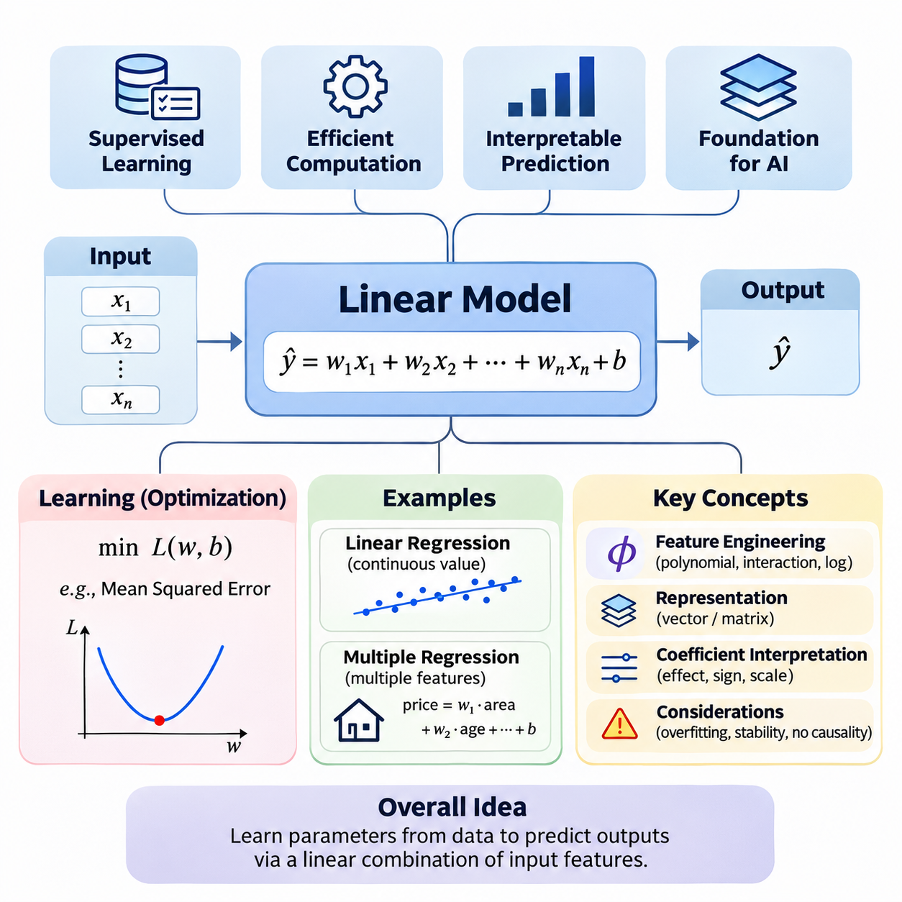
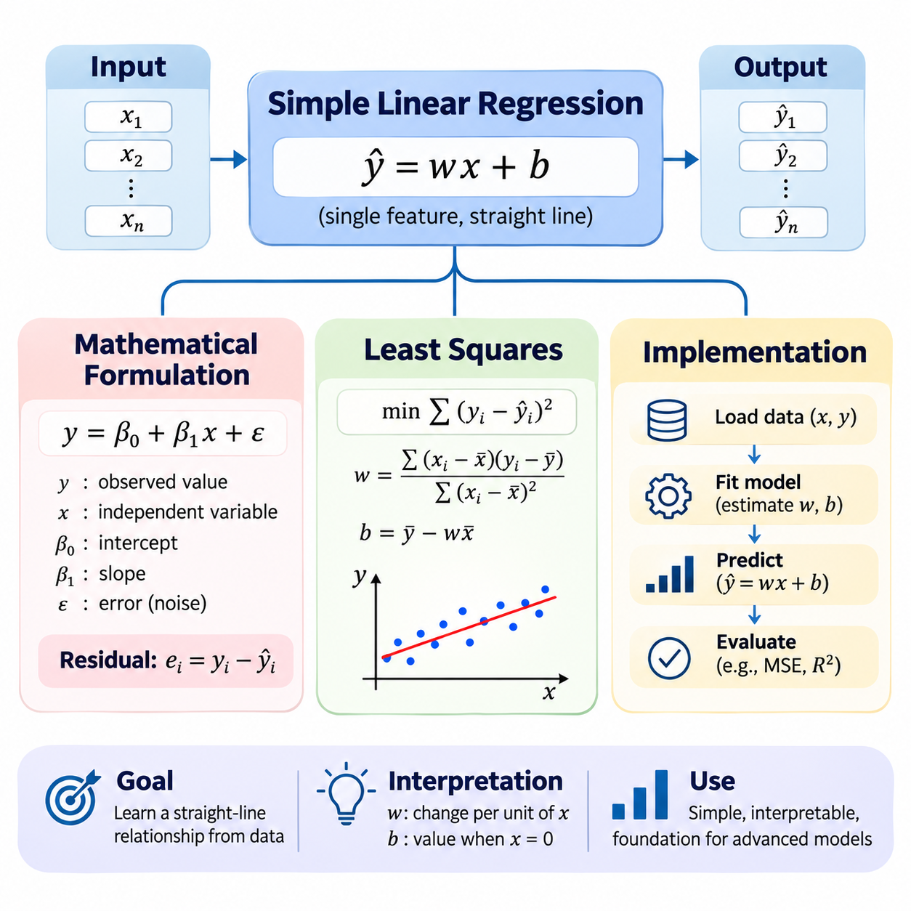
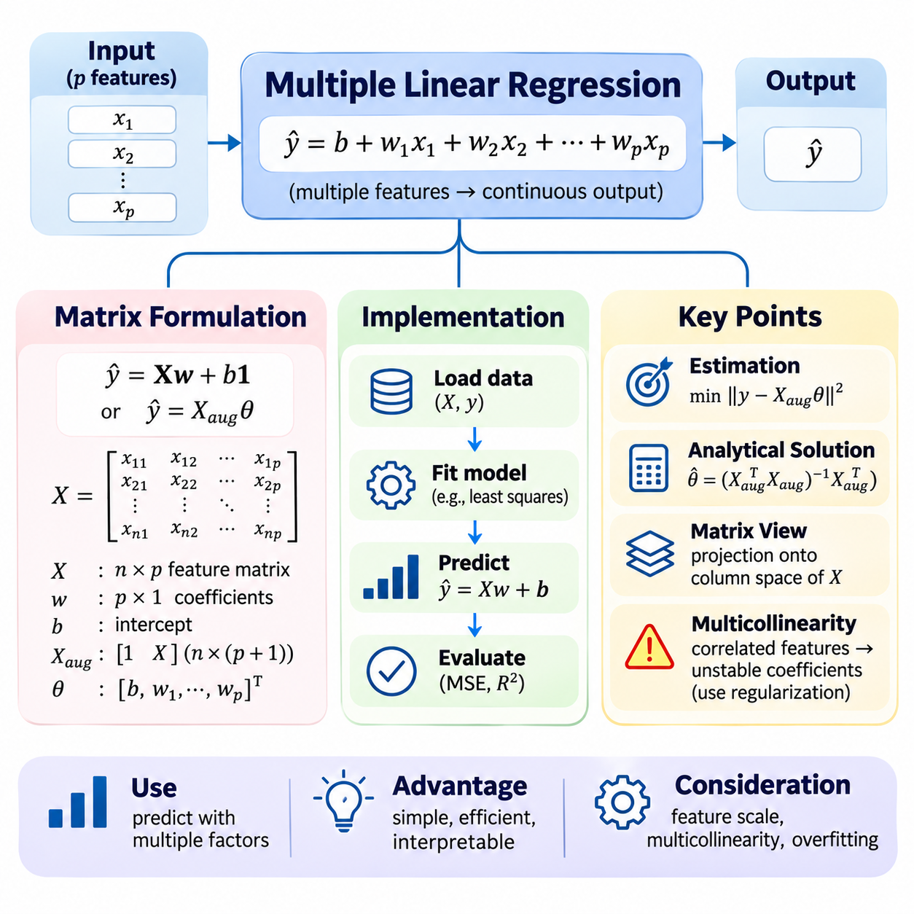
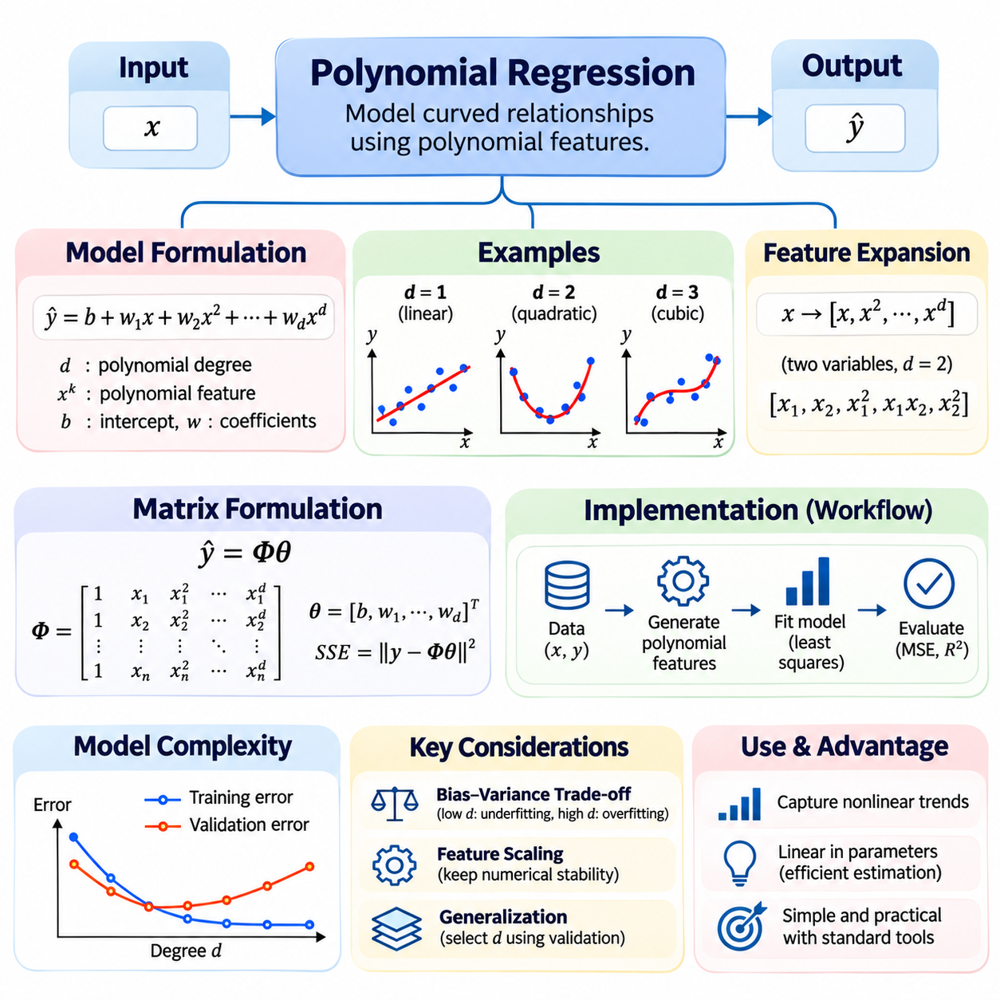
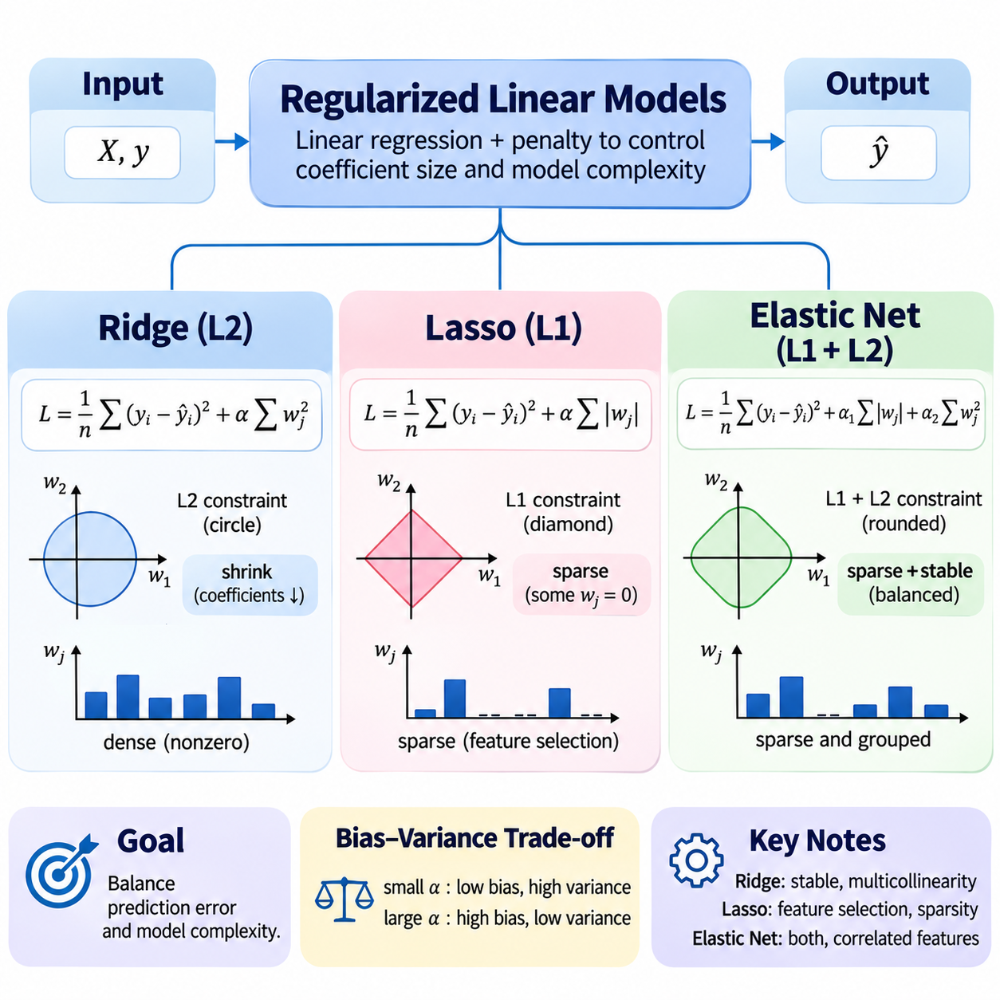
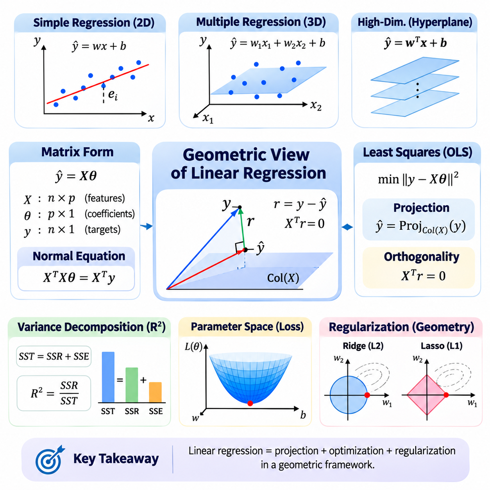
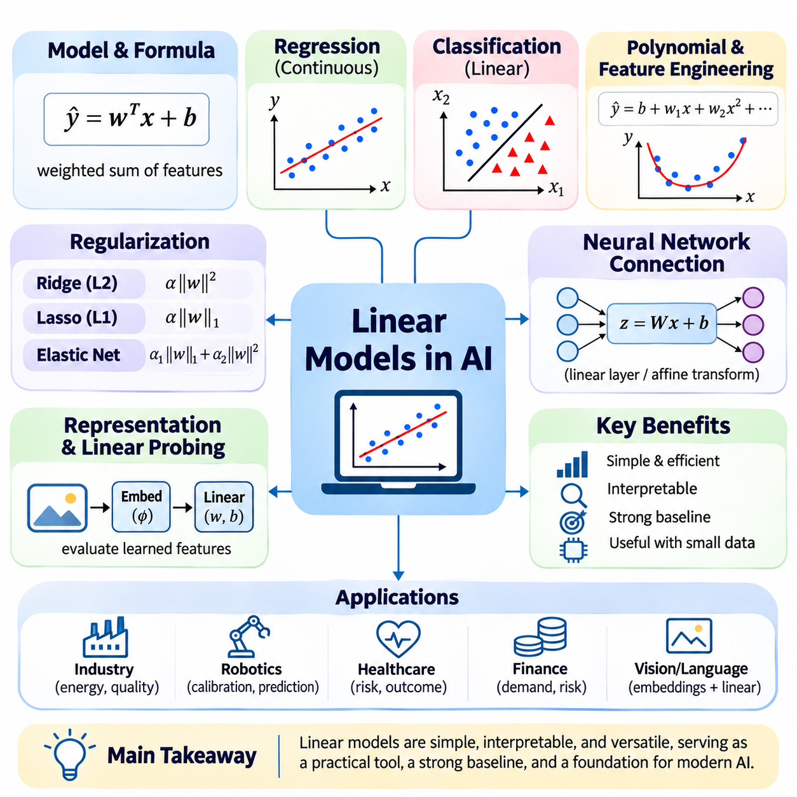

**Volume 08. Supervised Learning**

# 01. Linear Models

## 01.00 Introduction to Linear Models

{width="7.268055555555556in" height="7.268055555555556in"}

Linear models represent one of the most fundamental approaches in supervised machine learning. They describe relationships between input variables and predicted outputs through weighted combinations of numerical features. Despite their mathematical simplicity, linear models remain essential in modern artificial intelligence because they provide efficient computation, interpretable predictions, and a strong foundation for understanding more advanced learning algorithms.

The central assumption of a linear model is that the predicted output can be expressed as a linear combination of input features and learned parameters. Each feature contributes to the prediction according to an associated coefficient, while an intercept represents the baseline prediction. During training, the learning algorithm adjusts these parameters to reduce the difference between predicted values and observed targets.

A general linear prediction function can be written as y_hat = w1x1 + w2x2 + \... + wnxn + b, where x represents input features, w represents learned weights, and b denotes the intercept. The predicted value y_hat is determined by combining feature contributions. This formulation provides a compact mathematical representation that can be extended from a single input variable to datasets containing hundreds or thousands of features.

In supervised learning, linear models learn from labeled examples containing both input observations and corresponding target values. The training process identifies parameter values that best explain the observed relationships. Once trained, the model applies these parameters to previously unseen observations. Its effectiveness depends on whether the relationships learned from training data remain sufficiently consistent across new samples.

Linear regression is the most familiar example of this modeling approach. It predicts continuous numerical quantities such as temperature, energy consumption, product demand, or manufacturing cost. For example, a model may estimate electricity usage from operating hours and equipment load. The learned coefficients describe how each input contributes to the predicted consumption while other included variables remain unchanged.

The simplest linear regression model uses one explanatory variable and produces predictions along a straight line. Its slope indicates how the predicted output changes when the input increases by one unit, while its intercept specifies the predicted output when the input equals zero. Although this representation is straightforward, it introduces essential concepts of parameter estimation, prediction error, and statistical interpretation.

Multiple linear regression extends the same principle to several explanatory variables. A housing price model, for instance, may consider floor area, building age, distance from transportation, and neighborhood characteristics. Each feature receives an individual coefficient, allowing the model to combine different sources of information. This extension makes linear regression useful for many practical datasets containing multiple measurements.

The process of estimating model parameters is commonly formulated as an optimization problem. A loss function measures the disagreement between predictions and observed targets, and training seeks parameters that minimize this loss. Mean squared error is frequently used because it penalizes larger prediction errors more strongly. This objective connects linear regression with the broader mathematical framework of optimization in machine learning.

Ordinary least squares provides a classical method for estimating linear regression parameters. It minimizes the sum of squared differences between observed and predicted values. Under suitable mathematical conditions, the solution can be calculated directly through matrix operations. Alternatively, iterative optimization methods such as gradient descent can estimate parameters when direct computation is inconvenient or computationally expensive.

Linear models also provide an important introduction to vector and matrix representations. Instead of calculating each prediction separately, an entire dataset can be represented as a matrix of observations and features. Model parameters form a weight vector, and predictions are obtained through matrix multiplication. This representation supports efficient numerical computation and establishes concepts used throughout neural networks and deep learning.

An important distinction exists between linearity in input variables and linearity in model parameters. A model can include transformed inputs such as squared values, interaction terms, or logarithmic features while remaining linear in its learned coefficients. Polynomial regression demonstrates this principle by introducing nonlinear feature transformations without abandoning the underlying linear parameter structure.

Feature engineering therefore plays a significant role in determining the expressive power of linear models. Carefully selected transformations can reveal relationships that are difficult to represent using original variables alone. Interaction features can describe how two inputs jointly influence an output, while polynomial features can capture curved trends. However, additional features increase complexity and may introduce overfitting or numerical instability.

One major advantage of linear models is interpretability. Their coefficients provide a relatively transparent description of how features contribute to predictions. Positive coefficients indicate increasing predicted values as corresponding features increase, while negative coefficients indicate decreasing predictions, holding other features fixed. Nevertheless, these associations should not automatically be interpreted as causal relationships.

Coefficient interpretation also requires attention to feature scales and dependencies. A coefficient associated with distance measured in meters cannot be compared directly with one associated with temperature measured in degrees. Strong correlations among explanatory variables can make individual coefficients unstable. Standardization and careful examination of multicollinearity help improve numerical behavior and support more meaningful analysis.

Regularization addresses another important limitation by discouraging unnecessarily large or complex parameter values. Ridge regression introduces an L2 penalty that shrinks coefficients, while Lasso regression uses an L1 penalty that can set selected coefficients to zero. Elastic Net combines both approaches. These methods help control model complexity and can improve generalization when features are numerous or strongly correlated.

The geometric interpretation of linear models provides additional insight into their behavior. In a space containing input features, a linear prediction function defines a line, plane, or higher-dimensional hyperplane. Parameter estimation determines the position and orientation of this geometric structure. This perspective connects regression with linear algebra, projection, optimization, and the geometric foundations of other machine learning algorithms.

The performance of a linear model depends on assumptions about the underlying data-generating process. A simple linear relationship may be insufficient when the target depends on complex interactions or nonlinear mechanisms. Outliers can substantially influence least-squares estimates, and changing data distributions can reduce predictive reliability. These limitations motivate diagnostic analysis, robust estimation, and alternative modeling approaches.

Statistical assumptions become particularly important when linear regression is used for inference rather than prediction alone. Independent errors, appropriate functional relationships, and suitable variance assumptions influence the reliability of conventional confidence intervals and hypothesis tests. Normality of errors is useful for certain finite-sample inference procedures, but it is not generally required to calculate least-squares estimates.

Evaluating linear models requires separating training performance from generalization performance. A model may fit observed examples closely while producing inaccurate predictions on unseen data. Training, validation, and test datasets help measure this distinction. Common regression metrics include mean absolute error, mean squared error, root mean squared error, and the coefficient of determination, each emphasizing different aspects of predictive quality.

Residual analysis provides another valuable evaluation technique. Residuals represent differences between observed targets and model predictions. Examining their distribution and relationship with input variables can reveal systematic patterns, changing error variance, unusual observations, or missing nonlinear structure. Ideally, residuals should not display systematic patterns that indicate important relationships left unexplained by the model.

Linear models are especially attractive when computational resources are limited. Training and inference often require relatively modest memory and processing power compared with complex nonlinear architectures. This efficiency makes them useful for embedded systems, industrial monitoring, edge computing, and applications requiring rapid updates. Their predictable computational structure also simplifies implementation, testing, and operational maintenance.

In industrial artificial intelligence, linear models frequently serve as baseline predictors and interpretable components within larger systems. They can estimate equipment energy consumption, predict manufacturing measurements, or approximate relationships between operating conditions and sensor outputs. Even when more advanced algorithms ultimately provide higher accuracy, linear models establish a reference against which additional complexity can be justified.

Linear modeling also introduces the concept of the bias-variance tradeoff. A model with insufficient flexibility may exhibit high bias because it cannot represent important patterns. Increasing feature complexity may reduce this limitation but can increase variance and sensitivity to training data. Regularization, feature selection, and validation help balance these competing effects and support reliable predictions beyond the training dataset.

The relationship between linear models and neural networks is particularly significant. A neural network layer typically begins with a weighted linear transformation followed by an optional nonlinear activation function. Understanding weights, biases, matrix multiplication, and gradient-based optimization in linear regression therefore prepares learners for more sophisticated architectures. Linear models provide a conceptual bridge between classical statistical learning and modern deep learning.

Although linear models cannot represent every relationship directly, their simplicity remains a practical strength rather than merely a limitation. They allow researchers to establish transparent baselines, examine feature relationships, identify data problems, and evaluate whether more complex algorithms are necessary. A well-designed linear model can sometimes outperform sophisticated alternatives when data is limited, noisy, or approximately linear.

Understanding linear models establishes the foundation for subsequent topics in supervised learning. Simple and multiple linear regression introduce parameter estimation, polynomial regression expands feature representations, and regularized models address complexity and generalization. Geometric interpretation connects these methods with mathematical intuition, while practical applications demonstrate their continuing relevance in modern artificial intelligence systems.

## 01.01 Simple Linear Regression

{width="7.268055555555556in" height="7.268055555555556in"}

Simple linear regression is one of the most fundamental algorithms in supervised machine learning. It describes the relationship between a single independent variable and a continuous dependent variable using a straight-line function. By learning this relationship from observed data, the model can estimate numerical outcomes for previously unseen inputs. Its simplicity makes it an essential starting point for understanding regression, statistical estimation, and predictive modeling.

The mathematical formulation of simple linear regression begins with the equation y_hat = wx + b, where x represents the independent variable, w denotes the slope, and b represents the intercept. The predicted output y_hat changes linearly with the input. The slope determines how much the prediction changes for a one-unit increase in x, while the intercept specifies the predicted value when x equals zero.

A more complete statistical formulation includes an error term and is expressed as y = beta0 + beta1\\\*x + epsilon. Here, beta0 and beta1 represent the underlying population parameters, while epsilon captures unexplained variation, measurement noise, and other influences not represented by the input variable. The regression algorithm estimates these unknown parameters using observed training examples rather than assuming their values are already known.

The distinction between observed values and predicted values is central to regression analysis. An observed target contains the actual measured outcome, whereas a prediction represents the model\'s estimated outcome. Their difference is called a residual and can be written as e_i = y_i - y_hat_i. Residuals indicate how closely the fitted line represents individual observations and provide essential information for evaluating model quality.

The slope has a direct interpretation in the original measurement units. For example, if a regression model predicts electricity consumption from equipment operating hours, a slope of 2.5 indicates that each additional operating hour corresponds to an increase of 2.5 consumption units in the predicted value. This interpretation assumes that the fitted relationship is appropriate within the relevant operating range.

The intercept represents the predicted output when the independent variable equals zero. In some applications, this value has a meaningful physical interpretation, such as baseline energy consumption when equipment is inactive. In other situations, zero may lie outside the observed input range, making the intercept primarily a mathematical parameter. Consequently, coefficient interpretation should always consider the actual measurement context.

Simple linear regression can also be expressed geometrically. Each observation corresponds to a point in a two-dimensional coordinate system, with the independent variable on the horizontal axis and the dependent variable on the vertical axis. The fitted regression line passes through the feature space in a position determined by its slope and intercept. Training adjusts these parameters to represent the overall pattern of observations.

The most common parameter estimation approach is ordinary least squares, which identifies the line that minimizes the sum of squared residuals. Its objective function is SSE = sum((y_i - y_hat_i)\^2), where the summation covers all training observations. Squaring the residuals prevents positive and negative errors from canceling and assigns greater penalties to larger deviations from the fitted regression line.

The least-squares objective can also be expressed using mean squared error, MSE = (1/n)\\\*sum((y_i - y_hat_i)\^2). Dividing the sum of squared errors by the number of observations changes the scale of the objective but not its minimizing parameters. Mean squared error is particularly useful for comparing training performance across datasets and connecting classical regression with optimization methods used in machine learning.

For simple linear regression with an intercept, the least-squares slope has a closed-form solution. It can be written as w = sum((x_i - x_mean)\\\*(y_i - y_mean)) / sum((x_i - x_mean)\^2). This expression measures how the input and output vary together relative to the variation in the input. It requires nonzero variation in x, because identical input values cannot determine a unique slope.

After calculating the slope, the intercept is obtained from b = y_mean - w\\\*x_mean. This relationship ensures that the fitted regression line passes through the point defined by the sample means of the input and output variables. Together, these two equations provide a direct analytical solution to ordinary least squares without requiring iterative parameter updates or complex numerical optimization.

The closed-form solution reveals the connection between regression and statistical covariance. The slope equals the sample covariance between x and y divided by the sample variance of x, provided consistent normalization is used. A positive covariance produces a positive slope, while a negative covariance produces a negative slope. However, the magnitude of the slope depends on measurement units and should not be interpreted as a standardized correlation coefficient.

Least squares is attractive because its objective function is convex with respect to the slope and intercept. When the input values contain sufficient variation, the objective has a unique global minimum. This property allows reliable parameter estimation without the local-minimum difficulties associated with many nonlinear optimization problems. Nevertheless, convexity does not guarantee that the resulting model accurately represents the underlying relationship.

Gradient descent offers an alternative method for estimating regression parameters. Instead of calculating the analytical solution directly, it begins with initial values for the slope and intercept and repeatedly updates them using gradients of the loss function. For MSE, the gradients are proportional to prediction errors multiplied by input values for the slope, and to prediction errors for the intercept.

The gradient descent update rules can be written as w_new = w_old - alpha\\\*dMSE/dw and b_new = b_old - alpha\\\*dMSE/db. The learning rate alpha controls the size of each update. A very small learning rate may produce slow convergence, while an excessively large value can cause oscillation or divergence. Appropriate feature scaling and learning-rate selection improve numerical stability during iterative optimization.

Implementing simple linear regression begins with preparing a dataset containing paired input and target observations. Each sample should contain one numerical explanatory variable and its corresponding continuous target value. Before training, the dataset should be inspected for missing measurements, inconsistent units, duplicate records, and extreme observations that could distort parameter estimation or model evaluation.

The dataset is typically divided into training and test subsets before fitting the model. Training observations are used to estimate the slope and intercept, while test observations provide an independent assessment of predictive performance. When model selection or hyperparameter tuning is required, a separate validation subset can be introduced. This separation helps prevent overly optimistic estimates caused by evaluating predictions on the same observations used for training.

A basic implementation can calculate the input and target means, determine the slope using the least-squares equation, and then compute the intercept. Predictions are generated by applying the fitted equation to new input values. This manual implementation is valuable because it exposes the mathematical operations behind regression and allows learners to verify that each computational step corresponds to the theoretical formulation.

Numerical libraries such as NumPy simplify implementation through vectorized operations. Arrays can store observations, and mathematical expressions can calculate means, centered values, squared deviations, and parameter estimates without explicit element-by-element processing. Vectorization improves computational efficiency and reduces implementation complexity, particularly when datasets contain many observations.

Machine learning libraries such as scikit-learn provide standardized regression interfaces. A linear regression estimator can be fitted using training features and targets, after which its coefficient and intercept become available for inspection. The same estimator can generate predictions for test observations. Such libraries simplify practical development while preserving the underlying mathematical principles of least-squares estimation.

A correct implementation must maintain consistent input shapes and feature ordering. Many machine learning interfaces expect feature data as a two-dimensional array, even when only one explanatory variable is used. The target is commonly represented as a one-dimensional array. Incorrect dimensions can produce execution errors or unintended behavior, making data-shape verification an important part of the implementation process.

Model evaluation commonly begins with mean absolute error, mean squared error, and root mean squared error. Mean absolute error measures the average magnitude of prediction errors, while mean squared error penalizes larger deviations more strongly. Root mean squared error expresses error in the original target units. These metrics provide complementary information about prediction accuracy and sensitivity to unusually large errors.

The coefficient of determination, commonly denoted R-squared, measures predictive performance relative to a baseline that predicts the target mean. A value of one indicates perfect predictions, while a value of zero indicates performance equal to that baseline under the standard definition. Negative values are possible when predictions perform worse than the baseline, particularly on independent test datasets.

Residual analysis is essential for determining whether the fitted relationship is appropriate. Residuals should be examined for systematic curvature, changing variability, and unusually large deviations. A curved residual pattern may indicate that a nonlinear relationship is missing, while increasing residual dispersion may suggest heteroscedasticity. Such observations help determine whether simple linear regression adequately describes the available data.

Outliers can strongly influence ordinary least-squares estimates because the objective squares prediction errors. A single extreme observation may substantially change the fitted slope or intercept, especially when its input value lies far from most observations. Investigating influential samples is therefore important, although unusual observations should not be removed automatically without examining their validity and relevance.

Simple linear regression also requires careful interpretation of its assumptions. A linear conditional mean, appropriate treatment of dependent observations, and suitable error behavior are important for reliable analysis. Constant error variance is especially relevant to conventional statistical inference, while normal error assumptions support certain exact inference procedures. Prediction itself does not require every classical assumption to hold perfectly.

Extrapolation presents another practical limitation. A model trained on observations within a particular input range may produce unreliable predictions far beyond that range. Even when the fitted line accurately describes historical measurements, the underlying relationship may change under unfamiliar operating conditions. Predictions should therefore be interpreted with attention to the training distribution and the physical meaning of the variables.

Simple linear regression remains valuable because it combines mathematical transparency, computational efficiency, and practical usefulness. Its formulation introduces parameter estimation, least-squares optimization, gradient-based learning, and quantitative evaluation within a single understandable framework. These concepts extend naturally to multiple linear regression, regularized models, generalized linear models, and the optimization foundations of modern artificial intelligence.

## 01.02 Multiple Linear Regression

{width="7.268055555555556in" height="7.268055555555556in"}

Multiple linear regression extends simple linear regression by modeling the relationship between several independent variables and one continuous dependent variable. Instead of relying on a single explanatory feature, the model combines multiple measurements to estimate an outcome. This approach is widely used in supervised machine learning because many real-world predictions depend on several interacting factors rather than one isolated input.

The mathematical formulation of multiple linear regression is y_hat = b + w1\\\*x1 + w2\\\*x2 + \... + wp\\\*xp, where p represents the number of input features, w denotes the corresponding coefficients, and b represents the intercept. Each coefficient describes the change in the predicted output associated with a one-unit increase in its feature while the remaining features are held constant. This interpretation assumes that the model structure is appropriate.

For example, a manufacturing system may estimate energy consumption using operating temperature, motor speed, equipment load, and production duration. Each variable contributes information about the expected consumption. Multiple linear regression combines these contributions into a single numerical prediction, allowing engineers to examine relationships between operating conditions and system performance through a relatively transparent mathematical model.

The statistical formulation includes an error term representing influences not captured by the explanatory variables. For observation i, the model can be expressed as y_i = beta0 + beta1\\\*x_i1 + \... + betap\\\*x_ip + epsilon_i. The coefficients beta represent unknown population parameters, while epsilon_i accounts for unexplained variation. Training estimates the coefficients from observed data rather than assuming their true values are known.

Matrix notation provides a compact and computationally efficient representation of multiple linear regression. For n observations and p features, the prediction equation becomes y_hat = Xw + b\\\*1, where X is an n-by-p feature matrix, w is a p-dimensional coefficient vector, and 1 is a vector of ones. This formulation allows predictions for all observations to be calculated simultaneously using matrix multiplication.

The feature matrix X organizes observations into rows and explanatory variables into columns. Each row represents one training sample, while each column contains measurements of a particular feature across all samples. The coefficient vector w contains one learned weight for each feature. This structure makes the relationship between dataset organization, parameter dimensions, and prediction calculations explicit.

An alternative formulation incorporates the intercept directly into the matrix representation. By adding a column of ones to the feature matrix, an augmented design matrix X_aug is obtained. The parameter vector theta then contains both the intercept and feature coefficients. The prediction equation becomes y_hat = X_aug\\\*theta, providing a unified expression that simplifies analytical derivations and numerical implementation.

The dimensions of the matrix formulation must remain consistent. If X_aug contains n rows and p+1 columns, theta must contain p+1 parameters, producing an n-dimensional prediction vector. Understanding these dimensions is essential for implementing regression correctly, especially when working with numerical libraries that enforce strict array shapes and matrix multiplication rules.

Parameter estimation seeks coefficients that minimize the difference between predicted and observed outputs. Ordinary least squares defines this objective as minimizing SSE = \|\|y - X_aug\\\*theta\|\|\^2, where the squared Euclidean norm represents the sum of squared residuals. This objective penalizes larger prediction errors more strongly and provides a direct connection between regression analysis, vector geometry, and numerical optimization.

The least-squares objective is a convex quadratic function of the regression parameters. Consequently, any local minimum is also a global minimum. When the augmented design matrix has full column rank, the optimal coefficient vector is unique. If the columns are linearly dependent, multiple coefficient vectors may produce identical fitted predictions, creating difficulties for parameter interpretation.

Under the full-column-rank condition, the analytical solution can be expressed through the normal equation theta_hat = (X_aug\^T\\\*X_aug)\^(-1)\\\*X_aug\^T\\\*y. This expression follows from setting the gradient of the squared-error objective to zero. Although mathematically important, directly computing the matrix inverse is generally discouraged because it can amplify numerical errors and increase computational cost.

A more reliable implementation solves the least-squares problem using numerical linear algebra methods such as QR decomposition or singular value decomposition. These techniques avoid explicitly forming the inverse of X_aug\^T\\\*X_aug and provide better numerical behavior. The pseudoinverse can also produce a least-squares solution when the design matrix is rank-deficient, although individual coefficients may remain difficult to interpret.

The geometric interpretation of multiple linear regression views the predicted target vector as a projection onto the column space of the design matrix. Ordinary least squares selects the prediction vector closest to the observed target under Euclidean distance. At the optimum, the residual vector is orthogonal to every column of the design matrix, establishing the normal-equation condition X_aug\^T\\\*(y - y_hat) = 0.

Multicollinearity occurs when explanatory variables exhibit strong linear relationships with one another. For example, equipment power consumption and operating current may contain overlapping information. Severe multicollinearity can make coefficient estimates unstable and increase their sensitivity to small changes in training data. Although predictive accuracy may remain acceptable, interpreting individual coefficients becomes more difficult.

Feature scaling is another important consideration in multiple linear regression. Variables measured in different units may have substantially different numerical ranges. Standardization transforms features using their training-set means and standard deviations, while normalization may map values into a specified interval. Scaling is particularly beneficial for gradient-based optimization and numerical conditioning, although ordinary least-squares predictions are theoretically invariant to invertible feature rescaling.

Gradient descent provides an iterative alternative to analytical least-squares estimation. Beginning with initial parameter values, the algorithm repeatedly computes predictions, evaluates the loss, and updates the coefficients in the direction opposite to the gradient. For mean squared error, the gradient with respect to theta is (2/n)X_aug\^T(X_aug\\\*theta - y), allowing all parameter updates to be calculated efficiently through matrix operations.

The learning rate controls the magnitude of gradient descent updates and influences convergence behavior. A small learning rate may require many iterations, while an excessively large value may cause oscillation or divergence. Standardizing input features often improves optimization efficiency because it reduces differences in parameter sensitivity. Monitoring the training loss across iterations helps determine whether optimization is progressing appropriately.

Implementing multiple linear regression begins with constructing a dataset containing several numerical features and a continuous target. Data preparation includes identifying missing values, checking measurement units, examining unusual observations, and selecting relevant explanatory variables. Categorical variables may require numerical encoding before they can be included in the feature matrix. All transformations should preserve consistency between training and inference.

The dataset should be divided into training and test subsets before fitting preprocessing transformations or estimating regression coefficients. Training data determines the model parameters, while test data evaluates generalization to unseen observations. When feature selection or hyperparameter tuning is performed, a validation subset or cross-validation procedure should be used to avoid selecting models based on test-set performance.

A manual implementation can construct the design matrix, append an intercept column, and calculate coefficients using a least-squares solver. Predictions are then obtained through matrix multiplication between the design matrix and the estimated parameter vector. Comparing these results with a trusted numerical library helps verify correctness and provides practical experience with matrix dimensions, parameter estimation, and numerical precision.

NumPy supports efficient implementations through multidimensional arrays and vectorized operations. Its linear algebra functionality can solve least-squares problems without requiring explicit loops over individual observations. Functions designed for least-squares estimation are generally preferable to manually computing matrix inverses. This approach improves readability, computational reliability, and compatibility with larger datasets.

Scikit-learn provides a standardized implementation through its LinearRegression estimator. The estimator accepts a two-dimensional feature matrix and a corresponding target vector, learns the coefficients and intercept, and generates predictions for new observations. Its interface also integrates with preprocessing pipelines, cross-validation tools, and evaluation metrics, making it suitable for reproducible machine learning experiments.

Evaluation commonly uses mean absolute error, mean squared error, root mean squared error, and R-squared. These metrics describe different aspects of predictive performance. Mean absolute error summarizes average error magnitude, while squared-error metrics emphasize larger deviations. R-squared compares prediction quality with a mean-based baseline, although its interpretation depends on the evaluation dataset and prediction context.

Residual analysis helps determine whether the linear model captures the important structure of the data. Systematic residual patterns may indicate omitted variables, nonlinear relationships, or interactions that are not represented by the current feature matrix. Changing residual variance may indicate heteroscedasticity, while unusually large residuals may reveal measurement problems or observations that require further investigation.

The assumptions underlying multiple linear regression are especially important when coefficients are used for statistical inference. A correctly specified conditional mean, suitable independence or dependence assumptions, and appropriate treatment of error variance influence the validity of conventional statistical conclusions. Exogeneity is important for unbiased coefficient estimation, while multicollinearity and influential observations affect estimation stability.

Multiple linear regression offers a practical balance between computational simplicity and explanatory capability. Its matrix formulation connects statistical modeling with linear algebra, optimization, and numerical computation, while its implementation introduces essential data-processing and evaluation practices. These foundations support later study of polynomial regression, regularized linear models, generalized linear models, and more advanced supervised learning systems.

## 01.03 Polynomial Regression

{width="7.268055555555556in" height="7.268055555555556in"}

Polynomial regression extends linear regression by allowing a model to represent curved relationships between input variables and continuous outputs. Although ordinary linear regression describes predictions through a straight line or hyperplane, many real-world processes exhibit nonlinear patterns. Polynomial regression addresses this limitation by transforming original input variables into polynomial features while retaining a model that is linear in its learned coefficients.

The central idea of polynomial regression is to construct additional features from powers of the original inputs. For a single variable x, a polynomial model of degree d can be expressed as y_hat = b + w1\\\*x + w2\\\*x\^2 + \... + wd\\\*x\^d. The coefficients determine the contribution of each polynomial term, allowing the prediction function to represent curves with varying shapes and degrees of complexity.

A second-degree polynomial model, commonly called quadratic regression, includes the original input and its squared value. Its prediction equation is y_hat = b + w1\\\*x + w2\\\*x\^2. Depending on the coefficients, the resulting curve can bend upward or downward. This formulation is useful when an output initially increases and later decreases, or when its rate of change varies systematically with the input.

Third-degree polynomial regression introduces a cubic term, allowing the fitted curve to represent more complex changes in direction. Higher-degree polynomials can approximate increasingly intricate relationships, but additional flexibility also increases the risk of fitting random fluctuations. Selecting the polynomial degree therefore requires balancing the ability to capture meaningful patterns against the danger of excessive model complexity.

An important distinction is that polynomial regression remains linear in its parameters even though its predictions are nonlinear functions of the original inputs. The coefficients multiply predefined polynomial features without appearing inside nonlinear parameter transformations. Consequently, ordinary least squares, gradient descent, and other optimization techniques developed for linear regression can also estimate polynomial regression parameters.

Polynomial feature transformation provides the mechanism for constructing these models. For an original input x, a degree-three transformation may produce the feature vector [x, x\^2, x\^3]. A conventional linear regression algorithm then treats these transformed quantities as separate explanatory variables. This separation between feature construction and parameter estimation makes polynomial regression straightforward to implement using standard machine learning tools.

For datasets containing several input variables, polynomial features can include both individual powers and interaction terms. With two inputs x1 and x2, a degree-two transformation may produce x1, x2, x1\^2, x1\\\*x2, and x2\^2. The interaction term x1\\\*x2 allows the model to represent situations in which the contribution of one variable depends on the value of another variable.

The number of generated features increases rapidly as polynomial degree and input dimensionality grow. For p original variables and a maximum polynomial degree d, the number of polynomial terms including the constant term is C(p+d, d). This combinatorial growth can produce high-dimensional feature matrices, increasing memory requirements, computational cost, and the possibility of overfitting.

Polynomial regression can be represented using the same matrix formulation as multiple linear regression. After generating polynomial features, the transformed design matrix Phi contains one column for each selected term. The prediction equation becomes y_hat = Phi\\\*theta, where theta contains the corresponding coefficients. This representation demonstrates that nonlinear relationships in the original input space can be modeled through linear operations in a transformed feature space.

The least-squares objective for polynomial regression minimizes the sum of squared differences between observed and predicted outputs. It can be written as SSE = \|\|y - Phi\\\*theta\|\|\^2. Under suitable rank conditions, the parameters can be estimated analytically, while numerical least-squares solvers provide more stable practical solutions. The optimization problem remains convex with respect to the coefficient vector.

Feature scaling becomes particularly important when polynomial terms have very different numerical magnitudes. If an input variable contains large values, its squared and cubic terms may become extremely large. These differences can create poorly conditioned design matrices and unstable coefficient estimates. Standardization or other suitable scaling methods can improve numerical behavior and make iterative optimization more efficient.

Polynomial feature generation and scaling should be organized carefully within the training workflow. When preprocessing parameters are estimated from data, they must be fitted using training observations only. The same learned transformations are then applied to validation and test data. This procedure prevents data leakage and ensures that reported evaluation results reflect performance on genuinely unseen observations.

The polynomial degree acts as a model complexity parameter. A degree-one model is equivalent to ordinary linear regression, while degree-two and degree-three models introduce additional flexibility. Increasing the degree generally allows closer fitting of training observations, but lower training error does not necessarily imply better predictive performance. Validation data should determine whether the additional complexity improves generalization.

Underfitting occurs when the selected polynomial degree is too low to represent the underlying relationship. For example, a straight-line model may fail to capture a pronounced curved trend, producing systematic prediction errors. Increasing the degree can reduce this bias by introducing additional functional flexibility. However, this improvement is meaningful only when the resulting model also performs well on unseen data.

Overfitting occurs when a polynomial model becomes excessively sensitive to the training observations. High-degree polynomials may produce oscillating curves that pass close to individual samples while behaving unpredictably between them. This problem becomes more severe when datasets are small or contain substantial measurement noise. Cross-validation and complexity control help identify models that capture stable patterns rather than accidental fluctuations.

The bias-variance tradeoff provides a useful framework for understanding polynomial degree selection. Low-degree models typically have limited flexibility and may exhibit high bias, while high-degree models can have greater variance. The appropriate degree depends on the available sample size, noise level, and underlying relationship. Model selection should therefore consider predictive reliability rather than visual fit alone.

Regularization can improve polynomial regression by discouraging unnecessarily large coefficient values. Ridge regression introduces an L2 penalty that shrinks coefficients, while Lasso regression uses an L1 penalty that can eliminate selected polynomial terms. Elastic Net combines both penalties. These methods are especially useful when polynomial transformations generate many correlated features or when the available training dataset is relatively small.

The interpretation of polynomial coefficients differs from ordinary linear regression. In a polynomial model, the effect of an input variable generally depends on its current value because multiple powers contribute to the prediction. For a quadratic model, the local rate of change is dy_hat/dx = w1 + 2\\\*w2\\\*x. This derivative provides a more meaningful description of how predictions respond to changes in the input.

Polynomial regression is useful for representing physical and industrial processes with smooth nonlinear behavior. Examples include temperature-dependent sensor responses, nonlinear energy consumption, mechanical deformation, and manufacturing quality measurements. When the underlying relationship is reasonably smooth, polynomial features can provide an interpretable approximation without requiring a complex neural network or other advanced nonlinear model.

Implementation begins by preparing input observations and selecting an appropriate maximum polynomial degree. A feature transformation generates the required powers and interaction terms, after which a linear regression estimator learns their coefficients. Predictions are obtained by applying the same transformation to new inputs before evaluating the fitted model. Consistent preprocessing is essential for reliable deployment.

Scikit-learn provides PolynomialFeatures for generating polynomial terms from an input matrix. The transformed matrix can be supplied to LinearRegression or a regularized estimator such as Ridge. A pipeline can combine polynomial expansion, scaling, and regression into a single reusable workflow. This arrangement reduces preprocessing errors and supports systematic evaluation across different polynomial degrees.

A practical implementation should avoid unnecessary duplicate intercept terms. PolynomialFeatures can generate a constant feature, while many regression estimators also fit an intercept automatically. Including both may introduce redundant columns and reduce numerical clarity. Configuring the transformation and estimator consistently ensures that the design matrix represents the intended mathematical formulation.

Evaluation should include mean absolute error, mean squared error, root mean squared error, and R-squared on independent data. Residual analysis can reveal remaining nonlinear structure, systematic prediction errors, or unusual observations. Comparing training and validation performance across polynomial degrees helps identify the point at which additional flexibility stops improving generalization.

Polynomial models also require caution when extrapolating beyond the training range. High-degree terms can dominate predictions for input values far outside the observed domain, producing extreme outputs that are not physically plausible. Even a model with excellent interpolation performance may behave poorly under extrapolation. Practical applications should therefore define valid operating ranges and monitor incoming data for distribution changes.

Polynomial regression demonstrates how feature engineering can extend the expressive power of linear models without changing their fundamental optimization structure. By introducing powers and interactions, it connects linear algebra, nonlinear function approximation, regularization, and model selection. Understanding polynomial features prepares learners for more advanced basis-function methods, kernel approaches, and nonlinear supervised learning algorithms.

## 01.04 Regularized Linear Models

{width="7.268055555555556in" height="7.268055555555556in"}

Regularized linear models extend ordinary linear regression by introducing penalties that control the magnitude and complexity of learned coefficients. Although least-squares regression can fit training observations effectively, it may become unstable when features are numerous, strongly correlated, or noisy. Regularization addresses these limitations by balancing prediction accuracy against model complexity, improving generalization to previously unseen data.

The central principle of regularization is to modify the original loss function by adding a penalty associated with model parameters. Instead of minimizing prediction error alone, training minimizes a combined objective consisting of a data-fitting term and a complexity penalty. A regularization parameter, commonly denoted alpha or lambda, controls the strength of this penalty and determines how strongly coefficients are discouraged from becoming large.

Regularization is closely related to the bias-variance tradeoff in supervised learning. An unrestricted model may exhibit low training error but high variance, making predictions sensitive to small changes in the training dataset. Penalizing coefficient magnitude reduces model flexibility and can improve stability. However, excessive regularization introduces additional bias and may cause underfitting, so penalty strength must be selected carefully.

Ridge regression introduces an L2 penalty based on the sum of squared coefficient values. A common objective is L_Ridge = (1/n)\\\*sum((y_i - y_hat_i)\^2) + alpha\\\*sum(w_j\^2), where the second term penalizes large weights. The intercept is ordinarily excluded from the penalty. Ridge regression encourages coefficients to remain small while preserving contributions from features that collectively explain the target variable.

The geometric interpretation of Ridge regression involves constraining coefficient values within an L2-norm region. The corresponding constraint forms a circle in two dimensions and a sphere or hypersphere in higher dimensions. The optimal solution balances the least-squares error contours against this smooth constraint boundary. This geometry explains why Ridge generally shrinks coefficients continuously rather than forcing them exactly to zero.

Ridge regression is particularly useful when explanatory variables exhibit multicollinearity. Strongly correlated features can make ordinary least-squares coefficient estimates unstable, even when overall predictions remain reasonable. The L2 penalty reduces sensitivity to these dependencies and improves numerical conditioning. Consequently, Ridge often provides more reliable predictions when several features contain overlapping information.

In matrix notation, Ridge regression minimizes \|\|y - Xw\|\|\^2 + lambda\\\*\|\|w\|\|\\_2\^2 when the intercept is handled separately. Its analytical solution can be expressed as w_hat = (X\^T\\\*X + lambda\\\*I)\^(-1)\\\*X\^T\\\*y under the corresponding formulation. The penalty modifies the matrix system by adding a positive diagonal term, improving invertibility for positive lambda and reducing sensitivity to poorly conditioned feature matrices.

Lasso regression introduces an L1 penalty based on the sum of absolute coefficient values. Its objective can be written as L_Lasso = (1/n)\\\*sum((y_i - y_hat_i)\^2) + alpha\\\*sum(\|w_j\|). Unlike Ridge, Lasso can produce coefficients that are exactly zero. This property allows it to perform feature selection while estimating the regression model, potentially simplifying interpretation and reducing the number of active predictors.

The geometric explanation of Lasso involves an L1 constraint region with sharp corners. In two dimensions, this region forms a diamond rather than the circular shape associated with Ridge. Optimization solutions frequently occur at corners where one or more coefficients equal zero. This geometric characteristic explains the sparsity of Lasso solutions and their usefulness in applications requiring compact predictive models.

Lasso is attractive when a dataset contains many candidate features but only a relatively small subset is expected to be informative. By eliminating selected coefficients, it can produce a simpler model with lower storage and inference requirements. However, feature selection is not always stable when predictors are highly correlated. Lasso may select one correlated feature while excluding another that contains similar information.

The L1 penalty is convex but not differentiable at zero, making Lasso optimization different from ordinary least squares and Ridge regression. Coordinate descent is commonly used to estimate Lasso coefficients by updating one parameter at a time. Other approaches include proximal gradient methods, which combine gradient-based optimization with a thresholding operation that encourages exact zeros in the coefficient vector.

Elastic Net combines the L1 penalty of Lasso with the L2 penalty of Ridge. A representative objective is L_ElasticNet = (1/n)\\\*sum((y_i - y_hat_i)\^2) + alpha1\\\*sum(\|w_j\|) + alpha2\\\*sum(w_j\^2). The L1 component encourages sparsity, while the L2 component stabilizes estimates and reduces sensitivity to correlated predictors. Their combination provides a flexible compromise between feature selection and coefficient shrinkage.

Elastic Net is especially useful when datasets contain groups of correlated variables. Whereas Lasso may select only one variable from a correlated group, Elastic Net can retain several related predictors while shrinking their coefficients. This behavior is valuable when correlated measurements represent complementary aspects of the same process. Nevertheless, the selected features and their stability still depend on penalty settings and data characteristics.

The balance between L1 and L2 regularization is controlled by an additional mixing parameter. In scikit-learn, ElasticNet uses l1_ratio to specify the relative contribution of the L1 penalty, while alpha controls overall regularization strength. Values closer to one emphasize Lasso-like sparsity, whereas smaller positive values emphasize Ridge-like shrinkage. The parameterization must be considered when comparing implementations across libraries.

Feature scaling is essential for meaningful regularization because penalties operate directly on coefficient magnitudes. If input variables have different numerical scales, equivalent predictive contributions may require very different coefficient values. Without scaling, the penalty can affect features unevenly. Standardizing numerical inputs before fitting Ridge, Lasso, or Elastic Net usually produces more consistent optimization and more interpretable regularization behavior.

The intercept is generally not regularized because it represents the baseline prediction rather than the influence of a particular feature. Penalizing the intercept can introduce unnecessary bias, especially when the target has a nonzero mean. Many regression libraries handle the intercept separately, but implementation details differ. Understanding these conventions helps ensure that mathematical formulations and software behavior remain consistent.

Selecting the regularization strength is a model-selection problem rather than a parameter that should be determined from test performance. A small penalty produces behavior close to ordinary least squares, while a large penalty shrinks coefficients more aggressively. Cross-validation evaluates candidate penalty strengths across multiple training partitions, allowing practitioners to identify settings that provide reliable predictive performance on unseen observations.

A practical implementation begins by separating training and test datasets, preparing numerical features, and defining a preprocessing pipeline. Missing values should be handled consistently, categorical variables may require encoding, and numerical features should be scaled when appropriate. The regression estimator is then fitted using training data, with validation procedures used to select regularization parameters before final evaluation.

Scikit-learn provides Ridge, Lasso, and ElasticNet estimators with standardized interfaces. Each estimator accepts a feature matrix and target vector, learns the corresponding coefficients, and generates predictions for new observations. Pipeline objects can combine preprocessing and estimation, while GridSearchCV or related tools can evaluate hyperparameter combinations. This structure supports reproducible experiments and reduces preprocessing leakage.

The numerical algorithms used by regularized models depend on the penalty structure and dataset properties. Ridge can be solved using linear algebra techniques or iterative optimization methods, while Lasso and Elastic Net often use coordinate descent. Convergence tolerances, iteration limits, and feature scaling can influence numerical accuracy. Monitoring convergence warnings helps identify configurations that require additional optimization effort.

Comparing regularized models requires more than examining training error. Mean absolute error, mean squared error, root mean squared error, and R-squared should be calculated on validation or test observations. Coefficient magnitudes and the number of nonzero coefficients provide additional information about model complexity. A useful comparison considers predictive performance, interpretability, stability, and computational requirements together.

Regularization does not automatically solve every limitation of linear regression. Ridge, Lasso, and Elastic Net remain linear in their coefficients and cannot represent arbitrary nonlinear relationships without suitable feature transformations. Polynomial features and interaction terms can expand their expressive power, while regularization controls the resulting complexity. This combination is particularly valuable when feature engineering generates many candidate predictors.

Regularized linear models are useful in industrial monitoring, sensor-based prediction, energy estimation, and other applications involving numerous measurements. Ridge can stabilize models built from correlated sensor readings, Lasso can identify a compact subset of informative signals, and Elastic Net can balance these objectives. Their computational efficiency and relatively transparent structure make them practical choices for embedded and edge AI systems.

Coefficient interpretation requires caution because regularization deliberately changes parameter estimates. Shrinkage can improve prediction while introducing bias relative to unpenalized estimates. A coefficient reduced to zero by Lasso does not prove that the corresponding variable has no causal influence. Feature selection results should therefore be interpreted alongside domain knowledge, data quality, correlation structure, and model stability.

Ridge, Lasso, and Elastic Net illustrate three complementary approaches to controlling linear model complexity. Ridge emphasizes stable coefficient shrinkage, Lasso encourages sparse representations, and Elastic Net combines both behaviors. Understanding their objectives, geometric interpretations, numerical implementations, and evaluation requirements establishes a foundation for reliable supervised learning and more advanced regularization techniques.

## 01.05 Geometric Interpretation

{width="7.268055555555556in" height="7.268055555555556in"}

The geometric interpretation of linear models provides an intuitive connection between regression, linear algebra, and optimization. Instead of viewing regression only as an equation that predicts numerical values, it can be understood as finding a geometric structure that best represents observed data. This perspective explains how model parameters determine predictions, why least-squares estimation works, and how regularization changes the solution.

In simple linear regression, each observation is represented as a point in a two-dimensional coordinate system. The horizontal axis represents the independent variable, while the vertical axis represents the target value. The regression model defines a straight line described by y_hat = wx + b. The slope controls the orientation of this line, and the intercept determines where it crosses the vertical axis.

Training a simple linear regression model can therefore be interpreted as positioning a line among observed data points. Different combinations of slope and intercept produce different candidate lines. Some lines follow the overall distribution of observations closely, while others produce substantial prediction errors. The learning algorithm searches for the parameter combination that provides the best fit according to a selected objective function.

The vertical distance between an observed point and the fitted regression line represents its residual. For observation i, the residual is e_i = y_i - y_hat_i. Ordinary least squares minimizes the sum of squared vertical residuals rather than the perpendicular distances from points to the line. This distinction is important because conventional regression treats the input values as given and measures prediction errors along the output dimension.

When multiple explanatory variables are introduced, the geometric structure extends beyond a straight line. With two input features, the prediction equation y_hat = w1\\\*x1 + w2\\\*x2 + b defines a plane in three-dimensional space. With additional features, the corresponding prediction function defines a hyperplane in a higher-dimensional space. Although such structures are difficult to visualize directly, their mathematical behavior follows the same linear principles.

The coefficient vector determines the orientation of the regression hyperplane, while the intercept controls its position relative to the coordinate origin. Changing one coefficient alters the model\'s sensitivity to the corresponding feature. Changing the intercept shifts predictions uniformly without modifying their dependence on the inputs. This geometric interpretation clarifies how individual parameters influence the overall prediction surface.

A deeper geometric understanding emerges when regression is expressed in matrix form. For n observations, the target values form a vector y in an n-dimensional observation space. The design matrix X contains the input features, and the model generates predictions through y_hat = X\\\*theta when the intercept is included in X. Every possible prediction vector belongs to the column space of the design matrix.

The column space of X consists of all vectors that can be produced through linear combinations of its columns. Each column represents the values of one feature across the observations. By selecting coefficients, regression constructs a prediction vector from these feature directions. The collection of all possible prediction vectors forms a linear subspace within the larger observation space.

Ordinary least squares selects the prediction vector within this column space that is closest to the observed target vector. Closeness is measured using Euclidean distance, so the optimization minimizes \|\|y - X\\\*theta\|\|\^2. Geometrically, the fitted prediction vector is the orthogonal projection of y onto the column space of X. This projection interpretation is one of the central mathematical foundations of linear regression.

The residual vector is defined as r = y - y_hat and connects the observed target vector to its projection. At the least-squares optimum, this residual vector is orthogonal to every column of X. The orthogonality condition is expressed as X\^T\\\*r = 0. It indicates that no remaining component of the residual can be explained by moving along any direction represented by the design matrix.

The orthogonality condition leads directly to the normal equations. Substituting r = y - X\\\*theta gives X\^T\\\*(y - X\\\*theta) = 0, which becomes X\^T\\\*X\\\*theta = X\^T\\\*y. When X has full column rank, the coefficients are uniquely determined. If the columns are linearly dependent, the fitted prediction vector remains unique, but multiple coefficient vectors may represent the same projection.

The projection viewpoint also explains the relationship between fitted values and residuals. Because the fitted vector and residual vector are orthogonal, the squared length of the observed target vector can be decomposed into their squared lengths when the projection subspace is considered relative to the origin. With an intercept, centering the target values provides the familiar decomposition underlying the coefficient of determination.

The coefficient of determination, R-squared, measures how much of the centered target variation is represented by the fitted model relative to the total variation. In ordinary least squares with an intercept, the decomposition SST = SSR + SSE connects total variation, explained variation, and residual variation. This geometric relationship provides intuition for evaluating how closely the regression subspace represents observed outcomes.

Regression can also be interpreted through the geometry of its parameter space. For a model with two parameters, the horizontal axes may represent the slope and intercept, while the vertical dimension represents the loss function. The mean squared error forms a convex quadratic surface. Its contours are typically elliptical, and the minimum corresponds to the parameter combination that produces the smallest squared prediction error.

Gradient descent moves through this parameter space by repeatedly following directions opposite to the loss gradient. The gradient points toward the direction of greatest local increase in the objective function. Updating parameters in the opposite direction reduces the loss when an appropriate learning rate is used. The shape of the loss contours influences how quickly and smoothly the optimization algorithm approaches the minimum.

Feature scaling changes the geometry of the optimization problem. When input features have very different numerical ranges, the loss contours may become elongated, creating directions with substantially different curvature. Gradient descent can then move inefficiently toward the optimum. Standardization often improves conditioning by making the optimization landscape more balanced, although it does not necessarily eliminate correlations among features.

Multicollinearity has a geometric interpretation through nearly dependent columns of the design matrix. When two feature columns point in similar directions, their contributions become difficult to distinguish. Many coefficient combinations may produce nearly identical predictions, resulting in a narrow and poorly conditioned optimization landscape. This explains why ordinary least-squares coefficients can become unstable even when predictions remain relatively accurate.

Singular value decomposition provides a powerful way to examine this geometry. The design matrix can be decomposed into orthogonal directions associated with singular values that describe how strongly each direction is represented. Small singular values indicate directions in which coefficient changes have relatively little effect on predictions. Such directions amplify numerical sensitivity and help explain instability in poorly conditioned regression problems.

Regularization modifies the geometric optimization problem by introducing preferences or constraints on coefficient magnitude. Ridge regression penalizes the squared Euclidean norm of the coefficient vector, encouraging solutions closer to the origin of parameter space. The resulting objective combines prediction error with a smooth quadratic penalty, producing more stable coefficients when the original design matrix contains correlated features.

The geometric constraint associated with Ridge regression is circular in two dimensions and spherical in higher dimensions. The solution can be understood as the point where an error contour first touches the allowed coefficient region. Because the constraint boundary is smooth, coefficients are generally reduced continuously rather than eliminated exactly. This behavior makes Ridge useful when many features contribute overlapping predictive information.

Lasso regression uses an L1 penalty, producing a diamond-shaped constraint region in two dimensions. Its sharp corners frequently coincide with solutions where one or more coefficients equal zero. This geometry explains why Lasso can perform feature selection while estimating model parameters. The resulting sparse coefficient vector may simplify interpretation, although selected features can vary when explanatory variables are strongly correlated.

Elastic Net combines the L1 and L2 penalties, producing a constraint geometry that blends sparsity-inducing corners with smooth coefficient shrinkage. This combination can stabilize estimation while retaining the ability to eliminate less useful features. Its geometric behavior helps explain why Elastic Net is often effective when datasets contain numerous correlated predictors and a compact model is desirable.

Polynomial regression offers another important geometric connection. Although its prediction function may form a curve in the original input space, the model remains linear in its coefficients after polynomial feature transformation. The transformed design matrix defines a higher-dimensional feature space in which ordinary linear projection methods still apply. Thus, nonlinear prediction surfaces can emerge from linear operations on engineered features.

The geometric perspective also highlights the limitations of linear models. A line, plane, or hyperplane may not adequately represent complex relationships in the original feature space. Even when the least-squares projection is mathematically optimal within the selected model class, systematic residual patterns may reveal missing nonlinear structure. Feature transformations or alternative models may be required to represent these relationships.

Understanding geometric interpretation connects regression coefficients, projection, orthogonality, loss surfaces, and regularization within a unified mathematical framework. It explains why least-squares solutions exist, how correlated features affect stability, and why different penalties produce different coefficient structures. These ideas provide a foundation for studying support vector machines, kernel methods, dimensionality reduction, and optimization in modern machine learning.

## 01.06 Linear Models in AI

{width="7.268055555555556in" height="7.268055555555556in"}

Linear models occupy a foundational position in artificial intelligence because they provide simple, efficient, and interpretable methods for learning relationships from data. Although modern AI frequently employs complex neural networks and nonlinear architectures, linear models remain essential for prediction, explanation, and benchmarking. Their mathematical simplicity makes them valuable for understanding how data, parameters, optimization, and generalization interact.

The basic structure of a linear model represents a prediction as a weighted combination of input features. For a feature vector x and parameter vector w, the prediction can be expressed as y_hat = w\^T\\\*x + b, where b denotes the intercept. Each coefficient determines how strongly a corresponding feature contributes to the output. This formulation provides a direct connection between input measurements and predicted numerical values.

Linear regression is widely used in supervised learning tasks involving continuous targets. Examples include predicting energy consumption, estimating equipment degradation, forecasting demand, and modeling sensor measurements. Training adjusts model coefficients to minimize differences between predicted and observed values. Because the resulting model is relatively transparent, practitioners can examine how individual inputs influence predictions under the assumed model structure.

One important role of linear models in AI is establishing baseline performance. Before developing complex machine learning architectures, researchers often train a linear regression model to determine whether simple relationships already explain the available data. A strong baseline provides a reference for evaluating more sophisticated methods. If a complex model offers only marginal improvement, its additional computational and maintenance costs may not be justified.

Linear models are particularly attractive when training datasets are relatively small. Complex architectures may require substantial amounts of data to estimate numerous parameters reliably, while appropriately regularized linear models can operate effectively with fewer observations. Their restricted hypothesis space reduces the risk of fitting arbitrary patterns. However, limited flexibility can also introduce bias when important relationships are strongly nonlinear.

Feature engineering plays a central role in extending linear models beyond simple relationships. Transformations such as polynomial expansion, logarithmic scaling, interaction terms, and categorical encoding can reveal useful patterns that are not directly represented by raw inputs. Although the resulting prediction function may be nonlinear in the original variables, the model can remain linear in its learned coefficients, preserving efficient optimization.

Polynomial regression illustrates how nonlinear relationships can be represented through linear parameter estimation. By introducing squared, cubic, or interaction features, a linear estimator can approximate curved response surfaces. This approach is useful when domain knowledge suggests particular nonlinear relationships. Nevertheless, excessive feature expansion increases dimensionality and may require regularization to prevent unstable coefficient estimates and overfitting.

Regularized linear models provide practical tools for managing model complexity. Ridge regression shrinks coefficients using an L2 penalty, improving stability when features are correlated. Lasso regression introduces an L1 penalty that can eliminate selected coefficients and produce sparse models. Elastic Net combines both approaches, balancing feature selection with coefficient stability. These methods are valuable when AI systems process many overlapping measurements.

The relationship between linear models and neural networks is especially important. A fully connected neural network layer computes a weighted transformation of its inputs, commonly written as z = W\\\*x + b. This operation is fundamentally linear or affine before a nonlinear activation function is applied. Understanding linear models therefore helps explain how neural networks transform features, combine information, and learn parameterized mappings.

A neural network consisting only of affine transformations without nonlinear activation functions remains equivalent to a single affine transformation. Multiple such layers can be combined mathematically into one effective weight matrix and bias vector. Nonlinear activation functions are therefore essential for increasing representational capacity. This observation demonstrates why linear algebra and linear modeling principles remain central to deep learning architectures.

Linear models also connect naturally to representation learning. Modern AI systems frequently transform raw images, text, audio, or sensor signals into learned feature vectors called embeddings. A linear prediction layer can then operate on these representations to perform regression or classification. When embeddings contain useful information, relatively simple linear predictors may achieve strong performance without requiring extensive additional model complexity.

Linear probing is a common technique for evaluating learned representations. A pretrained feature extractor is kept fixed while a linear classifier or regressor is trained on its output embeddings. The resulting performance indicates how readily the desired information can be recovered through a linear mapping. This approach is useful for comparing representations, evaluating transfer learning, and examining the quality of pretrained models.

Although linear regression predicts continuous outputs, related linear models also support classification. Logistic regression applies a nonlinear link function to a linear combination of features to estimate class probabilities. Linear support vector machines construct separating hyperplanes using margin-based optimization. These algorithms demonstrate how different objectives and output transformations can extend the same underlying linear decision structure.

Interpretability is another major advantage of linear models. Coefficients provide a relatively direct description of associations between features and predictions, especially when inputs are measured consistently. However, coefficient interpretation requires caution when variables are correlated, transformed, or affected by confounding factors. A large coefficient does not automatically establish causal importance, and regularization can further alter estimated relationships.

Linear models can support explainable AI by providing transparent prediction mechanisms and understandable baseline explanations. In applications involving industrial operations, healthcare, finance, or public services, the ability to inspect model behavior may be important for validation and accountability. Nevertheless, transparency alone does not guarantee fairness, robustness, or correctness. Model assumptions and data quality must still be examined.

Computational efficiency makes linear models useful for resource-constrained AI systems. Prediction generally requires a dot product and an intercept addition, producing computational cost proportional to the number of features. This simplicity supports deployment on embedded processors, industrial controllers, and edge computing devices. Small memory footprints and predictable inference behavior can be advantageous when latency and energy consumption are limited.

In robotics and physical AI, linear models can estimate relationships between sensor measurements, operating conditions, and system responses. Examples include battery consumption estimation, actuator calibration, thermal compensation, and simplified motion prediction. Such models may serve as components within larger autonomous systems. However, safety-critical control applications require validation across operating conditions and careful treatment of uncertainty.

Linear models also contribute to anomaly detection and predictive maintenance. A regression model can estimate expected sensor readings under normal operating conditions, while residuals indicate differences between predicted and observed behavior. Large or persistent residuals may suggest equipment degradation, calibration problems, or unusual operating states. Reliable detection requires accounting for normal variability and avoiding simplistic interpretations of individual errors.

Online learning extends linear modeling to environments where observations arrive continuously. Algorithms such as stochastic gradient descent can update coefficients incrementally as new training samples become available. This capability supports adaptive prediction when operating conditions evolve. However, uncontrolled updates may cause instability or forgetting, so practical systems often require monitoring, validation, and safeguards against corrupted observations.

Linear models provide a useful foundation for understanding optimization algorithms. Ordinary least squares introduces convex objectives and analytical solutions, while gradient descent demonstrates iterative parameter estimation. Ridge regression connects optimization with smooth penalties, and Lasso introduces nonsmooth regularization. These examples establish concepts that reappear in neural network training, sparse learning, and large-scale machine learning.

Evaluation remains essential even when a model is mathematically simple. Training and test data should be separated, preprocessing should avoid leakage, and metrics should reflect the application objective. Residual analysis can reveal systematic errors, nonlinear patterns, or changing variance. Cross-validation supports hyperparameter selection, while testing on representative unseen data provides evidence about expected generalization performance.

Linear models are limited by their dependence on the selected feature representation. If important relationships involve complex interactions, discontinuities, or highly nonlinear behavior, a basic linear predictor may perform poorly. Feature engineering can address some limitations, but excessive manual transformation may become difficult to maintain. Decision trees, kernel methods, and neural networks provide alternatives when greater flexibility is necessary.

Model selection should consider more than predictive accuracy alone. Interpretability, computational cost, training data requirements, robustness, deployment constraints, and maintenance effort all influence whether a linear model is appropriate. In many practical AI applications, a well-designed linear model offers an effective balance between simplicity and performance. More complex methods should demonstrate meaningful benefits under realistic evaluation conditions.

Linear models connect classical statistics with modern artificial intelligence through shared principles of representation, optimization, and generalization. They provide practical prediction tools, transparent baselines, and mathematical foundations for more advanced algorithms. Understanding their capabilities and limitations enables practitioners to design reliable AI systems, evaluate sophisticated models critically, and select appropriate methods for real-world problems.
