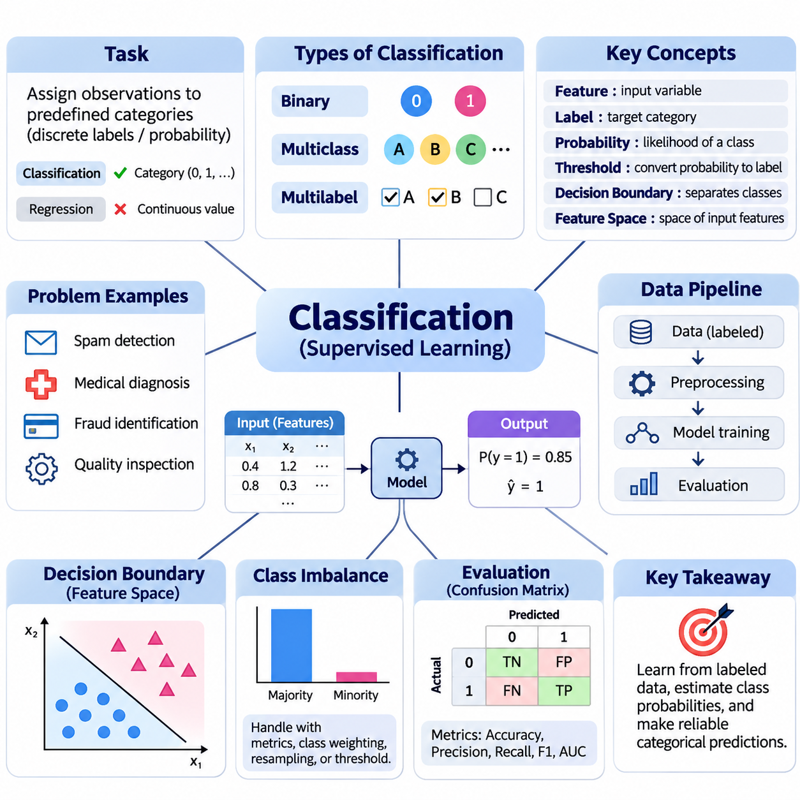
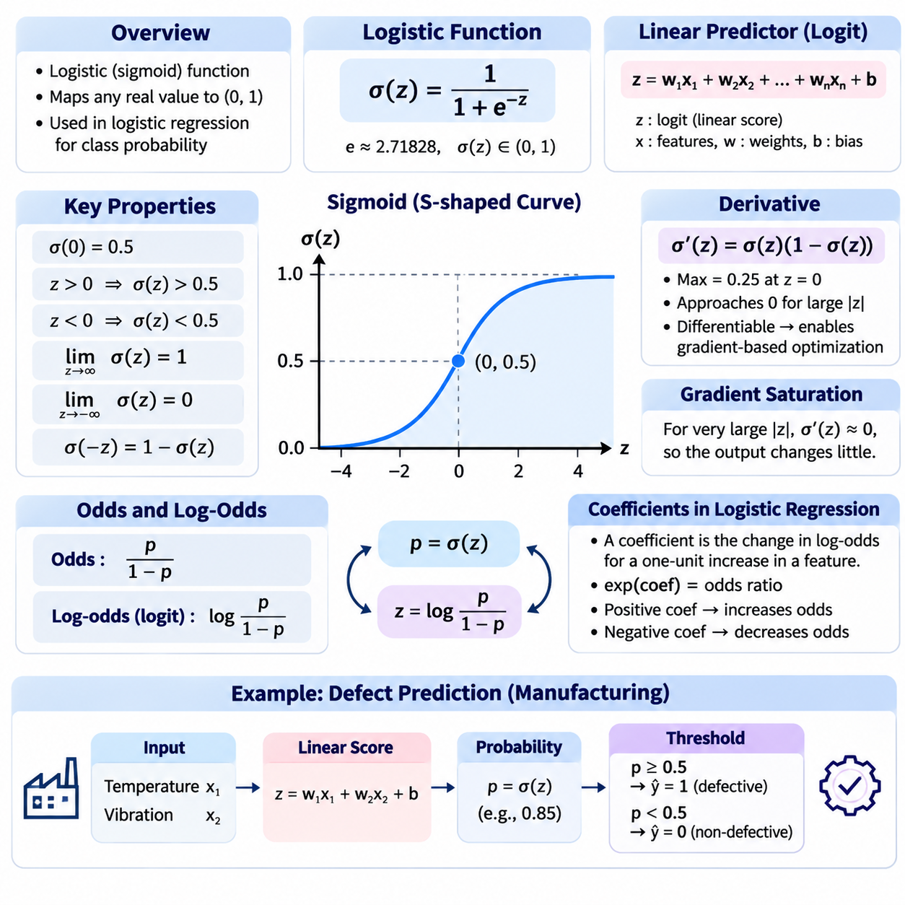
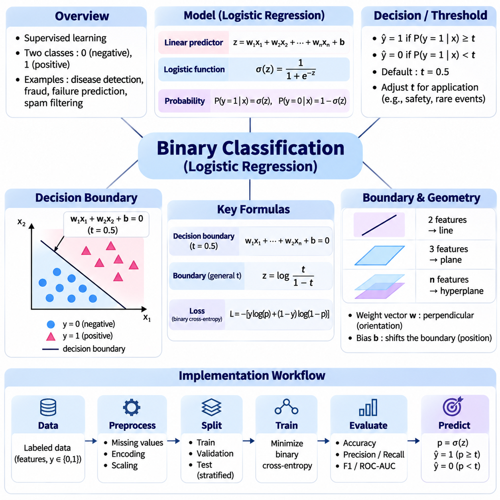
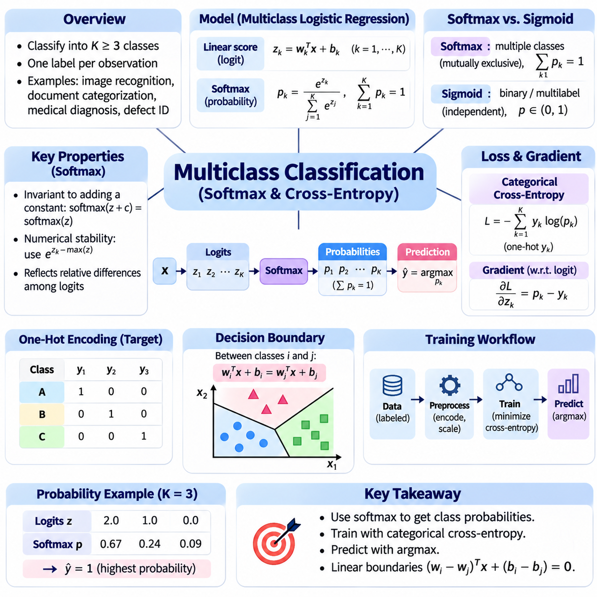
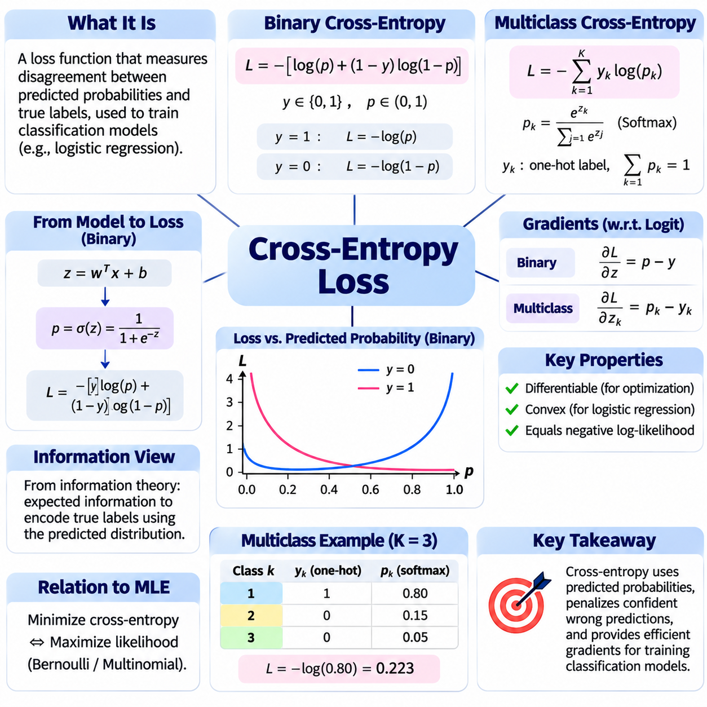
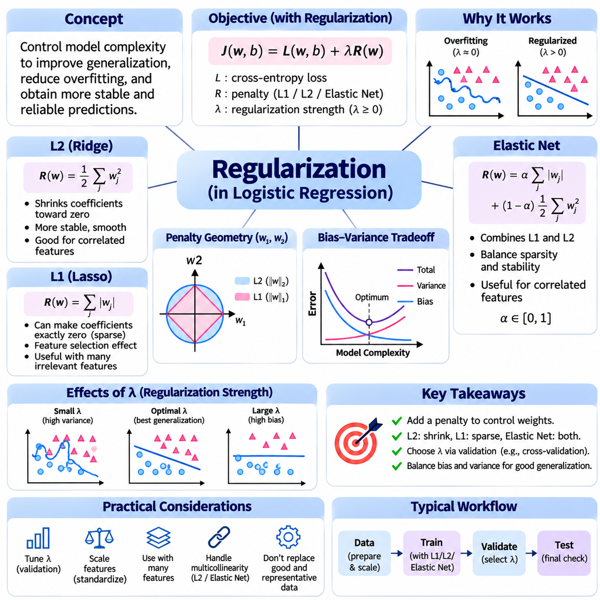
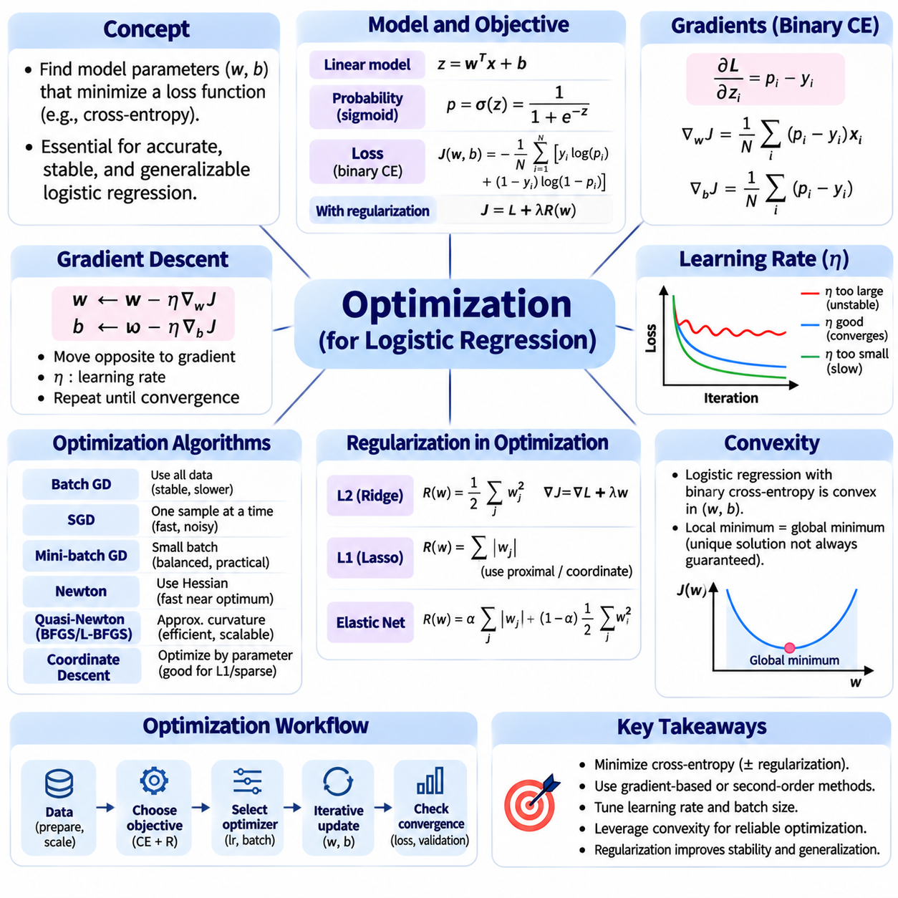
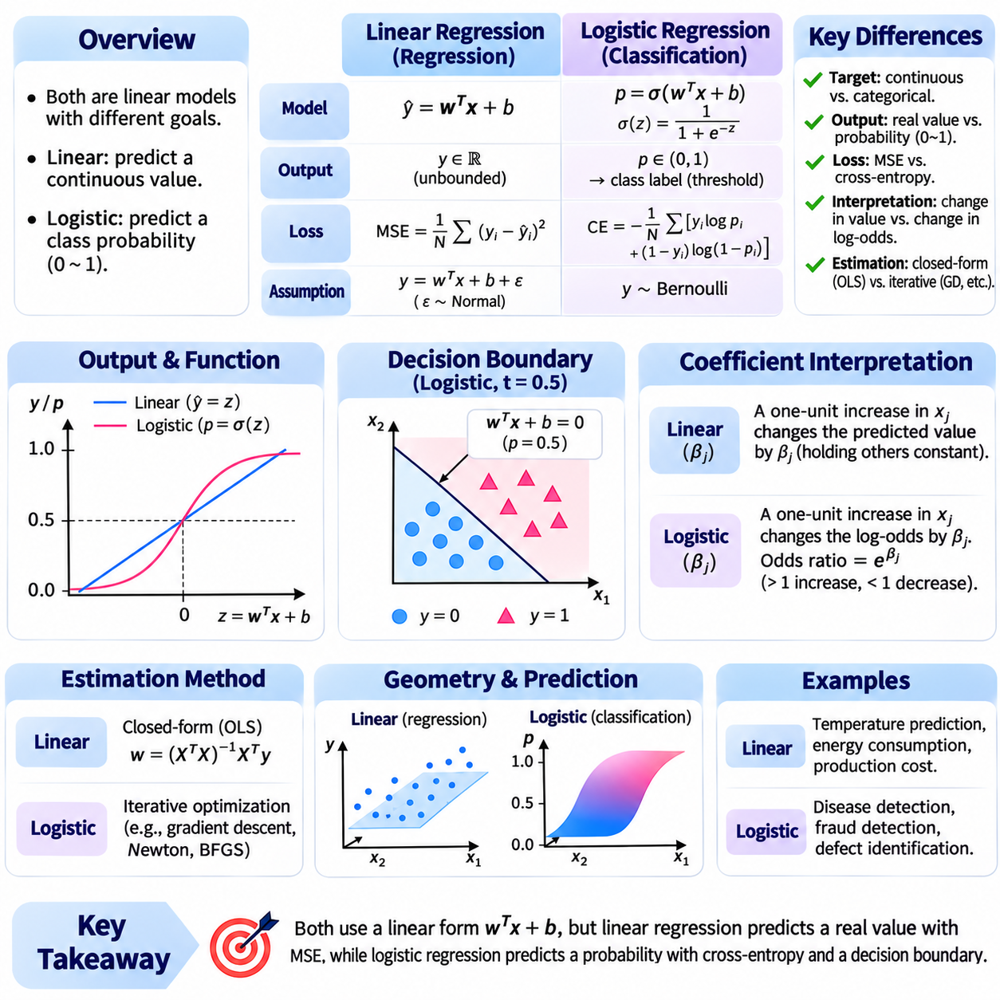
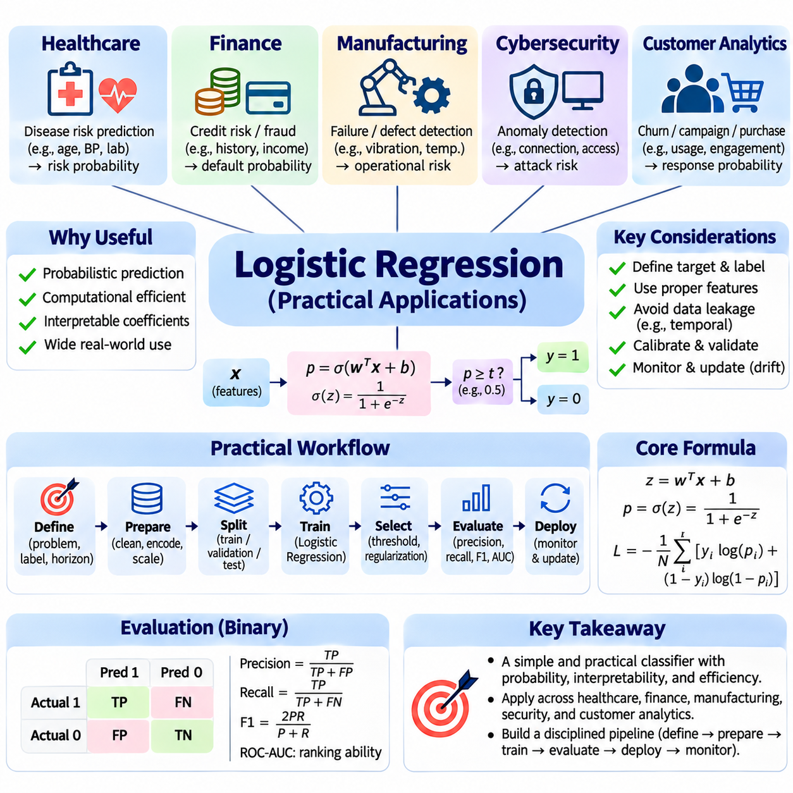

**/Volume 08. Supervised Learning**


# 02. Logistic Regression

## 02.00 Classification Basics

{width="7.268055555555556in" height="7.268055555555556in"}

Classification is a fundamental task in supervised machine learning that assigns observations to predefined categories based on their measurable characteristics. Unlike regression, which predicts continuous numerical values, classification produces discrete class labels or estimates the probability of belonging to each class. Common applications include spam detection, medical diagnosis, fraud identification, and automated quality inspection.

A classification system learns from labeled training examples, where each observation contains input features and a corresponding target category. Features describe measurable properties such as temperature, age, transaction amount, or image intensity. Labels represent the expected classification outcomes. By examining relationships between features and labels, the learning algorithm develops a predictive model that can classify previously unseen observations.

The simplest classification problem is binary classification, where each observation belongs to one of two mutually exclusive categories. Typical examples include positive versus negative, defective versus acceptable, and fraudulent versus legitimate. These categories are commonly represented using numerical labels 0 and 1. Although the labels are numerical, they indicate categorical membership rather than continuous quantities or meaningful numerical distances.

Multiclass classification extends this concept to problems containing three or more mutually exclusive categories. An image recognition system might distinguish among cats, dogs, birds, and vehicles, while an industrial inspection system might identify several types of manufacturing defects. Each observation receives one class label, although the model may estimate probabilities for every possible category before selecting its final prediction.

Multilabel classification differs from multiclass classification because an observation may belong to several categories simultaneously. For example, an image may contain a pedestrian, bicycle, and traffic signal, while a document may address several independent topics. Instead of selecting exactly one category, the model predicts the presence or absence of each label. This distinction influences model architecture, training objectives, and evaluation procedures.

Classification models generally operate by transforming input features into numerical scores that describe the evidence supporting different categories. These scores may be converted into estimated class probabilities using appropriate mathematical functions. In binary logistic regression, the sigmoid function transforms a linear combination of features into a value between zero and one, providing an interpretable estimate of positive-class probability under the model.

A class probability represents the model\'s estimated likelihood that an observation belongs to a particular category. For binary classification, a model might assign a probability of 0.85 to the positive class and 0.15 to the negative class. Such estimates provide more information than class labels alone because they express varying degrees of confidence. However, reliable interpretation requires examining whether predicted probabilities are properly calibrated.

A decision threshold converts estimated probabilities into categorical predictions. In binary classification, a threshold of 0.5 commonly assigns observations with positive-class probabilities at least 0.5 to class 1 and the remaining observations to class 0. This threshold is not universally optimal. Applications involving medical screening, financial fraud, or safety monitoring may require different thresholds depending on the consequences of incorrect predictions.

A decision boundary separates regions of the feature space assigned to different classes. In a two-dimensional problem, this boundary can be represented as a line or curve dividing observations according to their predicted categories. Linear classifiers construct boundaries from weighted combinations of input features. Their simplicity makes them computationally efficient and relatively interpretable, although complex relationships may require nonlinear transformations or more flexible models.

Feature space refers to the mathematical representation in which observations are described by their input variables. An observation containing three numerical features corresponds to a point in a three-dimensional feature space. Classification algorithms examine how observations from different categories are distributed within this space. Well-separated categories are generally easier to distinguish, while overlapping distributions create uncertainty and increase classification difficulty.

The quality of training data strongly influences classification performance. Incorrect labels, missing values, inconsistent measurements, and unrepresentative samples can prevent a model from learning reliable patterns. Data preparation therefore involves inspecting feature distributions, handling missing observations, encoding categorical variables, and applying suitable scaling procedures. These operations should be learned from training data and applied consistently to validation and test observations.

Class imbalance occurs when some categories appear substantially more frequently than others. A fraud detection dataset might contain thousands of legitimate transactions for every fraudulent transaction. A classifier that predicts the majority category almost exclusively could achieve high overall accuracy while failing to identify important minority cases. Addressing this problem requires appropriate evaluation metrics and potentially class weighting, resampling, or threshold adjustment.

Classification performance is often summarized using a confusion matrix, which compares predicted labels against actual labels. For binary classification, the matrix contains true positives, true negatives, false positives, and false negatives. These outcomes reveal different types of correct and incorrect decisions. Their relative importance depends on the application, because overlooking a dangerous condition may carry greater consequences than generating an unnecessary warning.

Accuracy measures the proportion of correctly classified observations among all evaluated observations. Although intuitive, accuracy can be misleading when classes are highly imbalanced or when different errors have unequal consequences. Precision measures the proportion of predicted positive cases that are actually positive, while recall measures the proportion of actual positive cases successfully identified. These metrics provide complementary perspectives on classification effectiveness.

The F1 score combines precision and recall through their harmonic mean, offering a useful summary when both measures are important. However, no single metric captures every operational requirement. Specificity evaluates how effectively negative cases are identified, while balanced accuracy considers performance across both classes. Selecting suitable metrics requires understanding the class distribution, application objectives, and practical costs associated with classification errors.

Receiver operating characteristic analysis examines how the true positive rate changes relative to the false positive rate across different decision thresholds. The area under the ROC curve summarizes a model\'s ability to rank positive observations above negative observations. Precision-recall curves provide another perspective and are often especially informative for rare positive classes. These analyses help compare classification models without committing immediately to one threshold.

Training a classification model involves adjusting its parameters to reduce disagreement between predictions and known labels. The learning process typically minimizes a loss function that penalizes incorrect or poorly supported predictions. For probabilistic classification, cross-entropy is widely used because it evaluates predicted probability distributions against observed class labels. Optimization algorithms iteratively update model parameters to improve performance on the training dataset.

A classification model must generalize beyond the examples used during training. Memorizing training observations without learning transferable relationships produces overfitting, while an excessively simple model may underfit important patterns. Separating data into training, validation, and test subsets helps assess generalization. The validation subset supports model selection and threshold tuning, while the independent test subset provides a final estimate of predictive performance.

Regularization improves classification robustness by discouraging unnecessarily complex models or excessively large parameter values. In linear classification, L1 regularization can encourage sparse coefficients, while L2 regularization penalizes large coefficients more smoothly. These techniques may reduce sensitivity to noise and improve generalization. Their effectiveness depends on feature characteristics, dataset size, regularization strength, and the underlying relationship between inputs and target categories.

Feature scaling can substantially influence classification algorithms that depend on distances, gradients, or regularization. Standardization transforms numerical features using their training-set means and standard deviations, while normalization may rescale values into specified ranges. Proper scaling can improve optimization behavior and prevent variables with large numerical magnitudes from dominating parameter updates. The transformation must be fitted without using information from held-out evaluation data.

Real-world classification systems must account for uncertainty, changing data distributions, and operational constraints. A model trained on historical observations may become less reliable when sensor characteristics, customer behavior, or environmental conditions change. Monitoring class distributions, prediction confidence, error rates, and calibration helps identify performance degradation. Periodic evaluation and controlled retraining are therefore important components of dependable classification deployment.

Classification also involves a distinction between statistical prediction and causal understanding. A model may accurately associate particular features with a category without identifying why the category occurs. Correlations learned from training data can reflect hidden confounders, measurement artifacts, or historical biases. Consequently, classification predictions should not automatically be interpreted as causal explanations, especially in healthcare, finance, employment, and other consequential applications.

Interpretability is particularly valuable when classification results influence important decisions. Linear models allow analysts to inspect feature coefficients and understand how input variables contribute to predicted scores. Nevertheless, coefficient interpretation depends on feature scaling, correlations among variables, and model assumptions. Transparent documentation of training data, evaluation results, decision thresholds, and known limitations supports more responsible use of classification systems.

Logistic regression provides a natural starting point for studying classification because it combines a linear prediction function with a probabilistic interpretation. Rather than predicting unrestricted numerical outputs, logistic regression transforms linear scores into probabilities suitable for categorical decisions. Understanding labels, feature spaces, class probabilities, decision boundaries, and evaluation metrics establishes the conceptual foundation for examining logistic functions, binary classification, and subsequent classification algorithms.

분류(Classification)는 측정 가능한 특성을 기반으로 관측 데이터(Observation)를 사전에 정의된 범주(Category)에 할당하는 지도학습(Supervised Learning)의 기본적인 작업이다. 연속적인 수치 값을 예측하는 회귀(Regression)와 달리, 분류는 이산적인 클래스 레이블(Class Label)을 생성하거나 각 클래스에 속할 확률(Probability)을 추정한다. 대표적인 응용 분야에는 스팸 탐지(Spam Detection), 의료 진단(Medical Diagnosis), 사기 탐지(Fraud Detection), 자동 품질 검사(Automated Quality Inspection) 등이 있다.

분류 시스템(Classification System)은 각 관측 데이터가 입력 특징(Input Feature)과 해당 목표 범주(Target Category)를 포함하는 레이블이 지정된 학습 예제(Labeled Training Example)로부터 학습한다. 특징(Feature)은 온도, 나이, 거래 금액, 이미지 밝기와 같은 측정 가능한 속성을 나타낸다. 레이블(Label)은 예상되는 분류 결과를 의미한다. 학습 알고리즘(Learning Algorithm)은 특징과 레이블 사이의 관계를 분석하여 이전에 관측하지 않은 데이터도 분류할 수 있는 예측 모델(Predictive Model)을 구축한다.

가장 단순한 분류 문제는 각 관측 데이터가 상호 배타적인 두 범주 중 하나에 속하는 이진 분류(Binary Classification)이다. 대표적인 예로는 양성(Positive)과 음성(Negative), 불량(Defective)과 정상(Acceptable), 사기(Fraudulent)와 정상 거래(Legitimate)가 있다. 이러한 범주는 일반적으로 숫자 레이블 0과 1로 표현된다. 레이블이 숫자로 표시되더라도 연속적인 수량이나 의미 있는 수치적 거리가 아니라 범주 소속 관계(Categorical Membership)를 나타낸다.

다중 클래스 분류(Multiclass Classification)는 세 개 이상의 상호 배타적인 범주를 포함하는 문제로 확장된다. 이미지 인식 시스템(Image Recognition System)은 고양이, 개, 새, 차량을 구분할 수 있으며, 산업 검사 시스템(Industrial Inspection System)은 여러 제조 결함 유형을 식별할 수 있다. 각 관측 데이터에는 하나의 클래스 레이블이 할당되지만, 모델은 최종 예측을 선택하기 전에 가능한 모든 범주에 대한 확률을 추정할 수 있다.

다중 레이블 분류(Multilabel Classification)는 하나의 관측 데이터가 여러 범주에 동시에 속할 수 있다는 점에서 다중 클래스 분류와 구별된다. 예를 들어 하나의 이미지에는 보행자, 자전거, 교통 신호등이 함께 포함될 수 있으며, 문서는 여러 독립적인 주제를 다룰 수 있다. 모델은 정확히 하나의 범주를 선택하는 대신 각 레이블의 존재 여부를 예측한다. 이러한 차이는 모델 구조(Model Architecture), 학습 목적(Training Objective), 평가 절차(Evaluation Procedure)에 영향을 미친다.

분류 모델(Classification Model)은 일반적으로 입력 특징을 서로 다른 범주를 지지하는 증거의 정도를 나타내는 수치 점수(Numerical Score)로 변환한다. 이러한 점수는 적절한 수학적 함수(Mathematical Function)를 사용하여 추정 클래스 확률(Class Probability)로 변환할 수 있다. 이진 로지스틱 회귀(Binary Logistic Regression)에서는 시그모이드 함수(Sigmoid Function)가 특징의 선형 결합(Linear Combination)을 0과 1 사이의 값으로 변환하여 모델에 따른 양성 클래스 확률의 해석 가능한 추정값을 제공한다.

클래스 확률(Class Probability)은 특정 관측 데이터가 해당 범주에 속할 가능성에 대한 모델의 추정값을 의미한다. 이진 분류 모델은 양성 클래스에 0.85, 음성 클래스에 0.15의 확률을 할당할 수 있다. 이러한 추정값은 서로 다른 신뢰 수준(Confidence Level)을 표현하므로 클래스 레이블만 사용하는 것보다 많은 정보를 제공한다. 그러나 확률을 신뢰성 있게 해석하려면 예측 확률이 적절하게 보정(Calibration)되었는지 확인해야 한다.

결정 임계값(Decision Threshold)은 추정된 확률을 범주형 예측(Categorical Prediction)으로 변환한다. 이진 분류에서는 일반적으로 0.5의 임계값을 사용하여 양성 클래스 확률이 0.5 이상인 관측 데이터를 클래스 1로, 나머지를 클래스 0으로 할당한다. 그러나 이 임계값이 항상 최적인 것은 아니다. 의료 선별 검사(Medical Screening), 금융 사기 탐지(Financial Fraud Detection), 안전 감시(Safety Monitoring)에서는 잘못된 예측의 결과에 따라 서로 다른 임계값이 필요할 수 있다.

결정 경계(Decision Boundary)는 특징 공간(Feature Space)에서 서로 다른 클래스로 할당되는 영역을 구분한다. 2차원 문제에서는 이러한 경계를 관측 데이터의 예측 범주를 나누는 직선이나 곡선으로 표현할 수 있다. 선형 분류기(Linear Classifier)는 입력 특징의 가중 결합(Weighted Combination)을 사용하여 결정 경계를 구성한다. 이러한 단순성은 계산 효율성(Computational Efficiency)과 해석 가능성(Interpretability)을 높이지만, 복잡한 관계를 표현하려면 비선형 변환(Nonlinear Transformation)이나 더욱 유연한 모델이 필요할 수 있다.

특징 공간(Feature Space)은 관측 데이터가 입력 변수(Input Variable)에 의해 표현되는 수학적 공간을 의미한다. 세 개의 수치 특징을 포함하는 관측 데이터는 3차원 특징 공간의 한 점에 해당한다. 분류 알고리즘(Classification Algorithm)은 서로 다른 범주의 관측 데이터가 이 공간에 어떻게 분포하는지 분석한다. 범주가 명확하게 분리되어 있으면 일반적으로 구분하기 쉽지만, 분포가 서로 겹치면 불확실성(Uncertainty)이 증가하고 분류 난도가 높아진다.

학습 데이터(Training Data)의 품질은 분류 성능(Classification Performance)에 큰 영향을 미친다. 잘못된 레이블, 결측값(Missing Value), 일관되지 않은 측정값, 대표성이 부족한 표본은 모델이 신뢰할 수 있는 패턴을 학습하지 못하게 할 수 있다. 따라서 데이터 준비(Data Preparation)에는 특징 분포 검사, 결측 관측값 처리, 범주형 변수 인코딩(Categorical Variable Encoding), 적절한 스케일링(Scaling)이 포함된다. 이러한 처리 규칙은 학습 데이터에서 결정하고 검증 및 테스트 데이터에 일관되게 적용해야 한다.

클래스 불균형(Class Imbalance)은 일부 범주가 다른 범주보다 훨씬 자주 나타날 때 발생한다. 사기 탐지 데이터셋(Fraud Detection Dataset)에는 사기 거래 한 건당 수천 건의 정상 거래가 포함될 수 있다. 대부분의 경우 다수 클래스(Majority Class)만 예측하는 분류기는 높은 전체 정확도(Accuracy)를 달성하면서도 중요한 소수 클래스(Minority Class)를 식별하지 못할 수 있다. 이러한 문제를 해결하려면 적절한 평가 지표(Evaluation Metric)와 클래스 가중치(Class Weighting), 재표본추출(Resampling), 임계값 조정(Threshold Adjustment) 등을 고려해야 한다.

분류 성능은 예측 레이블(Predicted Label)과 실제 레이블(Actual Label)을 비교하는 혼동 행렬(Confusion Matrix)을 통해 요약할 수 있다. 이진 분류의 혼동 행렬에는 진양성(True Positive), 진음성(True Negative), 위양성(False Positive), 위음성(False Negative)이 포함된다. 이러한 결과는 서로 다른 유형의 올바른 판단과 잘못된 판단을 보여준다. 위험한 상태를 놓치는 것이 불필요한 경고를 발생시키는 것보다 심각할 수 있으므로 각 오류의 상대적 중요성은 응용 분야에 따라 달라진다.

정확도(Accuracy)는 전체 평가 관측 데이터 중 올바르게 분류된 데이터의 비율을 측정한다. 직관적인 지표이지만 클래스가 심하게 불균형하거나 오류의 결과가 서로 다를 때 오해를 유발할 수 있다. 정밀도(Precision)는 양성으로 예측한 사례 중 실제 양성의 비율을 측정하며, 재현율(Recall)은 실제 양성 사례 중 성공적으로 식별한 비율을 측정한다. 이러한 지표는 분류 효과(Classification Effectiveness)를 서로 보완적인 관점에서 평가한다.

F1 점수(F1 Score)는 정밀도와 재현율을 조화 평균(Harmonic Mean)으로 결합하여 두 지표가 모두 중요한 상황에서 유용한 요약값을 제공한다. 그러나 하나의 지표만으로 모든 운영 요구사항(Operational Requirement)을 설명할 수는 없다. 특이도(Specificity)는 음성 사례를 얼마나 효과적으로 식별하는지 평가하며, 균형 정확도(Balanced Accuracy)는 두 클래스의 성능을 함께 고려한다. 적절한 지표를 선택하려면 클래스 분포, 응용 목적, 분류 오류와 관련된 실제 비용을 이해해야 한다.

수신자 조작 특성(Receiver Operating Characteristic, ROC) 분석은 결정 임계값이 변화함에 따라 진양성률(True Positive Rate)이 위양성률(False Positive Rate)에 대해 어떻게 변하는지 살펴본다. ROC 곡선 아래 면적(Area Under the ROC Curve, ROC-AUC)은 양성 관측 데이터에 음성 관측 데이터보다 높은 점수를 부여하는 모델의 능력을 요약한다. 정밀도-재현율 곡선(Precision-Recall Curve)은 또 다른 평가 관점을 제공하며, 특히 양성 클래스가 드문 경우 유용하다. 이러한 분석은 하나의 임계값을 즉시 확정하지 않고도 분류 모델을 비교하도록 지원한다.

분류 모델의 학습(Training)은 예측 결과와 알려진 레이블 사이의 불일치를 줄이도록 모델 매개변수(Model Parameter)를 조정하는 과정이다. 학습 과정은 일반적으로 잘못되거나 충분히 뒷받침되지 않는 예측에 벌점을 부여하는 손실 함수(Loss Function)를 최소화한다. 확률적 분류(Probabilistic Classification)에서는 교차 엔트로피(Cross-Entropy)가 예측 확률 분포와 관측된 클래스 레이블을 비교하기 때문에 널리 사용된다. 최적화 알고리즘(Optimization Algorithm)은 모델 매개변수를 반복적으로 갱신하여 학습 데이터에 대한 성능을 개선한다.

분류 모델은 학습에 사용된 예제를 넘어 일반화(Generalization)할 수 있어야 한다. 전이 가능한 관계를 학습하지 않고 학습 관측 데이터만 암기하면 과적합(Overfitting)이 발생하며, 지나치게 단순한 모델은 중요한 패턴을 충분히 학습하지 못하는 과소적합(Underfitting)을 일으킬 수 있다. 데이터를 학습(Training), 검증(Validation), 테스트(Test) 부분집합으로 분리하면 일반화 성능을 평가할 수 있다. 검증 데이터는 모델 선택과 임계값 조정에 사용하고, 독립적인 테스트 데이터는 최종 예측 성능을 추정하는 데 사용한다.

정규화(Regularization)는 불필요하게 복잡한 모델이나 지나치게 큰 매개변수 값을 억제하여 분류 모델의 강건성(Robustness)을 개선한다. 선형 분류(Linear Classification)에서 L1 정규화(L1 Regularization)는 희소 계수(Sparse Coefficient)를 유도할 수 있으며, L2 정규화(L2 Regularization)는 큰 계수에 보다 부드러운 벌점을 부여한다. 이러한 기법은 잡음(Noise)에 대한 민감도를 줄이고 일반화 성능을 개선할 수 있다. 효과는 특징의 특성, 데이터셋 크기, 정규화 강도(Regularization Strength), 입력과 목표 범주 사이의 관계에 따라 달라진다.

특징 스케일링(Feature Scaling)은 거리(Distance), 기울기(Gradient), 정규화에 의존하는 분류 알고리즘에 상당한 영향을 미칠 수 있다. 표준화(Standardization)는 학습 데이터의 평균과 표준편차를 사용하여 수치 특징을 변환하며, 정규화(Normalization)는 값을 지정된 범위로 재조정할 수 있다. 적절한 스케일링은 최적화 과정을 개선하고 수치적 크기가 큰 변수가 매개변수 갱신을 지배하는 현상을 방지한다. 변환 규칙은 평가용으로 분리한 데이터의 정보를 사용하지 않고 학습해야 한다.

실제 분류 시스템(Real-World Classification System)은 불확실성, 변화하는 데이터 분포(Data Distribution), 운영 제약(Operational Constraint)을 고려해야 한다. 과거 관측 데이터로 학습한 모델은 센서 특성, 고객 행동, 환경 조건이 변하면 신뢰성이 낮아질 수 있다. 클래스 분포, 예측 신뢰도(Prediction Confidence), 오류율(Error Rate), 확률 보정(Calibration)을 감시하면 성능 저하(Performance Degradation)를 식별하는 데 도움이 된다. 따라서 주기적인 평가와 통제된 재학습(Controlled Retraining)은 신뢰할 수 있는 분류 시스템 배포의 중요한 구성 요소이다.

분류에서는 통계적 예측(Statistical Prediction)과 인과적 이해(Causal Understanding)를 구별해야 한다. 모델은 특정 특징과 범주 사이의 관계를 정확하게 학습하더라도 해당 범주가 발생하는 원인을 식별하지 못할 수 있다. 학습 데이터에서 발견된 상관관계(Correlation)는 숨겨진 교란 변수(Confounder), 측정 인공물(Measurement Artifact), 과거의 편향(Historical Bias)을 반영할 수 있다. 따라서 특히 의료, 금융, 고용 등 중요한 의사결정에 사용되는 분류 예측을 자동으로 인과적 설명(Causal Explanation)으로 해석해서는 안 된다.

해석 가능성(Interpretability)은 분류 결과가 중요한 의사결정에 영향을 미칠 때 특히 가치가 있다. 선형 모델(Linear Model)은 분석자가 특징 계수(Feature Coefficient)를 조사하고 입력 변수가 예측 점수에 어떻게 기여하는지 이해하도록 지원한다. 그러나 계수의 해석은 특징 스케일링, 변수 사이의 상관관계, 모델 가정(Model Assumption)에 따라 달라진다. 학습 데이터, 평가 결과, 결정 임계값, 알려진 한계에 대한 투명한 문서화(Transparent Documentation)는 분류 시스템의 책임 있는 활용을 지원한다.

로지스틱 회귀(Logistic Regression)는 선형 예측 함수(Linear Prediction Function)와 확률적 해석(Probabilistic Interpretation)을 결합하므로 분류를 학습하기 위한 자연스러운 출발점이다. 로지스틱 회귀는 제한 없는 수치 출력을 예측하는 대신 선형 점수를 범주형 의사결정에 적합한 확률로 변환한다. 레이블, 특징 공간, 클래스 확률, 결정 경계, 평가 지표를 이해하는 것은 로지스틱 함수(Logistic Function), 이진 분류(Binary Classification), 이후의 분류 알고리즘을 학습하기 위한 개념적 기반을 확립한다.

## 02.01 Logistic Function

{width="7.268055555555556in" height="7.268055555555556in"}

The logistic function is a mathematical transformation that converts any real-valued input into a value between zero and one. Also known as the sigmoid function, it plays a central role in logistic regression and probabilistic binary classification. Its smooth, S-shaped behavior allows a linear model to represent class probabilities while preserving a continuous and differentiable relationship between input scores and predicted outcomes.

The standard logistic function is defined as σ(z) = 1 / (1 + e\^(-z)), where z represents a real-valued input and e denotes Euler\'s number, approximately 2.71828. The function maps the entire real number line into the open interval (0, 1). Regardless of how large or small the input becomes, its output remains strictly greater than zero and strictly less than one for every finite input value.

The input z is commonly called the logit or linear predictor in logistic regression. It is calculated as z = w₁x₁ + w₂x₂ + \... + wₙxₙ + b, where x represents input features, w represents learned weights, and b is the bias term. This linear combination summarizes the influence of multiple features before the logistic function transforms the resulting score into an estimated probability of belonging to the positive class.

The logistic function exhibits a characteristic S-shaped curve that increases monotonically from values approaching zero to values approaching one. When z equals zero, the function produces exactly 0.5. Positive inputs produce outputs greater than 0.5, while negative inputs produce outputs below 0.5. This behavior establishes a natural connection between the sign of a linear score and the predicted category in binary classification.

As z approaches positive infinity, the logistic function approaches one without reaching it. Conversely, as z approaches negative infinity, the output approaches zero. These asymptotic properties allow the function to represent increasingly strong evidence for either class. However, an output close to zero or one does not automatically guarantee a correct prediction, because the model may still be poorly calibrated or trained on unrepresentative data.

The logistic function is symmetric around its central point in the sense that σ(-z) = 1 - σ(z). This identity means that reversing the sign of the input produces the complementary probability. For example, if σ(2) is approximately 0.881, then σ(-2) is approximately 0.119. This mathematical relationship is particularly useful in binary classification, where the probabilities assigned to the two mutually exclusive classes must sum to one.

One of the most important properties of the logistic function is its differentiability. Its derivative can be expressed compactly as σ\'(z) = σ(z)(1 - σ(z)). This relationship makes gradient calculations computationally convenient because the derivative can be obtained directly from the function output. Differentiability supports gradient-based optimization methods used to estimate logistic regression parameters and train many neural network architectures.

The derivative reaches its maximum value of 0.25 when z equals zero, corresponding to an output probability of 0.5. As the input moves toward either extreme, the derivative approaches zero. Consequently, the logistic function is most sensitive to changes near its central region and becomes progressively less sensitive in saturated regions. This behavior affects numerical optimization and helps explain gradient saturation in neural networks.

Gradient saturation occurs when the logistic function receives inputs with very large positive or negative magnitudes. In these regions, changes in the input produce only small changes in the output, resulting in small derivatives. When sigmoid activations are repeatedly used in deep neural networks, these derivatives can contribute to vanishing gradients. Logistic regression avoids much of this difficulty when optimized with an appropriate cross-entropy objective.

The logistic function is closely connected to the concept of odds in probability theory. If p represents the probability of a positive outcome, the odds are defined as p / (1 - p). Odds compare the probability of an event occurring with the probability of it not occurring. Unlike probabilities, which lie between zero and one, odds range from zero toward positive infinity and provide an alternative representation of event likelihood.

The logarithm of the odds is called the log-odds or logit transformation. It is expressed as log(p / (1 - p)) and maps probabilities in the open interval (0, 1) to the entire real number line. The logistic function is the inverse of this transformation. Therefore, logistic regression models the log-odds as a linear function of input features and then converts those values into probabilities through the logistic function.

This relationship provides a useful interpretation of logistic regression coefficients. When a feature increases by one unit while other features remain constant, its coefficient represents the corresponding change in log-odds. Exponentiating that coefficient produces an odds ratio, which describes the multiplicative change in odds. A positive coefficient increases the odds of the positive class, while a negative coefficient decreases them.

For example, consider a logistic regression model that predicts whether a manufacturing component is defective based on measured temperature and vibration. The linear predictor combines these measurements using learned coefficients and a bias term. The logistic function then converts the resulting score into an estimated defect probability. A larger score produces a higher predicted probability, assuming the positive class represents defective components.

The probability output can be converted into a binary prediction by applying a decision threshold. With the conventional threshold of 0.5, predictions are assigned to the positive class when σ(z) is at least 0.5. Because the logistic function is monotonically increasing, this condition is equivalent to z being greater than or equal to zero. Consequently, the decision boundary of ordinary logistic regression is determined by the linear predictor.

Although the logistic function introduces a nonlinear transformation, standard logistic regression still produces a linear decision boundary in the original feature space. This distinction is important because nonlinear probability outputs do not necessarily imply nonlinear classification boundaries. More complex boundaries can be obtained by introducing polynomial features, interaction terms, or other nonlinear feature transformations before applying logistic regression.

The logistic function also supports probabilistic interpretation through the Bernoulli distribution. In binary classification, the target variable y takes values of zero or one, and the model estimates p = P(y = 1 \| x). The corresponding probability of observing a label can be expressed as p\^y(1 - p)\^(1 - y). This formulation connects logistic regression to maximum likelihood estimation and provides the foundation for its standard training objective.

Maximum likelihood estimation seeks model parameters that make the observed training labels as probable as possible. For logistic regression, maximizing the likelihood is equivalent to minimizing binary cross-entropy, also called log loss. This objective penalizes confident incorrect predictions more heavily than uncertain predictions. The combination of the logistic function and cross-entropy produces a well-structured optimization problem for binary classification.

An important computational property emerges when binary cross-entropy is combined with the logistic function. The derivative of the loss with respect to the linear score simplifies to p - y, where p is the predicted probability and y is the observed binary label. This simplification avoids explicitly multiplying several potentially small derivative terms and enables efficient gradient calculations during logistic regression training.

Numerical stability becomes important when evaluating the logistic function for extremely large input magnitudes. Directly computing e\^(-z) can cause overflow for sufficiently negative values of z, while outputs near zero or one may lose numerical precision. Stable implementations use conditional evaluation, specialized sigmoid functions, or mathematically equivalent formulations that reduce overflow and underflow risks.

In practical machine learning libraries, logistic regression training often uses numerically stable loss calculations that operate directly on logits rather than first computing probabilities and then taking logarithms. Functions based on log-sum-exp or softplus formulations improve stability when predictions approach extreme values. These implementation details are especially important for large datasets, repeated optimization steps, and systems operating with reduced numerical precision.

The logistic function should not be confused with the softmax function, although both convert numerical scores into probability-like outputs. Sigmoid independently maps a scalar score into a value between zero and one, making it suitable for binary classification and independent multilabel predictions. Softmax operates on a vector of scores and normalizes them into a probability distribution whose components sum to one, making it suitable for mutually exclusive multiclass classification.

In neural networks, sigmoid activation is frequently used in the output layer for binary classification because it produces a bounded scalar prediction. It may also appear in gating mechanisms that regulate information flow through network components. However, modern deep networks often prefer alternative hidden-layer activation functions because sigmoid saturation can hinder gradient propagation. Its role therefore depends on whether the objective requires probabilistic outputs or intermediate feature transformations.

Probability calibration is an important consideration when interpreting sigmoid outputs. Although the logistic function produces values between zero and one, these values are not necessarily accurate estimates of real-world event frequencies. A calibrated model assigning probability 0.8 to many observations should observe positive outcomes in approximately 80 percent of those cases. Calibration quality depends on model assumptions, training data, optimization, and deployment conditions.

The logistic function remains valuable because it combines mathematical simplicity, smooth differentiation, bounded outputs, and a direct relationship with log-odds. These properties make it a foundational component of statistical classification and modern machine learning. Understanding its equation, derivative, asymptotic behavior, probabilistic interpretation, and numerical limitations provides the mathematical basis for studying binary logistic regression and its practical implementation.

로지스틱 함수(Logistic Function)는 모든 실수 입력값(Real-Valued Input)을 0과 1 사이의 값으로 변환하는 수학적 변환 함수(Mathematical Transformation)이다. 시그모이드 함수(Sigmoid Function)라고도 하며, 로지스틱 회귀(Logistic Regression)와 확률적 이진 분류(Probabilistic Binary Classification)에서 핵심적인 역할을 수행한다. 부드러운 S자 형태의 특성을 통해 선형 모델(Linear Model)이 클래스 확률(Class Probability)을 표현하면서 입력 점수와 예측 결과 사이의 연속적이고 미분 가능한 관계를 유지하도록 한다.

표준 로지스틱 함수(Standard Logistic Function)는 σ(z) = 1 / (1 + e\^(-z))로 정의되며, 여기서 z는 실수 입력값을 나타내고 e는 약 2.71828인 오일러 수(Euler\'s Number)를 의미한다. 이 함수는 전체 실수 영역(Real Number Line)을 열린 구간(Open Interval) (0, 1)로 대응시킨다. 입력값이 아무리 크거나 작아지더라도 유한한 입력값에 대한 출력은 항상 0보다 크고 1보다 작은 값을 유지한다.

입력값 z는 로지스틱 회귀에서 일반적으로 로짓(Logit) 또는 선형 예측자(Linear Predictor)라고 부른다. 이는 z = w₁x₁ + w₂x₂ + \... + wₙxₙ + b로 계산되며, x는 입력 특징(Input Feature), w는 학습된 가중치(Learned Weight), b는 편향 항(Bias Term)을 나타낸다. 이러한 선형 결합(Linear Combination)은 여러 특징의 영향을 종합한 후 로지스틱 함수를 통해 결과 점수를 양성 클래스(Positive Class)에 속할 추정 확률로 변환한다.

로지스틱 함수는 0에 가까운 값에서 1에 가까운 값으로 단조 증가(Monotonic Increase)하는 특징적인 S자 곡선(S-Shaped Curve)을 나타낸다. z가 0이면 함수의 출력은 정확히 0.5가 된다. 양수 입력값은 0.5보다 큰 출력을 생성하고, 음수 입력값은 0.5보다 작은 출력을 생성한다. 이러한 특성은 이진 분류에서 선형 점수(Linear Score)의 부호와 예측 범주(Predicted Category) 사이에 자연스러운 관계를 형성한다.

z가 양의 무한대(Positive Infinity)에 가까워지면 로지스틱 함수의 출력은 1에 접근하지만 실제로 1에 도달하지 않는다. 반대로 z가 음의 무한대(Negative Infinity)에 가까워지면 출력은 0에 접근한다. 이러한 점근적 특성(Asymptotic Property)은 어느 한 클래스에 대한 증거가 점점 강해지는 상황을 표현할 수 있도록 한다. 그러나 출력이 0이나 1에 가깝다고 해서 예측이 반드시 정확한 것은 아니며, 모델의 확률 보정(Calibration)이 부정확하거나 학습 데이터의 대표성이 부족할 수 있다.

로지스틱 함수는 중심점을 기준으로 σ(-z) = 1 - σ(z)라는 대칭성(Symmetry)을 가진다. 이 항등식(Identity)은 입력값의 부호를 반대로 바꾸면 상보 확률(Complementary Probability)이 생성된다는 의미이다. 예를 들어 σ(2)가 약 0.881이면 σ(-2)는 약 0.119가 된다. 이러한 수학적 관계는 상호 배타적인 두 클래스에 할당된 확률의 합이 1이 되어야 하는 이진 분류에서 특히 유용하다.

로지스틱 함수의 가장 중요한 특성 중 하나는 미분 가능성(Differentiability)이다. 도함수(Derivative)는 σ\'(z) = σ(z)(1 - σ(z))라는 간결한 형태로 표현할 수 있다. 이러한 관계는 함수의 출력값만으로 도함수를 직접 계산할 수 있으므로 기울기 계산(Gradient Calculation)을 효율적으로 만든다. 미분 가능성은 로지스틱 회귀의 매개변수를 추정하고 다양한 신경망 구조(Neural Network Architecture)를 학습시키는 기울기 기반 최적화(Gradient-Based Optimization)를 지원한다.

도함수는 z가 0일 때 최대값 0.25에 도달하며, 이때 출력 확률은 0.5이다. 입력값이 양쪽 극단으로 이동하면 도함수는 0에 가까워진다. 따라서 로지스틱 함수는 중심 영역(Central Region) 근처의 변화에 가장 민감하며, 포화 영역(Saturated Region)에서는 점차 민감도가 낮아진다. 이러한 특성은 수치 최적화(Numerical Optimization)에 영향을 미치며 신경망에서 발생하는 기울기 포화(Gradient Saturation) 현상을 설명하는 데 도움이 된다.

기울기 포화(Gradient Saturation)는 로지스틱 함수가 절댓값이 매우 큰 양수 또는 음수 입력을 받을 때 발생한다. 이러한 영역에서는 입력값이 변하더라도 출력 변화가 작아 도함수 값이 작아진다. 심층 신경망(Deep Neural Network)에서 시그모이드 활성화 함수(Sigmoid Activation Function)를 반복적으로 사용하면 이러한 작은 도함수가 기울기 소실(Vanishing Gradient)에 기여할 수 있다. 로지스틱 회귀는 적절한 교차 엔트로피 목적 함수(Cross-Entropy Objective)를 사용하여 최적화할 경우 이러한 어려움의 상당 부분을 피할 수 있다.

로지스틱 함수는 확률 이론(Probability Theory)의 승산(Odds) 개념과 밀접하게 연결되어 있다. p가 양성 결과의 확률을 나타낸다면 승산은 p / (1 - p)로 정의된다. 승산은 사건이 발생할 확률과 발생하지 않을 확률을 비교한다. 확률이 0과 1 사이의 값을 가지는 것과 달리 승산은 0에서 양의 무한대 방향으로 확장되며, 사건 발생 가능성(Event Likelihood)을 표현하는 또 다른 방법을 제공한다.

승산의 로그(Logarithm of Odds)는 로그 승산(Log-Odds) 또는 로짓 변환(Logit Transformation)이라고 하며, log(p / (1 - p))로 표현된다. 이 변환은 열린 구간 (0, 1)의 확률을 전체 실수 영역으로 대응시킨다. 로지스틱 함수는 이러한 변환의 역함수(Inverse Function)이다. 따라서 로지스틱 회귀는 로그 승산을 입력 특징의 선형 함수로 모델링한 후 로지스틱 함수를 통해 해당 값을 확률로 변환한다.

이러한 관계는 로지스틱 회귀 계수(Logistic Regression Coefficient)를 해석하는 유용한 방법을 제공한다. 다른 특징을 일정하게 유지한 상태에서 특정 특징이 한 단위 증가하면 해당 계수는 로그 승산의 변화량을 나타낸다. 이 계수에 지수 함수(Exponential Function)를 적용하면 승산비(Odds Ratio)가 생성되며, 이는 승산의 배수 변화를 설명한다. 양의 계수는 양성 클래스의 승산을 증가시키고, 음의 계수는 승산을 감소시킨다.

예를 들어 제조 부품(Manufacturing Component)의 불량 여부를 온도와 진동 측정값으로 예측하는 로지스틱 회귀 모델을 생각할 수 있다. 선형 예측자(Linear Predictor)는 학습된 계수와 편향 항을 사용하여 이러한 측정값을 결합한다. 이후 로지스틱 함수는 결과 점수를 추정 불량 확률(Estimated Defect Probability)로 변환한다. 양성 클래스가 불량 부품을 나타낸다고 가정하면 점수가 높을수록 예측 불량 확률도 높아진다.

확률 출력(Probability Output)은 결정 임계값(Decision Threshold)을 적용하여 이진 예측(Binary Prediction)으로 변환할 수 있다. 일반적인 임계값 0.5를 사용하면 σ(z)가 0.5 이상일 때 양성 클래스로 분류한다. 로지스틱 함수는 단조 증가 함수(Monotonically Increasing Function)이므로 이 조건은 z가 0 이상인 조건과 동일하다. 따라서 일반적인 로지스틱 회귀의 결정 경계(Decision Boundary)는 선형 예측자에 의해 결정된다.

로지스틱 함수가 비선형 변환(Nonlinear Transformation)을 도입하더라도 표준 로지스틱 회귀(Standard Logistic Regression)는 원래의 특징 공간(Feature Space)에서 선형 결정 경계(Linear Decision Boundary)를 생성한다. 이러한 구분은 비선형 확률 출력이 반드시 비선형 분류 경계를 의미하지 않는다는 점에서 중요하다. 다항식 특징(Polynomial Feature), 상호작용 항(Interaction Term), 기타 비선형 특징 변환(Nonlinear Feature Transformation)을 도입하면 더욱 복잡한 결정 경계를 구성할 수 있다.

로지스틱 함수는 베르누이 분포(Bernoulli Distribution)를 통해 확률적 해석(Probabilistic Interpretation)도 지원한다. 이진 분류에서 목표 변수(Target Variable) y는 0 또는 1의 값을 가지며, 모델은 p = P(y = 1 \| x)를 추정한다. 해당 레이블이 관측될 확률은 p\^y(1 - p)\^(1 - y)로 표현할 수 있다. 이러한 공식은 로지스틱 회귀를 최대우도추정(Maximum Likelihood Estimation)과 연결하며 표준 학습 목적 함수의 기반을 제공한다.

최대우도추정(Maximum Likelihood Estimation)은 관측된 학습 레이블이 나타날 확률을 최대화하는 모델 매개변수를 찾는 방법이다. 로지스틱 회귀에서 우도(Likelihood)를 최대화하는 것은 로그 손실(Log Loss)이라고도 하는 이진 교차 엔트로피(Binary Cross-Entropy)를 최소화하는 것과 동일하다. 이 목적 함수는 불확실한 예측보다 높은 확신을 가지고 잘못 예측한 경우에 더 큰 벌점을 부여한다. 로지스틱 함수와 교차 엔트로피의 결합은 이진 분류를 위한 체계적인 최적화 문제를 구성한다.

이진 교차 엔트로피와 로지스틱 함수를 결합하면 중요한 계산적 특성(Computational Property)이 나타난다. 선형 점수에 대한 손실 함수의 도함수는 p - y로 단순화되며, 여기서 p는 예측 확률이고 y는 관측된 이진 레이블이다. 이러한 단순화는 잠재적으로 작은 여러 도함수 항을 명시적으로 곱하는 과정을 피하게 해주며, 로지스틱 회귀 학습 중 효율적인 기울기 계산을 가능하게 한다.

수치 안정성(Numerical Stability)은 입력값의 절댓값이 매우 클 때 로지스틱 함수를 계산하는 과정에서 중요해진다. e\^(-z)를 직접 계산하면 z가 충분히 큰 음수일 때 오버플로(Overflow)가 발생할 수 있으며, 출력이 0이나 1에 가까워지면 수치 정밀도(Numerical Precision)가 저하될 수 있다. 안정적인 구현(Stable Implementation)은 조건부 계산(Conditional Evaluation), 특수 시그모이드 함수(Specialized Sigmoid Function), 수학적으로 동등한 변형식을 사용하여 오버플로와 언더플로(Underflow)의 위험을 줄인다.

실제 머신러닝 라이브러리(Machine Learning Library)에서는 확률을 먼저 계산한 후 로그를 취하는 대신 로짓(Logit)을 직접 사용하는 수치적으로 안정적인 손실 계산(Numerically Stable Loss Calculation)을 사용하는 경우가 많다. 로그합지수(Log-Sum-Exp) 또는 소프트플러스(Softplus) 공식에 기반한 함수는 예측값이 극단적인 값에 접근할 때 안정성을 개선한다. 이러한 구현 세부 사항은 대규모 데이터셋, 반복적인 최적화 단계, 낮은 수치 정밀도(Reduced Numerical Precision)로 동작하는 시스템에서 특히 중요하다.

로지스틱 함수는 소프트맥스 함수(Softmax Function)와 혼동해서는 안 되지만, 두 함수 모두 수치 점수를 확률 형태의 출력으로 변환한다. 시그모이드 함수는 개별 스칼라 점수(Scalar Score)를 0과 1 사이의 값으로 변환하므로 이진 분류와 독립적인 다중 레이블 예측(Multilabel Prediction)에 적합하다. 반면 소프트맥스는 점수 벡터(Score Vector)를 입력받아 모든 구성 요소의 합이 1이 되는 확률 분포(Probability Distribution)로 정규화하므로 상호 배타적인 다중 클래스 분류(Multiclass Classification)에 적합하다.

신경망(Neural Network)에서 시그모이드 활성화 함수(Sigmoid Activation)는 제한된 범위의 스칼라 예측값을 생성하므로 이진 분류의 출력 계층(Output Layer)에서 자주 사용된다. 또한 네트워크 구성 요소 사이의 정보 흐름을 조절하는 게이팅 메커니즘(Gating Mechanism)에도 사용될 수 있다. 그러나 현대 심층 신경망에서는 시그모이드 포화(Sigmoid Saturation)가 기울기 전파(Gradient Propagation)를 방해할 수 있으므로 은닉 계층(Hidden Layer)에 다른 활성화 함수를 사용하는 경우가 많다. 따라서 시그모이드의 역할은 확률 출력이 필요한지 또는 중간 특징 변환이 필요한지에 따라 달라진다.

확률 보정(Probability Calibration)은 시그모이드 출력을 해석할 때 중요한 고려 사항이다. 로지스틱 함수가 0과 1 사이의 값을 생성하더라도 이러한 값이 반드시 실제 사건 발생 빈도(Real-World Event Frequency)를 정확하게 추정하는 것은 아니다. 적절하게 보정된 모델이 여러 관측 데이터에 0.8의 확률을 할당했다면 해당 사례 중 약 80%에서 양성 결과가 관측되어야 한다. 보정 품질(Calibration Quality)은 모델 가정, 학습 데이터, 최적화 과정, 배포 환경(Deployment Condition)에 따라 달라진다.

로지스틱 함수는 수학적 단순성(Mathematical Simplicity), 부드러운 미분 가능성(Smooth Differentiability), 제한된 출력 범위(Bounded Output), 로그 승산과의 직접적인 관계를 결합하기 때문에 중요한 가치를 가진다. 이러한 특성은 로지스틱 함수를 통계적 분류(Statistical Classification)와 현대 머신러닝(Modern Machine Learning)의 핵심 구성 요소로 만든다. 함수의 수식, 도함수, 점근적 특성, 확률적 해석, 수치적 한계를 이해하는 것은 이진 로지스틱 회귀(Binary Logistic Regression)와 실제 구현(Practical Implementation)을 학습하기 위한 수학적 기반을 제공한다.

## 02.02 Binary Classification

{width="7.268055555555556in" height="7.268055555555556in"}

Binary classification is a fundamental supervised learning task in which each observation is assigned to one of two mutually exclusive categories. These categories are typically represented by labels 0 and 1, corresponding to negative and positive outcomes. Applications include disease detection, fraud identification, equipment failure prediction, and spam filtering, where the objective is to distinguish between two possible states using observed features.

Logistic regression provides a probabilistic framework for binary classification by modeling the relationship between input features and the likelihood of a positive outcome. Unlike linear regression, which produces unrestricted numerical predictions, logistic regression transforms a linear score into a probability between zero and one. This transformation makes the model suitable for categorical decisions while retaining a relatively simple and interpretable mathematical structure.

The binary classification model begins with a linear predictor expressed as z = w₁x₁ + w₂x₂ + \... + wₙxₙ + b. Here, x represents input features, w denotes learned coefficients, and b is the intercept or bias term. Each coefficient determines how its corresponding feature contributes to the linear score. The model combines these contributions before converting the resulting value into a probability through the logistic function.

The logistic function is defined as σ(z) = 1 / (1 + e\^(-z)), producing an output strictly between zero and one for every finite input. In binary classification, this output represents the estimated conditional probability P(y = 1 \| x). The complementary probability P(y = 0 \| x) equals 1 - σ(z). Together, these probabilities describe the model\'s estimated distribution over the two possible class labels.

A decision threshold converts predicted probabilities into discrete class assignments. The conventional threshold of 0.5 assigns an observation to class 1 when its predicted positive-class probability is at least 0.5 and to class 0 otherwise. However, the threshold can be adjusted to reflect operational requirements. Applications involving safety-critical failures or rare events may prioritize detecting positive cases over minimizing false alarms.

The decision boundary is the geometric surface separating regions assigned to different classes. For logistic regression using a threshold of 0.5, the boundary occurs where the linear predictor equals zero. In mathematical terms, this condition is w₁x₁ + w₂x₂ + \... + wₙxₙ + b = 0. The boundary therefore depends directly on the learned feature coefficients and intercept, which determine how the feature space is partitioned.

In a two-dimensional feature space, the decision boundary of ordinary logistic regression is a straight line. With three input features, it becomes a plane, while higher-dimensional feature spaces produce hyperplanes. Observations on opposite sides of the boundary receive different predicted labels. Their distance from the boundary influences the magnitude of the linear score, although it should not automatically be interpreted as a calibrated measure of prediction confidence.

The orientation of the decision boundary is determined by the model\'s weight vector, which is perpendicular to the separating hyperplane. The intercept controls its position relative to the origin. Changing the coefficients rotates or reshapes the orientation of the boundary, while changing the intercept shifts its location. These geometric relationships provide an intuitive explanation of how logistic regression separates observations using learned linear combinations of features.

When a decision threshold differs from 0.5, the classification boundary also changes. For a threshold t between zero and one, the boundary satisfies z = log(t / (1 - t)). Increasing the threshold generally makes positive predictions less frequent, while decreasing it makes positive predictions more frequent. The underlying probability model remains unchanged, but the classification policy changes according to the selected operating point.

Linear decision boundaries work well when categories can be separated approximately through weighted combinations of input features. However, real-world datasets may contain nonlinear relationships, overlapping distributions, and complex interactions. Logistic regression can accommodate some nonlinear patterns through engineered features such as polynomial terms or interactions. These transformations create nonlinear boundaries in the original feature space while preserving linearity in the transformed representation.

Implementing binary logistic regression begins with preparing a labeled dataset containing numerical or encoded input features and binary targets. The dataset should be examined for missing values, inconsistent measurements, duplicated observations, and class imbalance. Features may require standardization to improve optimization behavior. Categorical variables must be encoded appropriately, and preprocessing procedures should be established using only the training data.

The dataset is typically divided into training, validation, and test subsets. Training data determines model parameters, validation data supports hyperparameter selection and threshold adjustment, and test data provides an independent estimate of final performance. Stratified splitting can help preserve class proportions across subsets. When observations are temporally dependent or grouped by subject, splitting must respect those relationships to prevent data leakage.

Model training estimates coefficients and the intercept by minimizing a suitable objective function. Binary cross-entropy is commonly used because it measures disagreement between predicted probabilities and observed labels. For a single observation, the loss is L = -[y log(p) + (1 - y) log(1 - p)], where y is the binary target and p is the predicted positive-class probability. Minimizing this loss encourages accurate probabilistic predictions.

Gradient-based optimization updates model parameters according to the derivatives of the loss function. For logistic regression, the gradient with respect to the weight vector is proportional to (p - y)x, while the intercept gradient is proportional to p - y. Across a dataset, these contributions are aggregated according to the selected objective. Gradient descent and its variants iteratively adjust parameters until a stopping criterion is satisfied.

Practical implementations frequently use established machine learning libraries rather than manually constructing every optimization step. In Python, scikit-learn provides a LogisticRegression estimator that supports model fitting, probability prediction, regularization, and coefficient inspection. A typical workflow creates a preprocessing pipeline, fits the classifier to training observations, generates validation probabilities, and evaluates predictions using appropriate classification metrics.

Regularization is commonly included during logistic regression training to control coefficient magnitude and reduce overfitting. L2 regularization penalizes large weights smoothly, while L1 regularization can encourage sparse coefficients and implicit feature selection. The regularization strength is selected using validation data or cross-validation. Appropriate regularization is especially valuable when features are correlated, noisy, or numerous relative to the available observations.

After training, the model generates probabilities for previously unseen observations. These probabilities are converted into predicted labels using the selected decision threshold. Predictions should be evaluated against known labels rather than judged solely by apparent confidence. A confusion matrix summarizes true positives, true negatives, false positives, and false negatives, revealing how the classifier performs across both categories and where important errors occur.

Accuracy measures the overall proportion of correct predictions, but it may conceal poor performance on minority classes. Precision evaluates the reliability of positive predictions, while recall measures the ability to identify actual positive cases. Specificity measures the ability to recognize negative cases, and the F1 score combines precision and recall. Metric selection should reflect the consequences of different classification errors rather than relying exclusively on accuracy.

Receiver operating characteristic curves examine the tradeoff between true positive rate and false positive rate across multiple thresholds. The ROC-AUC summarizes ranking performance independently of a single classification threshold. Precision-recall curves are often particularly informative when positive cases are rare. These evaluations help determine whether the classifier is suitable for deployment and whether its decision threshold should be adjusted.

Probability calibration provides another important evaluation perspective. A well-calibrated classifier should produce probability estimates consistent with observed outcome frequencies. For example, among observations assigned probabilities near 0.8, approximately 80 percent should belong to the positive class. Calibration curves and probabilistic scoring rules can reveal whether the model systematically overestimates or underestimates event likelihoods.

Class imbalance requires special attention during implementation because a classifier may favor the majority category. Techniques such as class weighting, carefully controlled resampling, and threshold optimization can improve minority-class detection. However, these methods may alter precision, recall, or probability calibration. Their effects should be evaluated on validation data that reflects the intended deployment distribution.

Numerical stability is important when computing logistic probabilities and cross-entropy losses. Extremely large positive or negative logits can cause overflow, underflow, or loss of numerical precision in naive implementations. Stable algorithms operate directly on logits and use carefully formulated mathematical expressions. Established machine learning libraries generally provide these safeguards, reducing implementation errors during training and inference.

An industrial binary classification example involves predicting whether a machine component will fail within a specified operating period. Input features might include vibration amplitude, motor temperature, operating hours, and electrical current. Historical maintenance records provide binary failure labels. Logistic regression estimates failure probabilities, while the decision threshold determines when the monitoring system should generate a maintenance warning.

The resulting model can be deployed as part of a larger prediction pipeline that receives sensor measurements, applies the same preprocessing transformations used during training, and calculates failure probabilities. Operational monitoring should track prediction distributions, classification errors, data drift, and changing class frequencies. Periodic validation helps determine whether retraining or threshold adjustment is necessary as equipment conditions evolve.

Binary logistic regression combines probabilistic prediction with a geometrically interpretable decision boundary and a practical implementation workflow. Its effectiveness depends on representative training data, appropriate preprocessing, reliable optimization, meaningful evaluation metrics, and carefully selected decision thresholds. Understanding these principles establishes a foundation for multiclass classification, regularized models, and more advanced supervised learning systems.

이진 분류(Binary Classification)는 각 관측 데이터(Observation)를 상호 배타적인 두 범주 중 하나에 할당하는 기본적인 지도학습(Supervised Learning) 작업이다. 이러한 범주는 일반적으로 음성(Negative)과 양성(Positive) 결과에 해당하는 레이블(Label) 0과 1로 표현된다. 대표적인 응용 분야에는 질병 탐지(Disease Detection), 사기 식별(Fraud Identification), 장비 고장 예측(Equipment Failure Prediction), 스팸 필터링(Spam Filtering) 등이 있으며, 관측된 특징(Feature)을 사용하여 두 가지 가능한 상태를 구별하는 것이 목적이다.

로지스틱 회귀(Logistic Regression)는 입력 특징(Input Feature)과 양성 결과가 발생할 가능성 사이의 관계를 모델링하여 이진 분류를 위한 확률적 프레임워크(Probabilistic Framework)를 제공한다. 제한 없는 수치 예측값을 생성하는 선형 회귀(Linear Regression)와 달리, 로지스틱 회귀는 선형 점수(Linear Score)를 0과 1 사이의 확률로 변환한다. 이러한 변환은 비교적 단순하고 해석 가능한 수학적 구조(Mathematical Structure)를 유지하면서 모델을 범주형 의사결정(Categorical Decision)에 적합하게 만든다.

이진 분류 모델은 z = w₁x₁ + w₂x₂ + \... + wₙxₙ + b로 표현되는 선형 예측자(Linear Predictor)에서 시작한다. 여기서 x는 입력 특징, w는 학습된 계수(Learned Coefficient), b는 절편(Intercept) 또는 편향 항(Bias Term)을 나타낸다. 각 계수는 해당 특징이 선형 점수에 얼마나 기여하는지를 결정한다. 모델은 이러한 기여도를 결합한 후 로지스틱 함수(Logistic Function)를 통해 결과값을 확률로 변환한다.

로지스틱 함수는 σ(z) = 1 / (1 + e\^(-z))로 정의되며, 모든 유한한 입력값에 대해 0과 1 사이의 출력을 생성한다. 이진 분류에서 이러한 출력은 추정 조건부 확률(Estimated Conditional Probability) P(y = 1 \| x)를 나타낸다. 상보 확률(Complementary Probability) P(y = 0 \| x)는 1 - σ(z)와 같다. 두 확률은 가능한 두 클래스 레이블에 대한 모델의 추정 확률 분포(Estimated Probability Distribution)를 함께 설명한다.

결정 임계값(Decision Threshold)은 예측 확률(Predicted Probability)을 이산적인 클래스 할당(Discrete Class Assignment)으로 변환한다. 일반적인 임계값 0.5는 예측된 양성 클래스 확률이 0.5 이상인 관측 데이터를 클래스 1로, 그렇지 않은 경우 클래스 0으로 할당한다. 그러나 운영 요구사항(Operational Requirement)에 따라 임계값을 조정할 수 있다. 안전 필수 고장(Safety-Critical Failure)이나 희귀 사건(Rare Event)을 다루는 응용 분야에서는 오경보(False Alarm)를 최소화하는 것보다 양성 사례를 탐지하는 것이 더 중요할 수 있다.

결정 경계(Decision Boundary)는 서로 다른 클래스로 할당되는 영역을 구분하는 기하학적 표면(Geometric Surface)이다. 임계값 0.5를 사용하는 로지스틱 회귀에서 결정 경계는 선형 예측자가 0이 되는 위치에 형성된다. 수학적으로 이 조건은 w₁x₁ + w₂x₂ + \... + wₙxₙ + b = 0으로 표현된다. 따라서 결정 경계는 학습된 특징 계수(Feature Coefficient)와 절편에 직접적으로 의존하며, 이들은 특징 공간(Feature Space)이 어떻게 분할되는지를 결정한다.

2차원 특징 공간(Two-Dimensional Feature Space)에서 일반적인 로지스틱 회귀의 결정 경계는 직선(Straight Line)이다. 입력 특징이 세 개이면 평면(Plane)이 되고, 더 높은 차원의 특징 공간에서는 초평면(Hyperplane)이 형성된다. 결정 경계의 서로 반대쪽에 위치한 관측 데이터는 서로 다른 예측 레이블을 받는다. 경계로부터의 거리는 선형 점수의 크기에 영향을 미치지만, 이를 자동으로 보정된 예측 신뢰도(Calibrated Prediction Confidence)로 해석해서는 안 된다.

결정 경계의 방향(Orientation)은 분리 초평면(Separating Hyperplane)에 수직인 모델의 가중치 벡터(Weight Vector)에 의해 결정된다. 절편은 원점(Origin)에 대한 경계의 위치를 제어한다. 계수를 변경하면 결정 경계의 방향이 회전하거나 달라지며, 절편을 변경하면 경계의 위치가 이동한다. 이러한 기하학적 관계(Geometric Relationship)는 로지스틱 회귀가 학습된 특징의 선형 결합을 사용하여 관측 데이터를 분리하는 방식을 직관적으로 설명한다.

결정 임계값이 0.5와 다르면 분류 경계(Classification Boundary)도 변경된다. 0과 1 사이의 임계값 t에 대해 결정 경계는 z = log(t / (1 - t))를 만족한다. 임계값을 높이면 일반적으로 양성 예측(Positive Prediction)의 빈도가 감소하고, 임계값을 낮추면 양성 예측의 빈도가 증가한다. 기본적인 확률 모델(Probability Model)은 변경되지 않지만, 선택된 운영 지점(Operating Point)에 따라 분류 정책(Classification Policy)이 달라진다.

선형 결정 경계(Linear Decision Boundary)는 입력 특징의 가중 결합을 통해 범주를 대략적으로 분리할 수 있을 때 효과적으로 작동한다. 그러나 실제 데이터셋(Real-World Dataset)에는 비선형 관계(Nonlinear Relationship), 중첩된 분포(Overlapping Distribution), 복잡한 상호작용(Complex Interaction)이 존재할 수 있다. 로지스틱 회귀는 다항식 항(Polynomial Term)이나 상호작용 항(Interaction Term)과 같은 특징 공학(Feature Engineering)을 통해 일부 비선형 패턴을 처리할 수 있다. 이러한 변환은 변환된 표현(Transformed Representation)에서 선형성을 유지하면서 원래 특징 공간에서는 비선형 경계를 생성한다.

이진 로지스틱 회귀(Binary Logistic Regression)의 구현(Implementation)은 수치형 또는 인코딩된 입력 특징과 이진 목표값(Binary Target)을 포함하는 레이블이 지정된 데이터셋(Labeled Dataset)을 준비하는 과정에서 시작한다. 데이터셋에서 결측값(Missing Value), 일관되지 않은 측정값, 중복 관측 데이터(Duplicated Observation), 클래스 불균형(Class Imbalance)을 검사해야 한다. 특징은 최적화 동작(Optimization Behavior)을 개선하기 위해 표준화(Standardization)가 필요할 수 있다. 범주형 변수(Categorical Variable)는 적절하게 인코딩해야 하며, 전처리(Preprocessing) 절차는 학습 데이터만 사용하여 설정해야 한다.

데이터셋은 일반적으로 학습(Training), 검증(Validation), 테스트(Test) 부분집합으로 분할한다. 학습 데이터는 모델 매개변수(Model Parameter)를 결정하고, 검증 데이터는 하이퍼파라미터 선택(Hyperparameter Selection)과 임계값 조정을 지원하며, 테스트 데이터는 최종 성능에 대한 독립적인 추정값을 제공한다. 계층화 분할(Stratified Splitting)은 각 부분집합에서 클래스 비율을 유지하는 데 도움이 된다. 관측 데이터가 시간적으로 의존하거나 특정 대상별로 그룹화되어 있다면 데이터 누출(Data Leakage)을 방지하도록 이러한 관계를 고려하여 분할해야 한다.

모델 학습(Model Training)은 적절한 목적 함수(Objective Function)를 최소화하여 계수와 절편을 추정한다. 이진 교차 엔트로피(Binary Cross-Entropy)는 예측 확률과 관측된 레이블 사이의 불일치를 측정하므로 일반적으로 사용된다. 단일 관측 데이터의 손실(Loss)은 L = -[y log(p) + (1 - y) log(1 - p)]로 표현되며, 여기서 y는 이진 목표값이고 p는 예측된 양성 클래스 확률이다. 이러한 손실을 최소화하면 모델이 정확한 확률적 예측(Probabilistic Prediction)을 수행하도록 유도할 수 있다.

기울기 기반 최적화(Gradient-Based Optimization)는 손실 함수의 도함수(Derivative)에 따라 모델 매개변수를 갱신한다. 로지스틱 회귀에서 가중치 벡터(Weight Vector)에 대한 기울기(Gradient)는 (p - y)x에 비례하며, 절편에 대한 기울기는 p - y에 비례한다. 전체 데이터셋에서는 선택된 목적 함수에 따라 이러한 기여도를 집계한다. 경사하강법(Gradient Descent)과 그 변형 알고리즘은 종료 기준(Stopping Criterion)이 충족될 때까지 매개변수를 반복적으로 조정한다.

실제 구현에서는 모든 최적화 단계를 직접 작성하기보다 검증된 머신러닝 라이브러리(Machine Learning Library)를 사용하는 경우가 많다. 파이썬(Python)의 사이킷런(scikit-learn)은 모델 학습(Model Fitting), 확률 예측(Probability Prediction), 정규화(Regularization), 계수 검사(Coefficient Inspection)를 지원하는 LogisticRegression 추정기(Estimator)를 제공한다. 일반적인 작업 흐름(Workflow)은 전처리 파이프라인(Preprocessing Pipeline)을 생성하고, 학습 데이터로 분류기를 학습한 다음, 검증 확률을 생성하고 적절한 분류 평가 지표(Classification Metric)로 예측 결과를 평가하는 과정으로 구성된다.

정규화(Regularization)는 계수의 크기를 제어하고 과적합(Overfitting)을 줄이기 위해 로지스틱 회귀 학습에 일반적으로 포함된다. L2 정규화(L2 Regularization)는 큰 가중치에 부드러운 벌점(Penalty)을 부여하며, L1 정규화(L1 Regularization)는 희소 계수(Sparse Coefficient)와 암묵적인 특징 선택(Implicit Feature Selection)을 유도할 수 있다. 정규화 강도(Regularization Strength)는 검증 데이터 또는 교차 검증(Cross-Validation)을 사용하여 선택한다. 적절한 정규화는 특징 사이의 상관관계가 높거나 잡음이 많거나 사용 가능한 관측 데이터에 비해 특징 수가 많을 때 특히 유용하다.

학습이 완료되면 모델은 이전에 관측하지 않은 데이터에 대한 확률을 생성한다. 이러한 확률은 선택된 결정 임계값을 사용하여 예측 레이블(Predicted Label)로 변환된다. 예측 결과는 겉으로 나타나는 신뢰도만으로 판단하지 않고 알려진 실제 레이블과 비교하여 평가해야 한다. 혼동 행렬(Confusion Matrix)은 진양성(True Positive), 진음성(True Negative), 위양성(False Positive), 위음성(False Negative)을 요약하여 분류기가 두 범주에서 어떻게 작동하는지와 중요한 오류가 어디에서 발생하는지를 보여준다.

정확도(Accuracy)는 전체 예측 중 올바른 예측의 비율을 측정하지만, 소수 클래스(Minority Class)에 대한 낮은 성능을 숨길 수 있다. 정밀도(Precision)는 양성 예측의 신뢰성을 평가하고, 재현율(Recall)은 실제 양성 사례를 식별하는 능력을 측정한다. 특이도(Specificity)는 음성 사례를 인식하는 능력을 측정하며, F1 점수(F1 Score)는 정밀도와 재현율을 결합한다. 평가 지표의 선택은 정확도에만 의존하기보다 서로 다른 분류 오류의 결과를 반영해야 한다.

수신자 조작 특성 곡선(Receiver Operating Characteristic Curve, ROC Curve)은 여러 임계값에서 진양성률(True Positive Rate)과 위양성률(False Positive Rate) 사이의 절충 관계(Tradeoff)를 분석한다. ROC 곡선 아래 면적(Area Under the ROC Curve, ROC-AUC)은 하나의 분류 임계값과 독립적으로 순위화 성능(Ranking Performance)을 요약한다. 정밀도-재현율 곡선(Precision-Recall Curve)은 양성 사례가 드문 경우 특히 유용하다. 이러한 평가는 분류기가 실제 배포(Deployment)에 적합한지와 결정 임계값을 조정해야 하는지를 판단하는 데 도움이 된다.

확률 보정(Probability Calibration)은 또 다른 중요한 평가 관점을 제공한다. 적절하게 보정된 분류기(Well-Calibrated Classifier)는 관측된 결과의 빈도와 일치하는 확률 추정값을 생성해야 한다. 예를 들어 약 0.8의 확률을 부여받은 관측 데이터 중 약 80%는 양성 클래스에 속해야 한다. 보정 곡선(Calibration Curve)과 확률적 점수 규칙(Probabilistic Scoring Rule)은 모델이 사건 발생 가능성(Event Likelihood)을 체계적으로 과대평가하거나 과소평가하는지 확인하는 데 사용할 수 있다.

클래스 불균형(Class Imbalance)은 분류기가 다수 클래스(Majority Class)를 선호할 수 있으므로 구현 과정에서 특별한 주의가 필요하다. 클래스 가중치(Class Weighting), 신중하게 통제된 재표본추출(Resampling), 임계값 최적화(Threshold Optimization)와 같은 기법은 소수 클래스 탐지(Minority-Class Detection)를 개선할 수 있다. 그러나 이러한 방법은 정밀도, 재현율, 확률 보정에 영향을 미칠 수 있다. 따라서 실제 배포 환경의 데이터 분포를 반영하는 검증 데이터에서 그 효과를 평가해야 한다.

수치 안정성(Numerical Stability)은 로지스틱 확률(Logistic Probability)과 교차 엔트로피 손실(Cross-Entropy Loss)을 계산할 때 중요하다. 매우 큰 양수 또는 음수 로짓(Logit)은 단순한 구현에서 오버플로(Overflow), 언더플로(Underflow), 수치 정밀도 손실(Loss of Numerical Precision)을 유발할 수 있다. 안정적인 알고리즘(Stable Algorithm)은 로짓을 직접 사용하고 신중하게 구성된 수학적 표현을 적용한다. 검증된 머신러닝 라이브러리는 일반적으로 이러한 보호 기능을 제공하여 학습과 추론(Inference) 과정에서 구현 오류를 줄인다.

산업용 이진 분류(Industrial Binary Classification)의 대표적인 사례는 특정 운영 기간 내에 기계 부품이 고장 날지 예측하는 것이다. 입력 특징에는 진동 진폭(Vibration Amplitude), 모터 온도(Motor Temperature), 운영 시간(Operating Hours), 전류(Electrical Current) 등이 포함될 수 있다. 과거 유지보수 기록(Historical Maintenance Record)은 이진 고장 레이블(Binary Failure Label)을 제공한다. 로지스틱 회귀는 고장 확률(Failure Probability)을 추정하고, 결정 임계값은 감시 시스템(Monitoring System)이 유지보수 경고(Maintenance Warning)를 생성할 시점을 결정한다.

생성된 모델은 센서 측정값(Sensor Measurement)을 수신하고 학습 중 사용한 것과 동일한 전처리 변환(Preprocessing Transformation)을 적용한 후 고장 확률을 계산하는 대규모 예측 파이프라인(Prediction Pipeline)의 일부로 배포할 수 있다. 운영 감시(Operational Monitoring)에서는 예측 분포(Prediction Distribution), 분류 오류(Classification Error), 데이터 드리프트(Data Drift), 변화하는 클래스 빈도(Class Frequency)를 추적해야 한다. 주기적인 검증(Periodic Validation)은 장비 상태가 변화함에 따라 재학습(Retraining)이나 임계값 조정이 필요한지 판단하는 데 도움이 된다.

이진 로지스틱 회귀(Binary Logistic Regression)는 확률적 예측(Probabilistic Prediction), 기하학적으로 해석 가능한 결정 경계(Geometrically Interpretable Decision Boundary), 실용적인 구현 작업 흐름(Implementation Workflow)을 결합한다. 효과적인 성능을 얻으려면 대표성 있는 학습 데이터, 적절한 전처리, 신뢰할 수 있는 최적화, 의미 있는 평가 지표, 신중하게 선택된 결정 임계값이 필요하다. 이러한 원리를 이해하면 다중 클래스 분류(Multiclass Classification), 정규화 모델(Regularized Model), 더욱 발전된 지도학습 시스템(Advanced Supervised Learning System)을 학습하기 위한 기반을 확립할 수 있다.

## 02.03 Multiclass Classification

{width="7.268055555555556in" height="7.268055555555556in"}

Multiclass classification is a supervised learning task in which each observation is assigned to one of three or more mutually exclusive categories. Unlike binary classification, which distinguishes between two outcomes, multiclass classification must evaluate several possible labels simultaneously. Applications include image recognition, document categorization, medical diagnosis, and industrial defect identification, where each observation belongs to exactly one target class.

Multiclass logistic regression extends binary logistic regression by estimating a probability distribution over multiple classes. Instead of producing a single probability, the model generates one probability for each possible category. These probabilities are nonnegative and sum to one, allowing the classifier to select the most likely class while preserving information about alternative predictions and their relative likelihoods.

The model begins by calculating a separate linear score for each class. For class k, the score is expressed as z_k = w_k\^T x + b_k, where x represents the input feature vector, w_k denotes the learned weight vector for class k, and b_k is the corresponding intercept. Collectively, these scores form a vector of logits that describes how strongly the model supports each possible classification outcome.

The softmax function converts the vector of logits into a normalized probability distribution. For K classes, the probability assigned to class k is p_k = exp(z_k) / Σ_j exp(z_j), where the summation covers all K classes. Exponentiation ensures positive values, while division by the sum of exponentials ensures that all probabilities add to one. This transformation provides the mathematical foundation for multinomial logistic regression.

Softmax differs from the sigmoid function because it processes multiple scores jointly rather than transforming each score independently. Sigmoid is commonly used for binary classification and multilabel prediction, where individual outputs can represent separate events. Softmax is designed for mutually exclusive categories, where increasing the probability of one class necessarily reduces the combined probability assigned to the remaining classes.

An important property of softmax is its invariance to adding the same constant to every logit. If a constant c is added to all class scores, the resulting probability distribution remains unchanged. This property follows because the common exponential factor cancels during normalization. It is also useful computationally because logits can be shifted before exponentiation without changing the predicted probabilities.

Numerical stability is essential when implementing softmax because exponentiating large logits may cause overflow. A stable implementation subtracts the maximum logit from every score before applying the exponential function. The resulting probabilities remain mathematically equivalent to the original formulation. This simple adjustment prevents unnecessarily large intermediate values and is widely used in modern machine learning libraries.

Softmax probabilities reflect relative differences among logits rather than their absolute magnitudes. If all logits are similar, the resulting distribution approaches uniformity, indicating that the model does not strongly favor any particular class. When one logit substantially exceeds the others, its corresponding probability approaches one. However, high softmax confidence does not necessarily imply that the prediction is correct or properly calibrated.

The predicted class is typically selected using the argmax operation, which identifies the class with the highest probability. Because softmax preserves the ordering of logits, selecting the largest probability is equivalent to selecting the largest logit. This property allows efficient inference when only the predicted class label is required. Probability outputs remain useful when confidence estimation, ranking, or decision analysis is necessary.

Multiclass logistic regression produces linear decision boundaries between pairs of classes in the original feature space. The boundary between classes i and j occurs where their logits are equal, expressed as w_i\^T x + b_i = w_j\^T x + b_j. These boundaries partition the feature space into regions associated with different predicted categories. Nonlinear feature transformations can produce more complex boundaries while retaining a linear model in the transformed representation.

Training a multiclass classifier requires labeled examples containing input features and target class identifiers. Each observation is associated with exactly one correct class, commonly represented as an integer label or one-hot encoded vector. One-hot encoding assigns a value of one to the correct category and zero to all others. This representation is especially useful when describing the relationship between predicted probabilities and multiclass loss functions.

Categorical cross-entropy is the standard loss function for softmax-based multiclass classification. For a single observation with one-hot target values y_k and predicted probabilities p_k, the loss is L = -Σ_k y_k log(p_k). Because only the correct class has a target value of one, the expression reduces to the negative logarithm of the predicted probability assigned to that class. Minimizing this loss encourages the model to assign higher probabilities to correct categories.

The combination of softmax and cross-entropy provides convenient gradients for optimization. The derivative of the loss with respect to each class logit simplifies to p_k - y_k. This relationship enables efficient parameter updates using gradient descent and related optimization algorithms. During training, the model adjusts class-specific weights and intercepts to reduce classification errors while improving the probability assigned to observed labels.

Multiclass logistic regression can be optimized using methods such as stochastic gradient descent, mini-batch gradient descent, and limited-memory quasi-Newton algorithms. The choice depends on dataset size, feature dimensionality, regularization requirements, and available computational resources. Convergence should be monitored through the training objective and validation performance rather than relying exclusively on a fixed number of optimization iterations.

Regularization helps control model complexity and improve generalization. L2 regularization penalizes large coefficient values and is commonly used in multiclass logistic regression. L1 regularization can encourage sparse feature representations, while elastic-net regularization combines both approaches. The regularization strength should be selected through validation or cross-validation to balance model flexibility against sensitivity to noise.

Implementing multiclass classification begins with preparing a representative dataset and inspecting its class distribution. Missing values, inconsistent labels, duplicated observations, and unsuitable feature scales can reduce model reliability. Numerical features may be standardized, while categorical features require appropriate encoding. Preprocessing transformations must be fitted using training data and applied consistently to validation and test datasets.

The dataset is commonly divided into training, validation, and test subsets. Stratified splitting helps maintain similar class proportions across these subsets, especially when some categories contain relatively few observations. For grouped or time-dependent data, splitting must also preserve the relevant dependencies. Preventing data leakage is essential because information from validation or test observations can otherwise produce misleading performance estimates.

Python implementations commonly use the LogisticRegression estimator provided by scikit-learn. The estimator can fit multiclass logistic regression using supported optimization solvers and regularization settings. A typical implementation constructs a preprocessing pipeline, trains the classifier on labeled observations, generates class probabilities using predict_proba, and obtains predicted labels using predict. The resulting model can then be evaluated on held-out data.

The learned coefficient matrix contains class-specific feature weights, while the intercept vector contains the corresponding bias terms. Inspecting these parameters can help explain how individual features influence the relative scores of different classes. However, interpretation requires care because coefficients depend on feature scaling, correlations, and the parameterization of the model. Large coefficients do not automatically establish causal importance.

Multiclass evaluation extends binary classification metrics to problems containing several categories. A multiclass confusion matrix records how frequently observations from each true class are assigned to every predicted class. Diagonal entries represent correct classifications, while off-diagonal entries reveal specific patterns of confusion. This information is particularly valuable when neighboring categories share similar features or when certain classification errors are operationally costly.

Accuracy measures the overall proportion of correctly classified observations, but it may hide poor performance on minority categories. Precision, recall, and F1 scores can be calculated separately for each class using a one-versus-rest interpretation. Macro averaging gives equal importance to each class, while weighted averaging accounts for class frequency. Micro averaging aggregates decisions across classes and provides another perspective on overall classification performance.

Class imbalance can significantly affect multiclass classification because frequently occurring categories may dominate the training objective. Class weighting, controlled resampling, and improved data collection can help address this problem. However, changes to the training distribution may influence probability calibration and error patterns. Evaluation should therefore consider per-class performance and reflect the expected distribution of observations during deployment.

Probability calibration is important when softmax outputs are used for decision-making rather than simple label selection. A model may produce highly concentrated probability distributions even when its predictions are unreliable. Calibration techniques, including temperature scaling, can adjust probability sharpness using validation data. Calibration should be evaluated independently because classification accuracy alone does not establish the reliability of estimated probabilities.

An industrial application might classify manufacturing components into categories such as acceptable, scratched, cracked, or dimensionally incorrect. Input features could include image measurements, geometric descriptors, and sensor readings. Multiclass logistic regression calculates a score for each defect category and applies softmax to estimate class probabilities. The predicted label supports automated inspection, while the probability distribution can guide further review.

A practical deployment pipeline receives new observations, applies the same preprocessing transformations used during training, computes class logits, and converts them into probabilities through softmax. The system then selects a predicted category or applies additional decision rules when confidence is insufficient. Monitoring should track class frequencies, confusion patterns, calibration quality, and changes in feature distributions to identify performance degradation.

Multiclass logistic regression combines linear scoring, softmax normalization, categorical cross-entropy, and gradient-based optimization into a unified classification framework. Its mathematical simplicity makes it useful as both a practical baseline and an educational foundation for more advanced classifiers. Understanding its probability calculations, decision boundaries, implementation workflow, and evaluation methods prepares learners for neural network output layers and complex multiclass learning systems.

다중 클래스 분류(Multiclass Classification)는 각 관측 데이터(Observation)를 상호 배타적인 세 개 이상의 범주 중 하나에 할당하는 지도학습(Supervised Learning) 작업이다. 두 가지 결과를 구별하는 이진 분류(Binary Classification)와 달리, 다중 클래스 분류는 여러 가능한 레이블(Label)을 동시에 평가해야 한다. 대표적인 응용 분야에는 이미지 인식(Image Recognition), 문서 분류(Document Categorization), 의료 진단(Medical Diagnosis), 산업 결함 식별(Industrial Defect Identification) 등이 있으며, 각 관측 데이터는 정확히 하나의 목표 클래스(Target Class)에 속한다.

다중 클래스 로지스틱 회귀(Multiclass Logistic Regression)는 여러 클래스에 대한 확률 분포(Probability Distribution)를 추정하여 이진 로지스틱 회귀(Binary Logistic Regression)를 확장한다. 하나의 확률만 생성하는 대신 모델은 가능한 각 범주에 대해 하나의 확률을 생성한다. 이러한 확률은 음수가 아니며 합이 1이 되므로, 분류기(Classifier)는 가장 가능성이 높은 클래스를 선택하면서 대안적인 예측과 상대적인 발생 가능성(Relative Likelihood)에 대한 정보를 유지할 수 있다.

모델은 각 클래스에 대해 별도의 선형 점수(Linear Score)를 계산하는 것으로 시작한다. 클래스 k에 대한 점수는 z_k = w_k\^T x + b_k로 표현되며, 여기서 x는 입력 특징 벡터(Input Feature Vector), w_k는 클래스 k에 대해 학습된 가중치 벡터(Learned Weight Vector), b_k는 해당 절편(Intercept)을 나타낸다. 이러한 점수는 함께 로짓 벡터(Logit Vector)를 형성하며, 모델이 가능한 각 분류 결과를 얼마나 강하게 지지하는지를 설명한다.

소프트맥스 함수(Softmax Function)는 로짓 벡터를 정규화된 확률 분포(Normalized Probability Distribution)로 변환한다. K개의 클래스에 대해 클래스 k에 할당되는 확률은 p_k = exp(z_k) / Σ_j exp(z_j)로 표현되며, 합산은 모든 K개 클래스에 대해 수행된다. 지수화(Exponentiation)는 양수 값을 보장하고, 지수값의 합으로 나누는 과정은 모든 확률의 합이 1이 되도록 한다. 이러한 변환은 다항 로지스틱 회귀(Multinomial Logistic Regression)의 수학적 기반을 제공한다.

소프트맥스는 각 점수를 독립적으로 변환하는 대신 여러 점수를 공동으로 처리한다는 점에서 시그모이드 함수(Sigmoid Function)와 다르다. 시그모이드는 개별 출력이 서로 다른 사건을 나타낼 수 있는 이진 분류(Binary Classification)와 다중 레이블 예측(Multilabel Prediction)에 일반적으로 사용된다. 반면 소프트맥스는 하나의 클래스 확률이 증가하면 나머지 클래스에 할당되는 확률의 합이 감소해야 하는 상호 배타적인 범주(Mutually Exclusive Category)를 위해 설계되었다.

소프트맥스의 중요한 특성 중 하나는 모든 로짓에 동일한 상수를 더해도 결과가 변하지 않는 불변성(Invariance)이다. 모든 클래스 점수에 상수 c를 더하더라도 결과 확률 분포는 동일하게 유지된다. 이는 정규화 과정에서 공통 지수 인자(Common Exponential Factor)가 상쇄되기 때문이다. 이러한 특성은 예측 확률을 변경하지 않고 지수화 이전에 로짓을 이동시킬 수 있으므로 계산 측면에서도 유용하다.

소프트맥스를 구현할 때는 큰 로짓을 지수화하면 오버플로(Overflow)가 발생할 수 있으므로 수치 안정성(Numerical Stability)이 필수적이다. 안정적인 구현(Stable Implementation)은 지수 함수를 적용하기 전에 모든 점수에서 최대 로짓(Maximum Logit)을 뺀다. 이렇게 계산한 확률은 원래 수식과 수학적으로 동일하다. 이러한 간단한 조정은 불필요하게 큰 중간값(Intermediate Value)의 발생을 방지하며 현대 머신러닝 라이브러리(Machine Learning Library)에서 널리 사용된다.

소프트맥스 확률(Softmax Probability)은 로짓의 절대적인 크기보다 로짓 사이의 상대적인 차이(Relative Difference)를 반영한다. 모든 로짓이 비슷하면 결과 분포는 균등 분포(Uniform Distribution)에 가까워지며, 모델이 특정 클래스를 강하게 선호하지 않는다는 것을 나타낸다. 하나의 로짓이 다른 로짓보다 상당히 크면 해당 클래스의 확률은 1에 가까워진다. 그러나 높은 소프트맥스 신뢰도(Softmax Confidence)가 반드시 예측의 정확성이나 적절한 확률 보정(Probability Calibration)을 의미하지는 않는다.

예측 클래스(Predicted Class)는 일반적으로 가장 높은 확률을 가진 클래스를 식별하는 아그맥스 연산(Argmax Operation)을 사용하여 선택한다. 소프트맥스는 로짓의 순서를 유지하므로 가장 큰 확률을 선택하는 것은 가장 큰 로짓을 선택하는 것과 동일하다. 이러한 특성은 예측 클래스 레이블만 필요한 경우 효율적인 추론(Inference)을 가능하게 한다. 확률 출력(Probability Output)은 신뢰도 추정(Confidence Estimation), 순위화(Ranking), 의사결정 분석(Decision Analysis)이 필요한 경우에도 유용하다.

다중 클래스 로지스틱 회귀는 원래 특징 공간(Feature Space)에서 클래스 쌍 사이에 선형 결정 경계(Linear Decision Boundary)를 생성한다. 클래스 i와 j 사이의 경계는 두 로짓이 동일한 위치에서 형성되며, w_i\^T x + b_i = w_j\^T x + b_j로 표현된다. 이러한 경계는 특징 공간을 서로 다른 예측 범주에 해당하는 영역으로 분할한다. 비선형 특징 변환(Nonlinear Feature Transformation)을 적용하면 변환된 표현에서 선형 모델을 유지하면서 더욱 복잡한 경계를 생성할 수 있다.

다중 클래스 분류기(Multiclass Classifier)를 학습하려면 입력 특징과 목표 클래스 식별자(Target Class Identifier)를 포함하는 레이블이 지정된 학습 예제(Labeled Training Example)가 필요하다. 각 관측 데이터는 정확히 하나의 정답 클래스(Correct Class)와 연결되며, 일반적으로 정수 레이블(Integer Label) 또는 원-핫 인코딩 벡터(One-Hot Encoded Vector)로 표현된다. 원-핫 인코딩(One-Hot Encoding)은 정답 범주에 1을, 나머지 모든 범주에 0을 할당한다. 이러한 표현은 예측 확률과 다중 클래스 손실 함수(Multiclass Loss Function)의 관계를 설명할 때 특히 유용하다.

범주형 교차 엔트로피(Categorical Cross-Entropy)는 소프트맥스 기반 다중 클래스 분류의 표준 손실 함수(Loss Function)이다. 원-핫 목표값 y_k와 예측 확률 p_k를 가진 단일 관측 데이터에 대해 손실은 L = -Σ_k y_k log(p_k)로 표현된다. 정답 클래스만 목표값 1을 가지므로 이 식은 해당 클래스에 할당된 예측 확률의 음의 로그(Negative Logarithm)로 단순화된다. 이러한 손실을 최소화하면 모델이 올바른 범주에 더 높은 확률을 할당하도록 유도한다.

소프트맥스와 교차 엔트로피(Cross-Entropy)의 결합은 최적화(Optimization)에 편리한 기울기(Gradient)를 제공한다. 각 클래스 로짓에 대한 손실의 도함수(Derivative)는 p_k - y_k로 단순화된다. 이러한 관계는 경사하강법(Gradient Descent)과 관련 최적화 알고리즘(Optimization Algorithm)을 사용하여 매개변수를 효율적으로 갱신할 수 있도록 한다. 학습 과정에서 모델은 관측된 레이블에 할당되는 확률을 높이면서 분류 오류를 줄이도록 클래스별 가중치와 절편을 조정한다.

다중 클래스 로지스틱 회귀는 확률적 경사하강법(Stochastic Gradient Descent), 미니배치 경사하강법(Mini-Batch Gradient Descent), 제한 메모리 준뉴턴 알고리즘(Limited-Memory Quasi-Newton Algorithm) 등의 방법으로 최적화할 수 있다. 방법의 선택은 데이터셋 크기, 특징 차원(Feature Dimensionality), 정규화 요구사항(Regularization Requirement), 사용 가능한 계산 자원(Computational Resource)에 따라 달라진다. 수렴(Convergence)은 고정된 최적화 반복 횟수에만 의존하지 않고 학습 목적 함수와 검증 성능(Validation Performance)을 통해 감시해야 한다.

정규화(Regularization)는 모델 복잡도(Model Complexity)를 제어하고 일반화(Generalization)를 개선하는 데 도움이 된다. L2 정규화(L2 Regularization)는 큰 계수 값에 벌점을 부여하며 다중 클래스 로지스틱 회귀에서 일반적으로 사용된다. L1 정규화(L1 Regularization)는 희소 특징 표현(Sparse Feature Representation)을 유도할 수 있으며, 엘라스틱넷 정규화(Elastic-Net Regularization)는 두 접근법을 결합한다. 정규화 강도(Regularization Strength)는 모델의 유연성과 잡음에 대한 민감도 사이의 균형을 맞추도록 검증 또는 교차 검증(Cross-Validation)을 통해 선택해야 한다.

다중 클래스 분류의 구현(Implementation)은 대표성 있는 데이터셋(Representative Dataset)을 준비하고 클래스 분포(Class Distribution)를 검사하는 것으로 시작한다. 결측값(Missing Value), 일관되지 않은 레이블(Inconsistent Label), 중복 관측 데이터(Duplicated Observation), 부적절한 특징 스케일(Feature Scale)은 모델의 신뢰성을 낮출 수 있다. 수치형 특징(Numerical Feature)은 표준화(Standardization)할 수 있으며, 범주형 특징(Categorical Feature)은 적절한 인코딩(Encoding)이 필요하다. 전처리 변환(Preprocessing Transformation)은 학습 데이터로 학습한 후 검증 및 테스트 데이터셋에 일관되게 적용해야 한다.

데이터셋은 일반적으로 학습(Training), 검증(Validation), 테스트(Test) 부분집합으로 분할한다. 계층화 분할(Stratified Splitting)은 특히 일부 범주에 상대적으로 적은 관측 데이터가 포함된 경우 각 부분집합에서 비슷한 클래스 비율을 유지하는 데 도움이 된다. 그룹화된 데이터(Grouped Data)나 시간 의존 데이터(Time-Dependent Data)는 관련 의존 관계를 보존하도록 분할해야 한다. 검증 또는 테스트 관측 데이터의 정보가 학습에 유입되면 잘못된 성능 추정값이 생성될 수 있으므로 데이터 누출(Data Leakage)을 방지하는 것이 필수적이다.

파이썬(Python) 구현에서는 일반적으로 사이킷런(scikit-learn)이 제공하는 LogisticRegression 추정기(Estimator)를 사용한다. 이 추정기는 지원되는 최적화 솔버(Optimization Solver)와 정규화 설정(Regularization Setting)을 사용하여 다중 클래스 로지스틱 회귀를 학습할 수 있다. 일반적인 구현은 전처리 파이프라인(Preprocessing Pipeline)을 구성하고, 레이블이 지정된 관측 데이터로 분류기를 학습하며, predict_proba를 사용하여 클래스 확률을 생성하고, predict를 사용하여 예측 레이블을 얻는다. 이후 별도로 분리한 데이터(Held-Out Data)에서 모델을 평가할 수 있다.

학습된 계수 행렬(Coefficient Matrix)은 클래스별 특징 가중치(Class-Specific Feature Weight)를 포함하며, 절편 벡터(Intercept Vector)는 해당 편향 항(Bias Term)을 포함한다. 이러한 매개변수를 조사하면 개별 특징이 서로 다른 클래스의 상대적인 점수에 어떻게 영향을 미치는지 설명하는 데 도움이 된다. 그러나 계수는 특징 스케일링(Feature Scaling), 변수 사이의 상관관계(Correlation), 모델 매개변수화(Model Parameterization)에 따라 달라지므로 해석에 주의해야 한다. 큰 계수가 반드시 인과적 중요성(Causal Importance)을 입증하는 것은 아니다.

다중 클래스 평가(Multiclass Evaluation)는 이진 분류 평가 지표(Binary Classification Metric)를 여러 범주가 포함된 문제로 확장한다. 다중 클래스 혼동 행렬(Multiclass Confusion Matrix)은 각 실제 클래스의 관측 데이터가 모든 예측 클래스에 얼마나 자주 할당되는지를 기록한다. 대각선 항목(Diagonal Entry)은 올바른 분류를 나타내고, 비대각선 항목(Off-Diagonal Entry)은 구체적인 혼동 패턴(Confusion Pattern)을 보여준다. 이러한 정보는 인접한 범주가 비슷한 특징을 공유하거나 특정 분류 오류의 운영 비용이 큰 경우 특히 유용하다.

정확도(Accuracy)는 전체 관측 데이터 중 올바르게 분류된 비율을 측정하지만, 소수 범주(Minority Category)에 대한 낮은 성능을 숨길 수 있다. 정밀도(Precision), 재현율(Recall), F1 점수(F1 Score)는 일대나머지 해석(One-Versus-Rest Interpretation)을 사용하여 각 클래스별로 계산할 수 있다. 매크로 평균(Macro Averaging)은 모든 클래스에 동일한 중요도를 부여하고, 가중 평균(Weighted Averaging)은 클래스 빈도를 고려한다. 마이크로 평균(Micro Averaging)은 클래스 전체의 예측 결과를 집계하여 전반적인 분류 성능을 평가하는 또 다른 관점을 제공한다.

클래스 불균형(Class Imbalance)은 자주 등장하는 범주가 학습 목적 함수(Training Objective)를 지배할 수 있으므로 다중 클래스 분류에 상당한 영향을 미칠 수 있다. 클래스 가중치(Class Weighting), 통제된 재표본추출(Controlled Resampling), 개선된 데이터 수집(Improved Data Collection)은 이러한 문제를 해결하는 데 도움이 된다. 그러나 학습 분포(Training Distribution)의 변화는 확률 보정(Probability Calibration)과 오류 패턴(Error Pattern)에 영향을 미칠 수 있다. 따라서 평가는 클래스별 성능(Per-Class Performance)을 고려하고 실제 배포 중 예상되는 관측 데이터 분포를 반영해야 한다.

확률 보정(Probability Calibration)은 소프트맥스 출력이 단순한 레이블 선택이 아니라 의사결정(Decision-Making)에 사용될 때 중요하다. 모델은 예측이 신뢰할 수 없는 경우에도 특정 클래스에 확률이 집중된 분포(Concentrated Probability Distribution)를 생성할 수 있다. 온도 스케일링(Temperature Scaling)을 포함한 보정 기법(Calibration Technique)은 검증 데이터를 사용하여 확률 분포의 집중도(Probability Sharpness)를 조정할 수 있다. 분류 정확도만으로 추정 확률의 신뢰성을 입증할 수 없으므로 확률 보정은 독립적으로 평가해야 한다.

산업 응용 사례(Industrial Application)에서는 제조 부품(Manufacturing Component)을 정상(Acceptable), 긁힘(Scratched), 균열(Cracked), 치수 불량(Dimensionally Incorrect) 등의 범주로 분류할 수 있다. 입력 특징에는 이미지 측정값(Image Measurement), 기하학적 기술자(Geometric Descriptor), 센서 측정값(Sensor Reading)이 포함될 수 있다. 다중 클래스 로지스틱 회귀는 각 결함 범주(Defect Category)에 대한 점수를 계산하고 소프트맥스를 적용하여 클래스 확률을 추정한다. 예측 레이블은 자동 검사(Automated Inspection)를 지원하며, 확률 분포는 추가 검토(Further Review)가 필요한 사례를 판단하는 데 활용할 수 있다.

실제 배포 파이프라인(Deployment Pipeline)은 새로운 관측 데이터를 수신하고 학습 중 사용한 것과 동일한 전처리 변환을 적용한 후 클래스 로짓(Class Logit)을 계산하고 소프트맥스를 통해 확률로 변환한다. 이후 시스템은 예측 범주를 선택하거나 신뢰도가 충분하지 않은 경우 추가 의사결정 규칙(Decision Rule)을 적용한다. 운영 감시(Operational Monitoring)에서는 성능 저하(Performance Degradation)를 식별하기 위해 클래스 빈도, 혼동 패턴, 확률 보정 품질(Calibration Quality), 특징 분포의 변화 등을 추적해야 한다.

다중 클래스 로지스틱 회귀(Multiclass Logistic Regression)는 선형 점수 계산(Linear Scoring), 소프트맥스 정규화(Softmax Normalization), 범주형 교차 엔트로피(Categorical Cross-Entropy), 기울기 기반 최적화(Gradient-Based Optimization)를 통합된 분류 프레임워크(Unified Classification Framework)로 결합한다. 수학적 단순성(Mathematical Simplicity) 덕분에 실용적인 기준 모델(Baseline Model)이자 고급 분류기를 학습하기 위한 교육적 기반으로 유용하다. 확률 계산, 결정 경계, 구현 작업 흐름(Implementation Workflow), 평가 방법을 이해하면 신경망 출력 계층(Neural Network Output Layer)과 복잡한 다중 클래스 학습 시스템(Multiclass Learning System)을 학습하기 위한 기초를 마련할 수 있다.

## 02.04 Loss Functions

{width="7.268055555555556in" height="7.268055555555556in"}

A loss function is a mathematical measure of disagreement between a model\'s predictions and the observed target values. In supervised classification, the loss function guides learning by assigning larger penalties to predictions that poorly match the correct labels. Logistic regression commonly uses cross-entropy loss because it evaluates predicted probabilities rather than treating classification outcomes as unrestricted numerical quantities.

Cross-entropy originates from information theory, where it measures the expected information required to represent observations drawn from one probability distribution using another distribution. In classification, the target distribution describes the correct labels, while the predicted distribution represents the model\'s estimated probabilities. Minimizing cross-entropy encourages predicted probabilities to align with observed class membership.

Binary cross-entropy is designed for classification problems containing two mutually exclusive classes. If y represents the observed label and p denotes the predicted probability of class 1, the loss for one observation is L = -[y log(p) + (1 - y) log(1 - p)]. The logarithm is natural, and the formula assumes probabilities strictly between zero and one. Its structure evaluates the probability assigned to the actual class.

When the true label equals one, binary cross-entropy simplifies to L = -log(p). The loss approaches zero as the predicted positive-class probability approaches one, indicating an increasingly accurate prediction. Conversely, the loss grows rapidly when the model assigns a probability near zero to the correct positive class. This behavior strongly penalizes confident predictions that contradict the observed label.

When the true label equals zero, the loss becomes L = -log(1 - p). Predictions assigning low probability to the positive class receive small penalties because they correctly favor the negative class. Predictions assigning probabilities close to one receive increasingly large penalties. The symmetric treatment of positive and negative labels makes binary cross-entropy suitable for probabilistic binary classification.

Cross-entropy differs from classification accuracy because it considers the complete probability assigned to the correct outcome. Two models may produce identical class labels while assigning substantially different probabilities. A prediction of 0.95 for a correct positive label receives a smaller loss than a prediction of 0.55. Consequently, cross-entropy provides a continuous learning signal even when the predicted class remains unchanged.

For a dataset containing N observations, the empirical binary cross-entropy objective is usually calculated as the average of individual losses. It can be expressed as J = -(1/N) Σ_i [y_i log(p_i) + (1 - y_i) log(1 - p_i)]. Averaging makes the objective less dependent on dataset size and allows optimization algorithms to evaluate the overall agreement between predictions and observed labels.

In logistic regression, predicted probabilities are obtained by applying the sigmoid function to a linear score. The model computes z = w\^T x + b and then p = σ(z) = 1 / (1 + exp(-z)). Cross-entropy evaluates this probability against the target label. Combining the sigmoid transformation with binary cross-entropy creates a differentiable objective suitable for gradient-based parameter estimation.

An important mathematical property is that the derivative of binary cross-entropy with respect to the logit simplifies to p - y. Therefore, the gradient with respect to the weight vector for one observation is (p - y)x, while the intercept gradient is p - y. These compact expressions enable efficient gradient descent and explain why logistic regression can be trained without explicitly calculating complicated derivative chains.

For standard binary logistic regression with a linear predictor, the cross-entropy objective is convex with respect to the model parameters. This means that every local minimum is also a global minimum, although a finite unique minimizer is not guaranteed for every dataset. Convexity makes logistic regression optimization more predictable than the nonconvex objectives commonly encountered in deep neural networks.

Cross-entropy is closely related to maximum likelihood estimation. Logistic regression assumes that binary labels follow a Bernoulli distribution whose success probability depends on the input features. Maximizing the likelihood of the observed labels is mathematically equivalent to minimizing their negative log-likelihood. Binary cross-entropy is precisely this negative log-likelihood when expressed per observation.

Multiclass classification extends cross-entropy to problems containing three or more mutually exclusive categories. If y_k represents a one-hot target and p_k is the predicted probability for class k, categorical cross-entropy is L = -Σ_k y_k log(p_k). Since only the correct class has a target value of one, the loss reduces to the negative logarithm of the probability assigned to that class.

Softmax is commonly used with categorical cross-entropy because it transforms class logits into probabilities that sum to one. For class k, softmax computes p_k = exp(z_k) / Σ_j exp(z_j). The cross-entropy objective then encourages the correct class to receive a larger share of the predicted probability distribution. This combination forms the standard training objective for multinomial logistic regression.

The gradient of softmax cross-entropy with respect to each logit has the convenient form p_k - y_k. This result resembles the binary logistic regression gradient and supports efficient optimization across multiple classes. The model adjusts class-specific weights to increase the probability assigned to correct labels while reducing probabilities assigned to competing categories.

Cross-entropy also has an information-theoretic interpretation through its relationship with entropy and Kullback-Leibler divergence. For target distribution P and predicted distribution Q, cross-entropy satisfies H(P,Q) = H(P) + D_KL(P\|\|Q). Because target entropy H(P) is constant with respect to model parameters, minimizing cross-entropy is equivalent to minimizing the divergence between the target and predicted distributions.

Cross-entropy is a proper scoring rule, meaning that its expected value is minimized when predicted probabilities match the true conditional probabilities, assuming the model can represent them. This property makes cross-entropy appropriate for probability estimation rather than merely selecting class labels. Nevertheless, limited data, model misspecification, and distribution shifts can prevent trained classifiers from producing well-calibrated probabilities.

Numerical stability is essential when implementing cross-entropy because logarithms of probabilities near zero can produce extremely large values or numerical errors. Directly calculating sigmoid or softmax probabilities before taking logarithms may also introduce overflow or underflow. Stable implementations combine the activation transformation and loss calculation using mathematically equivalent expressions that operate directly on logits.

For binary classification, a stable loss formulation is L = max(z, 0) - zy + log(1 + exp(-\|z\|)), where z is the logit and y is the binary label. This expression avoids several numerical difficulties associated with separately computing sigmoid probabilities and logarithms. Modern machine learning frameworks provide optimized binary cross-entropy functions that incorporate these stability techniques.

In Python, common implementations include log_loss in scikit-learn and BCEWithLogitsLoss in PyTorch for binary classification. Multiclass training commonly uses CrossEntropyLoss in PyTorch, which accepts class logits directly. These functions reduce implementation complexity and provide numerically stable calculations. Developers must verify expected input shapes, label formats, and whether the function expects logits or probabilities.

Regularization can be combined with cross-entropy to discourage overly complex models. A regularized objective adds a penalty based on parameter magnitudes, such as an L2 term proportional to the squared weight norm. The cross-entropy component measures predictive disagreement, while regularization controls model complexity. Their relative influence is determined by a regularization coefficient selected through validation.

Class imbalance may require modifying the contribution of different observations to the loss. Weighted cross-entropy assigns larger penalties to errors involving selected classes, helping the model pay greater attention to underrepresented outcomes. However, weighting changes the optimization objective and may affect probability calibration. Class weights should therefore be chosen carefully and evaluated against deployment requirements.

Label smoothing modifies categorical targets by replacing perfectly concentrated one-hot distributions with slightly softened target probabilities. This approach can discourage excessively confident predictions and sometimes improve generalization. However, it changes the target distribution used by cross-entropy and does not guarantee better calibration. Its effectiveness depends on the dataset, model architecture, and smoothing strength.

Training performance should be monitored using both cross-entropy and classification metrics. A decreasing training loss indicates improved agreement with training labels, but it does not guarantee better generalization. Validation cross-entropy can reveal overfitting, while accuracy, precision, recall, and F1 score describe decision quality. Evaluating both probability quality and classification outcomes provides a more complete assessment.

An industrial example involves predicting whether equipment will fail during a specified operating interval. A model may estimate failure probabilities from vibration, temperature, and operating history. Cross-entropy penalizes inaccurate probabilities during training, particularly when the model confidently predicts normal operation before an actual failure. The resulting probabilities can support maintenance decisions after appropriate validation and threshold selection.

Cross-entropy provides a unified mathematical foundation for binary and multiclass probabilistic classification. Its connection to likelihood estimation, information theory, convex optimization, and efficient gradient computation explains its widespread adoption. Understanding its equations, numerical implementation, regularization, and evaluation implications prepares learners to train reliable logistic regression models and more advanced classification systems.

손실 함수(Loss Function)는 모델의 예측값(Prediction)과 관측된 목표값(Target Value) 사이의 불일치를 측정하는 수학적 척도(Mathematical Measure)이다. 지도 분류(Supervised Classification)에서 손실 함수는 올바른 레이블(Correct Label)과 일치하지 않는 예측에 더 큰 벌점(Penalty)을 부여하여 학습 방향을 결정한다. 로지스틱 회귀(Logistic Regression)는 분류 결과를 제한 없는 수치로 취급하는 대신 예측 확률(Predicted Probability)을 평가하기 때문에 일반적으로 교차 엔트로피 손실(Cross-Entropy Loss)을 사용한다.

교차 엔트로피(Cross-Entropy)는 정보이론(Information Theory)에서 유래한 개념으로, 하나의 확률 분포(Probability Distribution)에서 추출된 관측 데이터를 다른 확률 분포를 사용하여 표현하는 데 필요한 기대 정보량(Expected Information)을 측정한다. 분류 문제에서 목표 분포(Target Distribution)는 올바른 레이블을 설명하고, 예측 분포(Predicted Distribution)는 모델이 추정한 확률을 나타낸다. 교차 엔트로피를 최소화하면 예측 확률이 관측된 클래스 소속(Class Membership)과 일치하도록 유도할 수 있다.

이진 교차 엔트로피(Binary Cross-Entropy)는 상호 배타적인 두 클래스를 포함하는 분류 문제를 위해 설계되었다. y가 관측된 레이블을 나타내고 p가 클래스 1의 예측 확률을 나타낸다면, 하나의 관측 데이터에 대한 손실은 L = -[y log(p) + (1 - y) log(1 - p)]로 표현된다. 여기서 로그(Logarithm)는 자연로그(Natural Logarithm)이며, 수식은 확률이 0과 1 사이에 있다고 가정한다. 이러한 구조는 실제 클래스에 할당된 확률을 평가한다.

실제 레이블이 1이면 이진 교차 엔트로피는 L = -log(p)로 단순화된다. 예측된 양성 클래스 확률(Positive-Class Probability)이 1에 가까워질수록 손실은 0에 접근하며, 이는 예측이 점점 더 정확해진다는 것을 나타낸다. 반대로 모델이 올바른 양성 클래스에 0에 가까운 확률을 할당하면 손실이 급격히 증가한다. 이러한 특성은 관측된 레이블과 모순되는 확신도 높은 예측(Confident Prediction)에 강한 벌점을 부여한다.

실제 레이블이 0이면 손실은 L = -log(1 - p)가 된다. 양성 클래스에 낮은 확률을 할당하는 예측은 음성 클래스(Negative Class)를 올바르게 선택하므로 작은 벌점을 받는다. 반면 1에 가까운 확률을 할당하는 예측은 점점 더 큰 벌점을 받는다. 양성 레이블과 음성 레이블을 대칭적으로 처리하는 이러한 특성은 이진 교차 엔트로피를 확률적 이진 분류(Probabilistic Binary Classification)에 적합하게 만든다.

교차 엔트로피는 올바른 결과에 할당된 전체 확률을 고려한다는 점에서 분류 정확도(Classification Accuracy)와 다르다. 두 모델이 동일한 클래스 레이블을 예측하더라도 서로 상당히 다른 확률을 할당할 수 있다. 올바른 양성 레이블에 대해 0.95를 예측한 경우는 0.55를 예측한 경우보다 작은 손실을 받는다. 따라서 교차 엔트로피는 예측 클래스가 변경되지 않더라도 연속적인 학습 신호(Continuous Learning Signal)를 제공한다.

N개의 관측 데이터를 포함하는 데이터셋(Dataset)에 대해 경험적 이진 교차 엔트로피 목적 함수(Empirical Binary Cross-Entropy Objective)는 일반적으로 개별 손실의 평균으로 계산된다. 이는 J = -(1/N) Σ_i [y_i log(p_i) + (1 - y_i) log(1 - p_i)]로 표현할 수 있다. 평균을 사용하면 목적 함수(Objective Function)가 데이터셋 크기에 덜 의존하게 되며, 최적화 알고리즘(Optimization Algorithm)이 예측값과 관측된 레이블 사이의 전반적인 일치 정도를 평가할 수 있다.

로지스틱 회귀에서 예측 확률은 선형 점수(Linear Score)에 시그모이드 함수(Sigmoid Function)를 적용하여 얻는다. 모델은 z = w\^T x + b를 계산한 다음 p = σ(z) = 1 / (1 + exp(-z))를 계산한다. 교차 엔트로피는 이러한 확률을 목표 레이블(Target Label)과 비교하여 평가한다. 시그모이드 변환(Sigmoid Transformation)과 이진 교차 엔트로피를 결합하면 기울기 기반 매개변수 추정(Gradient-Based Parameter Estimation)에 적합한 미분 가능한 목적 함수(Differentiable Objective Function)가 생성된다.

중요한 수학적 특성(Mathematical Property)은 로짓(Logit)에 대한 이진 교차 엔트로피의 도함수(Derivative)가 p - y로 단순화된다는 점이다. 따라서 하나의 관측 데이터에 대한 가중치 벡터(Weight Vector)의 기울기(Gradient)는 (p - y)x이고, 절편(Intercept)의 기울기는 p - y이다. 이러한 간결한 수식은 효율적인 경사하강법(Gradient Descent)을 가능하게 하며, 로지스틱 회귀가 복잡한 미분 연쇄(Derivative Chain)를 명시적으로 계산하지 않고도 학습될 수 있는 이유를 설명한다.

선형 예측자(Linear Predictor)를 사용하는 표준 이진 로지스틱 회귀에서 교차 엔트로피 목적 함수는 모델 매개변수(Model Parameter)에 대해 볼록 함수(Convex Function)이다. 이는 모든 국소 최솟값(Local Minimum)이 전역 최솟값(Global Minimum)이기도 하다는 것을 의미하지만, 모든 데이터셋에서 유한하고 유일한 최소화 해(Minimizer)가 보장되는 것은 아니다. 볼록성(Convexity)은 심층 신경망(Deep Neural Network)에서 일반적으로 나타나는 비볼록 목적 함수(Nonconvex Objective Function)보다 로지스틱 회귀의 최적화를 예측 가능하게 만든다.

교차 엔트로피는 최대우도추정(Maximum Likelihood Estimation)과 밀접하게 관련되어 있다. 로지스틱 회귀는 이진 레이블(Binary Label)이 입력 특징(Input Feature)에 따라 성공 확률이 달라지는 베르누이 분포(Bernoulli Distribution)를 따른다고 가정한다. 관측된 레이블의 우도(Likelihood)를 최대화하는 것은 음의 로그우도(Negative Log-Likelihood)를 최소화하는 것과 수학적으로 동일하다. 이진 교차 엔트로피는 관측 데이터별로 표현된 바로 이러한 음의 로그우도에 해당한다.

다중 클래스 분류(Multiclass Classification)는 교차 엔트로피를 세 개 이상의 상호 배타적인 범주를 포함하는 문제로 확장한다. y_k가 원-핫 목표값(One-Hot Target)을 나타내고 p_k가 클래스 k의 예측 확률이라면, 범주형 교차 엔트로피(Categorical Cross-Entropy)는 L = -Σ_k y_k log(p_k)로 표현된다. 올바른 클래스만 목표값 1을 가지므로 손실은 해당 클래스에 할당된 확률의 음의 로그(Negative Logarithm)로 단순화된다.

소프트맥스(Softmax)는 클래스 로짓(Class Logit)을 합이 1인 확률로 변환하므로 범주형 교차 엔트로피와 함께 일반적으로 사용된다. 클래스 k에 대해 소프트맥스는 p_k = exp(z_k) / Σ_j exp(z_j)를 계산한다. 이후 교차 엔트로피 목적 함수는 올바른 클래스가 예측 확률 분포(Predicted Probability Distribution)에서 더 큰 비중을 차지하도록 유도한다. 이러한 조합은 다항 로지스틱 회귀(Multinomial Logistic Regression)의 표준 학습 목적 함수(Standard Training Objective)를 형성한다.

각 로짓에 대한 소프트맥스 교차 엔트로피(Softmax Cross-Entropy)의 기울기는 p_k - y_k라는 간결한 형태를 가진다. 이러한 결과는 이진 로지스틱 회귀의 기울기와 유사하며 여러 클래스에 걸친 효율적인 최적화를 지원한다. 모델은 올바른 레이블에 할당되는 확률을 높이는 동시에 경쟁 범주(Competing Category)에 할당되는 확률을 낮추도록 클래스별 가중치(Class-Specific Weight)를 조정한다.

교차 엔트로피는 엔트로피(Entropy) 및 쿨백-라이블러 발산(Kullback-Leibler Divergence)과의 관계를 통해 정보이론적 해석(Information-Theoretic Interpretation)도 제공한다. 목표 분포 P와 예측 분포 Q에 대해 교차 엔트로피는 H(P,Q) = H(P) + D_KL(P\|\|Q)를 만족한다. 목표 엔트로피(Target Entropy) H(P)는 모델 매개변수에 대해 상수이므로 교차 엔트로피를 최소화하는 것은 목표 분포와 예측 분포 사이의 발산(Divergence)을 최소화하는 것과 동일하다.

교차 엔트로피는 적절한 점수 규칙(Proper Scoring Rule)으로, 모델이 실제 조건부 확률(True Conditional Probability)을 표현할 수 있다고 가정하면 예측 확률이 실제 조건부 확률과 일치할 때 기대값(Expected Value)이 최소화된다는 의미이다. 이러한 특성은 교차 엔트로피를 단순히 클래스 레이블을 선택하는 것이 아니라 확률 추정(Probability Estimation)에 적합하게 만든다. 그러나 제한된 데이터, 모델 명세 오류(Model Misspecification), 분포 변화(Distribution Shift)는 학습된 분류기가 적절하게 보정된 확률(Well-Calibrated Probability)을 생성하지 못하게 할 수 있다.

교차 엔트로피를 구현할 때는 0에 가까운 확률의 로그가 매우 큰 값이나 수치 오류(Numerical Error)를 생성할 수 있으므로 수치 안정성(Numerical Stability)이 필수적이다. 로그를 계산하기 전에 시그모이드 또는 소프트맥스 확률을 직접 계산하면 오버플로(Overflow)나 언더플로(Underflow)가 발생할 수도 있다. 안정적인 구현(Stable Implementation)은 로짓을 직접 사용하는 수학적으로 동등한 표현을 통해 활성화 변환(Activation Transformation)과 손실 계산을 결합한다.

이진 분류(Binary Classification)에서 안정적인 손실 수식은 L = max(z, 0) - zy + log(1 + exp(-\|z\|))이며, 여기서 z는 로짓이고 y는 이진 레이블이다. 이 수식은 시그모이드 확률과 로그를 별도로 계산할 때 발생하는 여러 수치적 어려움(Numerical Difficulty)을 방지한다. 현대 머신러닝 프레임워크(Machine Learning Framework)는 이러한 안정화 기법(Stability Technique)을 포함하는 최적화된 이진 교차 엔트로피 함수를 제공한다.

파이썬(Python)에서 일반적으로 사용되는 구현에는 이진 분류를 위한 사이킷런(scikit-learn)의 log_loss와 파이토치(PyTorch)의 BCEWithLogitsLoss가 있다. 다중 클래스 학습(Multiclass Training)에서는 클래스 로짓을 직접 입력받는 파이토치의 CrossEntropyLoss가 일반적으로 사용된다. 이러한 함수는 구현 복잡도(Implementation Complexity)를 줄이고 수치적으로 안정적인 계산을 제공한다. 개발자는 예상되는 입력 형태(Input Shape), 레이블 형식(Label Format), 함수가 로짓 또는 확률 중 무엇을 요구하는지 확인해야 한다.

정규화(Regularization)는 지나치게 복잡한 모델을 억제하기 위해 교차 엔트로피와 결합할 수 있다. 정규화된 목적 함수(Regularized Objective Function)는 가중치 노름(Weight Norm)의 제곱에 비례하는 L2 항(L2 Term)과 같이 매개변수의 크기에 기반한 벌점을 추가한다. 교차 엔트로피 항은 예측 불일치(Predictive Disagreement)를 측정하고, 정규화는 모델 복잡도(Model Complexity)를 제어한다. 두 요소의 상대적인 영향은 검증(Validation)을 통해 선택한 정규화 계수(Regularization Coefficient)에 의해 결정된다.

클래스 불균형(Class Imbalance)이 존재하면 서로 다른 관측 데이터가 손실에 기여하는 정도를 조정해야 할 수 있다. 가중 교차 엔트로피(Weighted Cross-Entropy)는 특정 클래스와 관련된 오류에 더 큰 벌점을 부여하여 모델이 과소대표된 결과(Underrepresented Outcome)에 더 많은 주의를 기울이도록 한다. 그러나 가중치를 적용하면 최적화 목적 함수가 변경되고 확률 보정(Probability Calibration)에 영향을 미칠 수 있다. 따라서 클래스 가중치(Class Weight)는 신중하게 선택하고 실제 배포 요구사항(Deployment Requirement)에 따라 평가해야 한다.

레이블 스무딩(Label Smoothing)은 완전히 집중된 원-핫 분포(One-Hot Distribution)를 약간 완화된 목표 확률(Softened Target Probability)로 대체하여 범주형 목표값(Categorical Target)을 수정한다. 이러한 접근법은 지나치게 확신하는 예측(Overconfident Prediction)을 억제하고 경우에 따라 일반화(Generalization)를 개선할 수 있다. 그러나 교차 엔트로피에 사용되는 목표 분포가 변경되며, 더 나은 확률 보정이 보장되는 것은 아니다. 효과는 데이터셋, 모델 아키텍처(Model Architecture), 스무딩 강도(Smoothing Strength)에 따라 달라진다.

학습 성능(Training Performance)은 교차 엔트로피와 분류 평가 지표(Classification Metric)를 함께 사용하여 감시해야 한다. 학습 손실(Training Loss)이 감소한다는 것은 학습 레이블과의 일치도가 개선되었음을 나타내지만, 반드시 더 나은 일반화를 보장하지는 않는다. 검증 교차 엔트로피(Validation Cross-Entropy)는 과적합(Overfitting)을 발견하는 데 도움이 되며, 정확도(Accuracy), 정밀도(Precision), 재현율(Recall), F1 점수(F1 Score)는 의사결정 품질(Decision Quality)을 설명한다. 확률 품질(Probability Quality)과 분류 결과를 함께 평가하면 더욱 완전한 성능 평가가 가능하다.

산업 응용 사례(Industrial Example)에서는 특정 운영 기간(Operating Interval) 동안 장비가 고장 날지 예측하는 문제를 고려할 수 있다. 모델은 진동(Vibration), 온도(Temperature), 운영 이력(Operating History)을 기반으로 고장 확률(Failure Probability)을 추정할 수 있다. 교차 엔트로피는 학습 중 부정확한 확률에 벌점을 부여하며, 특히 실제 고장이 발생하기 전에 정상 작동을 높은 확신도로 예측한 경우 큰 벌점을 부여한다. 이렇게 생성된 확률은 적절한 검증과 임계값 선택(Threshold Selection)을 거쳐 유지보수 의사결정(Maintenance Decision)을 지원할 수 있다.

교차 엔트로피(Cross-Entropy)는 이진 및 다중 클래스 확률적 분류(Probabilistic Classification)를 위한 통합된 수학적 기반(Unified Mathematical Foundation)을 제공한다. 우도 추정(Likelihood Estimation), 정보이론(Information Theory), 볼록 최적화(Convex Optimization), 효율적인 기울기 계산(Efficient Gradient Computation)과의 관계는 교차 엔트로피가 널리 채택된 이유를 설명한다. 수식, 수치적 구현(Numerical Implementation), 정규화, 평가에 미치는 영향을 이해하면 신뢰할 수 있는 로지스틱 회귀 모델과 더욱 발전된 분류 시스템(Classification System)을 학습하고 개발하기 위한 기반을 마련할 수 있다.

## 02.05 Regularization

{width="7.268055555555556in" height="7.268055555555556in"}

Regularization is a fundamental technique for improving the generalization ability of logistic regression models by controlling the complexity of learned parameters. Without regularization, a classifier may fit training observations too closely, including random noise and accidental patterns. Such overfitting can produce excellent training performance but unreliable predictions on unseen data. Regularization introduces constraints that encourage simpler and more stable decision boundaries.

In logistic regression, model complexity is closely related to the magnitude and distribution of feature coefficients. Large coefficients can make predicted probabilities change sharply in response to small variations in input features. Although strong coefficients may reflect meaningful relationships, they can also indicate sensitivity to noise or limited training data. Regularization discourages unnecessarily large weights while preserving useful predictive information.

The regularized objective combines the original classification loss with a penalty on model parameters. A general formulation is J(w,b) = L(w,b) + λR(w), where L represents average cross-entropy loss, R denotes the regularization penalty, and λ controls its strength. The intercept is commonly excluded from the penalty. Increasing λ generally emphasizes simpler models, while decreasing it allows greater flexibility in fitting training observations.

L2 regularization, also called ridge regularization, penalizes the squared magnitude of model coefficients. A common formulation is R(w) = (1/2)Σ_j w_j². This penalty grows rapidly as coefficients become large, encouraging the optimizer to distribute influence more conservatively across features. L2 regularization typically shrinks coefficients toward zero without forcing them to become exactly zero.

The geometric interpretation of L2 regularization involves restricting the coefficient vector to a region defined by its Euclidean norm. During optimization, the preferred solution balances low classification loss against a small weight magnitude. This often produces smoother probability transitions and reduces sensitivity to individual training observations. The resulting decision boundary may become more stable when the dataset contains correlated or noisy features.

L1 regularization, commonly associated with the lasso, penalizes the absolute magnitude of coefficients. Its penalty is R(w) = Σ_j \|w_j\|. Unlike L2 regularization, L1 can drive some coefficients exactly to zero, effectively removing selected features from the model. This property makes L1 useful when the dataset contains many irrelevant predictors or when a sparse, interpretable representation is desirable.

The sparsity produced by L1 regularization can simplify model interpretation and reduce the number of active features. However, feature selection may become unstable when several predictors contain similar information. In highly correlated groups, L1 may retain one feature while suppressing others, even when their predictive contributions are comparable. Therefore, zero coefficients should not automatically be interpreted as evidence that excluded features are scientifically irrelevant.

Elastic-net regularization combines L1 and L2 penalties to balance sparsity with coefficient stability. A typical penalty is R(w) = αΣ_j \|w_j\| + (1 - α)(1/2)Σ_j w_j², where α lies between zero and one. Larger values of α emphasize sparse solutions, while smaller values emphasize smooth coefficient shrinkage. Elastic net is particularly useful for high-dimensional datasets containing groups of correlated features.

Regularization strength determines the tradeoff between fitting the training data and restricting model complexity. Weak regularization may leave the classifier vulnerable to overfitting, while excessive regularization can produce underfitting. Underfitting occurs when the model becomes too constrained to capture meaningful relationships. Effective regularization therefore requires selecting a strength that achieves reliable validation performance rather than minimizing training loss alone.

The relationship between regularization and the bias-variance tradeoff provides an important theoretical perspective. Stronger regularization generally increases model bias while reducing variance, making predictions less sensitive to changes in the training sample. Weaker regularization may reduce bias but increase variance. The optimal balance depends on dataset size, feature quality, noise levels, and the complexity of the underlying classification problem.

Feature scaling is especially important when regularization is applied because penalties operate directly on coefficient magnitudes. Features measured in different units may require coefficients of very different sizes to produce comparable effects. Without standardization, the regularization penalty can influence features unevenly. Standardizing numerical variables to comparable scales helps ensure that coefficient shrinkage reflects predictive relationships rather than arbitrary measurement units.

Regularization is particularly valuable when the number of features is large relative to the number of training observations. In such settings, an unregularized model may have many parameter combinations that fit the observed labels well. Penalizing coefficient magnitude reduces the effective flexibility of the model and can improve numerical stability. However, regularization cannot replace representative data or correct fundamental problems in dataset construction.

Multicollinearity occurs when two or more input features are strongly correlated. This condition can make individual logistic regression coefficients difficult to estimate reliably, even when overall predictions remain useful. L2 regularization often improves stability by discouraging extreme coefficient combinations. Elastic net can provide additional flexibility when both correlated predictors and irrelevant features are present.

Regularization also affects the geometry of classification boundaries. Large coefficients can create steep changes in predicted probabilities across the boundary, while coefficient shrinkage generally produces more gradual transitions. In multidimensional spaces, the relative coefficient values determine boundary orientation. Consequently, regularization can alter both the location and orientation of the learned decision boundary, depending on the data and penalty structure.

In binary logistic regression, regularization is applied to the cross-entropy objective used to estimate model parameters. The gradient of an L2 penalty adds a term proportional to the weight vector, encouraging smaller coefficients during optimization. L1 penalties are not differentiable at zero, so suitable solvers use methods such as coordinate descent or proximal optimization. The choice of optimization algorithm must therefore be compatible with the selected penalty.

Multiclass logistic regression can also benefit from regularization because each class is associated with a set of learned coefficients. Penalizing the coefficient matrix helps control complexity across multiple decision boundaries. L2 regularization is commonly used with multinomial logistic regression, while sparse penalties can reduce dependence on unnecessary features. The regularization strategy should reflect the number of classes, feature dimensionality, and available training examples.

In practical Python implementations, scikit-learn provides regularization options through the LogisticRegression estimator. The parameter C represents the inverse of regularization strength, so smaller values of C generally produce stronger regularization. This convention differs from formulations using λ directly. Developers should also verify solver compatibility because not every optimization solver supports L1, L2, and elastic-net penalties equally.

Hyperparameter selection is commonly performed using cross-validation, which evaluates candidate regularization settings across multiple training and validation partitions. Each candidate model is trained independently and assessed using metrics relevant to the application. Cross-validation reduces dependence on a single random split, although grouped or time-dependent observations require specialized splitting strategies. Final evaluation should use a separate test dataset.

The choice of evaluation metric can influence the preferred regularization strength. Accuracy may be sufficient for balanced datasets with similar error costs, but precision, recall, F1 score, and cross-entropy can reveal different aspects of model behavior. A model with strong regularization may achieve stable classification accuracy while producing less extreme probabilities. Probability calibration should therefore be evaluated when predicted probabilities support operational decisions.

Class imbalance introduces additional considerations because regularization and class weighting influence different aspects of learning. Regularization controls coefficient complexity, while class weighting changes the relative contribution of observations to the classification loss. These techniques can be combined, but their interaction may affect decision boundaries and predicted probabilities. Validation should reflect the intended deployment distribution and error costs.

An industrial application might predict equipment failure using vibration, temperature, current, pressure, and operating history. Many measurements may be correlated because they describe related physical processes. L2 regularization can stabilize coefficient estimates, while L1 may identify a smaller subset of predictive measurements. Elastic net provides an alternative when both feature reduction and stability are important for deployment.

Regularization can also support operational robustness by reducing sensitivity to small fluctuations in sensor measurements. However, it does not guarantee resistance to distribution shifts, sensor failures, or adversarial inputs. A regularized classifier may still perform poorly when deployment conditions differ substantially from training conditions. Robust deployment requires representative validation, monitoring, data quality controls, and periodic reassessment.

Interpretability remains an important advantage of regularized logistic regression, but coefficient values require careful analysis. A positive coefficient indicates an increase in log-odds when its feature increases while other features remain fixed. Regularization changes coefficient magnitudes and may introduce estimation bias. Therefore, coefficient interpretation should consider preprocessing, feature correlations, penalty strength, and the distinction between prediction and causal explanation.

A practical development workflow compares unregularized or weakly regularized models against L1, L2, and elastic-net alternatives. Numerical features are standardized within the training pipeline, candidate penalty strengths are evaluated through cross-validation, and the selected model is tested on independent observations. Coefficient stability, predictive performance, calibration, and computational requirements should all contribute to the final selection.

Regularization provides a systematic mechanism for balancing model flexibility, predictive accuracy, and generalization in logistic regression. L1 encourages sparse solutions, L2 promotes coefficient stability, and elastic net combines their complementary properties. Understanding penalty functions, feature scaling, optimization compatibility, and validation procedures enables the development of classifiers that remain reliable beyond their original training datasets.

정규화(Regularization)는 학습된 매개변수(Learned Parameter)의 복잡도를 제어하여 로지스틱 회귀(Logistic Regression) 모델의 일반화 능력(Generalization Ability)을 개선하는 핵심 기법이다. 정규화가 없으면 분류기(Classifier)는 무작위 잡음(Random Noise)과 우연한 패턴(Accidental Pattern)을 포함하여 학습 관측 데이터(Training Observation)에 지나치게 밀착될 수 있다. 이러한 과적합(Overfitting)은 우수한 학습 성능을 나타내면서도 새로운 데이터(Unseen Data)에 대해서는 신뢰할 수 없는 예측을 생성할 수 있다. 정규화는 더 단순하고 안정적인 결정 경계(Decision Boundary)를 유도하는 제약 조건(Constraint)을 도입한다.

로지스틱 회귀에서 모델 복잡도(Model Complexity)는 특징 계수(Feature Coefficient)의 크기와 분포에 밀접하게 관련되어 있다. 큰 계수는 입력 특징(Input Feature)의 작은 변화에도 예측 확률(Predicted Probability)이 급격하게 변하도록 만들 수 있다. 강한 계수가 의미 있는 관계를 반영할 수도 있지만, 잡음이나 제한된 학습 데이터에 대한 민감도를 나타낼 수도 있다. 정규화는 유용한 예측 정보(Predictive Information)를 유지하면서 불필요하게 큰 가중치(Weight)를 억제한다.

정규화된 목적 함수(Regularized Objective Function)는 원래의 분류 손실(Classification Loss)과 모델 매개변수에 대한 벌점(Penalty)을 결합한다. 일반적인 수식은 J(w,b) = L(w,b) + λR(w)이며, 여기서 L은 평균 교차 엔트로피 손실(Average Cross-Entropy Loss), R은 정규화 벌점(Regularization Penalty), λ는 정규화 강도(Regularization Strength)를 나타낸다. 절편(Intercept)은 일반적으로 벌점에서 제외된다. λ를 증가시키면 대체로 더 단순한 모델을 강조하고, 감소시키면 학습 관측 데이터에 대한 적합 유연성(Fitting Flexibility)이 커진다.

L2 정규화(L2 Regularization)는 릿지 정규화(Ridge Regularization)라고도 하며, 모델 계수의 크기를 제곱하여 벌점을 부여한다. 일반적인 수식은 R(w) = (1/2)Σ_j w_j²이다. 이 벌점은 계수가 커질수록 빠르게 증가하여 최적화 알고리즘(Optimizer)이 여러 특징에 걸쳐 영향력을 더욱 보수적으로 분배하도록 유도한다. L2 정규화는 일반적으로 계수를 정확히 0으로 만들지 않으면서 0에 가까워지도록 축소한다.

L2 정규화의 기하학적 해석(Geometric Interpretation)은 유클리드 노름(Euclidean Norm)으로 정의되는 영역 안에 계수 벡터(Coefficient Vector)를 제한하는 것과 관련된다. 최적화 과정에서 선호되는 해(Solution)는 낮은 분류 손실과 작은 가중치 크기 사이의 균형을 유지한다. 이는 종종 더 부드러운 확률 변화(Probability Transition)를 생성하고 개별 학습 관측 데이터에 대한 민감도를 줄인다. 데이터셋(Dataset)에 상관관계가 높거나 잡음이 많은 특징이 포함된 경우 결정 경계가 더욱 안정적일 수 있다.

L1 정규화(L1 Regularization)는 일반적으로 라쏘(Lasso)와 관련되며, 계수의 절댓값(Absolute Magnitude)에 벌점을 부여한다. 벌점은 R(w) = Σ_j \|w_j\|로 표현된다. L2 정규화와 달리 L1 정규화는 일부 계수를 정확히 0으로 만들어 선택된 특징을 모델에서 사실상 제거할 수 있다. 이러한 특성은 데이터셋에 관련성이 낮은 예측 변수(Irrelevant Predictor)가 많거나 희소하고 해석 가능한 표현(Sparse and Interpretable Representation)이 필요한 경우 유용하다.

L1 정규화가 생성하는 희소성(Sparsity)은 모델 해석(Model Interpretation)을 단순화하고 활성 특징(Active Feature)의 수를 줄일 수 있다. 그러나 여러 예측 변수가 비슷한 정보를 포함하면 특징 선택(Feature Selection)이 불안정해질 수 있다. 상관관계가 높은 특징 그룹(Highly Correlated Feature Group)에서는 예측 기여도(Predictive Contribution)가 비슷하더라도 L1 정규화가 하나의 특징만 유지하고 나머지를 억제할 수 있다. 따라서 계수가 0이라는 사실을 제외된 특징이 과학적으로 중요하지 않다는 증거로 자동 해석해서는 안 된다.

엘라스틱넷 정규화(Elastic-Net Regularization)는 L1과 L2 벌점을 결합하여 희소성과 계수 안정성(Coefficient Stability) 사이의 균형을 유지한다. 일반적인 벌점은 R(w) = αΣ_j \|w_j\| + (1 - α)(1/2)Σ_j w_j²이며, α는 0과 1 사이의 값을 가진다. α가 클수록 희소한 해(Sparse Solution)를 강조하고, 작을수록 부드러운 계수 축소(Coefficient Shrinkage)를 강조한다. 엘라스틱넷은 상관관계가 있는 특징 그룹을 포함하는 고차원 데이터셋(High-Dimensional Dataset)에 특히 유용하다.

정규화 강도(Regularization Strength)는 학습 데이터 적합(Training Data Fitting)과 모델 복잡도 제한 사이의 절충 관계(Tradeoff)를 결정한다. 약한 정규화(Weak Regularization)는 분류기를 과적합에 취약하게 만들 수 있으며, 지나치게 강한 정규화(Excessive Regularization)는 과소적합(Underfitting)을 유발할 수 있다. 과소적합은 모델이 의미 있는 관계를 포착하기에 지나치게 제한될 때 발생한다. 따라서 효과적인 정규화를 위해서는 학습 손실만 최소화하기보다 신뢰할 수 있는 검증 성능(Validation Performance)을 달성하는 강도를 선택해야 한다.

정규화와 편향-분산 절충 관계(Bias-Variance Tradeoff)의 관계는 중요한 이론적 관점(Theoretical Perspective)을 제공한다. 강한 정규화는 일반적으로 모델 편향(Model Bias)을 증가시키는 동시에 분산(Variance)을 감소시켜 학습 표본(Training Sample)의 변화에 대한 예측 민감도를 낮춘다. 약한 정규화는 편향을 줄일 수 있지만 분산을 증가시킬 수 있다. 최적의 균형은 데이터셋 크기, 특징 품질(Feature Quality), 잡음 수준(Noise Level), 기본 분류 문제의 복잡도에 따라 달라진다.

정규화를 적용할 때는 벌점이 계수 크기에 직접 작용하므로 특징 스케일링(Feature Scaling)이 특히 중요하다. 서로 다른 단위로 측정된 특징은 비슷한 영향을 생성하기 위해 매우 다른 크기의 계수가 필요할 수 있다. 표준화(Standardization)가 없으면 정규화 벌점이 특징에 불균등하게 영향을 미칠 수 있다. 수치형 변수(Numerical Variable)를 비교 가능한 스케일로 표준화하면 계수 축소가 임의의 측정 단위보다 예측 관계(Predictive Relationship)를 반영하도록 하는 데 도움이 된다.

정규화는 학습 관측 데이터 수에 비해 특징 수가 많은 경우 특히 유용하다. 이러한 환경에서 정규화되지 않은 모델(Unregularized Model)은 관측된 레이블에 잘 맞는 여러 매개변수 조합(Parameter Combination)을 가질 수 있다. 계수 크기에 벌점을 부여하면 모델의 실질적인 유연성(Effective Flexibility)이 감소하고 수치 안정성(Numerical Stability)이 개선될 수 있다. 그러나 정규화가 대표성 있는 데이터(Representative Data)를 대체하거나 데이터셋 구성(Dataset Construction)의 근본적인 문제를 해결할 수는 없다.

다중공선성(Multicollinearity)은 두 개 이상의 입력 특징이 강한 상관관계(Correlation)를 가질 때 발생한다. 이러한 조건에서는 전체 예측이 유용하더라도 개별 로지스틱 회귀 계수를 신뢰성 있게 추정하기 어려울 수 있다. L2 정규화는 극단적인 계수 조합을 억제하여 안정성을 개선하는 경우가 많다. 엘라스틱넷은 상관관계가 있는 예측 변수와 관련성이 낮은 특징이 함께 존재할 때 추가적인 유연성을 제공할 수 있다.

정규화는 분류 경계(Classification Boundary)의 기하학적 구조(Geometry)에도 영향을 미친다. 큰 계수는 경계 주변에서 예측 확률이 급격하게 변하도록 만들 수 있으며, 계수 축소는 일반적으로 더욱 완만한 변화를 생성한다. 다차원 공간(Multidimensional Space)에서는 계수의 상대적인 값이 경계 방향(Boundary Orientation)을 결정한다. 따라서 정규화는 데이터와 벌점 구조(Penalty Structure)에 따라 학습된 결정 경계의 위치와 방향을 모두 변경할 수 있다.

이진 로지스틱 회귀(Binary Logistic Regression)에서 정규화는 모델 매개변수를 추정하는 데 사용되는 교차 엔트로피 목적 함수(Cross-Entropy Objective Function)에 적용된다. L2 벌점의 기울기(Gradient)는 가중치 벡터에 비례하는 항을 추가하여 최적화 과정에서 더 작은 계수를 유도한다. L1 벌점은 0에서 미분 가능하지 않으므로 적절한 최적화 솔버(Optimization Solver)는 좌표 하강법(Coordinate Descent)이나 근접 최적화(Proximal Optimization)와 같은 방법을 사용한다. 따라서 최적화 알고리즘은 선택한 벌점과 호환되어야 한다.

다중 클래스 로지스틱 회귀(Multiclass Logistic Regression)도 각 클래스가 학습된 계수 집합과 연결되므로 정규화의 이점을 얻을 수 있다. 계수 행렬(Coefficient Matrix)에 벌점을 부여하면 여러 결정 경계에 걸친 복잡도를 제어하는 데 도움이 된다. L2 정규화는 다항 로지스틱 회귀(Multinomial Logistic Regression)에서 일반적으로 사용되며, 희소 벌점(Sparse Penalty)은 불필요한 특징에 대한 의존도를 줄일 수 있다. 정규화 전략(Regularization Strategy)은 클래스 수, 특징 차원(Feature Dimensionality), 사용 가능한 학습 예제(Training Example)를 고려해야 한다.

실제 파이썬(Python) 구현에서 사이킷런(scikit-learn)은 LogisticRegression 추정기(Estimator)를 통해 정규화 옵션(Regularization Option)을 제공한다. 매개변수 C는 정규화 강도의 역수(Inverse of Regularization Strength)를 나타내므로 C가 작을수록 일반적으로 더 강한 정규화가 적용된다. 이러한 관례는 λ를 직접 사용하는 수식과 다르다. 또한 모든 최적화 솔버가 L1, L2, 엘라스틱넷 벌점을 동일하게 지원하는 것은 아니므로 개발자는 솔버 호환성(Solver Compatibility)을 확인해야 한다.

하이퍼파라미터 선택(Hyperparameter Selection)은 일반적으로 여러 학습 및 검증 분할(Training and Validation Partition)에서 후보 정규화 설정을 평가하는 교차 검증(Cross-Validation)을 통해 수행된다. 각 후보 모델(Candidate Model)은 독립적으로 학습되고 응용 분야와 관련된 평가 지표(Evaluation Metric)를 사용하여 평가된다. 교차 검증은 하나의 무작위 분할(Random Split)에 대한 의존도를 줄이지만, 그룹화되거나 시간 의존적인 관측 데이터에는 특수한 분할 전략(Splitting Strategy)이 필요하다. 최종 평가는 별도의 테스트 데이터셋(Test Dataset)을 사용해야 한다.

평가 지표의 선택은 선호되는 정규화 강도에 영향을 미칠 수 있다. 정확도(Accuracy)는 클래스가 균형을 이루고 오류 비용(Error Cost)이 비슷한 데이터셋에서 충분할 수 있지만, 정밀도(Precision), 재현율(Recall), F1 점수(F1 Score), 교차 엔트로피(Cross-Entropy)는 모델 동작의 서로 다른 측면을 보여줄 수 있다. 강한 정규화를 적용한 모델은 안정적인 분류 정확도를 달성하면서도 덜 극단적인 확률을 생성할 수 있다. 따라서 예측 확률이 운영 의사결정(Operational Decision)을 지원하는 경우 확률 보정(Probability Calibration)을 평가해야 한다.

클래스 불균형(Class Imbalance)은 정규화와 클래스 가중치(Class Weighting)가 학습의 서로 다른 측면에 영향을 미치므로 추가적인 고려가 필요하다. 정규화는 계수 복잡도(Coefficient Complexity)를 제어하는 반면, 클래스 가중치는 관측 데이터가 분류 손실(Classification Loss)에 기여하는 상대적인 정도를 변경한다. 이러한 기법은 함께 사용할 수 있지만, 상호작용(Interaction)이 결정 경계와 예측 확률에 영향을 미칠 수 있다. 검증은 실제 배포 분포(Deployment Distribution)와 오류 비용을 반영해야 한다.

산업 응용 사례(Industrial Application)에서는 진동(Vibration), 온도(Temperature), 전류(Current), 압력(Pressure), 운영 이력(Operating History)을 사용하여 장비 고장(Equipment Failure)을 예측할 수 있다. 많은 측정값은 서로 관련된 물리적 과정(Physical Process)을 설명하므로 상관관계를 가질 수 있다. L2 정규화는 계수 추정값(Coefficient Estimate)을 안정화할 수 있으며, L1 정규화는 예측에 유용한 측정값의 더 작은 부분집합(Subset)을 식별할 수 있다. 엘라스틱넷은 특징 축소(Feature Reduction)와 안정성이 모두 중요한 배포 환경에서 대안이 된다.

정규화는 센서 측정값(Sensor Measurement)의 작은 변동에 대한 민감도를 줄여 운영 견고성(Operational Robustness)을 지원할 수도 있다. 그러나 분포 변화(Distribution Shift), 센서 고장(Sensor Failure), 적대적 입력(Adversarial Input)에 대한 저항성을 보장하지는 않는다. 정규화된 분류기(Regularized Classifier)도 배포 조건이 학습 조건과 크게 다르면 성능이 저하될 수 있다. 견고한 배포(Robust Deployment)를 위해서는 대표성 있는 검증, 운영 감시(Monitoring), 데이터 품질 관리(Data Quality Control), 주기적인 재평가(Periodic Reassessment)가 필요하다.

해석 가능성(Interpretability)은 정규화된 로지스틱 회귀의 중요한 장점이지만, 계수 값은 신중하게 분석해야 한다. 양의 계수(Positive Coefficient)는 다른 특징이 고정된 상태에서 해당 특징이 증가하면 로그 승산(Log-Odds)이 증가한다는 것을 의미한다. 정규화는 계수 크기를 변경하고 추정 편향(Estimation Bias)을 도입할 수 있다. 따라서 계수 해석(Coefficient Interpretation)에서는 전처리(Preprocessing), 특징 상관관계(Feature Correlation), 벌점 강도(Penalty Strength), 예측(Prediction)과 인과적 설명(Causal Explanation)의 차이를 고려해야 한다.

실용적인 개발 작업 흐름(Development Workflow)은 정규화되지 않았거나 약하게 정규화된 모델을 L1, L2, 엘라스틱넷 대안과 비교한다. 수치형 특징은 학습 파이프라인(Training Pipeline) 내에서 표준화되고, 후보 벌점 강도(Candidate Penalty Strength)는 교차 검증을 통해 평가되며, 선택된 모델은 독립적인 관측 데이터(Independent Observation)에서 테스트된다. 계수 안정성(Coefficient Stability), 예측 성능(Predictive Performance), 확률 보정, 계산 요구사항(Computational Requirement)을 모두 최종 모델 선택에 반영해야 한다.

정규화(Regularization)는 로지스틱 회귀에서 모델 유연성(Model Flexibility), 예측 정확도(Predictive Accuracy), 일반화(Generalization) 사이의 균형을 유지하기 위한 체계적인 메커니즘(Systematic Mechanism)을 제공한다. L1은 희소한 해(Sparse Solution)를 유도하고, L2는 계수 안정성을 촉진하며, 엘라스틱넷은 두 방법의 상호보완적인 특성(Complementary Property)을 결합한다. 벌점 함수(Penalty Function), 특징 스케일링, 최적화 호환성(Optimization Compatibility), 검증 절차(Validation Procedure)를 이해하면 원래 학습 데이터셋을 벗어난 환경에서도 신뢰할 수 있는 분류기를 개발할 수 있다.

## 02.06 Optimization

{width="7.268055555555556in" height="7.268055555555556in"}

Optimization is the process of finding model parameters that minimize a specified objective function. In logistic regression, optimization determines the feature weights and intercept that produce probabilities consistent with observed class labels. The objective is usually based on cross-entropy loss, optionally combined with regularization. Effective optimization is essential for achieving accurate predictions, stable convergence, and reliable generalization.

The optimization problem begins with a parameterized linear model expressed as z = w\^T x + b. For binary classification, the sigmoid function converts this score into a probability p = 1 / (1 + exp(-z)). The model compares this probability with the observed target using binary cross-entropy. Training repeatedly adjusts the weight vector w and intercept b to reduce the average loss across the available observations.

For N training examples, the objective can be written as J(w,b) = -(1/N)Σ_i[y_i log(p_i) + (1-y_i)log(1-p_i)]. This expression measures how well predicted probabilities match the training labels. A regularization term may be added to discourage excessively large coefficients. The resulting objective balances predictive accuracy with parameter complexity and provides a mathematical target for numerical optimization.

Gradient descent is a foundational optimization algorithm that updates parameters in the direction opposite to the objective function\'s gradient. A typical update is w_new = w_old - η∇J(w), where η represents the learning rate. The gradient indicates how the objective changes with respect to each parameter. Repeated updates move the model toward parameter values associated with lower training loss.

The learning rate controls the size of each optimization step and strongly influences convergence behavior. If the learning rate is too large, updates may overshoot the minimum or cause unstable oscillations. If it is too small, training may progress slowly and require many iterations. Selecting an appropriate learning rate is therefore important for balancing computational efficiency with stable improvement of the objective function.

For binary logistic regression, the derivative of cross-entropy with respect to the logit is p - y. Consequently, the gradient of the average loss with respect to the weights is ∇J(w) = (1/N)Σ_i(p_i-y_i)x_i, excluding regularization. The intercept gradient is (1/N)Σ_i(p_i-y_i). These expressions are computationally efficient and provide the mathematical foundation for gradient-based logistic regression training.

Batch gradient descent computes parameter updates using the entire training dataset. Each iteration evaluates the contributions of all observations before adjusting the model coefficients. This approach provides a stable estimate of the full objective gradient but may become computationally expensive for large datasets. Batch gradient descent is particularly suitable for smaller problems where complete gradient calculations remain affordable.

Stochastic gradient descent updates model parameters using individual training observations or small randomly selected samples. Its updates are computationally inexpensive but contain more statistical noise than full-batch gradients. This variability can produce fluctuating training losses, yet it allows frequent parameter updates and efficient learning from large datasets. Learning-rate scheduling often helps stabilize convergence over time.

Mini-batch gradient descent provides a compromise between batch and stochastic optimization. It divides training observations into small groups and calculates one parameter update per group. Mini-batches support efficient vectorized computation and can exploit modern processors and GPUs. Their size influences memory consumption, gradient variability, and computational throughput, making batch size an important implementation choice.

The convexity of the standard logistic regression objective provides an important optimization advantage. For a linear predictor with binary cross-entropy, the objective is convex with respect to model parameters. Therefore, local minima are also global minima, although a unique finite solution is not always guaranteed. Appropriate regularization can improve numerical conditioning and help establish more stable parameter estimates.

Second-order optimization methods use curvature information in addition to gradients. Newton\'s method employs the Hessian matrix, which describes second derivatives of the objective, to calculate parameter updates. These methods can converge rapidly near a well-conditioned optimum. However, explicitly forming and solving systems involving the Hessian may become expensive when the model contains many features.

Quasi-Newton methods approximate curvature information without requiring the complete Hessian at every iteration. Algorithms such as BFGS and limited-memory BFGS can provide efficient convergence for logistic regression problems. Limited-memory variants reduce storage requirements and are useful for moderately high-dimensional datasets. Their effectiveness depends on feature scaling, numerical conditioning, and the structure of the optimization objective.

Coordinate descent optimizes selected parameters or parameter groups while holding others fixed. This approach can be effective for objectives involving L1 regularization, which encourages sparse coefficients. Because the absolute-value penalty is not differentiable at zero, ordinary gradient methods require additional treatment. Coordinate descent and proximal methods handle this structure and can produce solutions with exactly zero coefficients.

Regularization changes the optimization landscape by adding penalties to the original cross-entropy objective. With L2 regularization, the gradient includes an additional term proportional to the coefficient vector. L1 regularization introduces a nonsmooth penalty requiring compatible optimization methods. The selected solver must therefore support the intended regularization type and its associated mathematical properties.

Feature scaling plays a significant role in optimization efficiency because features with very different numerical ranges can produce poorly conditioned objectives. Large differences in scale may cause gradient-based algorithms to progress unevenly across parameter directions. Standardizing numerical features often improves convergence speed and stability. Scaling is especially important when regularization penalizes coefficient magnitudes.

Multiclass logistic regression extends optimization to several class-specific parameter vectors. Softmax transforms class logits into normalized probabilities, while categorical cross-entropy measures disagreement with the observed class labels. The gradient with respect to each class logit is p_k - y_k. Optimization adjusts the coefficient matrix and intercept vector jointly to improve predictions across all classes.

Optimization algorithms require stopping criteria to determine when further training is unnecessary. Common criteria include small changes in objective value, sufficiently small gradient norms, or reaching a maximum number of iterations. A solver may terminate before achieving adequate convergence if the iteration limit is too restrictive. Convergence warnings should therefore be investigated rather than ignored.

Monitoring the training objective helps identify optimization problems such as unstable updates, slow convergence, or inappropriate learning rates. Validation performance provides a separate perspective on generalization. A steadily decreasing training loss does not necessarily imply improving validation results. When validation performance deteriorates, overfitting or changes in the effective training objective may require attention.

Numerical stability is particularly important because logistic regression involves exponential and logarithmic operations. Extremely large logits can cause overflow or underflow in naive implementations of sigmoid and cross-entropy. Stable loss calculations operate directly on logits and avoid unnecessary intermediate probabilities. Reliable optimization libraries incorporate these safeguards to improve training behavior.

In Python, scikit-learn provides several optimization solvers through the LogisticRegression estimator. Available choices include methods based on quasi-Newton optimization, Newton-type approaches, and stochastic optimization. Solver selection should consider dataset size, feature dimensionality, multiclass requirements, and regularization compatibility. The maximum iteration count and convergence tolerance may also require adjustment.

Optimization performance can be evaluated through convergence diagnostics, final objective values, computational time, and predictive performance. Comparing solvers requires consistent preprocessing, regularization settings, and stopping conditions. A faster solver is not necessarily preferable if it terminates prematurely or produces unreliable estimates. Reproducibility also requires controlling random seeds when stochastic procedures are involved.

An industrial example involves training a logistic regression classifier to predict equipment failures from vibration, temperature, electrical current, and operating history. Optimization adjusts feature coefficients to reduce the disagreement between predicted failure probabilities and historical failure labels. Standardization can improve convergence, while regularization can stabilize estimates when sensor measurements are correlated.

Large-scale applications may benefit from incremental optimization when datasets are too large for repeated full-batch processing. Stochastic or mini-batch methods can update parameters as training observations are processed. However, changing data distributions, inconsistent preprocessing, and poorly selected learning rates may degrade performance. Incremental training should therefore include validation and monitoring procedures.

Optimization is closely connected to statistical estimation because minimizing cross-entropy corresponds to maximizing the likelihood of observed classification labels. Regularization further introduces preferences for smaller or sparser parameter values. These relationships explain why optimization is not merely a numerical procedure but also determines the statistical properties and generalization behavior of the trained classifier.

Effective logistic regression optimization combines a suitable objective function, accurate gradient computation, compatible solvers, appropriate feature scaling, and reliable convergence monitoring. Gradient descent provides the conceptual foundation, while second-order and specialized methods improve efficiency for particular problem structures. Understanding these principles prepares learners to optimize multiclass classifiers and more advanced machine learning models.

최적화(Optimization)는 지정된 목적 함수(Objective Function)를 최소화하는 모델 매개변수(Model Parameter)를 찾는 과정이다. 로지스틱 회귀(Logistic Regression)에서 최적화는 관측된 클래스 레이블(Class Label)과 일치하는 확률을 생성하도록 특징 가중치(Feature Weight)와 절편(Intercept)을 결정한다. 목적 함수는 일반적으로 교차 엔트로피 손실(Cross-Entropy Loss)을 기반으로 하며, 선택적으로 정규화(Regularization)를 결합할 수 있다. 효과적인 최적화는 정확한 예측(Accurate Prediction), 안정적인 수렴(Stable Convergence), 신뢰할 수 있는 일반화(Generalization)를 달성하는 데 필수적이다.

최적화 문제(Optimization Problem)는 z = w\^T x + b로 표현되는 매개변수화된 선형 모델(Parameterized Linear Model)에서 시작한다. 이진 분류(Binary Classification)에서는 시그모이드 함수(Sigmoid Function)가 이 점수를 p = 1 / (1 + exp(-z))의 확률로 변환한다. 모델은 이진 교차 엔트로피(Binary Cross-Entropy)를 사용하여 해당 확률을 관측된 목표값(Observed Target)과 비교한다. 학습(Training)은 사용 가능한 관측 데이터 전체에 대한 평균 손실(Average Loss)을 줄이기 위해 가중치 벡터(Weight Vector) w와 절편 b를 반복적으로 조정한다.

N개의 학습 예제(Training Example)에 대해 목적 함수는 J(w,b) = -(1/N)Σ_i[y_i log(p_i) + (1-y_i)log(1-p_i)]로 표현할 수 있다. 이 수식은 예측 확률(Predicted Probability)이 학습 레이블(Training Label)과 얼마나 잘 일치하는지를 측정한다. 지나치게 큰 계수(Coefficient)를 억제하기 위해 정규화 항(Regularization Term)을 추가할 수도 있다. 이렇게 구성된 목적 함수는 예측 정확도(Predictive Accuracy)와 매개변수 복잡도(Parameter Complexity) 사이의 균형을 유지하며, 수치 최적화(Numerical Optimization)를 위한 수학적 목표를 제공한다.

경사하강법(Gradient Descent)은 목적 함수의 기울기(Gradient)와 반대 방향으로 매개변수를 갱신하는 기본적인 최적화 알고리즘(Optimization Algorithm)이다. 일반적인 갱신 수식은 w_new = w_old - η∇J(w)이며, 여기서 η는 학습률(Learning Rate)을 나타낸다. 기울기는 각 매개변수에 따라 목적 함수가 어떻게 변화하는지를 보여준다. 반복적인 갱신은 모델을 더 낮은 학습 손실(Training Loss)과 연결된 매개변수 값으로 이동시킨다.

학습률(Learning Rate)은 각 최적화 단계(Optimization Step)의 크기를 제어하며 수렴 동작(Convergence Behavior)에 큰 영향을 미친다. 학습률이 지나치게 크면 갱신 과정에서 최솟값(Minimum)을 지나치거나 불안정한 진동(Unstable Oscillation)이 발생할 수 있다. 반대로 학습률이 지나치게 작으면 학습 진행이 느려지고 많은 반복 횟수(Iteration)가 필요할 수 있다. 따라서 적절한 학습률을 선택하는 것은 계산 효율성(Computational Efficiency)과 목적 함수의 안정적인 개선 사이에서 균형을 유지하는 데 중요하다.

이진 로지스틱 회귀(Binary Logistic Regression)에서 로짓(Logit)에 대한 교차 엔트로피의 도함수(Derivative)는 p - y이다. 따라서 정규화를 제외한 가중치에 대한 평균 손실의 기울기는 ∇J(w) = (1/N)Σ_i(p_i-y_i)x_i로 표현된다. 절편에 대한 기울기는 (1/N)Σ_i(p_i-y_i)이다. 이러한 수식은 계산 효율성이 높으며 기울기 기반 로지스틱 회귀 학습(Gradient-Based Logistic Regression Training)의 수학적 기반을 제공한다.

배치 경사하강법(Batch Gradient Descent)은 전체 학습 데이터셋(Training Dataset)을 사용하여 매개변수 갱신(Parameter Update)을 계산한다. 각 반복에서는 모델 계수를 조정하기 전에 모든 관측 데이터의 기여도를 평가한다. 이 접근법은 전체 목적 함수 기울기(Full Objective Gradient)에 대한 안정적인 추정값을 제공하지만, 대규모 데이터셋에서는 계산 비용(Computational Cost)이 높아질 수 있다. 배치 경사하강법은 전체 기울기 계산에 필요한 비용을 감당할 수 있는 비교적 작은 문제에 특히 적합하다.

확률적 경사하강법(Stochastic Gradient Descent)은 개별 학습 관측 데이터 또는 무작위로 선택된 작은 표본(Sample)을 사용하여 모델 매개변수를 갱신한다. 갱신 과정의 계산 비용은 낮지만 전체 배치 기울기(Full-Batch Gradient)보다 통계적 잡음(Statistical Noise)이 많다. 이러한 변동성(Variability)은 학습 손실의 변동을 유발할 수 있지만, 빈번한 매개변수 갱신과 대규모 데이터셋에서의 효율적인 학습을 가능하게 한다. 학습률 스케줄링(Learning-Rate Scheduling)은 시간이 지남에 따라 수렴을 안정화하는 데 도움이 된다.

미니배치 경사하강법(Mini-Batch Gradient Descent)은 배치 최적화(Batch Optimization)와 확률적 최적화(Stochastic Optimization) 사이의 절충안을 제공한다. 학습 관측 데이터를 작은 그룹으로 나누고 각 그룹에 대해 하나의 매개변수 갱신을 계산한다. 미니배치(Mini-Batch)는 효율적인 벡터화 계산(Vectorized Computation)을 지원하며 현대 프로세서(Processor)와 GPU의 성능을 활용할 수 있다. 배치 크기(Batch Size)는 메모리 사용량(Memory Consumption), 기울기 변동성(Gradient Variability), 계산 처리량(Computational Throughput)에 영향을 미치므로 중요한 구현 선택 요소가 된다.

표준 로지스틱 회귀 목적 함수의 볼록성(Convexity)은 중요한 최적화상의 장점을 제공한다. 선형 예측자(Linear Predictor)와 이진 교차 엔트로피를 사용하는 경우 목적 함수는 모델 매개변수에 대해 볼록 함수(Convex Function)이다. 따라서 국소 최솟값(Local Minimum)은 전역 최솟값(Global Minimum)이기도 하지만, 유일하고 유한한 해(Unique Finite Solution)가 항상 보장되는 것은 아니다. 적절한 정규화는 수치적 조건(Numerical Conditioning)을 개선하고 더 안정적인 매개변수 추정값(Parameter Estimate)을 얻는 데 도움이 된다.

2차 최적화 방법(Second-Order Optimization Method)은 기울기뿐 아니라 곡률 정보(Curvature Information)도 사용한다. 뉴턴 방법(Newton\'s Method)은 목적 함수의 2차 도함수(Second Derivative)를 설명하는 헤시안 행렬(Hessian Matrix)을 사용하여 매개변수 갱신을 계산한다. 이러한 방법은 수치적 조건이 양호한 최적점(Well-Conditioned Optimum) 근처에서 빠르게 수렴할 수 있다. 그러나 특징 수가 많은 모델에서는 헤시안을 명시적으로 구성하고 관련 연립방정식을 푸는 과정의 계산 비용이 높아질 수 있다.

준뉴턴 방법(Quasi-Newton Method)은 매 반복마다 전체 헤시안을 계산하지 않고 곡률 정보를 근사한다. BFGS와 제한 메모리 BFGS(Limited-Memory BFGS) 같은 알고리즘은 로지스틱 회귀 문제에서 효율적인 수렴을 제공할 수 있다. 제한 메모리 방식(Limited-Memory Variant)은 저장 공간 요구사항(Storage Requirement)을 줄이며 중간 수준의 고차원 데이터셋(High-Dimensional Dataset)에 유용하다. 이러한 방법의 효과는 특징 스케일링(Feature Scaling), 수치적 조건, 최적화 목적 함수의 구조에 따라 달라진다.

좌표 하강법(Coordinate Descent)은 다른 매개변수를 고정한 상태에서 선택된 매개변수 또는 매개변수 그룹(Parameter Group)을 최적화한다. 이 접근법은 희소 계수(Sparse Coefficient)를 유도하는 L1 정규화(L1 Regularization)를 포함한 목적 함수에 효과적일 수 있다. 절댓값 벌점(Absolute-Value Penalty)은 0에서 미분 가능하지 않으므로 일반적인 기울기 방법(Gradient Method)에는 추가적인 처리가 필요하다. 좌표 하강법과 근접 최적화(Proximal Optimization)는 이러한 구조를 처리하며 계수가 정확히 0인 해를 생성할 수 있다.

정규화(Regularization)는 원래의 교차 엔트로피 목적 함수에 벌점을 추가하여 최적화 지형(Optimization Landscape)을 변경한다. L2 정규화(L2 Regularization)를 적용하면 기울기에 계수 벡터(Coefficient Vector)에 비례하는 추가 항이 포함된다. L1 정규화는 매끄럽지 않은 벌점(Nonsmooth Penalty)을 도입하므로 호환 가능한 최적화 방법이 필요하다. 따라서 선택된 솔버(Solver)는 사용하려는 정규화 유형(Regularization Type)과 관련 수학적 특성을 지원해야 한다.

특징 스케일링(Feature Scaling)은 수치 범위(Numerical Range)가 매우 다른 특징들이 수치적 조건이 나쁜 목적 함수(Poorly Conditioned Objective Function)를 생성할 수 있으므로 최적화 효율성에 중요한 역할을 한다. 스케일 차이가 크면 기울기 기반 알고리즘이 매개변수 방향(Parameter Direction)에 따라 불균등하게 진행될 수 있다. 수치형 특징(Numerical Feature)을 표준화(Standardization)하면 수렴 속도(Convergence Speed)와 안정성이 개선되는 경우가 많다. 스케일링은 정규화가 계수 크기에 벌점을 부여하는 경우 특히 중요하다.

다중 클래스 로지스틱 회귀(Multiclass Logistic Regression)는 최적화를 여러 클래스별 매개변수 벡터(Class-Specific Parameter Vector)로 확장한다. 소프트맥스(Softmax)는 클래스 로짓(Class Logit)을 정규화된 확률(Normalized Probability)로 변환하고, 범주형 교차 엔트로피(Categorical Cross-Entropy)는 관측된 클래스 레이블과의 불일치를 측정한다. 각 클래스 로짓에 대한 기울기는 p_k - y_k이다. 최적화는 모든 클래스의 예측을 개선하도록 계수 행렬(Coefficient Matrix)과 절편 벡터(Intercept Vector)를 공동으로 조정한다.

최적화 알고리즘에는 추가 학습이 불필요한 시점을 판단하기 위한 종료 기준(Stopping Criterion)이 필요하다. 일반적인 기준에는 목적 함수 값의 작은 변화, 충분히 작은 기울기 노름(Gradient Norm), 최대 반복 횟수(Maximum Number of Iterations) 도달 등이 포함된다. 반복 횟수 제한이 지나치게 엄격하면 솔버가 충분한 수렴에 도달하기 전에 종료될 수 있다. 따라서 수렴 경고(Convergence Warning)는 무시하지 말고 원인을 조사해야 한다.

학습 목적 함수(Training Objective)를 감시하면 불안정한 갱신(Unstable Update), 느린 수렴(Slow Convergence), 부적절한 학습률과 같은 최적화 문제를 식별하는 데 도움이 된다. 검증 성능(Validation Performance)은 일반화(Generalization)에 대한 별도의 관점을 제공한다. 학습 손실이 지속적으로 감소한다고 해서 검증 결과도 반드시 개선되는 것은 아니다. 검증 성능이 악화되면 과적합(Overfitting)이나 실질적인 학습 목적 함수의 변화에 주의를 기울여야 할 수 있다.

로지스틱 회귀에는 지수 연산(Exponential Operation)과 로그 연산(Logarithmic Operation)이 포함되므로 수치 안정성(Numerical Stability)이 특히 중요하다. 매우 큰 로짓은 단순하게 구현된 시그모이드와 교차 엔트로피 계산에서 오버플로(Overflow) 또는 언더플로(Underflow)를 유발할 수 있다. 안정적인 손실 계산(Stable Loss Calculation)은 로짓을 직접 사용하고 불필요한 중간 확률(Intermediate Probability) 계산을 피한다. 신뢰할 수 있는 최적화 라이브러리(Optimization Library)는 이러한 보호 기능을 포함하여 학습 동작을 개선한다.

파이썬(Python)에서 사이킷런(scikit-learn)은 LogisticRegression 추정기(Estimator)를 통해 여러 최적화 솔버(Optimization Solver)를 제공한다. 사용 가능한 선택지에는 준뉴턴 최적화(Quasi-Newton Optimization), 뉴턴 계열 접근법(Newton-Type Approach), 확률적 최적화(Stochastic Optimization)에 기반한 방법이 포함된다. 솔버 선택에서는 데이터셋 크기, 특징 차원(Feature Dimensionality), 다중 클래스 요구사항(Multiclass Requirement), 정규화 호환성(Regularization Compatibility)을 고려해야 한다. 최대 반복 횟수와 수렴 허용오차(Convergence Tolerance)도 조정이 필요할 수 있다.

최적화 성능(Optimization Performance)은 수렴 진단(Convergence Diagnostics), 최종 목적 함수 값(Final Objective Value), 계산 시간(Computational Time), 예측 성능(Predictive Performance)을 통해 평가할 수 있다. 솔버를 비교할 때는 전처리(Preprocessing), 정규화 설정, 종료 조건(Stopping Condition)을 일관되게 유지해야 한다. 더 빠른 솔버라도 조기에 종료되거나 신뢰할 수 없는 추정값을 생성한다면 반드시 더 좋은 선택은 아니다. 확률적 절차(Stochastic Procedure)가 포함된 경우 재현성(Reproducibility)을 확보하기 위해 난수 시드(Random Seed)를 제어해야 한다.

산업 응용 사례(Industrial Example)에서는 진동(Vibration), 온도(Temperature), 전류(Electrical Current), 운영 이력(Operating History)을 사용하여 장비 고장(Equipment Failure)을 예측하는 로지스틱 회귀 분류기를 학습할 수 있다. 최적화는 예측된 고장 확률(Failure Probability)과 과거 고장 레이블(Historical Failure Label) 사이의 불일치를 줄이도록 특징 계수를 조정한다. 표준화는 수렴을 개선할 수 있으며, 정규화는 센서 측정값(Sensor Measurement) 사이에 상관관계가 있을 때 추정값을 안정화할 수 있다.

대규모 응용 분야(Large-Scale Application)에서는 데이터셋이 반복적인 전체 배치 처리(Full-Batch Processing)를 수행하기에 너무 큰 경우 점진적 최적화(Incremental Optimization)가 유용할 수 있다. 확률적 방법이나 미니배치 방법은 학습 관측 데이터를 처리하면서 매개변수를 갱신할 수 있다. 그러나 변화하는 데이터 분포(Data Distribution), 일관되지 않은 전처리, 부적절한 학습률은 성능을 저하시킬 수 있다. 따라서 점진적 학습(Incremental Training)에는 검증 및 감시 절차(Validation and Monitoring Procedure)가 포함되어야 한다.

최적화는 교차 엔트로피를 최소화하는 것이 관측된 분류 레이블의 우도(Likelihood)를 최대화하는 것과 동일하므로 통계적 추정(Statistical Estimation)과 밀접하게 연결되어 있다. 정규화는 더 작거나 희소한 매개변수 값(Sparse Parameter Value)을 선호하는 특성을 추가로 도입한다. 이러한 관계는 최적화가 단순한 수치 계산 절차(Numerical Procedure)가 아니라 학습된 분류기의 통계적 특성(Statistical Property)과 일반화 동작(Generalization Behavior)을 결정하는 과정임을 설명한다.

효과적인 로지스틱 회귀 최적화는 적절한 목적 함수, 정확한 기울기 계산(Gradient Computation), 호환 가능한 솔버, 적절한 특징 스케일링, 신뢰할 수 있는 수렴 감시(Convergence Monitoring)를 결합한다. 경사하강법은 개념적 기반(Conceptual Foundation)을 제공하며, 2차 최적화 방법과 특수화된 방법(Specialized Method)은 특정 문제 구조(Problem Structure)에 대한 효율성을 개선한다. 이러한 원리를 이해하면 다중 클래스 분류기(Multiclass Classifier)와 더욱 발전된 머신러닝 모델(Machine Learning Model)을 최적화하기 위한 기반을 마련할 수 있다.

## 02.07 Logistic vs Linear

{width="7.268055555555556in" height="7.268055555555556in"}

Linear regression and logistic regression are foundational supervised learning algorithms that share a linear mathematical structure but solve fundamentally different prediction problems. Linear regression estimates continuous numerical values, while logistic regression predicts probabilities associated with categorical outcomes. Understanding their similarities and differences is essential for selecting appropriate models, interpreting predictions, and designing reliable machine learning systems.

Linear regression models the relationship between input features and a continuous target using the equation y_hat = w\^T x + b. Here, x represents the feature vector, w contains learned coefficients, and b denotes the intercept. The predicted output can take any real value, making linear regression suitable for estimating quantities such as temperature, energy consumption, production cost, and equipment operating time.

Logistic regression begins with the same linear expression but transforms its output into a probability using the sigmoid function. For binary classification, the model calculates z = w\^T x + b and p = 1 / (1 + exp(-z)). The resulting probability lies between zero and one and represents the estimated likelihood of the positive class. A decision threshold converts this probability into a discrete classification label.

The most important distinction concerns the type of target variable. Linear regression assumes that the prediction target is numerical and that differences between predicted and observed values are meaningful. Logistic regression is designed for categorical targets, commonly represented by binary labels or multiple mutually exclusive classes. Applying the wrong model type can produce outputs that are difficult to interpret or unsuitable for the intended decision.

Linear regression produces an unrestricted output, meaning predictions can exceed any specified numerical range. This flexibility is useful for continuous estimation but problematic when outputs must represent probabilities. A linear model fitted directly to binary labels may predict values below zero or above one. Logistic regression avoids this limitation by mapping linear scores into the valid probability interval through a nonlinear transformation.

The interpretation of model coefficients also differs between the two approaches. In linear regression, a coefficient describes the expected change in the predicted numerical outcome for a one-unit increase in a feature, holding other features constant. In logistic regression, a coefficient represents the change in log-odds of the positive class. Exponentiating a logistic coefficient produces an odds ratio, which supports probabilistic interpretation.

Both models use linear combinations of features, but their output relationships differ. Linear regression assumes that the conditional mean of the target changes linearly with the input features. Logistic regression assumes that the log-odds of the positive outcome change linearly with those features. This distinction allows logistic regression to represent nonlinear probability changes while retaining a linear relationship in the log-odds domain.

The training objectives reflect the different statistical assumptions underlying each model. Linear regression commonly minimizes mean squared error, expressed as MSE = (1/N)Σ_i(y_i - y_hat_i)². Logistic regression generally minimizes binary cross-entropy, expressed as L = -(1/N)Σ_i[y_i log(p_i) + (1-y_i)log(1-p_i)]. Each objective measures prediction quality in a manner appropriate to its target type.

Mean squared error penalizes large numerical prediction errors quadratically, making it appropriate when the objective is accurate continuous estimation. Cross-entropy evaluates the probability assigned to observed categories and strongly penalizes confident incorrect predictions. Although squared error can technically be applied to probability predictions, cross-entropy is generally preferred for standard logistic regression because of its likelihood interpretation and optimization properties.

The statistical foundations of the models provide another important distinction. Classical linear regression often assumes additive errors with zero conditional mean, while Gaussian error assumptions support common likelihood-based inference. Logistic regression models binary outcomes using a Bernoulli distribution whose success probability depends on the input features. Consequently, their likelihood functions and interpretations of uncertainty differ.

Ordinary least squares provides a closed-form solution for linear regression under suitable matrix conditions. When the design matrix has full column rank, the coefficient estimate can be written as w_hat = (X\^T X)\^(-1)X\^T y, with the intercept handled appropriately. Logistic regression generally has no comparable closed-form solution and instead requires iterative numerical optimization to estimate its parameters.

Gradient descent can train both linear and logistic regression, but their gradients arise from different loss functions. Linear regression gradients depend on numerical residuals between predictions and targets. Logistic regression gradients depend on differences between predicted probabilities and observed labels. Both standard objectives are convex in their linear-model parameters, although numerical conditioning and data properties influence convergence.

The geometric interpretation further clarifies their relationship. Linear regression fits a continuous response surface that approximates numerical outcomes across the feature space. Logistic regression constructs a probability surface and a classification boundary separating predicted categories. With a threshold of 0.5, the binary logistic decision boundary satisfies w\^T x + b = 0, producing a linear separating hyperplane.

A logistic regression decision boundary is linear in the original features when the model uses an ordinary linear predictor. However, the probability surface is nonlinear because the sigmoid function transforms the linear score. Linear regression does not apply this bounded probability transformation. Polynomial features and interaction terms can introduce nonlinear relationships into either model while preserving linearity in the transformed parameters.

Evaluation metrics must correspond to the prediction objective. Linear regression is commonly evaluated using mean absolute error, mean squared error, root mean squared error, and the coefficient of determination. Logistic regression is assessed using accuracy, precision, recall, F1 score, ROC-AUC, and cross-entropy. Probability calibration is also important when classification probabilities guide operational decisions.

Regularization improves generalization in both approaches by discouraging unnecessarily large coefficients. L2 regularization produces ridge regression for continuous prediction and regularized logistic regression for classification. L1 regularization encourages sparse coefficients in both settings. Although the penalty structures are similar, the underlying loss functions remain different, reflecting the distinct statistical objectives of the models.

Feature scaling can improve optimization efficiency and regularization behavior for both algorithms. Standardizing numerical features prevents differences in measurement units from producing disproportionate coefficient penalties. Logistic regression often benefits from scaling when iterative solvers are used, while ordinary least squares may also benefit numerically. Preprocessing transformations must be fitted on training data to prevent data leakage.

Outliers influence the models differently because their objectives and output spaces differ. Linear regression with squared error can be strongly affected by observations with large numerical residuals. Logistic regression may be influenced by unusual feature values, mislabeled observations, or confidently incorrect predictions. Neither method is automatically robust to corrupted data, so diagnostic analysis and appropriate preprocessing remain necessary.

Class imbalance is primarily a classification concern rather than a standard continuous regression problem. In logistic regression, a dominant class may influence parameter estimation and decision thresholds, reducing sensitivity to minority outcomes. Class weighting, resampling, and threshold adjustment can address different aspects of this issue. Linear regression instead focuses on target distributions, residual behavior, and the relative importance of numerical errors.

An industrial example illustrates the distinction between the two models. Linear regression could estimate the remaining operating hours of a motor from vibration, temperature, and current measurements. Logistic regression could use the same features to predict whether the motor will fail within the next twenty-four hours. The first model produces a continuous time estimate, while the second produces a failure probability.

Another example involves manufacturing quality inspection. Linear regression may estimate the dimensional deviation of a component in millimeters, while logistic regression predicts whether the component passes or fails inspection. The continuous estimate provides information about the magnitude of deviation, whereas the classification probability supports acceptance decisions. Both approaches can be useful within the same industrial monitoring system.

Logistic regression also extends naturally to multiclass classification through softmax, which converts multiple linear scores into a probability distribution over mutually exclusive categories. Linear regression can predict multiple continuous targets through multi-output regression, but this does not make it a probabilistic multiclass classifier. The distinction concerns the meaning of the outputs rather than simply the number of predicted values.

Model selection should begin with the intended output and the operational question being answered. If the objective is to estimate a measurable numerical quantity, linear regression is often an appropriate baseline. If the objective is to estimate the probability of a categorical event, logistic regression is usually more suitable. Dataset characteristics, interpretability requirements, error costs, and validation results should guide the final decision.

Despite their differences, both methods are valued for computational efficiency, relatively simple mathematical structures, and interpretable coefficients. They provide strong baseline models before more complex algorithms are introduced. Their limitations become apparent when relationships are highly nonlinear, feature interactions are extensive, or the available predictors cannot adequately explain the target outcomes.

Linear regression and logistic regression demonstrate how a shared linear predictor can support different learning objectives through appropriate output functions, probability assumptions, and loss formulations. Linear regression emphasizes continuous estimation, while logistic regression emphasizes probabilistic classification. Understanding these differences establishes a foundation for generalized linear models, advanced classifiers, and practical supervised learning system design.

선형 회귀(Linear Regression)와 로지스틱 회귀(Logistic Regression)는 선형 수학적 구조(Linear Mathematical Structure)를 공유하지만 근본적으로 서로 다른 예측 문제(Prediction Problem)를 해결하는 대표적인 지도학습(Supervised Learning) 알고리즘이다. 선형 회귀는 연속적인 수치 값(Continuous Numerical Value)을 추정하는 반면, 로지스틱 회귀는 범주형 결과(Categorical Outcome)와 관련된 확률을 예측한다. 두 방법의 유사점과 차이점을 이해하는 것은 적절한 모델 선택(Model Selection), 예측 해석(Prediction Interpretation), 신뢰할 수 있는 머신러닝 시스템(Machine Learning System) 설계에 필수적이다.

선형 회귀는 y_hat = w\^T x + b라는 수식을 사용하여 입력 특징(Input Feature)과 연속형 목표값(Continuous Target) 사이의 관계를 모델링한다. 여기서 x는 특징 벡터(Feature Vector), w는 학습된 계수(Learned Coefficient), b는 절편(Intercept)을 나타낸다. 예측 출력(Predicted Output)은 모든 실수 값을 가질 수 있으므로 선형 회귀는 온도(Temperature), 에너지 소비량(Energy Consumption), 생산 비용(Production Cost), 장비 운영 시간(Equipment Operating Time)과 같은 수치를 추정하는 데 적합하다.

로지스틱 회귀는 동일한 선형 표현(Linear Expression)에서 시작하지만 시그모이드 함수(Sigmoid Function)를 사용하여 출력을 확률로 변환한다. 이진 분류(Binary Classification)에서 모델은 z = w\^T x + b와 p = 1 / (1 + exp(-z))를 계산한다. 결과 확률은 0과 1 사이에 있으며 양성 클래스(Positive Class)의 추정 발생 가능성(Estimated Likelihood)을 나타낸다. 결정 임계값(Decision Threshold)은 이러한 확률을 이산적인 분류 레이블(Discrete Classification Label)로 변환한다.

가장 중요한 차이점은 목표 변수(Target Variable)의 유형에 있다. 선형 회귀는 예측 목표가 수치형이며 예측값과 관측값 사이의 차이가 의미 있다고 가정한다. 로지스틱 회귀는 일반적으로 이진 레이블(Binary Label)이나 여러 상호 배타적인 클래스(Mutually Exclusive Class)로 표현되는 범주형 목표값(Categorical Target)을 위해 설계되었다. 잘못된 모델 유형을 적용하면 해석하기 어렵거나 의도한 의사결정(Decision-Making)에 적합하지 않은 출력이 생성될 수 있다.

선형 회귀는 제한 없는 출력(Unrestricted Output)을 생성하므로 예측값이 지정된 수치 범위를 초과할 수 있다. 이러한 유연성은 연속값 추정(Continuous Estimation)에는 유용하지만 출력이 확률을 나타내야 하는 경우 문제가 된다. 이진 레이블에 직접 적합한 선형 모델(Linear Model)은 0보다 작거나 1보다 큰 값을 예측할 수 있다. 로지스틱 회귀는 비선형 변환(Nonlinear Transformation)을 통해 선형 점수(Linear Score)를 유효한 확률 구간(Probability Interval)으로 매핑하여 이러한 한계를 방지한다.

모델 계수(Model Coefficient)의 해석도 두 접근법에서 다르다. 선형 회귀에서 계수는 다른 특징이 일정하게 유지될 때 특정 특징이 한 단위 증가함에 따라 예측된 수치 결과가 얼마나 변화하는지를 설명한다. 로지스틱 회귀에서 계수는 양성 클래스의 로그 승산(Log-Odds) 변화를 나타낸다. 로지스틱 계수를 지수화(Exponentiation)하면 승산비(Odds Ratio)가 생성되며, 이를 통해 확률적 해석(Probabilistic Interpretation)이 가능해진다.

두 모델 모두 특징의 선형 결합(Linear Combination)을 사용하지만 출력과의 관계는 다르다. 선형 회귀는 목표값의 조건부 평균(Conditional Mean)이 입력 특징에 따라 선형적으로 변화한다고 가정한다. 로지스틱 회귀는 양성 결과의 로그 승산이 해당 특징에 따라 선형적으로 변화한다고 가정한다. 이러한 차이로 인해 로지스틱 회귀는 로그 승산 영역(Log-Odds Domain)에서 선형 관계를 유지하면서 비선형 확률 변화(Nonlinear Probability Change)를 표현할 수 있다.

학습 목적 함수(Training Objective Function)는 각 모델의 기본적인 통계적 가정(Statistical Assumption)을 반영한다. 선형 회귀는 일반적으로 MSE = (1/N)Σ_i(y_i - y_hat_i)²로 표현되는 평균 제곱 오차(Mean Squared Error)를 최소화한다. 로지스틱 회귀는 일반적으로 L = -(1/N)Σ_i[y_i log(p_i) + (1-y_i)log(1-p_i)]로 표현되는 이진 교차 엔트로피(Binary Cross-Entropy)를 최소화한다. 각 목적 함수는 해당 목표값 유형에 적합한 방식으로 예측 품질(Prediction Quality)을 측정한다.

평균 제곱 오차는 큰 수치 예측 오류(Numerical Prediction Error)에 제곱에 비례하는 벌점을 부여하므로 정확한 연속값 추정이 목적인 경우 적합하다. 교차 엔트로피(Cross-Entropy)는 관측된 범주에 할당된 확률을 평가하고 높은 확신도로 수행한 잘못된 예측(Confident Incorrect Prediction)에 강한 벌점을 부여한다. 제곱 오차(Squared Error)를 확률 예측에 적용하는 것도 기술적으로 가능하지만, 우도 해석(Likelihood Interpretation)과 최적화 특성(Optimization Property) 때문에 표준 로지스틱 회귀에서는 일반적으로 교차 엔트로피가 선호된다.

모델의 통계적 기반(Statistical Foundation)은 또 다른 중요한 차이점을 제공한다. 고전적인 선형 회귀(Classical Linear Regression)는 일반적으로 조건부 평균이 0인 가산 오차(Additive Error)를 가정하며, 가우시안 오차 가정(Gaussian Error Assumption)은 일반적인 우도 기반 추론(Likelihood-Based Inference)을 지원한다. 로지스틱 회귀는 입력 특징에 따라 성공 확률(Success Probability)이 달라지는 베르누이 분포(Bernoulli Distribution)를 사용하여 이진 결과를 모델링한다. 따라서 두 모델의 우도 함수(Likelihood Function)와 불확실성 해석(Uncertainty Interpretation)은 서로 다르다.

보통 최소제곱법(Ordinary Least Squares)은 적절한 행렬 조건(Matrix Condition)에서 선형 회귀에 대한 닫힌 형태의 해(Closed-Form Solution)를 제공한다. 설계 행렬(Design Matrix)이 완전 열 계수(Full Column Rank)를 가지면 절편을 적절하게 처리한다는 조건에서 계수 추정값은 w_hat = (X\^T X)\^(-1)X\^T y로 표현할 수 있다. 반면 로지스틱 회귀에는 일반적으로 이에 대응하는 닫힌 형태의 해가 없으므로 매개변수를 추정하기 위해 반복적인 수치 최적화(Iterative Numerical Optimization)가 필요하다.

경사하강법(Gradient Descent)은 선형 회귀와 로지스틱 회귀를 모두 학습할 수 있지만, 각 모델의 기울기(Gradient)는 서로 다른 손실 함수(Loss Function)에서 도출된다. 선형 회귀의 기울기는 예측값과 목표값 사이의 수치 잔차(Numerical Residual)에 의존한다. 로지스틱 회귀의 기울기는 예측 확률과 관측된 레이블 사이의 차이에 의존한다. 두 표준 목적 함수는 선형 모델 매개변수에 대해 볼록 함수(Convex Function)이지만, 수치적 조건(Numerical Conditioning)과 데이터 특성(Data Property)은 수렴(Convergence)에 영향을 미친다.

기하학적 해석(Geometric Interpretation)은 두 모델의 관계를 더욱 명확하게 설명한다. 선형 회귀는 특징 공간(Feature Space) 전체에서 수치 결과를 근사하는 연속적인 반응 표면(Response Surface)을 적합한다. 로지스틱 회귀는 확률 표면(Probability Surface)과 예측 범주를 분리하는 분류 경계(Classification Boundary)를 구성한다. 임계값이 0.5인 경우 이진 로지스틱 결정 경계(Decision Boundary)는 w\^T x + b = 0을 만족하며 선형 분리 초평면(Linear Separating Hyperplane)을 형성한다.

로지스틱 회귀가 일반적인 선형 예측자(Linear Predictor)를 사용하는 경우 결정 경계는 원래 특징 공간에서 선형이다. 그러나 시그모이드 함수가 선형 점수를 변환하므로 확률 표면은 비선형(Nonlinear)이다. 선형 회귀는 이러한 제한된 확률 변환(Bounded Probability Transformation)을 적용하지 않는다. 다항식 특징(Polynomial Feature)과 상호작용 항(Interaction Term)은 변환된 매개변수(Transformed Parameter)에 대한 선형성을 유지하면서 두 모델 모두에 비선형 관계(Nonlinear Relationship)를 도입할 수 있다.

평가 지표(Evaluation Metric)는 예측 목적(Prediction Objective)에 부합해야 한다. 선형 회귀는 일반적으로 평균 절대 오차(Mean Absolute Error), 평균 제곱 오차(Mean Squared Error), 평균 제곱근 오차(Root Mean Squared Error), 결정계수(Coefficient of Determination)를 사용하여 평가한다. 로지스틱 회귀는 정확도(Accuracy), 정밀도(Precision), 재현율(Recall), F1 점수(F1 Score), ROC-AUC, 교차 엔트로피를 사용하여 평가한다. 분류 확률(Classification Probability)이 운영 의사결정(Operational Decision)을 지원하는 경우 확률 보정(Probability Calibration)도 중요하다.

정규화(Regularization)는 불필요하게 큰 계수를 억제하여 두 접근법 모두에서 일반화(Generalization)를 개선한다. L2 정규화(L2 Regularization)는 연속값 예측에서 릿지 회귀(Ridge Regression)를 생성하고 분류에서는 정규화된 로지스틱 회귀(Regularized Logistic Regression)를 생성한다. L1 정규화(L1 Regularization)는 두 모델 모두에서 희소 계수(Sparse Coefficient)를 유도한다. 벌점 구조(Penalty Structure)는 비슷하지만 기본 손실 함수는 서로 다르며, 이는 각 모델의 통계적 목적(Statistical Objective)이 다르다는 점을 반영한다.

특징 스케일링(Feature Scaling)은 두 알고리즘 모두에서 최적화 효율성(Optimization Efficiency)과 정규화 동작(Regularization Behavior)을 개선할 수 있다. 수치형 특징(Numerical Feature)을 표준화(Standardization)하면 측정 단위의 차이로 인해 계수 벌점(Coefficient Penalty)이 불균형하게 적용되는 것을 방지할 수 있다. 로지스틱 회귀는 반복 솔버(Iterative Solver)를 사용할 때 스케일링의 이점을 얻는 경우가 많으며, 보통 최소제곱법도 수치적으로 이점을 얻을 수 있다. 데이터 누출(Data Leakage)을 방지하려면 전처리 변환(Preprocessing Transformation)을 학습 데이터에만 적합해야 한다.

이상치(Outlier)는 목적 함수와 출력 공간(Output Space)이 서로 다르기 때문에 두 모델에 다른 방식으로 영향을 미친다. 제곱 오차를 사용하는 선형 회귀는 큰 수치 잔차를 가진 관측 데이터의 영향을 강하게 받을 수 있다. 로지스틱 회귀는 비정상적인 특징 값(Unusual Feature Value), 잘못 지정된 레이블(Mislabeled Observation), 높은 확신도로 수행한 잘못된 예측의 영향을 받을 수 있다. 두 방법 모두 손상된 데이터(Corrupted Data)에 자동으로 견고한 것은 아니므로 진단 분석(Diagnostic Analysis)과 적절한 전처리가 필요하다.

클래스 불균형(Class Imbalance)은 표준 연속형 회귀 문제보다 주로 분류 문제에서 중요한 고려사항이다. 로지스틱 회귀에서는 다수 클래스(Dominant Class)가 매개변수 추정(Parameter Estimation)과 결정 임계값(Decision Threshold)에 영향을 미쳐 소수 클래스(Minority Class)에 대한 민감도를 낮출 수 있다. 클래스 가중치(Class Weighting), 재표본추출(Resampling), 임계값 조정(Threshold Adjustment)은 이러한 문제의 서로 다른 측면을 해결할 수 있다. 반면 선형 회귀는 목표값 분포(Target Distribution), 잔차 동작(Residual Behavior), 수치 오류의 상대적인 중요성에 초점을 맞춘다.

산업 응용 사례(Industrial Example)는 두 모델의 차이를 명확하게 보여준다. 선형 회귀는 진동(Vibration), 온도(Temperature), 전류(Current) 측정값을 사용하여 모터의 잔여 운영 시간(Remaining Operating Hours)을 추정할 수 있다. 로지스틱 회귀는 동일한 특징을 사용하여 향후 24시간 이내에 모터가 고장 날지 예측할 수 있다. 첫 번째 모델은 연속적인 시간 추정값(Continuous Time Estimate)을 생성하고, 두 번째 모델은 고장 확률(Failure Probability)을 생성한다.

또 다른 사례는 제조 품질 검사(Manufacturing Quality Inspection)이다. 선형 회귀는 부품의 치수 편차(Dimensional Deviation)를 밀리미터 단위로 추정할 수 있으며, 로지스틱 회귀는 부품의 합격 또는 불합격 여부(Pass or Fail)를 예측할 수 있다. 연속적인 추정값은 편차의 크기(Magnitude of Deviation)에 대한 정보를 제공하는 반면, 분류 확률은 합격 판정(Acceptance Decision)을 지원한다. 두 접근법은 동일한 산업 감시 시스템(Industrial Monitoring System) 내에서 함께 유용하게 사용될 수 있다.

로지스틱 회귀는 여러 선형 점수를 상호 배타적인 범주에 대한 확률 분포로 변환하는 소프트맥스(Softmax)를 통해 다중 클래스 분류(Multiclass Classification)로 자연스럽게 확장된다. 선형 회귀는 다중 출력 회귀(Multi-Output Regression)를 통해 여러 연속형 목표값(Continuous Target)을 예측할 수 있지만, 이것이 확률적 다중 클래스 분류기(Probabilistic Multiclass Classifier)가 된다는 의미는 아니다. 핵심적인 차이는 단순히 예측값의 개수가 아니라 출력의 의미에 있다.

모델 선택(Model Selection)은 의도한 출력과 해결하려는 운영 질문(Operational Question)에서 시작해야 한다. 측정 가능한 수치량(Numerical Quantity)을 추정하는 것이 목적이라면 선형 회귀가 적절한 기준 모델(Baseline Model)이 되는 경우가 많다. 범주형 사건(Categorical Event)의 발생 확률을 추정하는 것이 목적이라면 일반적으로 로지스틱 회귀가 더 적합하다. 데이터셋 특성(Dataset Characteristic), 해석 가능성 요구사항(Interpretability Requirement), 오류 비용(Error Cost), 검증 결과(Validation Result)를 바탕으로 최종 결정을 내려야 한다.

두 방법은 차이점에도 불구하고 계산 효율성(Computational Efficiency), 비교적 단순한 수학적 구조(Mathematical Structure), 해석 가능한 계수(Interpretable Coefficient) 때문에 높은 가치를 가진다. 또한 더 복잡한 알고리즘을 도입하기 전에 강력한 기준 모델을 제공한다. 그러나 관계가 매우 비선형적이거나 특징 상호작용(Feature Interaction)이 광범위하거나 사용 가능한 예측 변수(Predictor)가 목표 결과를 충분히 설명하지 못하는 경우 한계가 드러난다.

선형 회귀(Linear Regression)와 로지스틱 회귀(Logistic Regression)는 공유된 선형 예측자(Linear Predictor)가 적절한 출력 함수(Output Function), 확률 가정(Probability Assumption), 손실 함수 구성(Loss Formulation)을 통해 서로 다른 학습 목적(Learning Objective)을 지원할 수 있음을 보여준다. 선형 회귀는 연속값 추정(Continuous Estimation)을 강조하고, 로지스틱 회귀는 확률적 분류(Probabilistic Classification)를 강조한다. 이러한 차이점을 이해하면 일반화 선형 모델(Generalized Linear Model), 고급 분류기(Advanced Classifier), 실용적인 지도학습 시스템 설계(Supervised Learning System Design)를 위한 기반을 확립할 수 있다.

## 02.08 Practical Applications [w/Code]

{width="7.268055555555556in" height="7.268055555555556in"}

Logistic regression is widely used in practical machine learning because it combines probabilistic predictions, computational efficiency, and interpretable model parameters. Although its mathematical structure is relatively simple, it supports important applications across healthcare, finance, manufacturing, cybersecurity, and intelligent automation. Its effectiveness depends on selecting appropriate features, preparing reliable datasets, and evaluating predictions under realistic operating conditions.

In healthcare applications, logistic regression can estimate the probability of a medical condition from patient measurements and clinical observations. Features may include age, blood pressure, laboratory results, and relevant medical history. The model produces a probability that can support risk assessment and clinical decision-making. However, predictions require external validation, careful calibration, and professional interpretation before being used in clinical practice.

Financial institutions use logistic regression for credit risk assessment, transaction monitoring, and customer behavior analysis. A credit model may estimate the probability of loan default using repayment history, income-related indicators, and existing financial obligations. Its coefficients provide a degree of transparency regarding predictive relationships. Responsible deployment also requires monitoring discrimination risks, data quality, and changing economic conditions.

Manufacturing systems can apply logistic regression to predict equipment failures, detect defective products, and classify abnormal operating conditions. Sensor measurements such as vibration, temperature, current, and pressure become input features. Historical maintenance records provide training labels indicating whether failures occurred. Predicted probabilities can help prioritize inspections and maintenance actions according to estimated operational risk.

Predictive maintenance illustrates the importance of defining classification targets precisely. A model might predict whether a machine will fail within the next twenty-four hours rather than estimating its remaining lifetime. Each training example must use only information available before its prediction time. Preventing future information from entering the feature set is essential because temporal data leakage can produce misleadingly optimistic evaluation results.

In cybersecurity, logistic regression can classify network connections, authentication attempts, or system events as potentially suspicious. Input features may describe connection frequency, packet characteristics, access patterns, and historical activity. The classifier assigns risk probabilities that support investigation priorities. Because attack behavior evolves, monitoring distribution changes and updating models are necessary for maintaining practical usefulness.

Customer analytics provides another important application. Logistic regression can estimate whether a customer will discontinue a subscription, respond to a marketing campaign, or complete a purchase. Features may include transaction frequency, service usage, engagement history, and support interactions. Probability estimates enable organizations to prioritize interventions, although business value must be assessed against intervention costs and possible unintended effects.

A practical implementation begins by defining the prediction objective and the meaning of each class label. Developers identify the population, observation period, prediction horizon, and intended decision. These definitions determine which data can legitimately be used during training and deployment. Clear problem formulation also prevents confusion between predicting an event, estimating its probability, and deciding what action should follow.

Data preparation typically includes handling missing values, encoding categorical variables, and scaling numerical features. Missing observations may require imputation based on training data, while categorical attributes can be represented through one-hot encoding. Standardization often improves optimization stability when feature ranges differ substantially. All preprocessing operations should be fitted within the training pipeline to prevent information leakage.

Dataset partitioning is essential for obtaining credible performance estimates. Training data determines model parameters, validation data supports model selection, and test data provides an independent final assessment. Random splitting may be suitable for independent observations, but chronological or group-aware splitting is preferable when records contain temporal dependencies or repeated measurements from the same entity.

In Python, scikit-learn provides a practical framework for logistic regression development. The LogisticRegression estimator supports binary and multiclass classification, regularization, and several numerical optimization methods. A typical workflow combines preprocessing transformers with the estimator through a Pipeline object. This structure helps ensure that training and prediction use consistent transformations and reduces accidental data leakage.

After fitting the model, the predict method returns class labels, while predict_proba returns estimated class probabilities. For binary classification, the probability associated with the positive class can be compared with an operational threshold. A threshold of 0.5 is common but not universally optimal. Applications involving costly missed failures or false alarms may require thresholds selected according to validation results and decision costs.

Evaluation should extend beyond overall accuracy, especially when class frequencies are unequal. Precision measures the reliability of positive predictions, while recall measures the proportion of actual positive cases detected. The F1 score combines these properties, and ROC-AUC evaluates ranking ability across thresholds. Precision-recall analysis can be particularly informative when positive events are rare.

Probability quality is also important because logistic regression is frequently used to support risk-based decisions. Cross-entropy evaluates the probability assigned to observed outcomes, while the Brier score measures squared probability errors. Calibration analysis compares predicted risks with observed event frequencies. A model with strong classification accuracy may still require recalibration before its probabilities can be interpreted operationally.

Regularization helps practical models avoid excessive dependence on noisy or redundant features. L2 regularization encourages stable coefficient estimates, while L1 regularization can produce sparse models by eliminating selected coefficients. Elastic net combines these properties when feature groups are correlated. Regularization strength should be selected through validation rather than adjusted solely to improve training performance.

Class imbalance frequently appears in fraud detection, medical screening, and equipment failure prediction. When positive events are rare, a classifier may achieve high accuracy while missing most important cases. Class weighting, resampling, and threshold adjustment provide different ways to address this problem. Evaluation should use representative data and metrics aligned with the operational consequences of false positives and false negatives.

Interpretability is one reason logistic regression remains valuable in regulated and industrial applications. Each coefficient describes a change in log-odds associated with its feature when other variables are held constant. Exponentiating coefficients produces odds ratios that can support domain-specific explanations. Nevertheless, correlated features, preprocessing choices, and regularization complicate interpretation, and predictive relationships do not establish causality.

An industrial quality inspection system might classify products as acceptable or defective using measured dimensions, image-derived features, and production conditions. Logistic regression can combine these measurements into a defect probability. Engineers can examine coefficient patterns and validation errors to identify weaknesses in the classification process. The model can also serve as a baseline against which more complex vision algorithms are compared.

Robotics applications can use logistic regression for lightweight risk classification, sensor health monitoring, and operational state assessment. Features derived from motor currents, vibration signals, localization confidence, and environmental measurements may indicate abnormal conditions. The resulting probabilities can support supervisory decisions. However, safety-critical control requires additional safeguards, validated decision logic, and independent fault-handling mechanisms.

Deployment introduces requirements that are not visible during offline model training. Feature definitions, measurement units, missing-value handling, and categorical encodings must remain consistent between training and production. Prediction latency and resource consumption should satisfy application constraints. Logging model inputs, outputs, and operational outcomes enables performance monitoring and systematic investigation of unexpected behavior.

Model performance may deteriorate when operating environments change. Sensor replacement, equipment aging, seasonal effects, and evolving customer behavior can alter feature distributions or relationships with target outcomes. Monitoring should detect changes in input data, prediction patterns, calibration, and observed error rates. Retraining decisions should be based on verified performance changes and reliable new labels rather than arbitrary schedules.

Practical projects benefit from comparing logistic regression with simple baselines and more advanced alternatives. A majority-class classifier, decision tree, random forest, or gradient boosting model may provide useful reference performance. Logistic regression remains attractive when interpretability, low computational cost, and probability estimation are priorities. Model selection should reflect measurable deployment requirements rather than algorithm complexity alone.

Reproducibility strengthens the credibility of applied logistic regression experiments. Developers should record dataset versions, preprocessing rules, feature definitions, random seeds, regularization settings, solver configurations, and evaluation procedures. Repeated experiments can reveal sensitivity to data partitions or hyperparameter choices. Clear documentation also supports auditing, maintenance, and collaboration across engineering teams.

A complete application workflow connects problem formulation, data collection, preprocessing, model training, validation, threshold selection, and deployment monitoring. Each stage influences the reliability of the final classifier. Even a mathematically correct logistic regression implementation can fail when labels are inconsistent, data leakage occurs, or deployment conditions differ from training assumptions.

Logistic regression demonstrates how a relatively simple statistical model can provide substantial practical value when embedded in a disciplined machine learning workflow. Its probabilistic outputs support risk assessment, while regularization and interpretable coefficients improve engineering usability. Understanding both its capabilities and limitations establishes a strong foundation for developing reliable classification systems in real-world environments.

로지스틱 회귀(Logistic Regression)는 확률적 예측(Probabilistic Prediction), 계산 효율성(Computational Efficiency), 해석 가능한 모델 매개변수(Interpretable Model Parameter)를 결합하므로 실용적인 머신러닝(Machine Learning)에서 널리 사용된다. 수학적 구조(Mathematical Structure)는 비교적 단순하지만 의료(Healthcare), 금융(Finance), 제조(Manufacturing), 사이버보안(Cybersecurity), 지능형 자동화(Intelligent Automation) 등 다양한 분야의 중요한 응용을 지원한다. 효과적인 활용을 위해서는 적절한 특징(Feature)을 선택하고 신뢰할 수 있는 데이터셋(Dataset)을 준비하며 실제 운영 조건(Operating Condition)에서 예측을 평가해야 한다.

의료 응용(Healthcare Application)에서 로지스틱 회귀는 환자 측정값(Patient Measurement)과 임상 관측 정보(Clinical Observation)를 바탕으로 특정 질환(Medical Condition)의 발생 확률을 추정할 수 있다. 특징에는 나이(Age), 혈압(Blood Pressure), 검사실 결과(Laboratory Result), 관련 병력(Medical History)이 포함될 수 있다. 모델은 위험 평가(Risk Assessment)와 임상 의사결정(Clinical Decision-Making)을 지원하는 확률을 생성한다. 그러나 임상 현장에서 사용하기 전에는 외부 검증(External Validation), 신중한 확률 보정(Calibration), 전문가의 해석(Professional Interpretation)이 필요하다.

금융기관(Financial Institution)은 신용 위험 평가(Credit Risk Assessment), 거래 감시(Transaction Monitoring), 고객 행동 분석(Customer Behavior Analysis)에 로지스틱 회귀를 사용한다. 신용 모델(Credit Model)은 상환 이력(Repayment History), 소득 관련 지표(Income-Related Indicator), 기존 금융 채무(Financial Obligation)를 사용하여 대출 채무불이행(Loan Default) 확률을 추정할 수 있다. 모델 계수(Coefficient)는 예측 관계(Predictive Relationship)에 대한 일정 수준의 투명성(Transparency)을 제공한다. 책임 있는 배포(Responsible Deployment)를 위해서는 차별 위험(Discrimination Risk), 데이터 품질(Data Quality), 변화하는 경제 상황(Economic Condition)에 대한 감시도 필요하다.

제조 시스템(Manufacturing System)은 로지스틱 회귀를 적용하여 장비 고장(Equipment Failure)을 예측하고 불량 제품(Defective Product)을 탐지하며 비정상 운영 상태(Abnormal Operating Condition)를 분류할 수 있다. 진동(Vibration), 온도(Temperature), 전류(Current), 압력(Pressure)과 같은 센서 측정값(Sensor Measurement)은 입력 특징(Input Feature)이 된다. 과거 유지보수 기록(Historical Maintenance Record)은 고장 발생 여부를 나타내는 학습 레이블(Training Label)을 제공한다. 예측 확률은 추정된 운영 위험(Operational Risk)에 따라 점검과 유지보수 작업의 우선순위를 결정하는 데 도움이 된다.

예지보전(Predictive Maintenance)은 분류 목표(Classification Target)를 정확하게 정의하는 것이 얼마나 중요한지 보여준다. 모델은 장비의 잔여 수명(Remaining Lifetime)을 추정하는 대신 향후 24시간 이내에 고장이 발생할지를 예측할 수 있다. 각 학습 예제(Training Example)는 해당 예측 시점(Prediction Time) 이전에 사용 가능한 정보만 활용해야 한다. 미래 정보(Future Information)가 특징 집합(Feature Set)에 포함되지 않도록 방지하는 것은 필수적이며, 시간적 데이터 누출(Temporal Data Leakage)은 실제보다 지나치게 낙관적인 평가 결과(Evaluation Result)를 생성할 수 있기 때문이다.

사이버보안(Cybersecurity)에서 로지스틱 회귀는 네트워크 연결(Network Connection), 인증 시도(Authentication Attempt), 시스템 이벤트(System Event)를 잠재적으로 의심스러운 상태로 분류할 수 있다. 입력 특징에는 연결 빈도(Connection Frequency), 패킷 특성(Packet Characteristic), 접근 패턴(Access Pattern), 과거 활동(Historical Activity)이 포함될 수 있다. 분류기(Classifier)는 조사 우선순위(Investigation Priority)를 지원하는 위험 확률(Risk Probability)을 할당한다. 공격 행동(Attack Behavior)은 지속적으로 변화하므로 분포 변화(Distribution Change)를 감시하고 모델을 갱신해야 실용적인 유용성을 유지할 수 있다.

고객 분석(Customer Analytics)은 또 다른 중요한 응용 분야이다. 로지스틱 회귀는 고객이 구독 서비스(Subscription)를 중단하거나 마케팅 캠페인(Marketing Campaign)에 반응하거나 구매(Purchase)를 완료할 확률을 추정할 수 있다. 특징에는 거래 빈도(Transaction Frequency), 서비스 사용량(Service Usage), 참여 이력(Engagement History), 고객 지원 상호작용(Support Interaction)이 포함될 수 있다. 확률 추정값(Probability Estimate)을 통해 조직은 개입 조치(Intervention)의 우선순위를 결정할 수 있지만, 사업적 가치(Business Value)는 개입 비용(Intervention Cost)과 의도하지 않은 영향(Unintended Effect)을 함께 고려하여 평가해야 한다.

실용적인 구현(Practical Implementation)은 예측 목적(Prediction Objective)과 각 클래스 레이블(Class Label)의 의미를 정의하는 것에서 시작한다. 개발자는 대상 모집단(Population), 관측 기간(Observation Period), 예측 기간(Prediction Horizon), 의도한 의사결정(Intended Decision)을 식별한다. 이러한 정의는 학습과 배포 과정에서 어떤 데이터를 정당하게 사용할 수 있는지를 결정한다. 명확한 문제 정의(Problem Formulation)는 사건 예측(Event Prediction), 발생 확률 추정(Probability Estimation), 후속 조치 결정(Action Decision) 사이의 혼동을 방지한다.

데이터 준비(Data Preparation)에는 일반적으로 결측값 처리(Missing Value Handling), 범주형 변수 인코딩(Categorical Variable Encoding), 수치형 특징 스케일링(Numerical Feature Scaling)이 포함된다. 결측 관측값(Missing Observation)은 학습 데이터를 기반으로 한 대체(Imputation)가 필요할 수 있으며, 범주형 속성(Categorical Attribute)은 원-핫 인코딩(One-Hot Encoding)으로 표현할 수 있다. 특징의 수치 범위가 크게 다르면 표준화(Standardization)가 최적화 안정성(Optimization Stability)을 개선하는 경우가 많다. 정보 누출(Information Leakage)을 방지하려면 모든 전처리 작업(Preprocessing Operation)을 학습 파이프라인(Training Pipeline) 내부에서 적합해야 한다.

데이터셋 분할(Dataset Partitioning)은 신뢰할 수 있는 성능 추정값(Performance Estimate)을 얻는 데 필수적이다. 학습 데이터(Training Data)는 모델 매개변수(Model Parameter)를 결정하고, 검증 데이터(Validation Data)는 모델 선택(Model Selection)을 지원하며, 테스트 데이터(Test Data)는 독립적인 최종 평가(Final Assessment)를 제공한다. 독립적인 관측 데이터에는 무작위 분할(Random Splitting)이 적합할 수 있지만, 시간적 의존성(Temporal Dependency)이나 동일 개체(Entity)의 반복 측정(Repeated Measurement)이 포함된 경우에는 시간 순서 기반 분할(Chronological Splitting) 또는 그룹 인식 분할(Group-Aware Splitting)이 더 적절하다.

파이썬(Python)에서 사이킷런(scikit-learn)은 로지스틱 회귀 개발을 위한 실용적인 프레임워크(Framework)를 제공한다. LogisticRegression 추정기(Estimator)는 이진 분류(Binary Classification), 다중 클래스 분류(Multiclass Classification), 정규화(Regularization), 여러 수치 최적화 방법(Numerical Optimization Method)을 지원한다. 일반적인 작업 흐름(Workflow)은 Pipeline 객체를 통해 전처리 변환기(Preprocessing Transformer)와 추정기를 결합한다. 이러한 구조는 학습과 예측 과정에서 일관된 변환(Consistent Transformation)을 적용하도록 돕고 우발적인 데이터 누출(Data Leakage)을 줄인다.

모델 적합(Model Fitting)이 완료되면 predict 메서드(Method)는 클래스 레이블을 반환하고, predict_proba 메서드는 추정된 클래스 확률(Class Probability)을 반환한다. 이진 분류에서는 양성 클래스(Positive Class)에 해당하는 확률을 운영 임계값(Operational Threshold)과 비교할 수 있다. 0.5라는 임계값은 일반적으로 사용되지만 항상 최적의 값은 아니다. 고장 미탐지(Missed Failure)나 오경보(False Alarm)의 비용이 큰 응용에서는 검증 결과와 의사결정 비용(Decision Cost)에 따라 임계값을 선택해야 할 수 있다.

평가(Evaluation)는 특히 클래스 빈도(Class Frequency)가 불균등한 경우 전체 정확도(Overall Accuracy)를 넘어 확장되어야 한다. 정밀도(Precision)는 양성 예측(Positive Prediction)의 신뢰성을 측정하고, 재현율(Recall)은 실제 양성 사례(Actual Positive Case) 중 탐지된 비율을 측정한다. F1 점수(F1 Score)는 이러한 특성을 결합하며, ROC-AUC는 여러 임계값에 걸친 순위 구분 능력(Ranking Ability)을 평가한다. 양성 사건(Positive Event)이 드문 경우 정밀도-재현율 분석(Precision-Recall Analysis)이 특히 유용할 수 있다.

로지스틱 회귀는 위험 기반 의사결정(Risk-Based Decision)을 지원하는 데 자주 사용되므로 확률 품질(Probability Quality)도 중요하다. 교차 엔트로피(Cross-Entropy)는 관측된 결과에 할당된 확률을 평가하며, 브라이어 점수(Brier Score)는 확률 예측의 제곱 오차(Squared Probability Error)를 측정한다. 보정 분석(Calibration Analysis)은 예측 위험(Predicted Risk)을 실제 관측된 사건 빈도(Observed Event Frequency)와 비교한다. 분류 정확도가 높은 모델이라도 해당 확률을 운영상 해석하기 전에 재보정(Recalibration)이 필요할 수 있다.

정규화(Regularization)는 실용적인 모델이 잡음이 많거나 중복된 특징(Noisy or Redundant Feature)에 지나치게 의존하지 않도록 돕는다. L2 정규화(L2 Regularization)는 안정적인 계수 추정값(Coefficient Estimate)을 유도하며, L1 정규화(L1 Regularization)는 선택된 계수를 제거하여 희소 모델(Sparse Model)을 생성할 수 있다. 엘라스틱넷(Elastic Net)은 특징 그룹(Feature Group)에 상관관계가 있을 때 이러한 특성을 결합한다. 정규화 강도(Regularization Strength)는 학습 성능만 개선하도록 조정하기보다 검증(Validation)을 통해 선택해야 한다.

클래스 불균형(Class Imbalance)은 사기 탐지(Fraud Detection), 의료 선별 검사(Medical Screening), 장비 고장 예측(Equipment Failure Prediction)에서 자주 발생한다. 양성 사건이 드문 경우 분류기는 높은 정확도를 달성하면서도 중요한 사례 대부분을 놓칠 수 있다. 클래스 가중치(Class Weighting), 재표본추출(Resampling), 임계값 조정(Threshold Adjustment)은 이러한 문제를 해결하는 서로 다른 방법을 제공한다. 평가는 대표성 있는 데이터(Representative Data)와 거짓 양성(False Positive) 및 거짓 음성(False Negative)의 운영상 결과에 부합하는 지표를 사용해야 한다.

해석 가능성(Interpretability)은 로지스틱 회귀가 규제 산업(Regulated Industry)과 산업 응용(Industrial Application)에서 여전히 중요한 이유 중 하나이다. 각 계수는 다른 변수가 일정하게 유지될 때 해당 특징과 관련된 로그 승산(Log-Odds)의 변화를 설명한다. 계수를 지수화(Exponentiation)하면 분야별 설명(Domain-Specific Explanation)을 지원할 수 있는 승산비(Odds Ratio)가 생성된다. 그러나 상관관계가 있는 특징(Correlated Feature), 전처리 선택(Preprocessing Choice), 정규화는 해석을 복잡하게 만들며, 예측 관계(Predictive Relationship)가 인과관계(Causality)를 입증하는 것은 아니다.

산업 품질 검사 시스템(Industrial Quality Inspection System)은 측정된 치수(Measured Dimension), 이미지 기반 특징(Image-Derived Feature), 생산 조건(Production Condition)을 사용하여 제품을 합격 또는 불량으로 분류할 수 있다. 로지스틱 회귀는 이러한 측정값을 결합하여 불량 확률(Defect Probability)을 생성한다. 엔지니어는 계수 패턴(Coefficient Pattern)과 검증 오류(Validation Error)를 분석하여 분류 과정(Classification Process)의 취약점을 식별할 수 있다. 또한 이 모델은 더 복잡한 컴퓨터 비전 알고리즘(Computer Vision Algorithm)을 비교 평가하기 위한 기준 모델(Baseline Model)로 활용할 수 있다.

로보틱스(Robotics) 응용에서는 경량 위험 분류(Lightweight Risk Classification), 센서 상태 감시(Sensor Health Monitoring), 운영 상태 평가(Operational State Assessment)에 로지스틱 회귀를 사용할 수 있다. 모터 전류(Motor Current), 진동 신호(Vibration Signal), 위치 추정 신뢰도(Localization Confidence), 환경 측정값(Environmental Measurement)에서 추출한 특징은 비정상 상태(Abnormal Condition)를 나타낼 수 있다. 생성된 확률은 감독 수준의 의사결정(Supervisory Decision)을 지원할 수 있다. 그러나 안전 필수 제어(Safety-Critical Control)에는 추가적인 안전장치(Safeguard), 검증된 의사결정 논리(Validated Decision Logic), 독립적인 고장 처리 메커니즘(Independent Fault-Handling Mechanism)이 필요하다.

배포(Deployment) 과정에서는 오프라인 모델 학습(Offline Model Training) 중에는 드러나지 않는 요구사항이 발생한다. 특징 정의(Feature Definition), 측정 단위(Measurement Unit), 결측값 처리, 범주형 인코딩(Categorical Encoding)은 학습 환경과 운영 환경(Production Environment) 사이에서 일관되게 유지되어야 한다. 예측 지연시간(Prediction Latency)과 자원 소비량(Resource Consumption)은 응용 제약 조건(Application Constraint)을 충족해야 한다. 모델 입력(Model Input), 출력(Output), 운영 결과(Operational Outcome)를 기록하면 성능 감시(Performance Monitoring)와 예상하지 못한 동작(Unexpected Behavior)에 대한 체계적인 조사가 가능해진다.

운영 환경(Operating Environment)이 변화하면 모델 성능(Model Performance)이 저하될 수 있다. 센서 교체(Sensor Replacement), 장비 노후화(Equipment Aging), 계절적 영향(Seasonal Effect), 변화하는 고객 행동(Customer Behavior)은 특징 분포(Feature Distribution) 또는 목표 결과(Target Outcome)와의 관계를 변화시킬 수 있다. 감시 시스템(Monitoring System)은 입력 데이터, 예측 패턴(Prediction Pattern), 확률 보정(Calibration), 관측된 오류율(Observed Error Rate)의 변화를 탐지해야 한다. 재학습(Retraining) 결정은 임의의 일정이 아니라 검증된 성능 변화와 신뢰할 수 있는 새로운 레이블(New Label)에 근거해야 한다.

실용적인 프로젝트(Practical Project)에서는 로지스틱 회귀를 단순한 기준 모델(Simple Baseline) 및 더 발전된 대안 모델(Advanced Alternative)과 비교하는 것이 유용하다. 다수 클래스 분류기(Majority-Class Classifier), 결정 트리(Decision Tree), 랜덤 포레스트(Random Forest), 그래디언트 부스팅(Gradient Boosting) 모델은 유용한 기준 성능(Reference Performance)을 제공할 수 있다. 로지스틱 회귀는 해석 가능성, 낮은 계산 비용(Low Computational Cost), 확률 추정(Probability Estimation)이 우선순위인 경우 여전히 매력적이다. 모델 선택은 단순히 알고리즘 복잡도(Algorithm Complexity)가 아니라 측정 가능한 배포 요구사항(Deployment Requirement)을 반영해야 한다.

재현성(Reproducibility)은 응용 로지스틱 회귀 실험(Applied Logistic Regression Experiment)의 신뢰성을 강화한다. 개발자는 데이터셋 버전(Dataset Version), 전처리 규칙(Preprocessing Rule), 특징 정의, 난수 시드(Random Seed), 정규화 설정(Regularization Setting), 솔버 구성(Solver Configuration), 평가 절차(Evaluation Procedure)를 기록해야 한다. 반복 실험(Repeated Experiment)은 데이터 분할(Data Partition)이나 하이퍼파라미터 선택(Hyperparameter Choice)에 대한 민감도를 드러낼 수 있다. 명확한 문서화(Documentation)는 엔지니어링 팀(Engineering Team) 간의 감사(Auditing), 유지보수(Maintenance), 협업(Collaboration)도 지원한다.

완전한 응용 작업 흐름(Application Workflow)은 문제 정의(Problem Formulation), 데이터 수집(Data Collection), 전처리(Preprocessing), 모델 학습(Model Training), 검증(Validation), 임계값 선택(Threshold Selection), 배포 감시(Deployment Monitoring)를 연결한다. 각 단계는 최종 분류기(Final Classifier)의 신뢰성에 영향을 미친다. 수학적으로 올바르게 구현된 로지스틱 회귀라도 레이블이 일관되지 않거나 데이터 누출이 발생하거나 배포 조건이 학습 가정(Training Assumption)과 다르면 실패할 수 있다.

로지스틱 회귀(Logistic Regression)는 비교적 단순한 통계 모델(Statistical Model)도 체계적인 머신러닝 작업 흐름(Disciplined Machine Learning Workflow)에 통합되면 상당한 실용적 가치(Practical Value)를 제공할 수 있음을 보여준다. 확률적 출력(Probabilistic Output)은 위험 평가(Risk Assessment)를 지원하며, 정규화와 해석 가능한 계수는 엔지니어링 활용성(Engineering Usability)을 개선한다. 로지스틱 회귀의 기능과 한계(Capability and Limitation)를 모두 이해하면 실제 환경(Real-World Environment)에서 신뢰할 수 있는 분류 시스템(Classification System)을 개발하기 위한 견고한 기반을 마련할 수 있다.
