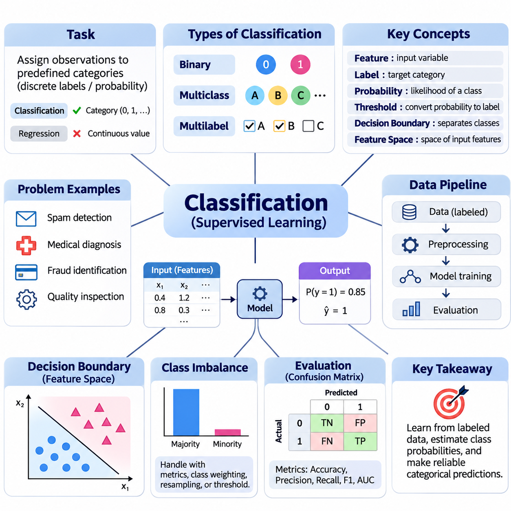
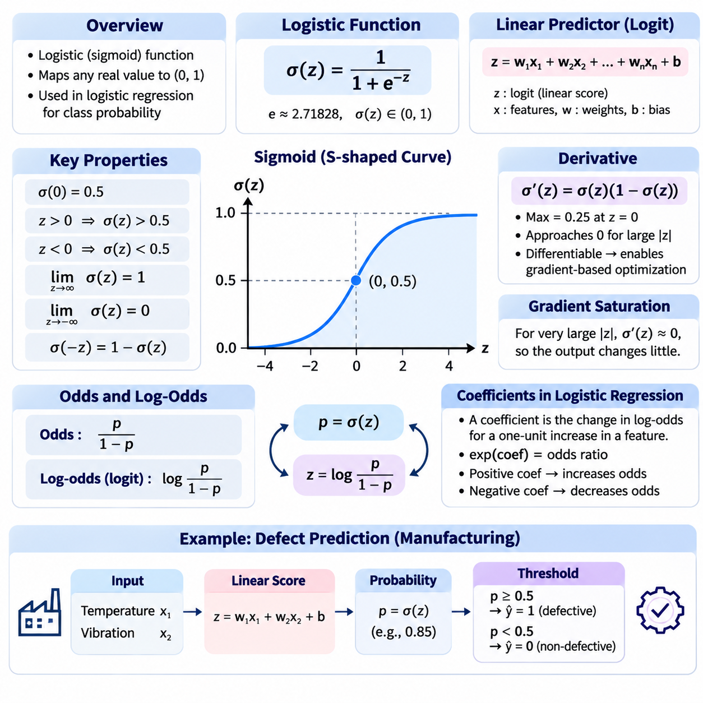
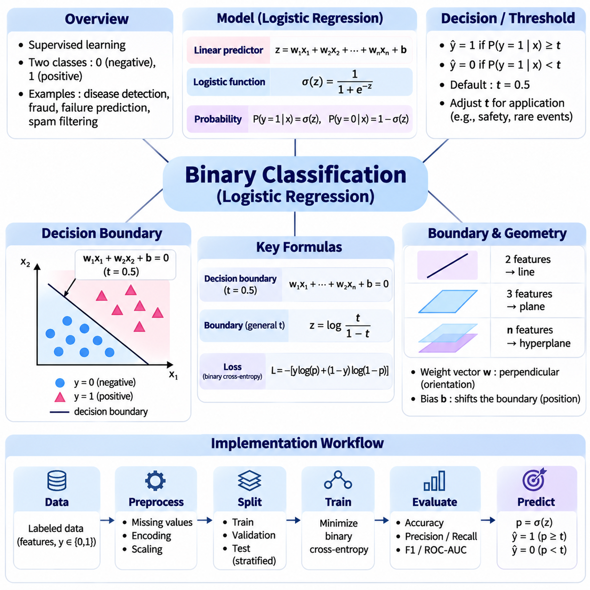
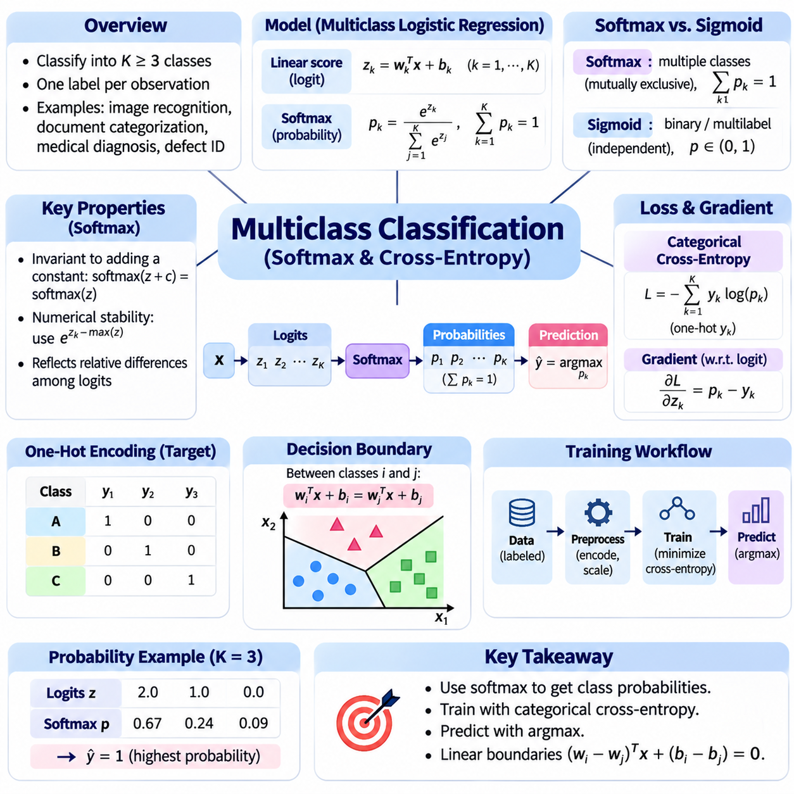
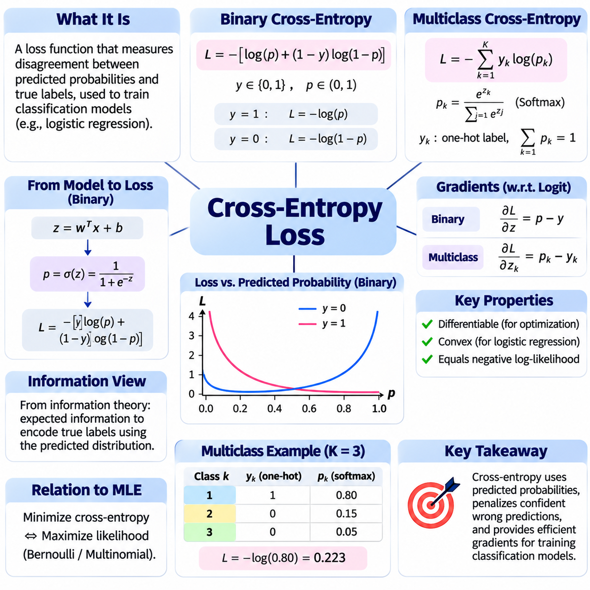
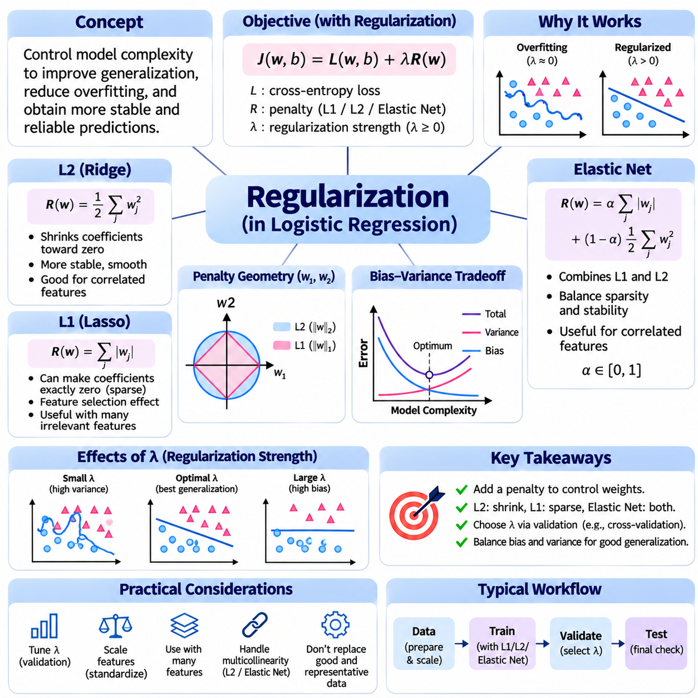
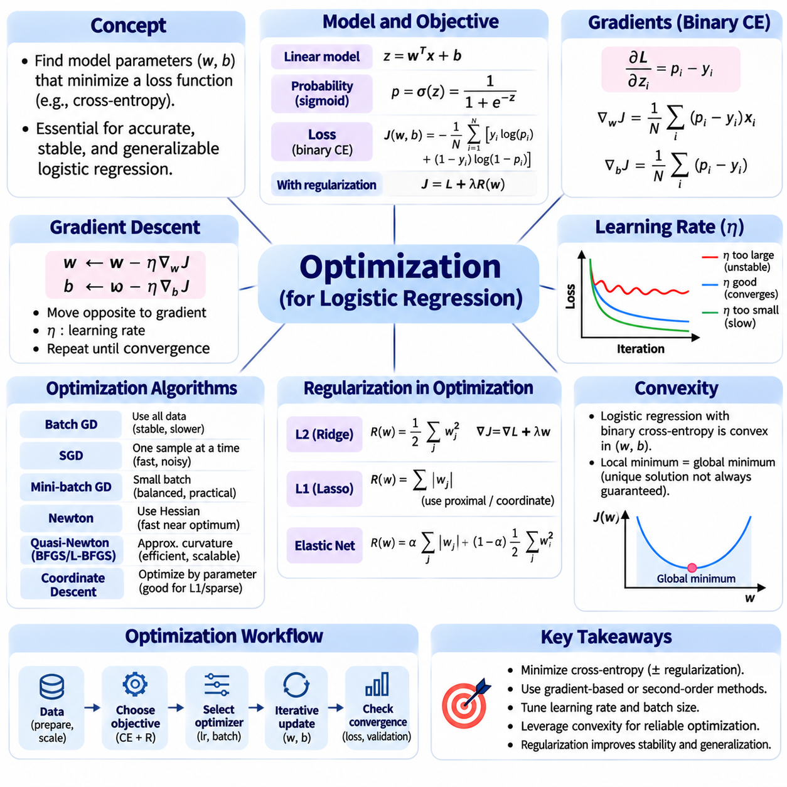
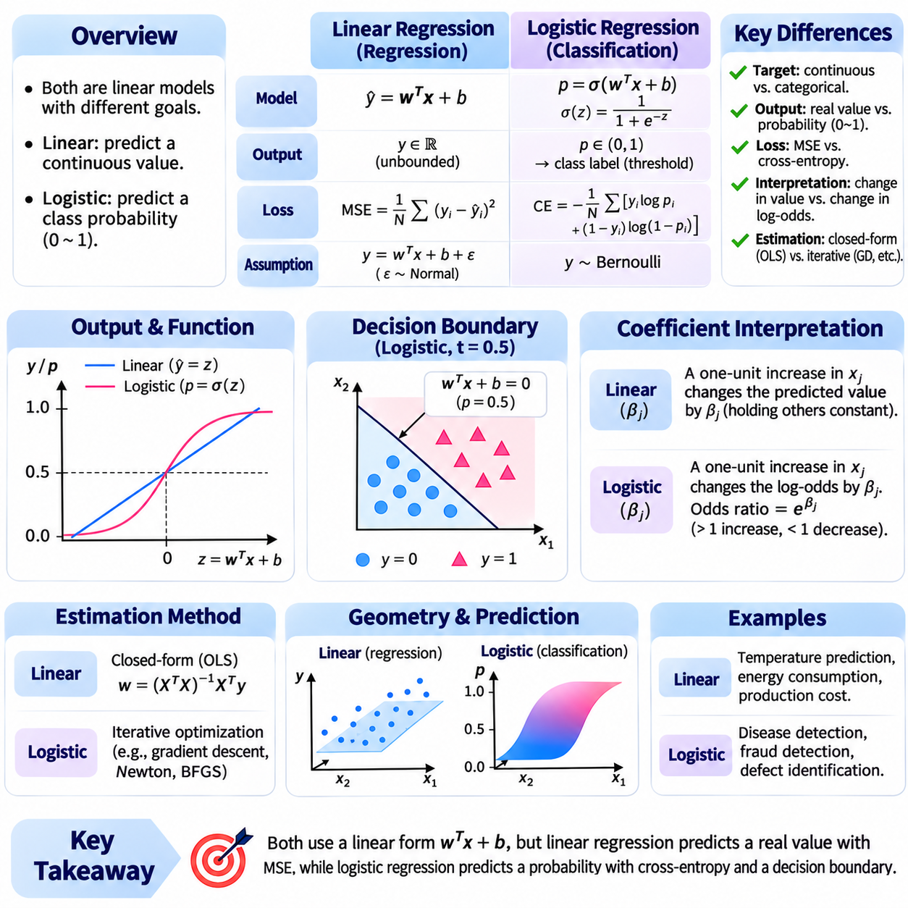
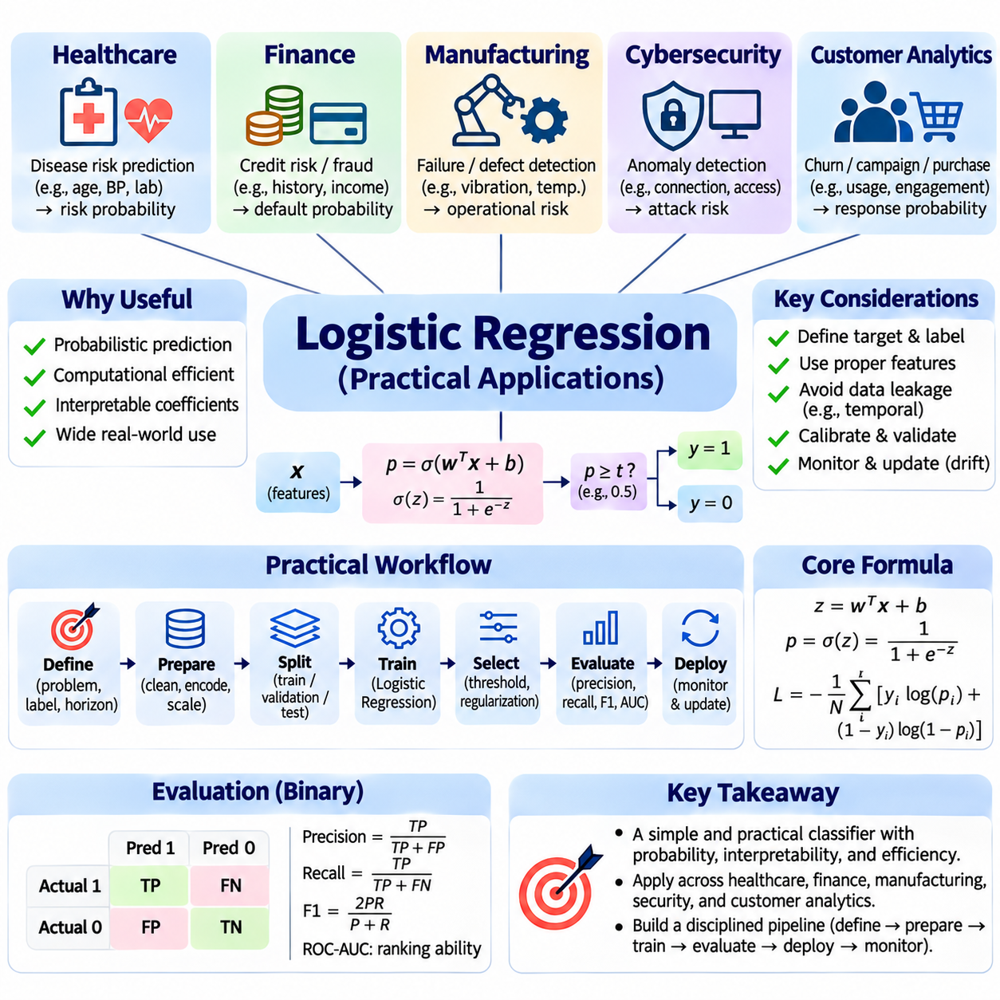

**/Volume 08. Supervised Learning**

# 02. Logistic Regression

## 02.00 Classification Basics

{width="7.268055555555556in" height="7.268055555555556in"}

Classification is a fundamental task in supervised machine learning that assigns observations to predefined categories based on their measurable characteristics. Unlike regression, which predicts continuous numerical values, classification produces discrete class labels or estimates the probability of belonging to each class. Common applications include spam detection, medical diagnosis, fraud identification, and automated quality inspection.

A classification system learns from labeled training examples, where each observation contains input features and a corresponding target category. Features describe measurable properties such as temperature, age, transaction amount, or image intensity. Labels represent the expected classification outcomes. By examining relationships between features and labels, the learning algorithm develops a predictive model that can classify previously unseen observations.

The simplest classification problem is binary classification, where each observation belongs to one of two mutually exclusive categories. Typical examples include positive versus negative, defective versus acceptable, and fraudulent versus legitimate. These categories are commonly represented using numerical labels 0 and 1. Although the labels are numerical, they indicate categorical membership rather than continuous quantities or meaningful numerical distances.

Multiclass classification extends this concept to problems containing three or more mutually exclusive categories. An image recognition system might distinguish among cats, dogs, birds, and vehicles, while an industrial inspection system might identify several types of manufacturing defects. Each observation receives one class label, although the model may estimate probabilities for every possible category before selecting its final prediction.

Multilabel classification differs from multiclass classification because an observation may belong to several categories simultaneously. For example, an image may contain a pedestrian, bicycle, and traffic signal, while a document may address several independent topics. Instead of selecting exactly one category, the model predicts the presence or absence of each label. This distinction influences model architecture, training objectives, and evaluation procedures.

Classification models generally operate by transforming input features into numerical scores that describe the evidence supporting different categories. These scores may be converted into estimated class probabilities using appropriate mathematical functions. In binary logistic regression, the sigmoid function transforms a linear combination of features into a value between zero and one, providing an interpretable estimate of positive-class probability under the model.

A class probability represents the model\'s estimated likelihood that an observation belongs to a particular category. For binary classification, a model might assign a probability of 0.85 to the positive class and 0.15 to the negative class. Such estimates provide more information than class labels alone because they express varying degrees of confidence. However, reliable interpretation requires examining whether predicted probabilities are properly calibrated.

A decision threshold converts estimated probabilities into categorical predictions. In binary classification, a threshold of 0.5 commonly assigns observations with positive-class probabilities at least 0.5 to class 1 and the remaining observations to class 0. This threshold is not universally optimal. Applications involving medical screening, financial fraud, or safety monitoring may require different thresholds depending on the consequences of incorrect predictions.

A decision boundary separates regions of the feature space assigned to different classes. In a two-dimensional problem, this boundary can be represented as a line or curve dividing observations according to their predicted categories. Linear classifiers construct boundaries from weighted combinations of input features. Their simplicity makes them computationally efficient and relatively interpretable, although complex relationships may require nonlinear transformations or more flexible models.

Feature space refers to the mathematical representation in which observations are described by their input variables. An observation containing three numerical features corresponds to a point in a three-dimensional feature space. Classification algorithms examine how observations from different categories are distributed within this space. Well-separated categories are generally easier to distinguish, while overlapping distributions create uncertainty and increase classification difficulty.

The quality of training data strongly influences classification performance. Incorrect labels, missing values, inconsistent measurements, and unrepresentative samples can prevent a model from learning reliable patterns. Data preparation therefore involves inspecting feature distributions, handling missing observations, encoding categorical variables, and applying suitable scaling procedures. These operations should be learned from training data and applied consistently to validation and test observations.

Class imbalance occurs when some categories appear substantially more frequently than others. A fraud detection dataset might contain thousands of legitimate transactions for every fraudulent transaction. A classifier that predicts the majority category almost exclusively could achieve high overall accuracy while failing to identify important minority cases. Addressing this problem requires appropriate evaluation metrics and potentially class weighting, resampling, or threshold adjustment.

Classification performance is often summarized using a confusion matrix, which compares predicted labels against actual labels. For binary classification, the matrix contains true positives, true negatives, false positives, and false negatives. These outcomes reveal different types of correct and incorrect decisions. Their relative importance depends on the application, because overlooking a dangerous condition may carry greater consequences than generating an unnecessary warning.

Accuracy measures the proportion of correctly classified observations among all evaluated observations. Although intuitive, accuracy can be misleading when classes are highly imbalanced or when different errors have unequal consequences. Precision measures the proportion of predicted positive cases that are actually positive, while recall measures the proportion of actual positive cases successfully identified. These metrics provide complementary perspectives on classification effectiveness.

The F1 score combines precision and recall through their harmonic mean, offering a useful summary when both measures are important. However, no single metric captures every operational requirement. Specificity evaluates how effectively negative cases are identified, while balanced accuracy considers performance across both classes. Selecting suitable metrics requires understanding the class distribution, application objectives, and practical costs associated with classification errors.

Receiver operating characteristic analysis examines how the true positive rate changes relative to the false positive rate across different decision thresholds. The area under the ROC curve summarizes a model\'s ability to rank positive observations above negative observations. Precision-recall curves provide another perspective and are often especially informative for rare positive classes. These analyses help compare classification models without committing immediately to one threshold.

Training a classification model involves adjusting its parameters to reduce disagreement between predictions and known labels. The learning process typically minimizes a loss function that penalizes incorrect or poorly supported predictions. For probabilistic classification, cross-entropy is widely used because it evaluates predicted probability distributions against observed class labels. Optimization algorithms iteratively update model parameters to improve performance on the training dataset.

A classification model must generalize beyond the examples used during training. Memorizing training observations without learning transferable relationships produces overfitting, while an excessively simple model may underfit important patterns. Separating data into training, validation, and test subsets helps assess generalization. The validation subset supports model selection and threshold tuning, while the independent test subset provides a final estimate of predictive performance.

Regularization improves classification robustness by discouraging unnecessarily complex models or excessively large parameter values. In linear classification, L1 regularization can encourage sparse coefficients, while L2 regularization penalizes large coefficients more smoothly. These techniques may reduce sensitivity to noise and improve generalization. Their effectiveness depends on feature characteristics, dataset size, regularization strength, and the underlying relationship between inputs and target categories.

Feature scaling can substantially influence classification algorithms that depend on distances, gradients, or regularization. Standardization transforms numerical features using their training-set means and standard deviations, while normalization may rescale values into specified ranges. Proper scaling can improve optimization behavior and prevent variables with large numerical magnitudes from dominating parameter updates. The transformation must be fitted without using information from held-out evaluation data.

Real-world classification systems must account for uncertainty, changing data distributions, and operational constraints. A model trained on historical observations may become less reliable when sensor characteristics, customer behavior, or environmental conditions change. Monitoring class distributions, prediction confidence, error rates, and calibration helps identify performance degradation. Periodic evaluation and controlled retraining are therefore important components of dependable classification deployment.

Classification also involves a distinction between statistical prediction and causal understanding. A model may accurately associate particular features with a category without identifying why the category occurs. Correlations learned from training data can reflect hidden confounders, measurement artifacts, or historical biases. Consequently, classification predictions should not automatically be interpreted as causal explanations, especially in healthcare, finance, employment, and other consequential applications.

Interpretability is particularly valuable when classification results influence important decisions. Linear models allow analysts to inspect feature coefficients and understand how input variables contribute to predicted scores. Nevertheless, coefficient interpretation depends on feature scaling, correlations among variables, and model assumptions. Transparent documentation of training data, evaluation results, decision thresholds, and known limitations supports more responsible use of classification systems.

Logistic regression provides a natural starting point for studying classification because it combines a linear prediction function with a probabilistic interpretation. Rather than predicting unrestricted numerical outputs, logistic regression transforms linear scores into probabilities suitable for categorical decisions. Understanding labels, feature spaces, class probabilities, decision boundaries, and evaluation metrics establishes the conceptual foundation for examining logistic functions, binary classification, and subsequent classification algorithms.

## 02.01 Logistic Function

{width="7.268055555555556in" height="7.268055555555556in"}

The logistic function is a mathematical transformation that converts any real-valued input into a value between zero and one. Also known as the sigmoid function, it plays a central role in logistic regression and probabilistic binary classification. Its smooth, S-shaped behavior allows a linear model to represent class probabilities while preserving a continuous and differentiable relationship between input scores and predicted outcomes.

The standard logistic function is defined as σ(z) = 1 / (1 + e\^(-z)), where z represents a real-valued input and e denotes Euler\'s number, approximately 2.71828. The function maps the entire real number line into the open interval (0, 1). Regardless of how large or small the input becomes, its output remains strictly greater than zero and strictly less than one for every finite input value.

The input z is commonly called the logit or linear predictor in logistic regression. It is calculated as z = w₁x₁ + w₂x₂ + \... + wₙxₙ + b, where x represents input features, w represents learned weights, and b is the bias term. This linear combination summarizes the influence of multiple features before the logistic function transforms the resulting score into an estimated probability of belonging to the positive class.

The logistic function exhibits a characteristic S-shaped curve that increases monotonically from values approaching zero to values approaching one. When z equals zero, the function produces exactly 0.5. Positive inputs produce outputs greater than 0.5, while negative inputs produce outputs below 0.5. This behavior establishes a natural connection between the sign of a linear score and the predicted category in binary classification.

As z approaches positive infinity, the logistic function approaches one without reaching it. Conversely, as z approaches negative infinity, the output approaches zero. These asymptotic properties allow the function to represent increasingly strong evidence for either class. However, an output close to zero or one does not automatically guarantee a correct prediction, because the model may still be poorly calibrated or trained on unrepresentative data.

The logistic function is symmetric around its central point in the sense that σ(-z) = 1 - σ(z). This identity means that reversing the sign of the input produces the complementary probability. For example, if σ(2) is approximately 0.881, then σ(-2) is approximately 0.119. This mathematical relationship is particularly useful in binary classification, where the probabilities assigned to the two mutually exclusive classes must sum to one.

One of the most important properties of the logistic function is its differentiability. Its derivative can be expressed compactly as σ\'(z) = σ(z)(1 - σ(z)). This relationship makes gradient calculations computationally convenient because the derivative can be obtained directly from the function output. Differentiability supports gradient-based optimization methods used to estimate logistic regression parameters and train many neural network architectures.

The derivative reaches its maximum value of 0.25 when z equals zero, corresponding to an output probability of 0.5. As the input moves toward either extreme, the derivative approaches zero. Consequently, the logistic function is most sensitive to changes near its central region and becomes progressively less sensitive in saturated regions. This behavior affects numerical optimization and helps explain gradient saturation in neural networks.

Gradient saturation occurs when the logistic function receives inputs with very large positive or negative magnitudes. In these regions, changes in the input produce only small changes in the output, resulting in small derivatives. When sigmoid activations are repeatedly used in deep neural networks, these derivatives can contribute to vanishing gradients. Logistic regression avoids much of this difficulty when optimized with an appropriate cross-entropy objective.

The logistic function is closely connected to the concept of odds in probability theory. If p represents the probability of a positive outcome, the odds are defined as p / (1 - p). Odds compare the probability of an event occurring with the probability of it not occurring. Unlike probabilities, which lie between zero and one, odds range from zero toward positive infinity and provide an alternative representation of event likelihood.

The logarithm of the odds is called the log-odds or logit transformation. It is expressed as log(p / (1 - p)) and maps probabilities in the open interval (0, 1) to the entire real number line. The logistic function is the inverse of this transformation. Therefore, logistic regression models the log-odds as a linear function of input features and then converts those values into probabilities through the logistic function.

This relationship provides a useful interpretation of logistic regression coefficients. When a feature increases by one unit while other features remain constant, its coefficient represents the corresponding change in log-odds. Exponentiating that coefficient produces an odds ratio, which describes the multiplicative change in odds. A positive coefficient increases the odds of the positive class, while a negative coefficient decreases them.

For example, consider a logistic regression model that predicts whether a manufacturing component is defective based on measured temperature and vibration. The linear predictor combines these measurements using learned coefficients and a bias term. The logistic function then converts the resulting score into an estimated defect probability. A larger score produces a higher predicted probability, assuming the positive class represents defective components.

The probability output can be converted into a binary prediction by applying a decision threshold. With the conventional threshold of 0.5, predictions are assigned to the positive class when σ(z) is at least 0.5. Because the logistic function is monotonically increasing, this condition is equivalent to z being greater than or equal to zero. Consequently, the decision boundary of ordinary logistic regression is determined by the linear predictor.

Although the logistic function introduces a nonlinear transformation, standard logistic regression still produces a linear decision boundary in the original feature space. This distinction is important because nonlinear probability outputs do not necessarily imply nonlinear classification boundaries. More complex boundaries can be obtained by introducing polynomial features, interaction terms, or other nonlinear feature transformations before applying logistic regression.

The logistic function also supports probabilistic interpretation through the Bernoulli distribution. In binary classification, the target variable y takes values of zero or one, and the model estimates p = P(y = 1 \| x). The corresponding probability of observing a label can be expressed as p\^y(1 - p)\^(1 - y). This formulation connects logistic regression to maximum likelihood estimation and provides the foundation for its standard training objective.

Maximum likelihood estimation seeks model parameters that make the observed training labels as probable as possible. For logistic regression, maximizing the likelihood is equivalent to minimizing binary cross-entropy, also called log loss. This objective penalizes confident incorrect predictions more heavily than uncertain predictions. The combination of the logistic function and cross-entropy produces a well-structured optimization problem for binary classification.

An important computational property emerges when binary cross-entropy is combined with the logistic function. The derivative of the loss with respect to the linear score simplifies to p - y, where p is the predicted probability and y is the observed binary label. This simplification avoids explicitly multiplying several potentially small derivative terms and enables efficient gradient calculations during logistic regression training.

Numerical stability becomes important when evaluating the logistic function for extremely large input magnitudes. Directly computing e\^(-z) can cause overflow for sufficiently negative values of z, while outputs near zero or one may lose numerical precision. Stable implementations use conditional evaluation, specialized sigmoid functions, or mathematically equivalent formulations that reduce overflow and underflow risks.

In practical machine learning libraries, logistic regression training often uses numerically stable loss calculations that operate directly on logits rather than first computing probabilities and then taking logarithms. Functions based on log-sum-exp or softplus formulations improve stability when predictions approach extreme values. These implementation details are especially important for large datasets, repeated optimization steps, and systems operating with reduced numerical precision.

The logistic function should not be confused with the softmax function, although both convert numerical scores into probability-like outputs. Sigmoid independently maps a scalar score into a value between zero and one, making it suitable for binary classification and independent multilabel predictions. Softmax operates on a vector of scores and normalizes them into a probability distribution whose components sum to one, making it suitable for mutually exclusive multiclass classification.

In neural networks, sigmoid activation is frequently used in the output layer for binary classification because it produces a bounded scalar prediction. It may also appear in gating mechanisms that regulate information flow through network components. However, modern deep networks often prefer alternative hidden-layer activation functions because sigmoid saturation can hinder gradient propagation. Its role therefore depends on whether the objective requires probabilistic outputs or intermediate feature transformations.

Probability calibration is an important consideration when interpreting sigmoid outputs. Although the logistic function produces values between zero and one, these values are not necessarily accurate estimates of real-world event frequencies. A calibrated model assigning probability 0.8 to many observations should observe positive outcomes in approximately 80 percent of those cases. Calibration quality depends on model assumptions, training data, optimization, and deployment conditions.

The logistic function remains valuable because it combines mathematical simplicity, smooth differentiation, bounded outputs, and a direct relationship with log-odds. These properties make it a foundational component of statistical classification and modern machine learning. Understanding its equation, derivative, asymptotic behavior, probabilistic interpretation, and numerical limitations provides the mathematical basis for studying binary logistic regression and its practical implementation.

## 02.02 Binary Classification

{width="7.268055555555556in" height="7.268055555555556in"}

Binary classification is a fundamental supervised learning task in which each observation is assigned to one of two mutually exclusive categories. These categories are typically represented by labels 0 and 1, corresponding to negative and positive outcomes. Applications include disease detection, fraud identification, equipment failure prediction, and spam filtering, where the objective is to distinguish between two possible states using observed features.

Logistic regression provides a probabilistic framework for binary classification by modeling the relationship between input features and the likelihood of a positive outcome. Unlike linear regression, which produces unrestricted numerical predictions, logistic regression transforms a linear score into a probability between zero and one. This transformation makes the model suitable for categorical decisions while retaining a relatively simple and interpretable mathematical structure.

The binary classification model begins with a linear predictor expressed as z = w₁x₁ + w₂x₂ + \... + wₙxₙ + b. Here, x represents input features, w denotes learned coefficients, and b is the intercept or bias term. Each coefficient determines how its corresponding feature contributes to the linear score. The model combines these contributions before converting the resulting value into a probability through the logistic function.

The logistic function is defined as σ(z) = 1 / (1 + e\^(-z)), producing an output strictly between zero and one for every finite input. In binary classification, this output represents the estimated conditional probability P(y = 1 \| x). The complementary probability P(y = 0 \| x) equals 1 - σ(z). Together, these probabilities describe the model\'s estimated distribution over the two possible class labels.

A decision threshold converts predicted probabilities into discrete class assignments. The conventional threshold of 0.5 assigns an observation to class 1 when its predicted positive-class probability is at least 0.5 and to class 0 otherwise. However, the threshold can be adjusted to reflect operational requirements. Applications involving safety-critical failures or rare events may prioritize detecting positive cases over minimizing false alarms.

The decision boundary is the geometric surface separating regions assigned to different classes. For logistic regression using a threshold of 0.5, the boundary occurs where the linear predictor equals zero. In mathematical terms, this condition is w₁x₁ + w₂x₂ + \... + wₙxₙ + b = 0. The boundary therefore depends directly on the learned feature coefficients and intercept, which determine how the feature space is partitioned.

In a two-dimensional feature space, the decision boundary of ordinary logistic regression is a straight line. With three input features, it becomes a plane, while higher-dimensional feature spaces produce hyperplanes. Observations on opposite sides of the boundary receive different predicted labels. Their distance from the boundary influences the magnitude of the linear score, although it should not automatically be interpreted as a calibrated measure of prediction confidence.

The orientation of the decision boundary is determined by the model\'s weight vector, which is perpendicular to the separating hyperplane. The intercept controls its position relative to the origin. Changing the coefficients rotates or reshapes the orientation of the boundary, while changing the intercept shifts its location. These geometric relationships provide an intuitive explanation of how logistic regression separates observations using learned linear combinations of features.

When a decision threshold differs from 0.5, the classification boundary also changes. For a threshold t between zero and one, the boundary satisfies z = log(t / (1 - t)). Increasing the threshold generally makes positive predictions less frequent, while decreasing it makes positive predictions more frequent. The underlying probability model remains unchanged, but the classification policy changes according to the selected operating point.

Linear decision boundaries work well when categories can be separated approximately through weighted combinations of input features. However, real-world datasets may contain nonlinear relationships, overlapping distributions, and complex interactions. Logistic regression can accommodate some nonlinear patterns through engineered features such as polynomial terms or interactions. These transformations create nonlinear boundaries in the original feature space while preserving linearity in the transformed representation.

Implementing binary logistic regression begins with preparing a labeled dataset containing numerical or encoded input features and binary targets. The dataset should be examined for missing values, inconsistent measurements, duplicated observations, and class imbalance. Features may require standardization to improve optimization behavior. Categorical variables must be encoded appropriately, and preprocessing procedures should be established using only the training data.

The dataset is typically divided into training, validation, and test subsets. Training data determines model parameters, validation data supports hyperparameter selection and threshold adjustment, and test data provides an independent estimate of final performance. Stratified splitting can help preserve class proportions across subsets. When observations are temporally dependent or grouped by subject, splitting must respect those relationships to prevent data leakage.

Model training estimates coefficients and the intercept by minimizing a suitable objective function. Binary cross-entropy is commonly used because it measures disagreement between predicted probabilities and observed labels. For a single observation, the loss is L = -[y log(p) + (1 - y) log(1 - p)], where y is the binary target and p is the predicted positive-class probability. Minimizing this loss encourages accurate probabilistic predictions.

Gradient-based optimization updates model parameters according to the derivatives of the loss function. For logistic regression, the gradient with respect to the weight vector is proportional to (p - y)x, while the intercept gradient is proportional to p - y. Across a dataset, these contributions are aggregated according to the selected objective. Gradient descent and its variants iteratively adjust parameters until a stopping criterion is satisfied.

Practical implementations frequently use established machine learning libraries rather than manually constructing every optimization step. In Python, scikit-learn provides a LogisticRegression estimator that supports model fitting, probability prediction, regularization, and coefficient inspection. A typical workflow creates a preprocessing pipeline, fits the classifier to training observations, generates validation probabilities, and evaluates predictions using appropriate classification metrics.

Regularization is commonly included during logistic regression training to control coefficient magnitude and reduce overfitting. L2 regularization penalizes large weights smoothly, while L1 regularization can encourage sparse coefficients and implicit feature selection. The regularization strength is selected using validation data or cross-validation. Appropriate regularization is especially valuable when features are correlated, noisy, or numerous relative to the available observations.

After training, the model generates probabilities for previously unseen observations. These probabilities are converted into predicted labels using the selected decision threshold. Predictions should be evaluated against known labels rather than judged solely by apparent confidence. A confusion matrix summarizes true positives, true negatives, false positives, and false negatives, revealing how the classifier performs across both categories and where important errors occur.

Accuracy measures the overall proportion of correct predictions, but it may conceal poor performance on minority classes. Precision evaluates the reliability of positive predictions, while recall measures the ability to identify actual positive cases. Specificity measures the ability to recognize negative cases, and the F1 score combines precision and recall. Metric selection should reflect the consequences of different classification errors rather than relying exclusively on accuracy.

Receiver operating characteristic curves examine the tradeoff between true positive rate and false positive rate across multiple thresholds. The ROC-AUC summarizes ranking performance independently of a single classification threshold. Precision-recall curves are often particularly informative when positive cases are rare. These evaluations help determine whether the classifier is suitable for deployment and whether its decision threshold should be adjusted.

Probability calibration provides another important evaluation perspective. A well-calibrated classifier should produce probability estimates consistent with observed outcome frequencies. For example, among observations assigned probabilities near 0.8, approximately 80 percent should belong to the positive class. Calibration curves and probabilistic scoring rules can reveal whether the model systematically overestimates or underestimates event likelihoods.

Class imbalance requires special attention during implementation because a classifier may favor the majority category. Techniques such as class weighting, carefully controlled resampling, and threshold optimization can improve minority-class detection. However, these methods may alter precision, recall, or probability calibration. Their effects should be evaluated on validation data that reflects the intended deployment distribution.

Numerical stability is important when computing logistic probabilities and cross-entropy losses. Extremely large positive or negative logits can cause overflow, underflow, or loss of numerical precision in naive implementations. Stable algorithms operate directly on logits and use carefully formulated mathematical expressions. Established machine learning libraries generally provide these safeguards, reducing implementation errors during training and inference.

An industrial binary classification example involves predicting whether a machine component will fail within a specified operating period. Input features might include vibration amplitude, motor temperature, operating hours, and electrical current. Historical maintenance records provide binary failure labels. Logistic regression estimates failure probabilities, while the decision threshold determines when the monitoring system should generate a maintenance warning.

The resulting model can be deployed as part of a larger prediction pipeline that receives sensor measurements, applies the same preprocessing transformations used during training, and calculates failure probabilities. Operational monitoring should track prediction distributions, classification errors, data drift, and changing class frequencies. Periodic validation helps determine whether retraining or threshold adjustment is necessary as equipment conditions evolve.

Binary logistic regression combines probabilistic prediction with a geometrically interpretable decision boundary and a practical implementation workflow. Its effectiveness depends on representative training data, appropriate preprocessing, reliable optimization, meaningful evaluation metrics, and carefully selected decision thresholds. Understanding these principles establishes a foundation for multiclass classification, regularized models, and more advanced supervised learning systems.

## 02.03 Multiclass Classification

{width="7.268055555555556in" height="7.268055555555556in"}

Multiclass classification is a supervised learning task in which each observation is assigned to one of three or more mutually exclusive categories. Unlike binary classification, which distinguishes between two outcomes, multiclass classification must evaluate several possible labels simultaneously. Applications include image recognition, document categorization, medical diagnosis, and industrial defect identification, where each observation belongs to exactly one target class.

Multiclass logistic regression extends binary logistic regression by estimating a probability distribution over multiple classes. Instead of producing a single probability, the model generates one probability for each possible category. These probabilities are nonnegative and sum to one, allowing the classifier to select the most likely class while preserving information about alternative predictions and their relative likelihoods.

The model begins by calculating a separate linear score for each class. For class k, the score is expressed as z_k = w_k\^T x + b_k, where x represents the input feature vector, w_k denotes the learned weight vector for class k, and b_k is the corresponding intercept. Collectively, these scores form a vector of logits that describes how strongly the model supports each possible classification outcome.

The softmax function converts the vector of logits into a normalized probability distribution. For K classes, the probability assigned to class k is p_k = exp(z_k) / Σ_j exp(z_j), where the summation covers all K classes. Exponentiation ensures positive values, while division by the sum of exponentials ensures that all probabilities add to one. This transformation provides the mathematical foundation for multinomial logistic regression.

Softmax differs from the sigmoid function because it processes multiple scores jointly rather than transforming each score independently. Sigmoid is commonly used for binary classification and multilabel prediction, where individual outputs can represent separate events. Softmax is designed for mutually exclusive categories, where increasing the probability of one class necessarily reduces the combined probability assigned to the remaining classes.

An important property of softmax is its invariance to adding the same constant to every logit. If a constant c is added to all class scores, the resulting probability distribution remains unchanged. This property follows because the common exponential factor cancels during normalization. It is also useful computationally because logits can be shifted before exponentiation without changing the predicted probabilities.

Numerical stability is essential when implementing softmax because exponentiating large logits may cause overflow. A stable implementation subtracts the maximum logit from every score before applying the exponential function. The resulting probabilities remain mathematically equivalent to the original formulation. This simple adjustment prevents unnecessarily large intermediate values and is widely used in modern machine learning libraries.

Softmax probabilities reflect relative differences among logits rather than their absolute magnitudes. If all logits are similar, the resulting distribution approaches uniformity, indicating that the model does not strongly favor any particular class. When one logit substantially exceeds the others, its corresponding probability approaches one. However, high softmax confidence does not necessarily imply that the prediction is correct or properly calibrated.

The predicted class is typically selected using the argmax operation, which identifies the class with the highest probability. Because softmax preserves the ordering of logits, selecting the largest probability is equivalent to selecting the largest logit. This property allows efficient inference when only the predicted class label is required. Probability outputs remain useful when confidence estimation, ranking, or decision analysis is necessary.

Multiclass logistic regression produces linear decision boundaries between pairs of classes in the original feature space. The boundary between classes i and j occurs where their logits are equal, expressed as w_i\^T x + b_i = w_j\^T x + b_j. These boundaries partition the feature space into regions associated with different predicted categories. Nonlinear feature transformations can produce more complex boundaries while retaining a linear model in the transformed representation.

Training a multiclass classifier requires labeled examples containing input features and target class identifiers. Each observation is associated with exactly one correct class, commonly represented as an integer label or one-hot encoded vector. One-hot encoding assigns a value of one to the correct category and zero to all others. This representation is especially useful when describing the relationship between predicted probabilities and multiclass loss functions.

Categorical cross-entropy is the standard loss function for softmax-based multiclass classification. For a single observation with one-hot target values y_k and predicted probabilities p_k, the loss is L = -Σ_k y_k log(p_k). Because only the correct class has a target value of one, the expression reduces to the negative logarithm of the predicted probability assigned to that class. Minimizing this loss encourages the model to assign higher probabilities to correct categories.

The combination of softmax and cross-entropy provides convenient gradients for optimization. The derivative of the loss with respect to each class logit simplifies to p_k - y_k. This relationship enables efficient parameter updates using gradient descent and related optimization algorithms. During training, the model adjusts class-specific weights and intercepts to reduce classification errors while improving the probability assigned to observed labels.

Multiclass logistic regression can be optimized using methods such as stochastic gradient descent, mini-batch gradient descent, and limited-memory quasi-Newton algorithms. The choice depends on dataset size, feature dimensionality, regularization requirements, and available computational resources. Convergence should be monitored through the training objective and validation performance rather than relying exclusively on a fixed number of optimization iterations.

Regularization helps control model complexity and improve generalization. L2 regularization penalizes large coefficient values and is commonly used in multiclass logistic regression. L1 regularization can encourage sparse feature representations, while elastic-net regularization combines both approaches. The regularization strength should be selected through validation or cross-validation to balance model flexibility against sensitivity to noise.

Implementing multiclass classification begins with preparing a representative dataset and inspecting its class distribution. Missing values, inconsistent labels, duplicated observations, and unsuitable feature scales can reduce model reliability. Numerical features may be standardized, while categorical features require appropriate encoding. Preprocessing transformations must be fitted using training data and applied consistently to validation and test datasets.

The dataset is commonly divided into training, validation, and test subsets. Stratified splitting helps maintain similar class proportions across these subsets, especially when some categories contain relatively few observations. For grouped or time-dependent data, splitting must also preserve the relevant dependencies. Preventing data leakage is essential because information from validation or test observations can otherwise produce misleading performance estimates.

Python implementations commonly use the LogisticRegression estimator provided by scikit-learn. The estimator can fit multiclass logistic regression using supported optimization solvers and regularization settings. A typical implementation constructs a preprocessing pipeline, trains the classifier on labeled observations, generates class probabilities using predict_proba, and obtains predicted labels using predict. The resulting model can then be evaluated on held-out data.

The learned coefficient matrix contains class-specific feature weights, while the intercept vector contains the corresponding bias terms. Inspecting these parameters can help explain how individual features influence the relative scores of different classes. However, interpretation requires care because coefficients depend on feature scaling, correlations, and the parameterization of the model. Large coefficients do not automatically establish causal importance.

Multiclass evaluation extends binary classification metrics to problems containing several categories. A multiclass confusion matrix records how frequently observations from each true class are assigned to every predicted class. Diagonal entries represent correct classifications, while off-diagonal entries reveal specific patterns of confusion. This information is particularly valuable when neighboring categories share similar features or when certain classification errors are operationally costly.

Accuracy measures the overall proportion of correctly classified observations, but it may hide poor performance on minority categories. Precision, recall, and F1 scores can be calculated separately for each class using a one-versus-rest interpretation. Macro averaging gives equal importance to each class, while weighted averaging accounts for class frequency. Micro averaging aggregates decisions across classes and provides another perspective on overall classification performance.

Class imbalance can significantly affect multiclass classification because frequently occurring categories may dominate the training objective. Class weighting, controlled resampling, and improved data collection can help address this problem. However, changes to the training distribution may influence probability calibration and error patterns. Evaluation should therefore consider per-class performance and reflect the expected distribution of observations during deployment.

Probability calibration is important when softmax outputs are used for decision-making rather than simple label selection. A model may produce highly concentrated probability distributions even when its predictions are unreliable. Calibration techniques, including temperature scaling, can adjust probability sharpness using validation data. Calibration should be evaluated independently because classification accuracy alone does not establish the reliability of estimated probabilities.

An industrial application might classify manufacturing components into categories such as acceptable, scratched, cracked, or dimensionally incorrect. Input features could include image measurements, geometric descriptors, and sensor readings. Multiclass logistic regression calculates a score for each defect category and applies softmax to estimate class probabilities. The predicted label supports automated inspection, while the probability distribution can guide further review.

A practical deployment pipeline receives new observations, applies the same preprocessing transformations used during training, computes class logits, and converts them into probabilities through softmax. The system then selects a predicted category or applies additional decision rules when confidence is insufficient. Monitoring should track class frequencies, confusion patterns, calibration quality, and changes in feature distributions to identify performance degradation.

Multiclass logistic regression combines linear scoring, softmax normalization, categorical cross-entropy, and gradient-based optimization into a unified classification framework. Its mathematical simplicity makes it useful as both a practical baseline and an educational foundation for more advanced classifiers. Understanding its probability calculations, decision boundaries, implementation workflow, and evaluation methods prepares learners for neural network output layers and complex multiclass learning systems.

## 02.04 Loss Functions

{width="7.268055555555556in" height="7.268055555555556in"}

A loss function is a mathematical measure of disagreement between a model\'s predictions and the observed target values. In supervised classification, the loss function guides learning by assigning larger penalties to predictions that poorly match the correct labels. Logistic regression commonly uses cross-entropy loss because it evaluates predicted probabilities rather than treating classification outcomes as unrestricted numerical quantities.

Cross-entropy originates from information theory, where it measures the expected information required to represent observations drawn from one probability distribution using another distribution. In classification, the target distribution describes the correct labels, while the predicted distribution represents the model\'s estimated probabilities. Minimizing cross-entropy encourages predicted probabilities to align with observed class membership.

Binary cross-entropy is designed for classification problems containing two mutually exclusive classes. If y represents the observed label and p denotes the predicted probability of class 1, the loss for one observation is L = -[y log(p) + (1 - y) log(1 - p)]. The logarithm is natural, and the formula assumes probabilities strictly between zero and one. Its structure evaluates the probability assigned to the actual class.

When the true label equals one, binary cross-entropy simplifies to L = -log(p). The loss approaches zero as the predicted positive-class probability approaches one, indicating an increasingly accurate prediction. Conversely, the loss grows rapidly when the model assigns a probability near zero to the correct positive class. This behavior strongly penalizes confident predictions that contradict the observed label.

When the true label equals zero, the loss becomes L = -log(1 - p). Predictions assigning low probability to the positive class receive small penalties because they correctly favor the negative class. Predictions assigning probabilities close to one receive increasingly large penalties. The symmetric treatment of positive and negative labels makes binary cross-entropy suitable for probabilistic binary classification.

Cross-entropy differs from classification accuracy because it considers the complete probability assigned to the correct outcome. Two models may produce identical class labels while assigning substantially different probabilities. A prediction of 0.95 for a correct positive label receives a smaller loss than a prediction of 0.55. Consequently, cross-entropy provides a continuous learning signal even when the predicted class remains unchanged.

For a dataset containing N observations, the empirical binary cross-entropy objective is usually calculated as the average of individual losses. It can be expressed as J = -(1/N) Σ_i [y_i log(p_i) + (1 - y_i) log(1 - p_i)]. Averaging makes the objective less dependent on dataset size and allows optimization algorithms to evaluate the overall agreement between predictions and observed labels.

In logistic regression, predicted probabilities are obtained by applying the sigmoid function to a linear score. The model computes z = w\^T x + b and then p = σ(z) = 1 / (1 + exp(-z)). Cross-entropy evaluates this probability against the target label. Combining the sigmoid transformation with binary cross-entropy creates a differentiable objective suitable for gradient-based parameter estimation.

An important mathematical property is that the derivative of binary cross-entropy with respect to the logit simplifies to p - y. Therefore, the gradient with respect to the weight vector for one observation is (p - y)x, while the intercept gradient is p - y. These compact expressions enable efficient gradient descent and explain why logistic regression can be trained without explicitly calculating complicated derivative chains.

For standard binary logistic regression with a linear predictor, the cross-entropy objective is convex with respect to the model parameters. This means that every local minimum is also a global minimum, although a finite unique minimizer is not guaranteed for every dataset. Convexity makes logistic regression optimization more predictable than the nonconvex objectives commonly encountered in deep neural networks.

Cross-entropy is closely related to maximum likelihood estimation. Logistic regression assumes that binary labels follow a Bernoulli distribution whose success probability depends on the input features. Maximizing the likelihood of the observed labels is mathematically equivalent to minimizing their negative log-likelihood. Binary cross-entropy is precisely this negative log-likelihood when expressed per observation.

Multiclass classification extends cross-entropy to problems containing three or more mutually exclusive categories. If y_k represents a one-hot target and p_k is the predicted probability for class k, categorical cross-entropy is L = -Σ_k y_k log(p_k). Since only the correct class has a target value of one, the loss reduces to the negative logarithm of the probability assigned to that class.

Softmax is commonly used with categorical cross-entropy because it transforms class logits into probabilities that sum to one. For class k, softmax computes p_k = exp(z_k) / Σ_j exp(z_j). The cross-entropy objective then encourages the correct class to receive a larger share of the predicted probability distribution. This combination forms the standard training objective for multinomial logistic regression.

The gradient of softmax cross-entropy with respect to each logit has the convenient form p_k - y_k. This result resembles the binary logistic regression gradient and supports efficient optimization across multiple classes. The model adjusts class-specific weights to increase the probability assigned to correct labels while reducing probabilities assigned to competing categories.

Cross-entropy also has an information-theoretic interpretation through its relationship with entropy and Kullback-Leibler divergence. For target distribution P and predicted distribution Q, cross-entropy satisfies H(P,Q) = H(P) + D_KL(P\|\|Q). Because target entropy H(P) is constant with respect to model parameters, minimizing cross-entropy is equivalent to minimizing the divergence between the target and predicted distributions.

Cross-entropy is a proper scoring rule, meaning that its expected value is minimized when predicted probabilities match the true conditional probabilities, assuming the model can represent them. This property makes cross-entropy appropriate for probability estimation rather than merely selecting class labels. Nevertheless, limited data, model misspecification, and distribution shifts can prevent trained classifiers from producing well-calibrated probabilities.

Numerical stability is essential when implementing cross-entropy because logarithms of probabilities near zero can produce extremely large values or numerical errors. Directly calculating sigmoid or softmax probabilities before taking logarithms may also introduce overflow or underflow. Stable implementations combine the activation transformation and loss calculation using mathematically equivalent expressions that operate directly on logits.

For binary classification, a stable loss formulation is L = max(z, 0) - zy + log(1 + exp(-\|z\|)), where z is the logit and y is the binary label. This expression avoids several numerical difficulties associated with separately computing sigmoid probabilities and logarithms. Modern machine learning frameworks provide optimized binary cross-entropy functions that incorporate these stability techniques.

In Python, common implementations include log_loss in scikit-learn and BCEWithLogitsLoss in PyTorch for binary classification. Multiclass training commonly uses CrossEntropyLoss in PyTorch, which accepts class logits directly. These functions reduce implementation complexity and provide numerically stable calculations. Developers must verify expected input shapes, label formats, and whether the function expects logits or probabilities.

Regularization can be combined with cross-entropy to discourage overly complex models. A regularized objective adds a penalty based on parameter magnitudes, such as an L2 term proportional to the squared weight norm. The cross-entropy component measures predictive disagreement, while regularization controls model complexity. Their relative influence is determined by a regularization coefficient selected through validation.

Class imbalance may require modifying the contribution of different observations to the loss. Weighted cross-entropy assigns larger penalties to errors involving selected classes, helping the model pay greater attention to underrepresented outcomes. However, weighting changes the optimization objective and may affect probability calibration. Class weights should therefore be chosen carefully and evaluated against deployment requirements.

Label smoothing modifies categorical targets by replacing perfectly concentrated one-hot distributions with slightly softened target probabilities. This approach can discourage excessively confident predictions and sometimes improve generalization. However, it changes the target distribution used by cross-entropy and does not guarantee better calibration. Its effectiveness depends on the dataset, model architecture, and smoothing strength.

Training performance should be monitored using both cross-entropy and classification metrics. A decreasing training loss indicates improved agreement with training labels, but it does not guarantee better generalization. Validation cross-entropy can reveal overfitting, while accuracy, precision, recall, and F1 score describe decision quality. Evaluating both probability quality and classification outcomes provides a more complete assessment.

An industrial example involves predicting whether equipment will fail during a specified operating interval. A model may estimate failure probabilities from vibration, temperature, and operating history. Cross-entropy penalizes inaccurate probabilities during training, particularly when the model confidently predicts normal operation before an actual failure. The resulting probabilities can support maintenance decisions after appropriate validation and threshold selection.

Cross-entropy provides a unified mathematical foundation for binary and multiclass probabilistic classification. Its connection to likelihood estimation, information theory, convex optimization, and efficient gradient computation explains its widespread adoption. Understanding its equations, numerical implementation, regularization, and evaluation implications prepares learners to train reliable logistic regression models and more advanced classification systems.

## 02.05 Regularization

{width="7.268055555555556in" height="7.268055555555556in"}

Regularization is a fundamental technique for improving the generalization ability of logistic regression models by controlling the complexity of learned parameters. Without regularization, a classifier may fit training observations too closely, including random noise and accidental patterns. Such overfitting can produce excellent training performance but unreliable predictions on unseen data. Regularization introduces constraints that encourage simpler and more stable decision boundaries.

In logistic regression, model complexity is closely related to the magnitude and distribution of feature coefficients. Large coefficients can make predicted probabilities change sharply in response to small variations in input features. Although strong coefficients may reflect meaningful relationships, they can also indicate sensitivity to noise or limited training data. Regularization discourages unnecessarily large weights while preserving useful predictive information.

The regularized objective combines the original classification loss with a penalty on model parameters. A general formulation is J(w,b) = L(w,b) + λR(w), where L represents average cross-entropy loss, R denotes the regularization penalty, and λ controls its strength. The intercept is commonly excluded from the penalty. Increasing λ generally emphasizes simpler models, while decreasing it allows greater flexibility in fitting training observations.

L2 regularization, also called ridge regularization, penalizes the squared magnitude of model coefficients. A common formulation is R(w) = (1/2)Σ_j w_j². This penalty grows rapidly as coefficients become large, encouraging the optimizer to distribute influence more conservatively across features. L2 regularization typically shrinks coefficients toward zero without forcing them to become exactly zero.

The geometric interpretation of L2 regularization involves restricting the coefficient vector to a region defined by its Euclidean norm. During optimization, the preferred solution balances low classification loss against a small weight magnitude. This often produces smoother probability transitions and reduces sensitivity to individual training observations. The resulting decision boundary may become more stable when the dataset contains correlated or noisy features.

L1 regularization, commonly associated with the lasso, penalizes the absolute magnitude of coefficients. Its penalty is R(w) = Σ_j \|w_j\|. Unlike L2 regularization, L1 can drive some coefficients exactly to zero, effectively removing selected features from the model. This property makes L1 useful when the dataset contains many irrelevant predictors or when a sparse, interpretable representation is desirable.

The sparsity produced by L1 regularization can simplify model interpretation and reduce the number of active features. However, feature selection may become unstable when several predictors contain similar information. In highly correlated groups, L1 may retain one feature while suppressing others, even when their predictive contributions are comparable. Therefore, zero coefficients should not automatically be interpreted as evidence that excluded features are scientifically irrelevant.

Elastic-net regularization combines L1 and L2 penalties to balance sparsity with coefficient stability. A typical penalty is R(w) = αΣ_j \|w_j\| + (1 - α)(1/2)Σ_j w_j², where α lies between zero and one. Larger values of α emphasize sparse solutions, while smaller values emphasize smooth coefficient shrinkage. Elastic net is particularly useful for high-dimensional datasets containing groups of correlated features.

Regularization strength determines the tradeoff between fitting the training data and restricting model complexity. Weak regularization may leave the classifier vulnerable to overfitting, while excessive regularization can produce underfitting. Underfitting occurs when the model becomes too constrained to capture meaningful relationships. Effective regularization therefore requires selecting a strength that achieves reliable validation performance rather than minimizing training loss alone.

The relationship between regularization and the bias-variance tradeoff provides an important theoretical perspective. Stronger regularization generally increases model bias while reducing variance, making predictions less sensitive to changes in the training sample. Weaker regularization may reduce bias but increase variance. The optimal balance depends on dataset size, feature quality, noise levels, and the complexity of the underlying classification problem.

Feature scaling is especially important when regularization is applied because penalties operate directly on coefficient magnitudes. Features measured in different units may require coefficients of very different sizes to produce comparable effects. Without standardization, the regularization penalty can influence features unevenly. Standardizing numerical variables to comparable scales helps ensure that coefficient shrinkage reflects predictive relationships rather than arbitrary measurement units.

Regularization is particularly valuable when the number of features is large relative to the number of training observations. In such settings, an unregularized model may have many parameter combinations that fit the observed labels well. Penalizing coefficient magnitude reduces the effective flexibility of the model and can improve numerical stability. However, regularization cannot replace representative data or correct fundamental problems in dataset construction.

Multicollinearity occurs when two or more input features are strongly correlated. This condition can make individual logistic regression coefficients difficult to estimate reliably, even when overall predictions remain useful. L2 regularization often improves stability by discouraging extreme coefficient combinations. Elastic net can provide additional flexibility when both correlated predictors and irrelevant features are present.

Regularization also affects the geometry of classification boundaries. Large coefficients can create steep changes in predicted probabilities across the boundary, while coefficient shrinkage generally produces more gradual transitions. In multidimensional spaces, the relative coefficient values determine boundary orientation. Consequently, regularization can alter both the location and orientation of the learned decision boundary, depending on the data and penalty structure.

In binary logistic regression, regularization is applied to the cross-entropy objective used to estimate model parameters. The gradient of an L2 penalty adds a term proportional to the weight vector, encouraging smaller coefficients during optimization. L1 penalties are not differentiable at zero, so suitable solvers use methods such as coordinate descent or proximal optimization. The choice of optimization algorithm must therefore be compatible with the selected penalty.

Multiclass logistic regression can also benefit from regularization because each class is associated with a set of learned coefficients. Penalizing the coefficient matrix helps control complexity across multiple decision boundaries. L2 regularization is commonly used with multinomial logistic regression, while sparse penalties can reduce dependence on unnecessary features. The regularization strategy should reflect the number of classes, feature dimensionality, and available training examples.

In practical Python implementations, scikit-learn provides regularization options through the LogisticRegression estimator. The parameter C represents the inverse of regularization strength, so smaller values of C generally produce stronger regularization. This convention differs from formulations using λ directly. Developers should also verify solver compatibility because not every optimization solver supports L1, L2, and elastic-net penalties equally.

Hyperparameter selection is commonly performed using cross-validation, which evaluates candidate regularization settings across multiple training and validation partitions. Each candidate model is trained independently and assessed using metrics relevant to the application. Cross-validation reduces dependence on a single random split, although grouped or time-dependent observations require specialized splitting strategies. Final evaluation should use a separate test dataset.

The choice of evaluation metric can influence the preferred regularization strength. Accuracy may be sufficient for balanced datasets with similar error costs, but precision, recall, F1 score, and cross-entropy can reveal different aspects of model behavior. A model with strong regularization may achieve stable classification accuracy while producing less extreme probabilities. Probability calibration should therefore be evaluated when predicted probabilities support operational decisions.

Class imbalance introduces additional considerations because regularization and class weighting influence different aspects of learning. Regularization controls coefficient complexity, while class weighting changes the relative contribution of observations to the classification loss. These techniques can be combined, but their interaction may affect decision boundaries and predicted probabilities. Validation should reflect the intended deployment distribution and error costs.

An industrial application might predict equipment failure using vibration, temperature, current, pressure, and operating history. Many measurements may be correlated because they describe related physical processes. L2 regularization can stabilize coefficient estimates, while L1 may identify a smaller subset of predictive measurements. Elastic net provides an alternative when both feature reduction and stability are important for deployment.

Regularization can also support operational robustness by reducing sensitivity to small fluctuations in sensor measurements. However, it does not guarantee resistance to distribution shifts, sensor failures, or adversarial inputs. A regularized classifier may still perform poorly when deployment conditions differ substantially from training conditions. Robust deployment requires representative validation, monitoring, data quality controls, and periodic reassessment.

Interpretability remains an important advantage of regularized logistic regression, but coefficient values require careful analysis. A positive coefficient indicates an increase in log-odds when its feature increases while other features remain fixed. Regularization changes coefficient magnitudes and may introduce estimation bias. Therefore, coefficient interpretation should consider preprocessing, feature correlations, penalty strength, and the distinction between prediction and causal explanation.

A practical development workflow compares unregularized or weakly regularized models against L1, L2, and elastic-net alternatives. Numerical features are standardized within the training pipeline, candidate penalty strengths are evaluated through cross-validation, and the selected model is tested on independent observations. Coefficient stability, predictive performance, calibration, and computational requirements should all contribute to the final selection.

Regularization provides a systematic mechanism for balancing model flexibility, predictive accuracy, and generalization in logistic regression. L1 encourages sparse solutions, L2 promotes coefficient stability, and elastic net combines their complementary properties. Understanding penalty functions, feature scaling, optimization compatibility, and validation procedures enables the development of classifiers that remain reliable beyond their original training datasets.

## 02.06 Optimization

{width="7.268055555555556in" height="7.268055555555556in"}

Optimization is the process of finding model parameters that minimize a specified objective function. In logistic regression, optimization determines the feature weights and intercept that produce probabilities consistent with observed class labels. The objective is usually based on cross-entropy loss, optionally combined with regularization. Effective optimization is essential for achieving accurate predictions, stable convergence, and reliable generalization.

The optimization problem begins with a parameterized linear model expressed as z = w\^T x + b. For binary classification, the sigmoid function converts this score into a probability p = 1 / (1 + exp(-z)). The model compares this probability with the observed target using binary cross-entropy. Training repeatedly adjusts the weight vector w and intercept b to reduce the average loss across the available observations.

For N training examples, the objective can be written as J(w,b) = -(1/N)Σ_i[y_i log(p_i) + (1-y_i)log(1-p_i)]. This expression measures how well predicted probabilities match the training labels. A regularization term may be added to discourage excessively large coefficients. The resulting objective balances predictive accuracy with parameter complexity and provides a mathematical target for numerical optimization.

Gradient descent is a foundational optimization algorithm that updates parameters in the direction opposite to the objective function\'s gradient. A typical update is w_new = w_old - η∇J(w), where η represents the learning rate. The gradient indicates how the objective changes with respect to each parameter. Repeated updates move the model toward parameter values associated with lower training loss.

The learning rate controls the size of each optimization step and strongly influences convergence behavior. If the learning rate is too large, updates may overshoot the minimum or cause unstable oscillations. If it is too small, training may progress slowly and require many iterations. Selecting an appropriate learning rate is therefore important for balancing computational efficiency with stable improvement of the objective function.

For binary logistic regression, the derivative of cross-entropy with respect to the logit is p - y. Consequently, the gradient of the average loss with respect to the weights is ∇J(w) = (1/N)Σ_i(p_i-y_i)x_i, excluding regularization. The intercept gradient is (1/N)Σ_i(p_i-y_i). These expressions are computationally efficient and provide the mathematical foundation for gradient-based logistic regression training.

Batch gradient descent computes parameter updates using the entire training dataset. Each iteration evaluates the contributions of all observations before adjusting the model coefficients. This approach provides a stable estimate of the full objective gradient but may become computationally expensive for large datasets. Batch gradient descent is particularly suitable for smaller problems where complete gradient calculations remain affordable.

Stochastic gradient descent updates model parameters using individual training observations or small randomly selected samples. Its updates are computationally inexpensive but contain more statistical noise than full-batch gradients. This variability can produce fluctuating training losses, yet it allows frequent parameter updates and efficient learning from large datasets. Learning-rate scheduling often helps stabilize convergence over time.

Mini-batch gradient descent provides a compromise between batch and stochastic optimization. It divides training observations into small groups and calculates one parameter update per group. Mini-batches support efficient vectorized computation and can exploit modern processors and GPUs. Their size influences memory consumption, gradient variability, and computational throughput, making batch size an important implementation choice.

The convexity of the standard logistic regression objective provides an important optimization advantage. For a linear predictor with binary cross-entropy, the objective is convex with respect to model parameters. Therefore, local minima are also global minima, although a unique finite solution is not always guaranteed. Appropriate regularization can improve numerical conditioning and help establish more stable parameter estimates.

Second-order optimization methods use curvature information in addition to gradients. Newton\'s method employs the Hessian matrix, which describes second derivatives of the objective, to calculate parameter updates. These methods can converge rapidly near a well-conditioned optimum. However, explicitly forming and solving systems involving the Hessian may become expensive when the model contains many features.

Quasi-Newton methods approximate curvature information without requiring the complete Hessian at every iteration. Algorithms such as BFGS and limited-memory BFGS can provide efficient convergence for logistic regression problems. Limited-memory variants reduce storage requirements and are useful for moderately high-dimensional datasets. Their effectiveness depends on feature scaling, numerical conditioning, and the structure of the optimization objective.

Coordinate descent optimizes selected parameters or parameter groups while holding others fixed. This approach can be effective for objectives involving L1 regularization, which encourages sparse coefficients. Because the absolute-value penalty is not differentiable at zero, ordinary gradient methods require additional treatment. Coordinate descent and proximal methods handle this structure and can produce solutions with exactly zero coefficients.

Regularization changes the optimization landscape by adding penalties to the original cross-entropy objective. With L2 regularization, the gradient includes an additional term proportional to the coefficient vector. L1 regularization introduces a nonsmooth penalty requiring compatible optimization methods. The selected solver must therefore support the intended regularization type and its associated mathematical properties.

Feature scaling plays a significant role in optimization efficiency because features with very different numerical ranges can produce poorly conditioned objectives. Large differences in scale may cause gradient-based algorithms to progress unevenly across parameter directions. Standardizing numerical features often improves convergence speed and stability. Scaling is especially important when regularization penalizes coefficient magnitudes.

Multiclass logistic regression extends optimization to several class-specific parameter vectors. Softmax transforms class logits into normalized probabilities, while categorical cross-entropy measures disagreement with the observed class labels. The gradient with respect to each class logit is p_k - y_k. Optimization adjusts the coefficient matrix and intercept vector jointly to improve predictions across all classes.

Optimization algorithms require stopping criteria to determine when further training is unnecessary. Common criteria include small changes in objective value, sufficiently small gradient norms, or reaching a maximum number of iterations. A solver may terminate before achieving adequate convergence if the iteration limit is too restrictive. Convergence warnings should therefore be investigated rather than ignored.

Monitoring the training objective helps identify optimization problems such as unstable updates, slow convergence, or inappropriate learning rates. Validation performance provides a separate perspective on generalization. A steadily decreasing training loss does not necessarily imply improving validation results. When validation performance deteriorates, overfitting or changes in the effective training objective may require attention.

Numerical stability is particularly important because logistic regression involves exponential and logarithmic operations. Extremely large logits can cause overflow or underflow in naive implementations of sigmoid and cross-entropy. Stable loss calculations operate directly on logits and avoid unnecessary intermediate probabilities. Reliable optimization libraries incorporate these safeguards to improve training behavior.

In Python, scikit-learn provides several optimization solvers through the LogisticRegression estimator. Available choices include methods based on quasi-Newton optimization, Newton-type approaches, and stochastic optimization. Solver selection should consider dataset size, feature dimensionality, multiclass requirements, and regularization compatibility. The maximum iteration count and convergence tolerance may also require adjustment.

Optimization performance can be evaluated through convergence diagnostics, final objective values, computational time, and predictive performance. Comparing solvers requires consistent preprocessing, regularization settings, and stopping conditions. A faster solver is not necessarily preferable if it terminates prematurely or produces unreliable estimates. Reproducibility also requires controlling random seeds when stochastic procedures are involved.

An industrial example involves training a logistic regression classifier to predict equipment failures from vibration, temperature, electrical current, and operating history. Optimization adjusts feature coefficients to reduce the disagreement between predicted failure probabilities and historical failure labels. Standardization can improve convergence, while regularization can stabilize estimates when sensor measurements are correlated.

Large-scale applications may benefit from incremental optimization when datasets are too large for repeated full-batch processing. Stochastic or mini-batch methods can update parameters as training observations are processed. However, changing data distributions, inconsistent preprocessing, and poorly selected learning rates may degrade performance. Incremental training should therefore include validation and monitoring procedures.

Optimization is closely connected to statistical estimation because minimizing cross-entropy corresponds to maximizing the likelihood of observed classification labels. Regularization further introduces preferences for smaller or sparser parameter values. These relationships explain why optimization is not merely a numerical procedure but also determines the statistical properties and generalization behavior of the trained classifier.

Effective logistic regression optimization combines a suitable objective function, accurate gradient computation, compatible solvers, appropriate feature scaling, and reliable convergence monitoring. Gradient descent provides the conceptual foundation, while second-order and specialized methods improve efficiency for particular problem structures. Understanding these principles prepares learners to optimize multiclass classifiers and more advanced machine learning models.

## 02.07 Logistic vs Linear

{width="7.268055555555556in" height="7.268055555555556in"}

Linear regression and logistic regression are foundational supervised learning algorithms that share a linear mathematical structure but solve fundamentally different prediction problems. Linear regression estimates continuous numerical values, while logistic regression predicts probabilities associated with categorical outcomes. Understanding their similarities and differences is essential for selecting appropriate models, interpreting predictions, and designing reliable machine learning systems.

Linear regression models the relationship between input features and a continuous target using the equation y_hat = w\^T x + b. Here, x represents the feature vector, w contains learned coefficients, and b denotes the intercept. The predicted output can take any real value, making linear regression suitable for estimating quantities such as temperature, energy consumption, production cost, and equipment operating time.

Logistic regression begins with the same linear expression but transforms its output into a probability using the sigmoid function. For binary classification, the model calculates z = w\^T x + b and p = 1 / (1 + exp(-z)). The resulting probability lies between zero and one and represents the estimated likelihood of the positive class. A decision threshold converts this probability into a discrete classification label.

The most important distinction concerns the type of target variable. Linear regression assumes that the prediction target is numerical and that differences between predicted and observed values are meaningful. Logistic regression is designed for categorical targets, commonly represented by binary labels or multiple mutually exclusive classes. Applying the wrong model type can produce outputs that are difficult to interpret or unsuitable for the intended decision.

Linear regression produces an unrestricted output, meaning predictions can exceed any specified numerical range. This flexibility is useful for continuous estimation but problematic when outputs must represent probabilities. A linear model fitted directly to binary labels may predict values below zero or above one. Logistic regression avoids this limitation by mapping linear scores into the valid probability interval through a nonlinear transformation.

The interpretation of model coefficients also differs between the two approaches. In linear regression, a coefficient describes the expected change in the predicted numerical outcome for a one-unit increase in a feature, holding other features constant. In logistic regression, a coefficient represents the change in log-odds of the positive class. Exponentiating a logistic coefficient produces an odds ratio, which supports probabilistic interpretation.

Both models use linear combinations of features, but their output relationships differ. Linear regression assumes that the conditional mean of the target changes linearly with the input features. Logistic regression assumes that the log-odds of the positive outcome change linearly with those features. This distinction allows logistic regression to represent nonlinear probability changes while retaining a linear relationship in the log-odds domain.

The training objectives reflect the different statistical assumptions underlying each model. Linear regression commonly minimizes mean squared error, expressed as MSE = (1/N)Σ_i(y_i - y_hat_i)². Logistic regression generally minimizes binary cross-entropy, expressed as L = -(1/N)Σ_i[y_i log(p_i) + (1-y_i)log(1-p_i)]. Each objective measures prediction quality in a manner appropriate to its target type.

Mean squared error penalizes large numerical prediction errors quadratically, making it appropriate when the objective is accurate continuous estimation. Cross-entropy evaluates the probability assigned to observed categories and strongly penalizes confident incorrect predictions. Although squared error can technically be applied to probability predictions, cross-entropy is generally preferred for standard logistic regression because of its likelihood interpretation and optimization properties.

The statistical foundations of the models provide another important distinction. Classical linear regression often assumes additive errors with zero conditional mean, while Gaussian error assumptions support common likelihood-based inference. Logistic regression models binary outcomes using a Bernoulli distribution whose success probability depends on the input features. Consequently, their likelihood functions and interpretations of uncertainty differ.

Ordinary least squares provides a closed-form solution for linear regression under suitable matrix conditions. When the design matrix has full column rank, the coefficient estimate can be written as w_hat = (X\^T X)\^(-1)X\^T y, with the intercept handled appropriately. Logistic regression generally has no comparable closed-form solution and instead requires iterative numerical optimization to estimate its parameters.

Gradient descent can train both linear and logistic regression, but their gradients arise from different loss functions. Linear regression gradients depend on numerical residuals between predictions and targets. Logistic regression gradients depend on differences between predicted probabilities and observed labels. Both standard objectives are convex in their linear-model parameters, although numerical conditioning and data properties influence convergence.

The geometric interpretation further clarifies their relationship. Linear regression fits a continuous response surface that approximates numerical outcomes across the feature space. Logistic regression constructs a probability surface and a classification boundary separating predicted categories. With a threshold of 0.5, the binary logistic decision boundary satisfies w\^T x + b = 0, producing a linear separating hyperplane.

A logistic regression decision boundary is linear in the original features when the model uses an ordinary linear predictor. However, the probability surface is nonlinear because the sigmoid function transforms the linear score. Linear regression does not apply this bounded probability transformation. Polynomial features and interaction terms can introduce nonlinear relationships into either model while preserving linearity in the transformed parameters.

Evaluation metrics must correspond to the prediction objective. Linear regression is commonly evaluated using mean absolute error, mean squared error, root mean squared error, and the coefficient of determination. Logistic regression is assessed using accuracy, precision, recall, F1 score, ROC-AUC, and cross-entropy. Probability calibration is also important when classification probabilities guide operational decisions.

Regularization improves generalization in both approaches by discouraging unnecessarily large coefficients. L2 regularization produces ridge regression for continuous prediction and regularized logistic regression for classification. L1 regularization encourages sparse coefficients in both settings. Although the penalty structures are similar, the underlying loss functions remain different, reflecting the distinct statistical objectives of the models.

Feature scaling can improve optimization efficiency and regularization behavior for both algorithms. Standardizing numerical features prevents differences in measurement units from producing disproportionate coefficient penalties. Logistic regression often benefits from scaling when iterative solvers are used, while ordinary least squares may also benefit numerically. Preprocessing transformations must be fitted on training data to prevent data leakage.

Outliers influence the models differently because their objectives and output spaces differ. Linear regression with squared error can be strongly affected by observations with large numerical residuals. Logistic regression may be influenced by unusual feature values, mislabeled observations, or confidently incorrect predictions. Neither method is automatically robust to corrupted data, so diagnostic analysis and appropriate preprocessing remain necessary.

Class imbalance is primarily a classification concern rather than a standard continuous regression problem. In logistic regression, a dominant class may influence parameter estimation and decision thresholds, reducing sensitivity to minority outcomes. Class weighting, resampling, and threshold adjustment can address different aspects of this issue. Linear regression instead focuses on target distributions, residual behavior, and the relative importance of numerical errors.

An industrial example illustrates the distinction between the two models. Linear regression could estimate the remaining operating hours of a motor from vibration, temperature, and current measurements. Logistic regression could use the same features to predict whether the motor will fail within the next twenty-four hours. The first model produces a continuous time estimate, while the second produces a failure probability.

Another example involves manufacturing quality inspection. Linear regression may estimate the dimensional deviation of a component in millimeters, while logistic regression predicts whether the component passes or fails inspection. The continuous estimate provides information about the magnitude of deviation, whereas the classification probability supports acceptance decisions. Both approaches can be useful within the same industrial monitoring system.

Logistic regression also extends naturally to multiclass classification through softmax, which converts multiple linear scores into a probability distribution over mutually exclusive categories. Linear regression can predict multiple continuous targets through multi-output regression, but this does not make it a probabilistic multiclass classifier. The distinction concerns the meaning of the outputs rather than simply the number of predicted values.

Model selection should begin with the intended output and the operational question being answered. If the objective is to estimate a measurable numerical quantity, linear regression is often an appropriate baseline. If the objective is to estimate the probability of a categorical event, logistic regression is usually more suitable. Dataset characteristics, interpretability requirements, error costs, and validation results should guide the final decision.

Despite their differences, both methods are valued for computational efficiency, relatively simple mathematical structures, and interpretable coefficients. They provide strong baseline models before more complex algorithms are introduced. Their limitations become apparent when relationships are highly nonlinear, feature interactions are extensive, or the available predictors cannot adequately explain the target outcomes.

Linear regression and logistic regression demonstrate how a shared linear predictor can support different learning objectives through appropriate output functions, probability assumptions, and loss formulations. Linear regression emphasizes continuous estimation, while logistic regression emphasizes probabilistic classification. Understanding these differences establishes a foundation for generalized linear models, advanced classifiers, and practical supervised learning system design.

## 02.08 Practical Applications [w/Code]

{width="7.268055555555556in" height="7.268055555555556in"}

Logistic regression is widely used in practical machine learning because it combines probabilistic predictions, computational efficiency, and interpretable model parameters. Although its mathematical structure is relatively simple, it supports important applications across healthcare, finance, manufacturing, cybersecurity, and intelligent automation. Its effectiveness depends on selecting appropriate features, preparing reliable datasets, and evaluating predictions under realistic operating conditions.

In healthcare applications, logistic regression can estimate the probability of a medical condition from patient measurements and clinical observations. Features may include age, blood pressure, laboratory results, and relevant medical history. The model produces a probability that can support risk assessment and clinical decision-making. However, predictions require external validation, careful calibration, and professional interpretation before being used in clinical practice.

Financial institutions use logistic regression for credit risk assessment, transaction monitoring, and customer behavior analysis. A credit model may estimate the probability of loan default using repayment history, income-related indicators, and existing financial obligations. Its coefficients provide a degree of transparency regarding predictive relationships. Responsible deployment also requires monitoring discrimination risks, data quality, and changing economic conditions.

Manufacturing systems can apply logistic regression to predict equipment failures, detect defective products, and classify abnormal operating conditions. Sensor measurements such as vibration, temperature, current, and pressure become input features. Historical maintenance records provide training labels indicating whether failures occurred. Predicted probabilities can help prioritize inspections and maintenance actions according to estimated operational risk.

Predictive maintenance illustrates the importance of defining classification targets precisely. A model might predict whether a machine will fail within the next twenty-four hours rather than estimating its remaining lifetime. Each training example must use only information available before its prediction time. Preventing future information from entering the feature set is essential because temporal data leakage can produce misleadingly optimistic evaluation results.

In cybersecurity, logistic regression can classify network connections, authentication attempts, or system events as potentially suspicious. Input features may describe connection frequency, packet characteristics, access patterns, and historical activity. The classifier assigns risk probabilities that support investigation priorities. Because attack behavior evolves, monitoring distribution changes and updating models are necessary for maintaining practical usefulness.

Customer analytics provides another important application. Logistic regression can estimate whether a customer will discontinue a subscription, respond to a marketing campaign, or complete a purchase. Features may include transaction frequency, service usage, engagement history, and support interactions. Probability estimates enable organizations to prioritize interventions, although business value must be assessed against intervention costs and possible unintended effects.

A practical implementation begins by defining the prediction objective and the meaning of each class label. Developers identify the population, observation period, prediction horizon, and intended decision. These definitions determine which data can legitimately be used during training and deployment. Clear problem formulation also prevents confusion between predicting an event, estimating its probability, and deciding what action should follow.

Data preparation typically includes handling missing values, encoding categorical variables, and scaling numerical features. Missing observations may require imputation based on training data, while categorical attributes can be represented through one-hot encoding. Standardization often improves optimization stability when feature ranges differ substantially. All preprocessing operations should be fitted within the training pipeline to prevent information leakage.

Dataset partitioning is essential for obtaining credible performance estimates. Training data determines model parameters, validation data supports model selection, and test data provides an independent final assessment. Random splitting may be suitable for independent observations, but chronological or group-aware splitting is preferable when records contain temporal dependencies or repeated measurements from the same entity.

In Python, scikit-learn provides a practical framework for logistic regression development. The LogisticRegression estimator supports binary and multiclass classification, regularization, and several numerical optimization methods. A typical workflow combines preprocessing transformers with the estimator through a Pipeline object. This structure helps ensure that training and prediction use consistent transformations and reduces accidental data leakage.

After fitting the model, the predict method returns class labels, while predict_proba returns estimated class probabilities. For binary classification, the probability associated with the positive class can be compared with an operational threshold. A threshold of 0.5 is common but not universally optimal. Applications involving costly missed failures or false alarms may require thresholds selected according to validation results and decision costs.

Evaluation should extend beyond overall accuracy, especially when class frequencies are unequal. Precision measures the reliability of positive predictions, while recall measures the proportion of actual positive cases detected. The F1 score combines these properties, and ROC-AUC evaluates ranking ability across thresholds. Precision-recall analysis can be particularly informative when positive events are rare.

Probability quality is also important because logistic regression is frequently used to support risk-based decisions. Cross-entropy evaluates the probability assigned to observed outcomes, while the Brier score measures squared probability errors. Calibration analysis compares predicted risks with observed event frequencies. A model with strong classification accuracy may still require recalibration before its probabilities can be interpreted operationally.

Regularization helps practical models avoid excessive dependence on noisy or redundant features. L2 regularization encourages stable coefficient estimates, while L1 regularization can produce sparse models by eliminating selected coefficients. Elastic net combines these properties when feature groups are correlated. Regularization strength should be selected through validation rather than adjusted solely to improve training performance.

Class imbalance frequently appears in fraud detection, medical screening, and equipment failure prediction. When positive events are rare, a classifier may achieve high accuracy while missing most important cases. Class weighting, resampling, and threshold adjustment provide different ways to address this problem. Evaluation should use representative data and metrics aligned with the operational consequences of false positives and false negatives.

Interpretability is one reason logistic regression remains valuable in regulated and industrial applications. Each coefficient describes a change in log-odds associated with its feature when other variables are held constant. Exponentiating coefficients produces odds ratios that can support domain-specific explanations. Nevertheless, correlated features, preprocessing choices, and regularization complicate interpretation, and predictive relationships do not establish causality.

An industrial quality inspection system might classify products as acceptable or defective using measured dimensions, image-derived features, and production conditions. Logistic regression can combine these measurements into a defect probability. Engineers can examine coefficient patterns and validation errors to identify weaknesses in the classification process. The model can also serve as a baseline against which more complex vision algorithms are compared.

Robotics applications can use logistic regression for lightweight risk classification, sensor health monitoring, and operational state assessment. Features derived from motor currents, vibration signals, localization confidence, and environmental measurements may indicate abnormal conditions. The resulting probabilities can support supervisory decisions. However, safety-critical control requires additional safeguards, validated decision logic, and independent fault-handling mechanisms.

Deployment introduces requirements that are not visible during offline model training. Feature definitions, measurement units, missing-value handling, and categorical encodings must remain consistent between training and production. Prediction latency and resource consumption should satisfy application constraints. Logging model inputs, outputs, and operational outcomes enables performance monitoring and systematic investigation of unexpected behavior.

Model performance may deteriorate when operating environments change. Sensor replacement, equipment aging, seasonal effects, and evolving customer behavior can alter feature distributions or relationships with target outcomes. Monitoring should detect changes in input data, prediction patterns, calibration, and observed error rates. Retraining decisions should be based on verified performance changes and reliable new labels rather than arbitrary schedules.

Practical projects benefit from comparing logistic regression with simple baselines and more advanced alternatives. A majority-class classifier, decision tree, random forest, or gradient boosting model may provide useful reference performance. Logistic regression remains attractive when interpretability, low computational cost, and probability estimation are priorities. Model selection should reflect measurable deployment requirements rather than algorithm complexity alone.

Reproducibility strengthens the credibility of applied logistic regression experiments. Developers should record dataset versions, preprocessing rules, feature definitions, random seeds, regularization settings, solver configurations, and evaluation procedures. Repeated experiments can reveal sensitivity to data partitions or hyperparameter choices. Clear documentation also supports auditing, maintenance, and collaboration across engineering teams.

A complete application workflow connects problem formulation, data collection, preprocessing, model training, validation, threshold selection, and deployment monitoring. Each stage influences the reliability of the final classifier. Even a mathematically correct logistic regression implementation can fail when labels are inconsistent, data leakage occurs, or deployment conditions differ from training assumptions.

Logistic regression demonstrates how a relatively simple statistical model can provide substantial practical value when embedded in a disciplined machine learning workflow. Its probabilistic outputs support risk assessment, while regularization and interpretable coefficients improve engineering usability. Understanding both its capabilities and limitations establishes a strong foundation for developing reliable classification systems in real-world environments.
