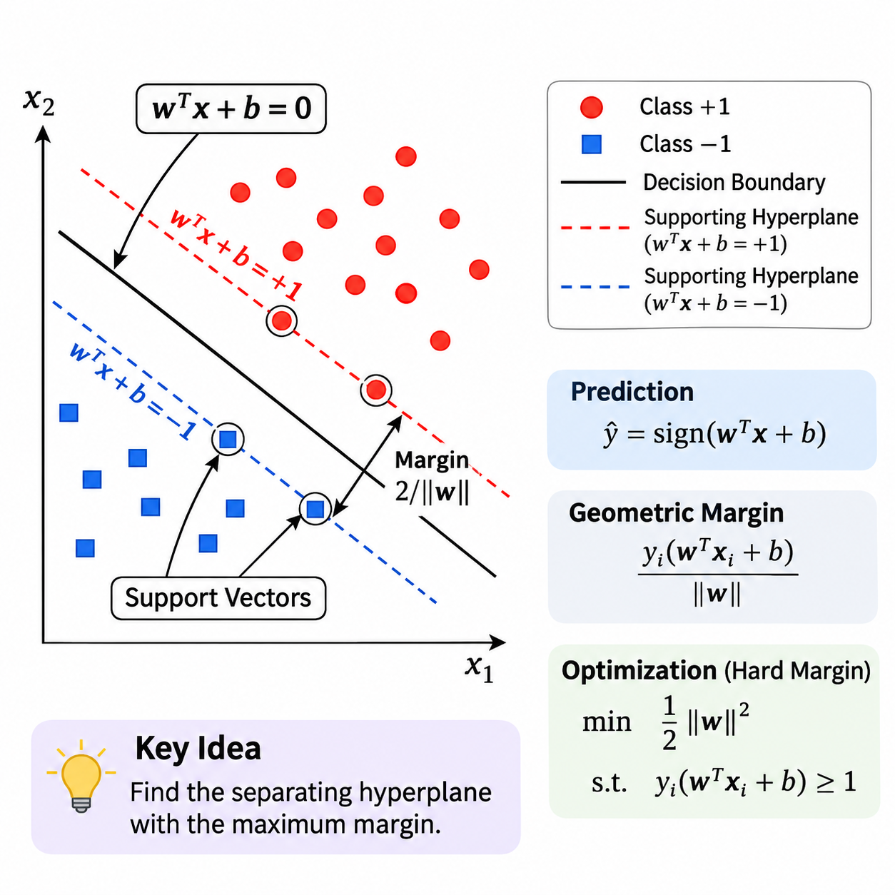
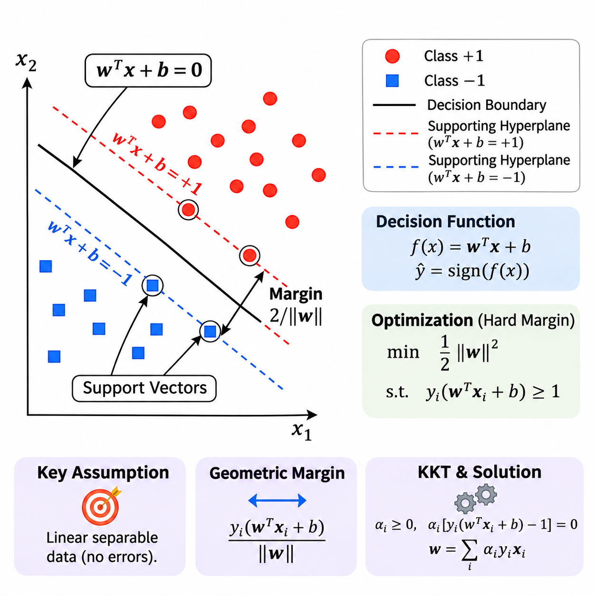
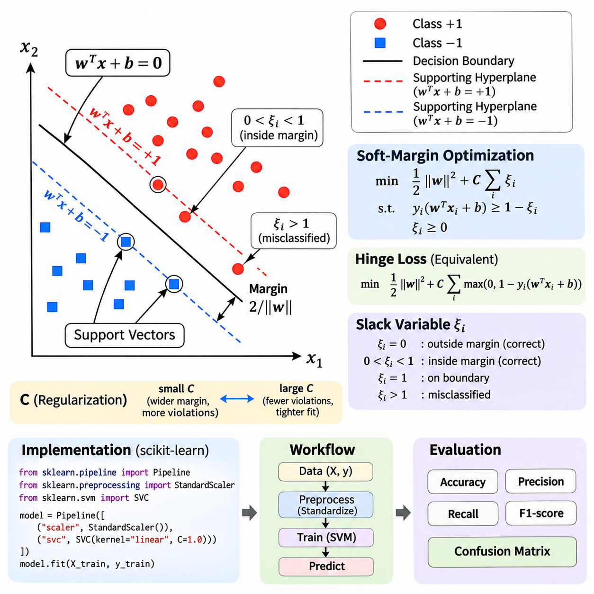
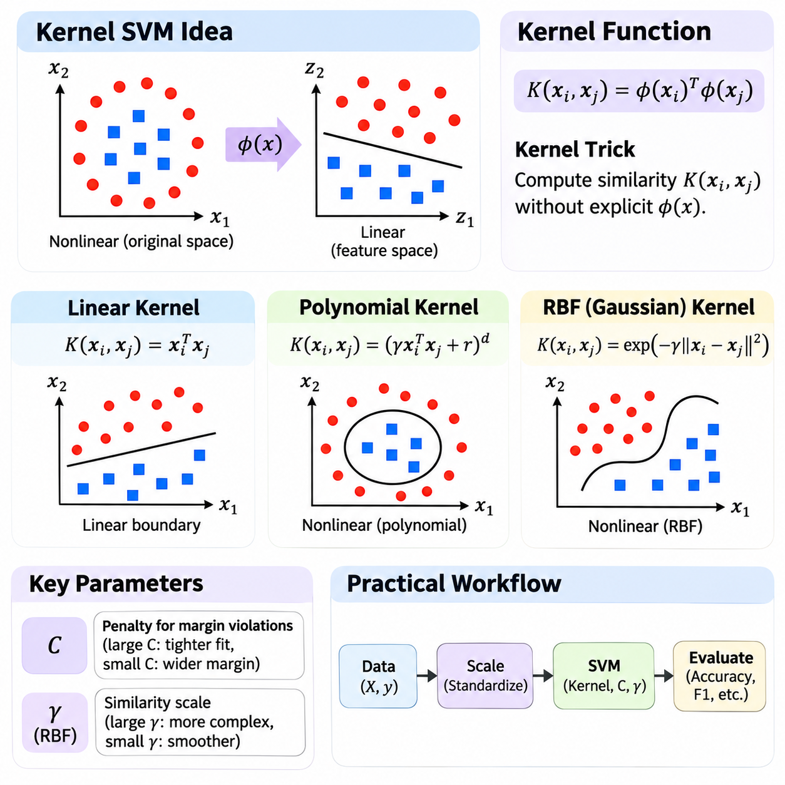
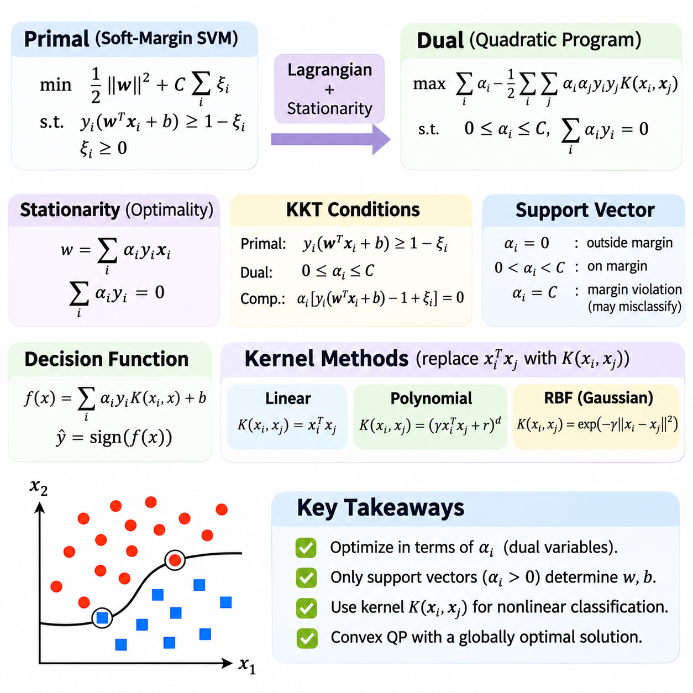
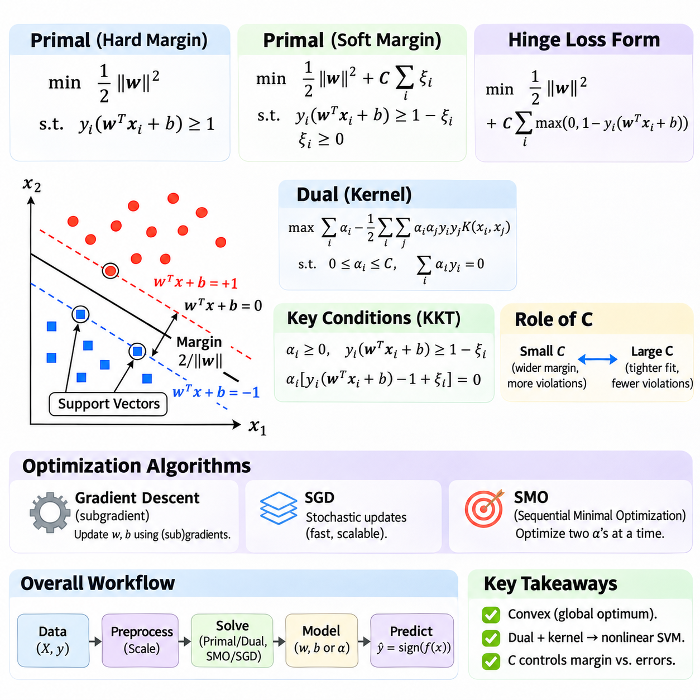
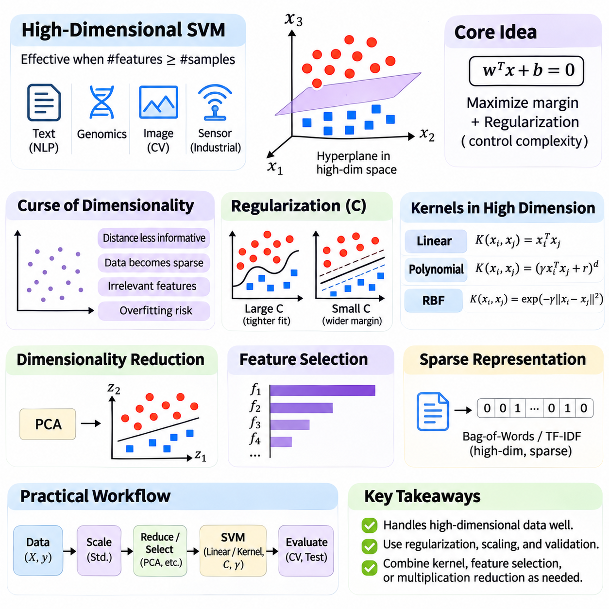
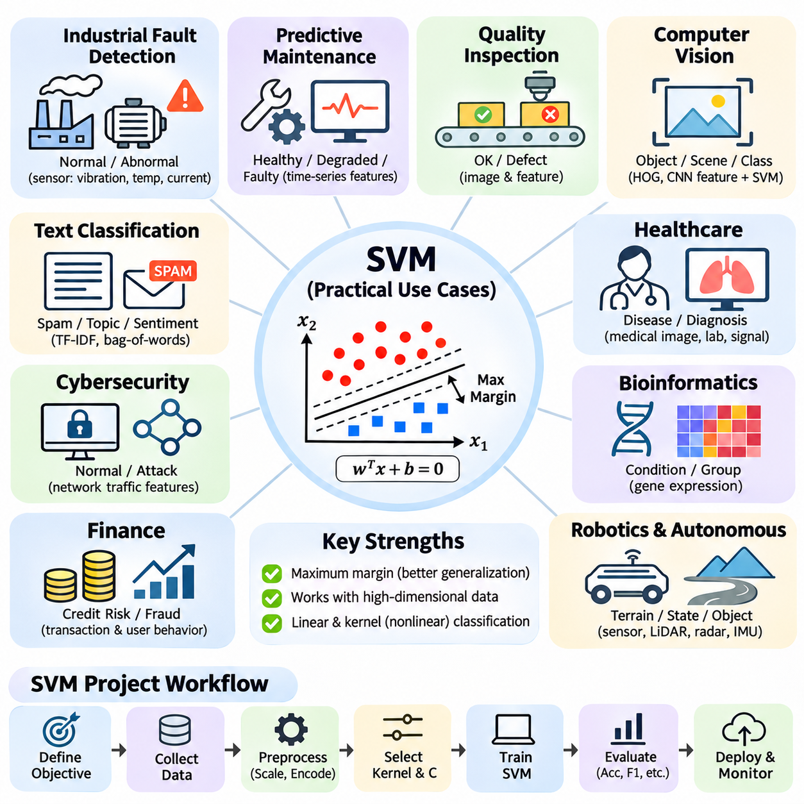

**Volume 08. Supervised Learning**


# 03. SVM

## 03.00 Maximum Margin Concept

{width="7.268055555555556in" height="7.268055555555556in"}

Support Vector Machines (SVMs) are supervised learning algorithms designed to classify data by identifying a decision boundary that separates different classes. Their central principle is maximum margin classification, which seeks a boundary that provides the greatest possible separation between the nearest training samples of opposing classes. Rather than merely finding a boundary that classifies the training data correctly, SVM aims to construct one that supports reliable generalization.

In binary classification, each training sample is represented by a feature vector and a corresponding class label. The labels are commonly expressed as +1 and -1, allowing the classification problem to be formulated mathematically. A linear decision boundary divides the feature space into two regions, with each region representing one class. The SVM learning process determines the position and orientation of this boundary according to the geometric distribution of the training samples.

The decision boundary of a linear SVM is represented by the equation wᵀx + b = 0, where w is the weight vector, x is the input feature vector, and b is the bias term. The weight vector determines the orientation of the separating hyperplane, while the bias controls its position. A prediction is obtained from the sign of wᵀx + b. Positive values indicate one class, whereas negative values indicate the other class.

A hyperplane is a geometric structure that separates a feature space into distinct regions. In two dimensions, the hyperplane corresponds to a straight line, while in three dimensions, it becomes a plane. In higher-dimensional spaces, the same mathematical principle applies even though direct visualization becomes difficult. SVM uses this generalized geometric representation to construct classification boundaries across datasets containing many numerical features.

The margin represents the distance between the separating hyperplane and the nearest training samples from either class. A larger margin creates a wider region around the decision boundary without training samples entering that region under strict linear separability assumptions. Maximum margin classification selects the hyperplane that maximizes this separation. This geometric objective distinguishes SVM from classifiers that primarily minimize training classification errors.

The nearest training samples that determine the margin are called support vectors. These samples play a particularly important role because they define the position of the optimal separating hyperplane. Training samples located far from the boundary generally have less influence on the final solution. Consequently, the geometry of a relatively small subset of training observations can determine the classification boundary learned from a much larger dataset.

The geometric margin of an individual training sample can be expressed as yᵢ(wᵀxᵢ + b)/\|\|w\|\|, where yᵢ is the class label and \|\|w\|\| is the Euclidean norm of the weight vector. This expression measures the signed perpendicular distance between the sample and the decision boundary. Correctly classified samples have positive geometric margins, while incorrectly classified samples have negative margins. The minimum geometric margin describes the classifier\'s closest separation.

Maximum margin optimization seeks to maximize the smallest geometric margin across all training samples. This objective emphasizes the observations closest to the decision boundary rather than treating every correctly classified observation as equally influential. By improving the worst-case separation, the classifier constructs a boundary that is less sensitive to small changes near the class interface. However, a large training margin alone does not guarantee strong performance on unseen data.

For linearly separable training data, the separating hyperplane can be normalized so that the closest samples satisfy yᵢ(wᵀxᵢ + b) = 1. Under this normalization, the two supporting hyperplanes are represented by wᵀx + b = +1 and wᵀx + b = -1. The perpendicular distance between these supporting hyperplanes equals 2/\|\|w\|\|. Maximizing the margin therefore becomes equivalent to minimizing the magnitude of the weight vector.

The maximum margin objective can be expressed as minimizing (1/2)\|\|w\|\|² subject to yᵢ(wᵀxᵢ + b) ≥ 1 for every training sample. The objective function encourages a wide separating margin, while the constraints require all training observations to lie on the correct side of their corresponding supporting hyperplanes. This formulation provides the mathematical foundation for hard-margin SVM and connects geometric classification with constrained optimization.

The optimization problem is convex because its quadratic objective is convex and its constraints are linear. Consequently, when a feasible solution exists, an optimization algorithm can identify a globally optimal separating hyperplane rather than becoming trapped in a suboptimal local minimum. This property makes the maximum margin formulation mathematically attractive. The resulting solution is determined by the training data, the constraints, and the optimization objective.

The maximum margin principle is closely related to the concept of generalization in machine learning. A classifier that separates training samples with a narrow margin may be sensitive to small perturbations in feature values. A wider margin can provide greater tolerance to such perturbations when the classifier and data representation remain fixed. Margin-based learning theory also provides generalization bounds under appropriate assumptions, although actual performance depends on data quality and distribution.

Consider a dataset containing two categories of objects represented by height and width measurements. Several straight lines might separate the training samples perfectly, but their distances from the nearest objects could differ substantially. A maximum margin classifier selects the line that maintains the largest minimum separation from both categories. This example demonstrates why SVM focuses on the geometric quality of the boundary rather than classification correctness alone.

Feature scaling is particularly important for maximum margin classification because distances and weight magnitudes depend on the numerical representation of the features. If one feature ranges from zero to thousands while another ranges from zero to one, the larger-scale feature may disproportionately influence the separating geometry. Standardization or normalization helps establish a more balanced feature space, allowing the optimization process to reflect meaningful relationships among variables.

The maximum margin concept also explains why SVM can be effective in high-dimensional feature spaces. Classification depends on the geometry of the separating hyperplane and the relationship between support vectors and the decision boundary. However, increasing dimensionality does not automatically improve classification quality. Irrelevant features, noisy measurements, and poorly scaled variables can distort distances and reduce generalization performance despite the mathematical advantages of margin maximization.

Real-world datasets are rarely perfectly linearly separable because observations may overlap, contain measurement errors, or include outliers. A strict maximum margin classifier cannot satisfy all separation constraints when conflicting samples prevent a feasible linear boundary. This limitation motivates soft-margin SVM, which permits controlled violations of the margin constraints. The broader SVM framework balances margin width against classification penalties through regularization.

The geometric interpretation of maximum margin classification also provides insight into model robustness. Samples located far from the decision boundary can tolerate larger feature perturbations before their predicted labels change. Samples close to the boundary are more vulnerable to classification changes. This relationship is especially relevant in industrial monitoring, sensor-based recognition, and automated inspection, where measurement uncertainty may affect observations near classification thresholds.

Maximum margin classification should not be interpreted as maximizing the physical distance between entire classes or their average positions. Instead, it maximizes the minimum signed distance between the training observations and the separating hyperplane under a specified normalization. The distinction is important because class centroids and distant observations may contribute little to the final boundary. Support vectors capture the critical local geometry of the classification problem.

The maximum margin concept establishes the theoretical foundation for understanding more advanced SVM techniques. Hard-margin SVM formalizes strict separation, soft-margin SVM introduces tolerance for overlapping observations, and kernel methods extend separation into transformed feature spaces. Dual optimization reveals how support vectors determine the solution through inner products. Together, these developments preserve the central idea that effective classification can emerge from carefully optimized geometric separation.

서포트 벡터 머신(Support Vector Machine, SVM)은 서로 다른 클래스(Class)를 구분하는 결정 경계(Decision Boundary)를 식별하도록 설계된 지도학습(Supervised Learning) 알고리즘이다. 핵심 원리는 최대 마진 분류(Maximum Margin Classification)로, 서로 다른 클래스에 속한 가장 가까운 학습 샘플(Training Sample) 사이에서 가능한 가장 넓은 분리 영역을 확보하는 결정 경계를 찾는 것이다. SVM은 단순히 학습 데이터를 올바르게 분류하는 경계를 찾는 데 그치지 않고, 새로운 데이터에 대해서도 안정적인 일반화(Generalization)를 지원하는 경계를 구성하는 것을 목표로 한다.

이진 분류(Binary Classification)에서는 각 학습 샘플을 특징 벡터(Feature Vector)와 해당 클래스 레이블(Class Label)로 표현한다. 레이블은 일반적으로 +1과 -1로 나타내며, 이를 통해 분류 문제를 수학적으로 정식화할 수 있다. 선형 결정 경계(Linear Decision Boundary)는 특징 공간(Feature Space)을 두 영역으로 나누고, 각 영역은 하나의 클래스를 나타낸다. SVM의 학습 과정은 학습 샘플의 기하학적 분포(Geometric Distribution)에 따라 결정 경계의 위치와 방향을 결정한다.

선형 SVM(Linear SVM)의 결정 경계는 wᵀx + b = 0이라는 방정식으로 표현된다. 여기서 w는 가중치 벡터(Weight Vector), x는 입력 특징 벡터(Input Feature Vector), b는 편향항(Bias Term)을 의미한다. 가중치 벡터는 분리 초평면(Separating Hyperplane)의 방향을 결정하고, 편향항은 그 위치를 조절한다. 예측 결과는 wᵀx + b의 부호(Sign)에 따라 결정되며, 양수는 하나의 클래스를 나타내고 음수는 다른 클래스를 나타낸다.

초평면(Hyperplane)은 특징 공간을 서로 다른 영역으로 분리하는 기하학적 구조(Geometric Structure)이다. 2차원 공간(Two-Dimensional Space)에서 초평면은 직선(Straight Line)에 해당하고, 3차원 공간(Three-Dimensional Space)에서는 평면(Plane)이 된다. 고차원 공간(High-Dimensional Space)에서도 동일한 수학적 원리가 적용되지만 직접적인 시각화(Visualization)는 어려워진다. SVM은 이러한 일반화된 기하학적 표현을 활용하여 다수의 수치형 특징(Numerical Feature)을 포함하는 데이터셋(Dataset)의 분류 경계를 구성한다.

마진(Margin)은 분리 초평면과 각 클래스에서 가장 가까운 학습 샘플 사이의 거리를 의미한다. 마진이 클수록 엄격한 선형 분리 가능성(Linear Separability)을 가정할 때 결정 경계 주변에 학습 샘플이 침범하지 않는 넓은 영역이 형성된다. 최대 마진 분류는 이러한 분리 거리를 최대화하는 초평면을 선택한다. 이 기하학적 목적(Geometric Objective)은 주로 학습 분류 오류(Training Classification Error)를 최소화하는 분류기(Classifier)와 SVM을 구별하는 중요한 특징이다.

마진을 결정하는 가장 가까운 학습 샘플을 서포트 벡터(Support Vector)라고 한다. 이러한 샘플은 최적 분리 초평면(Optimal Separating Hyperplane)의 위치를 정의하기 때문에 특히 중요한 역할을 수행한다. 결정 경계에서 멀리 떨어진 학습 샘플은 일반적으로 최종 해(Final Solution)에 미치는 영향이 작다. 따라서 상대적으로 적은 수의 학습 관측값(Training Observation)이 가진 기하학적 구조가 훨씬 큰 데이터셋으로부터 학습된 분류 경계를 결정할 수 있다.

개별 학습 샘플의 기하학적 마진(Geometric Margin)은 yᵢ(wᵀxᵢ + b)/\|\|w\|\|로 표현할 수 있다. 여기서 yᵢ는 클래스 레이블이며, \|\|w\|\|는 가중치 벡터의 유클리드 노름(Euclidean Norm)을 의미한다. 이 식은 샘플과 결정 경계 사이의 부호가 있는 수직 거리(Signed Perpendicular Distance)를 측정한다. 올바르게 분류된 샘플은 양의 기하학적 마진을 가지며, 잘못 분류된 샘플은 음의 마진을 가진다. 최소 기하학적 마진(Minimum Geometric Margin)은 분류기의 가장 가까운 분리 거리를 나타낸다.

최대 마진 최적화(Maximum Margin Optimization)는 모든 학습 샘플에 대한 최소 기하학적 마진을 최대화하는 것을 목표로 한다. 이러한 목적은 올바르게 분류된 모든 관측값을 동일하게 중요하게 취급하기보다 결정 경계에 가장 가까운 관측값을 강조한다. 최악의 경우에 해당하는 분리 거리(Worst-Case Separation)를 개선함으로써 분류기는 클래스 경계 부근의 작은 변화에 덜 민감한 결정 경계를 구성한다. 그러나 학습 데이터에서 큰 마진을 확보했다고 해서 보지 못한 데이터(Unseen Data)에 대한 우수한 성능이 반드시 보장되는 것은 아니다.

선형적으로 분리 가능한 학습 데이터에서는 가장 가까운 샘플이 yᵢ(wᵀxᵢ + b) = 1을 만족하도록 분리 초평면을 정규화(Normalization)할 수 있다. 이러한 정규화 아래에서 두 지지 초평면(Supporting Hyperplane)은 wᵀx + b = +1과 wᵀx + b = -1로 표현된다. 두 지지 초평면 사이의 수직 거리는 2/\|\|w\|\|와 같다. 따라서 마진을 최대화하는 문제는 가중치 벡터의 크기를 최소화하는 문제와 동등해진다.

최대 마진 목적 함수(Maximum Margin Objective)는 모든 학습 샘플에 대해 yᵢ(wᵀxᵢ + b) ≥ 1이라는 제약조건(Constraint)을 만족하면서 (1/2)\|\|w\|\|²을 최소화하는 형태로 표현할 수 있다. 목적 함수(Objective Function)는 넓은 분리 마진을 유도하고, 제약조건은 모든 학습 관측값이 해당 지지 초평면의 올바른 쪽에 위치하도록 요구한다. 이러한 정식화(Formulation)는 하드 마진 SVM(Hard-Margin SVM)의 수학적 기반을 제공하며, 기하학적 분류와 제약 최적화(Constrained Optimization)를 연결한다.

이 최적화 문제(Optimization Problem)는 이차 목적 함수(Quadratic Objective)가 볼록 함수(Convex Function)이고 제약조건이 선형(Linear)이기 때문에 볼록 최적화 문제(Convex Optimization Problem)에 해당한다. 따라서 실행 가능한 해(Feasible Solution)가 존재하면 최적화 알고리즘(Optimization Algorithm)은 열등한 국소 최솟값(Local Minimum)에 갇히지 않고 전역적으로 최적인 분리 초평면(Globally Optimal Separating Hyperplane)을 찾을 수 있다. 이러한 특성은 최대 마진 정식화를 수학적으로 매력적인 방법으로 만든다. 결과적으로 얻어지는 해는 학습 데이터, 제약조건, 최적화 목적에 의해 결정된다.

최대 마진 원리는 기계학습(Machine Learning)의 일반화(Generalization) 개념과 밀접하게 관련된다. 좁은 마진으로 학습 샘플을 분리하는 분류기는 특징값(Feature Value)의 작은 변화에도 민감하게 반응할 수 있다. 반면 넓은 마진은 분류기와 데이터 표현(Data Representation)이 고정되어 있을 때 이러한 변화에 대한 더 큰 허용 범위를 제공할 수 있다. 마진 기반 학습 이론(Margin-Based Learning Theory)은 적절한 가정 아래에서 일반화 경계(Generalization Bound)를 제공하지만, 실제 성능은 데이터 품질(Data Quality)과 데이터 분포(Data Distribution)에 따라 달라진다.

높이와 너비 측정값으로 표현된 두 종류의 객체(Object)를 포함하는 데이터셋을 생각해 볼 수 있다. 여러 직선이 학습 샘플을 완벽하게 분리할 수 있지만, 가장 가까운 객체까지의 거리는 직선마다 상당히 다를 수 있다. 최대 마진 분류기는 두 범주(Category)로부터 최소 분리 거리를 가장 크게 유지하는 직선을 선택한다. 이 사례는 SVM이 단순한 분류 정확성(Classification Correctness)뿐 아니라 결정 경계의 기하학적 품질(Geometric Quality)에 집중하는 이유를 보여준다.

특징 스케일링(Feature Scaling)은 최대 마진 분류에서 특히 중요하다. 거리와 가중치 크기는 특징의 수치적 표현(Numerical Representation)에 영향을 받기 때문이다. 하나의 특징은 0에서 수천까지의 값을 가지지만 다른 특징은 0에서 1 사이의 값을 가진다면, 값의 범위가 큰 특징이 분리 기하학(Separation Geometry)에 과도한 영향을 미칠 수 있다. 표준화(Standardization) 또는 정규화(Normalization)는 보다 균형 잡힌 특징 공간을 형성하여 최적화 과정이 변수 사이의 의미 있는 관계를 반영하도록 돕는다.

최대 마진 개념은 SVM이 고차원 특징 공간(High-Dimensional Feature Space)에서 효과적으로 작동할 수 있는 이유도 설명한다. 분류는 분리 초평면의 기하학적 구조와 서포트 벡터 및 결정 경계 사이의 관계에 따라 결정된다. 그러나 차원(Dimensionality)이 증가한다고 해서 분류 품질이 자동으로 향상되는 것은 아니다. 관련성이 낮은 특징(Irrelevant Feature), 잡음이 포함된 측정값(Noisy Measurement), 부적절하게 스케일링된 변수는 거리를 왜곡하고 일반화 성능을 저하시킬 수 있다.

실제 데이터셋은 관측값의 중첩(Overlap), 측정 오류(Measurement Error), 이상치(Outlier) 등으로 인해 완벽하게 선형 분리되는 경우가 드물다. 엄격한 최대 마진 분류기는 서로 충돌하는 샘플 때문에 실행 가능한 선형 경계가 존재하지 않으면 모든 분리 제약조건을 만족시킬 수 없다. 이러한 한계는 마진 제약조건의 위반을 통제된 범위에서 허용하는 소프트 마진 SVM(Soft-Margin SVM)의 필요성을 제기한다. 확장된 SVM 프레임워크(Framework)는 정규화(Regularization)를 통해 마진 너비와 분류 페널티(Classification Penalty) 사이의 균형을 조절한다.

최대 마진 분류의 기하학적 해석(Geometric Interpretation)은 모델 강건성(Model Robustness)에 대한 통찰도 제공한다. 결정 경계에서 멀리 떨어진 샘플은 예측 레이블(Predicted Label)이 변경되기 전까지 더 큰 특징 교란(Feature Perturbation)을 허용할 수 있다. 반면 경계에 가까운 샘플은 분류 결과가 변경될 가능성이 더 높다. 이러한 관계는 측정 불확실성(Measurement Uncertainty)이 분류 임계값(Classification Threshold) 근처의 관측값에 영향을 줄 수 있는 산업 모니터링(Industrial Monitoring), 센서 기반 인식(Sensor-Based Recognition), 자동 검사(Automated Inspection)에서 특히 중요하다.

최대 마진 분류를 전체 클래스 사이의 물리적 거리(Physical Distance)나 평균 위치 사이의 거리를 최대화하는 방법으로 해석해서는 안 된다. 최대 마진 분류는 지정된 정규화 조건 아래에서 학습 관측값과 분리 초평면 사이의 최소 부호 거리(Minimum Signed Distance)를 최대화한다. 클래스 중심점(Class Centroid)이나 멀리 떨어진 관측값은 최종 결정 경계에 거의 기여하지 않을 수 있으므로 이러한 구분은 중요하다. 서포트 벡터는 분류 문제에서 결정적인 국소 기하학적 구조(Local Geometry)를 포착한다.

최대 마진 개념은 보다 발전된 SVM 기법을 이해하기 위한 이론적 기반(Theoretical Foundation)을 제공한다. 하드 마진 SVM(Hard-Margin SVM)은 엄격한 분리를 수학적으로 정식화하고, 소프트 마진 SVM(Soft-Margin SVM)은 중첩된 관측값에 대한 허용 범위를 도입하며, 커널 방법(Kernel Method)은 변환된 특징 공간(Transformed Feature Space)으로 분리 개념을 확장한다. 쌍대 최적화(Dual Optimization)는 서포트 벡터가 내적(Inner Product)을 통해 해를 결정하는 방식을 설명한다. 이러한 발전은 효과적인 분류가 정교하게 최적화된 기하학적 분리에서 비롯될 수 있다는 핵심 원리를 유지한다.

## 03.01 Hard Margin SVM

{width="7.268055555555556in" height="7.268055555555556in"}

Hard-Margin Support Vector Machine (Hard-Margin SVM) is a supervised classification algorithm that identifies an optimal separating hyperplane when training data is perfectly linearly separable. Its objective is to maximize the geometric margin between two classes while ensuring that every training sample is classified correctly. Unlike methods that tolerate classification errors, Hard-Margin SVM imposes strict constraints requiring complete separation of the training observations.

The fundamental assumption of Hard-Margin SVM is linear separability, meaning that a hyperplane exists that divides all training samples into their respective classes without errors. In a two-dimensional feature space, this boundary is a straight line, while higher-dimensional spaces require a separating hyperplane. If even one observation prevents perfect linear separation, the standard Hard-Margin SVM optimization problem becomes infeasible.

A binary training dataset consists of feature vectors xᵢ and corresponding labels yᵢ, where yᵢ belongs to 1. The classifier constructs a linear decision function f(x) = wᵀx + b, where w represents the weight vector and b represents the bias. Predictions are determined by the sign of this function. A positive result indicates the positive class, while a negative result indicates the negative class, assuming the learned boundary separates the observations correctly.

The separating hyperplane is defined by wᵀx + b = 0. Its orientation depends on the weight vector, which is perpendicular to the hyperplane, while the bias controls its displacement from the origin. Multiple hyperplanes may correctly separate a linearly separable dataset. Hard-Margin SVM selects the hyperplane that maximizes the minimum perpendicular distance between the boundary and the closest training observations from either class.

The margin is the central geometric quantity in Hard-Margin SVM. Two parallel supporting hyperplanes are positioned on opposite sides of the decision boundary and pass through the closest training observations. Under canonical normalization, these supporting hyperplanes satisfy wᵀx + b = +1 and wᵀx + b = -1. Their perpendicular separation equals 2/\|\|w\|\|, where \|\|w\|\| denotes the Euclidean norm of the weight vector.

Maximizing the margin is mathematically equivalent to minimizing the squared magnitude of the weight vector under appropriate classification constraints. The standard primal optimization problem minimizes (1/2)\|\|w\|\|² subject to yᵢ(wᵀxᵢ + b) ≥ 1 for every training observation. These constraints ensure that all samples are correctly classified and remain outside or directly on the supporting hyperplanes defining the margin.

The objective function (1/2)\|\|w\|\|² is convex, and the classification constraints define a convex feasible region. Therefore, Hard-Margin SVM is formulated as a convex quadratic programming problem. When the training data is linearly separable, a globally optimal solution exists under the standard formulation. This property eliminates the difficulty of undesirable local minima commonly encountered in nonconvex optimization problems.

Support vectors are the training observations that lie directly on the margin boundaries. They satisfy yᵢ(wᵀxᵢ + b) = 1 and determine the position and orientation of the optimal separating hyperplane. Observations located farther from the decision boundary satisfy the constraints with strict inequality. Such samples generally do not directly influence the optimal weight vector, although the complete training dataset determines the feasible region.

The importance of support vectors can be understood through geometric sensitivity. Moving a training sample far from the margin often leaves the optimal decision boundary unchanged. However, moving a support vector may alter the position of the separating hyperplane because it changes an active optimization constraint. This property demonstrates that Hard-Margin SVM focuses primarily on the critical observations defining the separation between classes.

The geometric margin of an individual observation is expressed as yᵢ(wᵀxᵢ + b)/\|\|w\|\|. This quantity measures the signed perpendicular distance from the observation to the decision boundary. Positive values indicate correct classification, while negative values indicate incorrect classification. Hard-Margin SVM maximizes the smallest geometric margin across the training dataset, producing a boundary with the greatest possible minimum separation.

A useful example involves two groups of manufactured components represented by dimensional measurements. If all acceptable components occupy one region of the feature space and defective components occupy another linearly separable region, multiple decision boundaries may classify the training samples correctly. Hard-Margin SVM selects the boundary that maximizes separation from the closest examples, providing a geometric buffer between the two categories.

The optimization constraints can also be interpreted through functional margins. The functional margin of an observation is yᵢ(wᵀxᵢ + b), which depends on the scaling of the model parameters. Multiplying both w and b by the same positive constant changes the functional margin without changing the decision boundary. Canonical normalization removes this scaling ambiguity by setting the minimum functional margin to one.

The Lagrangian formulation provides another perspective on Hard-Margin SVM optimization. A nonnegative Lagrange multiplier αᵢ is associated with each classification constraint, allowing the constrained primal problem to be expressed through a Lagrangian function. At the optimum, the weight vector can be represented as w = Σᵢ αᵢyᵢxᵢ. This relationship reveals how selected training observations contribute directly to the separating hyperplane.

The Karush-Kuhn-Tucker conditions characterize optimal solutions through feasibility, stationarity, dual feasibility, and complementary slackness. Complementary slackness requires αᵢ[yᵢ(wᵀxᵢ + b) - 1] = 0. Consequently, observations strictly outside the margin have zero multipliers, while observations on the margin may have positive multipliers. These conditions explain the mathematical relationship between active constraints and support vectors.

The dual formulation expresses the optimization problem using inner products between training observations rather than explicitly optimizing the weight vector. Its objective maximizes Σᵢαᵢ - (1/2)ΣᵢΣⱼαᵢαⱼyᵢyⱼ(xᵢᵀxⱼ), subject to αᵢ ≥ 0 and Σᵢαᵢyᵢ = 0. This representation provides the foundation for understanding kernel methods and the broader mathematical structure of Support Vector Machines.

Feature scaling is essential because Hard-Margin SVM depends on geometric distances in the feature space. Variables measured on substantially different numerical scales can distort the orientation and position of the separating hyperplane. Standardization commonly transforms features to comparable scales before optimization. However, scaling parameters must be estimated from training data and consistently applied to validation, testing, and deployment observations.

Hard-Margin SVM is sensitive to outliers because every training observation must satisfy the strict separation constraints. A single mislabeled sample or unusual measurement may substantially reduce the achievable margin or make the optimization problem infeasible. This limitation becomes especially important in industrial datasets containing sensor noise, annotation errors, or overlapping operating conditions. Perfect training separation is therefore a demanding practical assumption.

Although Hard-Margin SVM achieves zero classification errors on linearly separable training data, this does not guarantee perfect generalization. The quality of predictions on unseen observations depends on the representativeness of the training dataset, the selected features, and the relationship between training and deployment distributions. A large margin can support generalization, but it cannot eliminate uncertainty caused by distribution shifts or inadequate sampling.

The computational characteristics of Hard-Margin SVM depend on the number of observations, feature dimensionality, and optimization method. Quadratic programming approaches can become expensive for large datasets, particularly when using a dual formulation involving pairwise inner products. Primal optimization may be more attractive for certain high-dimensional problems. The appropriate computational strategy depends on the structure and scale of the training data.

Hard-Margin SVM provides a rigorous foundation for understanding margin-based classification, convex optimization, support vectors, and duality. Its strict separation requirement makes it most appropriate for clean, linearly separable datasets and theoretical demonstrations. Real-world classification problems frequently require more flexible alternatives. Soft-Margin SVM extends this framework by introducing slack variables and regularization to balance margin maximization against constraint violations.

하드 마진 서포트 벡터 머신(Hard-Margin Support Vector Machine, Hard-Margin SVM)은 학습 데이터(Training Data)가 완벽하게 선형 분리 가능(Linearly Separable)할 때 최적의 분리 초평면(Optimal Separating Hyperplane)을 식별하는 지도 분류(Supervised Classification) 알고리즘이다. 이 알고리즘의 목적은 모든 학습 샘플(Training Sample)이 올바르게 분류되도록 보장하면서 두 클래스(Class) 사이의 기하학적 마진(Geometric Margin)을 최대화하는 것이다. 분류 오류(Classification Error)를 허용하는 방법과 달리 하드 마진 SVM은 모든 학습 관측값(Training Observation)의 완전한 분리를 요구하는 엄격한 제약조건(Strict Constraint)을 적용한다.

하드 마진 SVM의 기본 가정(Fundamental Assumption)은 선형 분리 가능성(Linear Separability)이다. 이는 모든 학습 샘플을 오류 없이 각각의 클래스로 구분할 수 있는 초평면(Hyperplane)이 존재한다는 의미이다. 2차원 특징 공간(Two-Dimensional Feature Space)에서 이러한 경계는 직선(Straight Line)이며, 고차원 공간(High-Dimensional Space)에서는 분리 초평면(Separating Hyperplane)이 필요하다. 단 하나의 관측값이라도 완벽한 선형 분리를 방해하면 표준 하드 마진 SVM 최적화 문제(Optimization Problem)는 실행 불가능(Infeasible)해진다.

이진 학습 데이터셋(Binary Training Dataset)은 특징 벡터(Feature Vector) xᵢ와 해당 레이블(Label) yᵢ로 구성되며, yᵢ는 1에 속한다. 분류기(Classifier)는 선형 결정 함수(Linear Decision Function) f(x) = wᵀx + b를 구성한다. 여기서 w는 가중치 벡터(Weight Vector)를 나타내고 b는 편향(Bias)을 나타낸다. 예측(Prediction)은 이 함수의 부호(Sign)에 따라 결정된다. 학습된 경계가 관측값을 올바르게 분리한다는 가정 아래에서 양의 결과는 양성 클래스(Positive Class)를 나타내고 음의 결과는 음성 클래스(Negative Class)를 나타낸다.

분리 초평면(Separating Hyperplane)은 wᵀx + b = 0으로 정의된다. 초평면의 방향(Orientation)은 초평면에 수직인 가중치 벡터에 의해 결정되며, 편향은 원점(Origin)으로부터의 위치 변화를 제어한다. 선형 분리 가능한 데이터셋에서는 여러 초평면이 학습 샘플을 올바르게 구분할 수 있다. 하드 마진 SVM은 결정 경계(Decision Boundary)와 각 클래스에서 가장 가까운 학습 관측값 사이의 최소 수직 거리(Minimum Perpendicular Distance)를 최대화하는 초평면을 선택한다.

마진(Margin)은 하드 마진 SVM에서 핵심적인 기하학적 수량(Geometric Quantity)이다. 두 개의 평행한 지지 초평면(Supporting Hyperplane)은 결정 경계의 양쪽에 위치하며 가장 가까운 학습 관측값을 통과한다. 정규형 정규화(Canonical Normalization) 조건에서 이러한 지지 초평면은 wᵀx + b = +1과 wᵀx + b = -1을 만족한다. 두 초평면 사이의 수직 분리 거리(Perpendicular Separation)는 2/\|\|w\|\|이며, 여기서 \|\|w\|\|는 가중치 벡터의 유클리드 노름(Euclidean Norm)을 의미한다.

마진 최대화(Margin Maximization)는 적절한 분류 제약조건(Classification Constraint) 아래에서 가중치 벡터 크기의 제곱(Squared Magnitude)을 최소화하는 것과 수학적으로 동등하다. 표준 원문제 최적화(Primal Optimization)는 모든 학습 관측값에 대해 yᵢ(wᵀxᵢ + b) ≥ 1을 만족하면서 (1/2)\|\|w\|\|²을 최소화한다. 이러한 제약조건은 모든 샘플이 올바르게 분류되고 마진을 정의하는 지지 초평면 위에 있거나 그 바깥쪽에 위치하도록 보장한다.

목적 함수(Objective Function) (1/2)\|\|w\|\|²은 볼록 함수(Convex Function)이며, 분류 제약조건은 볼록 실행 가능 영역(Convex Feasible Region)을 정의한다. 따라서 하드 마진 SVM은 볼록 이차계획 문제(Convex Quadratic Programming Problem)로 정식화된다. 학습 데이터가 선형 분리 가능하면 표준 정식화(Standard Formulation) 아래에서 전역 최적해(Globally Optimal Solution)가 존재한다. 이러한 특성은 비볼록 최적화(Nonconvex Optimization) 문제에서 흔히 발생하는 바람직하지 않은 국소 최솟값(Local Minimum)의 어려움을 제거한다.

서포트 벡터(Support Vector)는 마진 경계(Margin Boundary) 위에 직접 위치하는 학습 관측값이다. 이러한 관측값은 yᵢ(wᵀxᵢ + b) = 1을 만족하며 최적 분리 초평면의 위치와 방향을 결정한다. 결정 경계에서 더 멀리 떨어진 관측값은 엄격한 부등식(Strict Inequality)으로 제약조건을 만족한다. 이러한 샘플은 일반적으로 최적 가중치 벡터(Optimal Weight Vector)에 직접적인 영향을 미치지 않지만, 전체 학습 데이터셋은 실행 가능 영역을 결정한다.

서포트 벡터의 중요성은 기하학적 민감도(Geometric Sensitivity)를 통해 이해할 수 있다. 마진에서 멀리 떨어진 학습 샘플을 이동시키더라도 최적 결정 경계가 변경되지 않는 경우가 많다. 그러나 서포트 벡터를 이동시키면 활성 최적화 제약조건(Active Optimization Constraint)이 변경되므로 분리 초평면의 위치가 달라질 수 있다. 이러한 특성은 하드 마진 SVM이 클래스 사이의 분리를 정의하는 핵심 관측값(Critical Observation)에 주로 집중한다는 사실을 보여준다.

개별 관측값의 기하학적 마진(Geometric Margin)은 yᵢ(wᵀxᵢ + b)/\|\|w\|\|로 표현된다. 이 값은 관측값에서 결정 경계까지의 부호가 있는 수직 거리(Signed Perpendicular Distance)를 측정한다. 양의 값은 올바른 분류(Correct Classification)를 나타내며, 음의 값은 잘못된 분류(Incorrect Classification)를 나타낸다. 하드 마진 SVM은 전체 학습 데이터셋에서 가장 작은 기하학적 마진을 최대화하여 가능한 가장 큰 최소 분리 거리(Minimum Separation)를 갖는 경계를 생성한다.

유용한 사례로 치수 측정값(Dimensional Measurement)으로 표현된 두 그룹의 제조 부품(Manufactured Component)을 생각할 수 있다. 모든 정상 부품(Acceptable Component)이 특징 공간의 한 영역에 위치하고 불량 부품(Defective Component)이 선형 분리 가능한 다른 영역에 위치한다면, 여러 결정 경계가 학습 샘플을 올바르게 분류할 수 있다. 하드 마진 SVM은 가장 가까운 샘플과의 분리 거리를 최대화하는 경계를 선택하여 두 범주(Category) 사이에 기하학적 완충 영역(Geometric Buffer)을 제공한다.

최적화 제약조건은 함수적 마진(Functional Margin)을 통해서도 해석할 수 있다. 관측값의 함수적 마진은 yᵢ(wᵀxᵢ + b)이며, 모델 매개변수(Model Parameter)의 스케일링(Scaling)에 따라 달라진다. w와 b에 동일한 양의 상수(Positive Constant)를 곱하면 결정 경계는 변경되지 않지만 함수적 마진은 달라진다. 정규형 정규화(Canonical Normalization)는 최소 함수적 마진(Minimum Functional Margin)을 1로 설정하여 이러한 스케일링의 모호성(Scaling Ambiguity)을 제거한다.

라그랑주 정식화(Lagrangian Formulation)는 하드 마진 SVM 최적화에 대한 또 다른 관점을 제공한다. 각 분류 제약조건에는 음이 아닌 라그랑주 승수(Lagrange Multiplier) αᵢ가 연결되며, 이를 통해 제약된 원문제(Constrained Primal Problem)를 라그랑주 함수(Lagrangian Function)로 표현할 수 있다. 최적점(Optimum)에서 가중치 벡터는 w = Σᵢ αᵢyᵢxᵢ로 표현된다. 이러한 관계는 선택된 학습 관측값이 분리 초평면에 직접 기여하는 방식을 보여준다.

카루시-쿤-터커 조건(Karush-Kuhn-Tucker Conditions, KKT Conditions)은 실행 가능성(Feasibility), 정상성(Stationarity), 쌍대 실행 가능성(Dual Feasibility), 상보적 여유성(Complementary Slackness)을 통해 최적해를 특징짓는다. 상보적 여유성은 αᵢ[yᵢ(wᵀxᵢ + b) - 1] = 0을 요구한다. 따라서 마진 바깥쪽에 엄격하게 위치한 관측값은 영의 승수(Zero Multiplier)를 가지며, 마진 위의 관측값은 양의 승수(Positive Multiplier)를 가질 수 있다. 이러한 조건은 활성 제약조건(Active Constraint)과 서포트 벡터 사이의 수학적 관계를 설명한다.

쌍대 정식화(Dual Formulation)는 가중치 벡터를 직접 최적화하는 대신 학습 관측값 사이의 내적(Inner Product)을 사용하여 최적화 문제를 표현한다. 목적 함수는 Σᵢαᵢ - (1/2)ΣᵢΣⱼαᵢαⱼyᵢyⱼ(xᵢᵀxⱼ)를 최대화하며, αᵢ ≥ 0과 Σᵢαᵢyᵢ = 0이라는 제약조건을 따른다. 이러한 표현은 커널 방법(Kernel Method)과 서포트 벡터 머신(Support Vector Machine)의 보다 폭넓은 수학적 구조를 이해하기 위한 기반을 제공한다.

특징 스케일링(Feature Scaling)은 하드 마진 SVM이 특징 공간의 기하학적 거리(Geometric Distance)에 의존하기 때문에 필수적이다. 수치적 척도(Numerical Scale)가 크게 다른 변수는 분리 초평면의 방향과 위치를 왜곡할 수 있다. 표준화(Standardization)는 일반적으로 최적화 이전에 특징을 비교 가능한 척도로 변환한다. 그러나 스케일링 매개변수(Scaling Parameter)는 학습 데이터에서 추정해야 하며, 검증(Validation), 테스트(Testing), 배포(Deployment) 단계의 관측값에도 일관되게 적용해야 한다.

하드 마진 SVM은 모든 학습 관측값이 엄격한 분리 제약조건을 만족해야 하므로 이상치(Outlier)에 민감하다. 단 하나의 잘못된 레이블(Mislabeled Sample)이나 비정상적인 측정값(Unusual Measurement)도 달성 가능한 마진을 크게 줄이거나 최적화 문제를 실행 불가능하게 만들 수 있다. 이러한 한계는 센서 잡음(Sensor Noise), 주석 오류(Annotation Error), 중첩된 운용 조건(Overlapping Operating Condition)을 포함하는 산업 데이터셋(Industrial Dataset)에서 특히 중요하다. 따라서 완벽한 학습 데이터 분리는 실제 응용에서 매우 엄격한 가정이다.

하드 마진 SVM이 선형 분리 가능한 학습 데이터에서 분류 오류를 0으로 달성하더라도 완벽한 일반화(Generalization)가 보장되는 것은 아니다. 새로운 관측값(Unseen Observation)에 대한 예측 품질(Prediction Quality)은 학습 데이터셋의 대표성(Representativeness), 선택된 특징(Selected Feature), 학습 분포(Training Distribution)와 배포 분포(Deployment Distribution) 사이의 관계에 따라 달라진다. 큰 마진은 일반화를 지원할 수 있지만 분포 이동(Distribution Shift)이나 불충분한 표본 추출(Inadequate Sampling)로 인한 불확실성(Uncertainty)을 제거할 수는 없다.

하드 마진 SVM의 계산 특성(Computational Characteristics)은 관측값의 수, 특징 차원(Feature Dimensionality), 최적화 방법(Optimization Method)에 따라 달라진다. 이차계획법(Quadratic Programming) 접근 방식은 특히 관측값 사이의 쌍별 내적(Pairwise Inner Product)을 사용하는 쌍대 정식화에서 대규모 데이터셋을 처리할 때 계산 비용이 높아질 수 있다. 특정 고차원 문제에서는 원문제 최적화(Primal Optimization)가 더 유리할 수 있다. 적절한 계산 전략(Computational Strategy)은 학습 데이터의 구조와 규모에 따라 결정된다.

하드 마진 SVM은 마진 기반 분류(Margin-Based Classification), 볼록 최적화(Convex Optimization), 서포트 벡터(Support Vector), 쌍대성(Duality)을 이해하기 위한 엄밀한 이론적 기반(Theoretical Foundation)을 제공한다. 엄격한 분리 요구조건(Strict Separation Requirement)으로 인해 잡음이 적고 선형 분리 가능한 데이터셋이나 이론적 설명(Theoretical Demonstration)에 가장 적합하다. 실제 분류 문제에서는 더 유연한 대안이 필요한 경우가 많다. 소프트 마진 SVM(Soft-Margin SVM)은 슬랙 변수(Slack Variable)와 정규화(Regularization)를 도입하여 마진 최대화와 제약조건 위반(Constraint Violation) 사이의 균형을 조절함으로써 이러한 프레임워크를 확장한다.

## 03.02 Soft Margin SVM

{width="7.268055555555556in" height="7.268055555555556in"}

Soft-Margin Support Vector Machine (Soft-Margin SVM) extends maximum margin classification to datasets that are not perfectly linearly separable. Real-world observations frequently contain overlapping classes, measurement noise, and mislabeled samples, making strict separation impractical. Soft-Margin SVM addresses these limitations by allowing controlled violations of margin constraints while maintaining the objective of constructing a decision boundary with strong generalization properties.

The central difference between Hard-Margin SVM and Soft-Margin SVM is the treatment of classification constraints. Hard-Margin SVM requires every training observation to remain correctly classified outside the margin, whereas Soft-Margin SVM permits selected observations to enter the margin or cross the decision boundary. This flexibility enables optimization even when the training dataset contains overlapping distributions or observations that cannot be separated by a single hyperplane.

Soft-Margin SVM introduces nonnegative slack variables ξᵢ to quantify violations of the margin constraints. For each training observation, the classification condition becomes yᵢ(wᵀxᵢ + b) ≥ 1 - ξᵢ, with ξᵢ ≥ 0. A slack value of zero indicates that the observation satisfies the original margin constraint. Positive values indicate violations, allowing the optimization process to accommodate difficult observations without abandoning margin maximization.

The interpretation of slack variables depends on their magnitude. When 0 \< ξᵢ \< 1, an observation lies inside the margin but remains correctly classified. When ξᵢ = 1, the observation lies directly on the decision boundary. When ξᵢ \> 1, the observation is incorrectly classified. These relationships provide a geometric interpretation of classification violations and explain how Soft-Margin SVM distinguishes margin penetration from actual prediction errors.

The standard Soft-Margin SVM optimization problem minimizes (1/2)\|\|w\|\|² + CΣᵢξᵢ, subject to yᵢ(wᵀxᵢ + b) ≥ 1 - ξᵢ and ξᵢ ≥ 0. The first term encourages a wide geometric margin by controlling the weight vector magnitude. The second term penalizes violations of the margin constraints. Together, these terms establish a balance between maximizing separation and accommodating imperfect training observations.

The regularization parameter C determines the relative importance of margin violations during optimization. A large C assigns a substantial penalty to violations, encouraging the classifier to fit training observations more strictly. A small C reduces the penalty, allowing a wider margin with more violations. Selecting C therefore controls the tradeoff between fitting the training data and maintaining a simpler decision boundary with potentially better generalization.

Soft-Margin SVM can also be understood through hinge loss, a loss function commonly used in margin-based classification. For an observation with label yᵢ and decision score f(xᵢ), hinge loss is max(0, 1 - yᵢf(xᵢ)). Correctly classified observations outside the margin have zero loss, while observations inside the margin or incorrectly classified observations receive positive penalties. This formulation connects geometric margin constraints with empirical risk minimization.

The unconstrained objective can be expressed as (1/2)\|\|w\|\|² + CΣᵢmax(0, 1 - yᵢ(wᵀxᵢ + b)). This representation eliminates explicit slack variables by incorporating margin violations directly into the loss function. The resulting optimization problem remains convex for linear SVMs. Consequently, suitable optimization algorithms can identify globally optimal solutions without the local-minimum difficulties associated with many nonconvex learning models.

The implementation of Soft-Margin SVM begins with preparing a labeled dataset containing numerical feature vectors and corresponding class labels. Data quality should be examined before training because missing values, inconsistent measurements, and extreme outliers can influence the learned decision boundary. A practical workflow separates observations into training and testing subsets, preserving representative class distributions whenever possible.

Feature scaling is particularly important because SVM optimization depends on distances and inner products in feature space. Standardization commonly transforms each feature using its training-set mean and standard deviation. This prevents variables with large numerical ranges from dominating the optimization geometry. The same transformation must be applied to validation and testing observations to avoid inconsistent representations and unintended data leakage.

A practical Python implementation can use the SVC classifier provided by scikit-learn. The model can be initialized with a linear kernel and a selected regularization parameter C, then trained using the fit method. The predict method generates class labels for unseen observations, while decision_function returns signed decision scores relative to the learned boundary. These operations provide a straightforward implementation without requiring manual quadratic programming.

For example, a binary classification experiment can use a synthetic dataset generated with make_classification, followed by train_test_split to establish independent training and testing subsets. A Pipeline combining StandardScaler and SVC(kernel="linear", C=1.0) performs feature standardization and classification in a consistent sequence. Fitting the pipeline on training data ensures that scaling parameters are learned without accessing testing observations.

After training, model performance can be evaluated using accuracy, precision, recall, F1-score, and a confusion matrix. Accuracy measures the overall proportion of correct predictions, while precision and recall provide additional insight into different types of classification errors. F1-score combines precision and recall into a single measure. These metrics are especially useful when class distributions are imbalanced or different prediction errors have unequal practical consequences.

Hyperparameter tuning focuses primarily on the regularization parameter C for a linear Soft-Margin SVM. Candidate values can be evaluated through cross-validation, preferably using stratified folds for classification datasets. A logarithmic search range, such as 0.01, 0.1, 1, 10, and 100, provides a practical starting point. The optimal value should be selected using validation performance rather than training accuracy alone, reducing the risk of overfitting.

The support vectors of Soft-Margin SVM include observations that lie on the margin, inside the margin, or on the incorrect side of the decision boundary. These observations influence the learned hyperplane through the dual optimization formulation. In the standard formulation, the associated dual coefficients satisfy 0 ≤ αᵢ ≤ C. This upper bound reflects the role of regularization and distinguishes Soft-Margin SVM from the unconstrained upper range of Hard-Margin SVM multipliers.

The computational cost of Soft-Margin SVM depends on dataset size, feature dimensionality, kernel selection, and optimization strategy. Kernel-based SVC implementations may become expensive for very large datasets because they involve relationships between training observations. LinearSVC provides an alternative optimized for linear classification and can be more suitable for high-dimensional or large-scale problems. Implementation choices should reflect computational resources and application requirements.

Soft-Margin SVM is useful in industrial classification problems where sensor measurements contain uncertainty and class boundaries are imperfect. Examples include equipment fault detection, product quality inspection, document classification, and predictive maintenance. In these applications, allowing controlled margin violations can produce more practical classifiers than enforcing perfect separation. However, performance still depends on representative training data and appropriate feature engineering.

A robust implementation should also consider class imbalance, outlier sensitivity, and deployment conditions. Class weights can adjust the relative penalty assigned to errors from different classes, while cross-validation helps estimate performance stability. Monitoring feature distributions after deployment can reveal changes that reduce prediction reliability. These practices connect the mathematical flexibility of Soft-Margin SVM with dependable machine learning system operation.

Soft-Margin SVM preserves the geometric foundation of maximum margin classification while introducing a practical mechanism for handling imperfect data. Slack variables, hinge loss, and regularization transform strict separation into a controlled optimization tradeoff. Through standardized preprocessing, appropriate parameter selection, and systematic evaluation, Soft-Margin SVM provides a reliable baseline for many supervised classification tasks and establishes the foundation for nonlinear kernel-based extensions.

소프트 마진 서포트 벡터 머신(Soft-Margin Support Vector Machine, Soft-Margin SVM)은 완벽하게 선형 분리(Linearly Separable)되지 않는 데이터셋(Dataset)에도 최대 마진 분류(Maximum Margin Classification)를 적용할 수 있도록 확장한 알고리즘이다. 실제 관측값(Real-World Observation)에는 클래스 중첩(Class Overlap), 측정 잡음(Measurement Noise), 잘못된 레이블(Mislabeled Sample)이 자주 포함되므로 엄격한 분리는 현실적으로 어렵다. 소프트 마진 SVM은 강력한 일반화 특성(Generalization Property)을 갖는 결정 경계(Decision Boundary)를 구성한다는 목표를 유지하면서 마진 제약조건(Margin Constraint)의 위반을 통제된 범위에서 허용하여 이러한 한계를 해결한다.

하드 마진 SVM(Hard-Margin SVM)과 소프트 마진 SVM(Soft-Margin SVM)의 핵심적인 차이는 분류 제약조건(Classification Constraint)을 처리하는 방식에 있다. 하드 마진 SVM은 모든 학습 관측값(Training Observation)이 마진 바깥쪽에서 올바르게 분류될 것을 요구하지만, 소프트 마진 SVM은 일부 관측값이 마진 내부로 진입하거나 결정 경계를 넘어가는 것을 허용한다. 이러한 유연성(Flexibility)은 학습 데이터셋에 중첩된 분포(Overlapping Distribution)나 단일 초평면(Hyperplane)으로 분리할 수 없는 관측값이 포함되어 있어도 최적화(Optimization)를 수행할 수 있게 한다.

소프트 마진 SVM은 마진 제약조건의 위반 정도를 정량화하기 위해 음이 아닌 슬랙 변수(Nonnegative Slack Variable) ξᵢ를 도입한다. 각 학습 관측값에 대한 분류 조건은 yᵢ(wᵀxᵢ + b) ≥ 1 - ξᵢ로 변경되며, ξᵢ ≥ 0을 만족해야 한다. 슬랙 값(Slack Value)이 0이면 해당 관측값이 원래의 마진 제약조건을 만족한다는 의미이다. 양의 값(Positive Value)은 제약조건 위반을 나타내며, 최적화 과정이 마진 최대화(Margin Maximization)를 포기하지 않으면서 분류하기 어려운 관측값을 수용하도록 한다.

슬랙 변수(Slack Variable)의 해석은 그 크기에 따라 달라진다. 0 \< ξᵢ \< 1이면 관측값이 마진 내부에 있지만 여전히 올바르게 분류된 상태이다. ξᵢ = 1이면 관측값이 결정 경계(Decision Boundary) 위에 직접 위치한다. ξᵢ \> 1이면 해당 관측값은 잘못 분류된 상태이다. 이러한 관계는 분류 제약조건 위반(Classification Constraint Violation)에 대한 기하학적 해석(Geometric Interpretation)을 제공하며, 소프트 마진 SVM이 마진 침범(Margin Penetration)과 실제 예측 오류(Prediction Error)를 구별하는 방식을 설명한다.

표준 소프트 마진 SVM 최적화 문제(Standard Soft-Margin SVM Optimization Problem)는 yᵢ(wᵀxᵢ + b) ≥ 1 - ξᵢ 및 ξᵢ ≥ 0이라는 제약조건 아래에서 (1/2)\|\|w\|\|² + CΣᵢξᵢ를 최소화한다. 첫 번째 항(Term)은 가중치 벡터(Weight Vector)의 크기를 제어하여 넓은 기하학적 마진(Geometric Margin)을 유도한다. 두 번째 항은 마진 제약조건 위반에 페널티(Penalty)를 부과한다. 이 두 항은 분리 거리의 최대화와 불완전한 학습 관측값의 수용 사이에서 균형을 형성한다.

정규화 매개변수(Regularization Parameter) C는 최적화 과정에서 마진 위반(Margin Violation)의 상대적 중요도를 결정한다. 큰 C 값은 위반에 높은 페널티를 부과하여 분류기가 학습 관측값을 더욱 엄격하게 맞추도록 유도한다. 작은 C 값은 페널티를 줄여 더 많은 위반을 허용하면서 넓은 마진을 형성할 수 있게 한다. 따라서 C를 선택하는 것은 학습 데이터 적합(Training Data Fitting)과 잠재적으로 더 나은 일반화(Generalization)를 제공하는 단순한 결정 경계 사이의 절충 관계(Tradeoff)를 제어하는 과정이다.

소프트 마진 SVM은 마진 기반 분류(Margin-Based Classification)에서 일반적으로 사용하는 손실 함수(Loss Function)인 힌지 손실(Hinge Loss)을 통해서도 이해할 수 있다. 레이블(Label) yᵢ와 결정 점수(Decision Score) f(xᵢ)를 갖는 관측값의 힌지 손실은 max(0, 1 - yᵢf(xᵢ))로 정의된다. 마진 바깥쪽에서 올바르게 분류된 관측값은 손실이 0이며, 마진 내부에 있거나 잘못 분류된 관측값에는 양의 페널티가 부과된다. 이러한 정식화(Formulation)는 기하학적 마진 제약조건과 경험적 위험 최소화(Empirical Risk Minimization)를 연결한다.

비제약 목적 함수(Unconstrained Objective Function)는 (1/2)\|\|w\|\|² + CΣᵢmax(0, 1 - yᵢ(wᵀxᵢ + b))로 표현할 수 있다. 이 표현은 마진 위반을 손실 함수에 직접 포함함으로써 명시적인 슬랙 변수(Explicit Slack Variable)를 제거한다. 결과적으로 얻어지는 최적화 문제는 선형 SVM(Linear SVM)에서 여전히 볼록성(Convexity)을 유지한다. 따라서 적절한 최적화 알고리즘(Optimization Algorithm)은 많은 비볼록 학습 모델(Nonconvex Learning Model)에서 발생하는 국소 최솟값(Local Minimum)의 어려움 없이 전역 최적해(Globally Optimal Solution)를 찾을 수 있다.

소프트 마진 SVM의 구현(Implementation)은 수치형 특징 벡터(Numerical Feature Vector)와 해당 클래스 레이블(Class Label)을 포함하는 레이블 데이터셋(Labeled Dataset)을 준비하는 것으로 시작한다. 결측값(Missing Value), 일관되지 않은 측정값(Inconsistent Measurement), 극단적인 이상치(Extreme Outlier)는 학습된 결정 경계에 영향을 줄 수 있으므로 학습 전에 데이터 품질(Data Quality)을 검토해야 한다. 실용적인 작업 흐름(Practical Workflow)에서는 가능한 경우 대표성 있는 클래스 분포(Class Distribution)를 유지하면서 관측값을 학습 및 테스트 부분집합(Training and Testing Subset)으로 분리한다.

특징 스케일링(Feature Scaling)은 SVM 최적화가 특징 공간(Feature Space)의 거리(Distance)와 내적(Inner Product)에 의존하기 때문에 특히 중요하다. 표준화(Standardization)는 일반적으로 학습 데이터의 평균(Mean)과 표준편차(Standard Deviation)를 사용하여 각 특징을 변환한다. 이를 통해 수치 범위(Numerical Range)가 큰 변수가 최적화의 기하학적 구조(Optimization Geometry)를 지배하는 현상을 방지한다. 일관되지 않은 데이터 표현(Data Representation)과 의도하지 않은 데이터 누출(Data Leakage)을 방지하려면 검증 및 테스트 관측값에도 동일한 변환을 적용해야 한다.

실용적인 파이썬 구현(Python Implementation)에서는 사이킷런(scikit-learn)이 제공하는 SVC 분류기(SVC Classifier)를 사용할 수 있다. 모델(Model)은 선형 커널(Linear Kernel)과 선택한 정규화 매개변수 C로 초기화한 다음 fit 메서드(fit Method)를 사용하여 학습할 수 있다. predict 메서드(predict Method)는 새로운 관측값의 클래스 레이블을 생성하고, decision_function 메서드(decision_function Method)는 학습된 경계에 대한 부호가 있는 결정 점수(Signed Decision Score)를 반환한다. 이러한 연산은 이차계획법(Quadratic Programming)을 직접 구현하지 않고도 간단하게 모델을 구성할 수 있게 한다.

예를 들어 이진 분류 실험(Binary Classification Experiment)에서는 make_classification을 사용하여 합성 데이터셋(Synthetic Dataset)을 생성한 다음 train_test_split으로 독립적인 학습 및 테스트 부분집합을 구성할 수 있다. StandardScaler와 SVC(kernel="linear", C=1.0)를 결합한 파이프라인(Pipeline)은 특징 표준화(Feature Standardization)와 분류(Classification)를 일관된 순서로 수행한다. 학습 데이터에 파이프라인을 적합(Fitting)하면 테스트 관측값에 접근하지 않고 스케일링 매개변수를 학습할 수 있다.

학습이 완료되면 정확도(Accuracy), 정밀도(Precision), 재현율(Recall), F1 점수(F1-Score), 혼동 행렬(Confusion Matrix)을 사용하여 모델 성능(Model Performance)을 평가할 수 있다. 정확도는 전체 예측 중 올바른 예측의 비율을 측정하며, 정밀도와 재현율은 서로 다른 유형의 분류 오류에 대한 추가적인 통찰을 제공한다. F1 점수는 정밀도와 재현율을 하나의 지표(Metric)로 결합한다. 이러한 평가 지표는 클래스 분포가 불균형(Imbalanced)하거나 예측 오류의 실질적인 결과가 서로 다른 경우 특히 유용하다.

초매개변수 튜닝(Hyperparameter Tuning)은 선형 소프트 마진 SVM에서 주로 정규화 매개변수 C에 집중한다. 후보 값(Candidate Value)은 교차 검증(Cross-Validation)을 통해 평가할 수 있으며, 분류 데이터셋에서는 계층화 폴드(Stratified Fold)를 사용하는 것이 바람직하다. 0.01, 0.1, 1, 10, 100과 같은 로그 스케일 탐색 범위(Logarithmic Search Range)는 실용적인 출발점을 제공한다. 과적합(Overfitting) 위험을 줄이려면 학습 정확도(Training Accuracy)만이 아니라 검증 성능(Validation Performance)을 기준으로 최적값을 선택해야 한다.

소프트 마진 SVM의 서포트 벡터(Support Vector)에는 마진 위에 있거나 마진 내부에 위치하거나 결정 경계의 잘못된 쪽에 있는 관측값이 포함된다. 이러한 관측값은 쌍대 최적화 정식화(Dual Optimization Formulation)를 통해 학습된 초평면(Learned Hyperplane)에 영향을 준다. 표준 정식화에서 관련된 쌍대 계수(Dual Coefficient)는 0 ≤ αᵢ ≤ C를 만족한다. 이러한 상한(Upper Bound)은 정규화의 역할을 반영하며, 하드 마진 SVM 승수(Multiplier)에 유한한 상한이 없는 것과 소프트 마진 SVM을 구별하는 특징이다.

소프트 마진 SVM의 계산 비용(Computational Cost)은 데이터셋 크기(Dataset Size), 특징 차원(Feature Dimensionality), 커널 선택(Kernel Selection), 최적화 전략(Optimization Strategy)에 따라 달라진다. 커널 기반 SVC(Kernel-Based SVC) 구현은 학습 관측값 사이의 관계를 계산하므로 매우 큰 데이터셋에서 비용이 높아질 수 있다. LinearSVC는 선형 분류(Linear Classification)에 최적화된 대안으로, 고차원 또는 대규모 문제에 더 적합할 수 있다. 구현 방식의 선택은 계산 자원(Computational Resource)과 응용 요구사항(Application Requirement)을 반영해야 한다.

소프트 마진 SVM은 센서 측정값(Sensor Measurement)에 불확실성(Uncertainty)이 존재하고 클래스 경계(Class Boundary)가 불완전한 산업 분류 문제(Industrial Classification Problem)에 유용하다. 대표적인 사례로 장비 고장 감지(Equipment Fault Detection), 제품 품질 검사(Product Quality Inspection), 문서 분류(Document Classification), 예지보전(Predictive Maintenance)이 있다. 이러한 응용에서는 마진 위반을 통제된 범위에서 허용하는 방식이 완벽한 분리를 강제하는 것보다 실용적인 분류기를 제공할 수 있다. 그러나 성능은 여전히 대표성 있는 학습 데이터와 적절한 특징 공학(Feature Engineering)에 의존한다.

견고한 구현(Robust Implementation)을 위해서는 클래스 불균형(Class Imbalance), 이상치 민감도(Outlier Sensitivity), 배포 조건(Deployment Condition)도 고려해야 한다. 클래스 가중치(Class Weight)는 서로 다른 클래스의 오류에 부과되는 상대적 페널티를 조정할 수 있으며, 교차 검증(Cross-Validation)은 성능 안정성(Performance Stability)을 추정하는 데 도움이 된다. 배포 이후 특징 분포(Feature Distribution)를 모니터링하면 예측 신뢰성(Prediction Reliability)을 저하시키는 변화를 발견할 수 있다. 이러한 실무 관행은 소프트 마진 SVM의 수학적 유연성을 신뢰할 수 있는 기계학습 시스템 운영(Machine Learning System Operation)과 연결한다.

소프트 마진 SVM은 최대 마진 분류의 기하학적 기반(Geometric Foundation)을 유지하면서 불완전한 데이터를 처리하기 위한 실용적인 메커니즘(Practical Mechanism)을 도입한다. 슬랙 변수(Slack Variable), 힌지 손실(Hinge Loss), 정규화(Regularization)는 엄격한 분리를 통제된 최적화 절충 관계(Optimization Tradeoff)로 변환한다. 표준화된 전처리(Standardized Preprocessing), 적절한 매개변수 선택(Parameter Selection), 체계적인 평가(Systematic Evaluation)를 통해 소프트 마진 SVM은 다양한 지도 분류 작업(Supervised Classification Task)에 신뢰할 수 있는 기준 모델(Baseline Model)을 제공하며, 비선형 커널 기반 확장(Nonlinear Kernel-Based Extension)을 위한 기반을 확립한다.

## 03.03 Kernel Methods

{width="7.268055555555556in" height="7.268055555555556in"}

Kernel methods extend Support Vector Machines beyond linear classification by enabling nonlinear decision boundaries in the original feature space. Many real-world datasets contain complex relationships that cannot be separated by a single straight line or hyperplane. Kernel-based SVM addresses this limitation by measuring similarities between observations in a transformed feature space, allowing the classifier to represent nonlinear separation without explicitly constructing every transformed feature.

The mathematical foundation of kernel methods is the kernel function K(xᵢ, xⱼ), which evaluates the inner product between two observations in a potentially higher-dimensional feature space. If φ(x) denotes a feature transformation, a valid kernel satisfies K(xᵢ, xⱼ) = φ(xᵢ)ᵀφ(xⱼ). This relationship allows SVM optimization to operate through pairwise similarities rather than directly computing transformed feature vectors.

The kernel trick is the computational principle that makes nonlinear SVM practical. Instead of explicitly transforming every input into a high-dimensional representation, the algorithm evaluates kernel functions between training observations. This approach can reduce the cost of constructing complex feature representations, although the resulting kernel matrix may still require substantial memory and computation when the training dataset becomes large.

Kernel-based classification preserves the maximum margin principle of SVM. The classifier searches for a separating hyperplane in the implicit feature space while allowing the corresponding decision boundary in the original input space to become nonlinear. Support vectors remain the critical training observations that determine the boundary. Their contributions are combined through kernel evaluations, enabling flexible classification while retaining a convex optimization formulation.

The linear kernel is the simplest kernel function and is defined as K(xᵢ, xⱼ) = xᵢᵀxⱼ. It computes the ordinary inner product between two feature vectors without introducing nonlinear transformations. Consequently, an SVM using a linear kernel constructs a linear decision boundary in the original feature space. This approach is appropriate when the data is approximately linearly separable or when high-dimensional features already provide useful class separation.

Linear kernels are frequently effective in text classification, document categorization, and other applications involving sparse high-dimensional representations. In these settings, the number of features may greatly exceed the number of observations, and a linear boundary can provide strong predictive performance. Linear models also offer relatively straightforward interpretation because individual feature weights contribute directly to the decision function.

The polynomial kernel introduces nonlinear interactions between input features. Its general form is K(xᵢ, xⱼ) = (γxᵢᵀxⱼ + r)ᵈ, where γ controls the scaling of the inner product, r is an additive coefficient, and d specifies the polynomial degree. This kernel implicitly represents combinations of features, allowing SVM to learn decision boundaries that depend on interactions beyond simple linear relationships.

The polynomial degree determines the complexity of the implicit feature interactions. A degree of two can represent quadratic relationships, while higher degrees allow more complex polynomial structures. However, increasing the degree also increases model flexibility and may introduce sensitivity to noise or overfitting. Appropriate degree selection therefore requires balancing the ability to represent nonlinear patterns against the need for stable generalization.

Polynomial kernels are useful when the underlying classification structure involves interactions among measurements. For example, industrial quality inspection may depend on combinations of temperature, pressure, and vibration rather than on each measurement independently. A polynomial kernel can represent such relationships without manually constructing every interaction feature. Its effectiveness depends on feature scaling, parameter selection, and the complexity of the actual data distribution.

The Radial Basis Function kernel, commonly called the RBF kernel or Gaussian kernel, is one of the most widely used nonlinear kernels. It is defined as K(xᵢ, xⱼ) = exp(-γ\|\|xᵢ - xⱼ\|\|²), where γ is a positive parameter controlling how rapidly similarity decreases with distance. Observations close together receive kernel values near one, while distant observations receive values approaching zero.

The RBF kernel implicitly maps observations into an infinite-dimensional feature space, allowing highly flexible nonlinear decision boundaries. Its similarity-based structure makes it suitable for datasets containing curved, clustered, or irregular class distributions. Unlike polynomial kernels, the RBF kernel does not require selecting a finite polynomial degree. However, its flexibility must be controlled carefully to avoid fitting noise or isolated training observations.

The parameter γ plays a central role in RBF kernel behavior. A small γ produces slowly decreasing similarities, allowing distant observations to influence one another and often generating smoother decision boundaries. A large γ produces rapidly decreasing similarities, emphasizing local relationships and potentially creating highly complex boundaries. Excessively large values may encourage overfitting, while excessively small values may cause underfitting.

Kernel selection must be considered together with the regularization parameter C. While kernel parameters determine the shape and flexibility of the similarity representation, C controls the penalty assigned to margin violations. A large C encourages stricter fitting of training observations, whereas a smaller C permits more violations. Their interaction influences model complexity, support vector selection, and predictive performance on unseen data.

The mathematical decision function of a kernel SVM can be expressed as f(x) = ΣᵢαᵢyᵢK(xᵢ, x) + b, where αᵢ represents dual coefficients and yᵢ denotes class labels. Only observations with nonzero coefficients contribute to the final decision function. These observations are the support vectors. Classification is determined by the sign of f(x), allowing nonlinear prediction through kernel evaluations.

Kernel implementation begins with preparing numerical features, handling missing values, and dividing observations into training and testing subsets. Feature scaling is especially important for polynomial and RBF kernels because inner products and distances depend on feature magnitudes. Standardization should be fitted using training data only, then applied consistently to validation and testing data to prevent data leakage.

In Python, scikit-learn provides kernel SVM functionality through the SVC class. The kernel argument selects the desired function, such as "linear", "poly", or "rbf". Polynomial models can be configured using degree, gamma, and coef0, while RBF models primarily require gamma and C. The fit method trains the classifier, and predict generates class predictions. This interface enables systematic comparisons without manually implementing kernel optimization.

A practical implementation can combine StandardScaler and SVC within a Pipeline. Separate models using linear, polynomial, and RBF kernels can be trained on identical data partitions to ensure fair comparison. Cross-validation can then estimate performance under different parameter settings. GridSearchCV provides a systematic approach for searching combinations of C, gamma, polynomial degree, and other relevant hyperparameters.

Model evaluation should include accuracy, precision, recall, F1-score, and confusion matrices, depending on the application. Training performance alone is insufficient because flexible kernels may memorize complex patterns that do not generalize. Validation results reveal whether additional model complexity improves predictive quality. Computational cost, inference latency, and support vector count should also be considered when selecting a kernel for deployment.

Kernel methods introduce computational challenges because many SVM implementations rely on pairwise similarities between training observations. A kernel matrix for n observations contains n² entries, which can become expensive in memory and processing time. Large datasets may therefore benefit from linear SVM alternatives, approximate kernel methods, or dimensionality reduction. The best approach depends on dataset size, feature structure, and available computing resources.

Kernel SVMs are applicable to industrial fault diagnosis, image feature classification, biological data analysis, and sensor-based recognition. Linear kernels provide efficient boundaries for approximately linear relationships, polynomial kernels represent structured feature interactions, and RBF kernels capture flexible nonlinear patterns. Understanding these alternatives allows practitioners to select classification models that match the geometric characteristics of their datasets.

Kernel methods demonstrate how nonlinear classification can emerge from linear separation in an implicit feature space. The linear, polynomial, and RBF kernels provide different ways to represent similarity and control decision boundary complexity. Through careful preprocessing, hyperparameter tuning, cross-validation, and computational evaluation, kernel-based SVM offers a versatile framework for supervised classification and establishes the foundation for advanced dual optimization techniques.

커널 방법(Kernel Methods)은 원래의 특징 공간(Feature Space)에서 비선형 결정 경계(Nonlinear Decision Boundary)를 구성할 수 있도록 서포트 벡터 머신(Support Vector Machine, SVM)을 선형 분류(Linear Classification) 이상으로 확장한다. 많은 실제 데이터셋(Dataset)은 하나의 직선이나 초평면(Hyperplane)으로 분리할 수 없는 복잡한 관계를 포함한다. 커널 기반 SVM(Kernel-Based SVM)은 변환된 특징 공간(Transformed Feature Space)에서 관측값 사이의 유사도(Similarity)를 측정하여 이러한 한계를 해결하며, 모든 변환 특징(Transformed Feature)을 명시적으로 구성하지 않고도 비선형 분리를 표현할 수 있게 한다.

커널 방법의 수학적 기반(Mathematical Foundation)은 잠재적으로 더 높은 차원의 특징 공간에서 두 관측값 사이의 내적(Inner Product)을 계산하는 커널 함수(Kernel Function) K(xᵢ, xⱼ)이다. φ(x)가 특징 변환(Feature Transformation)을 나타낸다면, 유효한 커널(Valid Kernel)은 K(xᵢ, xⱼ) = φ(xᵢ)ᵀφ(xⱼ)를 만족한다. 이러한 관계를 통해 SVM 최적화(Optimization)는 변환된 특징 벡터(Transformed Feature Vector)를 직접 계산하는 대신 관측값 사이의 쌍별 유사도(Pairwise Similarity)를 활용하여 수행될 수 있다.

커널 트릭(Kernel Trick)은 비선형 SVM(Nonlinear SVM)을 실용적으로 만드는 계산 원리(Computational Principle)이다. 알고리즘은 모든 입력을 고차원 표현(High-Dimensional Representation)으로 명시적으로 변환하는 대신 학습 관측값 사이의 커널 함수를 계산한다. 이러한 접근 방식은 복잡한 특징 표현(Feature Representation)을 구성하는 비용을 줄일 수 있다. 그러나 학습 데이터셋이 커지면 결과적으로 생성되는 커널 행렬(Kernel Matrix)에 상당한 메모리(Memory)와 계산 자원(Computational Resource)이 필요할 수 있다.

커널 기반 분류(Kernel-Based Classification)는 SVM의 최대 마진 원리(Maximum Margin Principle)를 유지한다. 분류기(Classifier)는 암묵적 특징 공간(Implicit Feature Space)에서 분리 초평면(Separating Hyperplane)을 탐색하며, 원래 입력 공간(Input Space)에서 이에 대응하는 결정 경계는 비선형 형태를 가질 수 있다. 서포트 벡터(Support Vector)는 여전히 결정 경계를 정의하는 핵심 학습 관측값이다. 이들의 기여는 커널 계산(Kernel Evaluation)을 통해 결합되며, 볼록 최적화 정식화(Convex Optimization Formulation)를 유지하면서 유연한 분류를 가능하게 한다.

선형 커널(Linear Kernel)은 가장 단순한 커널 함수이며 K(xᵢ, xⱼ) = xᵢᵀxⱼ로 정의된다. 이 함수는 비선형 변환(Nonlinear Transformation)을 도입하지 않고 두 특징 벡터 사이의 일반적인 내적을 계산한다. 따라서 선형 커널을 사용하는 SVM은 원래 특징 공간에서 선형 결정 경계(Linear Decision Boundary)를 구성한다. 이러한 접근 방식은 데이터가 대체로 선형 분리 가능(Linearly Separable)하거나 고차원 특징(High-Dimensional Feature)이 이미 유용한 클래스 분리(Class Separation)를 제공하는 경우 적합하다.

선형 커널은 텍스트 분류(Text Classification), 문서 범주화(Document Categorization), 희소 고차원 표현(Sparse High-Dimensional Representation)을 사용하는 다양한 응용에서 효과적인 경우가 많다. 이러한 환경에서는 특징의 수가 관측값의 수보다 훨씬 많을 수 있으며, 선형 경계(Linear Boundary)만으로도 우수한 예측 성능(Predictive Performance)을 제공할 수 있다. 또한 개별 특징 가중치(Feature Weight)가 결정 함수(Decision Function)에 직접 기여하므로 선형 모델(Linear Model)은 상대적으로 해석하기 쉽다.

다항식 커널(Polynomial Kernel)은 입력 특징(Input Feature) 사이의 비선형 상호작용(Nonlinear Interaction)을 도입한다. 일반적인 형태는 K(xᵢ, xⱼ) = (γxᵢᵀxⱼ + r)ᵈ이며, γ는 내적의 스케일링(Scaling)을 제어하고, r은 가산 계수(Additive Coefficient), d는 다항식 차수(Polynomial Degree)를 나타낸다. 이 커널은 특징의 조합(Feature Combination)을 암묵적으로 표현하여 SVM이 단순한 선형 관계를 넘어서는 상호작용에 기반한 결정 경계를 학습할 수 있게 한다.

다항식 차수(Polynomial Degree)는 암묵적 특징 상호작용(Implicit Feature Interaction)의 복잡도(Complexity)를 결정한다. 차수가 2이면 이차 관계(Quadratic Relationship)를 표현할 수 있으며, 더 높은 차수는 더욱 복잡한 다항식 구조(Polynomial Structure)를 허용한다. 그러나 차수가 증가하면 모델 유연성(Model Flexibility)도 높아져 잡음(Noise)에 대한 민감도나 과적합(Overfitting)이 발생할 수 있다. 따라서 적절한 차수 선택은 비선형 패턴(Nonlinear Pattern)의 표현 능력과 안정적인 일반화(Generalization) 사이의 균형을 요구한다.

다항식 커널은 기본적인 분류 구조(Classification Structure)가 여러 측정값 사이의 상호작용을 포함하는 경우 유용하다. 예를 들어 산업 품질 검사(Industrial Quality Inspection)는 온도(Temperature), 압력(Pressure), 진동(Vibration) 각각의 독립적인 값보다 이들의 조합에 의존할 수 있다. 다항식 커널은 모든 상호작용 특징(Interaction Feature)을 수동으로 구성하지 않고도 이러한 관계를 표현할 수 있다. 그 효과는 특징 스케일링(Feature Scaling), 매개변수 선택(Parameter Selection), 실제 데이터 분포(Data Distribution)의 복잡도에 따라 달라진다.

방사 기저 함수 커널(Radial Basis Function Kernel, RBF Kernel)은 가우시안 커널(Gaussian Kernel)이라고도 하며 가장 널리 사용되는 비선형 커널 중 하나이다. 이 커널은 K(xᵢ, xⱼ) = exp(-γ\|\|xᵢ - xⱼ\|\|²)로 정의되며, γ는 거리에 따라 유사도가 얼마나 빠르게 감소하는지를 제어하는 양의 매개변수(Positive Parameter)이다. 서로 가까운 관측값은 1에 가까운 커널 값을 가지며, 멀리 떨어진 관측값은 0에 가까운 값을 가진다.

RBF 커널은 관측값을 무한 차원 특징 공간(Infinite-Dimensional Feature Space)으로 암묵적으로 매핑(Mapping)하여 매우 유연한 비선형 결정 경계를 구성할 수 있게 한다. 유사도 기반 구조(Similarity-Based Structure)는 곡선형(Curved), 군집형(Clustered), 불규칙한(Irregular) 클래스 분포를 포함하는 데이터셋에 적합하다. 다항식 커널과 달리 RBF 커널은 유한한 다항식 차수를 선택할 필요가 없다. 그러나 잡음이나 고립된 학습 관측값(Isolated Training Observation)에 과도하게 적합하지 않도록 유연성을 신중하게 제어해야 한다.

매개변수 γ는 RBF 커널의 동작에 핵심적인 역할을 한다. 작은 γ는 유사도가 천천히 감소하도록 하여 멀리 떨어진 관측값도 서로 영향을 미치게 하며, 일반적으로 더 부드러운 결정 경계(Smooth Decision Boundary)를 형성한다. 큰 γ는 유사도를 빠르게 감소시켜 국소 관계(Local Relationship)를 강조하고 매우 복잡한 경계를 생성할 수 있다. 지나치게 큰 값은 과적합을 유발할 수 있으며, 지나치게 작은 값은 과소적합(Underfitting)을 초래할 수 있다.

커널 선택(Kernel Selection)은 정규화 매개변수(Regularization Parameter) C와 함께 고려해야 한다. 커널 매개변수(Kernel Parameter)는 유사도 표현(Similarity Representation)의 형태와 유연성을 결정하고, C는 마진 위반(Margin Violation)에 부과되는 페널티(Penalty)를 제어한다. 큰 C는 학습 관측값에 대한 더 엄격한 적합(Fitting)을 유도하며, 작은 C는 더 많은 위반을 허용한다. 두 요소의 상호작용은 모델 복잡도(Model Complexity), 서포트 벡터 선택(Support Vector Selection), 새로운 데이터에 대한 예측 성능에 영향을 미친다.

커널 SVM(Kernel SVM)의 수학적 결정 함수(Mathematical Decision Function)는 f(x) = ΣᵢαᵢyᵢK(xᵢ, x) + b로 표현할 수 있다. 여기서 αᵢ는 쌍대 계수(Dual Coefficient)를 나타내고, yᵢ는 클래스 레이블(Class Label)을 의미한다. 계수가 0이 아닌 관측값만 최종 결정 함수에 기여하며, 이러한 관측값이 서포트 벡터이다. 분류 결과는 f(x)의 부호(Sign)에 따라 결정되므로 커널 계산을 통해 비선형 예측(Nonlinear Prediction)이 가능해진다.

커널 구현(Kernel Implementation)은 수치형 특징(Numerical Feature)을 준비하고, 결측값(Missing Value)을 처리하며, 관측값을 학습 및 테스트 부분집합(Training and Testing Subset)으로 분리하는 과정에서 시작한다. 특징 스케일링은 내적과 거리가 특징의 크기(Feature Magnitude)에 영향을 받기 때문에 다항식 커널과 RBF 커널에서 특히 중요하다. 데이터 누출(Data Leakage)을 방지하려면 표준화(Standardization)를 학습 데이터에 대해서만 적합(Fitting)한 후 검증 및 테스트 데이터에도 일관되게 적용해야 한다.

파이썬(Python)에서 사이킷런(scikit-learn)은 SVC 클래스(SVC Class)를 통해 커널 SVM 기능을 제공한다. kernel 인자(Kernel Argument)는 "linear", "poly", "rbf"와 같은 커널 함수를 선택한다. 다항식 모델(Polynomial Model)은 degree, gamma, coef0를 사용하여 설정할 수 있으며, RBF 모델은 주로 gamma와 C를 사용한다. fit 메서드(fit Method)는 분류기를 학습하고, predict 메서드(predict Method)는 클래스 예측(Class Prediction)을 생성한다. 이러한 인터페이스(Interface)는 커널 최적화를 직접 구현하지 않고도 체계적인 비교를 가능하게 한다.

실용적인 구현에서는 StandardScaler와 SVC를 파이프라인(Pipeline)으로 결합할 수 있다. 선형 커널, 다항식 커널, RBF 커널을 사용하는 별도의 모델을 동일한 데이터 분할(Data Partition)에서 학습하여 공정한 비교(Fair Comparison)를 수행할 수 있다. 이후 교차 검증(Cross-Validation)을 통해 서로 다른 매개변수 설정(Parameter Setting)의 성능을 추정할 수 있다. GridSearchCV는 C, gamma, 다항식 차수 및 기타 관련 초매개변수(Hyperparameter)의 조합을 체계적으로 탐색하는 방법을 제공한다.

모델 평가(Model Evaluation)에는 응용 분야에 따라 정확도(Accuracy), 정밀도(Precision), 재현율(Recall), F1 점수(F1-Score), 혼동 행렬(Confusion Matrix)을 포함해야 한다. 유연한 커널(Flexible Kernel)은 일반화되지 않는 복잡한 패턴을 암기(Memorization)할 수 있으므로 학습 성능(Training Performance)만으로는 충분하지 않다. 검증 결과(Validation Result)는 추가적인 모델 복잡도가 예측 품질(Predictive Quality)을 향상시키는지 보여준다. 배포(Deployment)를 위한 커널 선택에서는 계산 비용(Computational Cost), 추론 지연시간(Inference Latency), 서포트 벡터 수(Support Vector Count)도 고려해야 한다.

커널 방법은 많은 SVM 구현이 학습 관측값 사이의 쌍별 유사도(Pairwise Similarity)에 의존하기 때문에 계산상의 어려움(Computational Challenge)을 수반한다. n개의 관측값에 대한 커널 행렬(Kernel Matrix)은 n²개의 원소(Element)를 포함하므로 메모리와 처리 시간(Processing Time) 측면에서 비용이 커질 수 있다. 따라서 대규모 데이터셋에서는 선형 SVM 대안(Linear SVM Alternative), 근사 커널 방법(Approximate Kernel Method), 차원 축소(Dimensionality Reduction)가 유용할 수 있다. 최적의 접근 방식은 데이터셋 크기, 특징 구조(Feature Structure), 사용 가능한 계산 자원에 따라 달라진다.

커널 SVM은 산업 고장 진단(Industrial Fault Diagnosis), 이미지 특징 분류(Image Feature Classification), 생물학적 데이터 분석(Biological Data Analysis), 센서 기반 인식(Sensor-Based Recognition)에 적용할 수 있다. 선형 커널은 대체로 선형적인 관계에 효율적인 경계를 제공하고, 다항식 커널은 구조화된 특징 상호작용(Structured Feature Interaction)을 표현하며, RBF 커널은 유연한 비선형 패턴을 포착한다. 이러한 대안을 이해하면 데이터셋의 기하학적 특성(Geometric Characteristic)에 적합한 분류 모델을 선택할 수 있다.

커널 방법은 암묵적 특징 공간(Implicit Feature Space)에서의 선형 분리(Linear Separation)를 통해 비선형 분류(Nonlinear Classification)가 구현될 수 있음을 보여준다. 선형, 다항식, RBF 커널은 유사도를 표현하고 결정 경계 복잡도(Decision Boundary Complexity)를 제어하는 서로 다른 방법을 제공한다. 신중한 전처리(Preprocessing), 초매개변수 튜닝(Hyperparameter Tuning), 교차 검증(Cross-Validation), 계산 성능 평가(Computational Evaluation)를 통해 커널 기반 SVM은 지도 분류(Supervised Classification)를 위한 다목적 프레임워크(Versatile Framework)를 제공하며, 고급 쌍대 최적화 기법(Advanced Dual Optimization Technique)을 이해하기 위한 기반을 확립한다.

## 03.04 Dual Formulation

{width="7.268055555555556in" height="7.268055555555556in"}

The dual formulation of Support Vector Machines (SVMs) provides an alternative mathematical representation of maximum margin classification. Instead of directly optimizing the weight vector and bias of a separating hyperplane, the dual problem optimizes coefficients associated with individual training observations. This formulation reveals the role of support vectors, connects constrained optimization with geometric classification, and provides the mathematical foundation for kernel-based learning.

In the primal formulation, a linear SVM determines a weight vector w and bias b that define the decision boundary wᵀx + b = 0. For linearly separable observations, Hard-Margin SVM minimizes (1/2)\|\|w\|\|² subject to yᵢ(wᵀxᵢ + b) ≥ 1. These constraints ensure correct classification with a prescribed functional margin. The dual formulation transforms this constrained optimization problem into one expressed through relationships among training samples.

The transformation begins by introducing a nonnegative Lagrange multiplier αᵢ for each training constraint. The Lagrangian function for Hard-Margin SVM is L(w,b,α) = (1/2)\|\|w\|\|² - Σᵢαᵢ[yᵢ(wᵀxᵢ + b) - 1]. Each multiplier represents the contribution of its corresponding constraint to the optimization process. The dual objective is obtained by minimizing this Lagrangian over the primal variables while maximizing over feasible multipliers.

The stationarity conditions are derived by differentiating the Lagrangian with respect to w and b. Setting the gradient with respect to w to zero gives w = Σᵢαᵢyᵢxᵢ. Differentiation with respect to b produces Σᵢαᵢyᵢ = 0. These equations establish that the optimal weight vector is a weighted combination of training observations and that the weighted contributions of positive and negative classes must balance.

Substituting the stationarity relationships into the Lagrangian eliminates the explicit weight vector and bias from the objective. The resulting dual problem maximizes Σᵢαᵢ - (1/2)ΣᵢΣⱼαᵢαⱼyᵢyⱼ(xᵢᵀxⱼ), subject to αᵢ ≥ 0 and Σᵢαᵢyᵢ = 0. The objective depends on training observations only through their inner products, which is the essential mathematical property enabling kernel methods.

The dual objective is a concave quadratic function of the Lagrange multipliers, and its feasible region is defined by linear constraints. Therefore, maximizing the dual objective is a convex optimization problem in the standard optimization sense. When the primal problem is feasible and the required regularity conditions hold, strong duality ensures equality between optimal primal and dual objective values. This allows the dual solution to recover an optimal classifier.

The Karush-Kuhn-Tucker conditions provide the connection between primal and dual optimality. These conditions include primal feasibility, dual feasibility, stationarity, and complementary slackness. For Hard-Margin SVM, complementary slackness requires αᵢ[yᵢ(wᵀxᵢ + b) - 1] = 0. Consequently, observations strictly outside the margin have zero multipliers, while observations with positive multipliers lie directly on the margin boundaries.

Support vectors emerge naturally from the dual formulation because only observations with nonzero dual coefficients contribute to the optimal weight vector. The decision function can be written as f(x) = Σᵢαᵢyᵢ(xᵢᵀx) + b. Observations with zero coefficients disappear from this expression. This sparse representation explains why the final classifier may depend on a relatively small subset of training observations rather than every sample in the dataset.

The bias term can be recovered using a support vector satisfying the margin equality. For such an observation, yᵢ(wᵀxᵢ + b) = 1, giving b = yᵢ - wᵀxᵢ. In numerical implementations, averaging bias estimates from suitable margin support vectors can improve stability. The recovered parameters define the separating hyperplane and enable predictions through the sign of the resulting decision function.

The dual formulation also extends to Soft-Margin SVM, which permits controlled violations of margin constraints. Its primal objective minimizes (1/2)\|\|w\|\|² + CΣᵢξᵢ, subject to yᵢ(wᵀxᵢ + b) ≥ 1 - ξᵢ and ξᵢ ≥ 0. Introducing multipliers for both sets of constraints produces a dual problem with the same quadratic objective as Hard-Margin SVM but with additional upper bounds on the coefficients.

For the standard L1 slack-penalty formulation, the Soft-Margin SVM dual constraints become 0 ≤ αᵢ ≤ C and Σᵢαᵢyᵢ = 0. The parameter C limits the influence of individual observations through their dual coefficients. Samples with αᵢ = 0 lie outside the margin, while samples with 0 \< αᵢ \< C lie on the margin under the optimality conditions. Samples with αᵢ = C may violate the margin and can include misclassified observations.

The relationship between dual coefficients and margin violations provides insight into the geometry of Soft-Margin SVM. Observations outside the margin generally do not influence the classifier directly. Margin support vectors determine the separating boundary, while observations with coefficients at the upper bound reflect active regularization constraints. This structure demonstrates how the dual formulation incorporates both geometric separation and tolerance for imperfect training data.

One of the most important advantages of the dual formulation is its compatibility with kernel functions. Because the dual objective depends on observations through inner products, each expression xᵢᵀxⱼ can be replaced by a kernel function K(xᵢ,xⱼ). A valid kernel represents an inner product in an implicit feature space. This substitution allows SVM to construct nonlinear decision boundaries without explicitly calculating the transformed feature vectors.

The kernelized dual objective maximizes Σᵢαᵢ - (1/2)ΣᵢΣⱼαᵢαⱼyᵢyⱼK(xᵢ,xⱼ), subject to the appropriate coefficient constraints. Its corresponding decision function becomes f(x) = ΣᵢαᵢyᵢK(xᵢ,x) + b. Linear, polynomial, and radial basis function kernels can therefore be incorporated into the same optimization framework. Kernel selection determines the similarity representation used to construct the classification boundary.

The kernel matrix, also called the Gram matrix, contains pairwise kernel evaluations between training observations. For n samples, this matrix has dimensions n × n. A valid positive semidefinite kernel produces a positive semidefinite Gram matrix, preserving the concavity of the dual objective. However, constructing and storing the complete matrix can become computationally expensive as the number of observations increases.

The computational advantages of primal and dual formulations depend on dataset characteristics. The primal formulation optimizes parameters associated with feature dimensions, while the dual formulation introduces coefficients associated with training observations. Linear SVM problems involving many samples and relatively few features may favor primal optimization. Dual optimization is particularly valuable when kernel functions are required or when the number of training observations is comparatively small.

Sequential Minimal Optimization, commonly abbreviated SMO, is a widely used approach for solving the SVM dual problem. It decomposes the optimization into small subproblems involving pairs of dual coefficients while maintaining the equality constraint. By repeatedly updating selected coefficients, SMO approaches the optimal solution without requiring a general-purpose quadratic programming solver. Its efficiency depends on working-set selection, caching, and convergence criteria.

Numerical stability is important when implementing dual optimization. Kernel matrices may become poorly conditioned, especially when observations are highly similar or kernel parameters are extreme. Floating-point precision, optimization tolerances, and feature scaling can influence convergence and coefficient estimates. Practical implementations therefore rely on established numerical methods and carefully selected stopping conditions rather than direct inversion of large matrices.

The dual formulation provides a useful interpretation of classification decisions. Each support vector contributes a weighted similarity score to a new observation, and the classifier combines these contributions with the bias term. Positive and negative support vectors influence the decision function according to their labels and dual coefficients. This interpretation connects geometric separation with similarity-based prediction, although nonlinear kernel models may remain difficult to explain globally.

Understanding duality also clarifies the relationship between optimization and regularization. The primal objective expresses a balance between model complexity and margin violations, while the dual constraints restrict the influence of individual observations. The two formulations describe the same underlying optimization problem from different perspectives. Their equivalence provides mathematical tools for analyzing optimality, support vector selection, and the behavior of regularized classifiers.

The dual formulation is a central component of SVM theory because it transforms maximum margin classification into an optimization problem based on training-sample relationships. Lagrange multipliers, KKT conditions, support vectors, and kernel functions become connected within a unified mathematical framework. This perspective supports both linear and nonlinear classification and prepares the foundation for studying SVM optimization algorithms, computational efficiency, and high-dimensional learning.

서포트 벡터 머신(Support Vector Machine, SVM)의 쌍대 정식화(Dual Formulation)는 최대 마진 분류(Maximum Margin Classification)를 표현하는 대안적인 수학적 방법을 제공한다. 분리 초평면(Separating Hyperplane)의 가중치 벡터(Weight Vector)와 편향(Bias)을 직접 최적화하는 대신, 쌍대 문제(Dual Problem)는 개별 학습 관측값(Training Observation)에 연결된 계수(Coefficient)를 최적화한다. 이러한 정식화는 서포트 벡터(Support Vector)의 역할을 명확히 하고, 제약 최적화(Constrained Optimization)와 기하학적 분류(Geometric Classification)를 연결하며, 커널 기반 학습(Kernel-Based Learning)의 수학적 기반을 제공한다.

원시 정식화(Primal Formulation)에서 선형 SVM(Linear SVM)은 결정 경계(Decision Boundary) wᵀx + b = 0을 정의하는 가중치 벡터 w와 편향 b를 결정한다. 선형 분리 가능한 관측값(Linearly Separable Observation)에 대해 하드 마진 SVM(Hard-Margin SVM)은 yᵢ(wᵀxᵢ + b) ≥ 1이라는 제약조건 아래에서 (1/2)\|\|w\|\|²를 최소화한다. 이러한 제약조건은 지정된 함수적 마진(Functional Margin)을 만족하면서 올바른 분류가 이루어지도록 보장한다. 쌍대 정식화는 이러한 제약 최적화 문제를 학습 샘플(Training Sample) 사이의 관계로 표현되는 문제로 변환한다.

이러한 변환은 각 학습 제약조건(Training Constraint)에 대해 음이 아닌 라그랑주 승수(Nonnegative Lagrange Multiplier) αᵢ를 도입하는 것으로 시작한다. 하드 마진 SVM의 라그랑지안 함수(Lagrangian Function)는 L(w,b,α) = (1/2)\|\|w\|\|² - Σᵢαᵢ[yᵢ(wᵀxᵢ + b) - 1]로 표현된다. 각 승수는 최적화 과정(Optimization Process)에서 해당 제약조건의 기여도를 나타낸다. 쌍대 목적 함수(Dual Objective Function)는 원시 변수(Primal Variable)에 대해 라그랑지안을 최소화하고, 실현 가능한 승수(Feasible Multiplier)에 대해 최대화함으로써 얻어진다.

정상성 조건(Stationarity Condition)은 라그랑지안을 w와 b에 대해 미분하여 도출한다. w에 대한 기울기(Gradient)를 0으로 설정하면 w = Σᵢαᵢyᵢxᵢ를 얻는다. b에 대해 미분하면 Σᵢαᵢyᵢ = 0이 도출된다. 이러한 방정식은 최적 가중치 벡터(Optimal Weight Vector)가 학습 관측값의 가중 결합(Weighted Combination)으로 표현되며, 양성 클래스(Positive Class)와 음성 클래스(Negative Class)의 가중 기여도가 균형을 이루어야 한다는 사실을 보여준다.

정상성 관계(Stationarity Relationship)를 라그랑지안에 대입하면 목적 함수에서 명시적인 가중치 벡터와 편향을 제거할 수 있다. 결과적으로 쌍대 문제는 αᵢ ≥ 0 및 Σᵢαᵢyᵢ = 0이라는 제약조건 아래에서 Σᵢαᵢ - (1/2)ΣᵢΣⱼαᵢαⱼyᵢyⱼ(xᵢᵀxⱼ)를 최대화한다. 이 목적 함수는 학습 관측값의 내적(Inner Product)을 통해서만 데이터에 의존한다. 이러한 수학적 특성은 커널 방법(Kernel Method)을 가능하게 하는 핵심적인 기반이다.

쌍대 목적 함수(Dual Objective Function)는 라그랑주 승수(Lagrange Multiplier)에 대한 오목 이차 함수(Concave Quadratic Function)이며, 실현 가능 영역(Feasible Region)은 선형 제약조건(Linear Constraint)으로 정의된다. 따라서 쌍대 목적 함수를 최대화하는 과정은 표준 최적화 관점에서 볼록 최적화 문제(Convex Optimization Problem)에 해당한다. 원시 문제가 실현 가능하고 필요한 정칙성 조건(Regularity Condition)이 충족되면 강한 쌍대성(Strong Duality)에 의해 최적 원시 목적값(Optimal Primal Objective Value)과 최적 쌍대 목적값(Optimal Dual Objective Value)이 같아진다. 이를 통해 쌍대해(Dual Solution)로부터 최적 분류기(Optimal Classifier)를 복원할 수 있다.

카루시-쿤-터커 조건(Karush-Kuhn-Tucker Conditions, KKT Conditions)은 원시 최적성(Primal Optimality)과 쌍대 최적성(Dual Optimality) 사이의 연결 관계를 제공한다. 이러한 조건에는 원시 실현 가능성(Primal Feasibility), 쌍대 실현 가능성(Dual Feasibility), 정상성(Stationarity), 상보적 여유성(Complementary Slackness)이 포함된다. 하드 마진 SVM에서 상보적 여유성은 αᵢ[yᵢ(wᵀxᵢ + b) - 1] = 0을 요구한다. 따라서 마진 바깥쪽에 엄격하게 위치한 관측값은 승수가 0이며, 양의 승수를 갖는 관측값은 마진 경계(Margin Boundary) 위에 직접 위치한다.

서포트 벡터(Support Vector)는 0이 아닌 쌍대 계수(Dual Coefficient)를 갖는 관측값만 최적 가중치 벡터에 기여하기 때문에 쌍대 정식화에서 자연스럽게 나타난다. 결정 함수(Decision Function)는 f(x) = Σᵢαᵢyᵢ(xᵢᵀx) + b로 표현할 수 있다. 계수가 0인 관측값은 이 표현에서 사라진다. 이러한 희소 표현(Sparse Representation)은 최종 분류기가 데이터셋의 모든 샘플이 아니라 상대적으로 적은 수의 학습 관측값에 의존할 수 있는 이유를 설명한다.

편향 항(Bias Term)은 마진 등식(Margin Equality)을 만족하는 서포트 벡터를 사용하여 복원할 수 있다. 이러한 관측값에서는 yᵢ(wᵀxᵢ + b) = 1이 성립하므로 b = yᵢ - wᵀxᵢ를 얻는다. 수치적 구현(Numerical Implementation)에서는 적절한 마진 서포트 벡터(Margin Support Vector)에서 계산한 편향 추정값(Bias Estimate)의 평균을 사용하면 안정성을 향상시킬 수 있다. 복원된 매개변수(Recovered Parameter)는 분리 초평면을 정의하며, 결정 함수의 부호(Sign)를 통해 예측(Prediction)을 수행할 수 있게 한다.

쌍대 정식화는 마진 제약조건(Margin Constraint)의 통제된 위반을 허용하는 소프트 마진 SVM(Soft-Margin SVM)으로도 확장된다. 원시 목적 함수(Primal Objective Function)는 yᵢ(wᵀxᵢ + b) ≥ 1 - ξᵢ 및 ξᵢ ≥ 0이라는 제약조건 아래에서 (1/2)\|\|w\|\|² + CΣᵢξᵢ를 최소화한다. 두 종류의 제약조건에 각각 승수를 도입하면 하드 마진 SVM과 동일한 이차 목적 함수(Quadratic Objective Function)를 가지면서 계수에 추가적인 상한(Upper Bound)이 적용되는 쌍대 문제가 도출된다.

표준 L1 슬랙 페널티 정식화(L1 Slack-Penalty Formulation)에서 소프트 마진 SVM의 쌍대 제약조건(Dual Constraint)은 0 ≤ αᵢ ≤ C 및 Σᵢαᵢyᵢ = 0이 된다. 매개변수 C는 쌍대 계수를 통해 개별 관측값의 영향력을 제한한다. αᵢ = 0인 샘플은 마진 바깥쪽에 위치하며, 0 \< αᵢ \< C인 샘플은 최적성 조건에 따라 마진 위에 위치한다. αᵢ = C인 샘플은 마진을 위반할 수 있으며, 잘못 분류된 관측값(Misclassified Observation)을 포함할 수 있다.

쌍대 계수(Dual Coefficient)와 마진 위반(Margin Violation) 사이의 관계는 소프트 마진 SVM의 기하학적 구조(Geometry)를 이해하는 데 도움을 준다. 마진 바깥쪽의 관측값은 일반적으로 분류기에 직접적인 영향을 주지 않는다. 마진 서포트 벡터(Margin Support Vector)는 분리 경계(Separating Boundary)를 결정하며, 계수가 상한에 도달한 관측값은 활성 정규화 제약조건(Active Regularization Constraint)을 반영한다. 이러한 구조는 쌍대 정식화가 기하학적 분리(Geometric Separation)와 불완전한 학습 데이터에 대한 허용도(Tolerance)를 동시에 포함하는 방식을 보여준다.

쌍대 정식화의 가장 중요한 장점 중 하나는 커널 함수(Kernel Function)와의 호환성(Compatibility)이다. 쌍대 목적 함수가 관측값의 내적을 통해 데이터에 의존하므로 각 xᵢᵀxⱼ를 커널 함수 K(xᵢ,xⱼ)로 대체할 수 있다. 유효한 커널(Valid Kernel)은 암묵적 특징 공간(Implicit Feature Space)에서의 내적을 나타낸다. 이러한 대체를 통해 SVM은 변환된 특징 벡터(Transformed Feature Vector)를 명시적으로 계산하지 않고도 비선형 결정 경계(Nonlinear Decision Boundary)를 구성할 수 있다.

커널화된 쌍대 목적 함수(Kernelized Dual Objective Function)는 적절한 계수 제약조건(Coefficient Constraint) 아래에서 Σᵢαᵢ - (1/2)ΣᵢΣⱼαᵢαⱼyᵢyⱼK(xᵢ,xⱼ)를 최대화한다. 이에 대응하는 결정 함수는 f(x) = ΣᵢαᵢyᵢK(xᵢ,x) + b가 된다. 따라서 선형 커널(Linear Kernel), 다항식 커널(Polynomial Kernel), 방사 기저 함수 커널(Radial Basis Function Kernel, RBF Kernel)을 동일한 최적화 프레임워크(Optimization Framework)에 통합할 수 있다. 커널 선택(Kernel Selection)은 분류 경계를 구성하는 데 사용되는 유사도 표현(Similarity Representation)을 결정한다.

그램 행렬(Gram Matrix)이라고도 하는 커널 행렬(Kernel Matrix)은 학습 관측값 사이의 쌍별 커널 계산값(Pairwise Kernel Evaluation)을 포함한다. n개의 샘플에 대해 이 행렬의 크기는 n × n이다. 유효한 양의 준정부호 커널(Positive Semidefinite Kernel)은 양의 준정부호 그램 행렬(Positive Semidefinite Gram Matrix)을 생성하여 쌍대 목적 함수의 오목성(Concavity)을 유지한다. 그러나 관측값의 수가 증가하면 전체 행렬을 구성하고 저장하는 데 필요한 계산 비용과 메모리 사용량이 크게 증가할 수 있다.

원시 정식화와 쌍대 정식화의 계산상 장점(Computational Advantage)은 데이터셋의 특성(Dataset Characteristic)에 따라 달라진다. 원시 정식화는 특징 차원(Feature Dimension)에 관련된 매개변수를 최적화하는 반면, 쌍대 정식화는 학습 관측값에 연결된 계수를 도입한다. 샘플 수가 많고 특징 수가 상대적으로 적은 선형 SVM 문제에서는 원시 최적화(Primal Optimization)가 유리할 수 있다. 쌍대 최적화(Dual Optimization)는 커널 함수가 필요하거나 학습 관측값의 수가 비교적 적은 경우 특히 유용하다.

순차 최소 최적화(Sequential Minimal Optimization, SMO)는 SVM 쌍대 문제를 해결하기 위해 널리 사용되는 접근 방식이다. 이 알고리즘은 등식 제약조건(Equality Constraint)을 유지하면서 쌍대 계수의 쌍(Pair)을 포함하는 작은 하위 문제(Subproblem)로 최적화를 분해한다. 선택된 계수를 반복적으로 갱신함으로써 SMO는 범용 이차계획법 솔버(General-Purpose Quadratic Programming Solver) 없이 최적해에 접근한다. 알고리즘의 효율성은 작업 집합 선택(Working-Set Selection), 캐싱(Caching), 수렴 기준(Convergence Criteria)에 따라 달라진다.

쌍대 최적화를 구현할 때는 수치적 안정성(Numerical Stability)이 중요하다. 특히 관측값이 매우 유사하거나 커널 매개변수(Kernel Parameter)가 극단적인 경우 커널 행렬은 조건수가 나쁜 상태(Poorly Conditioned State)가 될 수 있다. 부동소수점 정밀도(Floating-Point Precision), 최적화 허용오차(Optimization Tolerance), 특징 스케일링(Feature Scaling)은 수렴(Convergence)과 계수 추정(Coefficient Estimation)에 영향을 미칠 수 있다. 따라서 실용적인 구현에서는 큰 행렬을 직접 역행렬 계산(Direct Matrix Inversion)하기보다 검증된 수치해석 방법(Numerical Method)과 신중하게 선택한 종료 조건(Stopping Condition)을 사용한다.

쌍대 정식화는 분류 결정(Classification Decision)에 대한 유용한 해석을 제공한다. 각 서포트 벡터는 새로운 관측값에 대해 가중 유사도 점수(Weighted Similarity Score)를 제공하며, 분류기는 이러한 기여를 편향 항과 결합한다. 양성 서포트 벡터(Positive Support Vector)와 음성 서포트 벡터(Negative Support Vector)는 각각의 레이블과 쌍대 계수에 따라 결정 함수에 영향을 미친다. 이러한 해석은 기하학적 분리와 유사도 기반 예측(Similarity-Based Prediction)을 연결하지만, 비선형 커널 모델(Nonlinear Kernel Model)은 전체적으로 설명하기 어려울 수 있다.

쌍대성을 이해하면 최적화(Optimization)와 정규화(Regularization) 사이의 관계도 명확해진다. 원시 목적 함수는 모델 복잡도(Model Complexity)와 마진 위반 사이의 균형을 표현하며, 쌍대 제약조건은 개별 관측값의 영향력을 제한한다. 두 정식화는 동일한 최적화 문제를 서로 다른 관점에서 설명한다. 이러한 동등성(Equivalence)은 최적성(Optimality), 서포트 벡터 선택(Support Vector Selection), 정규화된 분류기(Regularized Classifier)의 동작을 분석하기 위한 수학적 도구를 제공한다.

쌍대 정식화는 최대 마진 분류를 학습 샘플 사이의 관계에 기반한 최적화 문제로 변환하므로 SVM 이론(SVM Theory)의 핵심 구성요소이다. 라그랑주 승수(Lagrange Multiplier), KKT 조건(KKT Condition), 서포트 벡터(Support Vector), 커널 함수(Kernel Function)는 통합된 수학적 프레임워크(Mathematical Framework) 안에서 서로 연결된다. 이러한 관점은 선형 및 비선형 분류를 모두 지원하며, SVM 최적화 알고리즘(SVM Optimization Algorithm), 계산 효율성(Computational Efficiency), 고차원 학습(High-Dimensional Learning)을 연구하기 위한 기반을 마련한다.

## 03.05 SVM Optimization

{width="7.268055555555556in" height="7.268055555555556in"}

Support Vector Machine optimization determines the separating hyperplane that maximizes classification margin while controlling errors on training observations. The optimization process transforms geometric requirements into mathematical objectives and constraints. Unlike many neural network training problems, standard SVM formulations are convex, allowing suitable algorithms to identify globally optimal solutions under appropriate feasibility and regularity conditions.

The primal optimization problem for Hard-Margin SVM minimizes (1/2)\|\|w\|\|² subject to yᵢ(wᵀxᵢ + b) ≥ 1 for every training observation. The objective controls the magnitude of the weight vector, which is inversely related to the geometric margin. The constraints enforce correct classification outside the margin boundaries. This formulation is suitable only when the training observations are linearly separable.

Soft-Margin SVM extends the optimization problem by introducing slack variables ξᵢ and a regularization parameter C. Its objective minimizes (1/2)\|\|w\|\|² + CΣᵢξᵢ, subject to yᵢ(wᵀxᵢ + b) ≥ 1 - ξᵢ and ξᵢ ≥ 0. The first term encourages a wide margin, while the second penalizes margin violations. This balance enables classification when observations overlap or contain measurement noise.

The same Soft-Margin SVM objective can be expressed using hinge loss as (1/2)\|\|w\|\|² + CΣᵢmax(0, 1 - yᵢ(wᵀxᵢ + b)). Hinge loss is zero for observations correctly classified outside the margin and positive for observations inside or beyond the incorrect boundary. Although hinge loss is not differentiable at the margin threshold, it remains convex and can be optimized using subgradient-based methods.

Gradient-based optimization updates model parameters according to information derived from the objective function. For differentiable regions of hinge loss, the gradient depends on whether an observation satisfies the margin condition. Observations outside the margin contribute only through regularization, while observations violating the margin produce additional classification-related updates. This structure concentrates learning effort on difficult or influential samples.

Subgradient descent generalizes gradient descent to convex functions that contain nondifferentiable points. At a hinge-loss corner, the algorithm selects a valid subgradient rather than requiring a unique derivative. Repeated parameter updates can approach an optimal solution when appropriate learning-rate schedules and convergence conditions are used. However, convergence speed depends on feature scaling, regularization strength, and optimization settings.

Stochastic Gradient Descent, commonly abbreviated SGD, provides a scalable approach to training linear SVM classifiers. Instead of computing updates from the entire training dataset, SGD processes individual observations or small batches. This reduces the computational cost of each update and supports large datasets or streaming scenarios. Randomized sample ordering and suitable learning-rate schedules help improve convergence stability.

Mini-batch optimization combines the efficiency of stochastic updates with the stability of aggregated gradient estimates. Each update uses a subset of training observations, allowing efficient vectorized computation. Batch size influences memory requirements, update frequency, and gradient variability. Although mini-batch methods are common in large-scale learning, their effectiveness depends on the solver and implementation strategy used for the SVM objective.

The dual optimization formulation represents SVM training through coefficients associated with individual observations. For Soft-Margin SVM, the dual objective maximizes Σᵢαᵢ - (1/2)ΣᵢΣⱼαᵢαⱼyᵢyⱼK(xᵢ,xⱼ), subject to 0 ≤ αᵢ ≤ C and Σᵢαᵢyᵢ = 0. This representation supports kernel functions and enables nonlinear classification without explicitly constructing transformed feature vectors.

Quadratic programming is a natural optimization framework for SVM because its dual objective is quadratic and its constraints are linear. General-purpose quadratic programming solvers can compute optimal dual coefficients, but their memory and computational requirements may become substantial for large datasets. Specialized SVM solvers exploit the structure of the optimization problem to reduce unnecessary computation and improve practical scalability.

Sequential Minimal Optimization, or SMO, is a specialized algorithm for solving the SVM dual problem. It selects a small working set, commonly two dual coefficients, and optimizes them while preserving the equality constraint. Repeated updates gradually improve the dual objective until convergence criteria are satisfied. SMO avoids solving the entire quadratic program simultaneously and is widely associated with practical kernel SVM training.

Working-set selection strongly influences the efficiency of SMO-based optimization. The algorithm attempts to identify coefficients that violate optimality conditions or offer substantial improvement in the objective. Selecting informative pairs can reduce the number of iterations needed for convergence. Kernel caching further improves performance by reusing previously calculated similarities instead of repeatedly evaluating expensive kernel functions.

The Karush-Kuhn-Tucker conditions provide mathematical criteria for evaluating optimization progress. These conditions connect primal feasibility, dual feasibility, stationarity, and complementary slackness. In practical solvers, approximate KKT satisfaction is often used to determine whether training has converged sufficiently. Numerical tolerances are necessary because floating-point computations rarely satisfy every optimality condition exactly.

The regularization parameter C affects both classification behavior and optimization difficulty. Larger values penalize margin violations more strongly and may produce models that closely fit training observations. Smaller values allow greater flexibility in accepting violations and often encourage smoother boundaries. Extreme parameter choices can influence numerical conditioning, support vector counts, and solver convergence, making validation-based tuning important.

Kernel parameters also affect optimization behavior by changing the similarity structure between observations. For the RBF kernel, gamma determines how rapidly similarity decreases with distance. Large gamma values emphasize local relationships and can generate complex decision boundaries, while small values create broader similarity relationships. Kernel parameters should therefore be tuned jointly with C using cross-validation rather than selected independently.

Feature scaling is essential for reliable SVM optimization because large differences in feature magnitude can distort distances, inner products, and numerical conditioning. Standardization transforms features using statistics estimated from training observations. Applying the same transformation to validation and testing data ensures consistency. Without appropriate scaling, optimization may converge slowly or produce decision boundaries dominated by a few large-scale features.

The choice between primal and dual optimization depends on dataset dimensions and kernel requirements. Primal linear optimization is often efficient when the number of training observations is large relative to the number of features. Dual optimization is particularly useful for kernel-based classification because pairwise similarities appear directly in its objective. Solver selection should consider sample count, feature dimensionality, sparsity, and available memory.

In Python, scikit-learn provides several practical SVM optimization interfaces. SVC supports linear and nonlinear kernels through established kernel-based optimization methods, while LinearSVC uses linear classification solvers suited to many high-dimensional applications. SGDClassifier with hinge loss offers an additional approach for large-scale linear classification. These implementations differ in objectives, optimization details, and computational characteristics.

A practical training workflow combines preprocessing, model fitting, hyperparameter tuning, and evaluation. StandardScaler can be integrated with an SVM estimator through a Pipeline, ensuring that scaling is learned only from training partitions. GridSearchCV or randomized search can evaluate candidate regularization and kernel parameters. Stratified cross-validation provides more reliable performance estimates when class distributions are uneven.

Optimization performance should be evaluated beyond classification accuracy. Training time, memory consumption, iteration counts, convergence warnings, and prediction latency provide important information about practical efficiency. The number of support vectors can also influence inference cost for kernel SVM models. Comparing these characteristics helps identify configurations that balance predictive performance with deployment requirements.

Large-scale SVM optimization may require approximate kernel methods, reduced training subsets, or alternative linear solvers. Kernel approximation techniques construct finite-dimensional representations that approximate nonlinear similarity functions. These representations can enable scalable linear optimization while retaining some nonlinear modeling capability. Their usefulness depends on approximation quality, computational budget, and acceptable prediction error.

SVM optimization connects convex mathematical theory with practical machine learning algorithms. Primal objectives, dual quadratic programs, subgradient methods, SGD, and SMO provide complementary approaches for learning maximum margin classifiers. Effective implementation requires appropriate preprocessing, solver selection, regularization tuning, and convergence monitoring. Understanding these principles supports efficient, stable, and reliable SVM classification across diverse datasets.

서포트 벡터 머신 최적화(Support Vector Machine Optimization)는 학습 관측값(Training Observation)에 대한 분류 오류(Classification Error)를 제어하면서 분류 마진(Classification Margin)을 최대화하는 분리 초평면(Separating Hyperplane)을 결정한다. 최적화 과정(Optimization Process)은 기하학적 요구사항(Geometric Requirement)을 수학적 목적 함수(Mathematical Objective Function)와 제약조건(Constraint)으로 변환한다. 많은 신경망 학습 문제(Neural Network Training Problem)와 달리 표준 SVM 정식화(Standard SVM Formulation)는 볼록성(Convexity)을 가지므로, 적절한 실현 가능성(Feasibility)과 정칙성 조건(Regularity Condition) 아래에서 적합한 알고리즘을 통해 전역 최적해(Globally Optimal Solution)를 찾을 수 있다.

하드 마진 SVM(Hard-Margin SVM)의 원시 최적화 문제(Primal Optimization Problem)는 모든 학습 관측값에 대해 yᵢ(wᵀxᵢ + b) ≥ 1이라는 제약조건 아래에서 (1/2)\|\|w\|\|²를 최소화한다. 목적 함수는 기하학적 마진(Geometric Margin)과 반비례 관계에 있는 가중치 벡터(Weight Vector)의 크기를 제어한다. 제약조건은 마진 경계(Margin Boundary) 바깥쪽에서 올바른 분류가 이루어지도록 강제한다. 이러한 정식화는 학습 관측값이 선형 분리 가능(Linearly Separable)한 경우에만 적합하다.

소프트 마진 SVM(Soft-Margin SVM)은 슬랙 변수(Slack Variable) ξᵢ와 정규화 매개변수(Regularization Parameter) C를 도입하여 최적화 문제를 확장한다. 목적 함수는 yᵢ(wᵀxᵢ + b) ≥ 1 - ξᵢ 및 ξᵢ ≥ 0이라는 제약조건 아래에서 (1/2)\|\|w\|\|² + CΣᵢξᵢ를 최소화한다. 첫 번째 항(Term)은 넓은 마진을 유도하며, 두 번째 항은 마진 위반(Margin Violation)에 페널티(Penalty)를 부과한다. 이러한 균형은 관측값이 중첩되거나 측정 잡음(Measurement Noise)을 포함하는 경우에도 분류를 가능하게 한다.

동일한 소프트 마진 SVM 목적 함수는 힌지 손실(Hinge Loss)을 사용하여 (1/2)\|\|w\|\|² + CΣᵢmax(0, 1 - yᵢ(wᵀxᵢ + b))로 표현할 수 있다. 힌지 손실은 마진 바깥쪽에서 올바르게 분류된 관측값에 대해서는 0이며, 마진 내부에 있거나 잘못된 결정 경계(Decision Boundary)를 넘어선 관측값에 대해서는 양의 값을 가진다. 힌지 손실은 마진 임계값(Margin Threshold)에서 미분 가능하지 않지만, 여전히 볼록 함수(Convex Function)이므로 부분 기울기 기반 방법(Subgradient-Based Method)을 사용하여 최적화할 수 있다.

기울기 기반 최적화(Gradient-Based Optimization)는 목적 함수에서 도출된 정보를 바탕으로 모델 매개변수(Model Parameter)를 갱신한다. 힌지 손실의 미분 가능한 구간(Differentiable Region)에서 기울기(Gradient)는 관측값이 마진 조건(Margin Condition)을 만족하는지에 따라 달라진다. 마진 바깥쪽의 관측값은 정규화(Regularization)를 통해서만 기여하지만, 마진을 위반하는 관측값은 분류와 관련된 추가적인 갱신을 발생시킨다. 이러한 구조는 학습 과정이 분류하기 어렵거나 영향력이 큰 샘플에 집중하도록 한다.

부분 기울기 하강법(Subgradient Descent)은 미분 불가능한 지점(Nondifferentiable Point)을 포함하는 볼록 함수에도 기울기 하강법(Gradient Descent)을 적용할 수 있도록 일반화한 방법이다. 힌지 손실의 꺾이는 지점(Corner)에서는 유일한 도함수(Derivative)를 요구하는 대신 유효한 부분 기울기(Valid Subgradient)를 선택한다. 적절한 학습률 일정(Learning-Rate Schedule)과 수렴 조건(Convergence Condition)을 사용하면 반복적인 매개변수 갱신을 통해 최적해에 접근할 수 있다. 그러나 수렴 속도(Convergence Speed)는 특징 스케일링(Feature Scaling), 정규화 강도(Regularization Strength), 최적화 설정(Optimization Setting)에 따라 달라진다.

확률적 기울기 하강법(Stochastic Gradient Descent, SGD)은 선형 SVM 분류기(Linear SVM Classifier)를 학습하기 위한 확장성 높은 접근 방식(Scalable Approach)을 제공한다. 전체 학습 데이터셋(Training Dataset)에서 갱신값을 계산하는 대신 SGD는 개별 관측값이나 작은 배치(Batch)를 처리한다. 이를 통해 각 갱신의 계산 비용(Computational Cost)을 줄이고 대규모 데이터셋이나 스트리밍 환경(Streaming Scenario)을 지원한다. 무작위 샘플 순서(Randomized Sample Ordering)와 적절한 학습률 일정은 수렴 안정성(Convergence Stability)을 향상시키는 데 도움이 된다.

미니배치 최적화(Mini-Batch Optimization)는 확률적 갱신(Stochastic Update)의 효율성과 집계된 기울기 추정(Aggregated Gradient Estimate)의 안정성을 결합한다. 각 갱신은 학습 관측값의 부분집합(Subset)을 사용하므로 효율적인 벡터화 계산(Vectorized Computation)이 가능하다. 배치 크기(Batch Size)는 메모리 요구량(Memory Requirement), 갱신 빈도(Update Frequency), 기울기 변동성(Gradient Variability)에 영향을 미친다. 미니배치 방법은 대규모 학습(Large-Scale Learning)에서 일반적이지만, 그 효과는 SVM 목적 함수에 사용되는 솔버(Solver)와 구현 전략(Implementation Strategy)에 따라 달라진다.

쌍대 최적화 정식화(Dual Optimization Formulation)는 개별 관측값에 연결된 계수(Coefficient)를 통해 SVM 학습을 표현한다. 소프트 마진 SVM에서 쌍대 목적 함수(Dual Objective Function)는 0 ≤ αᵢ ≤ C 및 Σᵢαᵢyᵢ = 0이라는 제약조건 아래에서 Σᵢαᵢ - (1/2)ΣᵢΣⱼαᵢαⱼyᵢyⱼK(xᵢ,xⱼ)를 최대화한다. 이러한 표현은 커널 함수(Kernel Function)를 지원하며, 변환된 특징 벡터(Transformed Feature Vector)를 명시적으로 구성하지 않고도 비선형 분류(Nonlinear Classification)를 가능하게 한다.

이차계획법(Quadratic Programming)은 SVM의 쌍대 목적 함수가 이차 함수(Quadratic Function)이고 제약조건이 선형(Linear)이므로 자연스러운 최적화 프레임워크(Optimization Framework)이다. 범용 이차계획법 솔버(General-Purpose Quadratic Programming Solver)는 최적 쌍대 계수(Optimal Dual Coefficient)를 계산할 수 있지만, 대규모 데이터셋에서는 메모리 및 계산 요구량이 상당히 증가할 수 있다. 특화된 SVM 솔버(Specialized SVM Solver)는 최적화 문제의 구조를 활용하여 불필요한 계산을 줄이고 실질적인 확장성(Practical Scalability)을 향상시킨다.

순차 최소 최적화(Sequential Minimal Optimization, SMO)는 SVM 쌍대 문제(Dual Problem)를 해결하기 위한 특화된 알고리즘이다. 이 알고리즘은 일반적으로 두 개의 쌍대 계수를 포함하는 작은 작업 집합(Working Set)을 선택하고, 등식 제약조건(Equality Constraint)을 유지하면서 이를 최적화한다. 반복적인 갱신은 수렴 기준(Convergence Criterion)이 충족될 때까지 쌍대 목적 함수를 점진적으로 개선한다. SMO는 전체 이차계획 문제를 동시에 해결하지 않아도 되며, 실용적인 커널 SVM 학습(Kernel SVM Training)과 널리 연관되어 있다.

작업 집합 선택(Working-Set Selection)은 SMO 기반 최적화(SMO-Based Optimization)의 효율성에 큰 영향을 미친다. 알고리즘은 최적성 조건(Optimality Condition)을 위반하거나 목적 함수의 상당한 개선을 제공할 수 있는 계수를 식별하려고 한다. 정보량이 높은 계수 쌍(Informative Coefficient Pair)을 선택하면 수렴에 필요한 반복 횟수(Iteration Count)를 줄일 수 있다. 커널 캐싱(Kernel Caching)은 이전에 계산한 유사도(Similarity)를 재사용하여 비용이 높은 커널 함수를 반복적으로 계산하지 않도록 함으로써 성능을 더욱 향상시킨다.

카루시-쿤-터커 조건(Karush-Kuhn-Tucker Conditions, KKT Conditions)은 최적화 진행 상태(Optimization Progress)를 평가하기 위한 수학적 기준을 제공한다. 이러한 조건은 원시 실현 가능성(Primal Feasibility), 쌍대 실현 가능성(Dual Feasibility), 정상성(Stationarity), 상보적 여유성(Complementary Slackness)을 연결한다. 실용적인 솔버에서는 학습이 충분히 수렴했는지 판단하기 위해 근사적인 KKT 조건 만족(Approximate KKT Satisfaction)을 사용하는 경우가 많다. 부동소수점 계산(Floating-Point Computation)에서는 모든 최적성 조건을 정확하게 만족시키기 어려우므로 수치적 허용오차(Numerical Tolerance)가 필요하다.

정규화 매개변수 C는 분류 동작(Classification Behavior)과 최적화 난이도(Optimization Difficulty) 모두에 영향을 미친다. 큰 값은 마진 위반에 더 강한 페널티를 부과하여 학습 관측값에 밀접하게 적합하는 모델을 생성할 수 있다. 작은 값은 위반을 허용하는 유연성을 높이며, 일반적으로 더 부드러운 결정 경계(Smooth Decision Boundary)를 유도한다. 극단적인 매개변수 선택은 수치적 조건화(Numerical Conditioning), 서포트 벡터 수(Support Vector Count), 솔버 수렴(Solver Convergence)에 영향을 미칠 수 있으므로 검증 기반 튜닝(Validation-Based Tuning)이 중요하다.

커널 매개변수(Kernel Parameter)는 관측값 사이의 유사도 구조(Similarity Structure)를 변경하여 최적화 동작에도 영향을 미친다. 방사 기저 함수 커널(Radial Basis Function Kernel, RBF Kernel)에서 감마(Gamma)는 거리에 따라 유사도가 얼마나 빠르게 감소하는지를 결정한다. 큰 감마 값은 국소 관계(Local Relationship)를 강조하고 복잡한 결정 경계를 생성할 수 있으며, 작은 값은 더 넓은 범위의 유사도 관계를 형성한다. 따라서 커널 매개변수는 독립적으로 선택하기보다 교차 검증(Cross-Validation)을 사용하여 C와 함께 조정해야 한다.

특징 스케일링(Feature Scaling)은 특징 크기(Feature Magnitude)의 큰 차이가 거리(Distance), 내적(Inner Product), 수치적 조건화(Numerical Conditioning)를 왜곡할 수 있으므로 안정적인 SVM 최적화에 필수적이다. 표준화(Standardization)는 학습 관측값에서 추정한 통계량(Statistics)을 사용하여 특징을 변환한다. 동일한 변환을 검증 및 테스트 데이터(Validation and Testing Data)에 적용하면 일관성을 유지할 수 있다. 적절한 스케일링이 없으면 최적화가 느리게 수렴하거나 수치 범위가 큰 일부 특징에 의해 결정 경계가 지배될 수 있다.

원시 최적화(Primal Optimization)와 쌍대 최적화(Dual Optimization) 중 어떤 방식을 선택할지는 데이터셋 차원(Dataset Dimension)과 커널 요구사항(Kernel Requirement)에 따라 달라진다. 원시 선형 최적화(Primal Linear Optimization)는 학습 관측값의 수가 특징 수보다 많은 경우 효율적인 경우가 많다. 쌍대 최적화는 쌍별 유사도(Pairwise Similarity)가 목적 함수에 직접 나타나므로 커널 기반 분류(Kernel-Based Classification)에 특히 유용하다. 솔버 선택(Solver Selection)에서는 샘플 수(Sample Count), 특징 차원(Feature Dimensionality), 희소성(Sparsity), 사용 가능한 메모리(Available Memory)를 고려해야 한다.

파이썬(Python)에서 사이킷런(scikit-learn)은 여러 실용적인 SVM 최적화 인터페이스(Optimization Interface)를 제공한다. SVC는 검증된 커널 기반 최적화 방법(Kernel-Based Optimization Method)을 통해 선형 및 비선형 커널을 지원하며, LinearSVC는 다양한 고차원 응용(High-Dimensional Application)에 적합한 선형 분류 솔버(Linear Classification Solver)를 사용한다. 힌지 손실을 사용하는 SGDClassifier는 대규모 선형 분류(Large-Scale Linear Classification)를 위한 추가적인 접근 방식을 제공한다. 이러한 구현은 목적 함수, 최적화 세부사항, 계산 특성(Computational Characteristic)에서 차이가 있다.

실용적인 학습 작업 흐름(Practical Training Workflow)은 전처리(Preprocessing), 모델 적합(Model Fitting), 초매개변수 튜닝(Hyperparameter Tuning), 평가(Evaluation)를 결합한다. StandardScaler는 파이프라인(Pipeline)을 통해 SVM 추정기(SVM Estimator)와 통합할 수 있으며, 이를 통해 스케일링은 학습 데이터 분할(Training Partition)에서만 학습된다. GridSearchCV 또는 무작위 탐색(Randomized Search)은 정규화 및 커널 매개변수의 후보값을 평가할 수 있다. 계층화 교차 검증(Stratified Cross-Validation)은 클래스 분포(Class Distribution)가 불균형한 경우 더욱 신뢰할 수 있는 성능 추정(Performance Estimation)을 제공한다.

최적화 성능(Optimization Performance)은 분류 정확도(Classification Accuracy) 이외의 측면에서도 평가해야 한다. 학습 시간(Training Time), 메모리 사용량(Memory Consumption), 반복 횟수(Iteration Count), 수렴 경고(Convergence Warning), 예측 지연시간(Prediction Latency)은 실질적인 효율성(Practical Efficiency)에 관한 중요한 정보를 제공한다. 서포트 벡터의 수 역시 커널 SVM 모델의 추론 비용(Inference Cost)에 영향을 미칠 수 있다. 이러한 특성을 비교하면 예측 성능과 배포 요구사항(Deployment Requirement) 사이에서 균형을 이루는 구성을 식별할 수 있다.

대규모 SVM 최적화(Large-Scale SVM Optimization)에서는 근사 커널 방법(Approximate Kernel Method), 축소된 학습 부분집합(Reduced Training Subset), 대체 선형 솔버(Alternative Linear Solver)가 필요할 수 있다. 커널 근사 기법(Kernel Approximation Technique)은 비선형 유사도 함수(Nonlinear Similarity Function)를 근사하는 유한 차원 표현(Finite-Dimensional Representation)을 구성한다. 이러한 표현은 비선형 모델링 능력(Nonlinear Modeling Capability)의 일부를 유지하면서 확장 가능한 선형 최적화(Scalable Linear Optimization)를 가능하게 한다. 그 유용성은 근사 품질(Approximation Quality), 계산 예산(Computational Budget), 허용 가능한 예측 오류(Acceptable Prediction Error)에 따라 달라진다.

SVM 최적화는 볼록 최적화 이론(Convex Optimization Theory)과 실용적인 기계학습 알고리즘(Machine Learning Algorithm)을 연결한다. 원시 목적 함수(Primal Objective Function), 쌍대 이차계획 문제(Dual Quadratic Programming Problem), 부분 기울기 방법(Subgradient Method), 확률적 기울기 하강법(SGD), 순차 최소 최적화(SMO)는 최대 마진 분류기(Maximum Margin Classifier)를 학습하기 위한 상호 보완적인 접근 방식을 제공한다. 효과적인 구현을 위해서는 적절한 전처리, 솔버 선택, 정규화 튜닝, 수렴 모니터링(Convergence Monitoring)이 필요하다. 이러한 원리를 이해하면 다양한 데이터셋에서 효율적이고 안정적이며 신뢰할 수 있는 SVM 분류를 수행할 수 있다.

## 03.06 SVM in High Dimension

{width="7.268055555555556in" height="7.268055555555556in"}

Support Vector Machines are particularly effective in high-dimensional feature spaces, where the number of features may equal or exceed the number of training observations. Such settings frequently arise in text classification, genomics, image recognition, and scientific measurement systems. SVM addresses these problems by constructing a maximum margin decision boundary, using regularization to control model complexity even when the feature representation contains thousands of dimensions.

High-dimensional data introduces challenges because distances, similarities, and statistical relationships behave differently as dimensionality increases. Observations may become sparse, and irrelevant features can obscure meaningful patterns. This phenomenon is commonly associated with the curse of dimensionality. Although SVM can operate effectively in high-dimensional spaces, successful classification still requires suitable feature representations, regularization, and careful evaluation.

A linear SVM defines its decision boundary through wᵀx + b = 0, where the weight vector w contains one coefficient for each feature dimension. The classifier seeks a hyperplane that separates classes while maximizing the geometric margin. In high-dimensional settings, linear separation may become easier to achieve, but perfect training separation does not guarantee reliable predictions on unseen observations. Generalization therefore remains a central consideration.

The maximum margin principle provides an important form of complexity control. By minimizing the squared norm of the weight vector, SVM favors solutions with larger geometric margins. This regularization discourages excessively large coefficients and can improve stability when features are numerous. However, margin maximization alone does not eliminate overfitting, particularly when irrelevant variables or noisy labels influence the learned boundary.

High-dimensional datasets often contain redundant or strongly correlated features. These relationships can make model interpretation difficult and influence numerical conditioning during optimization. For example, multiple sensor channels may measure closely related physical phenomena, while text representations may contain overlapping terms. SVM can accommodate correlated features, but feature selection or dimensionality reduction may improve efficiency and interpretability.

Sparse feature representations are especially common in natural language processing. A document represented through a bag-of-words or TF-IDF vector may contain tens of thousands of possible features, while each document activates only a small subset. Linear SVM is well suited to such representations because sparse matrix operations can avoid unnecessary calculations. This makes linear classification practical even when the nominal feature dimension is extremely large.

The relationship between sample size and feature dimension influences SVM model selection. When the number of features greatly exceeds the number of observations, a classifier may find many separating hyperplanes. Regularization helps select a stable solution, but limited sample coverage can still produce high prediction uncertainty. Cross-validation and independent testing are essential for determining whether the learned boundary captures meaningful patterns rather than accidental correlations.

The regularization parameter C controls the tradeoff between margin width and classification violations. In high-dimensional spaces, a large C may encourage the classifier to fit noisy training observations too closely. A smaller C permits more violations and can reduce sensitivity to individual samples. The appropriate value depends on sample size, feature quality, class overlap, and noise characteristics, making validation-based selection important.

Feature scaling remains important even when the number of dimensions is very large. Features measured on different numerical scales can contribute disproportionately to inner products and decision scores. Standardization can improve optimization behavior for dense numerical data, while sparse datasets often require scaling methods that preserve sparsity. Mean-centering a large sparse matrix may destroy its sparse structure and substantially increase memory consumption.

Kernel methods introduce additional considerations in high-dimensional learning. A nonlinear kernel implicitly transforms observations into a potentially much larger feature space, allowing complex decision boundaries. However, an explicit increase in dimensionality is not always beneficial when the original representation already separates classes effectively. Linear kernels often provide competitive performance with lower computational cost for high-dimensional sparse datasets.

The radial basis function kernel measures similarity through squared Euclidean distance between observations. In high-dimensional spaces, pairwise distances may become less informative when features contain substantial noise or have poorly balanced scales. Consequently, RBF kernel performance can be sensitive to gamma and preprocessing choices. Careful parameter tuning is necessary to prevent overly localized boundaries or excessive smoothing.

Polynomial kernels represent interactions among input features and can model nonlinear relationships that linear classifiers cannot capture. However, the number of possible feature interactions grows rapidly with dimension and polynomial degree. Although the kernel trick avoids explicitly constructing these interactions, the resulting classifier may become sensitive to noise and computationally expensive. Low-degree polynomial kernels are often more practical starting points.

Dimensionality reduction can improve the efficiency of high-dimensional SVM learning by constructing a compact representation of the original features. Principal Component Analysis identifies directions that explain substantial variance, while other methods may preserve discriminative information more directly. However, high variance does not necessarily imply high classification relevance. Dimensionality reduction should therefore be evaluated according to downstream predictive performance.

Feature selection provides an alternative approach by retaining a subset of the original variables rather than constructing transformed components. Filter methods rank features using statistical relationships, while wrapper and embedded methods incorporate model performance or regularization. Linear SVM coefficients can provide useful feature importance information under appropriate scaling, although correlated features complicate interpretation. Selection must occur within cross-validation to prevent data leakage.

The computational complexity of high-dimensional SVM depends on the optimization formulation and data structure. Linear solvers can exploit sparse representations and scale efficiently to large feature spaces. Kernel-based solvers require relationships between training observations and may face substantial memory demands as sample count increases. Choosing between primal and dual optimization should consider both the number of observations and the number of features.

In Python, scikit-learn provides LinearSVC and SGDClassifier for scalable linear classification. LinearSVC supports efficient optimization for many high-dimensional datasets, while SGDClassifier with hinge loss can process large datasets through incremental updates. SVC with a linear kernel provides another option but may have different computational characteristics. Comparing these estimators helps identify suitable tradeoffs between accuracy, training time, and memory use.

A practical high-dimensional classification workflow begins by examining feature sparsity, class balance, missing values, and sample size. Data should be separated into training, validation, and testing partitions before feature selection or dimensionality reduction. A Pipeline can combine preprocessing with an SVM estimator to ensure consistent transformations. Stratified cross-validation supports reliable comparison when class frequencies differ substantially.

Model evaluation should extend beyond overall accuracy, particularly when high-dimensional datasets contain rare classes or limited observations. Precision, recall, F1-score, and confusion matrices provide complementary information about classification errors. Repeated cross-validation can help estimate performance variability, while independent test data provides a final assessment. Confidence in results should reflect both predictive performance and the uncertainty caused by limited samples.

High-dimensional SVM is valuable in biomedical analysis, where gene expression measurements may contain thousands of variables but relatively few patient samples. Similar challenges occur in document classification, industrial sensor monitoring, and image feature recognition. In these applications, regularization and careful validation are essential because apparent training accuracy can be misleading when feature dimensionality greatly exceeds available observations.

Interpretability becomes more challenging as feature dimensionality increases. Linear SVM provides coefficients associated with individual features, but their magnitudes depend on scaling and correlations. Nonlinear kernel SVM models are harder to interpret because predictions depend on similarities to support vectors rather than direct feature weights. Feature attribution and sensitivity analysis can provide additional insight, although their conclusions require cautious interpretation.

High-dimensional classification also requires attention to distribution shift and changing feature relevance. A model trained on one collection of documents, sensors, or biological samples may perform poorly when new observations follow different distributions. Monitoring feature statistics and prediction quality can reveal degradation after deployment. Periodic retraining and updated validation help maintain reliability as operating conditions and data characteristics evolve.

SVM provides a powerful framework for high-dimensional supervised learning by combining margin maximization, regularization, and efficient linear optimization. Its effectiveness depends on more than the ability to separate training observations. Appropriate feature representations, sparsity-aware preprocessing, parameter tuning, and independent evaluation are necessary for dependable generalization. These principles make SVM a valuable baseline for complex classification problems involving large feature spaces.

서포트 벡터 머신(Support Vector Machine, SVM)은 특징의 수(Feature Count)가 학습 관측값(Training Observation)의 수와 같거나 이를 초과하는 고차원 특징 공간(High-Dimensional Feature Space)에서 특히 효과적이다. 이러한 환경은 텍스트 분류(Text Classification), 유전체학(Genomics), 이미지 인식(Image Recognition), 과학적 측정 시스템(Scientific Measurement System)에서 자주 나타난다. SVM은 최대 마진 결정 경계(Maximum Margin Decision Boundary)를 구성하고, 특징 표현(Feature Representation)에 수천 개의 차원이 포함되어 있더라도 정규화(Regularization)를 통해 모델 복잡도(Model Complexity)를 제어함으로써 이러한 문제를 해결한다.

고차원 데이터(High-Dimensional Data)는 차원성(Dimensionality)이 증가함에 따라 거리(Distance), 유사도(Similarity), 통계적 관계(Statistical Relationship)의 특성이 달라지기 때문에 여러 문제를 발생시킨다. 관측값은 희소(Sparse)해질 수 있으며, 관련성이 낮은 특징(Irrelevant Feature)은 의미 있는 패턴(Meaningful Pattern)을 가릴 수 있다. 이러한 현상은 일반적으로 차원의 저주(Curse of Dimensionality)와 관련된다. SVM은 고차원 공간에서도 효과적으로 동작할 수 있지만, 성공적인 분류를 위해서는 적절한 특징 표현, 정규화, 신중한 평가(Evaluation)가 여전히 필요하다.

선형 SVM(Linear SVM)은 wᵀx + b = 0을 통해 결정 경계(Decision Boundary)를 정의하며, 여기서 가중치 벡터(Weight Vector) w는 각 특징 차원(Feature Dimension)에 대응하는 하나의 계수(Coefficient)를 포함한다. 분류기(Classifier)는 기하학적 마진(Geometric Margin)을 최대화하면서 클래스를 분리하는 초평면(Hyperplane)을 탐색한다. 고차원 환경에서는 선형 분리(Linear Separation)가 더 쉬워질 수 있지만, 학습 데이터의 완벽한 분리가 새로운 관측값에 대한 신뢰할 수 있는 예측을 보장하지는 않는다. 따라서 일반화(Generalization)는 여전히 핵심적인 고려사항이다.

최대 마진 원리(Maximum Margin Principle)는 복잡도 제어(Complexity Control)의 중요한 형태를 제공한다. SVM은 가중치 벡터의 제곱 노름(Squared Norm)을 최소화함으로써 더 큰 기하학적 마진을 갖는 해(Solution)를 선호한다. 이러한 정규화는 지나치게 큰 계수를 억제하며, 특징 수가 많은 경우 안정성(Stability)을 향상시킬 수 있다. 그러나 마진 최대화(Margin Maximization)만으로 과적합(Overfitting)을 완전히 제거할 수는 없으며, 특히 관련성이 낮은 변수(Irrelevant Variable)나 잡음이 포함된 레이블(Noisy Label)이 학습된 경계에 영향을 미치는 경우 더욱 그렇다.

고차원 데이터셋(High-Dimensional Dataset)에는 중복 특징(Redundant Feature)이나 강한 상관관계(Strong Correlation)를 갖는 특징이 포함되는 경우가 많다. 이러한 관계는 모델 해석(Model Interpretation)을 어렵게 만들고 최적화 과정의 수치적 조건화(Numerical Conditioning)에 영향을 미칠 수 있다. 예를 들어 여러 센서 채널(Sensor Channel)이 서로 밀접하게 관련된 물리적 현상(Physical Phenomenon)을 측정할 수 있으며, 텍스트 표현(Text Representation)에는 중복되는 용어가 포함될 수 있다. SVM은 상관된 특징(Correlated Feature)을 처리할 수 있지만, 특징 선택(Feature Selection)이나 차원 축소(Dimensionality Reduction)를 통해 효율성과 해석 가능성(Interpretability)을 향상시킬 수 있다.

희소 특징 표현(Sparse Feature Representation)은 자연어 처리(Natural Language Processing, NLP)에서 특히 일반적이다. 단어 가방(Bag-of-Words)이나 TF-IDF 벡터(TF-IDF Vector)로 표현된 문서는 수만 개의 가능한 특징을 포함할 수 있지만, 각 문서는 그중 일부만 활성화한다. 선형 SVM은 희소 행렬 연산(Sparse Matrix Operation)을 통해 불필요한 계산을 피할 수 있으므로 이러한 표현에 적합하다. 따라서 명목상 특징 차원(Nominal Feature Dimension)이 매우 큰 경우에도 선형 분류(Linear Classification)를 실용적으로 수행할 수 있다.

샘플 크기(Sample Size)와 특징 차원(Feature Dimension) 사이의 관계는 SVM 모델 선택(Model Selection)에 영향을 미친다. 특징의 수가 관측값의 수보다 훨씬 많으면 분류기가 여러 개의 분리 초평면(Separating Hyperplane)을 찾을 수 있다. 정규화는 안정적인 해(Stable Solution)를 선택하는 데 도움이 되지만, 제한된 샘플 범위(Sample Coverage)는 여전히 높은 예측 불확실성(Prediction Uncertainty)을 초래할 수 있다. 학습된 경계가 우연한 상관관계(Accidental Correlation)가 아니라 의미 있는 패턴을 포착하는지 판단하려면 교차 검증(Cross-Validation)과 독립적인 테스트(Independent Testing)가 필수적이다.

정규화 매개변수(Regularization Parameter) C는 마진 폭(Margin Width)과 분류 위반(Classification Violation) 사이의 절충 관계(Tradeoff)를 제어한다. 고차원 공간에서 큰 C 값은 분류기가 잡음이 포함된 학습 관측값에 지나치게 밀접하게 적합(Fitting)하도록 유도할 수 있다. 작은 C 값은 더 많은 위반을 허용하며 개별 샘플에 대한 민감도(Sensitivity)를 줄일 수 있다. 적절한 값은 샘플 크기, 특징 품질(Feature Quality), 클래스 중첩(Class Overlap), 잡음 특성(Noise Characteristic)에 따라 달라지므로 검증 기반 선택(Validation-Based Selection)이 중요하다.

특징 스케일링(Feature Scaling)은 차원의 수가 매우 많은 경우에도 중요하다. 서로 다른 수치 척도(Numerical Scale)로 측정된 특징은 내적(Inner Product)과 결정 점수(Decision Score)에 불균형하게 기여할 수 있다. 표준화(Standardization)는 밀집 수치 데이터(Dense Numerical Data)의 최적화 동작(Optimization Behavior)을 개선할 수 있으며, 희소 데이터셋(Sparse Dataset)에서는 희소성을 유지하는 스케일링 방법(Scaling Method)이 필요한 경우가 많다. 큰 희소 행렬(Sparse Matrix)에 평균 중심화(Mean-Centering)를 적용하면 희소 구조(Sparse Structure)가 손상되고 메모리 사용량(Memory Consumption)이 크게 증가할 수 있다.

커널 방법(Kernel Method)은 고차원 학습(High-Dimensional Learning)에 추가적인 고려사항을 도입한다. 비선형 커널(Nonlinear Kernel)은 관측값을 잠재적으로 훨씬 더 큰 특징 공간으로 암묵적으로 변환하여 복잡한 결정 경계를 구성할 수 있게 한다. 그러나 원래의 표현이 이미 클래스를 효과적으로 분리한다면 차원 증가가 항상 유리한 것은 아니다. 선형 커널(Linear Kernel)은 고차원 희소 데이터셋에서 더 낮은 계산 비용(Computational Cost)으로 경쟁력 있는 성능을 제공하는 경우가 많다.

방사 기저 함수 커널(Radial Basis Function Kernel, RBF Kernel)은 관측값 사이의 제곱 유클리드 거리(Squared Euclidean Distance)를 통해 유사도를 측정한다. 고차원 공간에서는 특징에 상당한 잡음이 포함되거나 척도가 적절하게 조정되지 않은 경우 쌍별 거리(Pairwise Distance)의 정보량이 감소할 수 있다. 따라서 RBF 커널 성능은 감마(Gamma)와 전처리 선택(Preprocessing Choice)에 민감할 수 있다. 지나치게 국소적인 경계(Localized Boundary)나 과도한 평활화(Excessive Smoothing)를 방지하려면 신중한 매개변수 튜닝(Parameter Tuning)이 필요하다.

다항식 커널(Polynomial Kernel)은 입력 특징(Input Feature) 사이의 상호작용(Interaction)을 표현하며, 선형 분류기(Linear Classifier)가 포착할 수 없는 비선형 관계(Nonlinear Relationship)를 모델링할 수 있다. 그러나 가능한 특징 상호작용(Feature Interaction)의 수는 차원과 다항식 차수(Polynomial Degree)가 증가함에 따라 빠르게 늘어난다. 커널 트릭(Kernel Trick)은 이러한 상호작용을 명시적으로 구성하지 않지만, 결과적인 분류기는 잡음에 민감해지고 계산 비용이 증가할 수 있다. 따라서 낮은 차수의 다항식 커널(Low-Degree Polynomial Kernel)이 실용적인 출발점이 되는 경우가 많다.

차원 축소(Dimensionality Reduction)는 원래 특징의 압축 표현(Compact Representation)을 구성하여 고차원 SVM 학습의 효율성을 향상시킬 수 있다. 주성분 분석(Principal Component Analysis, PCA)은 상당한 분산(Variance)을 설명하는 방향을 식별하며, 다른 방법들은 판별 정보(Discriminative Information)를 더욱 직접적으로 보존할 수 있다. 그러나 높은 분산이 반드시 높은 분류 관련성(Classification Relevance)을 의미하는 것은 아니다. 따라서 차원 축소는 최종 예측 성능(Downstream Predictive Performance)을 기준으로 평가해야 한다.

특징 선택(Feature Selection)은 변환된 성분(Transformed Component)을 구성하는 대신 원래 변수의 부분집합(Subset)을 유지하는 대안적인 접근 방식이다. 필터 방법(Filter Method)은 통계적 관계(Statistical Relationship)를 사용하여 특징의 순위를 결정하며, 래퍼 방법(Wrapper Method)과 내장 방법(Embedded Method)은 모델 성능(Model Performance)이나 정규화를 활용한다. 선형 SVM 계수(Linear SVM Coefficient)는 적절한 스케일링 조건에서 유용한 특징 중요도(Feature Importance) 정보를 제공할 수 있지만, 상관된 특징은 해석을 복잡하게 만든다. 데이터 누출(Data Leakage)을 방지하려면 특징 선택을 교차 검증 내부에서 수행해야 한다.

고차원 SVM의 계산 복잡도(Computational Complexity)는 최적화 정식화(Optimization Formulation)와 데이터 구조(Data Structure)에 따라 달라진다. 선형 솔버(Linear Solver)는 희소 표현(Sparse Representation)을 활용하여 큰 특징 공간에서도 효율적으로 확장할 수 있다. 커널 기반 솔버(Kernel-Based Solver)는 학습 관측값 사이의 관계를 계산해야 하므로 샘플 수가 증가하면 상당한 메모리 요구량(Memory Requirement)이 발생할 수 있다. 원시 최적화(Primal Optimization)와 쌍대 최적화(Dual Optimization) 중 하나를 선택할 때는 관측값 수와 특징 수를 모두 고려해야 한다.

파이썬(Python)에서 사이킷런(scikit-learn)은 확장 가능한 선형 분류(Scalable Linear Classification)를 위해 LinearSVC와 SGDClassifier를 제공한다. LinearSVC는 다양한 고차원 데이터셋에서 효율적인 최적화(Optimization)를 지원하며, 힌지 손실(Hinge Loss)을 사용하는 SGDClassifier는 점진적 갱신(Incremental Update)을 통해 대규모 데이터셋을 처리할 수 있다. 선형 커널을 사용하는 SVC도 또 다른 선택지이지만 계산 특성(Computational Characteristic)은 다를 수 있다. 이러한 추정기(Estimator)를 비교하면 정확도(Accuracy), 학습 시간(Training Time), 메모리 사용량 사이의 적절한 절충 관계를 식별할 수 있다.

실용적인 고차원 분류 작업 흐름(High-Dimensional Classification Workflow)은 특징 희소성(Feature Sparsity), 클래스 균형(Class Balance), 결측값(Missing Value), 샘플 크기를 검토하는 것으로 시작한다. 특징 선택이나 차원 축소를 수행하기 전에 데이터를 학습, 검증, 테스트 분할(Training, Validation, and Testing Partition)로 나누어야 한다. 파이프라인(Pipeline)은 전처리(Preprocessing)와 SVM 추정기(SVM Estimator)를 결합하여 일관된 변환(Consistent Transformation)을 보장할 수 있다. 계층화 교차 검증(Stratified Cross-Validation)은 클래스 빈도(Class Frequency)가 크게 다른 경우 신뢰할 수 있는 비교를 지원한다.

모델 평가(Model Evaluation)는 특히 고차원 데이터셋에 희귀 클래스(Rare Class)나 제한된 관측값이 포함된 경우 전체 정확도(Overall Accuracy)를 넘어서는 지표를 포함해야 한다. 정밀도(Precision), 재현율(Recall), F1 점수(F1-Score), 혼동 행렬(Confusion Matrix)은 분류 오류(Classification Error)에 관한 상호 보완적인 정보를 제공한다. 반복 교차 검증(Repeated Cross-Validation)은 성능 변동성(Performance Variability)을 추정하는 데 도움이 되며, 독립적인 테스트 데이터(Independent Test Data)는 최종 평가(Final Assessment)를 제공한다. 결과에 대한 신뢰도(Confidence)는 예측 성능뿐 아니라 제한된 샘플로 인해 발생하는 불확실성(Uncertainty)도 반영해야 한다.

고차원 SVM은 유전자 발현 측정(Gene Expression Measurement)에 수천 개의 변수가 포함되지만 환자 샘플(Patient Sample)은 상대적으로 적은 생물의학 분석(Biomedical Analysis)에서 유용하다. 유사한 문제는 문서 분류(Document Classification), 산업 센서 모니터링(Industrial Sensor Monitoring), 이미지 특징 인식(Image Feature Recognition)에서도 발생한다. 이러한 응용에서는 특징 차원이 사용 가능한 관측값 수를 크게 초과할 때 학습 정확도(Training Accuracy)가 오해를 일으킬 수 있으므로 정규화와 신중한 검증이 필수적이다.

특징 차원(Feature Dimensionality)이 증가하면 해석 가능성(Interpretability)은 더욱 어려워진다. 선형 SVM은 개별 특징에 대응하는 계수를 제공하지만, 계수의 크기는 스케일링(Scaling)과 상관관계(Correlation)에 영향을 받는다. 비선형 커널 SVM 모델은 직접적인 특징 가중치(Feature Weight)보다 서포트 벡터(Support Vector)와의 유사도에 기반하여 예측하므로 해석하기 더 어렵다. 특징 기여도 분석(Feature Attribution)과 민감도 분석(Sensitivity Analysis)은 추가적인 통찰을 제공할 수 있지만, 그 결론은 신중하게 해석해야 한다.

고차원 분류에서는 분포 이동(Distribution Shift)과 특징 관련성 변화(Changing Feature Relevance)에도 주의를 기울여야 한다. 특정 문서, 센서 또는 생물학적 샘플 집합으로 학습한 모델은 새로운 관측값이 다른 분포를 따르는 경우 성능이 저하될 수 있다. 특징 통계량(Feature Statistics)과 예측 품질(Prediction Quality)을 모니터링하면 배포(Deployment) 이후 성능 저하(Performance Degradation)를 발견할 수 있다. 주기적인 재학습(Periodic Retraining)과 갱신된 검증(Updated Validation)은 운영 조건(Operating Condition)과 데이터 특성(Data Characteristic)이 변화하더라도 신뢰성을 유지하는 데 도움이 된다.

SVM은 마진 최대화(Margin Maximization), 정규화(Regularization), 효율적인 선형 최적화(Efficient Linear Optimization)를 결합하여 고차원 지도학습(High-Dimensional Supervised Learning)을 위한 강력한 프레임워크(Framework)를 제공한다. 그러나 그 효과는 학습 관측값을 분리하는 능력만으로 결정되지 않는다. 신뢰할 수 있는 일반화를 위해서는 적절한 특징 표현(Feature Representation), 희소성을 고려한 전처리(Sparsity-Aware Preprocessing), 매개변수 튜닝(Parameter Tuning), 독립적인 평가(Independent Evaluation)가 필요하다. 이러한 원리는 SVM을 대규모 특징 공간(Large Feature Space)을 포함하는 복잡한 분류 문제의 유용한 기준 모델(Baseline Model)로 만든다.

## 03.07 Practical Use Cases [w/Code]

{width="7.268055555555556in" height="7.268055555555556in"}

Support Vector Machines are widely applied to practical classification problems where reliable decision boundaries must be learned from limited or complex datasets. Their maximum margin principle, regularization capabilities, and kernel methods make them useful across industrial automation, healthcare, finance, cybersecurity, and document processing. Practical success depends on selecting appropriate features, choosing suitable kernels, and evaluating models under realistic operating conditions.

One important application of SVM is industrial fault detection, where sensor measurements are used to distinguish normal equipment behavior from abnormal operating conditions. Features may include vibration amplitude, temperature, motor current, acoustic signals, and pressure variations. A trained SVM can identify patterns associated with mechanical degradation or electrical faults, supporting early warning systems and predictive maintenance strategies.

In predictive maintenance, SVM models can classify equipment conditions into healthy, degraded, and faulty states using historical monitoring data. Feature extraction may transform raw sensor signals into statistical indicators such as root mean square amplitude, spectral energy, kurtosis, and frequency-domain characteristics. These engineered features allow SVM to distinguish operational states without requiring extremely large training datasets.

Quality inspection provides another practical application, particularly in manufacturing environments where products must be classified as acceptable or defective. Image processing techniques can extract shape descriptors, color statistics, texture measurements, and dimensional features from camera observations. SVM then learns a classification boundary separating normal products from defective samples, supporting automated inspection and consistent production quality.

Computer vision applications frequently use SVM as a classifier operating on features extracted from images. Traditional approaches combine descriptors such as Histogram of Oriented Gradients with linear SVM for object recognition. Modern systems may instead extract embeddings from pretrained convolutional neural networks and train SVM on these representations. This hybrid approach can be effective when labeled images are limited but informative pretrained features are available.

Text classification is a particularly successful application of linear SVM because documents often contain high-dimensional sparse features. Emails, reports, and customer messages can be represented using bag-of-words or TF-IDF vectors. The classifier learns relationships between word usage and document categories, enabling spam detection, topic classification, sentiment analysis, and automated document routing with relatively efficient computation.

In cybersecurity, SVM can support intrusion detection by classifying network traffic patterns as normal or suspicious. Input features may include packet counts, connection duration, protocol characteristics, and traffic statistics. Nonlinear kernels can capture complex relationships among these measurements. However, changing attack patterns and class imbalance require periodic evaluation, updated training data, and careful control of false alarms.

Financial applications use SVM for classification tasks such as credit risk assessment, transaction anomaly detection, and fraud screening. Features may describe transaction frequency, account behavior, repayment history, and unusual activity patterns. SVM can identify boundaries between categories based on historical examples. Because financial decisions may affect individuals significantly, performance evaluation should include fairness, interpretability, and error consequences.

Healthcare applications include disease classification, medical image analysis, and biological signal interpretation. SVM can operate on laboratory measurements, imaging features, or physiological signals to distinguish clinically relevant categories. Its effectiveness with high-dimensional data is useful when measurements are numerous but labeled samples are limited. Nevertheless, clinical deployment requires independent validation, calibration, and appropriate professional oversight.

Bioinformatics provides a natural environment for SVM because genomic datasets often contain thousands of measurements but relatively few observations. Gene expression profiles can be used to classify biological conditions or experimental groups. Feature selection and regularization help control overfitting, while cross-validation estimates predictive reliability. Strict separation of training and testing data is essential to prevent optimistic performance estimates.

Robotics applications can use SVM to classify terrain conditions, detect equipment anomalies, or recognize operational states from sensor features. A mobile robot may combine accelerometer measurements, wheel slip estimates, motor currents, and surface characteristics to distinguish stable movement from hazardous conditions. SVM can provide a compact classification component, although real-time deployment requires attention to latency and changing environments.

Autonomous systems may also use SVM as part of a larger perception pipeline rather than as a complete decision-making system. Camera, LiDAR, radar, and inertial measurements can be transformed into engineered features or learned embeddings before classification. SVM may then recognize specific object categories or environmental conditions. Safety-critical operation requires additional uncertainty handling, redundancy, and system-level validation beyond classifier accuracy.

A practical SVM project begins with defining the prediction objective and understanding the available dataset. The target labels must correspond to meaningful operational categories, and input features should be available at prediction time. Data collection should include representative examples of normal conditions, difficult cases, and relevant variations. Poorly defined labels or unrepresentative sampling can undermine model performance regardless of optimization quality.

Data preprocessing is essential because SVM decisions depend on numerical relationships between observations. Missing values may require imputation, categorical variables may require encoding, and numerical features often benefit from standardization. For sparse text representations, preprocessing should preserve computational efficiency. All transformations must be fitted using training data only and consistently applied to validation and testing observations.

Kernel selection depends on the structure and dimensionality of the classification problem. Linear SVM is often suitable for high-dimensional sparse features or approximately linear class relationships. Polynomial kernels can represent structured interactions among measurements, while RBF kernels capture more flexible nonlinear patterns. Model complexity should be justified by validation improvements rather than by the assumption that nonlinear kernels are always superior.

Hyperparameter tuning typically focuses on the regularization parameter C and kernel-specific settings such as gamma or polynomial degree. Cross-validation evaluates candidate configurations using multiple training and validation partitions. Grid search or randomized search can automate this process. The selected configuration should reflect the intended evaluation metric, computational constraints, and the practical consequences of different classification errors.

Class imbalance is common in applications such as fraud detection, equipment failure prediction, and medical screening. A classifier trained on predominantly normal observations may achieve high accuracy while failing to identify rare but important events. Class weighting, carefully designed sampling strategies, and appropriate evaluation metrics can address this problem. Precision, recall, F1-score, and precision-recall analysis often provide more useful information than accuracy alone.

A practical Python implementation can use scikit-learn to combine preprocessing and classification within a Pipeline. StandardScaler and SVC can be trained using the fit method, while predict generates class labels for unseen observations. GridSearchCV can evaluate different values of C, gamma, and kernel type. This structure supports reproducibility and reduces the risk of inconsistent preprocessing between training and inference.

Model evaluation should consider both statistical performance and operational requirements. Confusion matrices reveal the distribution of classification errors, while precision and recall describe different aspects of prediction quality. Training time, inference latency, memory usage, and model size determine whether the classifier is suitable for deployment. In real-world applications, a slightly less accurate model may be preferable if it is faster, simpler, and more reliable.

Deployment introduces challenges that are not fully represented by offline testing. Sensor calibration changes, environmental variation, new document vocabulary, and evolving user behavior can alter input distributions. Monitoring feature statistics and prediction outcomes helps identify performance degradation. Periodic retraining, version control, and documented evaluation procedures support reliable operation throughout the model lifecycle.

SVM remains a valuable practical classification method because it combines strong mathematical foundations with flexible modeling capabilities. Linear models offer efficient solutions for high-dimensional data, while kernel methods extend classification to nonlinear relationships. Across industrial systems, robotics, healthcare, finance, and information processing, successful SVM applications depend on representative data, disciplined validation, suitable optimization, and continuous performance monitoring.

서포트 벡터 머신(Support Vector Machine, SVM)은 제한적이거나 복잡한 데이터셋(Dataset)으로부터 신뢰할 수 있는 결정 경계(Decision Boundary)를 학습해야 하는 실용적인 분류 문제(Classification Problem)에 널리 적용된다. 최대 마진 원리(Maximum Margin Principle), 정규화 기능(Regularization Capability), 커널 방법(Kernel Method)은 산업 자동화(Industrial Automation), 의료(Healthcare), 금융(Finance), 사이버보안(Cybersecurity), 문서 처리(Document Processing) 등 다양한 분야에서 SVM을 유용하게 만든다. 실제 응용의 성공 여부는 적절한 특징(Feature)을 선택하고, 적합한 커널(Kernel)을 결정하며, 현실적인 운영 조건(Operating Condition)에서 모델을 평가하는 데 달려 있다.

SVM의 중요한 응용 분야 중 하나는 산업 고장 감지(Industrial Fault Detection)이며, 센서 측정값(Sensor Measurement)을 사용하여 정상적인 장비 동작(Normal Equipment Behavior)과 비정상적인 운영 상태(Abnormal Operating Condition)를 구별한다. 특징에는 진동 진폭(Vibration Amplitude), 온도(Temperature), 모터 전류(Motor Current), 음향 신호(Acoustic Signal), 압력 변화(Pressure Variation) 등이 포함될 수 있다. 학습된 SVM은 기계적 열화(Mechanical Degradation)나 전기적 고장(Electrical Fault)과 관련된 패턴을 식별하여 조기 경고 시스템(Early Warning System)과 예지보전 전략(Predictive Maintenance Strategy)을 지원할 수 있다.

예지보전(Predictive Maintenance)에서 SVM 모델은 과거 모니터링 데이터(Historical Monitoring Data)를 사용하여 장비 상태(Equipment Condition)를 정상(Healthy), 열화(Degraded), 고장(Faulty) 상태로 분류할 수 있다. 특징 추출(Feature Extraction)은 원시 센서 신호(Raw Sensor Signal)를 제곱평균제곱근 진폭(Root Mean Square Amplitude), 스펙트럼 에너지(Spectral Energy), 첨도(Kurtosis), 주파수 영역 특성(Frequency-Domain Characteristic)과 같은 통계적 지표(Statistical Indicator)로 변환할 수 있다. 이러한 설계된 특징(Engineered Feature)을 활용하면 SVM은 매우 큰 학습 데이터셋 없이도 서로 다른 운영 상태(Operational State)를 구별할 수 있다.

품질 검사(Quality Inspection)는 또 다른 실용적인 응용 분야이며, 특히 제품을 양품(Acceptable Product)과 불량품(Defective Product)으로 분류해야 하는 제조 환경(Manufacturing Environment)에서 중요하다. 이미지 처리 기법(Image Processing Technique)은 카메라 관측값(Camera Observation)으로부터 형상 기술자(Shape Descriptor), 색상 통계량(Color Statistics), 텍스처 측정값(Texture Measurement), 치수 특징(Dimensional Feature)을 추출할 수 있다. 이후 SVM은 정상 제품과 불량 샘플을 분리하는 분류 경계(Classification Boundary)를 학습하여 자동 검사(Automated Inspection)와 일관된 생산 품질(Production Quality)을 지원한다.

컴퓨터 비전(Computer Vision) 응용에서는 이미지에서 추출한 특징을 분류하는 분류기(Classifier)로 SVM을 자주 사용한다. 전통적인 접근 방식(Traditional Approach)은 방향성 기울기 히스토그램(Histogram of Oriented Gradients, HOG)과 같은 기술자를 선형 SVM(Linear SVM)과 결합하여 객체 인식(Object Recognition)을 수행한다. 현대적인 시스템(Modern System)은 사전학습된 합성곱 신경망(Pretrained Convolutional Neural Network)에서 임베딩(Embedding)을 추출한 후 이러한 표현을 사용하여 SVM을 학습할 수 있다. 이러한 하이브리드 접근 방식(Hybrid Approach)은 레이블이 있는 이미지가 제한적이지만 유용한 사전학습 특징(Pretrained Feature)을 사용할 수 있는 경우 효과적이다.

텍스트 분류(Text Classification)는 문서에 고차원 희소 특징(High-Dimensional Sparse Feature)이 포함되는 경우가 많기 때문에 선형 SVM의 특히 성공적인 응용 분야이다. 이메일(Email), 보고서(Report), 고객 메시지(Customer Message)는 단어 가방(Bag-of-Words) 또는 TF-IDF 벡터(TF-IDF Vector)를 사용하여 표현할 수 있다. 분류기는 단어 사용(Word Usage)과 문서 범주(Document Category) 사이의 관계를 학습하여 스팸 탐지(Spam Detection), 주제 분류(Topic Classification), 감성 분석(Sentiment Analysis), 자동 문서 라우팅(Automated Document Routing)을 비교적 효율적인 계산으로 수행할 수 있다.

사이버보안(Cybersecurity)에서 SVM은 네트워크 트래픽 패턴(Network Traffic Pattern)을 정상(Normal) 또는 의심스러운(Suspicious) 상태로 분류하여 침입 탐지(Intrusion Detection)를 지원할 수 있다. 입력 특징(Input Feature)에는 패킷 수(Packet Count), 연결 지속시간(Connection Duration), 프로토콜 특성(Protocol Characteristic), 트래픽 통계량(Traffic Statistics)이 포함될 수 있다. 비선형 커널(Nonlinear Kernel)은 이러한 측정값 사이의 복잡한 관계를 포착할 수 있다. 그러나 변화하는 공격 패턴(Attack Pattern)과 클래스 불균형(Class Imbalance)에 대응하려면 주기적인 평가(Periodic Evaluation), 갱신된 학습 데이터(Updated Training Data), 오경보(False Alarm)에 대한 신중한 제어가 필요하다.

금융 응용(Financial Application)에서는 신용 위험 평가(Credit Risk Assessment), 거래 이상 탐지(Transaction Anomaly Detection), 사기 거래 선별(Fraud Screening)과 같은 분류 작업에 SVM을 사용한다. 특징에는 거래 빈도(Transaction Frequency), 계좌 행동(Account Behavior), 상환 이력(Repayment History), 비정상적인 활동 패턴(Unusual Activity Pattern)이 포함될 수 있다. SVM은 과거 사례(Historical Example)를 바탕으로 범주 사이의 경계를 식별할 수 있다. 금융 의사결정(Financial Decision)은 개인에게 중대한 영향을 미칠 수 있으므로 성능 평가에는 공정성(Fairness), 해석 가능성(Interpretability), 오류의 결과(Error Consequence)를 포함해야 한다.

의료 응용(Healthcare Application)에는 질병 분류(Disease Classification), 의료 영상 분석(Medical Image Analysis), 생체 신호 해석(Biological Signal Interpretation)이 포함된다. SVM은 실험실 측정값(Laboratory Measurement), 영상 특징(Imaging Feature), 생리학적 신호(Physiological Signal)를 활용하여 임상적으로 중요한 범주(Clinically Relevant Category)를 구별할 수 있다. 측정값은 많지만 레이블이 있는 샘플이 제한적인 경우 고차원 데이터(High-Dimensional Data)를 처리하는 능력이 유용하다. 그러나 임상 배포(Clinical Deployment)를 위해서는 독립적인 검증(Independent Validation), 확률 보정(Calibration), 적절한 전문가 감독(Professional Oversight)이 필요하다.

생물정보학(Bioinformatics)은 유전체 데이터셋(Genomic Dataset)에 수천 개의 측정값이 포함되지만 관측값의 수는 상대적으로 적기 때문에 SVM에 적합한 환경이다. 유전자 발현 프로파일(Gene Expression Profile)을 사용하여 생물학적 상태(Biological Condition)나 실험 집단(Experimental Group)을 분류할 수 있다. 특징 선택(Feature Selection)과 정규화(Regularization)는 과적합(Overfitting)을 제어하는 데 도움이 되며, 교차 검증(Cross-Validation)은 예측 신뢰성(Predictive Reliability)을 추정한다. 지나치게 낙관적인 성능 추정(Optimistic Performance Estimate)을 방지하려면 학습 데이터와 테스트 데이터를 엄격하게 분리해야 한다.

로보틱스(Robotics) 응용에서는 SVM을 사용하여 지형 상태(Terrain Condition)를 분류하고, 장비 이상(Equipment Anomaly)을 감지하거나, 센서 특징(Sensor Feature)으로부터 운영 상태(Operational State)를 인식할 수 있다. 이동 로봇(Mobile Robot)은 가속도계 측정값(Accelerometer Measurement), 바퀴 미끄러짐 추정값(Wheel Slip Estimate), 모터 전류(Motor Current), 노면 특성(Surface Characteristic)을 결합하여 안정적인 이동(Stable Movement)과 위험한 상태(Hazardous Condition)를 구별할 수 있다. SVM은 경량 분류 구성요소(Compact Classification Component)를 제공할 수 있지만, 실시간 배포(Real-Time Deployment)에서는 지연시간(Latency)과 변화하는 환경(Changing Environment)을 고려해야 한다.

자율 시스템(Autonomous System)에서는 SVM을 완전한 의사결정 시스템(Decision-Making System)이 아니라 더 큰 인지 파이프라인(Perception Pipeline)의 일부로 사용할 수도 있다. 카메라(Camera), 라이다(LiDAR), 레이더(Radar), 관성 측정값(Inertial Measurement)은 분류 전에 설계된 특징(Engineered Feature)이나 학습된 임베딩(Learned Embedding)으로 변환될 수 있다. 이후 SVM은 특정 객체 범주(Object Category)나 환경 조건(Environmental Condition)을 인식할 수 있다. 안전 필수 운영(Safety-Critical Operation)에는 분류 정확도(Classifier Accuracy)를 넘어서는 추가적인 불확실성 처리(Uncertainty Handling), 중복성(Redundancy), 시스템 수준 검증(System-Level Validation)이 필요하다.

실용적인 SVM 프로젝트(Practical SVM Project)는 예측 목표(Prediction Objective)를 정의하고 사용 가능한 데이터셋을 이해하는 것으로 시작한다. 목표 레이블(Target Label)은 의미 있는 운영 범주(Operational Category)에 대응해야 하며, 입력 특징은 예측 시점(Prediction Time)에 사용할 수 있어야 한다. 데이터 수집(Data Collection)에는 정상 상태(Normal Condition), 분류하기 어려운 사례(Difficult Case), 관련된 변동(Variation)을 대표하는 샘플이 포함되어야 한다. 잘못 정의된 레이블(Poorly Defined Label)이나 대표성이 부족한 샘플링(Unrepresentative Sampling)은 최적화 품질(Optimization Quality)과 관계없이 모델 성능을 저하시킬 수 있다.

데이터 전처리(Data Preprocessing)는 SVM의 분류 결정(Classification Decision)이 관측값 사이의 수치적 관계(Numerical Relationship)에 의존하므로 필수적이다. 결측값(Missing Value)에는 대치(Imputation)가 필요할 수 있고, 범주형 변수(Categorical Variable)에는 인코딩(Encoding)이 필요할 수 있으며, 수치형 특징(Numerical Feature)은 표준화(Standardization)를 통해 성능이 향상될 수 있다. 희소 텍스트 표현(Sparse Text Representation)에서는 전처리가 계산 효율성(Computational Efficiency)을 유지해야 한다. 모든 변환(Transformation)은 학습 데이터만 사용하여 적합(Fitting)한 후 검증 및 테스트 관측값에 일관되게 적용해야 한다.

커널 선택(Kernel Selection)은 분류 문제의 구조(Structure)와 차원성(Dimensionality)에 따라 달라진다. 선형 SVM은 고차원 희소 특징이나 대체로 선형적인 클래스 관계(Linear Class Relationship)에 적합한 경우가 많다. 다항식 커널(Polynomial Kernel)은 측정값 사이의 구조화된 상호작용(Structured Interaction)을 표현할 수 있으며, 방사 기저 함수 커널(Radial Basis Function Kernel, RBF Kernel)은 더욱 유연한 비선형 패턴(Nonlinear Pattern)을 포착한다. 비선형 커널이 항상 우수하다고 가정하기보다 검증 성능 향상(Validation Improvement)을 근거로 모델 복잡도(Model Complexity)를 정당화해야 한다.

초매개변수 튜닝(Hyperparameter Tuning)은 일반적으로 정규화 매개변수(Regularization Parameter) C와 감마(Gamma), 다항식 차수(Polynomial Degree)와 같은 커널별 설정(Kernel-Specific Setting)에 집중한다. 교차 검증(Cross-Validation)은 여러 학습 및 검증 분할(Training and Validation Partition)을 사용하여 후보 구성(Candidate Configuration)을 평가한다. 격자 탐색(Grid Search)이나 무작위 탐색(Randomized Search)을 통해 이 과정을 자동화할 수 있다. 선택된 구성은 목표 평가 지표(Evaluation Metric), 계산 제약조건(Computational Constraint), 서로 다른 분류 오류의 실질적인 결과(Practical Consequence)를 반영해야 한다.

클래스 불균형(Class Imbalance)은 사기 탐지(Fraud Detection), 장비 고장 예측(Equipment Failure Prediction), 의료 선별검사(Medical Screening)와 같은 응용에서 일반적으로 나타난다. 대부분 정상 관측값으로 학습한 분류기는 높은 정확도(Accuracy)를 달성하면서도 드물지만 중요한 사건(Rare but Important Event)을 식별하지 못할 수 있다. 클래스 가중치(Class Weight), 신중하게 설계된 샘플링 전략(Sampling Strategy), 적절한 평가 지표(Evaluation Metric)를 사용하면 이러한 문제를 완화할 수 있다. 정밀도(Precision), 재현율(Recall), F1 점수(F1-Score), 정밀도-재현율 분석(Precision-Recall Analysis)은 전체 정확도보다 더 유용한 정보를 제공하는 경우가 많다.

실용적인 파이썬 구현(Python Implementation)에서는 사이킷런(scikit-learn)을 사용하여 전처리(Preprocessing)와 분류(Classification)를 파이프라인(Pipeline)으로 결합할 수 있다. StandardScaler와 SVC는 fit 메서드(fit Method)를 사용하여 학습할 수 있으며, predict 메서드(predict Method)는 새로운 관측값에 대한 클래스 레이블(Class Label)을 생성한다. GridSearchCV는 C, gamma, 커널 유형(Kernel Type)의 서로 다른 값을 평가할 수 있다. 이러한 구조는 재현성(Reproducibility)을 지원하고 학습과 추론(Inference) 사이에서 전처리가 일관되지 않게 적용될 위험을 줄인다.

모델 평가(Model Evaluation)는 통계적 성능(Statistical Performance)과 운영 요구사항(Operational Requirement)을 모두 고려해야 한다. 혼동 행렬(Confusion Matrix)은 분류 오류의 분포(Classification Error Distribution)를 보여주며, 정밀도와 재현율은 예측 품질(Prediction Quality)의 서로 다른 측면을 설명한다. 학습 시간(Training Time), 추론 지연시간(Inference Latency), 메모리 사용량(Memory Usage), 모델 크기(Model Size)는 분류기가 배포에 적합한지 결정한다. 실제 응용에서는 정확도가 약간 낮더라도 더 빠르고 단순하며 신뢰성이 높은 모델이 선호될 수 있다.

배포(Deployment)는 오프라인 테스트(Offline Testing)만으로는 충분히 나타나지 않는 문제를 발생시킨다. 센서 보정 변화(Sensor Calibration Change), 환경 변동(Environmental Variation), 새로운 문서 어휘(New Document Vocabulary), 변화하는 사용자 행동(Evolving User Behavior)은 입력 분포(Input Distribution)를 변경할 수 있다. 특징 통계량(Feature Statistics)과 예측 결과(Prediction Outcome)를 모니터링하면 성능 저하(Performance Degradation)를 식별하는 데 도움이 된다. 주기적인 재학습(Periodic Retraining), 버전 관리(Version Control), 문서화된 평가 절차(Documented Evaluation Procedure)는 모델 생명주기(Model Lifecycle) 전반에 걸쳐 신뢰할 수 있는 운영을 지원한다.

SVM은 강력한 수학적 기반(Mathematical Foundation)과 유연한 모델링 능력(Flexible Modeling Capability)을 결합하기 때문에 여전히 가치 있는 실용적인 분류 방법(Practical Classification Method)이다. 선형 모델(Linear Model)은 고차원 데이터에 효율적인 해결책을 제공하며, 커널 방법(Kernel Method)은 비선형 관계(Nonlinear Relationship)까지 분류 능력을 확장한다. 산업 시스템(Industrial System), 로보틱스(Robotics), 의료(Healthcare), 금융(Finance), 정보 처리(Information Processing) 전반에서 성공적인 SVM 응용은 대표성 있는 데이터(Representative Data), 체계적인 검증(Disciplined Validation), 적절한 최적화(Suitable Optimization), 지속적인 성능 모니터링(Continuous Performance Monitoring)에 달려 있다.
