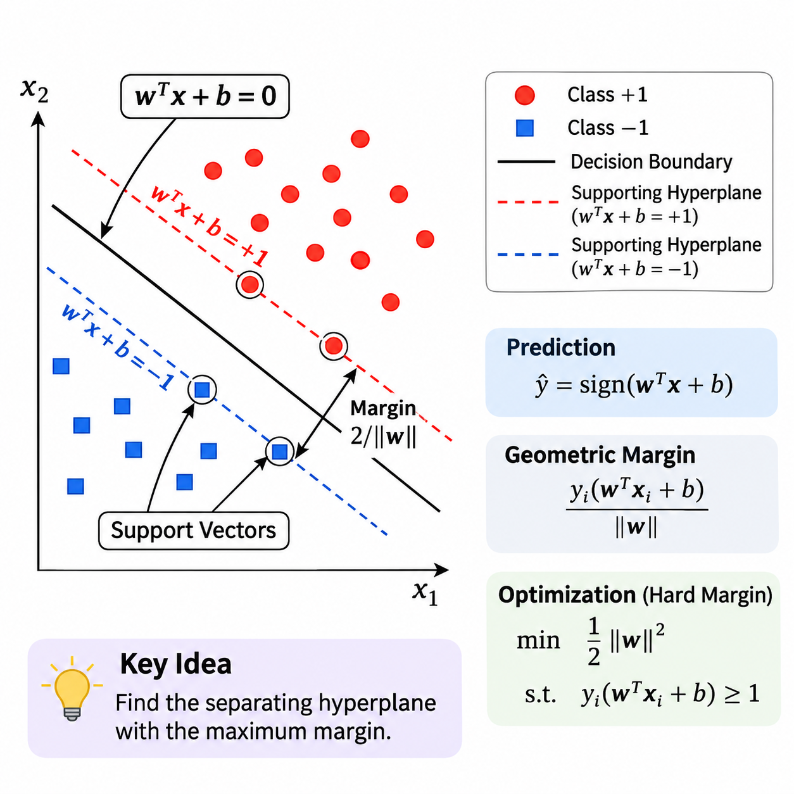
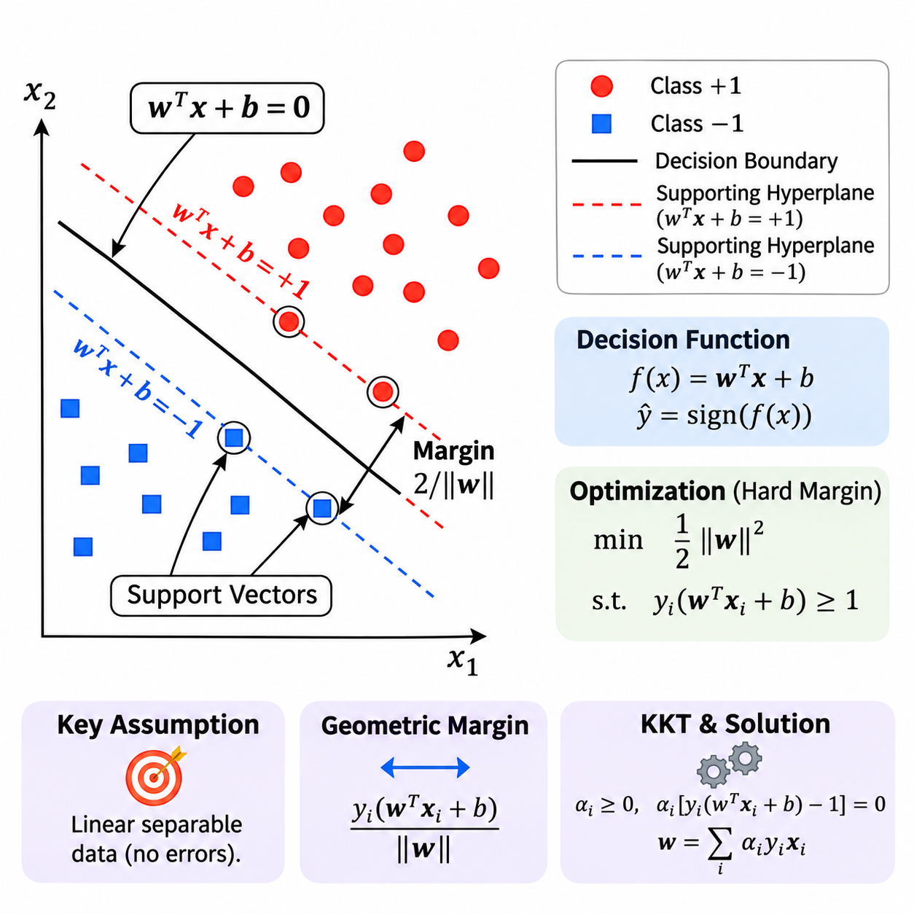
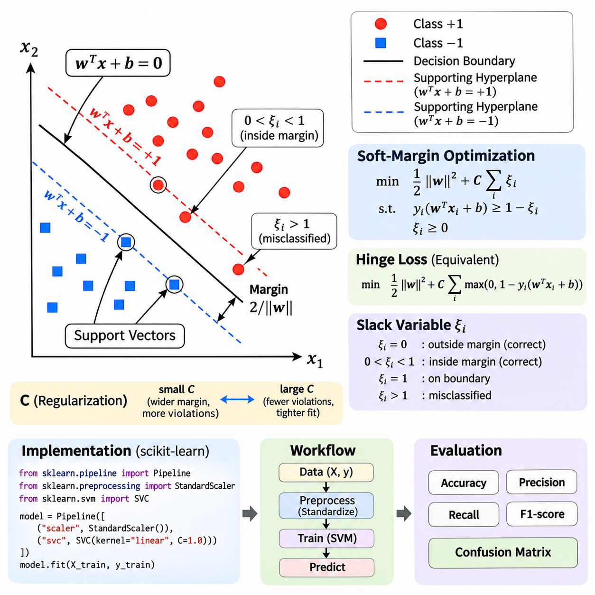
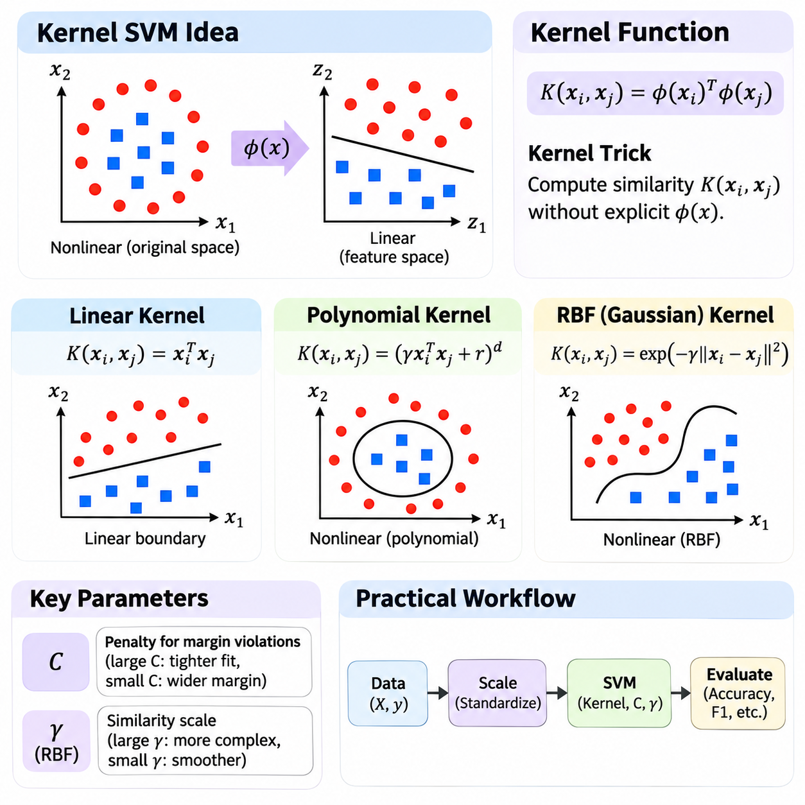
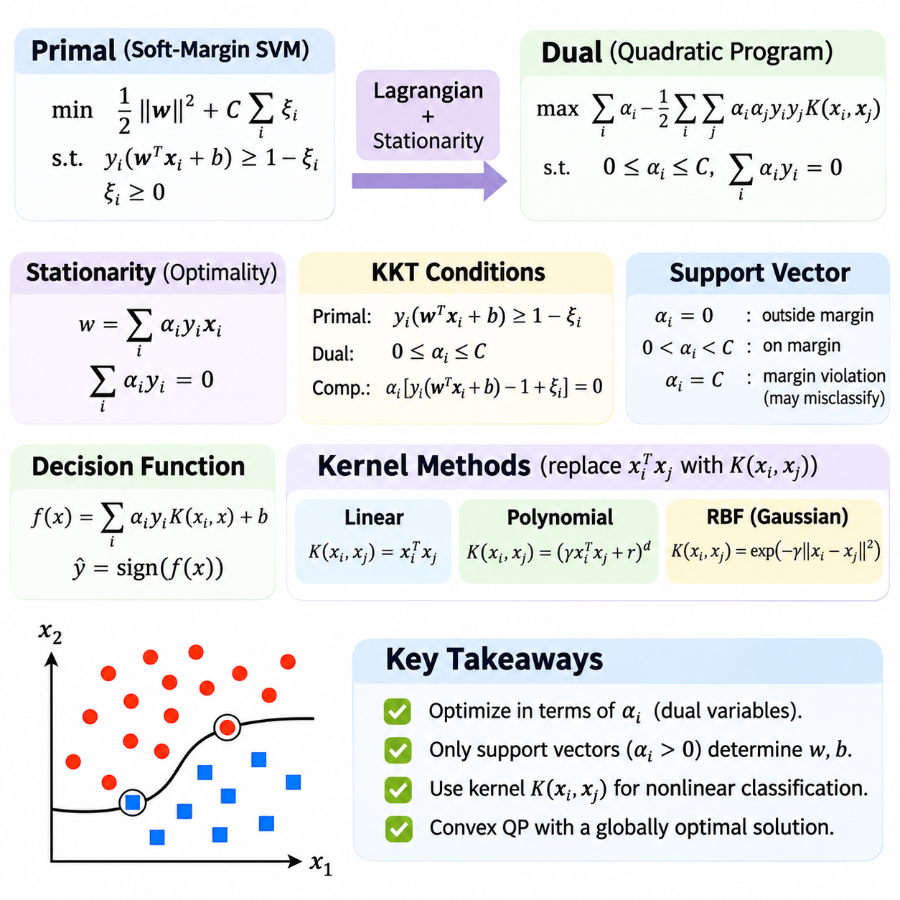
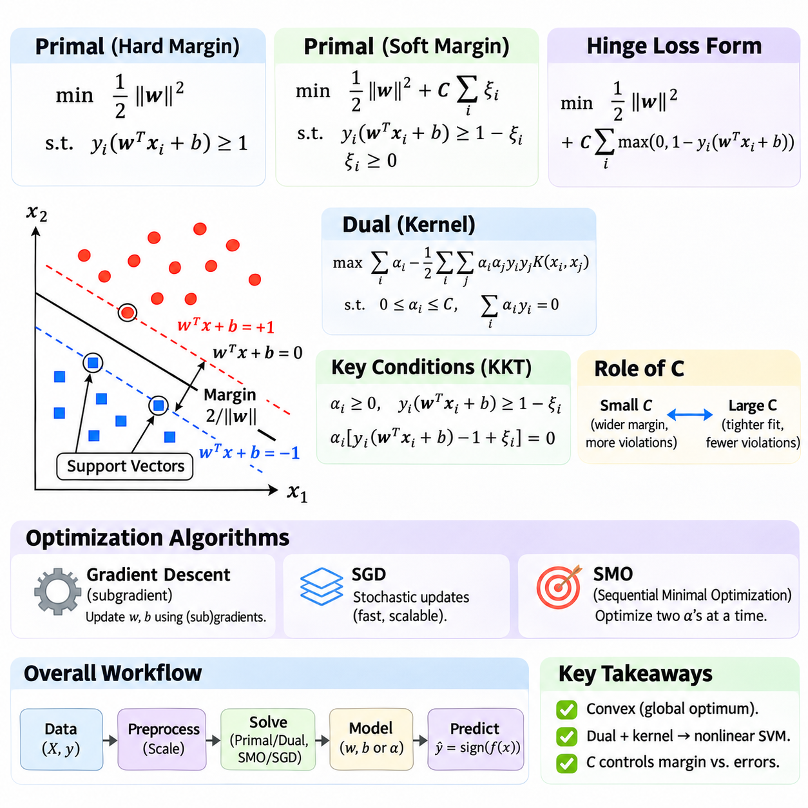
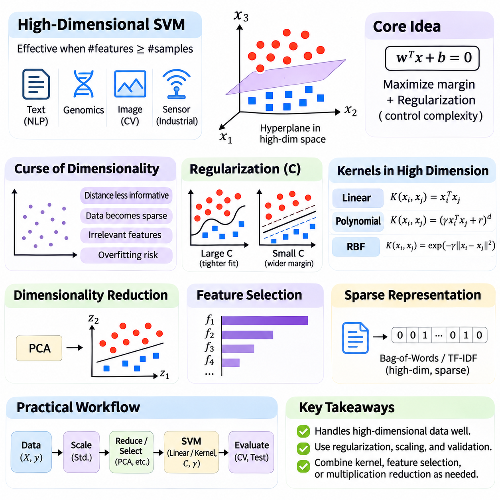

**Volume 08. Supervised Learning**

# 03. SVM

## 03.00 Maximum Margin Concept

{width="7.268055555555556in" height="7.268055555555556in"}

Support Vector Machines (SVMs) are supervised learning algorithms designed to classify data by identifying a decision boundary that separates different classes. Their central principle is maximum margin classification, which seeks a boundary that provides the greatest possible separation between the nearest training samples of opposing classes. Rather than merely finding a boundary that classifies the training data correctly, SVM aims to construct one that supports reliable generalization.

In binary classification, each training sample is represented by a feature vector and a corresponding class label. The labels are commonly expressed as +1 and -1, allowing the classification problem to be formulated mathematically. A linear decision boundary divides the feature space into two regions, with each region representing one class. The SVM learning process determines the position and orientation of this boundary according to the geometric distribution of the training samples.

The decision boundary of a linear SVM is represented by the equation wᵀx + b = 0, where w is the weight vector, x is the input feature vector, and b is the bias term. The weight vector determines the orientation of the separating hyperplane, while the bias controls its position. A prediction is obtained from the sign of wᵀx + b. Positive values indicate one class, whereas negative values indicate the other class.

A hyperplane is a geometric structure that separates a feature space into distinct regions. In two dimensions, the hyperplane corresponds to a straight line, while in three dimensions, it becomes a plane. In higher-dimensional spaces, the same mathematical principle applies even though direct visualization becomes difficult. SVM uses this generalized geometric representation to construct classification boundaries across datasets containing many numerical features.

The margin represents the distance between the separating hyperplane and the nearest training samples from either class. A larger margin creates a wider region around the decision boundary without training samples entering that region under strict linear separability assumptions. Maximum margin classification selects the hyperplane that maximizes this separation. This geometric objective distinguishes SVM from classifiers that primarily minimize training classification errors.

The nearest training samples that determine the margin are called support vectors. These samples play a particularly important role because they define the position of the optimal separating hyperplane. Training samples located far from the boundary generally have less influence on the final solution. Consequently, the geometry of a relatively small subset of training observations can determine the classification boundary learned from a much larger dataset.

The geometric margin of an individual training sample can be expressed as yᵢ(wᵀxᵢ + b)/\|\|w\|\|, where yᵢ is the class label and \|\|w\|\| is the Euclidean norm of the weight vector. This expression measures the signed perpendicular distance between the sample and the decision boundary. Correctly classified samples have positive geometric margins, while incorrectly classified samples have negative margins. The minimum geometric margin describes the classifier\'s closest separation.

Maximum margin optimization seeks to maximize the smallest geometric margin across all training samples. This objective emphasizes the observations closest to the decision boundary rather than treating every correctly classified observation as equally influential. By improving the worst-case separation, the classifier constructs a boundary that is less sensitive to small changes near the class interface. However, a large training margin alone does not guarantee strong performance on unseen data.

For linearly separable training data, the separating hyperplane can be normalized so that the closest samples satisfy yᵢ(wᵀxᵢ + b) = 1. Under this normalization, the two supporting hyperplanes are represented by wᵀx + b = +1 and wᵀx + b = -1. The perpendicular distance between these supporting hyperplanes equals 2/\|\|w\|\|. Maximizing the margin therefore becomes equivalent to minimizing the magnitude of the weight vector.

The maximum margin objective can be expressed as minimizing (1/2)\|\|w\|\|² subject to yᵢ(wᵀxᵢ + b) ≥ 1 for every training sample. The objective function encourages a wide separating margin, while the constraints require all training observations to lie on the correct side of their corresponding supporting hyperplanes. This formulation provides the mathematical foundation for hard-margin SVM and connects geometric classification with constrained optimization.

The optimization problem is convex because its quadratic objective is convex and its constraints are linear. Consequently, when a feasible solution exists, an optimization algorithm can identify a globally optimal separating hyperplane rather than becoming trapped in a suboptimal local minimum. This property makes the maximum margin formulation mathematically attractive. The resulting solution is determined by the training data, the constraints, and the optimization objective.

The maximum margin principle is closely related to the concept of generalization in machine learning. A classifier that separates training samples with a narrow margin may be sensitive to small perturbations in feature values. A wider margin can provide greater tolerance to such perturbations when the classifier and data representation remain fixed. Margin-based learning theory also provides generalization bounds under appropriate assumptions, although actual performance depends on data quality and distribution.

Consider a dataset containing two categories of objects represented by height and width measurements. Several straight lines might separate the training samples perfectly, but their distances from the nearest objects could differ substantially. A maximum margin classifier selects the line that maintains the largest minimum separation from both categories. This example demonstrates why SVM focuses on the geometric quality of the boundary rather than classification correctness alone.

Feature scaling is particularly important for maximum margin classification because distances and weight magnitudes depend on the numerical representation of the features. If one feature ranges from zero to thousands while another ranges from zero to one, the larger-scale feature may disproportionately influence the separating geometry. Standardization or normalization helps establish a more balanced feature space, allowing the optimization process to reflect meaningful relationships among variables.

The maximum margin concept also explains why SVM can be effective in high-dimensional feature spaces. Classification depends on the geometry of the separating hyperplane and the relationship between support vectors and the decision boundary. However, increasing dimensionality does not automatically improve classification quality. Irrelevant features, noisy measurements, and poorly scaled variables can distort distances and reduce generalization performance despite the mathematical advantages of margin maximization.

Real-world datasets are rarely perfectly linearly separable because observations may overlap, contain measurement errors, or include outliers. A strict maximum margin classifier cannot satisfy all separation constraints when conflicting samples prevent a feasible linear boundary. This limitation motivates soft-margin SVM, which permits controlled violations of the margin constraints. The broader SVM framework balances margin width against classification penalties through regularization.

The geometric interpretation of maximum margin classification also provides insight into model robustness. Samples located far from the decision boundary can tolerate larger feature perturbations before their predicted labels change. Samples close to the boundary are more vulnerable to classification changes. This relationship is especially relevant in industrial monitoring, sensor-based recognition, and automated inspection, where measurement uncertainty may affect observations near classification thresholds.

Maximum margin classification should not be interpreted as maximizing the physical distance between entire classes or their average positions. Instead, it maximizes the minimum signed distance between the training observations and the separating hyperplane under a specified normalization. The distinction is important because class centroids and distant observations may contribute little to the final boundary. Support vectors capture the critical local geometry of the classification problem.

The maximum margin concept establishes the theoretical foundation for understanding more advanced SVM techniques. Hard-margin SVM formalizes strict separation, soft-margin SVM introduces tolerance for overlapping observations, and kernel methods extend separation into transformed feature spaces. Dual optimization reveals how support vectors determine the solution through inner products. Together, these developments preserve the central idea that effective classification can emerge from carefully optimized geometric separation.

## 03.01 Hard Margin SVM

{width="7.268055555555556in" height="7.268055555555556in"}

Hard-Margin Support Vector Machine (Hard-Margin SVM) is a supervised classification algorithm that identifies an optimal separating hyperplane when training data is perfectly linearly separable. Its objective is to maximize the geometric margin between two classes while ensuring that every training sample is classified correctly. Unlike methods that tolerate classification errors, Hard-Margin SVM imposes strict constraints requiring complete separation of the training observations.

The fundamental assumption of Hard-Margin SVM is linear separability, meaning that a hyperplane exists that divides all training samples into their respective classes without errors. In a two-dimensional feature space, this boundary is a straight line, while higher-dimensional spaces require a separating hyperplane. If even one observation prevents perfect linear separation, the standard Hard-Margin SVM optimization problem becomes infeasible.

A binary training dataset consists of feature vectors xᵢ and corresponding labels yᵢ, where yᵢ belongs to 1. The classifier constructs a linear decision function f(x) = wᵀx + b, where w represents the weight vector and b represents the bias. Predictions are determined by the sign of this function. A positive result indicates the positive class, while a negative result indicates the negative class, assuming the learned boundary separates the observations correctly.

The separating hyperplane is defined by wᵀx + b = 0. Its orientation depends on the weight vector, which is perpendicular to the hyperplane, while the bias controls its displacement from the origin. Multiple hyperplanes may correctly separate a linearly separable dataset. Hard-Margin SVM selects the hyperplane that maximizes the minimum perpendicular distance between the boundary and the closest training observations from either class.

The margin is the central geometric quantity in Hard-Margin SVM. Two parallel supporting hyperplanes are positioned on opposite sides of the decision boundary and pass through the closest training observations. Under canonical normalization, these supporting hyperplanes satisfy wᵀx + b = +1 and wᵀx + b = -1. Their perpendicular separation equals 2/\|\|w\|\|, where \|\|w\|\| denotes the Euclidean norm of the weight vector.

Maximizing the margin is mathematically equivalent to minimizing the squared magnitude of the weight vector under appropriate classification constraints. The standard primal optimization problem minimizes (1/2)\|\|w\|\|² subject to yᵢ(wᵀxᵢ + b) ≥ 1 for every training observation. These constraints ensure that all samples are correctly classified and remain outside or directly on the supporting hyperplanes defining the margin.

The objective function (1/2)\|\|w\|\|² is convex, and the classification constraints define a convex feasible region. Therefore, Hard-Margin SVM is formulated as a convex quadratic programming problem. When the training data is linearly separable, a globally optimal solution exists under the standard formulation. This property eliminates the difficulty of undesirable local minima commonly encountered in nonconvex optimization problems.

Support vectors are the training observations that lie directly on the margin boundaries. They satisfy yᵢ(wᵀxᵢ + b) = 1 and determine the position and orientation of the optimal separating hyperplane. Observations located farther from the decision boundary satisfy the constraints with strict inequality. Such samples generally do not directly influence the optimal weight vector, although the complete training dataset determines the feasible region.

The importance of support vectors can be understood through geometric sensitivity. Moving a training sample far from the margin often leaves the optimal decision boundary unchanged. However, moving a support vector may alter the position of the separating hyperplane because it changes an active optimization constraint. This property demonstrates that Hard-Margin SVM focuses primarily on the critical observations defining the separation between classes.

The geometric margin of an individual observation is expressed as yᵢ(wᵀxᵢ + b)/\|\|w\|\|. This quantity measures the signed perpendicular distance from the observation to the decision boundary. Positive values indicate correct classification, while negative values indicate incorrect classification. Hard-Margin SVM maximizes the smallest geometric margin across the training dataset, producing a boundary with the greatest possible minimum separation.

A useful example involves two groups of manufactured components represented by dimensional measurements. If all acceptable components occupy one region of the feature space and defective components occupy another linearly separable region, multiple decision boundaries may classify the training samples correctly. Hard-Margin SVM selects the boundary that maximizes separation from the closest examples, providing a geometric buffer between the two categories.

The optimization constraints can also be interpreted through functional margins. The functional margin of an observation is yᵢ(wᵀxᵢ + b), which depends on the scaling of the model parameters. Multiplying both w and b by the same positive constant changes the functional margin without changing the decision boundary. Canonical normalization removes this scaling ambiguity by setting the minimum functional margin to one.

The Lagrangian formulation provides another perspective on Hard-Margin SVM optimization. A nonnegative Lagrange multiplier αᵢ is associated with each classification constraint, allowing the constrained primal problem to be expressed through a Lagrangian function. At the optimum, the weight vector can be represented as w = Σᵢ αᵢyᵢxᵢ. This relationship reveals how selected training observations contribute directly to the separating hyperplane.

The Karush-Kuhn-Tucker conditions characterize optimal solutions through feasibility, stationarity, dual feasibility, and complementary slackness. Complementary slackness requires αᵢ[yᵢ(wᵀxᵢ + b) - 1] = 0. Consequently, observations strictly outside the margin have zero multipliers, while observations on the margin may have positive multipliers. These conditions explain the mathematical relationship between active constraints and support vectors.

The dual formulation expresses the optimization problem using inner products between training observations rather than explicitly optimizing the weight vector. Its objective maximizes Σᵢαᵢ - (1/2)ΣᵢΣⱼαᵢαⱼyᵢyⱼ(xᵢᵀxⱼ), subject to αᵢ ≥ 0 and Σᵢαᵢyᵢ = 0. This representation provides the foundation for understanding kernel methods and the broader mathematical structure of Support Vector Machines.

Feature scaling is essential because Hard-Margin SVM depends on geometric distances in the feature space. Variables measured on substantially different numerical scales can distort the orientation and position of the separating hyperplane. Standardization commonly transforms features to comparable scales before optimization. However, scaling parameters must be estimated from training data and consistently applied to validation, testing, and deployment observations.

Hard-Margin SVM is sensitive to outliers because every training observation must satisfy the strict separation constraints. A single mislabeled sample or unusual measurement may substantially reduce the achievable margin or make the optimization problem infeasible. This limitation becomes especially important in industrial datasets containing sensor noise, annotation errors, or overlapping operating conditions. Perfect training separation is therefore a demanding practical assumption.

Although Hard-Margin SVM achieves zero classification errors on linearly separable training data, this does not guarantee perfect generalization. The quality of predictions on unseen observations depends on the representativeness of the training dataset, the selected features, and the relationship between training and deployment distributions. A large margin can support generalization, but it cannot eliminate uncertainty caused by distribution shifts or inadequate sampling.

The computational characteristics of Hard-Margin SVM depend on the number of observations, feature dimensionality, and optimization method. Quadratic programming approaches can become expensive for large datasets, particularly when using a dual formulation involving pairwise inner products. Primal optimization may be more attractive for certain high-dimensional problems. The appropriate computational strategy depends on the structure and scale of the training data.

Hard-Margin SVM provides a rigorous foundation for understanding margin-based classification, convex optimization, support vectors, and duality. Its strict separation requirement makes it most appropriate for clean, linearly separable datasets and theoretical demonstrations. Real-world classification problems frequently require more flexible alternatives. Soft-Margin SVM extends this framework by introducing slack variables and regularization to balance margin maximization against constraint violations.

## 03.02 Soft Margin SVM

{width="7.268055555555556in" height="7.268055555555556in"}

Soft-Margin Support Vector Machine (Soft-Margin SVM) extends maximum margin classification to datasets that are not perfectly linearly separable. Real-world observations frequently contain overlapping classes, measurement noise, and mislabeled samples, making strict separation impractical. Soft-Margin SVM addresses these limitations by allowing controlled violations of margin constraints while maintaining the objective of constructing a decision boundary with strong generalization properties.

The central difference between Hard-Margin SVM and Soft-Margin SVM is the treatment of classification constraints. Hard-Margin SVM requires every training observation to remain correctly classified outside the margin, whereas Soft-Margin SVM permits selected observations to enter the margin or cross the decision boundary. This flexibility enables optimization even when the training dataset contains overlapping distributions or observations that cannot be separated by a single hyperplane.

Soft-Margin SVM introduces nonnegative slack variables ξᵢ to quantify violations of the margin constraints. For each training observation, the classification condition becomes yᵢ(wᵀxᵢ + b) ≥ 1 - ξᵢ, with ξᵢ ≥ 0. A slack value of zero indicates that the observation satisfies the original margin constraint. Positive values indicate violations, allowing the optimization process to accommodate difficult observations without abandoning margin maximization.

The interpretation of slack variables depends on their magnitude. When 0 \< ξᵢ \< 1, an observation lies inside the margin but remains correctly classified. When ξᵢ = 1, the observation lies directly on the decision boundary. When ξᵢ \> 1, the observation is incorrectly classified. These relationships provide a geometric interpretation of classification violations and explain how Soft-Margin SVM distinguishes margin penetration from actual prediction errors.

The standard Soft-Margin SVM optimization problem minimizes (1/2)\|\|w\|\|² + CΣᵢξᵢ, subject to yᵢ(wᵀxᵢ + b) ≥ 1 - ξᵢ and ξᵢ ≥ 0. The first term encourages a wide geometric margin by controlling the weight vector magnitude. The second term penalizes violations of the margin constraints. Together, these terms establish a balance between maximizing separation and accommodating imperfect training observations.

The regularization parameter C determines the relative importance of margin violations during optimization. A large C assigns a substantial penalty to violations, encouraging the classifier to fit training observations more strictly. A small C reduces the penalty, allowing a wider margin with more violations. Selecting C therefore controls the tradeoff between fitting the training data and maintaining a simpler decision boundary with potentially better generalization.

Soft-Margin SVM can also be understood through hinge loss, a loss function commonly used in margin-based classification. For an observation with label yᵢ and decision score f(xᵢ), hinge loss is max(0, 1 - yᵢf(xᵢ)). Correctly classified observations outside the margin have zero loss, while observations inside the margin or incorrectly classified observations receive positive penalties. This formulation connects geometric margin constraints with empirical risk minimization.

The unconstrained objective can be expressed as (1/2)\|\|w\|\|² + CΣᵢmax(0, 1 - yᵢ(wᵀxᵢ + b)). This representation eliminates explicit slack variables by incorporating margin violations directly into the loss function. The resulting optimization problem remains convex for linear SVMs. Consequently, suitable optimization algorithms can identify globally optimal solutions without the local-minimum difficulties associated with many nonconvex learning models.

The implementation of Soft-Margin SVM begins with preparing a labeled dataset containing numerical feature vectors and corresponding class labels. Data quality should be examined before training because missing values, inconsistent measurements, and extreme outliers can influence the learned decision boundary. A practical workflow separates observations into training and testing subsets, preserving representative class distributions whenever possible.

Feature scaling is particularly important because SVM optimization depends on distances and inner products in feature space. Standardization commonly transforms each feature using its training-set mean and standard deviation. This prevents variables with large numerical ranges from dominating the optimization geometry. The same transformation must be applied to validation and testing observations to avoid inconsistent representations and unintended data leakage.

A practical Python implementation can use the SVC classifier provided by scikit-learn. The model can be initialized with a linear kernel and a selected regularization parameter C, then trained using the fit method. The predict method generates class labels for unseen observations, while decision_function returns signed decision scores relative to the learned boundary. These operations provide a straightforward implementation without requiring manual quadratic programming.

For example, a binary classification experiment can use a synthetic dataset generated with make_classification, followed by train_test_split to establish independent training and testing subsets. A Pipeline combining StandardScaler and SVC(kernel="linear", C=1.0) performs feature standardization and classification in a consistent sequence. Fitting the pipeline on training data ensures that scaling parameters are learned without accessing testing observations.

After training, model performance can be evaluated using accuracy, precision, recall, F1-score, and a confusion matrix. Accuracy measures the overall proportion of correct predictions, while precision and recall provide additional insight into different types of classification errors. F1-score combines precision and recall into a single measure. These metrics are especially useful when class distributions are imbalanced or different prediction errors have unequal practical consequences.

Hyperparameter tuning focuses primarily on the regularization parameter C for a linear Soft-Margin SVM. Candidate values can be evaluated through cross-validation, preferably using stratified folds for classification datasets. A logarithmic search range, such as 0.01, 0.1, 1, 10, and 100, provides a practical starting point. The optimal value should be selected using validation performance rather than training accuracy alone, reducing the risk of overfitting.

The support vectors of Soft-Margin SVM include observations that lie on the margin, inside the margin, or on the incorrect side of the decision boundary. These observations influence the learned hyperplane through the dual optimization formulation. In the standard formulation, the associated dual coefficients satisfy 0 ≤ αᵢ ≤ C. This upper bound reflects the role of regularization and distinguishes Soft-Margin SVM from the unconstrained upper range of Hard-Margin SVM multipliers.

The computational cost of Soft-Margin SVM depends on dataset size, feature dimensionality, kernel selection, and optimization strategy. Kernel-based SVC implementations may become expensive for very large datasets because they involve relationships between training observations. LinearSVC provides an alternative optimized for linear classification and can be more suitable for high-dimensional or large-scale problems. Implementation choices should reflect computational resources and application requirements.

Soft-Margin SVM is useful in industrial classification problems where sensor measurements contain uncertainty and class boundaries are imperfect. Examples include equipment fault detection, product quality inspection, document classification, and predictive maintenance. In these applications, allowing controlled margin violations can produce more practical classifiers than enforcing perfect separation. However, performance still depends on representative training data and appropriate feature engineering.

A robust implementation should also consider class imbalance, outlier sensitivity, and deployment conditions. Class weights can adjust the relative penalty assigned to errors from different classes, while cross-validation helps estimate performance stability. Monitoring feature distributions after deployment can reveal changes that reduce prediction reliability. These practices connect the mathematical flexibility of Soft-Margin SVM with dependable machine learning system operation.

Soft-Margin SVM preserves the geometric foundation of maximum margin classification while introducing a practical mechanism for handling imperfect data. Slack variables, hinge loss, and regularization transform strict separation into a controlled optimization tradeoff. Through standardized preprocessing, appropriate parameter selection, and systematic evaluation, Soft-Margin SVM provides a reliable baseline for many supervised classification tasks and establishes the foundation for nonlinear kernel-based extensions.

## 03.03 Kernel Methods

{width="7.268055555555556in" height="7.268055555555556in"}

Kernel methods extend Support Vector Machines beyond linear classification by enabling nonlinear decision boundaries in the original feature space. Many real-world datasets contain complex relationships that cannot be separated by a single straight line or hyperplane. Kernel-based SVM addresses this limitation by measuring similarities between observations in a transformed feature space, allowing the classifier to represent nonlinear separation without explicitly constructing every transformed feature.

The mathematical foundation of kernel methods is the kernel function K(xᵢ, xⱼ), which evaluates the inner product between two observations in a potentially higher-dimensional feature space. If φ(x) denotes a feature transformation, a valid kernel satisfies K(xᵢ, xⱼ) = φ(xᵢ)ᵀφ(xⱼ). This relationship allows SVM optimization to operate through pairwise similarities rather than directly computing transformed feature vectors.

The kernel trick is the computational principle that makes nonlinear SVM practical. Instead of explicitly transforming every input into a high-dimensional representation, the algorithm evaluates kernel functions between training observations. This approach can reduce the cost of constructing complex feature representations, although the resulting kernel matrix may still require substantial memory and computation when the training dataset becomes large.

Kernel-based classification preserves the maximum margin principle of SVM. The classifier searches for a separating hyperplane in the implicit feature space while allowing the corresponding decision boundary in the original input space to become nonlinear. Support vectors remain the critical training observations that determine the boundary. Their contributions are combined through kernel evaluations, enabling flexible classification while retaining a convex optimization formulation.

The linear kernel is the simplest kernel function and is defined as K(xᵢ, xⱼ) = xᵢᵀxⱼ. It computes the ordinary inner product between two feature vectors without introducing nonlinear transformations. Consequently, an SVM using a linear kernel constructs a linear decision boundary in the original feature space. This approach is appropriate when the data is approximately linearly separable or when high-dimensional features already provide useful class separation.

Linear kernels are frequently effective in text classification, document categorization, and other applications involving sparse high-dimensional representations. In these settings, the number of features may greatly exceed the number of observations, and a linear boundary can provide strong predictive performance. Linear models also offer relatively straightforward interpretation because individual feature weights contribute directly to the decision function.

The polynomial kernel introduces nonlinear interactions between input features. Its general form is K(xᵢ, xⱼ) = (γxᵢᵀxⱼ + r)ᵈ, where γ controls the scaling of the inner product, r is an additive coefficient, and d specifies the polynomial degree. This kernel implicitly represents combinations of features, allowing SVM to learn decision boundaries that depend on interactions beyond simple linear relationships.

The polynomial degree determines the complexity of the implicit feature interactions. A degree of two can represent quadratic relationships, while higher degrees allow more complex polynomial structures. However, increasing the degree also increases model flexibility and may introduce sensitivity to noise or overfitting. Appropriate degree selection therefore requires balancing the ability to represent nonlinear patterns against the need for stable generalization.

Polynomial kernels are useful when the underlying classification structure involves interactions among measurements. For example, industrial quality inspection may depend on combinations of temperature, pressure, and vibration rather than on each measurement independently. A polynomial kernel can represent such relationships without manually constructing every interaction feature. Its effectiveness depends on feature scaling, parameter selection, and the complexity of the actual data distribution.

The Radial Basis Function kernel, commonly called the RBF kernel or Gaussian kernel, is one of the most widely used nonlinear kernels. It is defined as K(xᵢ, xⱼ) = exp(-γ\|\|xᵢ - xⱼ\|\|²), where γ is a positive parameter controlling how rapidly similarity decreases with distance. Observations close together receive kernel values near one, while distant observations receive values approaching zero.

The RBF kernel implicitly maps observations into an infinite-dimensional feature space, allowing highly flexible nonlinear decision boundaries. Its similarity-based structure makes it suitable for datasets containing curved, clustered, or irregular class distributions. Unlike polynomial kernels, the RBF kernel does not require selecting a finite polynomial degree. However, its flexibility must be controlled carefully to avoid fitting noise or isolated training observations.

The parameter γ plays a central role in RBF kernel behavior. A small γ produces slowly decreasing similarities, allowing distant observations to influence one another and often generating smoother decision boundaries. A large γ produces rapidly decreasing similarities, emphasizing local relationships and potentially creating highly complex boundaries. Excessively large values may encourage overfitting, while excessively small values may cause underfitting.

Kernel selection must be considered together with the regularization parameter C. While kernel parameters determine the shape and flexibility of the similarity representation, C controls the penalty assigned to margin violations. A large C encourages stricter fitting of training observations, whereas a smaller C permits more violations. Their interaction influences model complexity, support vector selection, and predictive performance on unseen data.

The mathematical decision function of a kernel SVM can be expressed as f(x) = ΣᵢαᵢyᵢK(xᵢ, x) + b, where αᵢ represents dual coefficients and yᵢ denotes class labels. Only observations with nonzero coefficients contribute to the final decision function. These observations are the support vectors. Classification is determined by the sign of f(x), allowing nonlinear prediction through kernel evaluations.

Kernel implementation begins with preparing numerical features, handling missing values, and dividing observations into training and testing subsets. Feature scaling is especially important for polynomial and RBF kernels because inner products and distances depend on feature magnitudes. Standardization should be fitted using training data only, then applied consistently to validation and testing data to prevent data leakage.

In Python, scikit-learn provides kernel SVM functionality through the SVC class. The kernel argument selects the desired function, such as "linear", "poly", or "rbf". Polynomial models can be configured using degree, gamma, and coef0, while RBF models primarily require gamma and C. The fit method trains the classifier, and predict generates class predictions. This interface enables systematic comparisons without manually implementing kernel optimization.

A practical implementation can combine StandardScaler and SVC within a Pipeline. Separate models using linear, polynomial, and RBF kernels can be trained on identical data partitions to ensure fair comparison. Cross-validation can then estimate performance under different parameter settings. GridSearchCV provides a systematic approach for searching combinations of C, gamma, polynomial degree, and other relevant hyperparameters.

Model evaluation should include accuracy, precision, recall, F1-score, and confusion matrices, depending on the application. Training performance alone is insufficient because flexible kernels may memorize complex patterns that do not generalize. Validation results reveal whether additional model complexity improves predictive quality. Computational cost, inference latency, and support vector count should also be considered when selecting a kernel for deployment.

Kernel methods introduce computational challenges because many SVM implementations rely on pairwise similarities between training observations. A kernel matrix for n observations contains n² entries, which can become expensive in memory and processing time. Large datasets may therefore benefit from linear SVM alternatives, approximate kernel methods, or dimensionality reduction. The best approach depends on dataset size, feature structure, and available computing resources.

Kernel SVMs are applicable to industrial fault diagnosis, image feature classification, biological data analysis, and sensor-based recognition. Linear kernels provide efficient boundaries for approximately linear relationships, polynomial kernels represent structured feature interactions, and RBF kernels capture flexible nonlinear patterns. Understanding these alternatives allows practitioners to select classification models that match the geometric characteristics of their datasets.

Kernel methods demonstrate how nonlinear classification can emerge from linear separation in an implicit feature space. The linear, polynomial, and RBF kernels provide different ways to represent similarity and control decision boundary complexity. Through careful preprocessing, hyperparameter tuning, cross-validation, and computational evaluation, kernel-based SVM offers a versatile framework for supervised classification and establishes the foundation for advanced dual optimization techniques.

## 03.04 Dual Formulation

{width="7.268055555555556in" height="7.268055555555556in"}

The dual formulation of Support Vector Machines (SVMs) provides an alternative mathematical representation of maximum margin classification. Instead of directly optimizing the weight vector and bias of a separating hyperplane, the dual problem optimizes coefficients associated with individual training observations. This formulation reveals the role of support vectors, connects constrained optimization with geometric classification, and provides the mathematical foundation for kernel-based learning.

In the primal formulation, a linear SVM determines a weight vector w and bias b that define the decision boundary wᵀx + b = 0. For linearly separable observations, Hard-Margin SVM minimizes (1/2)\|\|w\|\|² subject to yᵢ(wᵀxᵢ + b) ≥ 1. These constraints ensure correct classification with a prescribed functional margin. The dual formulation transforms this constrained optimization problem into one expressed through relationships among training samples.

The transformation begins by introducing a nonnegative Lagrange multiplier αᵢ for each training constraint. The Lagrangian function for Hard-Margin SVM is L(w,b,α) = (1/2)\|\|w\|\|² - Σᵢαᵢ[yᵢ(wᵀxᵢ + b) - 1]. Each multiplier represents the contribution of its corresponding constraint to the optimization process. The dual objective is obtained by minimizing this Lagrangian over the primal variables while maximizing over feasible multipliers.

The stationarity conditions are derived by differentiating the Lagrangian with respect to w and b. Setting the gradient with respect to w to zero gives w = Σᵢαᵢyᵢxᵢ. Differentiation with respect to b produces Σᵢαᵢyᵢ = 0. These equations establish that the optimal weight vector is a weighted combination of training observations and that the weighted contributions of positive and negative classes must balance.

Substituting the stationarity relationships into the Lagrangian eliminates the explicit weight vector and bias from the objective. The resulting dual problem maximizes Σᵢαᵢ - (1/2)ΣᵢΣⱼαᵢαⱼyᵢyⱼ(xᵢᵀxⱼ), subject to αᵢ ≥ 0 and Σᵢαᵢyᵢ = 0. The objective depends on training observations only through their inner products, which is the essential mathematical property enabling kernel methods.

The dual objective is a concave quadratic function of the Lagrange multipliers, and its feasible region is defined by linear constraints. Therefore, maximizing the dual objective is a convex optimization problem in the standard optimization sense. When the primal problem is feasible and the required regularity conditions hold, strong duality ensures equality between optimal primal and dual objective values. This allows the dual solution to recover an optimal classifier.

The Karush-Kuhn-Tucker conditions provide the connection between primal and dual optimality. These conditions include primal feasibility, dual feasibility, stationarity, and complementary slackness. For Hard-Margin SVM, complementary slackness requires αᵢ[yᵢ(wᵀxᵢ + b) - 1] = 0. Consequently, observations strictly outside the margin have zero multipliers, while observations with positive multipliers lie directly on the margin boundaries.

Support vectors emerge naturally from the dual formulation because only observations with nonzero dual coefficients contribute to the optimal weight vector. The decision function can be written as f(x) = Σᵢαᵢyᵢ(xᵢᵀx) + b. Observations with zero coefficients disappear from this expression. This sparse representation explains why the final classifier may depend on a relatively small subset of training observations rather than every sample in the dataset.

The bias term can be recovered using a support vector satisfying the margin equality. For such an observation, yᵢ(wᵀxᵢ + b) = 1, giving b = yᵢ - wᵀxᵢ. In numerical implementations, averaging bias estimates from suitable margin support vectors can improve stability. The recovered parameters define the separating hyperplane and enable predictions through the sign of the resulting decision function.

The dual formulation also extends to Soft-Margin SVM, which permits controlled violations of margin constraints. Its primal objective minimizes (1/2)\|\|w\|\|² + CΣᵢξᵢ, subject to yᵢ(wᵀxᵢ + b) ≥ 1 - ξᵢ and ξᵢ ≥ 0. Introducing multipliers for both sets of constraints produces a dual problem with the same quadratic objective as Hard-Margin SVM but with additional upper bounds on the coefficients.

For the standard L1 slack-penalty formulation, the Soft-Margin SVM dual constraints become 0 ≤ αᵢ ≤ C and Σᵢαᵢyᵢ = 0. The parameter C limits the influence of individual observations through their dual coefficients. Samples with αᵢ = 0 lie outside the margin, while samples with 0 \< αᵢ \< C lie on the margin under the optimality conditions. Samples with αᵢ = C may violate the margin and can include misclassified observations.

The relationship between dual coefficients and margin violations provides insight into the geometry of Soft-Margin SVM. Observations outside the margin generally do not influence the classifier directly. Margin support vectors determine the separating boundary, while observations with coefficients at the upper bound reflect active regularization constraints. This structure demonstrates how the dual formulation incorporates both geometric separation and tolerance for imperfect training data.

One of the most important advantages of the dual formulation is its compatibility with kernel functions. Because the dual objective depends on observations through inner products, each expression xᵢᵀxⱼ can be replaced by a kernel function K(xᵢ,xⱼ). A valid kernel represents an inner product in an implicit feature space. This substitution allows SVM to construct nonlinear decision boundaries without explicitly calculating the transformed feature vectors.

The kernelized dual objective maximizes Σᵢαᵢ - (1/2)ΣᵢΣⱼαᵢαⱼyᵢyⱼK(xᵢ,xⱼ), subject to the appropriate coefficient constraints. Its corresponding decision function becomes f(x) = ΣᵢαᵢyᵢK(xᵢ,x) + b. Linear, polynomial, and radial basis function kernels can therefore be incorporated into the same optimization framework. Kernel selection determines the similarity representation used to construct the classification boundary.

The kernel matrix, also called the Gram matrix, contains pairwise kernel evaluations between training observations. For n samples, this matrix has dimensions n × n. A valid positive semidefinite kernel produces a positive semidefinite Gram matrix, preserving the concavity of the dual objective. However, constructing and storing the complete matrix can become computationally expensive as the number of observations increases.

The computational advantages of primal and dual formulations depend on dataset characteristics. The primal formulation optimizes parameters associated with feature dimensions, while the dual formulation introduces coefficients associated with training observations. Linear SVM problems involving many samples and relatively few features may favor primal optimization. Dual optimization is particularly valuable when kernel functions are required or when the number of training observations is comparatively small.

Sequential Minimal Optimization, commonly abbreviated SMO, is a widely used approach for solving the SVM dual problem. It decomposes the optimization into small subproblems involving pairs of dual coefficients while maintaining the equality constraint. By repeatedly updating selected coefficients, SMO approaches the optimal solution without requiring a general-purpose quadratic programming solver. Its efficiency depends on working-set selection, caching, and convergence criteria.

Numerical stability is important when implementing dual optimization. Kernel matrices may become poorly conditioned, especially when observations are highly similar or kernel parameters are extreme. Floating-point precision, optimization tolerances, and feature scaling can influence convergence and coefficient estimates. Practical implementations therefore rely on established numerical methods and carefully selected stopping conditions rather than direct inversion of large matrices.

The dual formulation provides a useful interpretation of classification decisions. Each support vector contributes a weighted similarity score to a new observation, and the classifier combines these contributions with the bias term. Positive and negative support vectors influence the decision function according to their labels and dual coefficients. This interpretation connects geometric separation with similarity-based prediction, although nonlinear kernel models may remain difficult to explain globally.

Understanding duality also clarifies the relationship between optimization and regularization. The primal objective expresses a balance between model complexity and margin violations, while the dual constraints restrict the influence of individual observations. The two formulations describe the same underlying optimization problem from different perspectives. Their equivalence provides mathematical tools for analyzing optimality, support vector selection, and the behavior of regularized classifiers.

The dual formulation is a central component of SVM theory because it transforms maximum margin classification into an optimization problem based on training-sample relationships. Lagrange multipliers, KKT conditions, support vectors, and kernel functions become connected within a unified mathematical framework. This perspective supports both linear and nonlinear classification and prepares the foundation for studying SVM optimization algorithms, computational efficiency, and high-dimensional learning.

## 03.05 SVM Optimization

{width="7.268055555555556in" height="7.268055555555556in"}

Support Vector Machine optimization determines the separating hyperplane that maximizes classification margin while controlling errors on training observations. The optimization process transforms geometric requirements into mathematical objectives and constraints. Unlike many neural network training problems, standard SVM formulations are convex, allowing suitable algorithms to identify globally optimal solutions under appropriate feasibility and regularity conditions.

The primal optimization problem for Hard-Margin SVM minimizes (1/2)\|\|w\|\|² subject to yᵢ(wᵀxᵢ + b) ≥ 1 for every training observation. The objective controls the magnitude of the weight vector, which is inversely related to the geometric margin. The constraints enforce correct classification outside the margin boundaries. This formulation is suitable only when the training observations are linearly separable.

Soft-Margin SVM extends the optimization problem by introducing slack variables ξᵢ and a regularization parameter C. Its objective minimizes (1/2)\|\|w\|\|² + CΣᵢξᵢ, subject to yᵢ(wᵀxᵢ + b) ≥ 1 - ξᵢ and ξᵢ ≥ 0. The first term encourages a wide margin, while the second penalizes margin violations. This balance enables classification when observations overlap or contain measurement noise.

The same Soft-Margin SVM objective can be expressed using hinge loss as (1/2)\|\|w\|\|² + CΣᵢmax(0, 1 - yᵢ(wᵀxᵢ + b)). Hinge loss is zero for observations correctly classified outside the margin and positive for observations inside or beyond the incorrect boundary. Although hinge loss is not differentiable at the margin threshold, it remains convex and can be optimized using subgradient-based methods.

Gradient-based optimization updates model parameters according to information derived from the objective function. For differentiable regions of hinge loss, the gradient depends on whether an observation satisfies the margin condition. Observations outside the margin contribute only through regularization, while observations violating the margin produce additional classification-related updates. This structure concentrates learning effort on difficult or influential samples.

Subgradient descent generalizes gradient descent to convex functions that contain nondifferentiable points. At a hinge-loss corner, the algorithm selects a valid subgradient rather than requiring a unique derivative. Repeated parameter updates can approach an optimal solution when appropriate learning-rate schedules and convergence conditions are used. However, convergence speed depends on feature scaling, regularization strength, and optimization settings.

Stochastic Gradient Descent, commonly abbreviated SGD, provides a scalable approach to training linear SVM classifiers. Instead of computing updates from the entire training dataset, SGD processes individual observations or small batches. This reduces the computational cost of each update and supports large datasets or streaming scenarios. Randomized sample ordering and suitable learning-rate schedules help improve convergence stability.

Mini-batch optimization combines the efficiency of stochastic updates with the stability of aggregated gradient estimates. Each update uses a subset of training observations, allowing efficient vectorized computation. Batch size influences memory requirements, update frequency, and gradient variability. Although mini-batch methods are common in large-scale learning, their effectiveness depends on the solver and implementation strategy used for the SVM objective.

The dual optimization formulation represents SVM training through coefficients associated with individual observations. For Soft-Margin SVM, the dual objective maximizes Σᵢαᵢ - (1/2)ΣᵢΣⱼαᵢαⱼyᵢyⱼK(xᵢ,xⱼ), subject to 0 ≤ αᵢ ≤ C and Σᵢαᵢyᵢ = 0. This representation supports kernel functions and enables nonlinear classification without explicitly constructing transformed feature vectors.

Quadratic programming is a natural optimization framework for SVM because its dual objective is quadratic and its constraints are linear. General-purpose quadratic programming solvers can compute optimal dual coefficients, but their memory and computational requirements may become substantial for large datasets. Specialized SVM solvers exploit the structure of the optimization problem to reduce unnecessary computation and improve practical scalability.

Sequential Minimal Optimization, or SMO, is a specialized algorithm for solving the SVM dual problem. It selects a small working set, commonly two dual coefficients, and optimizes them while preserving the equality constraint. Repeated updates gradually improve the dual objective until convergence criteria are satisfied. SMO avoids solving the entire quadratic program simultaneously and is widely associated with practical kernel SVM training.

Working-set selection strongly influences the efficiency of SMO-based optimization. The algorithm attempts to identify coefficients that violate optimality conditions or offer substantial improvement in the objective. Selecting informative pairs can reduce the number of iterations needed for convergence. Kernel caching further improves performance by reusing previously calculated similarities instead of repeatedly evaluating expensive kernel functions.

The Karush-Kuhn-Tucker conditions provide mathematical criteria for evaluating optimization progress. These conditions connect primal feasibility, dual feasibility, stationarity, and complementary slackness. In practical solvers, approximate KKT satisfaction is often used to determine whether training has converged sufficiently. Numerical tolerances are necessary because floating-point computations rarely satisfy every optimality condition exactly.

The regularization parameter C affects both classification behavior and optimization difficulty. Larger values penalize margin violations more strongly and may produce models that closely fit training observations. Smaller values allow greater flexibility in accepting violations and often encourage smoother boundaries. Extreme parameter choices can influence numerical conditioning, support vector counts, and solver convergence, making validation-based tuning important.

Kernel parameters also affect optimization behavior by changing the similarity structure between observations. For the RBF kernel, gamma determines how rapidly similarity decreases with distance. Large gamma values emphasize local relationships and can generate complex decision boundaries, while small values create broader similarity relationships. Kernel parameters should therefore be tuned jointly with C using cross-validation rather than selected independently.

Feature scaling is essential for reliable SVM optimization because large differences in feature magnitude can distort distances, inner products, and numerical conditioning. Standardization transforms features using statistics estimated from training observations. Applying the same transformation to validation and testing data ensures consistency. Without appropriate scaling, optimization may converge slowly or produce decision boundaries dominated by a few large-scale features.

The choice between primal and dual optimization depends on dataset dimensions and kernel requirements. Primal linear optimization is often efficient when the number of training observations is large relative to the number of features. Dual optimization is particularly useful for kernel-based classification because pairwise similarities appear directly in its objective. Solver selection should consider sample count, feature dimensionality, sparsity, and available memory.

In Python, scikit-learn provides several practical SVM optimization interfaces. SVC supports linear and nonlinear kernels through established kernel-based optimization methods, while LinearSVC uses linear classification solvers suited to many high-dimensional applications. SGDClassifier with hinge loss offers an additional approach for large-scale linear classification. These implementations differ in objectives, optimization details, and computational characteristics.

A practical training workflow combines preprocessing, model fitting, hyperparameter tuning, and evaluation. StandardScaler can be integrated with an SVM estimator through a Pipeline, ensuring that scaling is learned only from training partitions. GridSearchCV or randomized search can evaluate candidate regularization and kernel parameters. Stratified cross-validation provides more reliable performance estimates when class distributions are uneven.

Optimization performance should be evaluated beyond classification accuracy. Training time, memory consumption, iteration counts, convergence warnings, and prediction latency provide important information about practical efficiency. The number of support vectors can also influence inference cost for kernel SVM models. Comparing these characteristics helps identify configurations that balance predictive performance with deployment requirements.

Large-scale SVM optimization may require approximate kernel methods, reduced training subsets, or alternative linear solvers. Kernel approximation techniques construct finite-dimensional representations that approximate nonlinear similarity functions. These representations can enable scalable linear optimization while retaining some nonlinear modeling capability. Their usefulness depends on approximation quality, computational budget, and acceptable prediction error.

SVM optimization connects convex mathematical theory with practical machine learning algorithms. Primal objectives, dual quadratic programs, subgradient methods, SGD, and SMO provide complementary approaches for learning maximum margin classifiers. Effective implementation requires appropriate preprocessing, solver selection, regularization tuning, and convergence monitoring. Understanding these principles supports efficient, stable, and reliable SVM classification across diverse datasets.

## 03.06 SVM in High Dimension

{width="7.268055555555556in" height="7.268055555555556in"}

Support Vector Machines are particularly effective in high-dimensional feature spaces, where the number of features may equal or exceed the number of training observations. Such settings frequently arise in text classification, genomics, image recognition, and scientific measurement systems. SVM addresses these problems by constructing a maximum margin decision boundary, using regularization to control model complexity even when the feature representation contains thousands of dimensions.

High-dimensional data introduces challenges because distances, similarities, and statistical relationships behave differently as dimensionality increases. Observations may become sparse, and irrelevant features can obscure meaningful patterns. This phenomenon is commonly associated with the curse of dimensionality. Although SVM can operate effectively in high-dimensional spaces, successful classification still requires suitable feature representations, regularization, and careful evaluation.

A linear SVM defines its decision boundary through wᵀx + b = 0, where the weight vector w contains one coefficient for each feature dimension. The classifier seeks a hyperplane that separates classes while maximizing the geometric margin. In high-dimensional settings, linear separation may become easier to achieve, but perfect training separation does not guarantee reliable predictions on unseen observations. Generalization therefore remains a central consideration.

The maximum margin principle provides an important form of complexity control. By minimizing the squared norm of the weight vector, SVM favors solutions with larger geometric margins. This regularization discourages excessively large coefficients and can improve stability when features are numerous. However, margin maximization alone does not eliminate overfitting, particularly when irrelevant variables or noisy labels influence the learned boundary.

High-dimensional datasets often contain redundant or strongly correlated features. These relationships can make model interpretation difficult and influence numerical conditioning during optimization. For example, multiple sensor channels may measure closely related physical phenomena, while text representations may contain overlapping terms. SVM can accommodate correlated features, but feature selection or dimensionality reduction may improve efficiency and interpretability.

Sparse feature representations are especially common in natural language processing. A document represented through a bag-of-words or TF-IDF vector may contain tens of thousands of possible features, while each document activates only a small subset. Linear SVM is well suited to such representations because sparse matrix operations can avoid unnecessary calculations. This makes linear classification practical even when the nominal feature dimension is extremely large.

The relationship between sample size and feature dimension influences SVM model selection. When the number of features greatly exceeds the number of observations, a classifier may find many separating hyperplanes. Regularization helps select a stable solution, but limited sample coverage can still produce high prediction uncertainty. Cross-validation and independent testing are essential for determining whether the learned boundary captures meaningful patterns rather than accidental correlations.

The regularization parameter C controls the tradeoff between margin width and classification violations. In high-dimensional spaces, a large C may encourage the classifier to fit noisy training observations too closely. A smaller C permits more violations and can reduce sensitivity to individual samples. The appropriate value depends on sample size, feature quality, class overlap, and noise characteristics, making validation-based selection important.

Feature scaling remains important even when the number of dimensions is very large. Features measured on different numerical scales can contribute disproportionately to inner products and decision scores. Standardization can improve optimization behavior for dense numerical data, while sparse datasets often require scaling methods that preserve sparsity. Mean-centering a large sparse matrix may destroy its sparse structure and substantially increase memory consumption.

Kernel methods introduce additional considerations in high-dimensional learning. A nonlinear kernel implicitly transforms observations into a potentially much larger feature space, allowing complex decision boundaries. However, an explicit increase in dimensionality is not always beneficial when the original representation already separates classes effectively. Linear kernels often provide competitive performance with lower computational cost for high-dimensional sparse datasets.

The radial basis function kernel measures similarity through squared Euclidean distance between observations. In high-dimensional spaces, pairwise distances may become less informative when features contain substantial noise or have poorly balanced scales. Consequently, RBF kernel performance can be sensitive to gamma and preprocessing choices. Careful parameter tuning is necessary to prevent overly localized boundaries or excessive smoothing.

Polynomial kernels represent interactions among input features and can model nonlinear relationships that linear classifiers cannot capture. However, the number of possible feature interactions grows rapidly with dimension and polynomial degree. Although the kernel trick avoids explicitly constructing these interactions, the resulting classifier may become sensitive to noise and computationally expensive. Low-degree polynomial kernels are often more practical starting points.

Dimensionality reduction can improve the efficiency of high-dimensional SVM learning by constructing a compact representation of the original features. Principal Component Analysis identifies directions that explain substantial variance, while other methods may preserve discriminative information more directly. However, high variance does not necessarily imply high classification relevance. Dimensionality reduction should therefore be evaluated according to downstream predictive performance.

Feature selection provides an alternative approach by retaining a subset of the original variables rather than constructing transformed components. Filter methods rank features using statistical relationships, while wrapper and embedded methods incorporate model performance or regularization. Linear SVM coefficients can provide useful feature importance information under appropriate scaling, although correlated features complicate interpretation. Selection must occur within cross-validation to prevent data leakage.

The computational complexity of high-dimensional SVM depends on the optimization formulation and data structure. Linear solvers can exploit sparse representations and scale efficiently to large feature spaces. Kernel-based solvers require relationships between training observations and may face substantial memory demands as sample count increases. Choosing between primal and dual optimization should consider both the number of observations and the number of features.

In Python, scikit-learn provides LinearSVC and SGDClassifier for scalable linear classification. LinearSVC supports efficient optimization for many high-dimensional datasets, while SGDClassifier with hinge loss can process large datasets through incremental updates. SVC with a linear kernel provides another option but may have different computational characteristics. Comparing these estimators helps identify suitable tradeoffs between accuracy, training time, and memory use.

A practical high-dimensional classification workflow begins by examining feature sparsity, class balance, missing values, and sample size. Data should be separated into training, validation, and testing partitions before feature selection or dimensionality reduction. A Pipeline can combine preprocessing with an SVM estimator to ensure consistent transformations. Stratified cross-validation supports reliable comparison when class frequencies differ substantially.

Model evaluation should extend beyond overall accuracy, particularly when high-dimensional datasets contain rare classes or limited observations. Precision, recall, F1-score, and confusion matrices provide complementary information about classification errors. Repeated cross-validation can help estimate performance variability, while independent test data provides a final assessment. Confidence in results should reflect both predictive performance and the uncertainty caused by limited samples.

High-dimensional SVM is valuable in biomedical analysis, where gene expression measurements may contain thousands of variables but relatively few patient samples. Similar challenges occur in document classification, industrial sensor monitoring, and image feature recognition. In these applications, regularization and careful validation are essential because apparent training accuracy can be misleading when feature dimensionality greatly exceeds available observations.

Interpretability becomes more challenging as feature dimensionality increases. Linear SVM provides coefficients associated with individual features, but their magnitudes depend on scaling and correlations. Nonlinear kernel SVM models are harder to interpret because predictions depend on similarities to support vectors rather than direct feature weights. Feature attribution and sensitivity analysis can provide additional insight, although their conclusions require cautious interpretation.

High-dimensional classification also requires attention to distribution shift and changing feature relevance. A model trained on one collection of documents, sensors, or biological samples may perform poorly when new observations follow different distributions. Monitoring feature statistics and prediction quality can reveal degradation after deployment. Periodic retraining and updated validation help maintain reliability as operating conditions and data characteristics evolve.

SVM provides a powerful framework for high-dimensional supervised learning by combining margin maximization, regularization, and efficient linear optimization. Its effectiveness depends on more than the ability to separate training observations. Appropriate feature representations, sparsity-aware preprocessing, parameter tuning, and independent evaluation are necessary for dependable generalization. These principles make SVM a valuable baseline for complex classification problems involving large feature spaces.

## 03.07 Practical Use Cases [w/Code]

{width="7.268055555555556in" height="7.268055555555556in"}

Support Vector Machines are widely applied to practical classification problems where reliable decision boundaries must be learned from limited or complex datasets. Their maximum margin principle, regularization capabilities, and kernel methods make them useful across industrial automation, healthcare, finance, cybersecurity, and document processing. Practical success depends on selecting appropriate features, choosing suitable kernels, and evaluating models under realistic operating conditions.

One important application of SVM is industrial fault detection, where sensor measurements are used to distinguish normal equipment behavior from abnormal operating conditions. Features may include vibration amplitude, temperature, motor current, acoustic signals, and pressure variations. A trained SVM can identify patterns associated with mechanical degradation or electrical faults, supporting early warning systems and predictive maintenance strategies.

In predictive maintenance, SVM models can classify equipment conditions into healthy, degraded, and faulty states using historical monitoring data. Feature extraction may transform raw sensor signals into statistical indicators such as root mean square amplitude, spectral energy, kurtosis, and frequency-domain characteristics. These engineered features allow SVM to distinguish operational states without requiring extremely large training datasets.

Quality inspection provides another practical application, particularly in manufacturing environments where products must be classified as acceptable or defective. Image processing techniques can extract shape descriptors, color statistics, texture measurements, and dimensional features from camera observations. SVM then learns a classification boundary separating normal products from defective samples, supporting automated inspection and consistent production quality.

Computer vision applications frequently use SVM as a classifier operating on features extracted from images. Traditional approaches combine descriptors such as Histogram of Oriented Gradients with linear SVM for object recognition. Modern systems may instead extract embeddings from pretrained convolutional neural networks and train SVM on these representations. This hybrid approach can be effective when labeled images are limited but informative pretrained features are available.

Text classification is a particularly successful application of linear SVM because documents often contain high-dimensional sparse features. Emails, reports, and customer messages can be represented using bag-of-words or TF-IDF vectors. The classifier learns relationships between word usage and document categories, enabling spam detection, topic classification, sentiment analysis, and automated document routing with relatively efficient computation.

In cybersecurity, SVM can support intrusion detection by classifying network traffic patterns as normal or suspicious. Input features may include packet counts, connection duration, protocol characteristics, and traffic statistics. Nonlinear kernels can capture complex relationships among these measurements. However, changing attack patterns and class imbalance require periodic evaluation, updated training data, and careful control of false alarms.

Financial applications use SVM for classification tasks such as credit risk assessment, transaction anomaly detection, and fraud screening. Features may describe transaction frequency, account behavior, repayment history, and unusual activity patterns. SVM can identify boundaries between categories based on historical examples. Because financial decisions may affect individuals significantly, performance evaluation should include fairness, interpretability, and error consequences.

Healthcare applications include disease classification, medical image analysis, and biological signal interpretation. SVM can operate on laboratory measurements, imaging features, or physiological signals to distinguish clinically relevant categories. Its effectiveness with high-dimensional data is useful when measurements are numerous but labeled samples are limited. Nevertheless, clinical deployment requires independent validation, calibration, and appropriate professional oversight.

Bioinformatics provides a natural environment for SVM because genomic datasets often contain thousands of measurements but relatively few observations. Gene expression profiles can be used to classify biological conditions or experimental groups. Feature selection and regularization help control overfitting, while cross-validation estimates predictive reliability. Strict separation of training and testing data is essential to prevent optimistic performance estimates.

Robotics applications can use SVM to classify terrain conditions, detect equipment anomalies, or recognize operational states from sensor features. A mobile robot may combine accelerometer measurements, wheel slip estimates, motor currents, and surface characteristics to distinguish stable movement from hazardous conditions. SVM can provide a compact classification component, although real-time deployment requires attention to latency and changing environments.

Autonomous systems may also use SVM as part of a larger perception pipeline rather than as a complete decision-making system. Camera, LiDAR, radar, and inertial measurements can be transformed into engineered features or learned embeddings before classification. SVM may then recognize specific object categories or environmental conditions. Safety-critical operation requires additional uncertainty handling, redundancy, and system-level validation beyond classifier accuracy.

A practical SVM project begins with defining the prediction objective and understanding the available dataset. The target labels must correspond to meaningful operational categories, and input features should be available at prediction time. Data collection should include representative examples of normal conditions, difficult cases, and relevant variations. Poorly defined labels or unrepresentative sampling can undermine model performance regardless of optimization quality.

Data preprocessing is essential because SVM decisions depend on numerical relationships between observations. Missing values may require imputation, categorical variables may require encoding, and numerical features often benefit from standardization. For sparse text representations, preprocessing should preserve computational efficiency. All transformations must be fitted using training data only and consistently applied to validation and testing observations.

Kernel selection depends on the structure and dimensionality of the classification problem. Linear SVM is often suitable for high-dimensional sparse features or approximately linear class relationships. Polynomial kernels can represent structured interactions among measurements, while RBF kernels capture more flexible nonlinear patterns. Model complexity should be justified by validation improvements rather than by the assumption that nonlinear kernels are always superior.

Hyperparameter tuning typically focuses on the regularization parameter C and kernel-specific settings such as gamma or polynomial degree. Cross-validation evaluates candidate configurations using multiple training and validation partitions. Grid search or randomized search can automate this process. The selected configuration should reflect the intended evaluation metric, computational constraints, and the practical consequences of different classification errors.

Class imbalance is common in applications such as fraud detection, equipment failure prediction, and medical screening. A classifier trained on predominantly normal observations may achieve high accuracy while failing to identify rare but important events. Class weighting, carefully designed sampling strategies, and appropriate evaluation metrics can address this problem. Precision, recall, F1-score, and precision-recall analysis often provide more useful information than accuracy alone.

A practical Python implementation can use scikit-learn to combine preprocessing and classification within a Pipeline. StandardScaler and SVC can be trained using the fit method, while predict generates class labels for unseen observations. GridSearchCV can evaluate different values of C, gamma, and kernel type. This structure supports reproducibility and reduces the risk of inconsistent preprocessing between training and inference.

Model evaluation should consider both statistical performance and operational requirements. Confusion matrices reveal the distribution of classification errors, while precision and recall describe different aspects of prediction quality. Training time, inference latency, memory usage, and model size determine whether the classifier is suitable for deployment. In real-world applications, a slightly less accurate model may be preferable if it is faster, simpler, and more reliable.

Deployment introduces challenges that are not fully represented by offline testing. Sensor calibration changes, environmental variation, new document vocabulary, and evolving user behavior can alter input distributions. Monitoring feature statistics and prediction outcomes helps identify performance degradation. Periodic retraining, version control, and documented evaluation procedures support reliable operation throughout the model lifecycle.

SVM remains a valuable practical classification method because it combines strong mathematical foundations with flexible modeling capabilities. Linear models offer efficient solutions for high-dimensional data, while kernel methods extend classification to nonlinear relationships. Across industrial systems, robotics, healthcare, finance, and information processing, successful SVM applications depend on representative data, disciplined validation, suitable optimization, and continuous performance monitoring.
