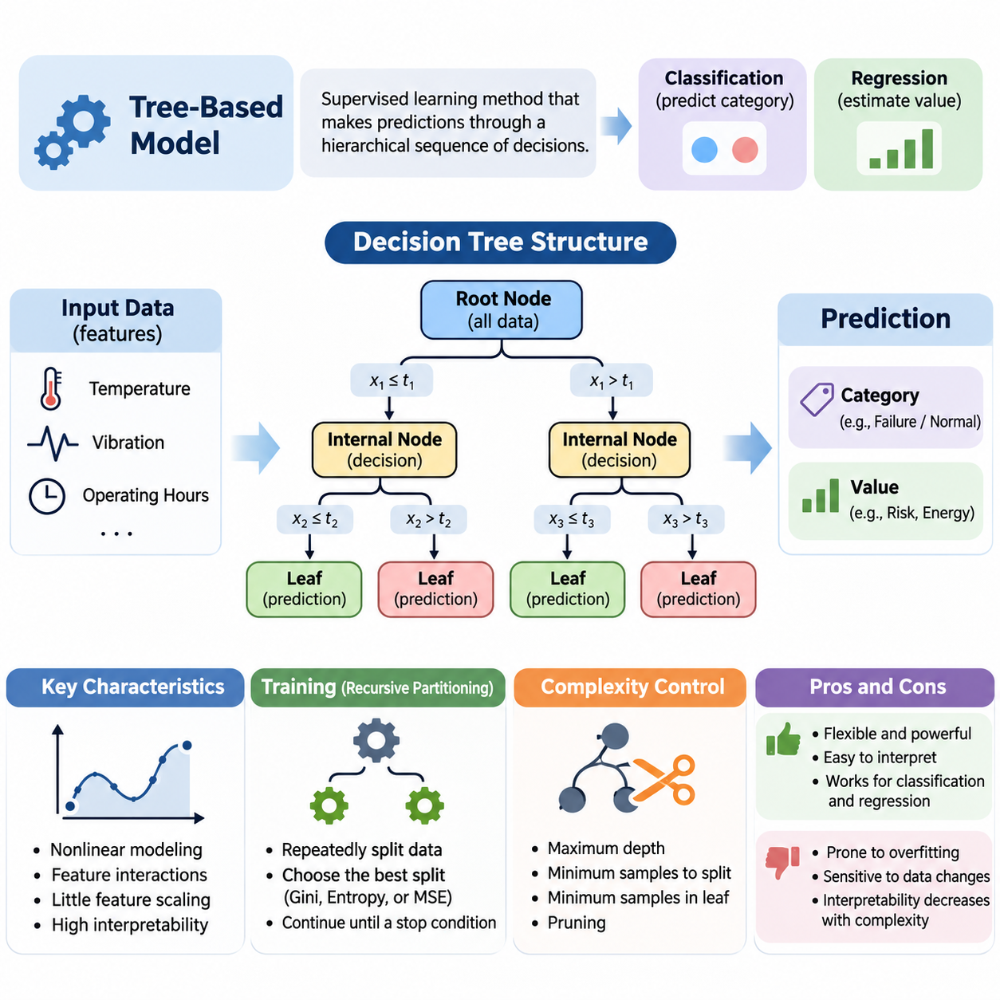
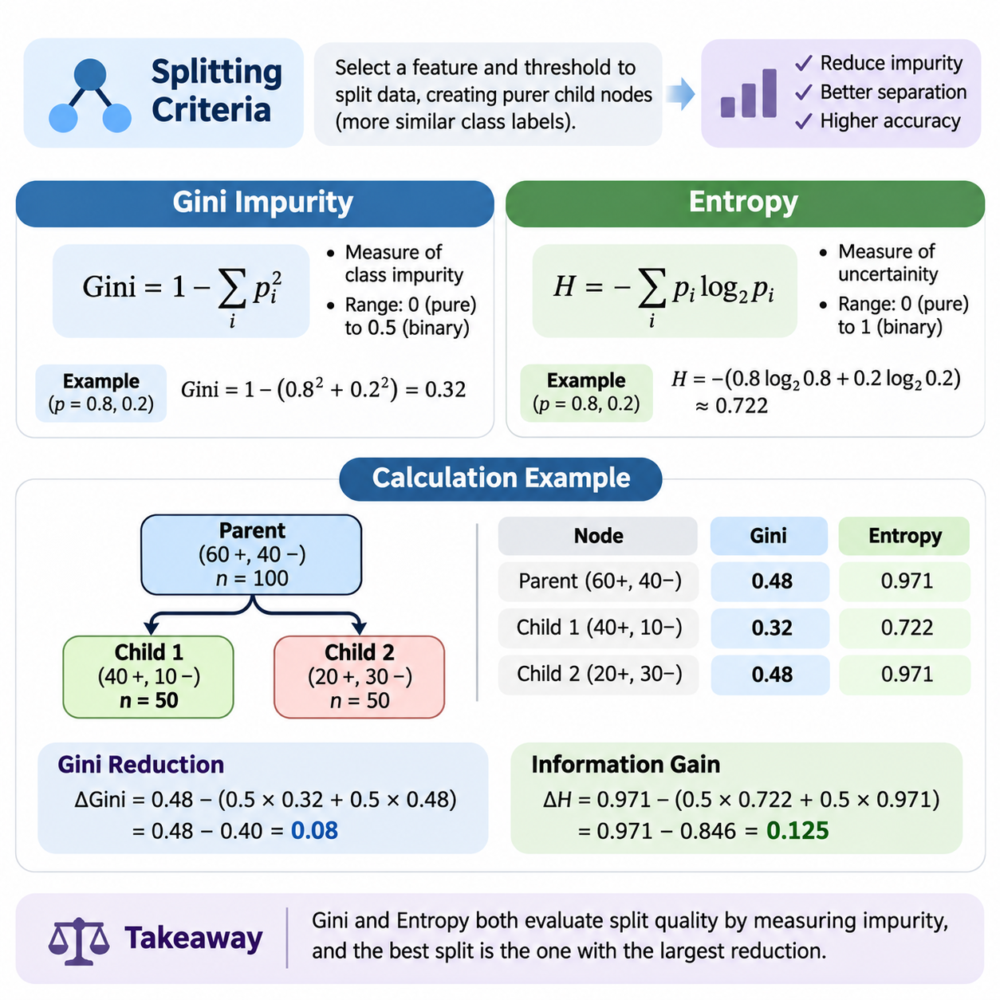
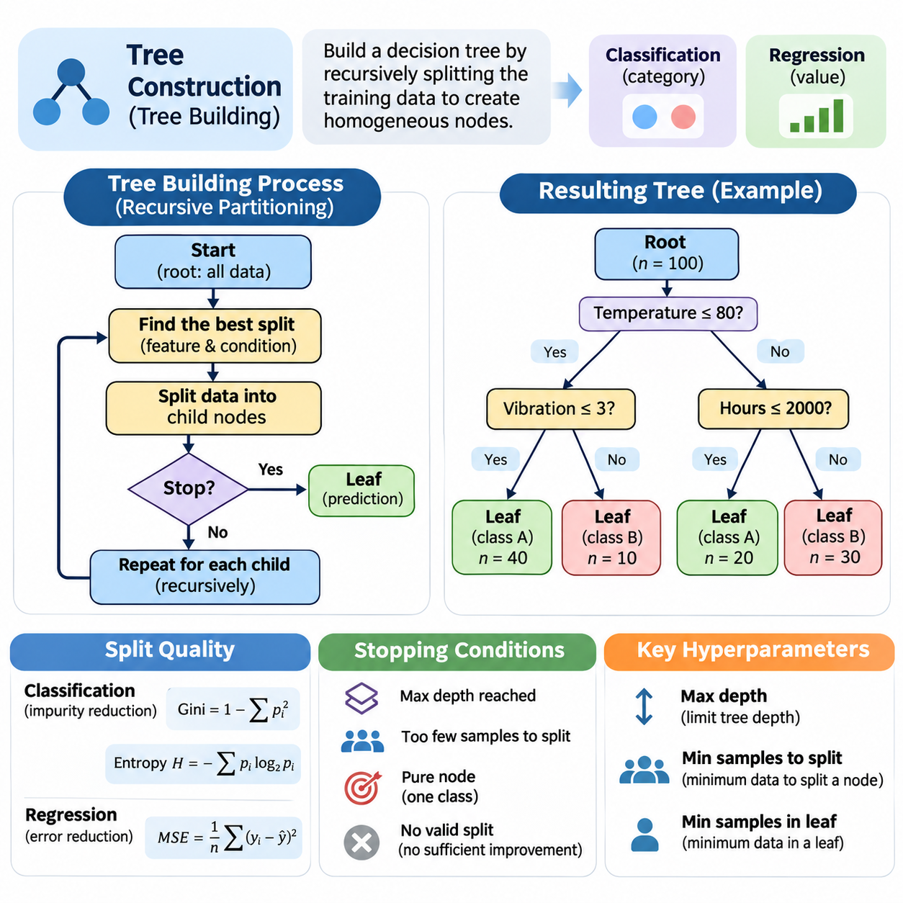
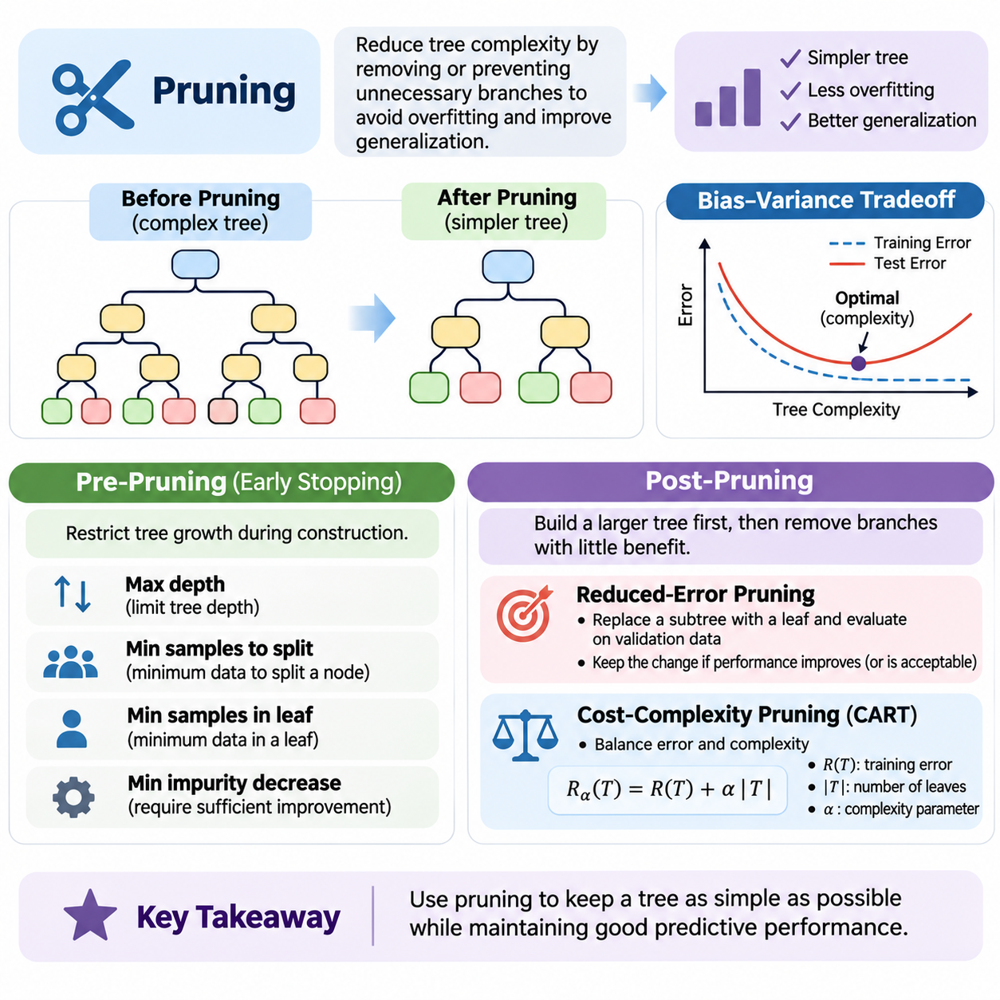
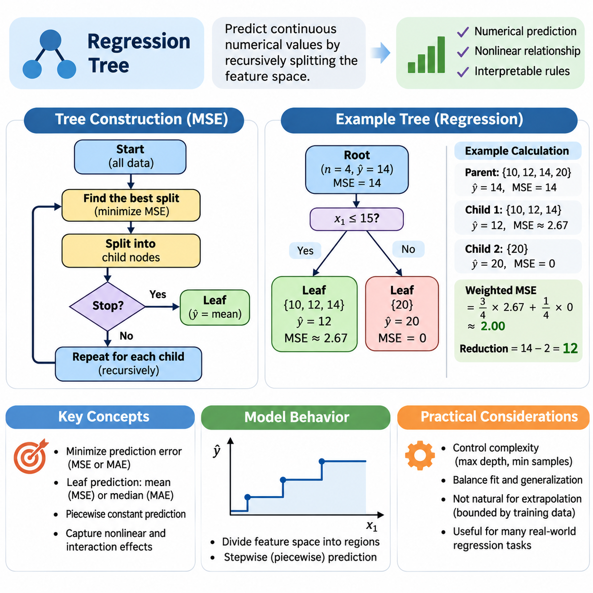
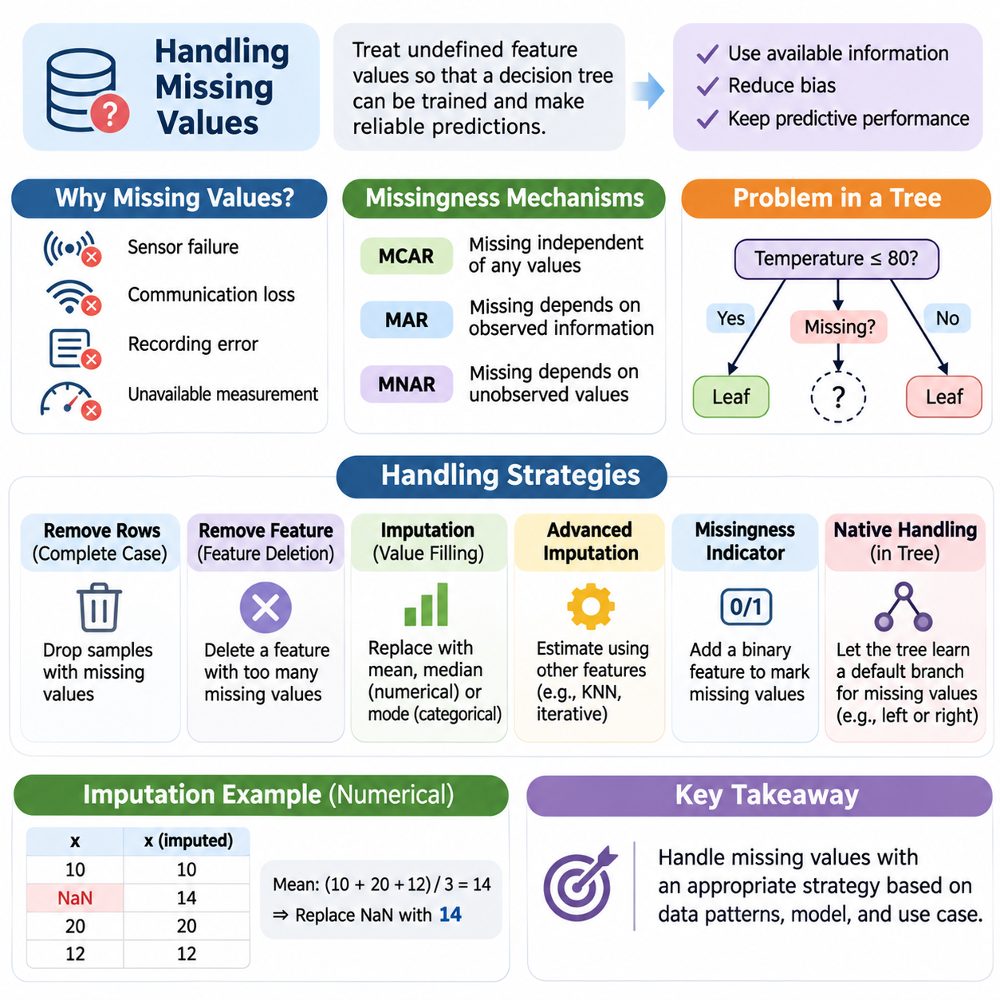
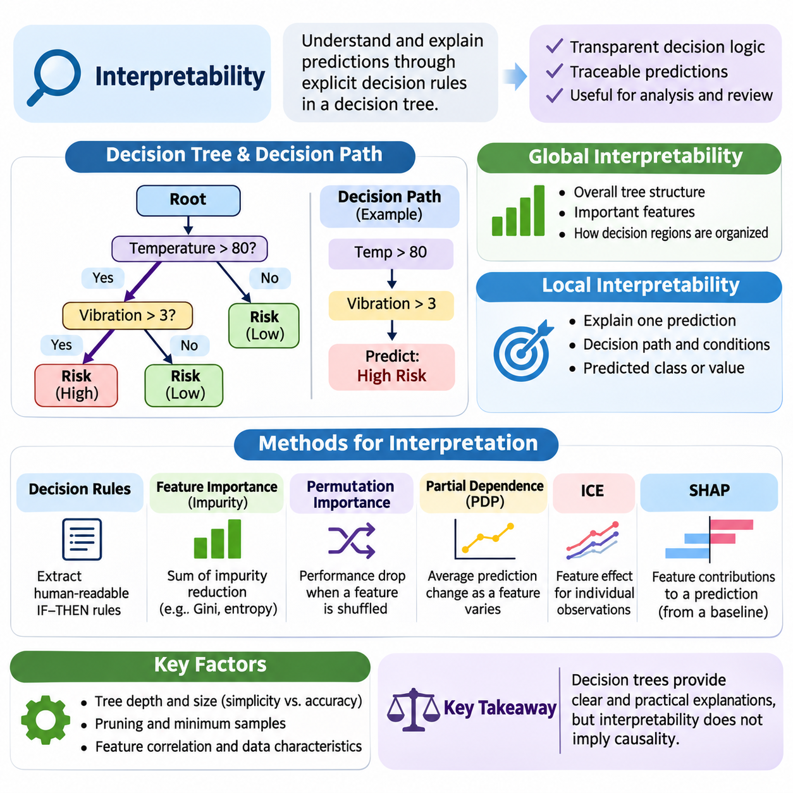
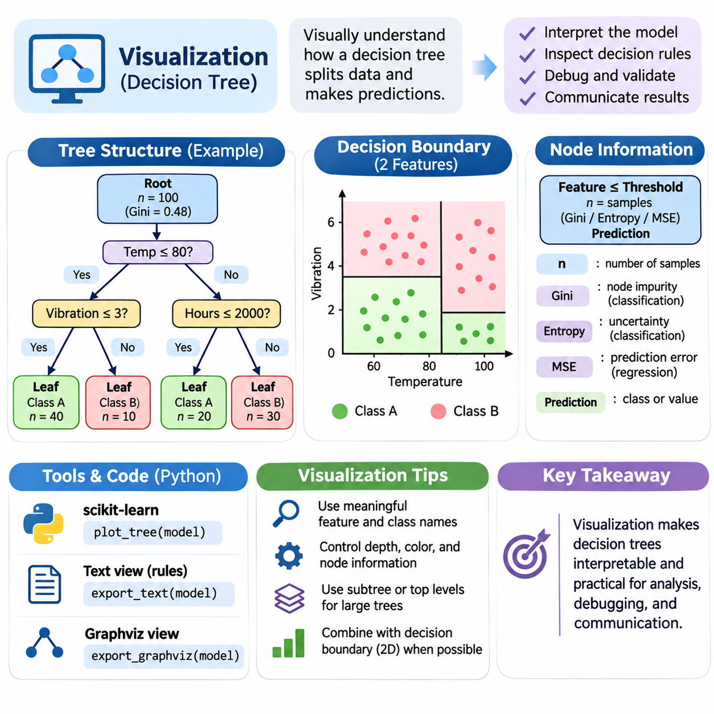
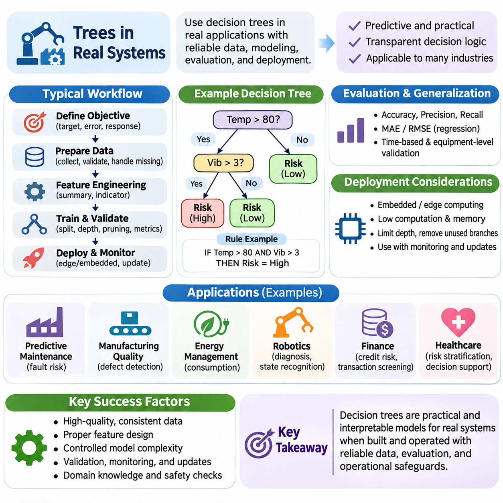

**Volume 08. Supervised Learning**


# 04. Decision Trees

## 04.00 Tree Based Model Overview

{width="7.268055555555556in" height="7.268055555555556in"}

Tree-based models are a fundamental family of supervised learning algorithms that organize predictions through a hierarchical sequence of decisions. Unlike linear models, which represent relationships using weighted combinations of features, tree-based methods divide the feature space into smaller regions. Each region represents observations sharing similar characteristics, allowing the model to capture nonlinear relationships without requiring an explicit mathematical equation.

A decision tree consists of a root node, internal decision nodes, branches, and terminal leaf nodes. The root represents the complete training dataset, while internal nodes evaluate conditions involving individual features. Branches indicate the outcomes of these conditions, and leaves provide final predictions. This hierarchical organization transforms a complex prediction problem into a sequence of relatively simple decisions that can be examined individually.

The prediction process begins at the root node and proceeds through successive conditions until a leaf is reached. For example, a model predicting equipment failure might first examine operating temperature, then vibration intensity, and finally accumulated operating hours. Each condition narrows the possible outcomes. The final leaf produces a predicted failure category or numerical risk estimate based on the training observations assigned to that region.

Tree-based learning is commonly applied to classification and regression problems. Classification trees predict discrete categories, such as defective or acceptable products, while regression trees estimate continuous values, such as energy consumption or equipment lifetime. Although both approaches share the same hierarchical structure, their training objectives differ because categorical prediction requires different measures of prediction quality from numerical estimation.

A defining characteristic of decision trees is recursive partitioning, which repeatedly divides a dataset into increasingly homogeneous subsets. At each internal node, the learning algorithm searches for a feature and splitting condition that improve the separation of observations. This process continues until a stopping condition is satisfied. The resulting tree represents a collection of local decision rules learned directly from the available training examples.

For numerical features, a typical split compares an observed value with a threshold. A temperature measurement might be divided into values below or above a selected operating limit. For categorical features, splitting can separate observations according to category membership when supported by the implementation. These operations create distinct regions of the feature space, allowing decision trees to model complicated relationships through combinations of simple conditions.

The selection of splitting conditions is central to tree construction. Classification trees commonly evaluate candidate splits using measures such as Gini impurity or entropy, which describe the distribution of class labels within a node. A useful split generally produces child nodes with more concentrated class distributions. Regression trees instead commonly minimize squared prediction error or within-node variance to obtain regions containing similar numerical targets.

Unlike gradient-based neural network training, conventional decision tree construction generally uses greedy optimization. At each node, the algorithm selects a locally favorable split without exhaustively evaluating every possible future tree structure. This strategy makes training computationally practical for many datasets. However, a locally optimal split does not necessarily produce the globally optimal tree, and small changes in training data may alter the resulting structure.

One important advantage of decision trees is their ability to represent nonlinear relationships and interactions between features. A linear classifier may require engineered interaction terms to capture conditional dependencies, whereas a tree can express them through successive splits. For example, vibration intensity might indicate equipment failure only when temperature exceeds a particular threshold. Such conditional behavior can emerge naturally from the tree structure.

Decision trees also require relatively little feature scaling. Since ordinary axis-aligned splits depend on feature thresholds rather than distances between observations, standardization and normalization are generally unnecessary. This property simplifies preprocessing when datasets contain measurements with different units. Nevertheless, data quality, appropriate feature representation, categorical encoding, and treatment of missing values remain important for reliable model development.

Interpretability is another major strength of decision trees. Each prediction follows a specific path consisting of identifiable feature conditions, making it possible to trace the model\'s decision process. Engineers can inspect these paths to understand which measurements influenced an outcome. However, interpretability decreases as trees become deeper and more complex, particularly when numerous interacting conditions make individual decision paths difficult to understand.

Despite their flexibility, individual decision trees are vulnerable to overfitting. A sufficiently deep tree can divide the training dataset into extremely small regions and memorize unusual observations or noise. Such a model may achieve excellent training accuracy while performing poorly on unseen data. This behavior illustrates the importance of controlling model complexity and evaluating whether learned decision rules generalize beyond the original training examples.

Tree complexity can be controlled through parameters such as maximum depth, minimum samples required for splitting, and minimum samples allowed in leaf nodes. These constraints prevent excessive fragmentation of the training dataset. Pruning provides another approach by removing branches that contribute little predictive value. Both strategies attempt to balance the ability to capture meaningful patterns against the risk of fitting accidental variations.

The bias-variance tradeoff provides a useful interpretation of tree complexity. Shallow trees tend to have higher bias because their limited structure may overlook important relationships. Deep trees generally have lower training bias but can exhibit high variance because their predictions are sensitive to changes in training observations. Selecting appropriate complexity therefore requires validation data and systematic evaluation rather than relying exclusively on training performance.

Decision trees can also encounter difficulties when datasets contain highly imbalanced classes. If normal observations greatly outnumber failure cases, splitting criteria may favor partitions that primarily improve predictions for the majority class. Consequently, a tree can achieve high overall accuracy while missing important rare events. Class weighting, resampling, and suitable evaluation metrics can help address this problem during model development.

Missing feature values introduce another practical challenge. Some tree implementations reject incomplete observations, while others support native missing-value handling, surrogate splits, or learned default directions. Alternatively, preprocessing methods can estimate missing values before training. The appropriate strategy depends on the algorithm and the reason measurements are missing, since missingness itself may carry useful information about system behavior.

Although decision trees are relatively efficient during inference, training costs depend on dataset size, feature count, split-search methods, and implementation details. Large datasets with numerous candidate thresholds may require substantial computation. Prediction generally involves evaluating conditions along one root-to-leaf path. Consequently, controlling tree depth can support predictable inference latency, which is valuable in resource-constrained industrial and edge computing environments.

A limitation of standard decision trees is that their predictions are typically piecewise constant. Classification leaves return class predictions or estimated probabilities, while regression leaves commonly return average target values. As a result, regression trees do not naturally extrapolate beyond the range of observed target values. Their axis-aligned partitions may also approximate smooth relationships inefficiently, requiring numerous splits to represent complex geometric boundaries.

Individual decision trees provide the conceptual foundation for more advanced ensemble methods. Random forests combine multiple trees trained with randomized data or feature selection to reduce prediction variance. Gradient boosting constructs trees sequentially to improve an additive predictive model. These approaches often achieve stronger generalization than a single tree, although they typically sacrifice some simplicity and direct interpretability in exchange for predictive performance.

Tree-based methods are especially effective for structured tabular datasets containing numerical and categorical business or engineering measurements. Applications include credit risk assessment, customer classification, predictive maintenance, quality inspection, and operational forecasting. Their ability to capture conditional relationships makes them attractive when observations are represented by meaningful features rather than raw images, audio waveforms, or other high-dimensional unstructured inputs.

In industrial monitoring, a decision tree can combine temperature, current consumption, vibration, and operating duration to identify abnormal equipment conditions. Each internal node evaluates a measurable characteristic, while the resulting prediction supports maintenance planning or diagnostic prioritization. Such models can be integrated with sensor acquisition systems and supervisory software, although operational deployment requires validation against realistic disturbances and changing equipment conditions.

For autonomous systems and robotics, tree-based models can support selected perception, diagnostics, and operational decision-support tasks. They may classify sensor health, estimate component degradation, or identify operating conditions requiring additional inspection. However, learned decision trees should not automatically replace verified safety mechanisms. Safety-critical applications require explicit performance requirements, uncertainty assessment, independent safeguards, and testing across relevant operating conditions.

Developing a reliable tree-based model begins with defining the prediction objective and preparing representative training data. The dataset must then be separated into appropriate training, validation, and test subsets. After constructing the initial tree, developers evaluate predictive performance, examine decision paths, and adjust complexity controls. This iterative process helps distinguish meaningful decision patterns from accidental correlations present in the training observations.

Model evaluation should reflect the intended application rather than depend on a single performance measure. Classification problems may require precision, recall, F1-score, or confusion-matrix analysis, while regression problems commonly use mean absolute error or root mean squared error. Cross-validation can improve confidence in model selection. For temporally dependent industrial measurements, chronological evaluation may be necessary to prevent unrealistic information leakage.

The reliability of tree-based models also depends on their behavior after deployment. Changes in sensor calibration, equipment operating conditions, user behavior, or data collection procedures can alter feature distributions. A tree trained under historical conditions may therefore become less accurate over time. Monitoring input distributions, prediction quality, and operational errors provides evidence for deciding when recalibration, retraining, or model replacement is necessary.

Tree-based learning represents an important connection between statistical prediction and human-readable decision logic. Its hierarchical structure provides an intuitive explanation of how supervised learning can transform observations into predictive rules. Understanding nodes, branches, recursive partitioning, complexity control, and generalization establishes the foundation for studying splitting criteria, tree construction, pruning, regression trees, interpretability, and advanced tree ensembles.

트리 기반 모델(Tree-Based Models)은 계층적 의사결정(Hierarchical Decision)의 연속적인 과정을 통해 예측을 수행하는 지도학습(Supervised Learning) 알고리즘의 기본적인 계열이다. 특징(Feature)의 가중 결합(Weighted Combination)을 사용하여 관계를 표현하는 선형 모델(Linear Models)과 달리, 트리 기반 방법(Tree-Based Methods)은 특징 공간(Feature Space)을 더 작은 영역으로 분할한다. 각 영역은 유사한 특성을 공유하는 관측값(Observations)을 나타내며, 명시적인 수학 방정식(Mathematical Equation)을 요구하지 않고도 비선형 관계(Nonlinear Relationships)를 학습할 수 있다.

의사결정 트리(Decision Tree)는 루트 노드(Root Node), 내부 의사결정 노드(Internal Decision Nodes), 분기(Branches), 말단 리프 노드(Terminal Leaf Nodes)로 구성된다. 루트 노드는 전체 학습 데이터셋(Training Dataset)을 나타내며, 내부 노드는 개별 특징에 대한 조건을 평가한다. 분기는 이러한 조건의 평가 결과를 나타내고, 리프 노드는 최종 예측값(Final Predictions)을 제공한다. 이러한 계층적 구조(Hierarchical Structure)는 복잡한 예측 문제를 개별적으로 분석할 수 있는 비교적 단순한 의사결정의 연속으로 변환한다.

예측 과정(Prediction Process)은 루트 노드에서 시작하여 리프 노드에 도달할 때까지 연속적인 조건을 따라 진행된다. 예를 들어, 장비 고장(Equipment Failure)을 예측하는 모델은 먼저 작동 온도(Operating Temperature)를 확인하고, 이후 진동 강도(Vibration Intensity)와 누적 작동 시간(Accumulated Operating Hours)을 평가할 수 있다. 각 조건은 가능한 결과의 범위를 점진적으로 좁힌다. 최종 리프 노드는 해당 영역에 할당된 학습 관측값을 기반으로 예측된 고장 범주(Failure Category) 또는 수치적 위험 추정값(Numerical Risk Estimate)을 생성한다.

트리 기반 학습(Tree-Based Learning)은 일반적으로 분류(Classification)와 회귀(Regression) 문제에 적용된다. 분류 트리(Classification Trees)는 불량품과 양품처럼 이산적인 범주(Discrete Categories)를 예측하며, 회귀 트리(Regression Trees)는 에너지 소비량이나 장비 수명과 같은 연속적인 값(Continuous Values)을 추정한다. 두 접근법은 동일한 계층적 구조를 공유하지만, 범주형 예측(Categorical Prediction)과 수치적 추정(Numerical Estimation)에 필요한 예측 품질 평가 기준이 서로 다르므로 학습 목적(Training Objectives)에도 차이가 있다.

의사결정 트리의 핵심적인 특징은 데이터셋을 점점 더 동질적인 부분집합(Homogeneous Subsets)으로 반복적으로 나누는 재귀적 분할(Recursive Partitioning)이다. 각 내부 노드에서 학습 알고리즘(Learning Algorithm)은 관측값의 분리 품질을 개선하는 특징과 분할 조건(Splitting Condition)을 탐색한다. 이러한 과정은 중지 조건(Stopping Condition)이 충족될 때까지 계속된다. 결과적으로 생성된 트리는 사용 가능한 학습 사례(Training Examples)에서 직접 학습한 국소적 의사결정 규칙(Local Decision Rules)의 집합을 나타낸다.

수치형 특징(Numerical Features)의 경우 일반적인 분할은 관측값을 임계값(Threshold)과 비교하는 방식으로 이루어진다. 예를 들어, 온도 측정값은 특정 작동 한계(Operating Limit)보다 낮은 값과 높은 값으로 구분할 수 있다. 범주형 특징(Categorical Features)은 구현 방식이 지원하는 경우 범주 소속 여부(Category Membership)에 따라 관측값을 분리할 수 있다. 이러한 연산은 특징 공간에 서로 다른 영역을 생성하며, 의사결정 트리가 단순한 조건의 조합을 통해 복잡한 관계를 모델링할 수 있도록 한다.

분할 조건(Splitting Conditions)의 선택은 트리 구성(Tree Construction)의 핵심 요소이다. 분류 트리는 일반적으로 노드 내부의 클래스 레이블(Class Labels) 분포를 나타내는 지니 불순도(Gini Impurity) 또는 엔트로피(Entropy)와 같은 척도를 사용하여 후보 분할을 평가한다. 유용한 분할은 일반적으로 자식 노드(Child Nodes)의 클래스 분포를 더욱 집중시킨다. 반면 회귀 트리는 유사한 수치형 목표값(Numerical Targets)을 포함하는 영역을 얻기 위해 제곱 예측 오차(Squared Prediction Error) 또는 노드 내부 분산(Within-Node Variance)을 최소화한다.

경사 기반 신경망 학습(Gradient-Based Neural Network Training)과 달리, 전통적인 의사결정 트리 구성은 일반적으로 탐욕적 최적화(Greedy Optimization)를 사용한다. 각 노드에서 알고리즘은 가능한 모든 미래의 트리 구조를 완전히 평가하지 않고 국소적으로 유리한 분할을 선택한다. 이러한 전략은 다양한 데이터셋에서 학습을 계산적으로 실용적인 수준으로 유지한다. 그러나 국소 최적 분할(Locally Optimal Split)이 반드시 전역 최적 트리(Globally Optimal Tree)를 생성하는 것은 아니며, 학습 데이터의 작은 변화도 결과 트리 구조를 변경할 수 있다.

의사결정 트리의 중요한 장점 중 하나는 비선형 관계(Nonlinear Relationships)와 특징 간 상호작용(Feature Interactions)을 표현할 수 있다는 점이다. 선형 분류기(Linear Classifier)는 조건부 의존성(Conditional Dependencies)을 표현하기 위해 별도의 상호작용 항(Interaction Terms)이 필요할 수 있지만, 트리는 연속적인 분할을 통해 이를 나타낼 수 있다. 예를 들어, 진동 강도는 온도가 특정 임계값을 초과하는 경우에만 장비 고장을 의미할 수 있다. 이러한 조건부 동작은 트리 구조에서 자연스럽게 학습될 수 있다.

의사결정 트리는 특징 스케일링(Feature Scaling)의 필요성도 상대적으로 낮다. 일반적인 축 정렬 분할(Axis-Aligned Splits)은 관측값 사이의 거리보다 특징의 임계값에 의존하므로 표준화(Standardization)와 정규화(Normalization)가 일반적으로 필요하지 않다. 이러한 특성은 서로 다른 단위를 사용하는 측정값이 포함된 데이터셋의 전처리(Preprocessing)를 단순화한다. 그러나 데이터 품질(Data Quality), 적절한 특징 표현(Feature Representation), 범주형 인코딩(Categorical Encoding), 결측값 처리(Missing Value Handling)는 여전히 신뢰할 수 있는 모델 개발에 중요하다.

해석 가능성(Interpretability)은 의사결정 트리의 또 다른 주요 장점이다. 각 예측은 식별 가능한 특징 조건으로 구성된 특정 경로를 따르므로 모델의 의사결정 과정(Decision Process)을 추적할 수 있다. 엔지니어는 이러한 경로를 분석하여 어떤 측정값이 결과에 영향을 주었는지 이해할 수 있다. 그러나 트리가 깊고 복잡해질수록 해석 가능성은 감소하며, 특히 다수의 상호작용 조건이 개별 의사결정 경로를 이해하기 어렵게 만드는 경우 이러한 한계가 두드러진다.

이러한 유연성에도 불구하고 개별 의사결정 트리는 과적합(Overfitting)에 취약하다. 충분히 깊은 트리는 학습 데이터셋을 매우 작은 영역으로 분할하여 비정상적인 관측값이나 잡음(Noise)을 암기할 수 있다. 이러한 모델은 높은 학습 정확도(Training Accuracy)를 달성하더라도 새로운 데이터(Unseen Data)에서는 낮은 성능을 보일 수 있다. 이러한 현상은 모델 복잡도(Model Complexity)를 제어하고 학습된 의사결정 규칙이 기존 학습 사례를 넘어 일반화(Generalization)되는지 평가해야 할 필요성을 보여준다.

트리 복잡도(Tree Complexity)는 최대 깊이(Maximum Depth), 분할에 필요한 최소 샘플 수(Minimum Samples Required for Splitting), 리프 노드의 최소 샘플 수(Minimum Samples per Leaf)와 같은 매개변수를 통해 제어할 수 있다. 이러한 제약은 학습 데이터셋이 지나치게 세분화되는 것을 방지한다. 가지치기(Pruning)는 예측 성능에 거의 기여하지 않는 분기를 제거하는 또 다른 접근법이다. 두 전략 모두 의미 있는 패턴을 포착하는 능력과 우연한 변동을 학습할 위험 사이에서 균형을 유지하려는 목적을 가진다.

편향-분산 절충(Bias-Variance Tradeoff)은 트리 복잡도를 이해하는 데 유용한 관점을 제공한다. 얕은 트리(Shallow Trees)는 제한된 구조로 인해 중요한 관계를 놓칠 수 있으므로 높은 편향(High Bias)을 보이는 경향이 있다. 깊은 트리(Deep Trees)는 일반적으로 학습 편향이 낮지만, 학습 관측값의 변화에 예측이 민감하게 반응하므로 높은 분산(High Variance)을 나타낼 수 있다. 따라서 적절한 복잡도를 선택하려면 학습 성능에만 의존하지 않고 검증 데이터(Validation Data)와 체계적인 평가(Systematic Evaluation)를 활용해야 한다.

의사결정 트리는 클래스 불균형(Class Imbalance)이 심한 데이터셋에서도 어려움을 겪을 수 있다. 정상 관측값이 고장 사례보다 훨씬 많으면 분할 기준(Splitting Criteria)이 다수 클래스(Majority Class)의 예측 성능을 주로 개선하는 방향으로 작동할 수 있다. 결과적으로 트리는 전체 정확도(Overall Accuracy)가 높더라도 중요한 희귀 사건(Rare Events)을 놓칠 수 있다. 클래스 가중치(Class Weighting), 재표본추출(Resampling), 적절한 평가 지표(Evaluation Metrics)는 모델 개발 과정에서 이러한 문제를 완화하는 데 도움이 된다.

특징의 결측값(Missing Feature Values)은 또 다른 실무적 과제를 제시한다. 일부 트리 구현은 불완전한 관측값을 허용하지 않지만, 다른 구현은 결측값의 직접 처리(Native Missing-Value Handling), 대체 분할(Surrogate Splits), 학습된 기본 분기 방향(Learned Default Directions)을 지원한다. 또는 전처리 방법을 통해 학습 전에 결측값을 추정할 수 있다. 적절한 전략은 알고리즘과 측정값이 누락된 원인에 따라 달라지며, 결측 자체가 시스템 동작에 관한 유용한 정보를 포함할 수도 있다.

의사결정 트리는 추론(Inference) 과정에서 상대적으로 효율적이지만, 학습 비용(Training Cost)은 데이터셋 크기, 특징 수, 분할 탐색 방법(Split-Search Methods), 구현 세부 사항에 따라 달라진다. 후보 임계값이 많은 대규모 데이터셋은 상당한 계산 자원을 요구할 수 있다. 예측 과정에서는 일반적으로 루트에서 리프까지 하나의 경로를 따라 조건을 평가한다. 따라서 트리 깊이를 제어하면 자원이 제한된 산업용 및 엣지 컴퓨팅(Edge Computing) 환경에서 예측 가능한 추론 지연시간(Inference Latency)을 확보하는 데 도움이 된다.

표준 의사결정 트리(Standard Decision Trees)의 한계 중 하나는 예측값이 일반적으로 구간별 상수(Piecewise Constant) 형태라는 점이다. 분류 트리의 리프는 클래스 예측값이나 추정 확률(Estimated Probabilities)을 반환하며, 회귀 트리의 리프는 일반적으로 평균 목표값(Average Target Values)을 반환한다. 따라서 회귀 트리는 관측된 목표값 범위를 넘어 자연스럽게 외삽(Extrapolation)하지 못한다. 또한 축 정렬 분할은 매끄러운 관계를 비효율적으로 근사할 수 있어 복잡한 기하학적 경계(Geometric Boundaries)를 표현하기 위해 많은 분할이 필요할 수 있다.

개별 의사결정 트리는 더욱 발전된 앙상블 방법(Ensemble Methods)의 개념적 기반을 제공한다. 랜덤 포레스트(Random Forests)는 무작위화된 데이터 또는 특징 선택을 사용하여 학습한 여러 트리를 결합함으로써 예측 분산(Prediction Variance)을 감소시킨다. 그래디언트 부스팅(Gradient Boosting)은 가산적 예측 모델(Additive Predictive Model)을 개선하기 위해 트리를 순차적으로 구성한다. 이러한 접근법은 일반적으로 단일 트리보다 높은 일반화 성능을 달성하지만, 예측 성능 향상의 대가로 단순성과 직접적인 해석 가능성이 일부 감소할 수 있다.

트리 기반 방법은 수치형 및 범주형 비즈니스 또는 엔지니어링 측정값을 포함하는 구조화된 표 형식 데이터셋(Structured Tabular Datasets)에 특히 효과적이다. 주요 응용 분야에는 신용 위험 평가(Credit Risk Assessment), 고객 분류(Customer Classification), 예지보전(Predictive Maintenance), 품질 검사(Quality Inspection), 운영 예측(Operational Forecasting)이 포함된다. 조건부 관계를 포착하는 능력은 원시 이미지, 오디오 파형 또는 고차원 비정형 입력보다 의미 있는 특징으로 표현된 관측값을 처리할 때 특히 유용하다.

산업용 모니터링(Industrial Monitoring)에서는 의사결정 트리가 온도, 전류 소비량(Current Consumption), 진동, 작동 시간을 결합하여 비정상적인 장비 상태(Abnormal Equipment Conditions)를 식별할 수 있다. 각 내부 노드는 측정 가능한 특성을 평가하며, 결과 예측은 유지보수 계획(Maintenance Planning)이나 진단 우선순위 결정(Diagnostic Prioritization)을 지원한다. 이러한 모델은 센서 데이터 수집 시스템(Sensor Acquisition Systems) 및 감독 소프트웨어(Supervisory Software)와 통합할 수 있지만, 실제 운영 환경에 배포하려면 현실적인 외란(Disturbances)과 변화하는 장비 상태에 대한 검증이 필요하다.

자율 시스템(Autonomous Systems)과 로보틱스(Robotics)에서 트리 기반 모델은 일부 인식(Perception), 진단(Diagnostics), 운영 의사결정 지원(Operational Decision Support) 작업에 활용될 수 있다. 센서 상태(Sensor Health)를 분류하거나 부품 열화(Component Degradation)를 추정하고 추가 점검이 필요한 작동 조건을 식별할 수 있다. 그러나 학습된 의사결정 트리가 검증된 안전 메커니즘(Verified Safety Mechanisms)을 자동으로 대체해서는 안 된다. 안전 필수 응용 분야(Safety-Critical Applications)에서는 명시적인 성능 요구사항, 불확실성 평가(Uncertainty Assessment), 독립적인 보호 장치(Independent Safeguards), 관련 작동 조건 전반에 대한 시험이 필요하다.

신뢰할 수 있는 트리 기반 모델의 개발은 예측 목표(Prediction Objective)를 정의하고 대표성 있는 학습 데이터(Representative Training Data)를 준비하는 것에서 시작된다. 이후 데이터셋을 적절한 학습, 검증, 테스트 부분집합(Training, Validation, and Test Subsets)으로 분리해야 한다. 초기 트리를 구성한 다음 개발자는 예측 성능을 평가하고 의사결정 경로를 분석하며 복잡도 제어 매개변수를 조정한다. 이러한 반복 과정(Iterative Process)은 의미 있는 의사결정 패턴과 학습 관측값에 존재하는 우연한 상관관계(Accidental Correlations)를 구분하는 데 도움이 된다.

모델 평가(Model Evaluation)는 단일 성능 지표에 의존하기보다 의도된 응용 분야를 반영해야 한다. 분류 문제에서는 정밀도(Precision), 재현율(Recall), F1 점수(F1-Score), 혼동 행렬 분석(Confusion Matrix Analysis)이 필요할 수 있으며, 회귀 문제에서는 평균 절대 오차(Mean Absolute Error) 또는 평균 제곱근 오차(Root Mean Squared Error)를 일반적으로 사용한다. 교차 검증(Cross-Validation)은 모델 선택의 신뢰도를 높일 수 있다. 시간적 의존성이 있는 산업용 측정값에서는 비현실적인 정보 누출(Information Leakage)을 방지하기 위해 시간 순서 기반 평가(Chronological Evaluation)가 필요할 수 있다.

트리 기반 모델의 신뢰성은 배포 이후의 동작에도 영향을 받는다. 센서 보정(Sensor Calibration), 장비 작동 조건, 사용자 행동 또는 데이터 수집 절차의 변화는 특징 분포(Feature Distributions)를 변경할 수 있다. 따라서 과거 조건에서 학습한 트리는 시간이 지나면서 정확도가 감소할 수 있다. 입력 분포(Input Distributions), 예측 품질(Prediction Quality), 운영 오류(Operational Errors)를 지속적으로 모니터링하면 재보정(Recalibration), 재학습(Retraining), 모델 교체(Model Replacement)가 필요한 시점을 판단하는 근거를 확보할 수 있다.

트리 기반 학습(Tree-Based Learning)은 통계적 예측(Statistical Prediction)과 사람이 이해할 수 있는 의사결정 논리(Human-Readable Decision Logic)를 연결하는 중요한 방법론이다. 계층적 구조는 지도학습이 관측값을 예측 규칙(Predictive Rules)으로 변환하는 과정을 직관적으로 설명한다. 노드, 분기, 재귀적 분할, 복잡도 제어, 일반화에 대한 이해는 분할 기준(Splitting Criteria), 트리 구성(Tree Construction), 가지치기(Pruning), 회귀 트리(Regression Trees), 해석 가능성(Interpretability), 고급 트리 앙상블(Advanced Tree Ensembles)을 학습하기 위한 기초를 제공한다.

## 04.01 Splitting Criteria

{width="7.268055555555556in" height="7.268055555555556in"}

Splitting criteria are fundamental mechanisms used in decision tree learning to determine how training observations should be divided at each internal node. The objective is to create child nodes containing observations with increasingly similar target labels. By evaluating candidate features and thresholds, the algorithm identifies partitions that improve class separation. This process directly influences tree structure, predictive accuracy, and generalization performance.

In classification trees, split quality is commonly measured through node impurity, which describes how mixed the class labels are within a particular subset. A node containing observations from only one class is considered pure, while a node containing several classes has greater impurity. The learning algorithm attempts to reduce impurity through recursive partitioning, progressively creating regions where class membership becomes more predictable.

Gini impurity is a widely used splitting criterion in classification trees, particularly in algorithms based on Classification and Regression Trees, commonly known as CART. It measures the probability of assigning an incorrect class when a label is randomly selected according to the class distribution within a node. Lower Gini impurity indicates greater class concentration, while higher values indicate a more heterogeneous distribution.

Mathematically, Gini impurity is expressed as Gini = 1 - sum(p_i²), where p_i represents the proportion of observations belonging to class i. The summation covers all classes present in the classification problem. When every observation belongs to the same class, one class probability equals one and all others equal zero, producing a Gini impurity of zero. This represents a completely pure node.

For a binary classification problem, Gini impurity reaches its maximum value of 0.5 when both classes have equal probabilities. If a node contains 80 percent positive observations and 20 percent negative observations, its impurity becomes 1 - (0.8² + 0.2²) = 0.32. This value indicates that the node contains a dominant class but still includes substantial uncertainty regarding individual class membership.

The Gini criterion evaluates candidate splits by comparing the impurity of the parent node with the weighted impurity of the resulting child nodes. Each child contributes according to its proportion of the parent observations. A split is considered beneficial when the weighted child impurity is smaller than the parent impurity. The difference represents the reduction in impurity achieved by the proposed partition.

For example, consider a parent node containing 100 observations, including 60 positive and 40 negative examples. Its Gini impurity is 0.48. Suppose a candidate split creates one child containing 40 positive and 10 negative observations and another containing 20 positive and 30 negative observations. Their impurities are 0.32 and 0.48, respectively, producing a weighted impurity of 0.40.

The Gini impurity reduction in this example equals 0.48 - 0.40 = 0.08. A competing split producing a larger reduction would generally be preferred under the Gini criterion. This calculation illustrates how decision trees evaluate partitions using class distributions rather than directly comparing predicted labels with individual observations. The procedure is repeated across candidate features and thresholds during tree construction.

Entropy provides another important splitting criterion and originates from information theory. It measures uncertainty associated with the class distribution within a node. When observations are evenly distributed among classes, uncertainty is relatively high because the class label is difficult to predict. When one class dominates, uncertainty decreases. A completely pure node has zero entropy because its class membership is certain.

The entropy of a classification node is defined as H = -sum(p_i log2(p_i)), where p_i denotes the probability of class i. The logarithm is conventionally calculated using base two, expressing entropy in bits. Terms with zero probability contribute zero by continuity. For binary classification, entropy reaches its maximum value of one bit when both classes have equal probabilities.

Consider a binary node containing 80 percent positive and 20 percent negative observations. Its entropy is approximately 0.722 bits, calculated as -(0.8 log2(0.8) + 0.2 log2(0.2)). Although the numerical scale differs from Gini impurity, both measures indicate that the node is not completely pure. Both also assign lower impurity to distributions dominated by a single class.

Entropy-based splitting commonly uses information gain to evaluate candidate partitions. Information gain measures how much uncertainty decreases after a dataset is divided into child nodes. It is calculated by subtracting the weighted average entropy of the child nodes from the entropy of the parent node. A larger information gain indicates that the selected feature and splitting condition provide a more informative separation of class labels.

Using the previous example with 60 positive and 40 negative observations, the parent entropy is approximately 0.971 bits. After splitting, the first child contains 40 positive and 10 negative observations, giving an entropy of approximately 0.722 bits. The second child contains 20 positive and 30 negative observations, producing an entropy of approximately 0.971 bits.

Because both child nodes contain 50 observations, their weighted entropy is approximately 0.846 bits. The information gain therefore equals 0.971 - 0.846, or approximately 0.125 bits. This positive value indicates that the split reduces uncertainty about class membership. The algorithm can compare this result with alternative splits and select the candidate producing the greatest information gain.

Gini impurity and entropy share several important properties. Both are zero for completely pure nodes, increase as class distributions become more mixed, and are symmetric with respect to class labels. Both support greedy tree construction by evaluating local reductions in impurity. However, their mathematical forms differ, meaning they can occasionally rank candidate splits differently even when applied to the same dataset.

Gini impurity uses squared class probabilities, while entropy uses logarithmic probabilities. Gini calculations are often computationally simpler because they avoid logarithmic operations. Entropy provides a direct information-theoretic interpretation of uncertainty reduction. In many practical classification problems, both criteria produce similar decision trees, although differences may appear in particular datasets or splitting configurations.

The calculation of split quality requires accounting for the relative sizes of child nodes. Without weighting, a small child containing only a few observations could receive the same influence as a much larger child. Standard impurity reduction therefore multiplies each child impurity by the fraction of parent observations assigned to that child. This ensures that the evaluation reflects the overall distribution of the training examples.

For a candidate split, the general impurity reduction can be written as Delta I = I(parent) - sum((n_j / n) I(child_j)), where n represents the parent sample count and n_j represents the number of observations in child j. The impurity function I may represent Gini impurity or entropy. The decision tree searches for the split maximizing this reduction among the available candidates.

The practical calculation process begins by examining the target labels associated with observations at the current node. For each candidate feature, the algorithm generates possible splitting conditions and assigns observations to the resulting child nodes. It then calculates class proportions, evaluates child impurities, and determines the weighted reduction. The best valid split is selected according to the configured criterion and structural constraints.

For continuous numerical features, candidate thresholds can be generated by sorting distinct observed values and examining boundaries between consecutive values. Implementations may evaluate midpoints or equivalent partition boundaries. Efficient algorithms avoid repeatedly scanning the complete dataset for every candidate. Instead, they maintain cumulative class counts while traversing sorted feature values, reducing redundant calculations.

Categorical features require different splitting strategies. A binary split may separate one category or a group of categories from the remaining values. Some algorithms support multiway splits that create separate branches for different categories. The number of possible category partitions can become large, so implementations often introduce restrictions or specialized search strategies to control computational complexity.

When implementing impurity calculations, numerical stability and correct probability handling are important. Class probabilities must be nonnegative and sum to one for a nonempty node. Entropy calculations must handle zero probabilities without evaluating the logarithm of zero directly. Small numerical differences can also affect comparisons between nearly equivalent candidate splits, making deterministic tie-breaking useful for reproducibility.

A simple implementation can calculate Gini impurity by counting observations in each class, dividing the counts by the total number of observations, squaring the resulting probabilities, and subtracting their sum from one. Entropy follows a similar procedure but multiplies each nonzero probability by its base-two logarithm. These calculations form reusable components within a recursive decision tree training algorithm.

To evaluate a candidate split computationally, the implementation first partitions the observations according to a feature condition. It then calculates the impurity of each child node and combines those values using sample-count weights. Subtracting this result from the parent impurity produces the split improvement. Repeating the procedure across candidate thresholds identifies the locally preferred partition for the current node.

A useful verification strategy is to test impurity functions against known distributions. A pure binary node should return zero for both Gini impurity and entropy. An evenly balanced binary node should return 0.5 for Gini impurity and one bit for entropy. Additional tests should confirm that weighted child impurities and impurity reductions are calculated correctly, including cases involving empty candidate partitions.

Although impurity reduction is central to tree learning, maximizing it without constraints can produce overly complex trees. A split that improves training impurity may still capture random noise rather than a generalizable relationship. Minimum sample requirements, maximum depth restrictions, and minimum impurity decrease thresholds help prevent unnecessary partitioning. Pruning and validation provide additional mechanisms for controlling overfitting.

Gini impurity and entropy are primarily classification criteria. Regression trees generally use different objectives, such as variance reduction or squared-error minimization, because their targets are continuous rather than categorical. Nevertheless, the underlying principle remains similar: a useful split creates child regions whose target values are more homogeneous than those of the parent region.

Understanding splitting criteria reveals how decision trees transform statistical class distributions into hierarchical decision rules. Gini impurity emphasizes class concentration through squared probabilities, while entropy measures uncertainty through information theory. Their calculations provide a systematic foundation for selecting features, constructing branches, and evaluating partition quality, preparing the way for deeper study of tree construction, pruning, and ensemble learning.

분할 기준(Splitting Criteria)은 의사결정 트리 학습(Decision Tree Learning)에서 각 내부 노드(Internal Node)의 학습 관측값(Training Observations)을 어떻게 나눌 것인지 결정하는 핵심 메커니즘이다. 그 목적은 목표 레이블(Target Labels)이 점점 더 유사한 관측값으로 구성된 자식 노드(Child Nodes)를 생성하는 것이다. 알고리즘은 후보 특징(Candidate Features)과 임계값(Thresholds)을 평가하여 클래스 분리(Class Separation)를 개선하는 분할을 식별한다. 이러한 과정은 트리 구조(Tree Structure), 예측 정확도(Predictive Accuracy), 일반화 성능(Generalization Performance)에 직접적인 영향을 미친다.

분류 트리(Classification Trees)에서 분할 품질(Split Quality)은 일반적으로 특정 부분집합(Subset) 내부의 클래스 레이블이 얼마나 혼합되어 있는지를 나타내는 노드 불순도(Node Impurity)를 통해 측정한다. 하나의 클래스에 속하는 관측값만 포함하는 노드는 순수 노드(Pure Node)로 간주하며, 여러 클래스가 혼합된 노드는 더 높은 불순도를 가진다. 학습 알고리즘(Learning Algorithm)은 재귀적 분할(Recursive Partitioning)을 통해 불순도를 감소시키고, 클래스 소속(Class Membership)을 더욱 예측하기 쉬운 영역을 점진적으로 생성한다.

지니 불순도(Gini Impurity)는 분류 트리에서 널리 사용되는 분할 기준이며, 특히 분류 및 회귀 트리(Classification and Regression Trees, CART) 기반 알고리즘에서 자주 활용된다. 지니 불순도는 노드 내부의 클래스 분포(Class Distribution)에 따라 레이블을 무작위로 선택하여 할당할 때 잘못된 클래스를 지정할 확률을 측정한다. 낮은 지니 불순도는 높은 클래스 집중도(Class Concentration)를 의미하며, 높은 값은 더욱 이질적인 분포(Heterogeneous Distribution)를 나타낸다.

수학적으로 지니 불순도는 Gini = 1 - sum(p_i²)로 표현하며, 여기서 p_i는 클래스 i에 속하는 관측값의 비율(Proportion)을 나타낸다. 합산(Summation)은 분류 문제에 존재하는 모든 클래스를 대상으로 수행한다. 모든 관측값이 동일한 클래스에 속하면 하나의 클래스 확률(Class Probability)은 1이 되고 나머지는 모두 0이므로 지니 불순도는 0이 된다. 이는 완전히 순수한 노드(Completely Pure Node)를 의미한다.

이진 분류(Binary Classification) 문제에서 지니 불순도는 두 클래스의 확률이 동일할 때 최대값인 0.5에 도달한다. 하나의 노드에 양성 관측값(Positive Observations)이 80%, 음성 관측값(Negative Observations)이 20% 포함되어 있다면 불순도는 1 - (0.8² + 0.2²) = 0.32가 된다. 이 값은 해당 노드에 우세한 클래스(Dominant Class)가 존재하지만 개별 관측값의 클래스 소속에 대해서는 여전히 상당한 불확실성(Uncertainty)이 남아 있음을 나타낸다.

지니 기준(Gini Criterion)은 부모 노드(Parent Node)의 불순도와 분할 이후 생성된 자식 노드들의 가중 불순도(Weighted Impurity)를 비교하여 후보 분할(Candidate Splits)을 평가한다. 각 자식 노드는 부모 노드의 전체 관측값에서 자신이 차지하는 비율에 따라 기여한다. 자식 노드들의 가중 불순도가 부모 노드의 불순도보다 작으면 해당 분할은 유익한 것으로 간주한다. 두 값의 차이는 제안된 분할에 의해 달성된 불순도 감소량(Impurity Reduction)을 의미한다.

예를 들어, 부모 노드에 100개의 관측값이 있으며 양성 사례(Positive Examples) 60개와 음성 사례(Negative Examples) 40개가 포함되어 있다고 가정하자. 이 노드의 지니 불순도는 0.48이다. 후보 분할이 양성 40개와 음성 10개를 포함하는 첫 번째 자식 노드, 양성 20개와 음성 30개를 포함하는 두 번째 자식 노드를 생성한다면 각 불순도는 0.32와 0.48이 된다. 따라서 가중 불순도는 0.40이다.

이 예제에서 지니 불순도 감소량(Gini Impurity Reduction)은 0.48 - 0.40 = 0.08이다. 경쟁하는 다른 분할이 더 큰 감소량을 생성한다면 지니 기준에서는 일반적으로 해당 분할을 우선적으로 선택한다. 이러한 계산은 의사결정 트리가 개별 관측값의 예측 레이블을 직접 비교하기보다 클래스 분포를 사용하여 분할을 평가한다는 점을 보여준다. 이 과정은 트리 구성(Tree Construction) 중 후보 특징과 임계값 전반에 걸쳐 반복된다.

엔트로피(Entropy)는 정보 이론(Information Theory)에서 유래한 또 다른 중요한 분할 기준이다. 엔트로피는 노드 내부의 클래스 분포와 관련된 불확실성을 측정한다. 관측값이 여러 클래스에 균등하게 분포하면 클래스 레이블을 예측하기 어렵기 때문에 불확실성이 상대적으로 높다. 반대로 하나의 클래스가 우세하면 불확실성이 감소한다. 완전히 순수한 노드는 클래스 소속이 확실하므로 엔트로피가 0이다.

분류 노드의 엔트로피는 H = -sum(p_i log2(p_i))로 정의하며, 여기서 p_i는 클래스 i의 확률을 나타낸다. 로그(Logarithm)는 일반적으로 밑이 2인 로그를 사용하며, 엔트로피를 비트(Bits) 단위로 표현한다. 확률이 0인 항은 연속성(Continuity)에 따라 0으로 처리한다. 이진 분류에서 엔트로피는 두 클래스의 확률이 동일할 때 최대값인 1비트에 도달한다.

양성 관측값이 80%, 음성 관측값이 20%인 이진 노드를 고려하자. 이 노드의 엔트로피는 -(0.8 log2(0.8) + 0.2 log2(0.2))로 계산하며, 약 0.722비트이다. 수치적 척도(Numerical Scale)는 지니 불순도와 다르지만 두 척도 모두 해당 노드가 완전히 순수하지 않다는 사실을 나타낸다. 또한 두 척도 모두 하나의 클래스가 우세한 분포에 더 낮은 불순도를 부여한다.

엔트로피 기반 분할(Entropy-Based Splitting)은 일반적으로 정보 이득(Information Gain)을 사용하여 후보 분할을 평가한다. 정보 이득은 데이터셋을 자식 노드로 분할한 이후 불확실성이 얼마나 감소했는지를 측정한다. 부모 노드의 엔트로피에서 자식 노드들의 가중 평균 엔트로피(Weighted Average Entropy)를 빼서 계산한다. 정보 이득이 클수록 선택한 특징과 분할 조건이 클래스 레이블을 더욱 유용하게 구분한다는 의미이다.

앞서 사용한 양성 관측값 60개와 음성 관측값 40개의 예제를 다시 고려하면 부모 노드의 엔트로피는 약 0.971비트이다. 분할 이후 첫 번째 자식 노드는 양성 40개와 음성 10개를 포함하므로 엔트로피가 약 0.722비트이다. 두 번째 자식 노드는 양성 20개와 음성 30개를 포함하며 엔트로피는 약 0.971비트이다. 이러한 값은 분할 전후의 불확실성을 정량적으로 비교하는 데 사용된다.

두 자식 노드가 각각 50개의 관측값을 포함하므로 가중 엔트로피(Weighted Entropy)는 약 0.846비트이다. 따라서 정보 이득은 0.971 - 0.846으로 계산되며 약 0.125비트이다. 이 양의 값(Positive Value)은 분할을 통해 클래스 소속에 관한 불확실성이 감소했음을 의미한다. 알고리즘은 이 결과를 다른 후보 분할과 비교하고 가장 큰 정보 이득을 생성하는 후보를 선택할 수 있다.

지니 불순도와 엔트로피는 몇 가지 중요한 특성을 공유한다. 두 척도 모두 완전히 순수한 노드에서는 0이 되고, 클래스 분포가 더욱 혼합될수록 증가하며, 클래스 레이블의 순서에 대해 대칭성(Symmetry)을 가진다. 또한 국소적 불순도 감소를 평가하는 탐욕적 트리 구성(Greedy Tree Construction)을 지원한다. 그러나 수학적 형태가 다르므로 동일한 데이터셋에 적용하더라도 후보 분할의 우선순위가 서로 다르게 결정될 수 있다.

지니 불순도는 클래스 확률의 제곱(Squared Class Probabilities)을 사용하지만, 엔트로피는 로그 확률(Logarithmic Probabilities)을 사용한다. 지니 계산은 로그 연산을 피하므로 계산적으로 더 단순한 경우가 많다. 반면 엔트로피는 불확실성 감소에 대한 직접적인 정보 이론적 해석(Information-Theoretic Interpretation)을 제공한다. 실제 분류 문제에서는 두 기준이 유사한 의사결정 트리를 생성하는 경우가 많지만 특정 데이터셋이나 분할 설정에서는 차이가 나타날 수 있다.

분할 품질을 계산할 때는 자식 노드의 상대적 크기(Relative Sizes)를 반드시 고려해야 한다. 가중치를 적용하지 않으면 소수의 관측값만 포함하는 작은 자식 노드가 훨씬 큰 자식 노드와 동일한 영향을 미칠 수 있다. 따라서 표준 불순도 감소 계산(Standard Impurity Reduction Calculation)은 각 자식 노드의 불순도에 부모 관측값 중 해당 자식 노드에 할당된 비율을 곱한다. 이를 통해 평가 결과가 전체 학습 사례의 분포를 반영하도록 한다.

후보 분할의 일반적인 불순도 감소량은 Delta I = I(parent) - sum((n_j / n) I(child_j))로 표현할 수 있다. 여기서 n은 부모 노드의 샘플 수(Parent Sample Count)를 나타내고, n_j는 자식 노드 j에 포함된 관측값의 수를 의미한다. 불순도 함수(Impurity Function) I는 지니 불순도 또는 엔트로피를 나타낼 수 있다. 의사결정 트리는 사용 가능한 후보 중 이러한 감소량을 최대화하는 분할을 탐색한다.

실제 계산 과정(Practical Calculation Process)은 현재 노드의 관측값과 연결된 목표 레이블을 확인하는 것에서 시작된다. 알고리즘은 각 후보 특징에 대해 가능한 분할 조건을 생성하고 관측값을 결과 자식 노드에 할당한다. 이후 클래스 비율(Class Proportions)을 계산하고 자식 노드의 불순도를 평가한 다음 가중 감소량을 결정한다. 최종적으로 설정된 기준과 구조적 제약(Structural Constraints)에 따라 가장 우수한 유효 분할(Valid Split)을 선택한다.

연속형 수치 특징(Continuous Numerical Features)의 경우 관측된 고유값(Distinct Observed Values)을 정렬하고 연속된 값 사이의 경계를 조사하여 후보 임계값을 생성할 수 있다. 구현 방식에 따라 중간값(Midpoints) 또는 동등한 분할 경계(Partition Boundaries)를 평가한다. 효율적인 알고리즘은 모든 후보에 대해 전체 데이터셋을 반복적으로 탐색하지 않는다. 대신 정렬된 특징값을 순회하면서 누적 클래스 개수(Cumulative Class Counts)를 유지하여 중복 계산을 줄인다.

범주형 특징(Categorical Features)은 서로 다른 분할 전략(Splitting Strategies)이 필요하다. 이진 분할(Binary Split)은 하나의 범주 또는 범주 그룹을 나머지 값과 구분할 수 있다. 일부 알고리즘은 서로 다른 범주에 대해 별도의 분기를 생성하는 다중 분할(Multiway Splits)을 지원한다. 가능한 범주 분할의 수가 매우 커질 수 있으므로 구현에서는 계산 복잡도(Computational Complexity)를 제어하기 위해 제한 조건이나 특수한 탐색 전략(Specialized Search Strategies)을 도입하는 경우가 많다.

불순도 계산(Impurity Calculations)을 구현할 때는 수치적 안정성(Numerical Stability)과 정확한 확률 처리(Probability Handling)가 중요하다. 클래스 확률은 음수가 아니어야 하며, 비어 있지 않은 노드에서는 전체 확률의 합이 1이어야 한다. 엔트로피 계산에서는 0의 로그를 직접 계산하지 않고 확률이 0인 경우를 처리해야 한다. 또한 거의 동일한 후보 분할 사이의 작은 수치 차이가 비교 결과에 영향을 줄 수 있으므로 재현성(Reproducibility)을 위한 결정적 동률 처리(Deterministic Tie-Breaking)가 유용하다.

간단한 구현(Implementation)에서는 각 클래스의 관측값 수를 계산하고 전체 관측값 수로 나누어 클래스 확률을 구한 다음, 확률을 제곱하여 합산하고 그 값을 1에서 빼는 방식으로 지니 불순도를 계산할 수 있다. 엔트로피 역시 유사한 절차를 사용하지만, 0이 아닌 각 확률에 밑이 2인 로그를 곱한다. 이러한 계산은 재귀적 의사결정 트리 학습 알고리즘(Recursive Decision Tree Training Algorithm) 내부에서 재사용 가능한 구성 요소가 된다.

후보 분할을 계산적으로 평가하려면 구현 과정에서 먼저 특징 조건(Feature Condition)에 따라 관측값을 분할한다. 이후 각 자식 노드의 불순도를 계산하고 샘플 수에 따른 가중치(Sample-Count Weights)를 적용하여 결합한다. 이 결과를 부모 노드의 불순도에서 빼면 분할 개선량(Split Improvement)이 계산된다. 후보 임계값 전반에 걸쳐 이 절차를 반복하면 현재 노드에서 국소적으로 선호되는 분할을 식별할 수 있다.

유용한 검증 전략(Verification Strategy)은 알려진 분포(Known Distributions)를 사용하여 불순도 함수를 시험하는 것이다. 완전히 순수한 이진 노드는 지니 불순도와 엔트로피 모두 0을 반환해야 한다. 두 클래스가 균등하게 분포된 이진 노드는 지니 불순도 0.5와 엔트로피 1비트를 반환해야 한다. 추가 시험에서는 빈 후보 분할(Empty Candidate Partitions)을 포함하여 가중 자식 불순도와 불순도 감소량이 올바르게 계산되는지 확인해야 한다.

불순도 감소(Impurity Reduction)는 트리 학습의 핵심이지만 제약 없이 이를 최대화하면 지나치게 복잡한 트리가 생성될 수 있다. 학습 불순도를 개선하는 분할이 일반화 가능한 관계(Generalizable Relationship)가 아니라 무작위 잡음(Random Noise)을 포착할 수도 있다. 최소 샘플 요구사항(Minimum Sample Requirements), 최대 깊이 제한(Maximum Depth Restrictions), 최소 불순도 감소 임계값(Minimum Impurity Decrease Thresholds)은 불필요한 분할을 방지한다. 가지치기(Pruning)와 검증(Validation)은 과적합(Overfitting)을 제어하는 추가적인 방법을 제공한다.

지니 불순도와 엔트로피는 주로 분류 기준(Classification Criteria)으로 사용된다. 회귀 트리(Regression Trees)는 목표값이 범주형이 아닌 연속형이므로 일반적으로 분산 감소(Variance Reduction) 또는 제곱 오차 최소화(Squared-Error Minimization)와 같은 다른 목적 함수를 사용한다. 그러나 기본 원리는 유사하다. 유용한 분할은 부모 영역보다 목표값이 더욱 동질적인 자식 영역을 생성한다는 것이다.

분할 기준에 대한 이해는 의사결정 트리가 통계적 클래스 분포(Statistical Class Distributions)를 계층적 의사결정 규칙(Hierarchical Decision Rules)으로 변환하는 방식을 보여준다. 지니 불순도는 확률의 제곱을 통해 클래스 집중도(Class Concentration)를 강조하고, 엔트로피는 정보 이론을 통해 불확실성을 측정한다. 이러한 계산은 특징 선택(Feature Selection), 분기 구성(Branch Construction), 분할 품질 평가(Partition Quality Evaluation)를 위한 체계적인 기반을 제공하며, 이후 트리 구성, 가지치기, 앙상블 학습(Ensemble Learning)을 심화 학습하기 위한 토대가 된다.

## 04.02 Tree Construction

{width="7.268055555555556in" height="7.268055555555556in"}

Tree construction is the process of transforming training observations into a hierarchical structure of decision rules. A decision tree begins with a root node containing the complete training dataset and recursively partitions observations according to selected feature conditions. Each partition creates smaller subsets that are expected to become more homogeneous. The resulting structure supports classification or regression by assigning predictions to terminal leaf nodes.

The central principle of tree building is recursive partitioning, in which the same splitting procedure is repeatedly applied to progressively smaller subsets. At each node, the algorithm examines candidate features and determines whether dividing the observations improves prediction quality. When a suitable split is found, child nodes are created and the procedure continues independently within each child. This recursive process produces the hierarchical organization of the tree.

Before construction begins, the learning system must define its input features, target variable, and training objective. Classification trees predict categorical labels, while regression trees estimate continuous numerical values. The selected objective determines how candidate splits are evaluated. Classification commonly uses Gini impurity or entropy, whereas regression frequently uses squared-error reduction or variance reduction to identify useful partitions.

The root node represents the initial state of the learning problem because it contains all observations assigned to the training dataset. Its class distribution or target statistics establish the baseline impurity or prediction error. The algorithm examines this node to identify a feature and splitting condition that produce the greatest improvement. The selected split becomes the first decision rule and determines the initial branches of the tree.

For numerical features, tree construction typically evaluates threshold-based conditions. A candidate rule might divide observations according to whether temperature is less than or equal to a particular value. The algorithm considers possible thresholds and calculates the resulting improvement in the splitting objective. Efficient implementations often sort feature values and evaluate candidate boundaries using cumulative statistics rather than repeatedly scanning the complete dataset.

Categorical features require conditions based on category membership. A split might separate one category from the remaining categories or divide several categories into distinct groups. The available strategies depend on the tree algorithm and its implementation. Some methods support multiway branching, while others construct binary trees exclusively. Appropriate encoding may be necessary when the software does not directly support categorical features.

The quality of a candidate split is determined by comparing the parent node with its resulting child nodes. For classification, the algorithm calculates the weighted impurity of the children and subtracts it from the parent impurity. For regression, it evaluates the reduction in prediction error. A split is preferred when it produces a greater improvement while satisfying constraints such as minimum sample counts and permitted tree depth.

Tree construction generally follows a greedy optimization strategy. At each node, the algorithm selects the best available split according to the current local objective without evaluating every possible future tree configuration. This approach makes training computationally manageable for many practical datasets. However, a locally optimal decision may not lead to the globally optimal tree, and early splitting choices can strongly influence subsequent branches.

After selecting a split, the algorithm distributes observations among the corresponding child nodes. Each child receives only the subset satisfying its associated condition. The splitting procedure is then applied recursively to these subsets. As the tree grows, its branches represent increasingly specific combinations of feature conditions, allowing the model to distinguish observations that exhibit different patterns or target values.

A recursive tree-building function typically receives the observations assigned to the current node, the corresponding target values, and the current depth. It first checks whether the node should become a leaf. If further splitting is permitted, the function searches for the best valid partition, creates child nodes, and recursively processes their observations. This design provides a direct correspondence between the mathematical concept of recursive partitioning and its software implementation.

Stopping conditions are essential because unrestricted recursive splitting can produce extremely deep trees. Common conditions include reaching a maximum depth, having too few observations to split, obtaining a pure classification node, or finding no valid split that improves the objective sufficiently. When a stopping condition is satisfied, the algorithm terminates recursion and converts the current node into a terminal leaf.

Maximum tree depth limits the number of decisions encountered along a root-to-leaf path. A shallow tree produces relatively simple decision boundaries and often provides greater interpretability. A deeper tree can represent more complicated feature interactions but may become sensitive to noise. Selecting an appropriate depth therefore involves balancing model flexibility, generalization performance, computational requirements, and interpretability.

Minimum sample constraints provide another mechanism for controlling tree growth. The minimum samples required to split a node prevents further partitioning when too few observations remain. The minimum samples permitted in a leaf ensures that resulting terminal regions contain sufficient training examples. These constraints discourage the creation of highly specialized branches that memorize individual observations instead of learning representative patterns.

Leaf prediction rules depend on the learning task. In classification trees, a leaf commonly predicts the majority class among its assigned training observations. It may also estimate class probabilities using the relative frequencies of those classes. In regression trees, a leaf commonly predicts the mean target value of its observations when squared-error minimization is used. These predictions complete the connection between hierarchical decisions and numerical model outputs.

Consider a classification dataset containing equipment temperature, vibration intensity, operating hours, and failure labels. The algorithm may first divide observations according to temperature because that feature provides the largest impurity reduction. Within the high-temperature branch, vibration may become the most informative feature. Another branch may depend primarily on operating hours, demonstrating how different regions can develop distinct decision rules.

The order of selected features is not fixed in advance. A feature appearing near the root generally provides substantial improvement for the observations available at that node, while deeper features address more specific subsets. The same feature may appear multiple times at different depths or within separate branches. This flexibility enables trees to represent nonlinear relationships and conditional interactions without requiring manually specified interaction terms.

Tree construction can be implemented using either recursive functions or explicit data structures that manage nodes awaiting expansion. Recursive implementations are conceptually simple because each function call corresponds to a node. Iterative implementations may use stacks or queues to control expansion order. Regardless of implementation style, each node must retain its splitting condition, child references, and prediction information when applicable.

An internal tree node commonly stores the selected feature index, threshold or category condition, and references to its children. It may also retain sample counts, impurity values, and class distributions for diagnostic purposes. A leaf node stores the prediction associated with its region. Separating internal-node behavior from leaf-node behavior simplifies prediction traversal, visualization, serialization, and subsequent model analysis.

Prediction using a constructed tree begins at the root and follows the stored conditions until a leaf is reached. Each internal node examines the corresponding feature value and selects the appropriate branch. The leaf then returns its classification result, estimated probabilities, or regression value. Unlike training, prediction does not search for new splits, making inference relatively efficient when tree depth remains controlled.

The computational cost of tree construction depends on the number of observations, number of features, candidate thresholds, and tree structure. Naive implementations may repeatedly examine many candidate partitions, creating substantial overhead. Optimized implementations use sorted feature values, cumulative statistics, and efficient data structures. Practical performance also depends on stopping rules and the computational complexity of the selected splitting criterion.

Missing feature values require explicit treatment during construction and prediction. Some implementations require preprocessing through imputation, while others learn default branch directions or use alternative splitting mechanisms. The chosen approach must remain consistent between training and inference. Otherwise, missing measurements encountered after deployment may cause prediction failures or inconsistent traversal through the constructed tree.

Tree-building algorithms must also address situations in which several candidate splits produce identical improvements. Deterministic tie-breaking can improve reproducibility by selecting candidates according to a consistent feature or threshold ordering. Randomized implementations may intentionally introduce variation. Recording random seeds, algorithm parameters, software versions, and preprocessing procedures helps reproduce tree structures across repeated experiments.

A practical implementation should verify that every accepted split creates valid child nodes and respects structural constraints. Unit tests can examine pure nodes, balanced class distributions, constant-valued features, and datasets containing repeated observations. Additional checks should confirm that all training samples are assigned correctly, no invalid empty branches are created, and predictions remain consistent with the stored decision conditions.

Constructing a tree with maximum training accuracy does not guarantee strong performance on unseen observations. Deep trees can repeatedly partition small subsets until they capture noise or accidental correlations. This behavior reflects overfitting and the high variance associated with complex tree structures. Validation datasets, cross-validation, depth restrictions, and pruning provide mechanisms for selecting models that generalize more reliably.

Tree construction establishes the structural foundation for subsequent methods such as pruning, regression trees, random forests, and gradient boosting. Its essential operations involve selecting candidate splits, evaluating improvement, creating child nodes, applying stopping conditions, and assigning leaf predictions. Understanding these operations provides a practical basis for implementing decision trees and evaluating their behavior in real supervised learning systems.

트리 구성(Tree Construction)은 학습 관측값(Training Observations)을 계층적인 의사결정 규칙(Hierarchical Decision Rules) 구조로 변환하는 과정이다. 의사결정 트리(Decision Tree)는 전체 학습 데이터셋(Training Dataset)을 포함하는 루트 노드(Root Node)에서 시작하여 선택된 특징 조건(Feature Conditions)에 따라 관측값을 재귀적으로 분할한다. 각 분할은 점점 더 동질적인 부분집합(Homogeneous Subsets)을 생성하며, 최종 구조는 말단 리프 노드(Terminal Leaf Nodes)에 예측값을 할당하여 분류(Classification) 또는 회귀(Regression)를 수행한다.

트리 구축(Tree Building)의 핵심 원리는 재귀적 분할(Recursive Partitioning)이며, 동일한 분할 절차를 점점 더 작은 부분집합에 반복적으로 적용하는 방식이다. 각 노드에서 알고리즘은 후보 특징(Candidate Features)을 조사하고 관측값을 나누는 것이 예측 품질(Prediction Quality)을 개선하는지 판단한다. 적절한 분할이 발견되면 자식 노드(Child Nodes)를 생성하고 각 자식 노드에서 독립적으로 절차를 반복한다. 이러한 재귀적 과정(Recursive Process)을 통해 트리의 계층적 구조(Hierarchical Structure)가 형성된다.

트리 구성을 시작하기 전에 학습 시스템(Learning System)은 입력 특징(Input Features), 목표 변수(Target Variable), 학습 목적(Training Objective)을 정의해야 한다. 분류 트리(Classification Trees)는 범주형 레이블(Categorical Labels)을 예측하고, 회귀 트리(Regression Trees)는 연속적인 수치값(Continuous Numerical Values)을 추정한다. 선택한 목적에 따라 후보 분할(Candidate Splits)의 평가 방법이 결정된다. 분류에서는 일반적으로 지니 불순도(Gini Impurity) 또는 엔트로피(Entropy)를 사용하며, 회귀에서는 제곱 오차 감소(Squared-Error Reduction) 또는 분산 감소(Variance Reduction)를 활용한다.

루트 노드는 학습 데이터셋에 할당된 모든 관측값을 포함하므로 학습 문제의 초기 상태(Initial State)를 나타낸다. 루트 노드의 클래스 분포(Class Distribution) 또는 목표 통계량(Target Statistics)은 기준 불순도(Baseline Impurity)나 예측 오차(Prediction Error)를 설정한다. 알고리즘은 이 노드를 조사하여 가장 큰 개선을 생성하는 특징과 분할 조건(Splitting Condition)을 식별한다. 선택된 분할은 첫 번째 의사결정 규칙(Decision Rule)이 되며 트리의 초기 분기(Initial Branches)를 결정한다.

수치형 특징(Numerical Features)의 경우 트리 구성은 일반적으로 임계값 기반 조건(Threshold-Based Conditions)을 평가한다. 후보 규칙은 온도가 특정 값 이하인지에 따라 관측값을 구분할 수 있다. 알고리즘은 가능한 임계값을 검토하고 분할 목적 함수(Splitting Objective)의 개선 정도를 계산한다. 효율적인 구현(Efficient Implementations)은 전체 데이터셋을 반복적으로 탐색하는 대신 특징값을 정렬하고 누적 통계량(Cumulative Statistics)을 사용하여 후보 경계(Candidate Boundaries)를 평가한다.

범주형 특징(Categorical Features)은 범주 소속(Category Membership)을 기반으로 하는 조건이 필요하다. 분할은 하나의 범주를 나머지 범주와 구분하거나 여러 범주를 서로 다른 그룹으로 나눌 수 있다. 사용 가능한 전략은 트리 알고리즘(Tree Algorithm)과 구현 방식(Implementation)에 따라 달라진다. 일부 방법은 다중 분기(Multiway Branching)를 지원하지만 다른 방법은 이진 트리(Binary Trees)만 구성한다. 소프트웨어가 범주형 특징을 직접 지원하지 않는 경우 적절한 인코딩(Encoding)이 필요할 수 있다.

후보 분할의 품질(Split Quality)은 부모 노드(Parent Node)와 분할 이후 생성된 자식 노드를 비교하여 결정한다. 분류에서는 자식 노드의 가중 불순도(Weighted Impurity)를 계산하고 이를 부모 노드의 불순도에서 뺀다. 회귀에서는 예측 오차 감소(Prediction Error Reduction)를 평가한다. 최소 샘플 수(Minimum Sample Counts)와 허용된 트리 깊이(Permitted Tree Depth) 같은 제약을 충족하면서 더 큰 개선을 생성하는 분할이 우선적으로 선택된다.

트리 구성은 일반적으로 탐욕적 최적화(Greedy Optimization) 전략을 따른다. 각 노드에서 알고리즘은 가능한 모든 미래의 트리 구성(Future Tree Configurations)을 평가하지 않고 현재의 국소적 목적 함수(Local Objective)에 따라 가장 우수한 분할을 선택한다. 이러한 접근법은 다양한 실제 데이터셋에서 학습을 계산적으로 관리할 수 있게 한다. 그러나 국소 최적 결정(Locally Optimal Decision)이 반드시 전역 최적 트리(Globally Optimal Tree)로 이어지는 것은 아니며 초기 분할 선택은 이후 분기에 큰 영향을 줄 수 있다.

분할을 선택한 이후 알고리즘은 관측값을 해당 자식 노드에 분배한다. 각 자식 노드는 자신에게 연결된 조건을 만족하는 부분집합만 전달받는다. 이후 분할 절차를 이러한 부분집합에 재귀적으로 적용한다. 트리가 성장함에 따라 분기는 점점 더 구체적인 특징 조건의 조합(Combinations of Feature Conditions)을 나타낸다. 이를 통해 모델은 서로 다른 패턴이나 목표값(Target Values)을 가진 관측값을 구분할 수 있다.

재귀적 트리 구축 함수(Recursive Tree-Building Function)는 일반적으로 현재 노드에 할당된 관측값, 대응하는 목표값, 현재 깊이(Current Depth)를 입력으로 받는다. 먼저 해당 노드가 리프 노드(Leaf Node)가 되어야 하는지 확인한다. 추가 분할이 허용되면 최적의 유효 분할(Best Valid Partition)을 탐색하고 자식 노드를 생성한 다음 각 관측값을 재귀적으로 처리한다. 이러한 설계는 재귀적 분할이라는 수학적 개념과 소프트웨어 구현(Software Implementation) 사이에 직접적인 대응 관계를 제공한다.

중지 조건(Stopping Conditions)은 제한 없는 재귀적 분할이 지나치게 깊은 트리를 생성할 수 있으므로 필수적이다. 일반적인 조건에는 최대 깊이(Maximum Depth)에 도달한 경우, 분할하기에 관측값이 너무 적은 경우, 순수한 분류 노드(Pure Classification Node)가 생성된 경우, 목적 함수를 충분히 개선하는 유효 분할이 없는 경우가 포함된다. 중지 조건이 충족되면 알고리즘은 재귀를 종료하고 현재 노드를 말단 리프(Terminal Leaf)로 변환한다.

최대 트리 깊이(Maximum Tree Depth)는 루트에서 리프까지의 경로(Root-to-Leaf Path)에서 수행되는 의사결정 횟수를 제한한다. 얕은 트리(Shallow Tree)는 비교적 단순한 결정 경계(Decision Boundaries)를 생성하며 일반적으로 높은 해석 가능성(Interpretability)을 제공한다. 깊은 트리(Deep Tree)는 더욱 복잡한 특징 상호작용(Feature Interactions)을 표현할 수 있지만 잡음(Noise)에 민감해질 수 있다. 따라서 적절한 깊이를 선택하려면 모델 유연성(Model Flexibility), 일반화 성능(Generalization Performance), 계산 요구사항(Computational Requirements), 해석 가능성 사이의 균형을 고려해야 한다.

최소 샘플 제약(Minimum Sample Constraints)은 트리 성장을 제어하는 또 다른 방법이다. 노드를 분할하는 데 필요한 최소 샘플 수(Minimum Samples Required to Split)는 관측값이 지나치게 적을 때 추가 분할을 방지한다. 리프 노드에 허용되는 최소 샘플 수(Minimum Samples per Leaf)는 최종 영역에 충분한 학습 사례(Training Examples)가 포함되도록 한다. 이러한 제약은 대표적인 패턴을 학습하기보다 개별 관측값을 암기하는 지나치게 특수화된 분기(Highly Specialized Branches)의 생성을 억제한다.

리프 예측 규칙(Leaf Prediction Rules)은 학습 작업(Learning Task)에 따라 달라진다. 분류 트리에서 리프는 일반적으로 자신에게 할당된 학습 관측값 중 다수 클래스(Majority Class)를 예측한다. 또한 클래스의 상대 빈도(Relative Frequencies)를 사용하여 클래스 확률(Class Probabilities)을 추정할 수 있다. 회귀 트리에서는 제곱 오차 최소화(Squared-Error Minimization)를 사용하는 경우 리프가 일반적으로 관측값의 평균 목표값(Mean Target Value)을 예측한다. 이러한 예측은 계층적 의사결정과 수치적 모델 출력(Numerical Model Outputs)을 연결한다.

장비 온도(Equipment Temperature), 진동 강도(Vibration Intensity), 작동 시간(Operating Hours), 고장 레이블(Failure Labels)을 포함하는 분류 데이터셋을 고려하자. 알고리즘은 온도가 가장 큰 불순도 감소(Impurity Reduction)를 제공한다면 먼저 해당 특징을 기준으로 관측값을 분할할 수 있다. 고온 분기(High-Temperature Branch)에서는 진동이 가장 유용한 특징이 될 수 있다. 다른 분기는 주로 작동 시간에 의존할 수 있으며, 이는 서로 다른 영역이 독립적인 의사결정 규칙을 형성할 수 있음을 보여준다.

선택되는 특징의 순서(Feature Selection Order)는 사전에 고정되지 않는다. 루트 근처에 나타나는 특징은 일반적으로 해당 노드의 관측값에 대해 상당한 개선을 제공하며, 더 깊은 위치의 특징은 더욱 구체적인 부분집합을 처리한다. 동일한 특징이 서로 다른 깊이나 별도의 분기에서 여러 번 나타날 수도 있다. 이러한 유연성은 수동으로 상호작용 항(Interaction Terms)을 지정하지 않고도 비선형 관계(Nonlinear Relationships)와 조건부 상호작용(Conditional Interactions)을 표현할 수 있게 한다.

트리 구성은 재귀 함수(Recursive Functions) 또는 확장 대기 중인 노드를 관리하는 명시적 자료구조(Explicit Data Structures)를 사용하여 구현할 수 있다. 재귀적 구현(Recursive Implementation)은 각 함수 호출(Function Call)이 하나의 노드에 대응하므로 개념적으로 단순하다. 반복적 구현(Iterative Implementation)은 스택(Stack)이나 큐(Queue)를 사용하여 확장 순서(Expansion Order)를 제어할 수 있다. 구현 방식과 관계없이 각 노드는 분할 조건, 자식 참조(Child References), 필요한 경우 예측 정보를 유지해야 한다.

내부 트리 노드(Internal Tree Node)는 일반적으로 선택된 특징 인덱스(Feature Index), 임계값 또는 범주 조건(Category Condition), 자식 노드에 대한 참조를 저장한다. 진단 목적(Diagnostic Purposes)으로 샘플 수(Sample Counts), 불순도 값(Impurity Values), 클래스 분포를 추가로 보관할 수도 있다. 리프 노드는 해당 영역의 예측값을 저장한다. 내부 노드의 동작과 리프 노드의 동작을 구분하면 예측 탐색(Prediction Traversal), 시각화(Visualization), 직렬화(Serialization), 후속 모델 분석(Model Analysis)을 단순화할 수 있다.

구성된 트리를 사용한 예측(Prediction)은 루트에서 시작하여 리프에 도달할 때까지 저장된 조건을 따라 진행된다. 각 내부 노드는 해당 특징값을 검사하고 적절한 분기를 선택한다. 리프는 분류 결과(Classification Result), 추정 확률(Estimated Probabilities), 회귀값(Regression Value)을 반환한다. 학습과 달리 예측 과정에서는 새로운 분할을 탐색하지 않으므로 트리 깊이가 적절하게 제어되면 추론(Inference)은 비교적 효율적으로 수행된다.

트리 구성의 계산 비용(Computational Cost)은 관측값 수, 특징 수, 후보 임계값, 트리 구조에 따라 달라진다. 단순 구현(Naive Implementation)은 많은 후보 분할을 반복적으로 검사하여 상당한 계산 부담(Computational Overhead)을 발생시킬 수 있다. 최적화된 구현(Optimized Implementation)은 정렬된 특징값(Sorted Feature Values), 누적 통계량, 효율적인 자료구조를 활용한다. 실제 성능은 중지 규칙(Stopping Rules)과 선택된 분할 기준(Splitting Criterion)의 계산 복잡도에도 영향을 받는다.

결측 특징값(Missing Feature Values)은 트리 구성과 예측 과정에서 명시적인 처리가 필요하다. 일부 구현은 결측값 대체(Imputation)를 통한 전처리(Preprocessing)를 요구하지만, 다른 구현은 기본 분기 방향(Default Branch Directions)을 학습하거나 대체 분할 메커니즘(Alternative Splitting Mechanisms)을 사용한다. 선택한 접근법은 학습과 추론 사이에서 일관되게 유지되어야 한다. 그렇지 않으면 배포 이후 발생하는 측정값 누락(Missing Measurements)이 예측 실패(Prediction Failures)나 일관되지 않은 트리 탐색(Inconsistent Traversal)을 유발할 수 있다.

트리 구축 알고리즘(Tree-Building Algorithms)은 여러 후보 분할이 동일한 개선량을 생성하는 상황도 처리해야 한다. 결정적 동률 처리(Deterministic Tie-Breaking)는 일관된 특징 또는 임계값 순서에 따라 후보를 선택함으로써 재현성(Reproducibility)을 향상시킬 수 있다. 무작위화된 구현(Randomized Implementations)은 의도적으로 변동성을 도입할 수도 있다. 무작위 시드(Random Seeds), 알고리즘 매개변수(Algorithm Parameters), 소프트웨어 버전(Software Versions), 전처리 절차를 기록하면 반복 실험에서 트리 구조를 재현하는 데 도움이 된다.

실제 구현에서는 허용된 모든 분할이 유효한 자식 노드를 생성하고 구조적 제약(Structural Constraints)을 준수하는지 검증해야 한다. 단위 시험(Unit Tests)은 순수 노드, 균형 잡힌 클래스 분포(Balanced Class Distributions), 상수값 특징(Constant-Valued Features), 반복된 관측값을 포함하는 데이터셋을 검사할 수 있다. 추가 검사는 모든 학습 샘플이 올바르게 할당되었는지, 유효하지 않은 빈 분기(Invalid Empty Branches)가 생성되지 않았는지, 예측이 저장된 의사결정 조건과 일치하는지 확인해야 한다.

학습 정확도(Training Accuracy)를 최대화하는 트리를 구성하더라도 새로운 관측값(Unseen Observations)에서 높은 성능이 보장되는 것은 아니다. 깊은 트리는 작은 부분집합을 반복적으로 분할하면서 잡음이나 우연한 상관관계(Accidental Correlations)를 포착할 수 있다. 이러한 현상은 과적합(Overfitting)과 복잡한 트리 구조의 높은 분산(High Variance)을 반영한다. 검증 데이터셋(Validation Datasets), 교차 검증(Cross-Validation), 깊이 제한(Depth Restrictions), 가지치기(Pruning)는 더욱 신뢰할 수 있는 일반화 성능을 가진 모델을 선택하는 방법을 제공한다.

트리 구성은 가지치기, 회귀 트리, 랜덤 포레스트(Random Forests), 그래디언트 부스팅(Gradient Boosting)과 같은 후속 방법의 구조적 기반(Structural Foundation)을 형성한다. 핵심 연산은 후보 분할 선택(Candidate Split Selection), 개선량 평가(Improvement Evaluation), 자식 노드 생성(Child Node Creation), 중지 조건 적용(Stopping Condition Application), 리프 예측값 할당(Leaf Prediction Assignment)으로 구성된다. 이러한 연산을 이해하면 의사결정 트리를 직접 구현하고 실제 지도학습 시스템(Supervised Learning Systems)에서 그 동작을 평가하기 위한 실용적인 기반을 확보할 수 있다.

## 04.03 Pruning

{width="7.268055555555556in" height="7.268055555555556in"}

Pruning is a model complexity control technique used in decision trees to reduce overfitting and improve generalization. During construction, a tree may create many branches that closely match the training observations but fail to represent reliable patterns. Pruning removes or prevents unnecessary branches, producing a simpler model. The objective is to preserve meaningful decision rules while reducing sensitivity to noise and accidental relationships.

A fully grown decision tree often achieves low training error because it repeatedly partitions observations into increasingly specialized regions. However, some branches may depend on only a few examples or minor fluctuations in the dataset. These branches can increase prediction variance and reduce performance on unseen observations. Pruning addresses this problem by limiting tree complexity according to structural constraints or evidence of predictive usefulness.

The relationship between pruning and generalization can be understood through the bias-variance tradeoff. A highly complex tree generally has low training bias but may exhibit high variance because small changes in training data can alter its structure. Removing unnecessary branches reduces variance and can improve stability. Excessive pruning, however, increases bias and may prevent the model from capturing important nonlinear relationships or feature interactions.

Decision tree pruning is commonly divided into pre-pruning and post-pruning. Pre-pruning, also called early stopping, restricts tree growth during construction. Post-pruning allows a larger tree to be constructed before removing branches that provide insufficient benefit. Both methods attempt to control complexity, but they differ in when decisions are made and how much of the potential tree structure is examined.

Pre-pruning prevents a node from splitting when specified conditions are not satisfied. Common restrictions include maximum tree depth, minimum samples required for splitting, minimum samples per leaf, and minimum impurity reduction. These parameters provide direct control over the size and complexity of the resulting tree. They also reduce training cost by avoiding the construction of branches that are unlikely to provide sufficient predictive improvement.

Maximum depth is one of the simplest pre-pruning parameters. It limits the number of successive decisions between the root and a terminal leaf. A shallow tree generally produces fewer regions and is easier to interpret, while a deeper tree can represent more complicated relationships. The appropriate depth depends on dataset size, feature interactions, noise levels, and the predictive complexity of the underlying problem.

Minimum sample requirements prevent the algorithm from creating branches based on extremely small subsets. A minimum split size determines how many observations must be available before a node can be divided. A minimum leaf size specifies the smallest permitted number of observations in each terminal region. Increasing these thresholds often produces smoother decision boundaries and reduces the influence of isolated or unusual training examples.

Minimum impurity decrease is another pre-pruning mechanism that evaluates whether a proposed split provides sufficient improvement. A split is accepted only when its impurity reduction exceeds a configured threshold. This discourages branches that provide negligible gains in training purity. However, an individually weak split may enable valuable later partitions, so overly restrictive thresholds can prevent useful tree structures from developing.

Post-pruning begins with a tree that has already been grown, often with relatively permissive stopping conditions. The algorithm examines internal branches and determines whether replacing a subtree with a leaf would improve a chosen complexity-performance objective. This approach allows the initial construction process to discover detailed relationships before evaluating which branches should remain. It can therefore preserve useful structures that aggressive early stopping might eliminate.

Reduced-error pruning is a conceptually straightforward post-pruning technique. The algorithm evaluates whether replacing an internal subtree with a leaf changes prediction performance on a separate validation dataset. If the replacement improves performance or produces an acceptable result under a defined rule, the subtree can be removed. This process may be repeated across candidate branches until further pruning no longer provides a suitable benefit.

A major advantage of reduced-error pruning is its direct connection to predictive performance on observations not used to construct the tree. However, it requires validation data, reducing the number of observations available for training if the dataset is limited. Its effectiveness also depends on whether the validation subset represents future operating conditions. Small or unrepresentative validation sets may produce unstable pruning decisions.

Cost-complexity pruning is a widely used post-pruning method associated with Classification and Regression Trees. It balances the predictive error of a tree against a penalty for structural complexity. Instead of selecting the tree with the lowest training error alone, the method favors a simpler structure when additional leaves do not justify their contribution. This provides a systematic framework for comparing trees of different sizes.

A typical cost-complexity objective can be expressed as R_alpha(T) = R(T) + alpha \|T\|, where R(T) represents the training risk of tree T, \|T\| denotes the number of terminal leaves, and alpha is a nonnegative complexity parameter. Increasing alpha places greater emphasis on simplicity. When alpha is zero, the complexity penalty disappears, while larger values encourage removal of branches with limited improvement.

Weakest-link pruning provides an efficient way to generate candidate subtrees under the cost-complexity framework. The algorithm identifies the internal branch whose removal produces the smallest increase in training risk relative to the reduction in leaf count. That branch is replaced by a leaf, creating a smaller tree. Repeating this procedure generates a nested sequence of candidate trees with progressively decreasing complexity.

The complexity parameter should generally be selected using validation data or cross-validation rather than training performance alone. Different parameter values produce trees with different depths, leaf counts, and predictive errors. Evaluating these candidates on held-out observations helps identify a suitable balance between complexity and generalization. The final selected structure can then be assessed using an independent test dataset.

Cross-validation is particularly useful when a single validation split might produce unreliable results. The training data is divided into multiple folds, and candidate pruning configurations are evaluated across repeated training and validation partitions. Their average performance provides evidence for model selection. Variability across folds can also reveal whether a particular pruning choice is sensitive to the composition of the training data.

Pruning decisions must reflect the intended prediction task. In classification, performance may be measured using accuracy, log loss, or metrics that account for class imbalance. In regression, mean squared error or mean absolute error may be more appropriate. The impurity measure used during tree construction does not necessarily need to be the final metric used for pruning selection, particularly when operational objectives differ from training objectives.

Class imbalance creates additional challenges because removing a branch may improve overall accuracy while reducing sensitivity to rare but important events. For example, a fault detection tree might contain a small branch that identifies uncommon equipment failures. Eliminating that branch could simplify the model but increase missed detections. Pruning evaluation should therefore consider recall, false-negative costs, and other application-specific requirements.

Pruning also influences interpretability. A smaller tree typically contains fewer decision rules, shorter prediction paths, and fewer specialized conditions. This can make model behavior easier to inspect, explain, and validate. However, simplicity does not automatically guarantee that the remaining rules are causally meaningful. Feature correlations, biased training data, and unstable thresholds can still produce misleading explanations.

Computational efficiency is another potential benefit of pruning. Smaller trees generally require less memory to store their nodes and may reduce inference latency because predictions traverse fewer decisions. These advantages can be important for embedded devices, industrial controllers, and edge computing systems. Nevertheless, the actual speed improvement depends on tree shape, implementation details, and the distribution of prediction paths.

Consider a predictive maintenance dataset containing temperature, vibration, operating hours, and equipment failure labels. An unrestricted tree may create specialized branches for rare combinations of sensor readings. Some branches may represent genuine failure patterns, while others may capture measurement noise. Pruning evaluates whether those branches provide sufficient predictive value and removes unnecessary complexity without intentionally discarding important diagnostic behavior.

A practical pruning workflow begins by establishing a baseline decision tree and measuring its performance on training and validation data. The developer then adjusts pre-pruning constraints or evaluates post-pruning candidates. Model size, predictive performance, and error patterns are compared across configurations. The chosen tree should demonstrate acceptable generalization while meeting interpretability, computational, and operational requirements.

Pruning should be performed without using the final test dataset to guide model selection. Repeatedly selecting pruning parameters based on test performance introduces information leakage and can produce overly optimistic estimates. Validation data or cross-validation should guide pruning decisions, while the independent test set provides a final assessment. This separation supports reproducible and trustworthy evaluation of decision tree models.

Pruning cannot correct every weakness of a decision tree. Poor feature quality, inconsistent labels, distribution shifts, and insufficient training coverage may still limit performance. Excessive pruning can also cause underfitting by removing branches that represent meaningful relationships. Consequently, pruning should be combined with appropriate data preparation, robust evaluation, and monitoring of model behavior under realistic operating conditions.

Pruning is therefore an essential component of reliable decision tree development. Pre-pruning limits unnecessary growth during construction, while post-pruning simplifies an already developed tree. Reduced-error pruning and cost-complexity pruning provide complementary approaches to evaluating branch usefulness. By balancing predictive performance, structural simplicity, and generalization, pruning helps transform flexible decision trees into more stable and practical supervised learning models.

가지치기(Pruning)는 의사결정 트리(Decision Tree)에서 과적합(Overfitting)을 줄이고 일반화 성능(Generalization Performance)을 향상시키기 위해 사용하는 모델 복잡도 제어(Model Complexity Control) 기법이다. 트리 구성(Tree Construction) 과정에서는 학습 관측값(Training Observations)에 매우 밀접하게 일치하지만 신뢰할 수 있는 패턴을 나타내지 못하는 분기(Branches)가 많이 생성될 수 있다. 가지치기는 불필요한 분기를 제거하거나 생성을 방지하여 더 단순한 모델을 만든다. 그 목적은 의미 있는 의사결정 규칙(Decision Rules)을 유지하면서 잡음(Noise)과 우연한 관계(Accidental Relationships)에 대한 민감도를 줄이는 것이다.

완전히 성장한 의사결정 트리(Fully Grown Decision Tree)는 관측값을 점점 더 세분화된 영역으로 반복적으로 분할하므로 낮은 학습 오차(Training Error)를 달성하는 경우가 많다. 그러나 일부 분기는 소수의 사례나 데이터셋의 미세한 변동에 의존할 수 있다. 이러한 분기는 예측 분산(Prediction Variance)을 증가시키고 새로운 관측값(Unseen Observations)에 대한 성능을 저하시킬 수 있다. 가지치기는 구조적 제약(Structural Constraints)이나 예측 유용성(Predictive Usefulness)에 관한 근거를 바탕으로 트리 복잡도를 제한하여 이러한 문제를 해결한다.

가지치기와 일반화(Generalization)의 관계는 편향-분산 절충(Bias-Variance Tradeoff)을 통해 이해할 수 있다. 매우 복잡한 트리는 일반적으로 학습 편향(Training Bias)이 낮지만 학습 데이터의 작은 변화가 구조를 변경할 수 있으므로 높은 분산(High Variance)을 나타낼 수 있다. 불필요한 분기를 제거하면 분산이 감소하고 안정성(Stability)이 향상될 수 있다. 그러나 지나친 가지치기는 편향(Bias)을 증가시켜 중요한 비선형 관계(Nonlinear Relationships)나 특징 상호작용(Feature Interactions)을 포착하지 못하게 할 수 있다.

의사결정 트리 가지치기는 일반적으로 사전 가지치기(Pre-Pruning)와 사후 가지치기(Post-Pruning)로 구분한다. 조기 종료(Early Stopping)라고도 하는 사전 가지치기는 트리 구성 중 성장을 제한한다. 사후 가지치기는 먼저 비교적 큰 트리를 구성한 다음 충분한 이점을 제공하지 못하는 분기를 제거한다. 두 방법 모두 복잡도를 제어하려는 목적을 가지지만, 결정을 수행하는 시점과 잠재적인 트리 구조(Potential Tree Structure)를 검토하는 범위에서 차이가 있다.

사전 가지치기는 지정된 조건이 충족되지 않으면 노드의 분할을 방지한다. 일반적인 제한에는 최대 트리 깊이(Maximum Tree Depth), 분할에 필요한 최소 샘플 수(Minimum Samples Required for Splitting), 리프당 최소 샘플 수(Minimum Samples per Leaf), 최소 불순도 감소량(Minimum Impurity Reduction)이 포함된다. 이러한 매개변수는 결과 트리의 크기와 복잡도를 직접 제어한다. 또한 충분한 예측 성능 개선을 제공할 가능성이 낮은 분기를 생성하지 않으므로 학습 비용(Training Cost)을 줄인다.

최대 깊이(Maximum Depth)는 가장 단순한 사전 가지치기 매개변수 중 하나이다. 이는 루트 노드(Root Node)에서 말단 리프(Terminal Leaf)까지 연속적으로 수행되는 의사결정의 수를 제한한다. 얕은 트리(Shallow Tree)는 일반적으로 더 적은 영역을 생성하고 해석하기 쉬운 반면, 깊은 트리(Deep Tree)는 더욱 복잡한 관계를 표현할 수 있다. 적절한 깊이는 데이터셋 크기(Dataset Size), 특징 상호작용, 잡음 수준(Noise Levels), 기저 문제의 예측 복잡도(Predictive Complexity)에 따라 달라진다.

최소 샘플 요구사항(Minimum Sample Requirements)은 극도로 작은 부분집합을 기반으로 분기가 생성되는 것을 방지한다. 최소 분할 크기(Minimum Split Size)는 노드를 나누기 전에 필요한 관측값의 수를 결정한다. 최소 리프 크기(Minimum Leaf Size)는 각 말단 영역에 허용되는 최소 관측값 수를 지정한다. 이러한 임계값을 높이면 일반적으로 더 부드러운 결정 경계(Decision Boundaries)가 생성되고, 고립되거나 비정상적인 학습 사례(Isolated or Unusual Training Examples)의 영향이 감소한다.

최소 불순도 감소량(Minimum Impurity Decrease)은 제안된 분할이 충분한 개선을 제공하는지 평가하는 또 다른 사전 가지치기 메커니즘이다. 분할은 불순도 감소량이 설정된 임계값(Threshold)을 초과할 때만 허용된다. 이를 통해 학습 데이터의 순도(Training Purity)를 거의 개선하지 못하는 분기를 억제한다. 그러나 개별적으로 개선 효과가 작은 분할이 이후 유용한 분할을 가능하게 할 수도 있으므로, 지나치게 엄격한 임계값은 유용한 트리 구조의 형성을 방해할 수 있다.

사후 가지치기(Post-Pruning)는 이미 성장한 트리에서 시작하며, 일반적으로 비교적 완화된 중지 조건(Stopping Conditions)을 적용하여 트리를 구성한다. 알고리즘은 내부 분기(Internal Branches)를 검사하고 하위 트리(Subtree)를 리프 노드(Leaf Node)로 대체하는 것이 선택한 복잡도-성능 목적 함수(Complexity-Performance Objective)를 개선하는지 판단한다. 이러한 접근법은 초기 구성 과정에서 상세한 관계를 발견한 후 어떤 분기를 유지할지 평가한다. 따라서 공격적인 조기 종료가 제거할 수 있는 유용한 구조를 보존할 수 있다.

오차 감소 가지치기(Reduced-Error Pruning)는 개념적으로 이해하기 쉬운 사후 가지치기 기법이다. 알고리즘은 내부 하위 트리를 리프 노드로 대체했을 때 별도의 검증 데이터셋(Validation Dataset)에서 예측 성능(Predictive Performance)이 어떻게 변하는지 평가한다. 대체 결과가 성능을 개선하거나 정의된 규칙에 따라 허용 가능한 결과를 생성하면 해당 하위 트리를 제거할 수 있다. 이러한 과정은 추가 가지치기가 더 이상 적절한 이점을 제공하지 않을 때까지 후보 분기(Candidate Branches)에 반복적으로 적용할 수 있다.

오차 감소 가지치기의 주요 장점은 트리 구성에 사용하지 않은 관측값에서 측정한 예측 성능과 직접적으로 연결된다는 점이다. 그러나 별도의 검증 데이터(Validation Data)가 필요하므로 데이터셋이 제한적일 경우 학습에 사용할 수 있는 관측값의 수가 감소한다. 또한 효과는 검증 부분집합(Validation Subset)이 미래의 운영 조건(Future Operating Conditions)을 얼마나 잘 대표하는지에 따라 달라진다. 작거나 대표성이 부족한 검증 데이터셋은 불안정한 가지치기 결정을 초래할 수 있다.

비용 복잡도 가지치기(Cost-Complexity Pruning)는 분류 및 회귀 트리(Classification and Regression Trees, CART)와 관련된 널리 사용되는 사후 가지치기 방법이다. 이 방법은 트리의 예측 오차(Prediction Error)와 구조적 복잡도(Structural Complexity)에 대한 벌점(Penalty) 사이의 균형을 조정한다. 학습 오차가 가장 낮은 트리만 선택하는 대신 추가 리프가 충분한 기여를 하지 못하면 더 단순한 구조를 선호한다. 이를 통해 서로 다른 크기의 트리를 체계적으로 비교할 수 있는 프레임워크(Framework)를 제공한다.

일반적인 비용 복잡도 목적 함수(Cost-Complexity Objective)는 R_alpha(T) = R(T) + alpha \|T\|로 표현할 수 있다. 여기서 R(T)는 트리 T의 학습 위험(Training Risk)을 나타내고, \|T\|는 말단 리프의 수(Number of Terminal Leaves)를 의미하며, alpha는 음수가 아닌 복잡도 매개변수(Complexity Parameter)이다. alpha가 증가하면 단순성(Simplicity)에 더 큰 비중을 부여한다. alpha가 0이면 복잡도 벌점이 사라지며, 값이 커질수록 개선 효과가 제한적인 분기의 제거를 장려한다.

가장 약한 연결 가지치기(Weakest-Link Pruning)는 비용 복잡도 프레임워크에서 후보 하위 트리를 효율적으로 생성하는 방법이다. 알고리즘은 리프 수 감소에 비해 학습 위험의 증가가 가장 작은 내부 분기를 식별한다. 해당 분기를 리프로 대체하여 더 작은 트리를 생성한다. 이러한 절차를 반복하면 복잡도가 점진적으로 감소하는 중첩된 후보 트리의 연속(Nested Sequence of Candidate Trees)이 만들어진다.

복잡도 매개변수는 일반적으로 학습 성능만을 기준으로 선택하지 않고 검증 데이터나 교차 검증(Cross-Validation)을 사용하여 결정해야 한다. 서로 다른 매개변수 값은 깊이(Depth), 리프 수(Leaf Count), 예측 오차가 다른 트리를 생성한다. 이러한 후보를 보류된 관측값(Held-Out Observations)에서 평가하면 복잡도와 일반화 사이의 적절한 균형을 찾을 수 있다. 최종 선택된 구조는 독립적인 테스트 데이터셋(Independent Test Dataset)을 사용하여 평가할 수 있다.

교차 검증은 단일 검증 분할(Single Validation Split)이 신뢰할 수 없는 결과를 생성할 가능성이 있을 때 특히 유용하다. 학습 데이터를 여러 폴드(Folds)로 나누고 반복적인 학습 및 검증 분할(Training and Validation Partitions)을 통해 후보 가지치기 설정을 평가한다. 평균 성능(Average Performance)은 모델 선택(Model Selection)을 위한 근거를 제공한다. 폴드 사이의 변동성(Variability)은 특정 가지치기 선택이 학습 데이터의 구성에 얼마나 민감한지도 보여줄 수 있다.

가지치기 결정은 의도된 예측 작업(Prediction Task)을 반영해야 한다. 분류에서는 정확도(Accuracy), 로그 손실(Log Loss), 클래스 불균형(Class Imbalance)을 고려하는 평가 지표를 사용할 수 있다. 회귀에서는 평균 제곱 오차(Mean Squared Error) 또는 평균 절대 오차(Mean Absolute Error)가 더 적절할 수 있다. 특히 운영 목적(Operational Objectives)이 학습 목적과 다를 경우 트리 구성에 사용한 불순도 척도(Impurity Measure)가 가지치기 선택의 최종 평가 지표와 반드시 같을 필요는 없다.

클래스 불균형은 분기를 제거하면 전체 정확도(Overall Accuracy)는 향상되지만 드물고 중요한 사건(Rare but Important Events)에 대한 민감도(Sensitivity)가 감소할 수 있으므로 추가적인 문제를 발생시킨다. 예를 들어, 고장 탐지 트리(Fault Detection Tree)는 흔하지 않은 장비 고장을 식별하는 작은 분기를 포함할 수 있다. 해당 분기를 제거하면 모델은 단순해지지만 탐지 누락(Missed Detections)이 증가할 수 있다. 따라서 가지치기 평가에서는 재현율(Recall), 거짓 음성 비용(False-Negative Costs), 기타 응용 분야별 요구사항(Application-Specific Requirements)을 고려해야 한다.

가지치기는 해석 가능성(Interpretability)에도 영향을 미친다. 작은 트리는 일반적으로 더 적은 의사결정 규칙, 더 짧은 예측 경로(Prediction Paths), 더 적은 특수 조건(Specialized Conditions)을 포함한다. 따라서 모델의 동작을 검사하고 설명하며 검증하기가 쉬워질 수 있다. 그러나 단순성이 남아 있는 규칙의 인과적 의미(Causal Meaning)를 자동으로 보장하지는 않는다. 특징 상관관계(Feature Correlations), 편향된 학습 데이터(Biased Training Data), 불안정한 임계값(Unstable Thresholds)은 여전히 잘못된 설명을 생성할 수 있다.

계산 효율성(Computational Efficiency)은 가지치기의 또 다른 잠재적인 장점이다. 작은 트리는 일반적으로 노드를 저장하는 데 필요한 메모리(Memory)가 적고, 예측 과정에서 더 적은 의사결정을 거치므로 추론 지연시간(Inference Latency)을 줄일 수 있다. 이러한 장점은 임베디드 장치(Embedded Devices), 산업용 제어기(Industrial Controllers), 엣지 컴퓨팅 시스템(Edge Computing Systems)에서 중요할 수 있다. 다만 실제 속도 향상은 트리 형태(Tree Shape), 구현 세부 사항(Implementation Details), 예측 경로의 분포(Distribution of Prediction Paths)에 따라 달라진다.

온도(Temperature), 진동(Vibration), 작동 시간(Operating Hours), 장비 고장 레이블(Equipment Failure Labels)을 포함하는 예지보전 데이터셋(Predictive Maintenance Dataset)을 고려하자. 제한 없는 트리(Unrestricted Tree)는 드문 센서 측정값 조합에 대해 특수한 분기를 생성할 수 있다. 일부 분기는 실제 고장 패턴(Genuine Failure Patterns)을 나타내지만 다른 분기는 측정 잡음(Measurement Noise)을 포착할 수 있다. 가지치기는 이러한 분기가 충분한 예측 가치(Predictive Value)를 제공하는지 평가하고 중요한 진단 동작(Diagnostic Behavior)을 의도적으로 제거하지 않으면서 불필요한 복잡도를 줄인다.

실제 가지치기 작업 흐름(Practical Pruning Workflow)은 기준 의사결정 트리(Baseline Decision Tree)를 구성하고 학습 및 검증 데이터에서 성능을 측정하는 것으로 시작된다. 이후 개발자는 사전 가지치기 제약(Pre-Pruning Constraints)을 조정하거나 사후 가지치기 후보(Post-Pruning Candidates)를 평가한다. 여러 설정에서 모델 크기(Model Size), 예측 성능, 오류 패턴(Error Patterns)을 비교한다. 선택된 트리는 해석 가능성, 계산 요구사항, 운영 요구사항(Operational Requirements)을 충족하면서 허용 가능한 일반화 성능을 보여야 한다.

가지치기는 최종 테스트 데이터셋(Final Test Dataset)을 모델 선택에 사용하지 않고 수행해야 한다. 테스트 성능을 기준으로 가지치기 매개변수를 반복적으로 선택하면 정보 누출(Information Leakage)이 발생하고 지나치게 낙관적인 성능 추정(Optimistic Performance Estimates)이 생성될 수 있다. 검증 데이터 또는 교차 검증은 가지치기 결정을 안내해야 하며, 독립적인 테스트 데이터셋은 최종 평가(Final Assessment)에 사용해야 한다. 이러한 분리는 재현 가능하고 신뢰할 수 있는 의사결정 트리 평가를 지원한다.

가지치기가 의사결정 트리의 모든 약점을 해결할 수 있는 것은 아니다. 낮은 특징 품질(Poor Feature Quality), 일관되지 않은 레이블(Inconsistent Labels), 분포 변화(Distribution Shifts), 불충분한 학습 데이터 범위(Insufficient Training Coverage)는 여전히 성능을 제한할 수 있다. 과도한 가지치기는 의미 있는 관계를 나타내는 분기를 제거하여 과소적합(Underfitting)을 발생시킬 수도 있다. 따라서 가지치기는 적절한 데이터 준비(Data Preparation), 강건한 평가(Robust Evaluation), 현실적인 운영 조건에서의 모델 동작 모니터링(Model Behavior Monitoring)과 함께 수행해야 한다.

따라서 가지치기는 신뢰할 수 있는 의사결정 트리 개발(Reliable Decision Tree Development)의 필수 구성 요소이다. 사전 가지치기는 트리 구성 중 불필요한 성장을 제한하고, 사후 가지치기는 이미 개발된 트리를 단순화한다. 오차 감소 가지치기와 비용 복잡도 가지치기는 분기의 유용성(Branch Usefulness)을 평가하는 상호 보완적인 접근법을 제공한다. 예측 성능, 구조적 단순성, 일반화 사이의 균형을 조정함으로써 가지치기는 유연한 의사결정 트리를 더욱 안정적이고 실용적인 지도학습 모델(Supervised Learning Models)로 발전시키는 데 기여한다.

## 04.04 Regression Trees

{width="7.268055555555556in" height="7.268055555555556in"}

Regression trees are supervised learning models designed to predict continuous numerical values through hierarchical decision rules. Unlike classification trees, which assign observations to discrete categories, regression trees estimate quantities such as temperature, energy consumption, equipment lifetime, or production output. They recursively divide the feature space into smaller regions and assign a numerical prediction to each terminal leaf.

The fundamental objective of a regression tree is to create regions containing observations with similar target values. Each internal node evaluates a feature condition and divides the available observations into child nodes. The algorithm selects partitions that reduce prediction error within the resulting regions. Repeating this process produces a hierarchical model capable of representing nonlinear relationships without requiring a predefined mathematical function.

Regression tree construction begins with a root node containing the complete training dataset. The algorithm examines candidate features and thresholds to identify the partition that provides the greatest reduction in prediction error. After selecting a split, the same procedure is applied recursively to each child node. Tree growth continues until stopping conditions are satisfied, such as maximum depth, minimum sample requirements, or insufficient error reduction.

Mean squared error is a common criterion for evaluating regression tree splits. It measures the average squared difference between observed target values and their predicted values. Within a node, the prediction minimizing squared error is the mean of the target observations. Consequently, a candidate split is evaluated by calculating how much the combined squared error of its child nodes decreases relative to the parent node.

For a node containing n observations, mean squared error can be expressed as MSE = (1/n) sum((y_i - y_mean)²), where y_i represents an observed target and y_mean is the average target value within the node. A pure regression node contains identical target values and therefore has zero squared error. Larger differences among target values produce greater error, indicating that further partitioning may improve prediction quality.

Consider a node containing target values of 10, 12, 14, and 20. Their mean is 14, and the mean squared error is 14. Suppose a candidate split separates the first three values from the final value. The first child predicts 12 and has an MSE of approximately 2.67, while the second predicts 20 with zero error. Their weighted MSE is 2, representing a substantial improvement over the parent node.

The reduction in weighted mean squared error provides a quantitative measure of split quality. A regression tree compares candidate thresholds and selects the split producing the largest valid reduction. Because each child node represents a subset of the parent observations, its contribution must be weighted by sample count. This prevents a small region from receiving the same importance as a much larger region during split evaluation.

Variance reduction provides an equivalent interpretation when node predictions use target means and squared-error loss. The variance of target observations measures how widely their values are distributed around the mean. A useful split creates child nodes with lower combined variance than the parent node. The regression tree therefore searches for partitions that make target values increasingly homogeneous within individual regions.

Mean absolute error can also be used in certain regression tree implementations. Under absolute-error minimization, the median target value is an appropriate leaf prediction rather than the mean. Absolute error is generally less sensitive to extreme observations than squared error. However, the choice of splitting objective and leaf prediction rule must remain consistent with the selected algorithm and intended evaluation requirements.

Regression trees naturally represent nonlinear relationships because they do not assume that target values change linearly with input features. A model can assign different predictions to regions defined by temperature, pressure, operating hours, or other measurements. Successive splits also capture conditional interactions between features. This flexibility is valuable when relationships are discontinuous, threshold-dependent, or difficult to describe using a single equation.

A regression tree divides the feature space into regions with piecewise constant predictions. Every observation reaching the same leaf receives the same numerical estimate under the standard constant-leaf formulation. This makes the model straightforward to interpret but introduces abrupt changes at decision boundaries. Even when the underlying physical relationship is smooth, the predicted response may exhibit a staircase-like pattern.

One important limitation of standard regression trees is their inability to extrapolate naturally beyond the range of observed target values. Since leaf predictions are typically calculated from training targets, predictions remain bounded by the values represented in the training data. A model trained on moderate operating temperatures may therefore fail to predict increasing equipment degradation accurately under previously unseen extreme conditions.

Tree depth strongly influences regression performance. A shallow tree creates relatively few regions and may fail to represent important variation in the target function. A deep tree can fit more detailed relationships but may also capture measurement noise or isolated observations. Selecting an appropriate depth requires balancing predictive flexibility with generalization, especially when the available dataset is small or contains substantial uncertainty.

Minimum samples per leaf and minimum samples required for splitting provide additional complexity controls. These parameters prevent the tree from repeatedly dividing observations into extremely small groups. Larger minimum leaf sizes generally produce smoother predictions and reduce sensitivity to individual measurements. However, overly restrictive settings may prevent the model from detecting genuine local changes in the relationship between inputs and targets.

Pruning offers another mechanism for controlling regression tree complexity. Pre-pruning limits growth through depth, sample-count, or minimum improvement constraints. Post-pruning removes branches after a larger tree has been constructed. Cost-complexity pruning balances the reduction in prediction error against the number of terminal leaves. Validation data can help determine whether a simpler tree predicts unseen observations more reliably.

Regression trees are particularly useful for structured tabular datasets containing numerical and categorical features. They generally do not require feature standardization because splitting decisions depend on thresholds rather than distances between observations. Nevertheless, missing values, categorical encoding, outliers, and measurement errors require appropriate treatment. The quality of the resulting predictions depends heavily on representative training data.

Outliers can have a significant influence on regression trees trained using squared-error objectives. Large deviations contribute disproportionately to squared loss and may encourage splits that isolate unusual observations. Such partitions can be useful when extreme values represent meaningful operational events, but they may cause overfitting when the values originate from sensor faults or recording errors. Robust data analysis is therefore important before model training.

A practical regression tree implementation begins by calculating the mean target value and prediction error at the current node. The algorithm then evaluates candidate splits across available features and identifies the partition with the greatest improvement. If the split satisfies the configured constraints, child nodes are created recursively. Otherwise, the node becomes a leaf storing the numerical prediction associated with its observations.

Prediction with a trained regression tree follows a deterministic path from the root to a terminal leaf. At each internal node, the model compares an input feature with the stored splitting condition and selects the corresponding branch. Once a leaf is reached, its numerical value becomes the prediction. This procedure is computationally efficient for reasonably shallow trees and can be suitable for resource-constrained inference environments.

Regression tree performance is commonly evaluated using mean squared error, root mean squared error, mean absolute error, and the coefficient of determination. These metrics describe different aspects of predictive accuracy. Squared-error metrics emphasize large deviations, while absolute error provides a more direct measure of typical prediction magnitude. The evaluation metric should reflect the practical consequences of errors in the intended application.

Cross-validation helps estimate how regression tree performance changes across different training subsets. Hyperparameters such as maximum depth, minimum leaf size, and pruning strength can be selected using validation results. An independent test dataset should then assess final generalization performance. For time-dependent industrial data, chronological splitting may be necessary to avoid information leakage from future observations into model development.

In predictive maintenance, a regression tree can estimate remaining useful life from vibration intensity, temperature, accumulated operating hours, and electrical measurements. Different branches may represent distinct equipment operating regimes. The resulting predictions can support maintenance scheduling and resource allocation. However, reliability depends on whether the training data includes representative degradation patterns and operating conditions.

Regression trees can also support energy forecasting, manufacturing quality estimation, environmental monitoring, and robotic system diagnostics. Their hierarchical rules allow engineers to inspect which feature conditions influence numerical predictions. This interpretability can assist troubleshooting and model validation. Nevertheless, decision rules should not automatically be interpreted as causal explanations because correlated features may influence the selected splits.

Individual regression trees provide the foundation for more advanced ensemble methods. Random forests combine predictions from multiple trees to reduce variance and improve stability. Gradient boosting constructs trees sequentially to correct residual prediction errors and improve predictive accuracy. These approaches often outperform a single regression tree, although they introduce additional computational complexity and reduce the simplicity of direct rule inspection.

Regression trees demonstrate how recursive partitioning can transform complex numerical prediction problems into interpretable local decision rules. Their essential mechanisms include error-based split selection, recursive node construction, numerical leaf prediction, and complexity control. Understanding these principles provides a foundation for implementing regression trees, evaluating their limitations, and extending tree-based learning to modern ensemble regression systems.

회귀 트리(Regression Trees)는 계층적 의사결정 규칙(Hierarchical Decision Rules)을 통해 연속적인 수치값(Continuous Numerical Values)을 예측하도록 설계된 지도학습 모델(Supervised Learning Models)이다. 관측값을 이산적인 범주(Discrete Categories)로 분류하는 분류 트리(Classification Trees)와 달리, 회귀 트리는 온도, 에너지 소비량, 장비 수명, 생산량과 같은 수치를 추정한다. 특징 공간(Feature Space)을 재귀적으로 더 작은 영역으로 분할하고 각 말단 리프(Terminal Leaf)에 수치적 예측값(Numerical Prediction)을 할당한다.

회귀 트리의 기본 목적은 유사한 목표값(Target Values)을 가진 관측값들이 포함된 영역을 생성하는 것이다. 각 내부 노드(Internal Node)는 특징 조건(Feature Condition)을 평가하고 관측값을 자식 노드(Child Nodes)로 나눈다. 알고리즘은 생성된 영역 내부의 예측 오차(Prediction Error)를 줄이는 분할을 선택한다. 이러한 과정을 반복하면 사전에 정의된 수학적 함수(Mathematical Function) 없이도 비선형 관계(Nonlinear Relationships)를 표현할 수 있는 계층적 모델(Hierarchical Model)이 만들어진다.

회귀 트리 구성(Regression Tree Construction)은 전체 학습 데이터셋(Training Dataset)을 포함하는 루트 노드(Root Node)에서 시작된다. 알고리즘은 후보 특징(Candidate Features)과 임계값(Thresholds)을 조사하여 예측 오차를 가장 크게 감소시키는 분할을 식별한다. 분할을 선택한 이후 동일한 절차를 각 자식 노드에 재귀적으로 적용한다. 트리 성장은 최대 깊이(Maximum Depth), 최소 샘플 요구사항(Minimum Sample Requirements), 불충분한 오차 감소(Insufficient Error Reduction)와 같은 중지 조건(Stopping Conditions)이 충족될 때까지 계속된다.

평균 제곱 오차(Mean Squared Error, MSE)는 회귀 트리의 분할을 평가하는 일반적인 기준이다. 이는 관측된 목표값(Observed Target Values)과 예측값(Predicted Values) 사이의 차이를 제곱한 값의 평균을 측정한다. 하나의 노드에서 제곱 오차(Squared Error)를 최소화하는 예측값은 해당 노드의 목표 관측값 평균(Mean of Target Observations)이다. 따라서 후보 분할은 자식 노드들의 결합된 제곱 오차가 부모 노드(Parent Node)에 비해 얼마나 감소하는지를 계산하여 평가한다.

n개의 관측값을 포함하는 노드에서 평균 제곱 오차는 MSE = (1/n) sum((y_i - y_mean)²)로 표현할 수 있다. 여기서 y_i는 관측된 목표값을 나타내고, y_mean은 노드 내부 목표값의 평균이다. 순수한 회귀 노드(Pure Regression Node)는 동일한 목표값만 포함하므로 제곱 오차가 0이다. 목표값 사이의 차이가 클수록 오차가 증가하며, 이는 추가적인 분할이 예측 품질(Prediction Quality)을 개선할 가능성이 있음을 나타낸다.

목표값이 10, 12, 14, 20인 노드를 고려하자. 이 값들의 평균은 14이고 평균 제곱 오차는 14이다. 후보 분할이 처음 세 값을 하나의 그룹으로, 마지막 값을 다른 그룹으로 분리한다고 가정하자. 첫 번째 자식 노드는 12를 예측하고 평균 제곱 오차는 약 2.67이며, 두 번째 자식 노드는 20을 예측하고 오차는 0이다. 가중 평균 제곱 오차(Weighted Mean Squared Error)는 2가 되므로 부모 노드에 비해 상당한 개선이 이루어진다.

가중 평균 제곱 오차의 감소량(Reduction in Weighted Mean Squared Error)은 분할 품질(Split Quality)을 정량적으로 측정하는 기준을 제공한다. 회귀 트리는 후보 임계값을 비교하고 유효한 감소량이 가장 큰 분할을 선택한다. 각 자식 노드는 부모 관측값의 부분집합을 나타내므로 샘플 수(Sample Count)에 따라 기여도를 가중해야 한다. 이를 통해 작은 영역이 훨씬 큰 영역과 동일한 중요도를 갖는 문제를 방지한다.

분산 감소(Variance Reduction)는 노드 예측값으로 목표 평균을 사용하고 제곱 오차 손실(Squared-Error Loss)을 적용할 때 동등한 해석을 제공한다. 목표 관측값의 분산(Variance)은 값들이 평균 주변에 얼마나 넓게 분포하는지를 측정한다. 유용한 분할은 부모 노드보다 결합 분산(Combined Variance)이 낮은 자식 노드를 생성한다. 따라서 회귀 트리는 개별 영역 내부의 목표값이 점점 더 동질적(Homogeneous)이 되도록 분할을 탐색한다.

일부 회귀 트리 구현(Regression Tree Implementations)에서는 평균 절대 오차(Mean Absolute Error, MAE)도 사용할 수 있다. 절대 오차 최소화(Absolute-Error Minimization)에서는 평균(Mean) 대신 중앙값(Median)이 적절한 리프 예측값(Leaf Prediction)이 된다. 절대 오차는 일반적으로 제곱 오차보다 극단적인 관측값(Extreme Observations)에 덜 민감하다. 그러나 분할 목적 함수(Splitting Objective)와 리프 예측 규칙(Leaf Prediction Rule)의 선택은 알고리즘 및 의도된 평가 요구사항(Evaluation Requirements)과 일관성을 유지해야 한다.

회귀 트리는 목표값이 입력 특징(Input Features)에 따라 선형적으로 변화한다고 가정하지 않으므로 비선형 관계를 자연스럽게 표현한다. 모델은 온도, 압력, 작동 시간(Operating Hours), 기타 측정값으로 정의된 영역마다 서로 다른 예측값을 할당할 수 있다. 연속적인 분할(Successive Splits)은 특징 사이의 조건부 상호작용(Conditional Interactions)도 포착한다. 이러한 유연성은 관계가 불연속적(Discontinuous)이거나 임계값에 의존하거나 하나의 방정식으로 설명하기 어려운 경우에 유용하다.

회귀 트리는 특징 공간을 구간별 상수 예측(Piecewise Constant Predictions)을 갖는 영역으로 분할한다. 표준 상수 리프 구조(Standard Constant-Leaf Formulation)에서는 동일한 리프에 도달하는 모든 관측값이 같은 수치적 추정값(Numerical Estimate)을 받는다. 이러한 특성은 모델을 해석하기 쉽게 하지만 의사결정 경계(Decision Boundaries)에서 급격한 변화를 발생시킨다. 실제 물리적 관계(Physical Relationship)가 매끄럽더라도 예측 응답(Predicted Response)은 계단 형태의 패턴(Staircase-Like Pattern)을 나타낼 수 있다.

표준 회귀 트리의 중요한 한계 중 하나는 관측된 목표값 범위를 넘어 자연스럽게 외삽(Extrapolation)하지 못한다는 점이다. 리프 예측값은 일반적으로 학습 목표값(Training Targets)으로부터 계산되므로 예측은 학습 데이터에 포함된 값의 범위 내에 머무른다. 따라서 중간 수준의 작동 온도(Operating Temperatures)에서 학습한 모델은 이전에 관측하지 못한 극한 조건(Extreme Conditions)에서 장비 열화(Equipment Degradation)가 증가하는 현상을 정확하게 예측하지 못할 수 있다.

트리 깊이(Tree Depth)는 회귀 성능(Regression Performance)에 큰 영향을 미친다. 얕은 트리(Shallow Tree)는 비교적 적은 영역을 생성하므로 목표 함수(Target Function)의 중요한 변화를 충분히 표현하지 못할 수 있다. 깊은 트리(Deep Tree)는 더욱 세부적인 관계를 학습할 수 있지만 측정 잡음(Measurement Noise)이나 고립된 관측값(Isolated Observations)까지 포착할 수 있다. 적절한 깊이를 선택하려면 특히 데이터셋이 작거나 불확실성(Uncertainty)이 큰 경우 예측 유연성(Predictive Flexibility)과 일반화(Generalization) 사이의 균형을 고려해야 한다.

리프당 최소 샘플 수(Minimum Samples per Leaf)와 분할에 필요한 최소 샘플 수(Minimum Samples Required for Splitting)는 추가적인 복잡도 제어(Complexity Control) 수단을 제공한다. 이러한 매개변수는 트리가 관측값을 극도로 작은 그룹으로 반복 분할하는 것을 방지한다. 최소 리프 크기(Minimum Leaf Size)가 커지면 일반적으로 예측이 더 부드러워지고 개별 측정값에 대한 민감도가 감소한다. 그러나 지나치게 엄격한 설정은 입력과 목표값 사이의 실제 국소적 변화(Local Changes)를 탐지하지 못하게 할 수 있다.

가지치기(Pruning)는 회귀 트리 복잡도를 제어하는 또 다른 메커니즘이다. 사전 가지치기(Pre-Pruning)는 깊이, 샘플 수, 최소 개선량(Minimum Improvement) 제약을 통해 성장을 제한한다. 사후 가지치기(Post-Pruning)는 더 큰 트리를 구성한 이후 분기를 제거한다. 비용 복잡도 가지치기(Cost-Complexity Pruning)는 예측 오차 감소와 말단 리프 수(Number of Terminal Leaves) 사이의 균형을 조정한다. 검증 데이터(Validation Data)는 더 단순한 트리가 새로운 관측값을 더욱 신뢰성 있게 예측하는지 판단하는 데 도움이 된다.

회귀 트리는 수치형 특징(Numerical Features)과 범주형 특징(Categorical Features)을 포함하는 구조화된 표 형식 데이터셋(Structured Tabular Datasets)에 특히 유용하다. 분할 결정이 관측값 사이의 거리보다 임계값에 의존하므로 일반적으로 특징 표준화(Feature Standardization)가 필요하지 않다. 그러나 결측값(Missing Values), 범주형 인코딩(Categorical Encoding), 이상값(Outliers), 측정 오류(Measurement Errors)는 적절하게 처리해야 한다. 최종 예측의 품질은 대표성 있는 학습 데이터(Representative Training Data)에 크게 의존한다.

이상값은 제곱 오차 목적 함수(Squared-Error Objectives)를 사용하여 학습한 회귀 트리에 상당한 영향을 미칠 수 있다. 큰 편차(Large Deviations)는 제곱 손실(Squared Loss)에 불균형적으로 큰 영향을 주며, 비정상적인 관측값을 분리하는 분할을 유도할 수 있다. 극단적인 값이 의미 있는 운영 사건(Operational Events)을 나타낸다면 이러한 분할은 유용할 수 있지만, 센서 고장(Sensor Faults)이나 기록 오류(Recording Errors)에서 발생했다면 과적합(Overfitting)을 유발할 수 있다. 따라서 모델 학습 전에 강건한 데이터 분석(Robust Data Analysis)이 중요하다.

실제 회귀 트리 구현(Practical Regression Tree Implementation)은 현재 노드의 평균 목표값과 예측 오차를 계산하는 것에서 시작된다. 이후 알고리즘은 사용 가능한 특징 전반에 걸쳐 후보 분할을 평가하고 가장 큰 개선을 제공하는 분할을 식별한다. 해당 분할이 설정된 제약을 충족하면 자식 노드를 재귀적으로 생성한다. 그렇지 않으면 현재 노드는 관측값과 연결된 수치적 예측값을 저장하는 리프 노드가 된다.

학습된 회귀 트리(Trained Regression Tree)를 사용한 예측은 루트에서 말단 리프까지 결정적 경로(Deterministic Path)를 따라 진행된다. 각 내부 노드에서 모델은 입력 특징을 저장된 분할 조건(Splitting Condition)과 비교하고 해당 분기를 선택한다. 리프에 도달하면 저장된 수치값이 예측 결과가 된다. 이러한 절차는 적절하게 얕은 트리에서 계산적으로 효율적이며, 자원이 제한된 추론 환경(Resource-Constrained Inference Environments)에 적합할 수 있다.

회귀 트리 성능은 일반적으로 평균 제곱 오차, 평균 제곱근 오차(Root Mean Squared Error, RMSE), 평균 절대 오차, 결정계수(Coefficient of Determination)를 사용하여 평가한다. 이러한 지표는 예측 정확도(Predictive Accuracy)의 서로 다른 측면을 설명한다. 제곱 오차 기반 지표(Squared-Error Metrics)는 큰 편차를 강조하는 반면, 절대 오차(Absolute Error)는 일반적인 예측 오차 크기(Typical Prediction Magnitude)를 더욱 직접적으로 나타낸다. 평가 지표는 실제 응용 분야에서 오차가 초래하는 결과를 반영해야 한다.

교차 검증(Cross-Validation)은 서로 다른 학습 부분집합(Training Subsets)에서 회귀 트리 성능이 어떻게 변화하는지 추정하는 데 도움이 된다. 최대 깊이, 최소 리프 크기, 가지치기 강도(Pruning Strength)와 같은 하이퍼파라미터(Hyperparameters)는 검증 결과를 사용하여 선택할 수 있다. 이후 독립적인 테스트 데이터셋(Independent Test Dataset)으로 최종 일반화 성능을 평가해야 한다. 시간 의존적 산업 데이터(Time-Dependent Industrial Data)에서는 미래 관측값이 모델 개발 과정에 유입되는 정보 누출(Information Leakage)을 방지하기 위해 시간 순서 기반 분할(Chronological Splitting)이 필요할 수 있다.

예지보전(Predictive Maintenance)에서 회귀 트리는 진동 강도(Vibration Intensity), 온도, 누적 작동 시간(Accumulated Operating Hours), 전기적 측정값(Electrical Measurements)을 기반으로 잔여 유효 수명(Remaining Useful Life, RUL)을 추정할 수 있다. 서로 다른 분기는 장비의 다양한 작동 영역(Operating Regimes)을 나타낼 수 있다. 이러한 예측은 유지보수 일정 수립(Maintenance Scheduling)과 자원 할당(Resource Allocation)을 지원한다. 그러나 신뢰성은 학습 데이터가 대표적인 열화 패턴(Degradation Patterns)과 작동 조건을 포함하는지에 따라 달라진다.

회귀 트리는 에너지 예측(Energy Forecasting), 제조 품질 추정(Manufacturing Quality Estimation), 환경 모니터링(Environmental Monitoring), 로봇 시스템 진단(Robotic System Diagnostics)에도 활용할 수 있다. 계층적 규칙(Hierarchical Rules)을 통해 엔지니어는 어떤 특징 조건이 수치적 예측에 영향을 미치는지 검사할 수 있다. 이러한 해석 가능성(Interpretability)은 문제 해결(Troubleshooting)과 모델 검증(Model Validation)을 지원한다. 그러나 상관관계가 있는 특징(Correlated Features)이 선택된 분할에 영향을 줄 수 있으므로 의사결정 규칙을 자동으로 인과적 설명(Causal Explanations)으로 해석해서는 안 된다.

개별 회귀 트리는 더욱 발전된 앙상블 방법(Ensemble Methods)의 기반을 제공한다. 랜덤 포레스트(Random Forests)는 여러 트리의 예측을 결합하여 분산(Variance)을 줄이고 안정성(Stability)을 향상시킨다. 그래디언트 부스팅(Gradient Boosting)은 잔차 예측 오차(Residual Prediction Errors)를 수정하고 예측 정확도를 개선하기 위해 트리를 순차적으로 구성한다. 이러한 접근법은 단일 회귀 트리보다 높은 성능을 달성하는 경우가 많지만, 추가적인 계산 복잡도(Computational Complexity)를 도입하고 직접적인 규칙 검사(Direct Rule Inspection)의 단순성을 감소시킨다.

회귀 트리는 재귀적 분할(Recursive Partitioning)을 통해 복잡한 수치 예측 문제(Numerical Prediction Problems)를 해석 가능한 국소적 의사결정 규칙(Local Decision Rules)으로 변환하는 방법을 보여준다. 핵심 메커니즘에는 오차 기반 분할 선택(Error-Based Split Selection), 재귀적 노드 구성(Recursive Node Construction), 수치적 리프 예측(Numerical Leaf Prediction), 복잡도 제어가 포함된다. 이러한 원리를 이해하면 회귀 트리를 구현하고 한계를 평가하며 트리 기반 학습(Tree-Based Learning)을 현대적인 앙상블 회귀 시스템(Ensemble Regression Systems)으로 확장하기 위한 기초를 확보할 수 있다.

## 04.05 Handling Missing Values

{width="7.268055555555556in" height="7.268055555555556in"}

Missing values are a common challenge in decision tree learning because real-world datasets frequently contain incomplete observations. Sensor failures, communication interruptions, recording errors, and unavailable measurements can leave feature values undefined. If these cases are not handled appropriately, tree construction may become biased or prediction may fail. Effective missing-value handling preserves useful information while maintaining reliable model behavior.

Missing data can arise through several mechanisms that influence how it should be treated. Missing Completely at Random describes cases where missingness is unrelated to observed or unobserved values. Missing at Random allows missingness to depend on observed information. Missing Not at Random describes situations where missingness depends on unavailable values or other unobserved factors. Distinguishing these mechanisms helps evaluate potential bias.

Decision trees rely on feature conditions to partition observations into child nodes. A numerical split may compare temperature with a threshold, while a categorical split may test category membership. When a required feature value is missing, the condition cannot be evaluated normally. The algorithm therefore needs a consistent strategy for assigning incomplete observations during training and directing them through the tree during inference.

One straightforward approach is to remove observations containing missing values before training. Complete-case analysis produces a dataset without undefined feature entries and simplifies implementation. However, removing incomplete rows reduces the available sample size and may distort class distributions or target relationships. This approach is most defensible when missingness is limited and the retained observations remain representative.

Feature deletion is another possible strategy when a variable contains an excessive proportion of missing observations. Removing such a feature eliminates the need to estimate its unavailable values and can simplify the model. However, the feature may still contain valuable predictive information. Decisions about deletion should therefore consider missingness frequency, predictive relevance, operational availability, and the consequences of losing information.

Imputation replaces missing entries with estimated or predefined values. For numerical features, mean or median imputation is commonly used, while categorical features may be filled with the most frequent category. These methods are simple and computationally efficient, but they can distort distributions and weaken relationships between variables. The chosen imputation method should reflect the characteristics of the feature and the intended application.

Mean imputation replaces missing numerical values with the average of available training observations. It is easy to implement but can be sensitive to extreme values and may reduce apparent variability. Median imputation uses the central observed value and is generally more robust to outliers. Neither method reconstructs the true missing measurement, so both should be understood as approximations rather than recovery of original information.

Categorical imputation commonly uses the most frequent observed category or introduces a dedicated missing category. Mode imputation can be appropriate when the dominant category represents a reasonable default. A separate missing category allows the model to learn whether unavailable information is itself predictive. However, its effectiveness depends on whether missingness patterns remain sufficiently consistent between training and deployment.

More advanced imputation methods use relationships among features to estimate missing values. K-nearest neighbors imputation identifies similar observations and derives estimates from their available measurements. Iterative imputation models each incomplete feature using other variables. These methods may preserve more information than simple replacement, but they introduce computational cost and assumptions about relationships within the dataset.

Imputation procedures must be fitted using training data only. Calculating replacement values from the complete dataset before separating training and test observations introduces information leakage. The correct workflow estimates imputation parameters within each training partition and applies those learned parameters to validation or test data. This separation ensures that evaluation reflects the information available during realistic deployment.

Missingness indicators provide another way to preserve information. A binary indicator can identify whether a particular feature was originally missing. The tree can then use this indicator as an additional input, potentially discovering relationships between missing measurements and prediction targets. Such indicators are especially useful when missingness reflects equipment conditions, operational procedures, or systematic data collection problems.

Some decision tree algorithms support missing values directly without requiring explicit imputation. These implementations learn how missing observations should be assigned during splitting or prediction. A common approach evaluates whether missing values should follow the left or right branch for a candidate split. The selected direction becomes part of the learned node behavior and is reused when the corresponding feature is unavailable during inference.

Native missing-value handling can simplify preprocessing and preserve patterns associated with unavailable measurements. However, support varies across algorithms and software implementations. Some tree estimators reject missing values, while others provide learned default directions or specialized partitioning procedures. Developers must verify the behavior of their chosen implementation rather than assuming that all decision tree libraries handle missing data identically.

Surrogate splits offer another mechanism for routing observations when the primary splitting feature is unavailable. During training, the algorithm identifies alternative feature conditions that approximately reproduce the primary split. If the primary feature is missing during prediction, a surrogate condition can determine the branch. This approach can be useful when correlated measurements provide alternative information about the same operating state.

Surrogate splitting depends on the availability and predictive agreement of alternative features. If temperature and electrical current exhibit related patterns, current measurements may help approximate a temperature-based partition. However, correlated variables are not necessarily interchangeable, particularly when operating conditions change. Surrogate rules should therefore be evaluated for reliability rather than treated as exact replacements.

Missing values can also affect how split quality is calculated. A tree algorithm must determine whether incomplete observations contribute to candidate impurity or error calculations and how their weights are assigned. Different strategies may exclude missing observations temporarily, distribute them according to defined rules, or optimize their branch assignment. These choices influence selected thresholds, node statistics, and the resulting tree structure.

The proportion and distribution of missing observations should be examined before selecting a handling strategy. Missingness concentrated in a particular sensor, operating period, equipment type, or target class may indicate a systematic process. Summary statistics and missingness-pattern analysis can reveal such dependencies. Understanding these patterns helps distinguish isolated data errors from meaningful operational information.

In industrial systems, missing measurements may result from sensor disconnection, network congestion, maintenance operations, or power interruptions. These events may be associated with abnormal operating conditions and therefore contain predictive information. Simply replacing every missing measurement with an average can conceal important patterns. Combining imputation with missingness indicators or suitable native tree handling may preserve more relevant information.

Time-dependent datasets introduce additional complications because neighboring observations may contain useful information. Forward filling can reuse the most recent available measurement, while interpolation can estimate intermediate values under appropriate assumptions. However, methods that use future observations may create information leakage in forecasting applications. Temporal imputation must respect the information that would actually be available at prediction time.

The choice of missing-value strategy should be evaluated experimentally rather than determined only by convenience. Complete-case analysis, simple imputation, indicator features, and native handling can produce different predictive results. Cross-validation can compare these alternatives using appropriate classification or regression metrics. The evaluation should also consider computational cost, interpretability, and robustness to changing missingness patterns.

Artificial missingness experiments can help assess robustness. A validation dataset with complete measurements can be modified by masking selected feature values according to controlled patterns. The model is then evaluated under different missingness rates and feature combinations. Such experiments reveal sensitivity to unavailable inputs, although simulated missingness may not fully reproduce the mechanisms encountered in actual operating environments.

Consistency between training and inference is essential. A model trained with median imputation must use the same learned replacement values during deployment unless the entire preprocessing pipeline is deliberately updated. Similarly, a model using missingness indicators must preserve the same feature definitions and ordering. Inconsistent handling can change decision paths and generate unreliable predictions even when the underlying tree remains unchanged.

Missing-value handling should also be considered alongside model monitoring. Changes in the frequency of unavailable measurements may indicate sensor degradation, communication failures, or distribution shifts. Monitoring missingness rates and their relationships with prediction errors can reveal emerging operational problems. Significant changes may require investigation, recalibration, retraining, or modification of the data acquisition process.

No single missing-value strategy is optimal for every decision tree application. The appropriate method depends on the missingness mechanism, dataset size, feature relationships, algorithm capabilities, and consequences of prediction errors. Simple imputation may be sufficient for limited random missingness, while native handling or surrogate splits may be preferable in more complex settings. High-stakes systems require additional validation of failure conditions.

Handling missing values is therefore an integral part of reliable decision tree development rather than a minor preprocessing detail. Deletion, imputation, missingness indicators, surrogate splits, and native missing-value support offer different ways to manage incomplete observations. Understanding their assumptions and limitations enables developers to construct trees that remain accurate, interpretable, and operationally robust when real-world data is imperfect.

결측값(Missing Values)은 실제 데이터셋(Real-World Datasets)에 불완전한 관측값(Incomplete Observations)이 자주 포함되기 때문에 의사결정 트리 학습(Decision Tree Learning)에서 일반적으로 발생하는 문제이다. 센서 고장(Sensor Failures), 통신 중단(Communication Interruptions), 기록 오류(Recording Errors), 측정값의 부재(Unavailable Measurements)는 특징값(Feature Values)을 정의되지 않은 상태로 만들 수 있다. 이러한 상황을 적절하게 처리하지 않으면 트리 구성(Tree Construction)에 편향(Bias)이 발생하거나 예측(Prediction)이 실패할 수 있다. 효과적인 결측값 처리(Missing-Value Handling)는 유용한 정보를 보존하면서 신뢰할 수 있는 모델 동작(Model Behavior)을 유지한다.

결측 데이터(Missing Data)는 처리 방법에 영향을 미치는 여러 메커니즘(Mechanisms)을 통해 발생할 수 있다. 완전 무작위 결측(Missing Completely at Random, MCAR)은 결측 여부가 관측된 값이나 관측되지 않은 값과 무관한 경우를 의미한다. 조건부 무작위 결측(Missing at Random, MAR)은 결측 여부가 관측된 정보에 의존할 수 있는 경우이다. 비무작위 결측(Missing Not at Random, MNAR)은 결측 여부가 관측할 수 없는 값이나 다른 미관측 요인(Unobserved Factors)에 의존하는 상황을 나타낸다. 이러한 메커니즘을 구분하면 잠재적인 편향(Potential Bias)을 평가하는 데 도움이 된다.

의사결정 트리는 특징 조건(Feature Conditions)을 사용하여 관측값을 자식 노드(Child Nodes)로 분할한다. 수치형 분할(Numerical Split)은 온도를 임계값(Threshold)과 비교할 수 있으며, 범주형 분할(Categorical Split)은 범주 소속(Category Membership)을 검사할 수 있다. 필요한 특징값이 누락되면 해당 조건을 정상적으로 평가할 수 없다. 따라서 알고리즘은 학습(Training) 과정에서 불완전한 관측값을 할당하고 추론(Inference) 과정에서 이를 트리 내부로 전달하기 위한 일관된 전략(Consistent Strategy)이 필요하다.

간단한 접근법 중 하나는 학습 전에 결측값이 포함된 관측값을 제거하는 것이다. 완전 사례 분석(Complete-Case Analysis)은 정의되지 않은 특징 항목이 없는 데이터셋을 생성하여 구현을 단순화한다. 그러나 불완전한 행(Incomplete Rows)을 제거하면 사용 가능한 샘플 크기(Sample Size)가 감소하고 클래스 분포(Class Distributions)나 목표값 관계(Target Relationships)가 왜곡될 수 있다. 이러한 접근법은 결측 비율이 낮고 남아 있는 관측값이 충분한 대표성(Representativeness)을 유지할 때 가장 타당하다.

특징 삭제(Feature Deletion)는 특정 변수가 지나치게 높은 비율의 결측 관측값을 포함하는 경우 고려할 수 있는 또 다른 전략이다. 이러한 특징을 제거하면 사용할 수 없는 값을 추정할 필요가 없어지고 모델을 단순화할 수 있다. 그러나 해당 특징에는 여전히 중요한 예측 정보(Predictive Information)가 포함되어 있을 수 있다. 따라서 삭제 여부를 결정할 때는 결측 빈도(Missingness Frequency), 예측 관련성(Predictive Relevance), 운영 환경에서의 가용성(Operational Availability), 정보 손실(Information Loss)의 영향을 함께 고려해야 한다.

결측값 대체(Imputation)는 누락된 항목을 추정값(Estimated Values)이나 사전에 정의된 값(Predefined Values)으로 교체하는 방법이다. 수치형 특징(Numerical Features)에는 평균 대체(Mean Imputation)나 중앙값 대체(Median Imputation)를 일반적으로 사용하며, 범주형 특징(Categorical Features)에는 최빈 범주(Most Frequent Category)를 사용할 수 있다. 이러한 방법은 단순하고 계산 효율성(Computational Efficiency)이 높지만 분포(Distributions)를 왜곡하거나 변수 간 관계(Relationships Between Variables)를 약화시킬 수 있다. 선택한 대체 방법은 특징의 특성과 의도된 응용 분야를 반영해야 한다.

평균 대체는 누락된 수치값을 사용 가능한 학습 관측값의 평균(Average)으로 교체한다. 구현하기 쉽지만 극단적인 값(Extreme Values)에 민감할 수 있으며 관측되는 변동성(Variability)을 감소시킬 수 있다. 중앙값 대체는 관측값의 중심값(Central Observed Value)을 사용하며 일반적으로 이상값(Outliers)에 더 강건하다. 그러나 어느 방법도 실제 누락된 측정값을 복원하지 못하므로 원래 정보를 복구하는 방법이 아니라 근사(Approximation) 방법으로 이해해야 한다.

범주형 결측값 대체(Categorical Imputation)는 일반적으로 가장 자주 관측된 범주를 사용하거나 별도의 결측 범주(Missing Category)를 도입한다. 최빈값 대체(Mode Imputation)는 우세한 범주(Dominant Category)가 합리적인 기본값(Default Value)을 나타낼 때 적절할 수 있다. 별도의 결측 범주를 사용하면 모델이 정보의 부재 자체가 예측에 유용한지 학습할 수 있다. 그러나 효과는 학습과 배포(Deployment) 사이에서 결측 패턴(Missingness Patterns)이 충분히 일관되게 유지되는지에 따라 달라진다.

더 발전된 결측값 대체 방법(Advanced Imputation Methods)은 특징 사이의 관계를 활용하여 누락된 값을 추정한다. K-최근접 이웃 대체(K-Nearest Neighbors Imputation)는 유사한 관측값(Similar Observations)을 식별하고 사용 가능한 측정값을 기반으로 추정값을 생성한다. 반복적 대체(Iterative Imputation)는 다른 변수를 사용하여 각 불완전한 특징을 모델링한다. 이러한 방법은 단순 대체보다 많은 정보를 보존할 수 있지만 추가적인 계산 비용(Computational Cost)과 데이터셋 내부 관계에 대한 가정(Assumptions)을 도입한다.

결측값 대체 절차(Imputation Procedures)는 반드시 학습 데이터(Training Data)만을 사용하여 적합(Fitting)해야 한다. 학습 관측값과 테스트 관측값(Test Observations)을 분리하기 전에 전체 데이터셋에서 대체값을 계산하면 정보 누출(Information Leakage)이 발생한다. 올바른 작업 흐름(Workflow)은 각 학습 분할(Training Partition)에서 대체 매개변수(Imputation Parameters)를 추정하고 학습된 매개변수를 검증 데이터(Validation Data)나 테스트 데이터(Test Data)에 적용하는 것이다. 이러한 분리는 실제 배포에서 사용할 수 있는 정보만으로 평가가 수행되도록 보장한다.

결측 여부 지시 변수(Missingness Indicators)는 정보를 보존하는 또 다른 방법이다. 이진 지시 변수(Binary Indicator)는 특정 특징이 원래 누락되었는지를 나타낼 수 있다. 트리는 이러한 지시 변수를 추가 입력(Additional Input)으로 사용하여 누락된 측정값과 예측 목표(Prediction Targets) 사이의 관계를 발견할 수 있다. 이러한 지시 변수는 결측이 장비 상태(Equipment Conditions), 운영 절차(Operational Procedures), 체계적인 데이터 수집 문제(Systematic Data Collection Problems)를 반영할 때 특히 유용하다.

일부 의사결정 트리 알고리즘(Decision Tree Algorithms)은 명시적인 결측값 대체 없이 결측값을 직접 지원한다. 이러한 구현은 분할 또는 예측 과정에서 결측 관측값을 어느 방향으로 할당할지 학습한다. 일반적인 접근법은 후보 분할(Candidate Split)에 대해 결측값을 왼쪽 분기(Left Branch) 또는 오른쪽 분기(Right Branch)로 전달하는 경우를 평가하는 것이다. 선택된 방향은 학습된 노드 동작(Learned Node Behavior)의 일부가 되며, 추론 중 해당 특징을 사용할 수 없을 때 다시 적용된다.

내장 결측값 처리(Native Missing-Value Handling)는 전처리(Preprocessing)를 단순화하고 사용할 수 없는 측정값과 관련된 패턴을 보존할 수 있다. 그러나 지원 여부는 알고리즘과 소프트웨어 구현(Software Implementations)에 따라 다르다. 일부 트리 추정기(Tree Estimators)는 결측값을 허용하지 않지만, 다른 추정기는 학습된 기본 분기 방향(Learned Default Directions)이나 특수 분할 절차(Specialized Partitioning Procedures)를 제공한다. 따라서 개발자는 모든 의사결정 트리 라이브러리가 결측 데이터를 동일하게 처리한다고 가정하지 말고 선택한 구현의 동작을 확인해야 한다.

대체 분할(Surrogate Splits)은 주요 분할 특징(Primary Splitting Feature)을 사용할 수 없을 때 관측값을 적절한 분기로 전달하는 또 다른 메커니즘이다. 학습 과정에서 알고리즘은 주요 분할을 근사적으로 재현하는 대체 특징 조건(Alternative Feature Conditions)을 식별한다. 예측 중 주요 특징이 누락되면 대체 조건을 사용하여 분기를 결정할 수 있다. 이러한 접근법은 상관관계가 있는 측정값(Correlated Measurements)이 동일한 작동 상태(Operating State)에 관한 대체 정보를 제공할 때 유용할 수 있다.

대체 분할은 대체 특징(Alternative Features)의 가용성과 예측 일치도(Predictive Agreement)에 의존한다. 온도(Temperature)와 전류(Electrical Current)가 관련된 패턴을 나타낸다면 전류 측정값은 온도 기반 분할(Temperature-Based Partition)을 근사하는 데 도움이 될 수 있다. 그러나 상관관계가 있는 변수들이 반드시 서로 대체 가능한 것은 아니며, 특히 작동 조건(Operating Conditions)이 변화하는 경우에는 더욱 그렇다. 따라서 대체 규칙(Surrogate Rules)을 정확한 대체 수단으로 간주하지 말고 신뢰성을 평가해야 한다.

결측값은 분할 품질(Split Quality)을 계산하는 방식에도 영향을 미칠 수 있다. 트리 알고리즘은 불완전한 관측값이 후보 불순도(Candidate Impurity)나 오차 계산(Error Calculations)에 기여하는지, 그리고 해당 관측값의 가중치(Weights)를 어떻게 할당할지 결정해야 한다. 서로 다른 전략은 결측 관측값을 일시적으로 제외하거나 정의된 규칙에 따라 분배하거나 분기 할당(Branch Assignment)을 최적화할 수 있다. 이러한 선택은 선택된 임계값, 노드 통계량(Node Statistics), 최종 트리 구조(Resulting Tree Structure)에 영향을 미친다.

결측값 처리 전략을 선택하기 전에 결측 관측값의 비율(Proportion)과 분포(Distribution)를 조사해야 한다. 특정 센서(Sensor), 작동 기간(Operating Period), 장비 유형(Equipment Type), 목표 클래스(Target Class)에 결측이 집중되어 있다면 체계적인 과정(Systematic Process)이 존재할 수 있다. 요약 통계량(Summary Statistics)과 결측 패턴 분석(Missingness-Pattern Analysis)은 이러한 의존성을 드러낼 수 있다. 패턴을 이해하면 개별적인 데이터 오류(Isolated Data Errors)와 의미 있는 운영 정보(Operational Information)를 구분하는 데 도움이 된다.

산업용 시스템(Industrial Systems)에서 측정값 누락은 센서 연결 해제(Sensor Disconnection), 네트워크 혼잡(Network Congestion), 유지보수 작업(Maintenance Operations), 전원 중단(Power Interruptions)으로 인해 발생할 수 있다. 이러한 사건은 비정상적인 작동 조건(Abnormal Operating Conditions)과 관련될 수 있으므로 예측 정보를 포함할 수 있다. 모든 결측 측정값을 단순히 평균으로 교체하면 중요한 패턴이 숨겨질 수 있다. 결측값 대체와 결측 여부 지시 변수 또는 적절한 내장 트리 처리 방법을 결합하면 더 많은 관련 정보를 보존할 수 있다.

시간 의존적 데이터셋(Time-Dependent Datasets)은 인접한 관측값(Neighboring Observations)에 유용한 정보가 포함될 수 있으므로 추가적인 복잡성을 가진다. 전방 채우기(Forward Filling)는 가장 최근에 사용 가능한 측정값을 재사용하며, 보간(Interpolation)은 적절한 가정에 따라 중간값을 추정할 수 있다. 그러나 미래 관측값(Future Observations)을 사용하는 방법은 예측 응용 분야(Forecasting Applications)에서 정보 누출을 발생시킬 수 있다. 시간적 결측값 대체(Temporal Imputation)는 실제 예측 시점(Prediction Time)에 사용할 수 있는 정보를 준수해야 한다.

결측값 처리 전략은 편의성만으로 결정하기보다 실험적으로 평가해야 한다. 완전 사례 분석, 단순 대체(Simple Imputation), 지시 변수 특징(Indicator Features), 내장 처리(Native Handling)는 서로 다른 예측 결과를 생성할 수 있다. 교차 검증(Cross-Validation)은 적절한 분류 또는 회귀 평가 지표(Classification or Regression Metrics)를 사용하여 이러한 대안을 비교할 수 있다. 평가 과정에서는 계산 비용, 해석 가능성(Interpretability), 변화하는 결측 패턴에 대한 강건성(Robustness)도 고려해야 한다.

인위적 결측 실험(Artificial Missingness Experiments)은 강건성을 평가하는 데 도움이 될 수 있다. 완전한 측정값을 포함하는 검증 데이터셋(Validation Dataset)에서 선택한 특징값을 통제된 패턴에 따라 마스킹(Masking)할 수 있다. 이후 서로 다른 결측 비율(Missingness Rates)과 특징 조합(Feature Combinations)에서 모델을 평가한다. 이러한 실험은 사용할 수 없는 입력(Unavailable Inputs)에 대한 민감도를 보여주지만, 시뮬레이션된 결측(Simulated Missingness)이 실제 운영 환경에서 발생하는 메커니즘을 완전히 재현하지는 못할 수 있다.

학습과 추론 사이의 일관성(Consistency)은 필수적이다. 중앙값 대체로 학습한 모델은 전체 전처리 파이프라인(Preprocessing Pipeline)을 의도적으로 갱신하지 않는 한 배포 중에도 동일한 학습 대체값(Learned Replacement Values)을 사용해야 한다. 마찬가지로 결측 여부 지시 변수를 사용하는 모델은 동일한 특징 정의(Feature Definitions)와 순서(Feature Ordering)를 유지해야 한다. 일관되지 않은 처리는 기본 트리가 변경되지 않더라도 의사결정 경로(Decision Paths)를 바꾸고 신뢰할 수 없는 예측을 생성할 수 있다.

결측값 처리는 모델 모니터링(Model Monitoring)과 함께 고려해야 한다. 사용할 수 없는 측정값의 빈도 변화는 센서 열화(Sensor Degradation), 통신 장애(Communication Failures), 분포 변화(Distribution Shifts)를 나타낼 수 있다. 결측 비율과 예측 오류(Prediction Errors) 사이의 관계를 모니터링하면 새롭게 발생하는 운영 문제(Emerging Operational Problems)를 발견할 수 있다. 중요한 변화가 발생하면 조사(Investigation), 재보정(Recalibration), 재학습(Retraining), 데이터 수집 과정(Data Acquisition Process)의 수정이 필요할 수 있다.

모든 의사결정 트리 응용 분야에 최적인 단일 결측값 처리 전략은 존재하지 않는다. 적절한 방법은 결측 메커니즘(Missingness Mechanism), 데이터셋 크기, 특징 간 관계(Feature Relationships), 알고리즘 기능(Algorithm Capabilities), 예측 오류의 영향(Consequences of Prediction Errors)에 따라 달라진다. 제한적인 무작위 결측에는 단순 대체가 충분할 수 있지만, 더 복잡한 환경에서는 내장 처리나 대체 분할이 적합할 수 있다. 높은 신뢰성이 요구되는 시스템(High-Stakes Systems)에서는 고장 조건(Failure Conditions)에 대한 추가 검증이 필요하다.

따라서 결측값 처리는 사소한 전처리 세부 사항이 아니라 신뢰할 수 있는 의사결정 트리 개발(Reliable Decision Tree Development)의 필수적인 부분이다. 삭제(Deletion), 결측값 대체(Imputation), 결측 여부 지시 변수(Missingness Indicators), 대체 분할(Surrogate Splits), 내장 결측값 지원(Native Missing-Value Support)은 불완전한 관측값을 관리하는 서로 다른 방법을 제공한다. 각 방법의 가정과 한계를 이해하면 실제 데이터가 불완전한 상황에서도 정확성(Accuracy), 해석 가능성, 운영 강건성(Operational Robustness)을 유지하는 트리를 구성할 수 있다.

## 04.06 Interpretability

{width="7.268055555555556in" height="7.268055555555556in"}

Interpretability is one of the most important characteristics of decision trees because their predictions can be traced through explicit decision rules. Unlike many complex machine learning models, a decision tree represents its reasoning as a sequence of feature-based conditions. Each internal node evaluates a condition, and each branch determines the next step. This structure allows developers to examine how input features influence predictions.

Decision tree interpretability can be understood at both global and local levels. Global interpretability concerns the overall structure of the model, including which features are used and how decision regions are organized. Local interpretability focuses on explaining an individual prediction by identifying the path followed from the root node to a terminal leaf. These complementary perspectives help users understand general model behavior and specific decisions.

The hierarchical structure of a decision tree provides a direct connection between model architecture and decision logic. A root node represents the complete input population, while internal nodes progressively divide observations into more specialized subsets. Terminal leaves contain predicted classes, probabilities, or numerical values. Examining these components reveals how the model organizes information and separates different prediction outcomes.

Decision paths are particularly useful for explaining individual predictions. Each path consists of a sequence of conditions that must be satisfied for an observation to reach a specific leaf. For example, an equipment monitoring tree might predict elevated failure risk when temperature exceeds a threshold and vibration remains unusually high. The explanation can identify the exact conditions responsible for the prediction.

Decision rules can be extracted from a trained tree and expressed as human-readable statements. A path from the root to a leaf corresponds to a conjunction of feature conditions, while different paths represent alternative decision regions. These rules can support technical documentation, operational review, and knowledge transfer. However, large trees may generate too many rules for convenient human inspection.

Tree depth and node count strongly influence interpretability. A shallow tree with relatively few branches is generally easier to understand than a deeply nested structure containing hundreds of nodes. Increasing complexity may improve training accuracy but make decision logic difficult to follow. Pruning and minimum sample constraints can reduce unnecessary branches, improving readability while potentially supporting better generalization.

Feature importance provides a summary of how strongly individual inputs contribute to a tree\'s splitting decisions. Impurity-based importance commonly aggregates the weighted reduction in impurity or prediction error produced by splits using each feature. Features responsible for larger total reductions receive higher importance scores. These values help identify influential inputs but do not directly establish causal relationships.

Impurity-based feature importance has important limitations. Continuous variables or categorical variables with many possible split points may receive inflated importance because they offer more candidate partitions. Correlated features may divide predictive contributions unevenly, making one variable appear dominant while another receives little importance. Consequently, importance scores should be interpreted as model-specific summaries rather than universal measures of relevance.

Permutation importance provides an alternative way to examine feature contributions. It measures how much predictive performance deteriorates when the values of a selected feature are randomly rearranged in an evaluation dataset. A substantial performance decrease suggests that the model depends on information carried by that feature. This approach connects importance to predictive performance, although correlated variables can complicate interpretation.

Partial dependence analysis examines how a model\'s average prediction changes as one or more features vary while other observed feature values are retained. For decision trees, partial dependence plots can reveal threshold effects, nonlinear patterns, and changes across operating regions. However, averaging over unrealistic feature combinations may produce misleading interpretations when input variables are strongly dependent.

Individual Conditional Expectation analysis extends partial dependence by displaying feature-response relationships for individual observations. Rather than showing only an average effect, it reveals how predictions change for different samples as a selected feature varies. This can expose heterogeneous behavior hidden by aggregate summaries. As with partial dependence, unrealistic feature combinations and correlated inputs require careful interpretation.

SHAP values offer another approach to explaining predictions by distributing a model\'s output difference from a reference expectation among its input features. Tree-specific algorithms can compute these contributions efficiently for many tree models. The resulting explanations indicate how individual features contribute to a particular prediction under the chosen attribution framework. Their interpretation depends on assumptions about feature dependence and reference distributions.

Interpretability should not be confused with causality. A decision tree may repeatedly split on a feature because it is correlated with the target, even when that feature does not directly cause the observed outcome. For example, operating hours may predict equipment failures without being the sole physical mechanism responsible for degradation. Establishing causal relationships requires additional experimental evidence, domain knowledge, or appropriate causal analysis.

Decision boundaries also provide insight into model behavior. A decision tree partitions the feature space into regions defined by threshold conditions, producing axis-aligned boundaries in standard implementations. These boundaries reveal which combinations of feature values lead to different predictions. However, small changes near a threshold may produce abrupt prediction changes, even when the underlying physical process varies smoothly.

Model stability is an important consideration when interpreting decision trees. Small changes in training observations can alter selected features, splitting thresholds, or branch structures. Two trees trained on similar datasets may achieve comparable predictive performance while expressing different decision rules. Therefore, explanations based on a single fitted tree should be examined for stability across data samples or repeated training experiments.

Cross-validation and resampling can help assess whether decision rules remain consistent. Developers can compare feature usage, threshold locations, tree depths, and prediction patterns across multiple fitted models. Stable patterns provide stronger evidence that the model has identified repeatable relationships. Highly variable rules suggest that explanations should be treated cautiously, even when average predictive accuracy remains acceptable.

Class imbalance can influence interpretability because the tree may prioritize patterns associated with frequently occurring classes. A small branch identifying rare equipment failures might be operationally important despite representing relatively few observations. Feature importance and overall accuracy may understate its significance. Explanations should therefore consider class-specific performance, error costs, and the practical importance of uncommon outcomes.

Missing values introduce additional interpretability challenges. Imputation can change the apparent meaning of a feature threshold, while missingness indicators may become influential predictors. Native missing-value routing can also affect which branches observations follow. To explain predictions accurately, the interpretation process must account for preprocessing, missing-value strategies, and the complete inference pipeline.

In industrial applications, decision tree explanations can support fault diagnosis, quality inspection, and maintenance planning. Engineers can inspect the conditions associated with predicted failures and compare them with established operating knowledge. Such explanations may help identify unusual sensor combinations or unexpected model behavior. Nevertheless, a plausible decision rule should still be validated against physical evidence and operational constraints.

Interpretability is especially valuable when models are deployed in safety-sensitive systems. Operators may need to understand why a prediction triggered an alarm, inspection request, or operational restriction. Explicit decision paths can support auditing and incident investigation. However, understandable rules do not automatically guarantee safety, fairness, or reliability, so independent testing and monitoring remain necessary.

A practical interpretation workflow begins by examining overall tree structure, depth, leaf count, and frequently used features. Developers then inspect representative decision paths and compare them with domain expectations. Feature importance and local explanation methods can provide additional perspectives. Unexpected thresholds or unstable rules should prompt further investigation of training data, preprocessing, and model assumptions.

Interpretability must also be balanced against predictive performance. A small tree may offer clear rules but insufficient accuracy, while a larger tree may capture important relationships at the cost of readability. Model selection should consider both predictive metrics and explanation requirements. In some applications, a moderately pruned tree provides a useful compromise between accuracy, simplicity, and operational transparency.

The interpretability of a decision tree depends on more than its visible structure. Feature definitions, data quality, preprocessing choices, target construction, and deployment conditions all influence the meaning of its rules. A threshold may be mathematically precise but operationally misleading if the associated measurement is unreliable. Effective interpretation therefore requires combining model inspection with knowledge of the data generation process.

Decision trees provide a foundation for understanding explainable machine learning because they connect predictions to explicit conditions and hierarchical partitions. Decision paths, extracted rules, feature importance, and attribution methods offer complementary explanations. Their limitations include instability, correlation effects, and the distinction between prediction and causation. Responsible interpretation combines structural transparency with validation and domain expertise.

해석 가능성(Interpretability)은 의사결정 트리(Decision Trees)의 가장 중요한 특성 중 하나로, 예측 결과를 명시적인 의사결정 규칙(Decision Rules)을 통해 추적할 수 있기 때문이다. 많은 복잡한 머신러닝 모델(Machine Learning Models)과 달리 의사결정 트리는 특징 기반 조건(Feature-Based Conditions)의 연속으로 판단 과정을 표현한다. 각 내부 노드(Internal Node)는 조건을 평가하고, 각 분기(Branch)는 다음 단계를 결정한다. 이러한 구조를 통해 개발자는 입력 특징(Input Features)이 예측에 어떤 영향을 미치는지 조사할 수 있다.

의사결정 트리의 해석 가능성은 전역적 수준(Global Level)과 국소적 수준(Local Level)에서 이해할 수 있다. 전역적 해석 가능성(Global Interpretability)은 사용되는 특징과 의사결정 영역(Decision Regions)의 구성 방식을 포함한 모델의 전체 구조에 관한 것이다. 국소적 해석 가능성(Local Interpretability)은 루트 노드(Root Node)에서 말단 리프(Terminal Leaf)까지 따라간 경로를 식별하여 개별 예측을 설명하는 데 초점을 맞춘다. 이러한 상호 보완적인 관점은 사용자가 일반적인 모델 동작(Model Behavior)과 특정 의사결정을 이해하는 데 도움이 된다.

의사결정 트리의 계층적 구조(Hierarchical Structure)는 모델 아키텍처(Model Architecture)와 의사결정 논리(Decision Logic) 사이에 직접적인 연결을 제공한다. 루트 노드는 전체 입력 집단(Input Population)을 나타내며, 내부 노드는 관측값(Observations)을 점차 더 세분화된 부분집합(Subsets)으로 나눈다. 말단 리프에는 예측 클래스(Predicted Classes), 확률(Probabilities), 수치값(Numerical Values)이 포함된다. 이러한 구성 요소를 조사하면 모델이 정보를 조직하고 서로 다른 예측 결과(Prediction Outcomes)를 구분하는 방식을 파악할 수 있다.

의사결정 경로(Decision Paths)는 개별 예측을 설명할 때 특히 유용하다. 각 경로는 관측값이 특정 리프에 도달하기 위해 충족해야 하는 일련의 조건으로 구성된다. 예를 들어 장비 모니터링 트리(Equipment Monitoring Tree)는 온도가 임계값(Threshold)을 초과하고 진동(Vibration)이 비정상적으로 높은 상태를 유지할 때 고장 위험(Failure Risk)이 증가한다고 예측할 수 있다. 이러한 설명은 해당 예측을 발생시킨 정확한 조건을 식별할 수 있다.

의사결정 규칙은 학습된 트리(Trained Tree)에서 추출하여 사람이 읽을 수 있는 문장(Human-Readable Statements)으로 표현할 수 있다. 루트에서 리프까지의 경로는 특징 조건들의 논리적 결합(Conjunction of Feature Conditions)에 해당하며, 서로 다른 경로는 대안적인 의사결정 영역(Alternative Decision Regions)을 나타낸다. 이러한 규칙은 기술 문서화(Technical Documentation), 운영 검토(Operational Review), 지식 전달(Knowledge Transfer)을 지원할 수 있다. 그러나 큰 트리는 사람이 편리하게 검토하기 어려울 정도로 많은 규칙을 생성할 수 있다.

트리 깊이(Tree Depth)와 노드 수(Node Count)는 해석 가능성에 큰 영향을 미친다. 비교적 적은 분기를 가진 얕은 트리(Shallow Tree)는 수백 개의 노드를 포함하는 깊게 중첩된 구조(Deeply Nested Structure)보다 일반적으로 이해하기 쉽다. 복잡도가 증가하면 학습 정확도(Training Accuracy)는 향상될 수 있지만 의사결정 논리를 추적하기 어려워질 수 있다. 가지치기(Pruning)와 최소 샘플 제약(Minimum Sample Constraints)은 불필요한 분기를 줄여 가독성(Readability)을 높이고 일반화 성능(Generalization Performance) 개선에도 기여할 수 있다.

특징 중요도(Feature Importance)는 개별 입력이 트리의 분할 결정(Splitting Decisions)에 얼마나 크게 기여하는지 요약한다. 불순도 기반 중요도(Impurity-Based Importance)는 일반적으로 각 특징을 사용한 분할에서 발생하는 가중 불순도 감소량(Weighted Reduction in Impurity) 또는 예측 오차 감소량(Prediction Error Reduction)을 합산한다. 전체 감소량이 큰 특징에는 더 높은 중요도 점수가 부여된다. 이러한 값은 영향력 있는 입력을 식별하는 데 도움이 되지만 인과관계(Causal Relationships)를 직접적으로 입증하지는 않는다.

불순도 기반 특징 중요도에는 중요한 한계가 있다. 연속형 변수(Continuous Variables)나 가능한 분할 지점(Split Points)이 많은 범주형 변수(Categorical Variables)는 더 많은 후보 분할(Candidate Partitions)을 제공하므로 중요도가 과대평가될 수 있다. 상관관계가 있는 특징(Correlated Features)은 예측 기여도(Predictive Contributions)를 불균등하게 나누어 한 변수가 지배적인 것처럼 보이는 반면 다른 변수는 낮은 중요도를 받을 수 있다. 따라서 중요도 점수는 보편적인 관련성 척도(Universal Measures of Relevance)가 아니라 모델별 요약값(Model-Specific Summaries)으로 해석해야 한다.

순열 중요도(Permutation Importance)는 특징의 기여도를 조사하는 대안적인 방법을 제공한다. 이는 평가 데이터셋(Evaluation Dataset)에서 선택한 특징의 값을 무작위로 재배열했을 때 예측 성능(Predictive Performance)이 얼마나 저하되는지 측정한다. 성능이 크게 감소하면 모델이 해당 특징에 포함된 정보에 의존하고 있음을 시사한다. 이러한 접근법은 중요도를 예측 성능과 연결하지만, 상관관계가 있는 변수는 해석을 복잡하게 만들 수 있다.

부분 의존성 분석(Partial Dependence Analysis)은 다른 관측 특징값(Observed Feature Values)을 유지하면서 하나 이상의 특징을 변화시킬 때 모델의 평균 예측(Average Prediction)이 어떻게 달라지는지 조사한다. 의사결정 트리에서 부분 의존성 그래프(Partial Dependence Plots)는 임계값 효과(Threshold Effects), 비선형 패턴(Nonlinear Patterns), 작동 영역(Operating Regions)에 따른 변화를 보여줄 수 있다. 그러나 입력 변수들이 강하게 의존하는 경우 비현실적인 특징 조합(Unrealistic Feature Combinations)에 대한 평균화가 잘못된 해석을 생성할 수 있다.

개별 조건부 기댓값 분석(Individual Conditional Expectation Analysis, ICE)은 개별 관측값의 특징-응답 관계(Feature-Response Relationships)를 표시하여 부분 의존성 분석을 확장한다. 평균 효과(Average Effect)만 보여주는 대신 선택한 특징이 변화할 때 서로 다른 샘플(Samples)의 예측이 어떻게 달라지는지 나타낸다. 이를 통해 집계된 요약값(Aggregate Summaries)에 숨겨진 이질적인 동작(Heterogeneous Behavior)을 발견할 수 있다. 부분 의존성과 마찬가지로 비현실적인 특징 조합과 상관관계가 있는 입력은 신중하게 해석해야 한다.

SHAP 값(SHAP Values)은 기준 기대값(Reference Expectation)과 모델 출력(Model Output)의 차이를 입력 특징들에 배분하여 예측을 설명하는 또 다른 접근법이다. 트리 전용 알고리즘(Tree-Specific Algorithms)은 많은 트리 모델에서 이러한 기여도를 효율적으로 계산할 수 있다. 생성된 설명은 선택한 기여도 할당 프레임워크(Attribution Framework)에 따라 개별 특징이 특정 예측에 어떻게 기여하는지 나타낸다. 해석 결과는 특징 의존성(Feature Dependence)과 기준 분포(Reference Distributions)에 관한 가정에 영향을 받는다.

해석 가능성을 인과성(Causality)과 혼동해서는 안 된다. 의사결정 트리는 특정 특징이 목표값(Target)과 상관관계를 가지기 때문에 반복적으로 분할에 사용할 수 있으며, 해당 특징이 관측된 결과를 직접적으로 유발하지 않을 수도 있다. 예를 들어 작동 시간(Operating Hours)은 장비 고장(Equipment Failures)을 예측할 수 있지만 열화(Degradation)를 일으키는 유일한 물리적 메커니즘(Physical Mechanism)은 아닐 수 있다. 인과관계를 확립하려면 추가적인 실험적 증거(Experimental Evidence), 도메인 지식(Domain Knowledge), 적절한 인과 분석(Causal Analysis)이 필요하다.

의사결정 경계(Decision Boundaries)도 모델 동작에 관한 통찰을 제공한다. 의사결정 트리는 특징 공간(Feature Space)을 임계값 조건(Threshold Conditions)으로 정의된 영역으로 분할하며, 표준 구현(Standard Implementations)에서는 축 정렬 경계(Axis-Aligned Boundaries)를 생성한다. 이러한 경계는 어떤 특징값 조합이 서로 다른 예측으로 이어지는지 보여준다. 그러나 실제 물리적 과정(Physical Process)이 부드럽게 변화하더라도 임계값 근처의 작은 변화가 급격한 예측 변화를 발생시킬 수 있다.

모델 안정성(Model Stability)은 의사결정 트리를 해석할 때 중요한 고려사항이다. 학습 관측값(Training Observations)의 작은 변화도 선택된 특징, 분할 임계값(Splitting Thresholds), 분기 구조(Branch Structures)를 변경할 수 있다. 유사한 데이터셋에서 학습한 두 트리는 비슷한 예측 성능을 달성하면서도 서로 다른 의사결정 규칙을 표현할 수 있다. 따라서 하나의 학습된 트리(Fitted Tree)에 기반한 설명은 여러 데이터 샘플이나 반복 학습 실험(Repeated Training Experiments)을 통해 안정성을 검토해야 한다.

교차 검증(Cross-Validation)과 재표본추출(Resampling)은 의사결정 규칙이 일관되게 유지되는지 평가하는 데 도움이 된다. 개발자는 여러 학습 모델(Fitted Models)에서 특징 사용(Feature Usage), 임계값 위치(Threshold Locations), 트리 깊이, 예측 패턴(Prediction Patterns)을 비교할 수 있다. 안정적인 패턴은 모델이 반복적으로 나타나는 관계(Repeatable Relationships)를 식별했다는 더 강한 근거를 제공한다. 반면 규칙의 변동성이 크다면 평균 예측 정확도(Average Predictive Accuracy)가 허용 가능한 수준이더라도 설명을 신중하게 해석해야 한다.

클래스 불균형(Class Imbalance)은 트리가 자주 발생하는 클래스(Frequent Classes)와 관련된 패턴을 우선시할 수 있으므로 해석 가능성에 영향을 미친다. 드문 장비 고장(Rare Equipment Failures)을 식별하는 작은 분기는 상대적으로 적은 관측값을 나타내더라도 운영상 중요할 수 있다. 특징 중요도와 전체 정확도(Overall Accuracy)는 이러한 중요성을 과소평가할 수 있다. 따라서 설명에서는 클래스별 성능(Class-Specific Performance), 오류 비용(Error Costs), 드물게 발생하는 결과(Uncommon Outcomes)의 실질적인 중요성을 고려해야 한다.

결측값(Missing Values)은 해석 가능성에 추가적인 문제를 발생시킨다. 결측값 대체(Imputation)는 특징 임계값의 겉보기 의미(Apparent Meaning)를 변경할 수 있으며, 결측 여부 지시 변수(Missingness Indicators)는 영향력 있는 예측 변수(Predictors)가 될 수 있다. 내장 결측값 분기 처리(Native Missing-Value Routing)도 관측값이 따라가는 분기에 영향을 미칠 수 있다. 예측을 정확하게 설명하려면 해석 과정에서 전처리(Preprocessing), 결측값 처리 전략(Missing-Value Strategies), 전체 추론 파이프라인(Inference Pipeline)을 고려해야 한다.

산업 응용 분야(Industrial Applications)에서 의사결정 트리 설명은 고장 진단(Fault Diagnosis), 품질 검사(Quality Inspection), 유지보수 계획(Maintenance Planning)을 지원할 수 있다. 엔지니어는 예측된 고장과 관련된 조건을 조사하고 이를 기존의 운영 지식(Operating Knowledge)과 비교할 수 있다. 이러한 설명은 비정상적인 센서 조합(Unusual Sensor Combinations)이나 예상하지 못한 모델 동작을 식별하는 데 도움이 될 수 있다. 그러나 그럴듯한 의사결정 규칙도 물리적 증거(Physical Evidence)와 운영 제약(Operational Constraints)을 바탕으로 검증해야 한다.

해석 가능성은 안전 민감 시스템(Safety-Sensitive Systems)에 모델을 배포할 때 특히 중요하다. 운영자는 특정 예측이 경보(Alarm), 검사 요청(Inspection Request), 운영 제한(Operational Restriction)을 발생시킨 이유를 이해해야 할 수 있다. 명시적인 의사결정 경로는 감사(Auditing)와 사고 조사(Incident Investigation)를 지원할 수 있다. 그러나 이해하기 쉬운 규칙이 안전성(Safety), 공정성(Fairness), 신뢰성(Reliability)을 자동으로 보장하는 것은 아니므로 독립적인 테스트(Independent Testing)와 모니터링(Monitoring)이 여전히 필요하다.

실제 해석 작업 흐름(Practical Interpretation Workflow)은 전체 트리 구조, 깊이, 리프 수(Leaf Count), 자주 사용되는 특징을 조사하는 것으로 시작된다. 이후 개발자는 대표적인 의사결정 경로(Representative Decision Paths)를 검토하고 도메인 기대사항(Domain Expectations)과 비교한다. 특징 중요도와 국소 설명 방법(Local Explanation Methods)은 추가적인 관점을 제공할 수 있다. 예상하지 못한 임계값이나 불안정한 규칙은 학습 데이터, 전처리, 모델 가정(Model Assumptions)에 대한 추가 조사를 요구한다.

해석 가능성은 예측 성능과의 균형도 고려해야 한다. 작은 트리는 명확한 규칙을 제공할 수 있지만 정확도(Accuracy)가 충분하지 않을 수 있으며, 큰 트리는 중요한 관계를 포착하는 대신 가독성이 저하될 수 있다. 모델 선택(Model Selection)에서는 예측 평가 지표(Predictive Metrics)와 설명 요구사항(Explanation Requirements)을 함께 고려해야 한다. 일부 응용 분야에서는 적절하게 가지치기된 트리(Moderately Pruned Tree)가 정확도, 단순성(Simplicity), 운영 투명성(Operational Transparency) 사이의 유용한 절충안을 제공한다.

의사결정 트리의 해석 가능성은 눈에 보이는 구조만으로 결정되지 않는다. 특징 정의(Feature Definitions), 데이터 품질(Data Quality), 전처리 선택(Preprocessing Choices), 목표값 구성(Target Construction), 배포 조건(Deployment Conditions)은 모두 규칙의 의미에 영향을 미친다. 관련 측정값이 신뢰할 수 없다면 수학적으로 정확한 임계값도 운영상 잘못된 의미를 가질 수 있다. 따라서 효과적인 해석에는 모델 검사(Model Inspection)와 데이터 생성 과정(Data Generation Process)에 대한 지식을 결합해야 한다.

의사결정 트리는 예측을 명시적인 조건과 계층적 분할(Hierarchical Partitions)에 연결하므로 설명 가능한 머신러닝(Explainable Machine Learning)을 이해하기 위한 기초를 제공한다. 의사결정 경로, 추출된 규칙(Extracted Rules), 특징 중요도, 기여도 분석 방법(Attribution Methods)은 상호 보완적인 설명을 제공한다. 주요 한계에는 불안정성(Instability), 상관관계 효과(Correlation Effects), 예측과 인과관계(Prediction and Causation)의 차이가 포함된다. 책임 있는 해석(Responsible Interpretation)은 구조적 투명성(Structural Transparency)을 검증(Validation) 및 도메인 전문성(Domain Expertise)과 결합하는 것이다.

## 04.07 Visualization [w/Code]

{width="7.268055555555556in" height="7.268055555555556in"}

Visualization is an important technique for understanding how decision trees organize information and generate predictions. Although a trained tree can be represented mathematically, graphical and textual representations make its hierarchical structure easier to inspect. Visualization reveals feature conditions, splitting thresholds, node statistics, and prediction outcomes. It supports model interpretation, debugging, validation, and communication with technical or nontechnical users.

A decision tree visualization typically begins with the root node and displays successive branches leading to internal nodes and terminal leaves. Each internal node represents a decision condition, while connecting edges indicate possible outcomes of that condition. Terminal leaves contain final predictions. Following a path from the root to a leaf shows how an observation is processed through a sequence of increasingly specific decisions.

Node annotations provide essential information about the model\'s behavior. A classification tree may display the splitting feature, threshold, impurity, sample count, class distribution, and predicted class. A regression tree may instead show squared error, sample count, and predicted numerical value. These annotations help developers understand why particular regions were created and how observations are distributed throughout the tree.

The root node usually represents the complete training population, making it a useful starting point for interpretation. Its selected feature and threshold indicate the first partition chosen by the learning algorithm. Subsequent nodes refine the partition using additional conditions. However, the position of a feature near the root does not automatically establish causal importance or guarantee that the same split would appear under different training samples.

Color coding can make tree structures easier to understand by distinguishing predicted classes, node purity, or numerical prediction ranges. In classification trees, different colors may represent different classes, while color intensity can indicate class concentration. In regression trees, continuous color scales can represent predicted values. A clear legend is essential because colors may otherwise suggest meanings not supported by the model.

Tree visualization is especially effective for small and moderately sized models. A shallow tree may be displayed on a single page with readable conditions and prediction values. Deep trees, however, can contain hundreds or thousands of nodes, making complete diagrams difficult to inspect. In such cases, selective visualization, subtree extraction, and simplified representations provide more practical ways to examine important decision patterns.

Text-based tree visualization offers an alternative when graphical rendering is unnecessary or inconvenient. A textual representation uses indentation to indicate hierarchical depth and displays conditions for each branch. This format is useful for terminal environments, automated reports, version control, and documentation. Although less visually intuitive than a graphical tree, it allows decision rules to be inspected without specialized rendering software.

In Python, scikit-learn provides several utilities for inspecting trained decision trees. The plot_tree function displays a graphical representation using Matplotlib, while export_text generates a readable textual structure. The export_graphviz function produces a Graphviz-compatible description for external rendering. These tools provide complementary approaches to examining the same trained model without changing its prediction logic.

Before visualization, the decision tree estimator must be trained using the appropriate feature matrix and target values. The fitted estimator contains the learned splitting structure, thresholds, child-node relationships, and leaf predictions. Visualization functions access these stored properties to reconstruct the tree. Meaningful feature names and class labels should be supplied whenever possible to improve readability and reduce interpretation errors.

The plot_tree function supports options for controlling displayed information and visual complexity. Feature names identify the variables used at each split, while class names clarify classification outcomes. Parameters can control node coloring, rounding, font size, and the maximum displayed depth. Limiting visualization depth is useful for inspecting upper-level decisions, but hidden branches must not be mistaken for actual terminal leaves.

Graphviz-based visualization is useful when more control over layout and exported graphics is required. A trained tree can be converted into a DOT description containing nodes, edges, labels, and structural relationships. Graphviz then renders the description into supported output formats. This workflow is suitable for technical reports and documentation, although it may require additional software installation and environment configuration.

Decision tree visualization should distinguish between the model\'s actual structure and a simplified presentation. Displaying only the first few levels can reveal dominant splitting patterns but may conceal important conditions deeper in the tree. Similarly, removing annotations improves readability while reducing available information. Developers should document visualization settings so readers understand whether they are examining the complete model or a selected portion.

Decision boundaries provide another perspective on tree behavior. For datasets with two input features, the feature space can be divided into colored regions corresponding to predicted classes or numerical values. Standard decision trees produce axis-aligned partitions because individual splits typically compare one feature against a threshold. These regions reveal how the model separates observations and where predictions change.

Decision boundary visualization becomes more difficult when datasets contain many features. A two-dimensional plot cannot directly represent the complete high-dimensional decision space. Developers may select two important features while fixing other inputs at representative values. Such plots illustrate conditional behavior rather than the full model. Their interpretation must account for feature interactions and the possibility of unrealistic input combinations.

Feature importance charts complement structural tree diagrams by summarizing the contributions of individual variables. Impurity-based importance values can be displayed as bars ordered by magnitude. This helps identify which measurements contribute strongly to the fitted tree\'s splitting decisions. However, importance values may be biased toward features offering many candidate splits and should not be interpreted as direct evidence of causality.

Permutation importance can also be visualized to show how prediction performance changes when individual feature values are randomly rearranged. The resulting chart emphasizes model dependence on particular inputs rather than only their role in impurity reduction. Repeated permutations can reveal variability in estimated importance. Correlated features may still complicate interpretation because alternative variables can preserve similar predictive information.

Visualization can support the investigation of overfitting and underfitting. A very deep tree with many leaves containing only a few observations may indicate excessive specialization. A shallow tree with broad regions may fail to capture meaningful relationships. Comparing tree structures with training and validation performance helps identify these conditions. Structural complexity alone, however, does not determine whether a model generalizes successfully.

Pruning effects can be examined by visualizing trees before and after complexity reduction. Removing weak branches typically decreases depth, node count, and the number of decision rules. Side-by-side inspection can reveal which regions were simplified and whether important predictive distinctions remain. This comparison is particularly valuable when interpretability and computational efficiency are important deployment requirements.

In industrial fault diagnosis, a visualized decision tree can show how temperature, vibration, electrical current, and operating hours contribute to predicted equipment conditions. Engineers can follow specific decision paths and compare thresholds with operational knowledge. Unexpected splits may reveal sensor anomalies, data quality problems, or previously unrecognized patterns. Nevertheless, visual plausibility should be confirmed through validation and physical evidence.

Visualization also supports debugging during model development. Developers can inspect whether expected features appear, whether thresholds fall within reasonable ranges, and whether terminal leaves contain appropriate sample distributions. Unusual node statistics may indicate preprocessing mistakes, inconsistent units, class imbalance, or data leakage. Visual inspection is therefore a useful diagnostic tool, although it cannot replace systematic testing.

For regression trees, visualization reveals how numerical predictions are assigned to different regions. Leaf annotations display estimated target values, while decision boundaries show piecewise constant prediction surfaces. Abrupt changes between neighboring regions may be important for understanding model limitations. Such representations are useful when evaluating temperature estimation, energy forecasting, or equipment lifetime prediction.

Interactive visualization can extend static diagrams by allowing users to expand branches, inspect node statistics, and highlight individual prediction paths. These capabilities are valuable for large trees and collaborative model review. However, interactive tools should preserve the original splitting conditions and numerical values. Simplified interfaces must not introduce explanations that differ from the actual trained model.

Reproducibility is important when generating decision tree visualizations. The training dataset, random seed, hyperparameters, feature ordering, and software versions can influence the resulting structure. Saving the fitted model and recording visualization settings helps reproduce published diagrams. Consistent labeling and numerical formatting also make comparisons between experiments easier and reduce ambiguity in technical documentation.

Effective visualization requires selecting the representation that matches the intended audience and analytical objective. Detailed node diagrams support algorithm inspection, text-based rules support implementation review, and simplified diagrams support communication. Decision boundary plots and feature importance charts provide additional perspectives. Combining these representations can improve understanding without requiring every detail to appear in a single diagram.

Decision tree visualization connects mathematical learning procedures with observable decision logic. Structural diagrams, textual rules, decision boundaries, and importance charts reveal complementary aspects of model behavior. Their usefulness depends on readable presentation, accurate annotations, and awareness of visualization limitations. When combined with quantitative evaluation, visualization becomes a practical tool for developing interpretable and reliable supervised learning systems.

시각화(Visualization)는 의사결정 트리(Decision Trees)가 정보를 구성하고 예측을 생성하는 방식을 이해하기 위한 중요한 기법이다. 학습된 트리(Trained Tree)는 수학적으로 표현할 수 있지만, 그래픽 표현(Graphical Representations)과 텍스트 표현(Textual Representations)을 사용하면 계층적 구조(Hierarchical Structure)를 더욱 쉽게 조사할 수 있다. 시각화는 특징 조건(Feature Conditions), 분할 임계값(Splitting Thresholds), 노드 통계량(Node Statistics), 예측 결과(Prediction Outcomes)를 보여준다. 이를 통해 모델 해석(Model Interpretation), 디버깅(Debugging), 검증(Validation), 기술 및 비기술 사용자와의 의사소통(Communication)을 지원한다.

의사결정 트리 시각화(Decision Tree Visualization)는 일반적으로 루트 노드(Root Node)에서 시작하여 내부 노드(Internal Nodes)와 말단 리프(Terminal Leaves)로 이어지는 연속적인 분기(Branches)를 표시한다. 각 내부 노드는 의사결정 조건(Decision Condition)을 나타내며, 연결 간선(Connecting Edges)은 해당 조건에서 발생할 수 있는 결과를 나타낸다. 말단 리프에는 최종 예측값(Final Predictions)이 포함된다. 루트에서 리프까지의 경로를 따라가면 관측값(Observation)이 점점 더 구체적인 의사결정 과정을 거쳐 처리되는 방식을 확인할 수 있다.

노드 주석(Node Annotations)은 모델 동작(Model Behavior)에 관한 필수 정보를 제공한다. 분류 트리(Classification Tree)는 분할 특징(Splitting Feature), 임계값(Threshold), 불순도(Impurity), 샘플 수(Sample Count), 클래스 분포(Class Distribution), 예측 클래스(Predicted Class)를 표시할 수 있다. 회귀 트리(Regression Tree)는 제곱 오차(Squared Error), 샘플 수, 예측 수치값(Predicted Numerical Value)을 표시할 수 있다. 이러한 주석은 특정 영역이 생성된 이유와 관측값이 트리 전체에 어떻게 분포하는지 이해하는 데 도움이 된다.

루트 노드는 일반적으로 전체 학습 집단(Training Population)을 나타내므로 해석을 시작하기에 유용한 지점이다. 루트에서 선택된 특징과 임계값은 학습 알고리즘(Learning Algorithm)이 선택한 첫 번째 분할(First Partition)을 나타낸다. 이후 노드들은 추가 조건을 사용하여 분할을 더욱 세분화한다. 그러나 특징이 루트에 가까이 위치한다고 해서 인과적 중요성(Causal Importance)이 자동으로 입증되거나 서로 다른 학습 샘플(Training Samples)에서도 동일한 분할이 나타난다고 보장되는 것은 아니다.

색상 코딩(Color Coding)은 예측 클래스, 노드 순도(Node Purity), 수치 예측 범위(Numerical Prediction Ranges)를 구분하여 트리 구조를 더욱 쉽게 이해하도록 도와준다. 분류 트리에서는 서로 다른 색상이 서로 다른 클래스를 나타낼 수 있으며, 색상 강도(Color Intensity)는 클래스 집중도(Class Concentration)를 나타낼 수 있다. 회귀 트리에서는 연속 색상 척도(Continuous Color Scales)를 사용하여 예측값을 표현할 수 있다. 색상은 모델이 뒷받침하지 않는 의미를 암시할 수 있으므로 명확한 범례(Legend)가 필수적이다.

트리 시각화는 작거나 중간 규모의 모델(Small and Moderately Sized Models)에 특히 효과적이다. 얕은 트리(Shallow Tree)는 읽기 쉬운 조건과 예측값을 포함하여 한 페이지에 표시할 수 있다. 그러나 깊은 트리(Deep Tree)는 수백 또는 수천 개의 노드를 포함할 수 있으므로 전체 다이어그램(Complete Diagram)을 조사하기 어려워진다. 이러한 경우 선택적 시각화(Selective Visualization), 하위 트리 추출(Subtree Extraction), 단순화된 표현(Simplified Representations)을 사용하면 중요한 의사결정 패턴(Decision Patterns)을 더욱 실용적으로 검토할 수 있다.

텍스트 기반 트리 시각화(Text-Based Tree Visualization)는 그래픽 렌더링(Graphical Rendering)이 불필요하거나 불편한 경우 사용할 수 있는 대안이다. 텍스트 표현(Textual Representation)은 들여쓰기(Indentation)를 사용하여 계층적 깊이(Hierarchical Depth)를 나타내고 각 분기의 조건을 표시한다. 이러한 형식은 터미널 환경(Terminal Environments), 자동화된 보고서(Automated Reports), 버전 관리(Version Control), 문서화(Documentation)에 유용하다. 그래픽 트리보다 시각적으로 직관적이지는 않지만 전문적인 렌더링 소프트웨어 없이도 의사결정 규칙을 조사할 수 있다.

파이썬(Python)의 사이킷런(scikit-learn)은 학습된 의사결정 트리를 조사하기 위한 여러 유틸리티(Utilities)를 제공한다. plot_tree 함수(Function)는 Matplotlib을 사용하여 그래픽 표현을 표시하며, export_text는 읽기 쉬운 텍스트 구조를 생성한다. export_graphviz 함수는 외부 렌더링(External Rendering)을 위한 Graphviz 호환 설명(Graphviz-Compatible Description)을 생성한다. 이러한 도구는 모델의 예측 논리(Prediction Logic)를 변경하지 않으면서 동일한 학습 모델을 서로 다른 방식으로 조사할 수 있는 상호 보완적인 접근법을 제공한다.

시각화하기 전에 의사결정 트리 추정기(Decision Tree Estimator)는 적절한 특징 행렬(Feature Matrix)과 목표값(Target Values)을 사용하여 학습되어야 한다. 학습이 완료된 추정기(Fitted Estimator)는 학습된 분할 구조(Splitting Structure), 임계값, 자식 노드 관계(Child-Node Relationships), 리프 예측값(Leaf Predictions)을 포함한다. 시각화 함수는 저장된 이러한 속성에 접근하여 트리를 재구성한다. 가독성을 높이고 해석 오류(Interpretation Errors)를 줄이기 위해 가능한 경우 의미 있는 특징 이름(Feature Names)과 클래스 레이블(Class Labels)을 제공해야 한다.

plot_tree 함수는 표시되는 정보와 시각적 복잡도(Visual Complexity)를 제어하기 위한 옵션을 지원한다. 특징 이름은 각 분할에 사용되는 변수를 식별하고, 클래스 이름(Class Names)은 분류 결과(Classification Outcomes)를 명확하게 한다. 매개변수(Parameters)를 통해 노드 색상(Node Coloring), 반올림(Rounding), 글꼴 크기(Font Size), 최대 표시 깊이(Maximum Displayed Depth)를 제어할 수 있다. 시각화 깊이를 제한하면 상위 수준의 의사결정(Upper-Level Decisions)을 조사하는 데 유용하지만, 숨겨진 분기(Hidden Branches)를 실제 말단 리프로 오해해서는 안 된다.

Graphviz 기반 시각화(Graphviz-Based Visualization)는 레이아웃(Layout)과 내보내는 그래픽(Exported Graphics)을 더욱 세밀하게 제어해야 할 때 유용하다. 학습된 트리는 노드, 간선, 레이블, 구조적 관계(Structural Relationships)를 포함하는 DOT 설명(DOT Description)으로 변환할 수 있다. 이후 Graphviz는 이 설명을 지원되는 출력 형식(Output Formats)으로 렌더링한다. 이러한 작업 흐름(Workflow)은 기술 보고서(Technical Reports)와 문서화에 적합하지만 추가적인 소프트웨어 설치(Software Installation)와 환경 설정(Environment Configuration)이 필요할 수 있다.

의사결정 트리 시각화에서는 모델의 실제 구조(Actual Structure)와 단순화된 표현(Simplified Presentation)을 구분해야 한다. 처음 몇 개 수준만 표시하면 주요 분할 패턴(Dominant Splitting Patterns)을 확인할 수 있지만 트리 깊은 곳의 중요한 조건을 숨길 수 있다. 마찬가지로 주석을 제거하면 가독성은 향상되지만 사용 가능한 정보가 감소한다. 따라서 개발자는 독자가 전체 모델(Complete Model)을 보고 있는지 선택된 일부(Selected Portion)를 보고 있는지 이해할 수 있도록 시각화 설정(Visualization Settings)을 문서화해야 한다.

의사결정 경계(Decision Boundaries)는 트리 동작을 이해하는 또 다른 관점을 제공한다. 두 개의 입력 특징(Input Features)을 가진 데이터셋에서는 특징 공간(Feature Space)을 예측 클래스 또는 수치값에 해당하는 색상 영역(Colored Regions)으로 나눌 수 있다. 표준 의사결정 트리는 개별 분할이 일반적으로 하나의 특징을 임계값과 비교하므로 축 정렬 분할(Axis-Aligned Partitions)을 생성한다. 이러한 영역은 모델이 관측값을 어떻게 구분하고 예측이 어디에서 변화하는지 보여준다.

데이터셋에 많은 특징이 포함되면 의사결정 경계 시각화는 더욱 어려워진다. 이차원 그래프(Two-Dimensional Plot)는 전체 고차원 의사결정 공간(High-Dimensional Decision Space)을 직접 표현할 수 없다. 개발자는 두 개의 중요한 특징을 선택하고 다른 입력을 대표값(Representative Values)으로 고정할 수 있다. 이러한 그래프는 전체 모델이 아니라 조건부 동작(Conditional Behavior)을 설명한다. 따라서 해석할 때 특징 상호작용(Feature Interactions)과 비현실적인 입력 조합(Unrealistic Input Combinations)의 가능성을 고려해야 한다.

특징 중요도 차트(Feature Importance Charts)는 개별 변수의 기여도를 요약하여 구조적 트리 다이어그램(Structural Tree Diagrams)을 보완한다. 불순도 기반 중요도(Impurity-Based Importance)는 크기순으로 정렬된 막대(Bar) 형태로 표시할 수 있다. 이를 통해 학습된 트리의 분할 결정에 크게 기여하는 측정값을 식별할 수 있다. 그러나 중요도 값은 많은 후보 분할(Candidate Splits)을 제공하는 특징에 유리한 편향을 가질 수 있으므로 인과관계(Causality)의 직접적인 증거로 해석해서는 안 된다.

순열 중요도(Permutation Importance)도 시각화하여 개별 특징값을 무작위로 재배열했을 때 예측 성능(Prediction Performance)이 어떻게 변화하는지 보여줄 수 있다. 결과 차트는 불순도 감소(Impurity Reduction)에 대한 기여뿐만 아니라 특정 입력에 대한 모델 의존성(Model Dependence)을 강조한다. 반복적인 순열(Repeated Permutations)을 통해 추정된 중요도의 변동성(Variability)을 확인할 수 있다. 그러나 상관관계가 있는 특징(Correlated Features)은 대체 변수(Alternative Variables)가 유사한 예측 정보를 유지할 수 있으므로 여전히 해석을 복잡하게 만든다.

시각화는 과적합(Overfitting)과 과소적합(Underfitting)을 조사하는 데 도움이 될 수 있다. 소수의 관측값만 포함하는 리프가 많은 매우 깊은 트리는 지나친 세분화(Excessive Specialization)를 나타낼 수 있다. 반대로 넓은 영역(Broad Regions)을 가진 얕은 트리는 의미 있는 관계를 충분히 포착하지 못할 수 있다. 트리 구조를 학습 성능(Training Performance) 및 검증 성능(Validation Performance)과 비교하면 이러한 상태를 식별하는 데 도움이 된다. 그러나 구조적 복잡도만으로 모델의 일반화 성공 여부를 판단할 수는 없다.

가지치기 효과(Pruning Effects)는 복잡도 감소(Complexity Reduction) 전후의 트리를 시각화하여 조사할 수 있다. 약한 분기(Weak Branches)를 제거하면 일반적으로 깊이, 노드 수, 의사결정 규칙의 수가 감소한다. 나란히 비교하는 방식(Side-by-Side Inspection)은 어떤 영역이 단순화되었고 중요한 예측 구분(Predictive Distinctions)이 유지되었는지 보여줄 수 있다. 이러한 비교는 해석 가능성(Interpretability)과 계산 효율성(Computational Efficiency)이 중요한 배포 요구사항(Deployment Requirements)일 때 특히 유용하다.

산업용 고장 진단(Industrial Fault Diagnosis)에서 시각화된 의사결정 트리는 온도(Temperature), 진동(Vibration), 전류(Electrical Current), 작동 시간(Operating Hours)이 예측된 장비 상태(Equipment Conditions)에 어떻게 기여하는지 보여줄 수 있다. 엔지니어는 특정 의사결정 경로(Decision Paths)를 따라가고 임계값을 운영 지식(Operational Knowledge)과 비교할 수 있다. 예상하지 못한 분할(Unexpected Splits)은 센서 이상(Sensor Anomalies), 데이터 품질 문제(Data Quality Problems), 이전에 인식하지 못한 패턴을 드러낼 수 있다. 그러나 시각적으로 그럴듯한 결과(Visual Plausibility)는 검증과 물리적 증거(Physical Evidence)를 통해 확인해야 한다.

시각화는 모델 개발(Model Development) 과정의 디버깅도 지원한다. 개발자는 예상한 특징이 나타나는지, 임계값이 합리적인 범위(Reasonable Ranges)에 있는지, 말단 리프에 적절한 샘플 분포(Sample Distributions)가 포함되어 있는지 조사할 수 있다. 비정상적인 노드 통계량(Unusual Node Statistics)은 전처리 오류(Preprocessing Mistakes), 일관되지 않은 단위(Inconsistent Units), 클래스 불균형(Class Imbalance), 데이터 누출(Data Leakage)을 나타낼 수 있다. 따라서 시각적 검사(Visual Inspection)는 유용한 진단 도구(Diagnostic Tool)이지만 체계적인 테스트(Systematic Testing)를 대체할 수는 없다.

회귀 트리(Regression Trees)에서 시각화는 서로 다른 영역에 수치 예측값(Numerical Predictions)이 어떻게 할당되는지 보여준다. 리프 주석(Leaf Annotations)은 추정된 목표값(Estimated Target Values)을 표시하며, 의사결정 경계는 구간별 상수 예측 표면(Piecewise Constant Prediction Surfaces)을 보여준다. 인접한 영역 사이의 급격한 변화(Abrupt Changes)는 모델의 한계(Model Limitations)를 이해하는 데 중요할 수 있다. 이러한 표현은 온도 추정(Temperature Estimation), 에너지 예측(Energy Forecasting), 장비 수명 예측(Equipment Lifetime Prediction)을 평가할 때 유용하다.

대화형 시각화(Interactive Visualization)는 사용자가 분기를 확장하고 노드 통계량을 조사하며 개별 예측 경로(Individual Prediction Paths)를 강조할 수 있도록 정적 다이어그램(Static Diagrams)을 확장한다. 이러한 기능은 큰 트리와 협업 기반 모델 검토(Collaborative Model Review)에 유용하다. 그러나 대화형 도구는 원래의 분할 조건(Original Splitting Conditions)과 수치값(Numerical Values)을 보존해야 한다. 단순화된 인터페이스(Simplified Interfaces)가 실제 학습 모델과 다른 설명을 생성해서는 안 된다.

의사결정 트리 시각화를 생성할 때 재현 가능성(Reproducibility)이 중요하다. 학습 데이터셋(Training Dataset), 난수 시드(Random Seed), 하이퍼파라미터(Hyperparameters), 특징 순서(Feature Ordering), 소프트웨어 버전(Software Versions)은 결과 트리 구조에 영향을 미칠 수 있다. 학습된 모델(Fitted Model)을 저장하고 시각화 설정을 기록하면 공개된 다이어그램(Published Diagrams)을 재현하는 데 도움이 된다. 일관된 레이블링(Labeling)과 수치 형식(Numerical Formatting)은 실험 간 비교를 쉽게 하고 기술 문서의 모호성(Ambiguity)을 줄인다.

효과적인 시각화(Effective Visualization)를 위해서는 대상 독자(Intended Audience)와 분석 목적(Analytical Objective)에 적합한 표현을 선택해야 한다. 상세한 노드 다이어그램(Detailed Node Diagrams)은 알고리즘 검사(Algorithm Inspection)를 지원하고, 텍스트 기반 규칙(Text-Based Rules)은 구현 검토(Implementation Review)를 지원하며, 단순화된 다이어그램은 의사소통을 지원한다. 의사결정 경계 그래프와 특징 중요도 차트는 추가적인 관점을 제공한다. 이러한 표현을 결합하면 모든 세부 정보를 하나의 다이어그램에 포함하지 않고도 이해도를 높일 수 있다.

의사결정 트리 시각화는 수학적 학습 절차(Mathematical Learning Procedures)를 관찰 가능한 의사결정 논리(Observable Decision Logic)와 연결한다. 구조적 다이어그램(Structural Diagrams), 텍스트 규칙(Textual Rules), 의사결정 경계, 중요도 차트(Importance Charts)는 모델 동작의 상호 보완적인 측면을 보여준다. 이러한 표현의 유용성은 읽기 쉬운 구성(Readable Presentation), 정확한 주석(Accurate Annotations), 시각화 한계(Visualization Limitations)에 대한 이해에 달려 있다. 정량적 평가(Quantitative Evaluation)와 결합하면 시각화는 해석 가능하고 신뢰할 수 있는 지도학습 시스템(Supervised Learning Systems)을 개발하기 위한 실용적인 도구가 된다.

## 04.08 Trees in Real Systems

{width="7.268055555555556in" height="7.268055555555556in"}

Decision trees are widely used in real-world systems because they combine predictive capability with transparent decision logic. Their hierarchical structure allows applications to transform measured features into classification or regression outputs through explicit conditions. This makes them suitable for industrial monitoring, financial analysis, healthcare support, and embedded control. However, reliable deployment requires more than satisfactory training accuracy.

A practical tree-based system begins with a clearly defined operational objective. Developers must identify the prediction target, available input features, acceptable error rates, and expected response time. A classification tree might identify equipment faults, while a regression tree could estimate energy consumption. These requirements determine the data collection process, model complexity, evaluation metrics, and deployment architecture.

Data acquisition is particularly important because real-world measurements are often incomplete, noisy, or inconsistent. Industrial sensors may produce missing readings, communication delays, calibration errors, and unexpected values. Decision trees can tolerate different feature scales, but they cannot automatically correct unreliable information. Data validation, missing-value handling, and consistent feature definitions are therefore essential components of the system.

Feature engineering connects raw measurements with meaningful decision conditions. Temperature, vibration, electrical current, and operating hours may be transformed into statistical summaries or operational indicators. For example, vibration measurements can be represented by rolling averages or peak amplitudes. Features should reflect the prediction objective while remaining available at inference time and avoiding information from future observations.

Model training typically uses historical observations containing input features and known outcomes. The tree recursively selects splitting conditions that reduce classification impurity or regression error. Maximum depth, minimum leaf size, and pruning constraints control complexity. These settings should be selected through validation rather than training performance alone, since an excessively detailed tree may memorize accidental patterns instead of learning reliable relationships.

Evaluation must reflect the operational consequences of incorrect predictions. Accuracy may be appropriate for balanced classification tasks, but rare fault detection often requires precision, recall, and false-negative analysis. Regression applications may use mean absolute error or root mean squared error. In safety-sensitive environments, the cost of missed events can be substantially greater than the cost of unnecessary inspections.

Real-world datasets frequently contain temporal dependencies that affect evaluation design. Randomly dividing observations may allow measurements from the same operating period or equipment cycle to appear in both training and testing. This can produce optimistic performance estimates. Chronological validation and equipment-level separation help evaluate whether the model generalizes to future observations or previously unseen machines.

Decision trees are attractive for embedded and edge computing because prediction requires a sequence of relatively simple comparisons. A trained tree can often operate without specialized accelerators or extensive computational resources. Memory requirements depend on the number of stored nodes and associated statistics. Restricting tree depth and removing unnecessary branches can reduce inference latency and simplify deployment on industrial controllers.

In predictive maintenance systems, decision trees can classify equipment conditions using temperature, vibration, pressure, and electrical measurements. A branch may identify increased fault risk when several sensor readings exceed learned thresholds. The resulting prediction can trigger inspection recommendations or maintenance planning. However, operational decisions should also consider sensor reliability, equipment history, and established engineering safety procedures.

Manufacturing quality inspection provides another practical application. A decision tree may predict whether a manufactured component satisfies quality requirements based on dimensions, process temperature, material properties, and inspection measurements. Its decision rules can reveal combinations associated with defective products. These rules support process investigation, although statistical relationships should not automatically be interpreted as physical causes.

Energy management systems can use regression trees to estimate electricity consumption from environmental conditions, production schedules, and equipment utilization. Different branches may represent distinct operating regimes, such as idle, partial-load, and high-load conditions. Predictions can support energy planning and anomaly detection. However, changing production processes may require model updates to maintain reliable performance.

Robotic systems can use decision trees for diagnostic classification, operating-state recognition, and supervisory decision support. Features such as motor temperature, battery voltage, wheel speed, and vibration can indicate abnormal operating conditions. A compact tree may provide interpretable warnings to a higher-level controller. Safety-critical motion decisions, however, require independently validated safeguards rather than reliance on predictions alone.

Financial applications use decision trees for credit risk assessment, transaction screening, and customer behavior analysis. Their explicit rules can support review and documentation of automated decisions. Nevertheless, historical data may contain sampling bias or patterns associated with protected characteristics. Model evaluation should therefore include fairness considerations, stability analysis, and compliance with applicable requirements.

Healthcare applications may use decision trees to support risk stratification or clinical decision assistance using patient measurements and medical history. Their transparent paths can help professionals understand the conditions associated with a prediction. However, apparent interpretability does not guarantee clinical validity. Such systems require representative data, appropriate external validation, privacy protection, and qualified human oversight.

Missing values require particular attention during deployment because real systems cannot assume that every feature will always be available. A sensor may disconnect, a database field may be absent, or a communication link may fail. Imputation, missingness indicators, and supported native missing-value routing can provide consistent behavior. The selected strategy must match the preprocessing and model configuration used during training.

Integration into an operational system requires a reliable inference pipeline. Raw inputs are collected, validated, transformed into model features, and passed to the trained tree. Predictions are then delivered to dashboards, monitoring services, or decision-support components. The pipeline must preserve feature ordering, measurement units, categorical encoding, and missing-value conventions to prevent inconsistencies between development and deployment.

Decision tree predictions should be accompanied by appropriate operational context. A predicted fault label may be insufficient without information about the relevant sensor conditions, confidence estimates, or recommended follow-up actions. Decision paths can explain which thresholds were satisfied. However, leaf probabilities estimated from limited observations may be poorly calibrated, so confidence information should be evaluated before being presented as reliable.

Monitoring is necessary because data distributions and operating conditions can change after deployment. Sensor replacement, equipment aging, environmental variation, and modified production procedures may alter feature relationships. These changes can reduce predictive performance even when the software operates correctly. Monitoring input distributions, missingness rates, prediction frequencies, and verified outcomes helps detect emerging problems.

Concept drift occurs when the relationship between input features and prediction targets changes over time. For example, equipment modifications may alter the vibration patterns associated with mechanical faults. A tree trained on historical behavior may then apply outdated thresholds. Periodic evaluation and controlled retraining can restore performance, but updates should be tested against representative operating conditions before deployment.

Version control and reproducibility are essential for maintaining deployed tree models. The training dataset, feature definitions, hyperparameters, software dependencies, and evaluation results should be documented. Saving the fitted model together with preprocessing components helps reproduce predictions. A controlled release process also enables rollback when a new model introduces unexpected behavior or fails operational acceptance tests.

Interpretability supports troubleshooting and system auditing. Engineers can examine decision paths to identify which measurements contributed to an alarm or numerical estimate. Unexpected thresholds may indicate data problems, unstable training patterns, or genuine operational changes. Nevertheless, a readable rule is not necessarily correct or causal. Explanations should be evaluated alongside empirical performance and domain expertise.

System reliability also depends on handling conditions outside the training distribution. Extreme temperatures, unfamiliar equipment configurations, or unusual combinations of sensor values may lead a tree to produce predictions based on poorly supported leaves. Standard trees do not automatically recognize such uncertainty. Input validation, operating-range checks, and fallback procedures can reduce the consequences of unsupported predictions.

Decision trees can serve as baseline models before more complex approaches are introduced. Their relatively simple training procedures and explicit decision rules make them useful for establishing initial performance expectations. Random forests and gradient boosting often improve predictive accuracy by combining multiple trees. However, ensemble methods generally increase model complexity and require additional techniques for explaining individual predictions.

A complete deployment workflow connects problem definition, data preparation, model training, validation, integration, monitoring, and maintenance. Each stage introduces requirements that influence the reliability of the final system. Predictive performance must be evaluated together with computational cost, interpretability, data availability, and operational risk. Successful deployment therefore requires coordinated machine learning and systems engineering practices.

Decision trees demonstrate how supervised learning can support practical decisions through understandable hierarchical rules. Their strengths include flexible feature partitioning, relatively efficient inference, and accessible explanations. Their limitations include sensitivity to training data, overfitting, restricted extrapolation, and vulnerability to distribution changes. Reliable real-world use depends on combining these models with disciplined validation, monitoring, and operational safeguards.

의사결정 트리(Decision Trees)는 예측 능력(Predictive Capability)과 투명한 의사결정 논리(Transparent Decision Logic)를 결합하기 때문에 실제 시스템(Real-World Systems)에서 널리 사용된다. 계층적 구조(Hierarchical Structure)를 통해 측정된 특징(Measured Features)을 명시적인 조건(Explicit Conditions)에 따라 분류(Classification) 또는 회귀(Regression) 결과로 변환할 수 있다. 이러한 특성은 산업 모니터링(Industrial Monitoring), 금융 분석(Financial Analysis), 의료 지원(Healthcare Support), 임베디드 제어(Embedded Control)에 적합하다. 그러나 신뢰할 수 있는 배포(Reliable Deployment)를 위해서는 만족스러운 학습 정확도(Training Accuracy) 이상의 조건이 필요하다.

실용적인 트리 기반 시스템(Tree-Based System)은 명확하게 정의된 운영 목표(Operational Objective)에서 시작된다. 개발자는 예측 목표(Prediction Target), 사용 가능한 입력 특징(Input Features), 허용 가능한 오류율(Acceptable Error Rates), 예상 응답 시간(Expected Response Time)을 식별해야 한다. 분류 트리(Classification Tree)는 장비 고장(Equipment Faults)을 식별할 수 있으며, 회귀 트리(Regression Tree)는 에너지 소비량(Energy Consumption)을 추정할 수 있다. 이러한 요구사항은 데이터 수집 과정(Data Collection Process), 모델 복잡도(Model Complexity), 평가 지표(Evaluation Metrics), 배포 아키텍처(Deployment Architecture)를 결정한다.

실제 측정값은 불완전하거나 잡음(Noise)이 포함되어 있거나 일관성이 부족한 경우가 많으므로 데이터 수집(Data Acquisition)이 특히 중요하다. 산업용 센서(Industrial Sensors)는 결측 측정값(Missing Readings), 통신 지연(Communication Delays), 보정 오류(Calibration Errors), 예상하지 못한 값(Unexpected Values)을 생성할 수 있다. 의사결정 트리는 서로 다른 특징 척도(Feature Scales)를 처리할 수 있지만 신뢰할 수 없는 정보를 자동으로 수정하지는 못한다. 따라서 데이터 검증(Data Validation), 결측값 처리(Missing-Value Handling), 일관된 특징 정의(Consistent Feature Definitions)는 시스템의 필수 구성 요소이다.

특징 공학(Feature Engineering)은 원시 측정값(Raw Measurements)을 의미 있는 의사결정 조건(Decision Conditions)과 연결한다. 온도(Temperature), 진동(Vibration), 전류(Electrical Current), 작동 시간(Operating Hours)은 통계적 요약값(Statistical Summaries)이나 운영 지표(Operational Indicators)로 변환할 수 있다. 예를 들어 진동 측정값은 이동 평균(Rolling Averages)이나 최대 진폭(Peak Amplitudes)으로 표현할 수 있다. 특징은 예측 목표를 반영하면서 추론 시점(Inference Time)에 사용할 수 있어야 하며, 미래 관측값(Future Observations)의 정보를 포함하지 않아야 한다.

모델 학습(Model Training)은 일반적으로 입력 특징과 알려진 결과(Known Outcomes)를 포함하는 과거 관측값(Historical Observations)을 사용한다. 트리는 분류 불순도(Classification Impurity) 또는 회귀 오차(Regression Error)를 줄이는 분할 조건(Splitting Conditions)을 재귀적으로 선택한다. 최대 깊이(Maximum Depth), 최소 리프 크기(Minimum Leaf Size), 가지치기 제약(Pruning Constraints)은 복잡도를 제어한다. 지나치게 상세한 트리는 신뢰할 수 있는 관계 대신 우연한 패턴(Accidental Patterns)을 암기할 수 있으므로 이러한 설정은 학습 성능만이 아니라 검증(Validation)을 통해 선택해야 한다.

평가(Evaluation)는 잘못된 예측(Incorrect Predictions)이 운영에 미치는 영향을 반영해야 한다. 정확도(Accuracy)는 균형 잡힌 분류 작업(Balanced Classification Tasks)에 적합할 수 있지만, 드문 고장 탐지(Rare Fault Detection)에는 정밀도(Precision), 재현율(Recall), 거짓 음성 분석(False-Negative Analysis)이 필요한 경우가 많다. 회귀 응용 분야에서는 평균 절대 오차(Mean Absolute Error, MAE) 또는 평균 제곱근 오차(Root Mean Squared Error, RMSE)를 사용할 수 있다. 안전 민감 환경(Safety-Sensitive Environments)에서는 사건 탐지 누락(Missed Events)의 비용이 불필요한 검사(Unnecessary Inspections)의 비용보다 훨씬 클 수 있다.

실제 데이터셋(Real-World Datasets)에는 평가 설계(Evaluation Design)에 영향을 미치는 시간적 의존성(Temporal Dependencies)이 자주 포함된다. 관측값을 무작위로 분할하면 동일한 작동 기간(Operating Period)이나 장비 주기(Equipment Cycle)의 측정값이 학습 데이터와 테스트 데이터에 동시에 포함될 수 있다. 이는 지나치게 낙관적인 성능 추정(Optimistic Performance Estimates)을 생성할 수 있다. 시간 순서 기반 검증(Chronological Validation)과 장비 단위 분리(Equipment-Level Separation)는 모델이 미래 관측값이나 이전에 관측하지 못한 장비(Unseen Machines)에 일반화되는지 평가하는 데 도움이 된다.

의사결정 트리는 예측 과정에서 비교적 단순한 비교 연산(Simple Comparisons)을 연속적으로 수행하므로 임베디드 컴퓨팅(Embedded Computing)과 엣지 컴퓨팅(Edge Computing)에 적합하다. 학습된 트리는 특수 가속기(Specialized Accelerators)나 대규모 계산 자원(Computational Resources) 없이도 동작할 수 있는 경우가 많다. 메모리 요구량(Memory Requirements)은 저장된 노드와 관련 통계량의 수에 따라 달라진다. 트리 깊이를 제한하고 불필요한 분기를 제거하면 추론 지연시간(Inference Latency)을 줄이고 산업용 제어기(Industrial Controllers)에 대한 배포를 단순화할 수 있다.

예지보전 시스템(Predictive Maintenance Systems)에서 의사결정 트리는 온도, 진동, 압력(Pressure), 전기적 측정값(Electrical Measurements)을 사용하여 장비 상태(Equipment Conditions)를 분류할 수 있다. 여러 센서 측정값이 학습된 임계값(Learned Thresholds)을 초과하면 특정 분기가 고장 위험(Fault Risk)의 증가를 식별할 수 있다. 예측 결과는 검사 권고(Inspection Recommendations)나 유지보수 계획(Maintenance Planning)을 실행하는 데 활용될 수 있다. 그러나 운영 결정(Operational Decisions)에는 센서 신뢰성(Sensor Reliability), 장비 이력(Equipment History), 확립된 엔지니어링 안전 절차(Engineering Safety Procedures)도 고려해야 한다.

제조 품질 검사(Manufacturing Quality Inspection)는 또 다른 실용적인 응용 분야이다. 의사결정 트리는 치수(Dimensions), 공정 온도(Process Temperature), 재료 특성(Material Properties), 검사 측정값(Inspection Measurements)을 기반으로 제조 부품(Manufactured Component)이 품질 요구사항(Quality Requirements)을 충족하는지 예측할 수 있다. 의사결정 규칙은 불량 제품(Defective Products)과 관련된 조건 조합을 보여줄 수 있다. 이러한 규칙은 공정 조사(Process Investigation)를 지원하지만 통계적 관계(Statistical Relationships)를 자동으로 물리적 원인(Physical Causes)으로 해석해서는 안 된다.

에너지 관리 시스템(Energy Management Systems)은 회귀 트리를 사용하여 환경 조건(Environmental Conditions), 생산 일정(Production Schedules), 장비 가동률(Equipment Utilization)을 기반으로 전력 소비량(Electricity Consumption)을 추정할 수 있다. 서로 다른 분기는 유휴 상태(Idle), 부분 부하(Partial-Load), 고부하(High-Load)와 같은 별도의 작동 영역(Operating Regimes)을 나타낼 수 있다. 예측 결과는 에너지 계획(Energy Planning)과 이상 탐지(Anomaly Detection)를 지원할 수 있다. 그러나 생산 공정(Production Processes)이 변경되면 신뢰할 수 있는 성능을 유지하기 위해 모델 갱신(Model Updates)이 필요할 수 있다.

로봇 시스템(Robotic Systems)은 진단 분류(Diagnostic Classification), 작동 상태 인식(Operating-State Recognition), 상위 수준 의사결정 지원(Supervisory Decision Support)에 의사결정 트리를 사용할 수 있다. 모터 온도(Motor Temperature), 배터리 전압(Battery Voltage), 바퀴 속도(Wheel Speed), 진동과 같은 특징은 비정상적인 작동 조건(Abnormal Operating Conditions)을 나타낼 수 있다. 소형 트리(Compact Tree)는 상위 제어기(Higher-Level Controller)에 해석 가능한 경고(Interpretable Warnings)를 제공할 수 있다. 그러나 안전 필수 동작 결정(Safety-Critical Motion Decisions)에는 예측에만 의존하지 않고 독립적으로 검증된 안전장치(Independently Validated Safeguards)가 필요하다.

금융 응용 분야(Financial Applications)에서는 신용 위험 평가(Credit Risk Assessment), 거래 심사(Transaction Screening), 고객 행동 분석(Customer Behavior Analysis)에 의사결정 트리를 사용한다. 명시적인 규칙은 자동화된 의사결정(Automated Decisions)의 검토와 문서화를 지원할 수 있다. 그러나 과거 데이터(Historical Data)에는 표본 편향(Sampling Bias)이나 보호 특성(Protected Characteristics)과 관련된 패턴이 포함될 수 있다. 따라서 모델 평가에는 공정성 고려사항(Fairness Considerations), 안정성 분석(Stability Analysis), 적용 가능한 요구사항(Applicable Requirements)에 대한 준수 여부를 포함해야 한다.

의료 응용 분야(Healthcare Applications)에서는 환자 측정값(Patient Measurements)과 병력(Medical History)을 사용하여 위험 계층화(Risk Stratification) 또는 임상 의사결정 지원(Clinical Decision Assistance)에 의사결정 트리를 활용할 수 있다. 투명한 의사결정 경로(Transparent Decision Paths)는 전문가가 예측과 관련된 조건을 이해하는 데 도움이 된다. 그러나 겉보기 해석 가능성(Apparent Interpretability)이 임상적 타당성(Clinical Validity)을 보장하지는 않는다. 이러한 시스템에는 대표성 있는 데이터(Representative Data), 적절한 외부 검증(External Validation), 개인정보 보호(Privacy Protection), 자격을 갖춘 전문가의 감독(Qualified Human Oversight)이 필요하다.

실제 시스템은 모든 특징이 항상 사용 가능하다고 가정할 수 없으므로 배포 과정에서 결측값(Missing Values)에 특별한 주의가 필요하다. 센서 연결이 끊어지거나 데이터베이스 필드(Database Field)가 누락되거나 통신 링크(Communication Link)가 실패할 수 있다. 결측값 대체(Imputation), 결측 여부 지시 변수(Missingness Indicators), 지원되는 내장 결측값 분기 처리(Native Missing-Value Routing)는 일관된 동작을 제공할 수 있다. 선택된 전략은 학습 과정에서 사용한 전처리(Preprocessing) 및 모델 설정(Model Configuration)과 일치해야 한다.

운영 시스템(Operational System)에 통합하려면 신뢰할 수 있는 추론 파이프라인(Inference Pipeline)이 필요하다. 원시 입력(Raw Inputs)을 수집하고 검증한 다음 모델 특징(Model Features)으로 변환하여 학습된 트리에 전달한다. 이후 예측 결과는 대시보드(Dashboards), 모니터링 서비스(Monitoring Services), 의사결정 지원 구성 요소(Decision-Support Components)로 전달된다. 개발과 배포 사이의 불일치를 방지하려면 파이프라인에서 특징 순서(Feature Ordering), 측정 단위(Measurement Units), 범주형 인코딩(Categorical Encoding), 결측값 처리 규칙(Missing-Value Conventions)을 유지해야 한다.

의사결정 트리 예측에는 적절한 운영 맥락(Operational Context)이 함께 제공되어야 한다. 예측된 고장 레이블(Predicted Fault Label)만으로는 관련 센서 조건(Sensor Conditions), 신뢰도 추정값(Confidence Estimates), 권장 후속 조치(Recommended Follow-Up Actions)를 충분히 설명하지 못할 수 있다. 의사결정 경로는 어떤 임계값 조건이 충족되었는지 설명할 수 있다. 그러나 제한된 관측값으로 추정한 리프 확률(Leaf Probabilities)은 보정(Calibration)이 불충분할 수 있으므로 신뢰할 수 있는 정보로 제시하기 전에 신뢰도 정보를 평가해야 한다.

배포 이후에는 데이터 분포(Data Distributions)와 작동 조건(Operating Conditions)이 변할 수 있으므로 모니터링(Monitoring)이 필요하다. 센서 교체(Sensor Replacement), 장비 노후화(Equipment Aging), 환경 변화(Environmental Variation), 생산 절차 변경(Modified Production Procedures)은 특징 간 관계(Feature Relationships)를 변화시킬 수 있다. 이러한 변화는 소프트웨어가 정상적으로 작동하더라도 예측 성능을 저하시킬 수 있다. 입력 분포(Input Distributions), 결측 비율(Missingness Rates), 예측 빈도(Prediction Frequencies), 검증된 결과(Verified Outcomes)를 모니터링하면 새롭게 발생하는 문제를 탐지하는 데 도움이 된다.

개념 드리프트(Concept Drift)는 입력 특징과 예측 목표(Prediction Targets) 사이의 관계가 시간에 따라 변화할 때 발생한다. 예를 들어 장비 개조(Equipment Modifications)는 기계적 고장(Mechanical Faults)과 관련된 진동 패턴(Vibration Patterns)을 변화시킬 수 있다. 과거 동작(Historical Behavior)을 기반으로 학습한 트리는 이후 오래된 임계값(Outdated Thresholds)을 적용할 수 있다. 주기적인 평가(Periodic Evaluation)와 통제된 재학습(Controlled Retraining)은 성능을 회복하는 데 도움이 되지만, 갱신된 모델은 배포 전에 대표적인 작동 조건에서 테스트해야 한다.

버전 관리(Version Control)와 재현 가능성(Reproducibility)은 배포된 트리 모델을 유지관리하는 데 필수적이다. 학습 데이터셋(Training Dataset), 특징 정의(Feature Definitions), 하이퍼파라미터(Hyperparameters), 소프트웨어 의존성(Software Dependencies), 평가 결과(Evaluation Results)를 문서화해야 한다. 학습된 모델(Fitted Model)을 전처리 구성 요소(Preprocessing Components)와 함께 저장하면 예측 결과를 재현하는 데 도움이 된다. 통제된 배포 절차(Controlled Release Process)는 새로운 모델이 예상하지 못한 동작을 도입하거나 운영 승인 테스트(Operational Acceptance Tests)에 실패했을 때 이전 버전으로 복귀(Rollback)할 수 있도록 한다.

해석 가능성(Interpretability)은 문제 해결(Troubleshooting)과 시스템 감사(System Auditing)를 지원한다. 엔지니어는 의사결정 경로(Decision Paths)를 조사하여 어떤 측정값이 경보(Alarm)나 수치적 추정값(Numerical Estimate)에 기여했는지 식별할 수 있다. 예상하지 못한 임계값은 데이터 문제(Data Problems), 불안정한 학습 패턴(Unstable Training Patterns), 실제 운영 변화(Genuine Operational Changes)를 나타낼 수 있다. 그러나 읽기 쉬운 규칙(Readable Rule)이 반드시 정확하거나 인과적인 것은 아니다. 설명은 경험적 성능(Empirical Performance) 및 도메인 전문성(Domain Expertise)과 함께 평가해야 한다.

시스템 신뢰성(System Reliability)은 학습 분포(Training Distribution)를 벗어나는 조건을 처리하는 능력에도 의존한다. 극한 온도(Extreme Temperatures), 익숙하지 않은 장비 구성(Unfamiliar Equipment Configurations), 비정상적인 센서값 조합(Unusual Combinations of Sensor Values)은 트리가 충분한 근거가 없는 리프(Poorly Supported Leaves)를 기반으로 예측하도록 만들 수 있다. 표준 트리는 이러한 불확실성(Uncertainty)을 자동으로 인식하지 못한다. 입력 검증(Input Validation), 작동 범위 검사(Operating-Range Checks), 대체 대응 절차(Fallback Procedures)는 근거가 부족한 예측(Unsupported Predictions)의 영향을 줄일 수 있다.

의사결정 트리는 더 복잡한 접근법을 도입하기 전에 기준 모델(Baseline Models)로 활용할 수 있다. 비교적 단순한 학습 절차(Training Procedures)와 명시적인 의사결정 규칙은 초기 성능 기대치(Initial Performance Expectations)를 설정하는 데 유용하다. 랜덤 포레스트(Random Forests)와 그래디언트 부스팅(Gradient Boosting)은 여러 트리를 결합하여 예측 정확도(Predictive Accuracy)를 향상시키는 경우가 많다. 그러나 앙상블 방법(Ensemble Methods)은 일반적으로 모델 복잡도를 증가시키고 개별 예측을 설명하기 위한 추가 기법(Explanation Techniques)을 필요로 한다.

완전한 배포 작업 흐름(Complete Deployment Workflow)은 문제 정의(Problem Definition), 데이터 준비(Data Preparation), 모델 학습(Model Training), 검증(Validation), 통합(Integration), 모니터링(Monitoring), 유지관리(Maintenance)를 연결한다. 각 단계는 최종 시스템의 신뢰성에 영향을 미치는 요구사항을 도입한다. 예측 성능은 계산 비용(Computational Cost), 해석 가능성, 데이터 가용성(Data Availability), 운영 위험(Operational Risk)과 함께 평가해야 한다. 따라서 성공적인 배포에는 머신러닝(Machine Learning)과 시스템 엔지니어링(Systems Engineering)의 조율된 실무 절차가 필요하다.

의사결정 트리는 지도학습(Supervised Learning)이 이해하기 쉬운 계층적 규칙(Hierarchical Rules)을 통해 실제 의사결정을 지원하는 방법을 보여준다. 주요 장점에는 유연한 특징 분할(Flexible Feature Partitioning), 비교적 효율적인 추론(Relatively Efficient Inference), 이해하기 쉬운 설명(Accessible Explanations)이 포함된다. 한계에는 학습 데이터에 대한 민감성(Sensitivity to Training Data), 과적합(Overfitting), 제한적인 외삽 능력(Restricted Extrapolation), 분포 변화에 대한 취약성(Vulnerability to Distribution Changes)이 포함된다. 신뢰할 수 있는 실제 활용을 위해서는 이러한 모델을 체계적인 검증(Disciplined Validation), 모니터링, 운영 안전장치(Operational Safeguards)와 결합해야 한다.
