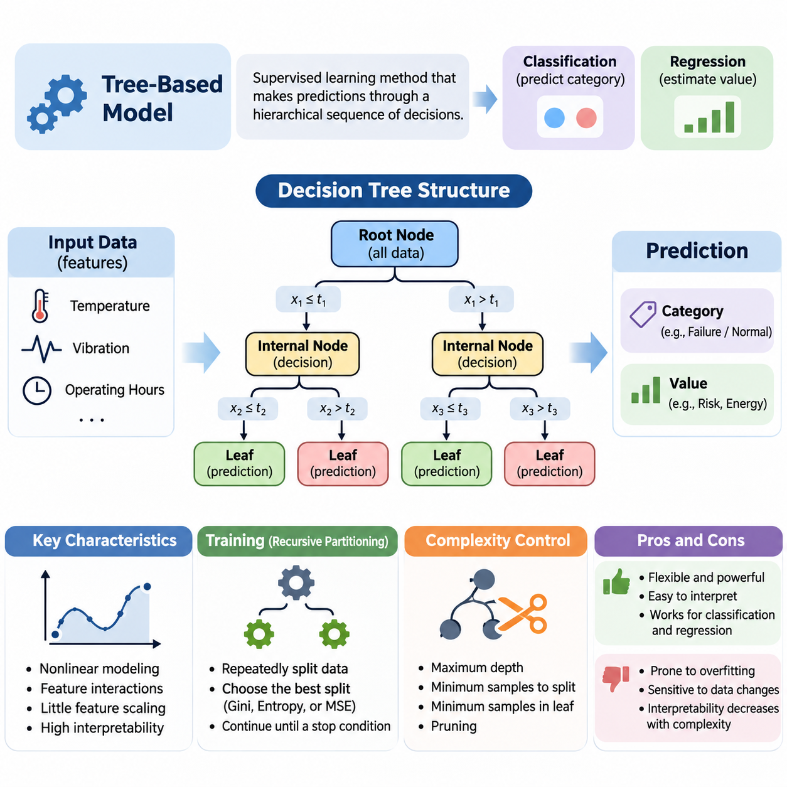
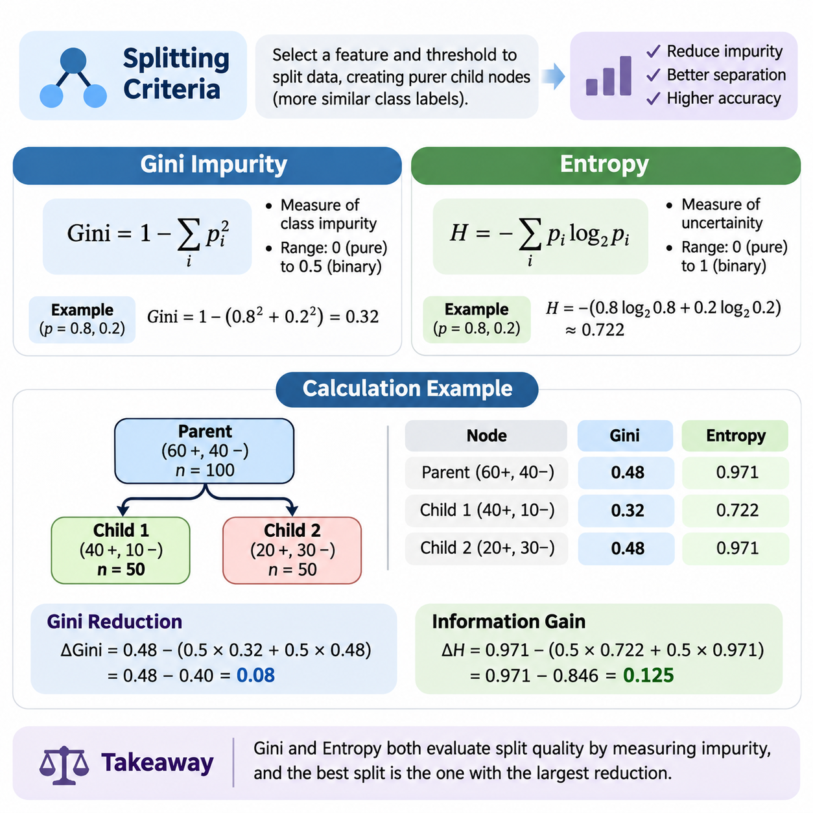
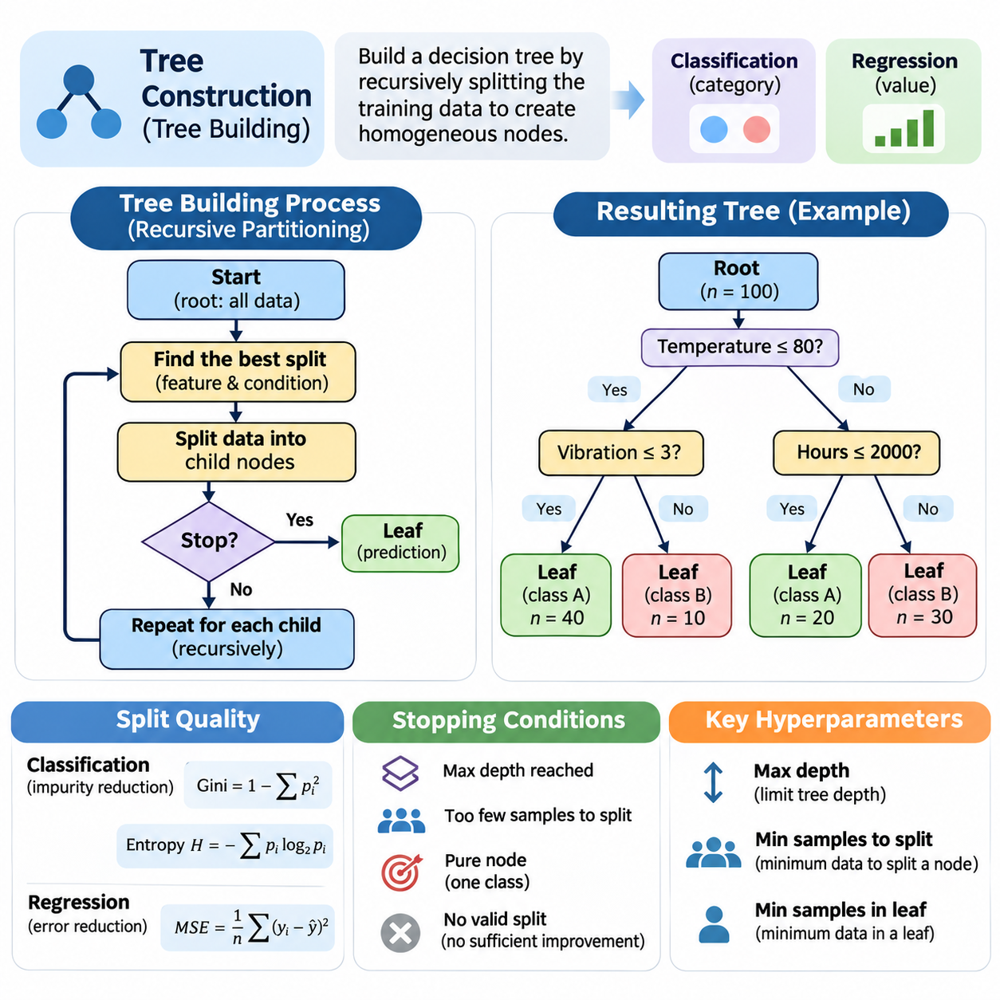
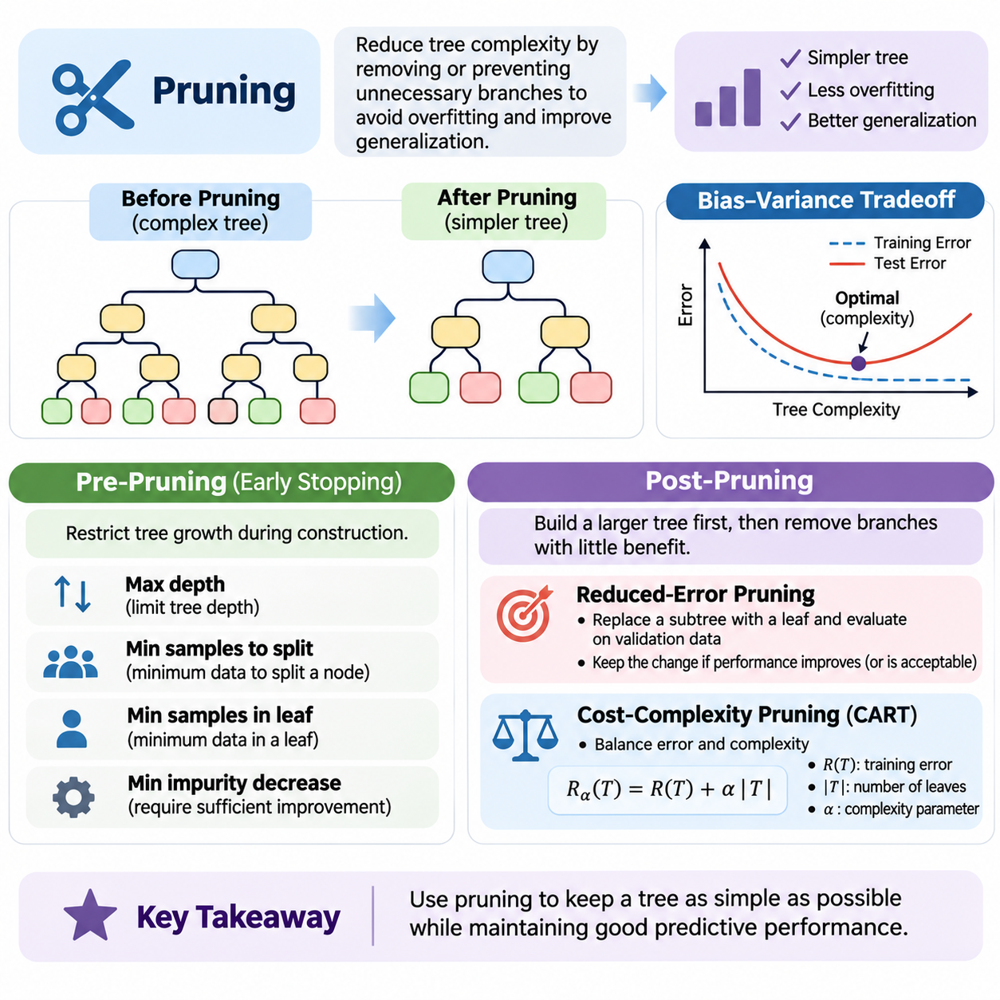
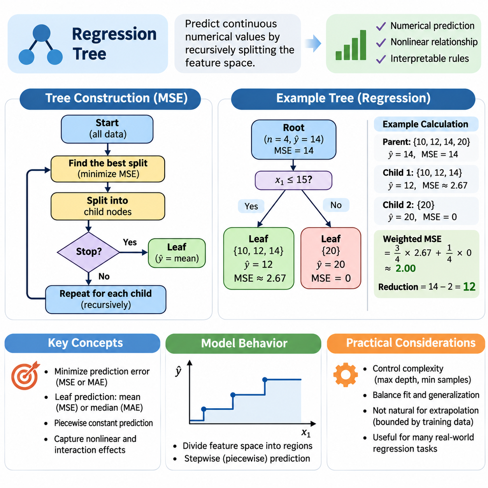
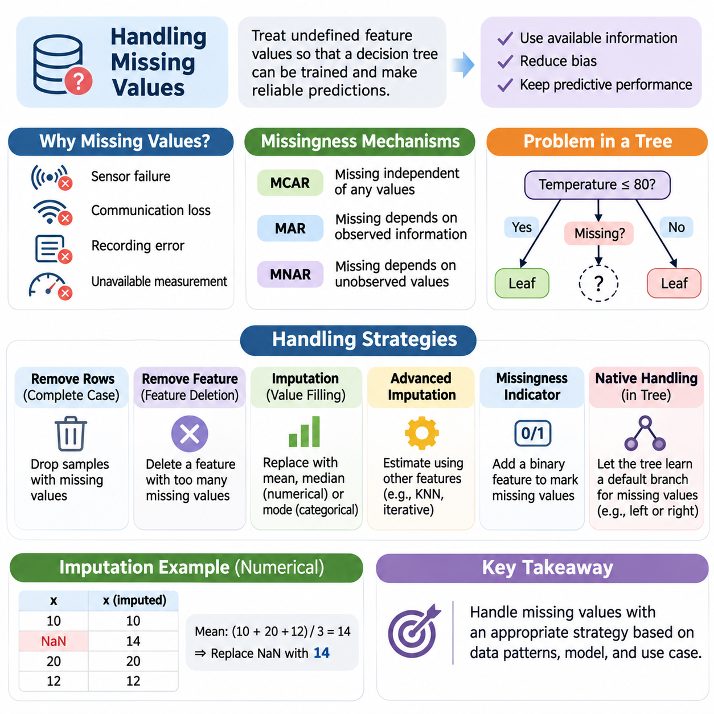
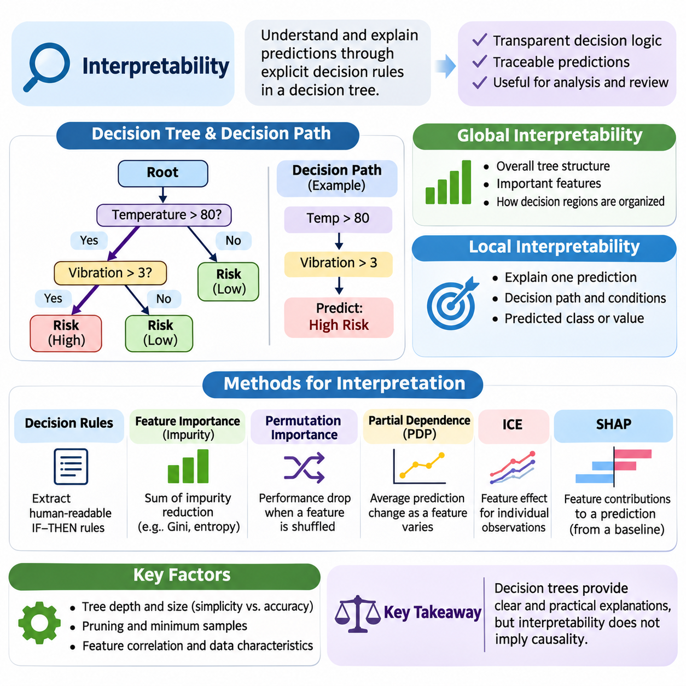
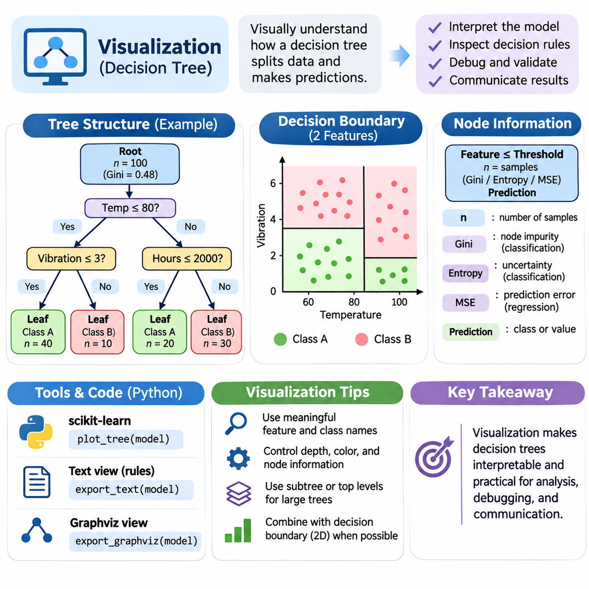
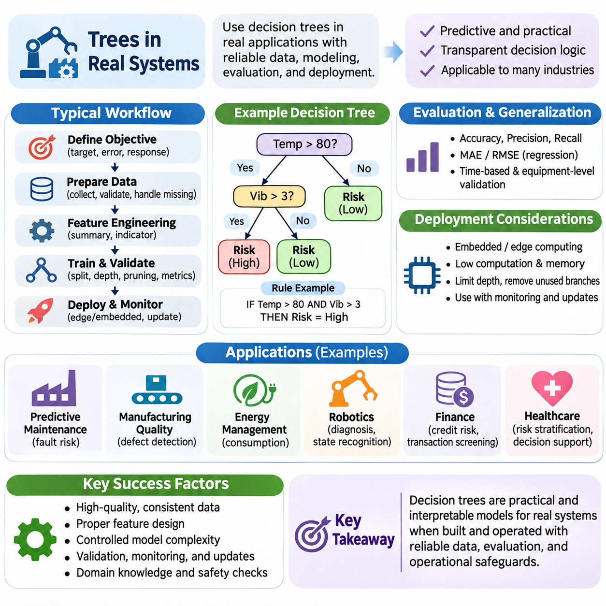

**Volume 08. Supervised Learning**

# 04. Decision Trees

## 04.00 Tree Based Model Overview

{width="7.268055555555556in" height="7.268055555555556in"}

Tree-based models are a fundamental family of supervised learning algorithms that organize predictions through a hierarchical sequence of decisions. Unlike linear models, which represent relationships using weighted combinations of features, tree-based methods divide the feature space into smaller regions. Each region represents observations sharing similar characteristics, allowing the model to capture nonlinear relationships without requiring an explicit mathematical equation.

A decision tree consists of a root node, internal decision nodes, branches, and terminal leaf nodes. The root represents the complete training dataset, while internal nodes evaluate conditions involving individual features. Branches indicate the outcomes of these conditions, and leaves provide final predictions. This hierarchical organization transforms a complex prediction problem into a sequence of relatively simple decisions that can be examined individually.

The prediction process begins at the root node and proceeds through successive conditions until a leaf is reached. For example, a model predicting equipment failure might first examine operating temperature, then vibration intensity, and finally accumulated operating hours. Each condition narrows the possible outcomes. The final leaf produces a predicted failure category or numerical risk estimate based on the training observations assigned to that region.

Tree-based learning is commonly applied to classification and regression problems. Classification trees predict discrete categories, such as defective or acceptable products, while regression trees estimate continuous values, such as energy consumption or equipment lifetime. Although both approaches share the same hierarchical structure, their training objectives differ because categorical prediction requires different measures of prediction quality from numerical estimation.

A defining characteristic of decision trees is recursive partitioning, which repeatedly divides a dataset into increasingly homogeneous subsets. At each internal node, the learning algorithm searches for a feature and splitting condition that improve the separation of observations. This process continues until a stopping condition is satisfied. The resulting tree represents a collection of local decision rules learned directly from the available training examples.

For numerical features, a typical split compares an observed value with a threshold. A temperature measurement might be divided into values below or above a selected operating limit. For categorical features, splitting can separate observations according to category membership when supported by the implementation. These operations create distinct regions of the feature space, allowing decision trees to model complicated relationships through combinations of simple conditions.

The selection of splitting conditions is central to tree construction. Classification trees commonly evaluate candidate splits using measures such as Gini impurity or entropy, which describe the distribution of class labels within a node. A useful split generally produces child nodes with more concentrated class distributions. Regression trees instead commonly minimize squared prediction error or within-node variance to obtain regions containing similar numerical targets.

Unlike gradient-based neural network training, conventional decision tree construction generally uses greedy optimization. At each node, the algorithm selects a locally favorable split without exhaustively evaluating every possible future tree structure. This strategy makes training computationally practical for many datasets. However, a locally optimal split does not necessarily produce the globally optimal tree, and small changes in training data may alter the resulting structure.

One important advantage of decision trees is their ability to represent nonlinear relationships and interactions between features. A linear classifier may require engineered interaction terms to capture conditional dependencies, whereas a tree can express them through successive splits. For example, vibration intensity might indicate equipment failure only when temperature exceeds a particular threshold. Such conditional behavior can emerge naturally from the tree structure.

Decision trees also require relatively little feature scaling. Since ordinary axis-aligned splits depend on feature thresholds rather than distances between observations, standardization and normalization are generally unnecessary. This property simplifies preprocessing when datasets contain measurements with different units. Nevertheless, data quality, appropriate feature representation, categorical encoding, and treatment of missing values remain important for reliable model development.

Interpretability is another major strength of decision trees. Each prediction follows a specific path consisting of identifiable feature conditions, making it possible to trace the model\'s decision process. Engineers can inspect these paths to understand which measurements influenced an outcome. However, interpretability decreases as trees become deeper and more complex, particularly when numerous interacting conditions make individual decision paths difficult to understand.

Despite their flexibility, individual decision trees are vulnerable to overfitting. A sufficiently deep tree can divide the training dataset into extremely small regions and memorize unusual observations or noise. Such a model may achieve excellent training accuracy while performing poorly on unseen data. This behavior illustrates the importance of controlling model complexity and evaluating whether learned decision rules generalize beyond the original training examples.

Tree complexity can be controlled through parameters such as maximum depth, minimum samples required for splitting, and minimum samples allowed in leaf nodes. These constraints prevent excessive fragmentation of the training dataset. Pruning provides another approach by removing branches that contribute little predictive value. Both strategies attempt to balance the ability to capture meaningful patterns against the risk of fitting accidental variations.

The bias-variance tradeoff provides a useful interpretation of tree complexity. Shallow trees tend to have higher bias because their limited structure may overlook important relationships. Deep trees generally have lower training bias but can exhibit high variance because their predictions are sensitive to changes in training observations. Selecting appropriate complexity therefore requires validation data and systematic evaluation rather than relying exclusively on training performance.

Decision trees can also encounter difficulties when datasets contain highly imbalanced classes. If normal observations greatly outnumber failure cases, splitting criteria may favor partitions that primarily improve predictions for the majority class. Consequently, a tree can achieve high overall accuracy while missing important rare events. Class weighting, resampling, and suitable evaluation metrics can help address this problem during model development.

Missing feature values introduce another practical challenge. Some tree implementations reject incomplete observations, while others support native missing-value handling, surrogate splits, or learned default directions. Alternatively, preprocessing methods can estimate missing values before training. The appropriate strategy depends on the algorithm and the reason measurements are missing, since missingness itself may carry useful information about system behavior.

Although decision trees are relatively efficient during inference, training costs depend on dataset size, feature count, split-search methods, and implementation details. Large datasets with numerous candidate thresholds may require substantial computation. Prediction generally involves evaluating conditions along one root-to-leaf path. Consequently, controlling tree depth can support predictable inference latency, which is valuable in resource-constrained industrial and edge computing environments.

A limitation of standard decision trees is that their predictions are typically piecewise constant. Classification leaves return class predictions or estimated probabilities, while regression leaves commonly return average target values. As a result, regression trees do not naturally extrapolate beyond the range of observed target values. Their axis-aligned partitions may also approximate smooth relationships inefficiently, requiring numerous splits to represent complex geometric boundaries.

Individual decision trees provide the conceptual foundation for more advanced ensemble methods. Random forests combine multiple trees trained with randomized data or feature selection to reduce prediction variance. Gradient boosting constructs trees sequentially to improve an additive predictive model. These approaches often achieve stronger generalization than a single tree, although they typically sacrifice some simplicity and direct interpretability in exchange for predictive performance.

Tree-based methods are especially effective for structured tabular datasets containing numerical and categorical business or engineering measurements. Applications include credit risk assessment, customer classification, predictive maintenance, quality inspection, and operational forecasting. Their ability to capture conditional relationships makes them attractive when observations are represented by meaningful features rather than raw images, audio waveforms, or other high-dimensional unstructured inputs.

In industrial monitoring, a decision tree can combine temperature, current consumption, vibration, and operating duration to identify abnormal equipment conditions. Each internal node evaluates a measurable characteristic, while the resulting prediction supports maintenance planning or diagnostic prioritization. Such models can be integrated with sensor acquisition systems and supervisory software, although operational deployment requires validation against realistic disturbances and changing equipment conditions.

For autonomous systems and robotics, tree-based models can support selected perception, diagnostics, and operational decision-support tasks. They may classify sensor health, estimate component degradation, or identify operating conditions requiring additional inspection. However, learned decision trees should not automatically replace verified safety mechanisms. Safety-critical applications require explicit performance requirements, uncertainty assessment, independent safeguards, and testing across relevant operating conditions.

Developing a reliable tree-based model begins with defining the prediction objective and preparing representative training data. The dataset must then be separated into appropriate training, validation, and test subsets. After constructing the initial tree, developers evaluate predictive performance, examine decision paths, and adjust complexity controls. This iterative process helps distinguish meaningful decision patterns from accidental correlations present in the training observations.

Model evaluation should reflect the intended application rather than depend on a single performance measure. Classification problems may require precision, recall, F1-score, or confusion-matrix analysis, while regression problems commonly use mean absolute error or root mean squared error. Cross-validation can improve confidence in model selection. For temporally dependent industrial measurements, chronological evaluation may be necessary to prevent unrealistic information leakage.

The reliability of tree-based models also depends on their behavior after deployment. Changes in sensor calibration, equipment operating conditions, user behavior, or data collection procedures can alter feature distributions. A tree trained under historical conditions may therefore become less accurate over time. Monitoring input distributions, prediction quality, and operational errors provides evidence for deciding when recalibration, retraining, or model replacement is necessary.

Tree-based learning represents an important connection between statistical prediction and human-readable decision logic. Its hierarchical structure provides an intuitive explanation of how supervised learning can transform observations into predictive rules. Understanding nodes, branches, recursive partitioning, complexity control, and generalization establishes the foundation for studying splitting criteria, tree construction, pruning, regression trees, interpretability, and advanced tree ensembles.

## 04.01 Splitting Criteria

{width="7.268055555555556in" height="7.268055555555556in"}

Splitting criteria are fundamental mechanisms used in decision tree learning to determine how training observations should be divided at each internal node. The objective is to create child nodes containing observations with increasingly similar target labels. By evaluating candidate features and thresholds, the algorithm identifies partitions that improve class separation. This process directly influences tree structure, predictive accuracy, and generalization performance.

In classification trees, split quality is commonly measured through node impurity, which describes how mixed the class labels are within a particular subset. A node containing observations from only one class is considered pure, while a node containing several classes has greater impurity. The learning algorithm attempts to reduce impurity through recursive partitioning, progressively creating regions where class membership becomes more predictable.

Gini impurity is a widely used splitting criterion in classification trees, particularly in algorithms based on Classification and Regression Trees, commonly known as CART. It measures the probability of assigning an incorrect class when a label is randomly selected according to the class distribution within a node. Lower Gini impurity indicates greater class concentration, while higher values indicate a more heterogeneous distribution.

Mathematically, Gini impurity is expressed as Gini = 1 - sum(p_i²), where p_i represents the proportion of observations belonging to class i. The summation covers all classes present in the classification problem. When every observation belongs to the same class, one class probability equals one and all others equal zero, producing a Gini impurity of zero. This represents a completely pure node.

For a binary classification problem, Gini impurity reaches its maximum value of 0.5 when both classes have equal probabilities. If a node contains 80 percent positive observations and 20 percent negative observations, its impurity becomes 1 - (0.8² + 0.2²) = 0.32. This value indicates that the node contains a dominant class but still includes substantial uncertainty regarding individual class membership.

The Gini criterion evaluates candidate splits by comparing the impurity of the parent node with the weighted impurity of the resulting child nodes. Each child contributes according to its proportion of the parent observations. A split is considered beneficial when the weighted child impurity is smaller than the parent impurity. The difference represents the reduction in impurity achieved by the proposed partition.

For example, consider a parent node containing 100 observations, including 60 positive and 40 negative examples. Its Gini impurity is 0.48. Suppose a candidate split creates one child containing 40 positive and 10 negative observations and another containing 20 positive and 30 negative observations. Their impurities are 0.32 and 0.48, respectively, producing a weighted impurity of 0.40.

The Gini impurity reduction in this example equals 0.48 - 0.40 = 0.08. A competing split producing a larger reduction would generally be preferred under the Gini criterion. This calculation illustrates how decision trees evaluate partitions using class distributions rather than directly comparing predicted labels with individual observations. The procedure is repeated across candidate features and thresholds during tree construction.

Entropy provides another important splitting criterion and originates from information theory. It measures uncertainty associated with the class distribution within a node. When observations are evenly distributed among classes, uncertainty is relatively high because the class label is difficult to predict. When one class dominates, uncertainty decreases. A completely pure node has zero entropy because its class membership is certain.

The entropy of a classification node is defined as H = -sum(p_i log2(p_i)), where p_i denotes the probability of class i. The logarithm is conventionally calculated using base two, expressing entropy in bits. Terms with zero probability contribute zero by continuity. For binary classification, entropy reaches its maximum value of one bit when both classes have equal probabilities.

Consider a binary node containing 80 percent positive and 20 percent negative observations. Its entropy is approximately 0.722 bits, calculated as -(0.8 log2(0.8) + 0.2 log2(0.2)). Although the numerical scale differs from Gini impurity, both measures indicate that the node is not completely pure. Both also assign lower impurity to distributions dominated by a single class.

Entropy-based splitting commonly uses information gain to evaluate candidate partitions. Information gain measures how much uncertainty decreases after a dataset is divided into child nodes. It is calculated by subtracting the weighted average entropy of the child nodes from the entropy of the parent node. A larger information gain indicates that the selected feature and splitting condition provide a more informative separation of class labels.

Using the previous example with 60 positive and 40 negative observations, the parent entropy is approximately 0.971 bits. After splitting, the first child contains 40 positive and 10 negative observations, giving an entropy of approximately 0.722 bits. The second child contains 20 positive and 30 negative observations, producing an entropy of approximately 0.971 bits.

Because both child nodes contain 50 observations, their weighted entropy is approximately 0.846 bits. The information gain therefore equals 0.971 - 0.846, or approximately 0.125 bits. This positive value indicates that the split reduces uncertainty about class membership. The algorithm can compare this result with alternative splits and select the candidate producing the greatest information gain.

Gini impurity and entropy share several important properties. Both are zero for completely pure nodes, increase as class distributions become more mixed, and are symmetric with respect to class labels. Both support greedy tree construction by evaluating local reductions in impurity. However, their mathematical forms differ, meaning they can occasionally rank candidate splits differently even when applied to the same dataset.

Gini impurity uses squared class probabilities, while entropy uses logarithmic probabilities. Gini calculations are often computationally simpler because they avoid logarithmic operations. Entropy provides a direct information-theoretic interpretation of uncertainty reduction. In many practical classification problems, both criteria produce similar decision trees, although differences may appear in particular datasets or splitting configurations.

The calculation of split quality requires accounting for the relative sizes of child nodes. Without weighting, a small child containing only a few observations could receive the same influence as a much larger child. Standard impurity reduction therefore multiplies each child impurity by the fraction of parent observations assigned to that child. This ensures that the evaluation reflects the overall distribution of the training examples.

For a candidate split, the general impurity reduction can be written as Delta I = I(parent) - sum((n_j / n) I(child_j)), where n represents the parent sample count and n_j represents the number of observations in child j. The impurity function I may represent Gini impurity or entropy. The decision tree searches for the split maximizing this reduction among the available candidates.

The practical calculation process begins by examining the target labels associated with observations at the current node. For each candidate feature, the algorithm generates possible splitting conditions and assigns observations to the resulting child nodes. It then calculates class proportions, evaluates child impurities, and determines the weighted reduction. The best valid split is selected according to the configured criterion and structural constraints.

For continuous numerical features, candidate thresholds can be generated by sorting distinct observed values and examining boundaries between consecutive values. Implementations may evaluate midpoints or equivalent partition boundaries. Efficient algorithms avoid repeatedly scanning the complete dataset for every candidate. Instead, they maintain cumulative class counts while traversing sorted feature values, reducing redundant calculations.

Categorical features require different splitting strategies. A binary split may separate one category or a group of categories from the remaining values. Some algorithms support multiway splits that create separate branches for different categories. The number of possible category partitions can become large, so implementations often introduce restrictions or specialized search strategies to control computational complexity.

When implementing impurity calculations, numerical stability and correct probability handling are important. Class probabilities must be nonnegative and sum to one for a nonempty node. Entropy calculations must handle zero probabilities without evaluating the logarithm of zero directly. Small numerical differences can also affect comparisons between nearly equivalent candidate splits, making deterministic tie-breaking useful for reproducibility.

A simple implementation can calculate Gini impurity by counting observations in each class, dividing the counts by the total number of observations, squaring the resulting probabilities, and subtracting their sum from one. Entropy follows a similar procedure but multiplies each nonzero probability by its base-two logarithm. These calculations form reusable components within a recursive decision tree training algorithm.

To evaluate a candidate split computationally, the implementation first partitions the observations according to a feature condition. It then calculates the impurity of each child node and combines those values using sample-count weights. Subtracting this result from the parent impurity produces the split improvement. Repeating the procedure across candidate thresholds identifies the locally preferred partition for the current node.

A useful verification strategy is to test impurity functions against known distributions. A pure binary node should return zero for both Gini impurity and entropy. An evenly balanced binary node should return 0.5 for Gini impurity and one bit for entropy. Additional tests should confirm that weighted child impurities and impurity reductions are calculated correctly, including cases involving empty candidate partitions.

Although impurity reduction is central to tree learning, maximizing it without constraints can produce overly complex trees. A split that improves training impurity may still capture random noise rather than a generalizable relationship. Minimum sample requirements, maximum depth restrictions, and minimum impurity decrease thresholds help prevent unnecessary partitioning. Pruning and validation provide additional mechanisms for controlling overfitting.

Gini impurity and entropy are primarily classification criteria. Regression trees generally use different objectives, such as variance reduction or squared-error minimization, because their targets are continuous rather than categorical. Nevertheless, the underlying principle remains similar: a useful split creates child regions whose target values are more homogeneous than those of the parent region.

Understanding splitting criteria reveals how decision trees transform statistical class distributions into hierarchical decision rules. Gini impurity emphasizes class concentration through squared probabilities, while entropy measures uncertainty through information theory. Their calculations provide a systematic foundation for selecting features, constructing branches, and evaluating partition quality, preparing the way for deeper study of tree construction, pruning, and ensemble learning.

## 04.02 Tree Construction

{width="7.268055555555556in" height="7.268055555555556in"}

Tree construction is the process of transforming training observations into a hierarchical structure of decision rules. A decision tree begins with a root node containing the complete training dataset and recursively partitions observations according to selected feature conditions. Each partition creates smaller subsets that are expected to become more homogeneous. The resulting structure supports classification or regression by assigning predictions to terminal leaf nodes.

The central principle of tree building is recursive partitioning, in which the same splitting procedure is repeatedly applied to progressively smaller subsets. At each node, the algorithm examines candidate features and determines whether dividing the observations improves prediction quality. When a suitable split is found, child nodes are created and the procedure continues independently within each child. This recursive process produces the hierarchical organization of the tree.

Before construction begins, the learning system must define its input features, target variable, and training objective. Classification trees predict categorical labels, while regression trees estimate continuous numerical values. The selected objective determines how candidate splits are evaluated. Classification commonly uses Gini impurity or entropy, whereas regression frequently uses squared-error reduction or variance reduction to identify useful partitions.

The root node represents the initial state of the learning problem because it contains all observations assigned to the training dataset. Its class distribution or target statistics establish the baseline impurity or prediction error. The algorithm examines this node to identify a feature and splitting condition that produce the greatest improvement. The selected split becomes the first decision rule and determines the initial branches of the tree.

For numerical features, tree construction typically evaluates threshold-based conditions. A candidate rule might divide observations according to whether temperature is less than or equal to a particular value. The algorithm considers possible thresholds and calculates the resulting improvement in the splitting objective. Efficient implementations often sort feature values and evaluate candidate boundaries using cumulative statistics rather than repeatedly scanning the complete dataset.

Categorical features require conditions based on category membership. A split might separate one category from the remaining categories or divide several categories into distinct groups. The available strategies depend on the tree algorithm and its implementation. Some methods support multiway branching, while others construct binary trees exclusively. Appropriate encoding may be necessary when the software does not directly support categorical features.

The quality of a candidate split is determined by comparing the parent node with its resulting child nodes. For classification, the algorithm calculates the weighted impurity of the children and subtracts it from the parent impurity. For regression, it evaluates the reduction in prediction error. A split is preferred when it produces a greater improvement while satisfying constraints such as minimum sample counts and permitted tree depth.

Tree construction generally follows a greedy optimization strategy. At each node, the algorithm selects the best available split according to the current local objective without evaluating every possible future tree configuration. This approach makes training computationally manageable for many practical datasets. However, a locally optimal decision may not lead to the globally optimal tree, and early splitting choices can strongly influence subsequent branches.

After selecting a split, the algorithm distributes observations among the corresponding child nodes. Each child receives only the subset satisfying its associated condition. The splitting procedure is then applied recursively to these subsets. As the tree grows, its branches represent increasingly specific combinations of feature conditions, allowing the model to distinguish observations that exhibit different patterns or target values.

A recursive tree-building function typically receives the observations assigned to the current node, the corresponding target values, and the current depth. It first checks whether the node should become a leaf. If further splitting is permitted, the function searches for the best valid partition, creates child nodes, and recursively processes their observations. This design provides a direct correspondence between the mathematical concept of recursive partitioning and its software implementation.

Stopping conditions are essential because unrestricted recursive splitting can produce extremely deep trees. Common conditions include reaching a maximum depth, having too few observations to split, obtaining a pure classification node, or finding no valid split that improves the objective sufficiently. When a stopping condition is satisfied, the algorithm terminates recursion and converts the current node into a terminal leaf.

Maximum tree depth limits the number of decisions encountered along a root-to-leaf path. A shallow tree produces relatively simple decision boundaries and often provides greater interpretability. A deeper tree can represent more complicated feature interactions but may become sensitive to noise. Selecting an appropriate depth therefore involves balancing model flexibility, generalization performance, computational requirements, and interpretability.

Minimum sample constraints provide another mechanism for controlling tree growth. The minimum samples required to split a node prevents further partitioning when too few observations remain. The minimum samples permitted in a leaf ensures that resulting terminal regions contain sufficient training examples. These constraints discourage the creation of highly specialized branches that memorize individual observations instead of learning representative patterns.

Leaf prediction rules depend on the learning task. In classification trees, a leaf commonly predicts the majority class among its assigned training observations. It may also estimate class probabilities using the relative frequencies of those classes. In regression trees, a leaf commonly predicts the mean target value of its observations when squared-error minimization is used. These predictions complete the connection between hierarchical decisions and numerical model outputs.

Consider a classification dataset containing equipment temperature, vibration intensity, operating hours, and failure labels. The algorithm may first divide observations according to temperature because that feature provides the largest impurity reduction. Within the high-temperature branch, vibration may become the most informative feature. Another branch may depend primarily on operating hours, demonstrating how different regions can develop distinct decision rules.

The order of selected features is not fixed in advance. A feature appearing near the root generally provides substantial improvement for the observations available at that node, while deeper features address more specific subsets. The same feature may appear multiple times at different depths or within separate branches. This flexibility enables trees to represent nonlinear relationships and conditional interactions without requiring manually specified interaction terms.

Tree construction can be implemented using either recursive functions or explicit data structures that manage nodes awaiting expansion. Recursive implementations are conceptually simple because each function call corresponds to a node. Iterative implementations may use stacks or queues to control expansion order. Regardless of implementation style, each node must retain its splitting condition, child references, and prediction information when applicable.

An internal tree node commonly stores the selected feature index, threshold or category condition, and references to its children. It may also retain sample counts, impurity values, and class distributions for diagnostic purposes. A leaf node stores the prediction associated with its region. Separating internal-node behavior from leaf-node behavior simplifies prediction traversal, visualization, serialization, and subsequent model analysis.

Prediction using a constructed tree begins at the root and follows the stored conditions until a leaf is reached. Each internal node examines the corresponding feature value and selects the appropriate branch. The leaf then returns its classification result, estimated probabilities, or regression value. Unlike training, prediction does not search for new splits, making inference relatively efficient when tree depth remains controlled.

The computational cost of tree construction depends on the number of observations, number of features, candidate thresholds, and tree structure. Naive implementations may repeatedly examine many candidate partitions, creating substantial overhead. Optimized implementations use sorted feature values, cumulative statistics, and efficient data structures. Practical performance also depends on stopping rules and the computational complexity of the selected splitting criterion.

Missing feature values require explicit treatment during construction and prediction. Some implementations require preprocessing through imputation, while others learn default branch directions or use alternative splitting mechanisms. The chosen approach must remain consistent between training and inference. Otherwise, missing measurements encountered after deployment may cause prediction failures or inconsistent traversal through the constructed tree.

Tree-building algorithms must also address situations in which several candidate splits produce identical improvements. Deterministic tie-breaking can improve reproducibility by selecting candidates according to a consistent feature or threshold ordering. Randomized implementations may intentionally introduce variation. Recording random seeds, algorithm parameters, software versions, and preprocessing procedures helps reproduce tree structures across repeated experiments.

A practical implementation should verify that every accepted split creates valid child nodes and respects structural constraints. Unit tests can examine pure nodes, balanced class distributions, constant-valued features, and datasets containing repeated observations. Additional checks should confirm that all training samples are assigned correctly, no invalid empty branches are created, and predictions remain consistent with the stored decision conditions.

Constructing a tree with maximum training accuracy does not guarantee strong performance on unseen observations. Deep trees can repeatedly partition small subsets until they capture noise or accidental correlations. This behavior reflects overfitting and the high variance associated with complex tree structures. Validation datasets, cross-validation, depth restrictions, and pruning provide mechanisms for selecting models that generalize more reliably.

Tree construction establishes the structural foundation for subsequent methods such as pruning, regression trees, random forests, and gradient boosting. Its essential operations involve selecting candidate splits, evaluating improvement, creating child nodes, applying stopping conditions, and assigning leaf predictions. Understanding these operations provides a practical basis for implementing decision trees and evaluating their behavior in real supervised learning systems.

## 04.03 Pruning

{width="7.268055555555556in" height="7.268055555555556in"}

Pruning is a model complexity control technique used in decision trees to reduce overfitting and improve generalization. During construction, a tree may create many branches that closely match the training observations but fail to represent reliable patterns. Pruning removes or prevents unnecessary branches, producing a simpler model. The objective is to preserve meaningful decision rules while reducing sensitivity to noise and accidental relationships.

A fully grown decision tree often achieves low training error because it repeatedly partitions observations into increasingly specialized regions. However, some branches may depend on only a few examples or minor fluctuations in the dataset. These branches can increase prediction variance and reduce performance on unseen observations. Pruning addresses this problem by limiting tree complexity according to structural constraints or evidence of predictive usefulness.

The relationship between pruning and generalization can be understood through the bias-variance tradeoff. A highly complex tree generally has low training bias but may exhibit high variance because small changes in training data can alter its structure. Removing unnecessary branches reduces variance and can improve stability. Excessive pruning, however, increases bias and may prevent the model from capturing important nonlinear relationships or feature interactions.

Decision tree pruning is commonly divided into pre-pruning and post-pruning. Pre-pruning, also called early stopping, restricts tree growth during construction. Post-pruning allows a larger tree to be constructed before removing branches that provide insufficient benefit. Both methods attempt to control complexity, but they differ in when decisions are made and how much of the potential tree structure is examined.

Pre-pruning prevents a node from splitting when specified conditions are not satisfied. Common restrictions include maximum tree depth, minimum samples required for splitting, minimum samples per leaf, and minimum impurity reduction. These parameters provide direct control over the size and complexity of the resulting tree. They also reduce training cost by avoiding the construction of branches that are unlikely to provide sufficient predictive improvement.

Maximum depth is one of the simplest pre-pruning parameters. It limits the number of successive decisions between the root and a terminal leaf. A shallow tree generally produces fewer regions and is easier to interpret, while a deeper tree can represent more complicated relationships. The appropriate depth depends on dataset size, feature interactions, noise levels, and the predictive complexity of the underlying problem.

Minimum sample requirements prevent the algorithm from creating branches based on extremely small subsets. A minimum split size determines how many observations must be available before a node can be divided. A minimum leaf size specifies the smallest permitted number of observations in each terminal region. Increasing these thresholds often produces smoother decision boundaries and reduces the influence of isolated or unusual training examples.

Minimum impurity decrease is another pre-pruning mechanism that evaluates whether a proposed split provides sufficient improvement. A split is accepted only when its impurity reduction exceeds a configured threshold. This discourages branches that provide negligible gains in training purity. However, an individually weak split may enable valuable later partitions, so overly restrictive thresholds can prevent useful tree structures from developing.

Post-pruning begins with a tree that has already been grown, often with relatively permissive stopping conditions. The algorithm examines internal branches and determines whether replacing a subtree with a leaf would improve a chosen complexity-performance objective. This approach allows the initial construction process to discover detailed relationships before evaluating which branches should remain. It can therefore preserve useful structures that aggressive early stopping might eliminate.

Reduced-error pruning is a conceptually straightforward post-pruning technique. The algorithm evaluates whether replacing an internal subtree with a leaf changes prediction performance on a separate validation dataset. If the replacement improves performance or produces an acceptable result under a defined rule, the subtree can be removed. This process may be repeated across candidate branches until further pruning no longer provides a suitable benefit.

A major advantage of reduced-error pruning is its direct connection to predictive performance on observations not used to construct the tree. However, it requires validation data, reducing the number of observations available for training if the dataset is limited. Its effectiveness also depends on whether the validation subset represents future operating conditions. Small or unrepresentative validation sets may produce unstable pruning decisions.

Cost-complexity pruning is a widely used post-pruning method associated with Classification and Regression Trees. It balances the predictive error of a tree against a penalty for structural complexity. Instead of selecting the tree with the lowest training error alone, the method favors a simpler structure when additional leaves do not justify their contribution. This provides a systematic framework for comparing trees of different sizes.

A typical cost-complexity objective can be expressed as R_alpha(T) = R(T) + alpha \|T\|, where R(T) represents the training risk of tree T, \|T\| denotes the number of terminal leaves, and alpha is a nonnegative complexity parameter. Increasing alpha places greater emphasis on simplicity. When alpha is zero, the complexity penalty disappears, while larger values encourage removal of branches with limited improvement.

Weakest-link pruning provides an efficient way to generate candidate subtrees under the cost-complexity framework. The algorithm identifies the internal branch whose removal produces the smallest increase in training risk relative to the reduction in leaf count. That branch is replaced by a leaf, creating a smaller tree. Repeating this procedure generates a nested sequence of candidate trees with progressively decreasing complexity.

The complexity parameter should generally be selected using validation data or cross-validation rather than training performance alone. Different parameter values produce trees with different depths, leaf counts, and predictive errors. Evaluating these candidates on held-out observations helps identify a suitable balance between complexity and generalization. The final selected structure can then be assessed using an independent test dataset.

Cross-validation is particularly useful when a single validation split might produce unreliable results. The training data is divided into multiple folds, and candidate pruning configurations are evaluated across repeated training and validation partitions. Their average performance provides evidence for model selection. Variability across folds can also reveal whether a particular pruning choice is sensitive to the composition of the training data.

Pruning decisions must reflect the intended prediction task. In classification, performance may be measured using accuracy, log loss, or metrics that account for class imbalance. In regression, mean squared error or mean absolute error may be more appropriate. The impurity measure used during tree construction does not necessarily need to be the final metric used for pruning selection, particularly when operational objectives differ from training objectives.

Class imbalance creates additional challenges because removing a branch may improve overall accuracy while reducing sensitivity to rare but important events. For example, a fault detection tree might contain a small branch that identifies uncommon equipment failures. Eliminating that branch could simplify the model but increase missed detections. Pruning evaluation should therefore consider recall, false-negative costs, and other application-specific requirements.

Pruning also influences interpretability. A smaller tree typically contains fewer decision rules, shorter prediction paths, and fewer specialized conditions. This can make model behavior easier to inspect, explain, and validate. However, simplicity does not automatically guarantee that the remaining rules are causally meaningful. Feature correlations, biased training data, and unstable thresholds can still produce misleading explanations.

Computational efficiency is another potential benefit of pruning. Smaller trees generally require less memory to store their nodes and may reduce inference latency because predictions traverse fewer decisions. These advantages can be important for embedded devices, industrial controllers, and edge computing systems. Nevertheless, the actual speed improvement depends on tree shape, implementation details, and the distribution of prediction paths.

Consider a predictive maintenance dataset containing temperature, vibration, operating hours, and equipment failure labels. An unrestricted tree may create specialized branches for rare combinations of sensor readings. Some branches may represent genuine failure patterns, while others may capture measurement noise. Pruning evaluates whether those branches provide sufficient predictive value and removes unnecessary complexity without intentionally discarding important diagnostic behavior.

A practical pruning workflow begins by establishing a baseline decision tree and measuring its performance on training and validation data. The developer then adjusts pre-pruning constraints or evaluates post-pruning candidates. Model size, predictive performance, and error patterns are compared across configurations. The chosen tree should demonstrate acceptable generalization while meeting interpretability, computational, and operational requirements.

Pruning should be performed without using the final test dataset to guide model selection. Repeatedly selecting pruning parameters based on test performance introduces information leakage and can produce overly optimistic estimates. Validation data or cross-validation should guide pruning decisions, while the independent test set provides a final assessment. This separation supports reproducible and trustworthy evaluation of decision tree models.

Pruning cannot correct every weakness of a decision tree. Poor feature quality, inconsistent labels, distribution shifts, and insufficient training coverage may still limit performance. Excessive pruning can also cause underfitting by removing branches that represent meaningful relationships. Consequently, pruning should be combined with appropriate data preparation, robust evaluation, and monitoring of model behavior under realistic operating conditions.

Pruning is therefore an essential component of reliable decision tree development. Pre-pruning limits unnecessary growth during construction, while post-pruning simplifies an already developed tree. Reduced-error pruning and cost-complexity pruning provide complementary approaches to evaluating branch usefulness. By balancing predictive performance, structural simplicity, and generalization, pruning helps transform flexible decision trees into more stable and practical supervised learning models.

## 04.04 Regression Trees

{width="7.268055555555556in" height="7.268055555555556in"}

Regression trees are supervised learning models designed to predict continuous numerical values through hierarchical decision rules. Unlike classification trees, which assign observations to discrete categories, regression trees estimate quantities such as temperature, energy consumption, equipment lifetime, or production output. They recursively divide the feature space into smaller regions and assign a numerical prediction to each terminal leaf.

The fundamental objective of a regression tree is to create regions containing observations with similar target values. Each internal node evaluates a feature condition and divides the available observations into child nodes. The algorithm selects partitions that reduce prediction error within the resulting regions. Repeating this process produces a hierarchical model capable of representing nonlinear relationships without requiring a predefined mathematical function.

Regression tree construction begins with a root node containing the complete training dataset. The algorithm examines candidate features and thresholds to identify the partition that provides the greatest reduction in prediction error. After selecting a split, the same procedure is applied recursively to each child node. Tree growth continues until stopping conditions are satisfied, such as maximum depth, minimum sample requirements, or insufficient error reduction.

Mean squared error is a common criterion for evaluating regression tree splits. It measures the average squared difference between observed target values and their predicted values. Within a node, the prediction minimizing squared error is the mean of the target observations. Consequently, a candidate split is evaluated by calculating how much the combined squared error of its child nodes decreases relative to the parent node.

For a node containing n observations, mean squared error can be expressed as MSE = (1/n) sum((y_i - y_mean)²), where y_i represents an observed target and y_mean is the average target value within the node. A pure regression node contains identical target values and therefore has zero squared error. Larger differences among target values produce greater error, indicating that further partitioning may improve prediction quality.

Consider a node containing target values of 10, 12, 14, and 20. Their mean is 14, and the mean squared error is 14. Suppose a candidate split separates the first three values from the final value. The first child predicts 12 and has an MSE of approximately 2.67, while the second predicts 20 with zero error. Their weighted MSE is 2, representing a substantial improvement over the parent node.

The reduction in weighted mean squared error provides a quantitative measure of split quality. A regression tree compares candidate thresholds and selects the split producing the largest valid reduction. Because each child node represents a subset of the parent observations, its contribution must be weighted by sample count. This prevents a small region from receiving the same importance as a much larger region during split evaluation.

Variance reduction provides an equivalent interpretation when node predictions use target means and squared-error loss. The variance of target observations measures how widely their values are distributed around the mean. A useful split creates child nodes with lower combined variance than the parent node. The regression tree therefore searches for partitions that make target values increasingly homogeneous within individual regions.

Mean absolute error can also be used in certain regression tree implementations. Under absolute-error minimization, the median target value is an appropriate leaf prediction rather than the mean. Absolute error is generally less sensitive to extreme observations than squared error. However, the choice of splitting objective and leaf prediction rule must remain consistent with the selected algorithm and intended evaluation requirements.

Regression trees naturally represent nonlinear relationships because they do not assume that target values change linearly with input features. A model can assign different predictions to regions defined by temperature, pressure, operating hours, or other measurements. Successive splits also capture conditional interactions between features. This flexibility is valuable when relationships are discontinuous, threshold-dependent, or difficult to describe using a single equation.

A regression tree divides the feature space into regions with piecewise constant predictions. Every observation reaching the same leaf receives the same numerical estimate under the standard constant-leaf formulation. This makes the model straightforward to interpret but introduces abrupt changes at decision boundaries. Even when the underlying physical relationship is smooth, the predicted response may exhibit a staircase-like pattern.

One important limitation of standard regression trees is their inability to extrapolate naturally beyond the range of observed target values. Since leaf predictions are typically calculated from training targets, predictions remain bounded by the values represented in the training data. A model trained on moderate operating temperatures may therefore fail to predict increasing equipment degradation accurately under previously unseen extreme conditions.

Tree depth strongly influences regression performance. A shallow tree creates relatively few regions and may fail to represent important variation in the target function. A deep tree can fit more detailed relationships but may also capture measurement noise or isolated observations. Selecting an appropriate depth requires balancing predictive flexibility with generalization, especially when the available dataset is small or contains substantial uncertainty.

Minimum samples per leaf and minimum samples required for splitting provide additional complexity controls. These parameters prevent the tree from repeatedly dividing observations into extremely small groups. Larger minimum leaf sizes generally produce smoother predictions and reduce sensitivity to individual measurements. However, overly restrictive settings may prevent the model from detecting genuine local changes in the relationship between inputs and targets.

Pruning offers another mechanism for controlling regression tree complexity. Pre-pruning limits growth through depth, sample-count, or minimum improvement constraints. Post-pruning removes branches after a larger tree has been constructed. Cost-complexity pruning balances the reduction in prediction error against the number of terminal leaves. Validation data can help determine whether a simpler tree predicts unseen observations more reliably.

Regression trees are particularly useful for structured tabular datasets containing numerical and categorical features. They generally do not require feature standardization because splitting decisions depend on thresholds rather than distances between observations. Nevertheless, missing values, categorical encoding, outliers, and measurement errors require appropriate treatment. The quality of the resulting predictions depends heavily on representative training data.

Outliers can have a significant influence on regression trees trained using squared-error objectives. Large deviations contribute disproportionately to squared loss and may encourage splits that isolate unusual observations. Such partitions can be useful when extreme values represent meaningful operational events, but they may cause overfitting when the values originate from sensor faults or recording errors. Robust data analysis is therefore important before model training.

A practical regression tree implementation begins by calculating the mean target value and prediction error at the current node. The algorithm then evaluates candidate splits across available features and identifies the partition with the greatest improvement. If the split satisfies the configured constraints, child nodes are created recursively. Otherwise, the node becomes a leaf storing the numerical prediction associated with its observations.

Prediction with a trained regression tree follows a deterministic path from the root to a terminal leaf. At each internal node, the model compares an input feature with the stored splitting condition and selects the corresponding branch. Once a leaf is reached, its numerical value becomes the prediction. This procedure is computationally efficient for reasonably shallow trees and can be suitable for resource-constrained inference environments.

Regression tree performance is commonly evaluated using mean squared error, root mean squared error, mean absolute error, and the coefficient of determination. These metrics describe different aspects of predictive accuracy. Squared-error metrics emphasize large deviations, while absolute error provides a more direct measure of typical prediction magnitude. The evaluation metric should reflect the practical consequences of errors in the intended application.

Cross-validation helps estimate how regression tree performance changes across different training subsets. Hyperparameters such as maximum depth, minimum leaf size, and pruning strength can be selected using validation results. An independent test dataset should then assess final generalization performance. For time-dependent industrial data, chronological splitting may be necessary to avoid information leakage from future observations into model development.

In predictive maintenance, a regression tree can estimate remaining useful life from vibration intensity, temperature, accumulated operating hours, and electrical measurements. Different branches may represent distinct equipment operating regimes. The resulting predictions can support maintenance scheduling and resource allocation. However, reliability depends on whether the training data includes representative degradation patterns and operating conditions.

Regression trees can also support energy forecasting, manufacturing quality estimation, environmental monitoring, and robotic system diagnostics. Their hierarchical rules allow engineers to inspect which feature conditions influence numerical predictions. This interpretability can assist troubleshooting and model validation. Nevertheless, decision rules should not automatically be interpreted as causal explanations because correlated features may influence the selected splits.

Individual regression trees provide the foundation for more advanced ensemble methods. Random forests combine predictions from multiple trees to reduce variance and improve stability. Gradient boosting constructs trees sequentially to correct residual prediction errors and improve predictive accuracy. These approaches often outperform a single regression tree, although they introduce additional computational complexity and reduce the simplicity of direct rule inspection.

Regression trees demonstrate how recursive partitioning can transform complex numerical prediction problems into interpretable local decision rules. Their essential mechanisms include error-based split selection, recursive node construction, numerical leaf prediction, and complexity control. Understanding these principles provides a foundation for implementing regression trees, evaluating their limitations, and extending tree-based learning to modern ensemble regression systems.

## 04.05 Handling Missing Values

{width="7.268055555555556in" height="7.268055555555556in"}

Missing values are a common challenge in decision tree learning because real-world datasets frequently contain incomplete observations. Sensor failures, communication interruptions, recording errors, and unavailable measurements can leave feature values undefined. If these cases are not handled appropriately, tree construction may become biased or prediction may fail. Effective missing-value handling preserves useful information while maintaining reliable model behavior.

Missing data can arise through several mechanisms that influence how it should be treated. Missing Completely at Random describes cases where missingness is unrelated to observed or unobserved values. Missing at Random allows missingness to depend on observed information. Missing Not at Random describes situations where missingness depends on unavailable values or other unobserved factors. Distinguishing these mechanisms helps evaluate potential bias.

Decision trees rely on feature conditions to partition observations into child nodes. A numerical split may compare temperature with a threshold, while a categorical split may test category membership. When a required feature value is missing, the condition cannot be evaluated normally. The algorithm therefore needs a consistent strategy for assigning incomplete observations during training and directing them through the tree during inference.

One straightforward approach is to remove observations containing missing values before training. Complete-case analysis produces a dataset without undefined feature entries and simplifies implementation. However, removing incomplete rows reduces the available sample size and may distort class distributions or target relationships. This approach is most defensible when missingness is limited and the retained observations remain representative.

Feature deletion is another possible strategy when a variable contains an excessive proportion of missing observations. Removing such a feature eliminates the need to estimate its unavailable values and can simplify the model. However, the feature may still contain valuable predictive information. Decisions about deletion should therefore consider missingness frequency, predictive relevance, operational availability, and the consequences of losing information.

Imputation replaces missing entries with estimated or predefined values. For numerical features, mean or median imputation is commonly used, while categorical features may be filled with the most frequent category. These methods are simple and computationally efficient, but they can distort distributions and weaken relationships between variables. The chosen imputation method should reflect the characteristics of the feature and the intended application.

Mean imputation replaces missing numerical values with the average of available training observations. It is easy to implement but can be sensitive to extreme values and may reduce apparent variability. Median imputation uses the central observed value and is generally more robust to outliers. Neither method reconstructs the true missing measurement, so both should be understood as approximations rather than recovery of original information.

Categorical imputation commonly uses the most frequent observed category or introduces a dedicated missing category. Mode imputation can be appropriate when the dominant category represents a reasonable default. A separate missing category allows the model to learn whether unavailable information is itself predictive. However, its effectiveness depends on whether missingness patterns remain sufficiently consistent between training and deployment.

More advanced imputation methods use relationships among features to estimate missing values. K-nearest neighbors imputation identifies similar observations and derives estimates from their available measurements. Iterative imputation models each incomplete feature using other variables. These methods may preserve more information than simple replacement, but they introduce computational cost and assumptions about relationships within the dataset.

Imputation procedures must be fitted using training data only. Calculating replacement values from the complete dataset before separating training and test observations introduces information leakage. The correct workflow estimates imputation parameters within each training partition and applies those learned parameters to validation or test data. This separation ensures that evaluation reflects the information available during realistic deployment.

Missingness indicators provide another way to preserve information. A binary indicator can identify whether a particular feature was originally missing. The tree can then use this indicator as an additional input, potentially discovering relationships between missing measurements and prediction targets. Such indicators are especially useful when missingness reflects equipment conditions, operational procedures, or systematic data collection problems.

Some decision tree algorithms support missing values directly without requiring explicit imputation. These implementations learn how missing observations should be assigned during splitting or prediction. A common approach evaluates whether missing values should follow the left or right branch for a candidate split. The selected direction becomes part of the learned node behavior and is reused when the corresponding feature is unavailable during inference.

Native missing-value handling can simplify preprocessing and preserve patterns associated with unavailable measurements. However, support varies across algorithms and software implementations. Some tree estimators reject missing values, while others provide learned default directions or specialized partitioning procedures. Developers must verify the behavior of their chosen implementation rather than assuming that all decision tree libraries handle missing data identically.

Surrogate splits offer another mechanism for routing observations when the primary splitting feature is unavailable. During training, the algorithm identifies alternative feature conditions that approximately reproduce the primary split. If the primary feature is missing during prediction, a surrogate condition can determine the branch. This approach can be useful when correlated measurements provide alternative information about the same operating state.

Surrogate splitting depends on the availability and predictive agreement of alternative features. If temperature and electrical current exhibit related patterns, current measurements may help approximate a temperature-based partition. However, correlated variables are not necessarily interchangeable, particularly when operating conditions change. Surrogate rules should therefore be evaluated for reliability rather than treated as exact replacements.

Missing values can also affect how split quality is calculated. A tree algorithm must determine whether incomplete observations contribute to candidate impurity or error calculations and how their weights are assigned. Different strategies may exclude missing observations temporarily, distribute them according to defined rules, or optimize their branch assignment. These choices influence selected thresholds, node statistics, and the resulting tree structure.

The proportion and distribution of missing observations should be examined before selecting a handling strategy. Missingness concentrated in a particular sensor, operating period, equipment type, or target class may indicate a systematic process. Summary statistics and missingness-pattern analysis can reveal such dependencies. Understanding these patterns helps distinguish isolated data errors from meaningful operational information.

In industrial systems, missing measurements may result from sensor disconnection, network congestion, maintenance operations, or power interruptions. These events may be associated with abnormal operating conditions and therefore contain predictive information. Simply replacing every missing measurement with an average can conceal important patterns. Combining imputation with missingness indicators or suitable native tree handling may preserve more relevant information.

Time-dependent datasets introduce additional complications because neighboring observations may contain useful information. Forward filling can reuse the most recent available measurement, while interpolation can estimate intermediate values under appropriate assumptions. However, methods that use future observations may create information leakage in forecasting applications. Temporal imputation must respect the information that would actually be available at prediction time.

The choice of missing-value strategy should be evaluated experimentally rather than determined only by convenience. Complete-case analysis, simple imputation, indicator features, and native handling can produce different predictive results. Cross-validation can compare these alternatives using appropriate classification or regression metrics. The evaluation should also consider computational cost, interpretability, and robustness to changing missingness patterns.

Artificial missingness experiments can help assess robustness. A validation dataset with complete measurements can be modified by masking selected feature values according to controlled patterns. The model is then evaluated under different missingness rates and feature combinations. Such experiments reveal sensitivity to unavailable inputs, although simulated missingness may not fully reproduce the mechanisms encountered in actual operating environments.

Consistency between training and inference is essential. A model trained with median imputation must use the same learned replacement values during deployment unless the entire preprocessing pipeline is deliberately updated. Similarly, a model using missingness indicators must preserve the same feature definitions and ordering. Inconsistent handling can change decision paths and generate unreliable predictions even when the underlying tree remains unchanged.

Missing-value handling should also be considered alongside model monitoring. Changes in the frequency of unavailable measurements may indicate sensor degradation, communication failures, or distribution shifts. Monitoring missingness rates and their relationships with prediction errors can reveal emerging operational problems. Significant changes may require investigation, recalibration, retraining, or modification of the data acquisition process.

No single missing-value strategy is optimal for every decision tree application. The appropriate method depends on the missingness mechanism, dataset size, feature relationships, algorithm capabilities, and consequences of prediction errors. Simple imputation may be sufficient for limited random missingness, while native handling or surrogate splits may be preferable in more complex settings. High-stakes systems require additional validation of failure conditions.

Handling missing values is therefore an integral part of reliable decision tree development rather than a minor preprocessing detail. Deletion, imputation, missingness indicators, surrogate splits, and native missing-value support offer different ways to manage incomplete observations. Understanding their assumptions and limitations enables developers to construct trees that remain accurate, interpretable, and operationally robust when real-world data is imperfect.

## 04.06 Interpretability

{width="7.268055555555556in" height="7.268055555555556in"}

Interpretability is one of the most important characteristics of decision trees because their predictions can be traced through explicit decision rules. Unlike many complex machine learning models, a decision tree represents its reasoning as a sequence of feature-based conditions. Each internal node evaluates a condition, and each branch determines the next step. This structure allows developers to examine how input features influence predictions.

Decision tree interpretability can be understood at both global and local levels. Global interpretability concerns the overall structure of the model, including which features are used and how decision regions are organized. Local interpretability focuses on explaining an individual prediction by identifying the path followed from the root node to a terminal leaf. These complementary perspectives help users understand general model behavior and specific decisions.

The hierarchical structure of a decision tree provides a direct connection between model architecture and decision logic. A root node represents the complete input population, while internal nodes progressively divide observations into more specialized subsets. Terminal leaves contain predicted classes, probabilities, or numerical values. Examining these components reveals how the model organizes information and separates different prediction outcomes.

Decision paths are particularly useful for explaining individual predictions. Each path consists of a sequence of conditions that must be satisfied for an observation to reach a specific leaf. For example, an equipment monitoring tree might predict elevated failure risk when temperature exceeds a threshold and vibration remains unusually high. The explanation can identify the exact conditions responsible for the prediction.

Decision rules can be extracted from a trained tree and expressed as human-readable statements. A path from the root to a leaf corresponds to a conjunction of feature conditions, while different paths represent alternative decision regions. These rules can support technical documentation, operational review, and knowledge transfer. However, large trees may generate too many rules for convenient human inspection.

Tree depth and node count strongly influence interpretability. A shallow tree with relatively few branches is generally easier to understand than a deeply nested structure containing hundreds of nodes. Increasing complexity may improve training accuracy but make decision logic difficult to follow. Pruning and minimum sample constraints can reduce unnecessary branches, improving readability while potentially supporting better generalization.

Feature importance provides a summary of how strongly individual inputs contribute to a tree\'s splitting decisions. Impurity-based importance commonly aggregates the weighted reduction in impurity or prediction error produced by splits using each feature. Features responsible for larger total reductions receive higher importance scores. These values help identify influential inputs but do not directly establish causal relationships.

Impurity-based feature importance has important limitations. Continuous variables or categorical variables with many possible split points may receive inflated importance because they offer more candidate partitions. Correlated features may divide predictive contributions unevenly, making one variable appear dominant while another receives little importance. Consequently, importance scores should be interpreted as model-specific summaries rather than universal measures of relevance.

Permutation importance provides an alternative way to examine feature contributions. It measures how much predictive performance deteriorates when the values of a selected feature are randomly rearranged in an evaluation dataset. A substantial performance decrease suggests that the model depends on information carried by that feature. This approach connects importance to predictive performance, although correlated variables can complicate interpretation.

Partial dependence analysis examines how a model\'s average prediction changes as one or more features vary while other observed feature values are retained. For decision trees, partial dependence plots can reveal threshold effects, nonlinear patterns, and changes across operating regions. However, averaging over unrealistic feature combinations may produce misleading interpretations when input variables are strongly dependent.

Individual Conditional Expectation analysis extends partial dependence by displaying feature-response relationships for individual observations. Rather than showing only an average effect, it reveals how predictions change for different samples as a selected feature varies. This can expose heterogeneous behavior hidden by aggregate summaries. As with partial dependence, unrealistic feature combinations and correlated inputs require careful interpretation.

SHAP values offer another approach to explaining predictions by distributing a model\'s output difference from a reference expectation among its input features. Tree-specific algorithms can compute these contributions efficiently for many tree models. The resulting explanations indicate how individual features contribute to a particular prediction under the chosen attribution framework. Their interpretation depends on assumptions about feature dependence and reference distributions.

Interpretability should not be confused with causality. A decision tree may repeatedly split on a feature because it is correlated with the target, even when that feature does not directly cause the observed outcome. For example, operating hours may predict equipment failures without being the sole physical mechanism responsible for degradation. Establishing causal relationships requires additional experimental evidence, domain knowledge, or appropriate causal analysis.

Decision boundaries also provide insight into model behavior. A decision tree partitions the feature space into regions defined by threshold conditions, producing axis-aligned boundaries in standard implementations. These boundaries reveal which combinations of feature values lead to different predictions. However, small changes near a threshold may produce abrupt prediction changes, even when the underlying physical process varies smoothly.

Model stability is an important consideration when interpreting decision trees. Small changes in training observations can alter selected features, splitting thresholds, or branch structures. Two trees trained on similar datasets may achieve comparable predictive performance while expressing different decision rules. Therefore, explanations based on a single fitted tree should be examined for stability across data samples or repeated training experiments.

Cross-validation and resampling can help assess whether decision rules remain consistent. Developers can compare feature usage, threshold locations, tree depths, and prediction patterns across multiple fitted models. Stable patterns provide stronger evidence that the model has identified repeatable relationships. Highly variable rules suggest that explanations should be treated cautiously, even when average predictive accuracy remains acceptable.

Class imbalance can influence interpretability because the tree may prioritize patterns associated with frequently occurring classes. A small branch identifying rare equipment failures might be operationally important despite representing relatively few observations. Feature importance and overall accuracy may understate its significance. Explanations should therefore consider class-specific performance, error costs, and the practical importance of uncommon outcomes.

Missing values introduce additional interpretability challenges. Imputation can change the apparent meaning of a feature threshold, while missingness indicators may become influential predictors. Native missing-value routing can also affect which branches observations follow. To explain predictions accurately, the interpretation process must account for preprocessing, missing-value strategies, and the complete inference pipeline.

In industrial applications, decision tree explanations can support fault diagnosis, quality inspection, and maintenance planning. Engineers can inspect the conditions associated with predicted failures and compare them with established operating knowledge. Such explanations may help identify unusual sensor combinations or unexpected model behavior. Nevertheless, a plausible decision rule should still be validated against physical evidence and operational constraints.

Interpretability is especially valuable when models are deployed in safety-sensitive systems. Operators may need to understand why a prediction triggered an alarm, inspection request, or operational restriction. Explicit decision paths can support auditing and incident investigation. However, understandable rules do not automatically guarantee safety, fairness, or reliability, so independent testing and monitoring remain necessary.

A practical interpretation workflow begins by examining overall tree structure, depth, leaf count, and frequently used features. Developers then inspect representative decision paths and compare them with domain expectations. Feature importance and local explanation methods can provide additional perspectives. Unexpected thresholds or unstable rules should prompt further investigation of training data, preprocessing, and model assumptions.

Interpretability must also be balanced against predictive performance. A small tree may offer clear rules but insufficient accuracy, while a larger tree may capture important relationships at the cost of readability. Model selection should consider both predictive metrics and explanation requirements. In some applications, a moderately pruned tree provides a useful compromise between accuracy, simplicity, and operational transparency.

The interpretability of a decision tree depends on more than its visible structure. Feature definitions, data quality, preprocessing choices, target construction, and deployment conditions all influence the meaning of its rules. A threshold may be mathematically precise but operationally misleading if the associated measurement is unreliable. Effective interpretation therefore requires combining model inspection with knowledge of the data generation process.

Decision trees provide a foundation for understanding explainable machine learning because they connect predictions to explicit conditions and hierarchical partitions. Decision paths, extracted rules, feature importance, and attribution methods offer complementary explanations. Their limitations include instability, correlation effects, and the distinction between prediction and causation. Responsible interpretation combines structural transparency with validation and domain expertise.

## 04.07 Visualization [w/Code]

{width="7.268055555555556in" height="7.268055555555556in"}

Visualization is an important technique for understanding how decision trees organize information and generate predictions. Although a trained tree can be represented mathematically, graphical and textual representations make its hierarchical structure easier to inspect. Visualization reveals feature conditions, splitting thresholds, node statistics, and prediction outcomes. It supports model interpretation, debugging, validation, and communication with technical or nontechnical users.

A decision tree visualization typically begins with the root node and displays successive branches leading to internal nodes and terminal leaves. Each internal node represents a decision condition, while connecting edges indicate possible outcomes of that condition. Terminal leaves contain final predictions. Following a path from the root to a leaf shows how an observation is processed through a sequence of increasingly specific decisions.

Node annotations provide essential information about the model\'s behavior. A classification tree may display the splitting feature, threshold, impurity, sample count, class distribution, and predicted class. A regression tree may instead show squared error, sample count, and predicted numerical value. These annotations help developers understand why particular regions were created and how observations are distributed throughout the tree.

The root node usually represents the complete training population, making it a useful starting point for interpretation. Its selected feature and threshold indicate the first partition chosen by the learning algorithm. Subsequent nodes refine the partition using additional conditions. However, the position of a feature near the root does not automatically establish causal importance or guarantee that the same split would appear under different training samples.

Color coding can make tree structures easier to understand by distinguishing predicted classes, node purity, or numerical prediction ranges. In classification trees, different colors may represent different classes, while color intensity can indicate class concentration. In regression trees, continuous color scales can represent predicted values. A clear legend is essential because colors may otherwise suggest meanings not supported by the model.

Tree visualization is especially effective for small and moderately sized models. A shallow tree may be displayed on a single page with readable conditions and prediction values. Deep trees, however, can contain hundreds or thousands of nodes, making complete diagrams difficult to inspect. In such cases, selective visualization, subtree extraction, and simplified representations provide more practical ways to examine important decision patterns.

Text-based tree visualization offers an alternative when graphical rendering is unnecessary or inconvenient. A textual representation uses indentation to indicate hierarchical depth and displays conditions for each branch. This format is useful for terminal environments, automated reports, version control, and documentation. Although less visually intuitive than a graphical tree, it allows decision rules to be inspected without specialized rendering software.

In Python, scikit-learn provides several utilities for inspecting trained decision trees. The plot_tree function displays a graphical representation using Matplotlib, while export_text generates a readable textual structure. The export_graphviz function produces a Graphviz-compatible description for external rendering. These tools provide complementary approaches to examining the same trained model without changing its prediction logic.

Before visualization, the decision tree estimator must be trained using the appropriate feature matrix and target values. The fitted estimator contains the learned splitting structure, thresholds, child-node relationships, and leaf predictions. Visualization functions access these stored properties to reconstruct the tree. Meaningful feature names and class labels should be supplied whenever possible to improve readability and reduce interpretation errors.

The plot_tree function supports options for controlling displayed information and visual complexity. Feature names identify the variables used at each split, while class names clarify classification outcomes. Parameters can control node coloring, rounding, font size, and the maximum displayed depth. Limiting visualization depth is useful for inspecting upper-level decisions, but hidden branches must not be mistaken for actual terminal leaves.

Graphviz-based visualization is useful when more control over layout and exported graphics is required. A trained tree can be converted into a DOT description containing nodes, edges, labels, and structural relationships. Graphviz then renders the description into supported output formats. This workflow is suitable for technical reports and documentation, although it may require additional software installation and environment configuration.

Decision tree visualization should distinguish between the model\'s actual structure and a simplified presentation. Displaying only the first few levels can reveal dominant splitting patterns but may conceal important conditions deeper in the tree. Similarly, removing annotations improves readability while reducing available information. Developers should document visualization settings so readers understand whether they are examining the complete model or a selected portion.

Decision boundaries provide another perspective on tree behavior. For datasets with two input features, the feature space can be divided into colored regions corresponding to predicted classes or numerical values. Standard decision trees produce axis-aligned partitions because individual splits typically compare one feature against a threshold. These regions reveal how the model separates observations and where predictions change.

Decision boundary visualization becomes more difficult when datasets contain many features. A two-dimensional plot cannot directly represent the complete high-dimensional decision space. Developers may select two important features while fixing other inputs at representative values. Such plots illustrate conditional behavior rather than the full model. Their interpretation must account for feature interactions and the possibility of unrealistic input combinations.

Feature importance charts complement structural tree diagrams by summarizing the contributions of individual variables. Impurity-based importance values can be displayed as bars ordered by magnitude. This helps identify which measurements contribute strongly to the fitted tree\'s splitting decisions. However, importance values may be biased toward features offering many candidate splits and should not be interpreted as direct evidence of causality.

Permutation importance can also be visualized to show how prediction performance changes when individual feature values are randomly rearranged. The resulting chart emphasizes model dependence on particular inputs rather than only their role in impurity reduction. Repeated permutations can reveal variability in estimated importance. Correlated features may still complicate interpretation because alternative variables can preserve similar predictive information.

Visualization can support the investigation of overfitting and underfitting. A very deep tree with many leaves containing only a few observations may indicate excessive specialization. A shallow tree with broad regions may fail to capture meaningful relationships. Comparing tree structures with training and validation performance helps identify these conditions. Structural complexity alone, however, does not determine whether a model generalizes successfully.

Pruning effects can be examined by visualizing trees before and after complexity reduction. Removing weak branches typically decreases depth, node count, and the number of decision rules. Side-by-side inspection can reveal which regions were simplified and whether important predictive distinctions remain. This comparison is particularly valuable when interpretability and computational efficiency are important deployment requirements.

In industrial fault diagnosis, a visualized decision tree can show how temperature, vibration, electrical current, and operating hours contribute to predicted equipment conditions. Engineers can follow specific decision paths and compare thresholds with operational knowledge. Unexpected splits may reveal sensor anomalies, data quality problems, or previously unrecognized patterns. Nevertheless, visual plausibility should be confirmed through validation and physical evidence.

Visualization also supports debugging during model development. Developers can inspect whether expected features appear, whether thresholds fall within reasonable ranges, and whether terminal leaves contain appropriate sample distributions. Unusual node statistics may indicate preprocessing mistakes, inconsistent units, class imbalance, or data leakage. Visual inspection is therefore a useful diagnostic tool, although it cannot replace systematic testing.

For regression trees, visualization reveals how numerical predictions are assigned to different regions. Leaf annotations display estimated target values, while decision boundaries show piecewise constant prediction surfaces. Abrupt changes between neighboring regions may be important for understanding model limitations. Such representations are useful when evaluating temperature estimation, energy forecasting, or equipment lifetime prediction.

Interactive visualization can extend static diagrams by allowing users to expand branches, inspect node statistics, and highlight individual prediction paths. These capabilities are valuable for large trees and collaborative model review. However, interactive tools should preserve the original splitting conditions and numerical values. Simplified interfaces must not introduce explanations that differ from the actual trained model.

Reproducibility is important when generating decision tree visualizations. The training dataset, random seed, hyperparameters, feature ordering, and software versions can influence the resulting structure. Saving the fitted model and recording visualization settings helps reproduce published diagrams. Consistent labeling and numerical formatting also make comparisons between experiments easier and reduce ambiguity in technical documentation.

Effective visualization requires selecting the representation that matches the intended audience and analytical objective. Detailed node diagrams support algorithm inspection, text-based rules support implementation review, and simplified diagrams support communication. Decision boundary plots and feature importance charts provide additional perspectives. Combining these representations can improve understanding without requiring every detail to appear in a single diagram.

Decision tree visualization connects mathematical learning procedures with observable decision logic. Structural diagrams, textual rules, decision boundaries, and importance charts reveal complementary aspects of model behavior. Their usefulness depends on readable presentation, accurate annotations, and awareness of visualization limitations. When combined with quantitative evaluation, visualization becomes a practical tool for developing interpretable and reliable supervised learning systems.

## 04.08 Trees in Real Systems

{width="7.268055555555556in" height="7.268055555555556in"}

Decision trees are widely used in real-world systems because they combine predictive capability with transparent decision logic. Their hierarchical structure allows applications to transform measured features into classification or regression outputs through explicit conditions. This makes them suitable for industrial monitoring, financial analysis, healthcare support, and embedded control. However, reliable deployment requires more than satisfactory training accuracy.

A practical tree-based system begins with a clearly defined operational objective. Developers must identify the prediction target, available input features, acceptable error rates, and expected response time. A classification tree might identify equipment faults, while a regression tree could estimate energy consumption. These requirements determine the data collection process, model complexity, evaluation metrics, and deployment architecture.

Data acquisition is particularly important because real-world measurements are often incomplete, noisy, or inconsistent. Industrial sensors may produce missing readings, communication delays, calibration errors, and unexpected values. Decision trees can tolerate different feature scales, but they cannot automatically correct unreliable information. Data validation, missing-value handling, and consistent feature definitions are therefore essential components of the system.

Feature engineering connects raw measurements with meaningful decision conditions. Temperature, vibration, electrical current, and operating hours may be transformed into statistical summaries or operational indicators. For example, vibration measurements can be represented by rolling averages or peak amplitudes. Features should reflect the prediction objective while remaining available at inference time and avoiding information from future observations.

Model training typically uses historical observations containing input features and known outcomes. The tree recursively selects splitting conditions that reduce classification impurity or regression error. Maximum depth, minimum leaf size, and pruning constraints control complexity. These settings should be selected through validation rather than training performance alone, since an excessively detailed tree may memorize accidental patterns instead of learning reliable relationships.

Evaluation must reflect the operational consequences of incorrect predictions. Accuracy may be appropriate for balanced classification tasks, but rare fault detection often requires precision, recall, and false-negative analysis. Regression applications may use mean absolute error or root mean squared error. In safety-sensitive environments, the cost of missed events can be substantially greater than the cost of unnecessary inspections.

Real-world datasets frequently contain temporal dependencies that affect evaluation design. Randomly dividing observations may allow measurements from the same operating period or equipment cycle to appear in both training and testing. This can produce optimistic performance estimates. Chronological validation and equipment-level separation help evaluate whether the model generalizes to future observations or previously unseen machines.

Decision trees are attractive for embedded and edge computing because prediction requires a sequence of relatively simple comparisons. A trained tree can often operate without specialized accelerators or extensive computational resources. Memory requirements depend on the number of stored nodes and associated statistics. Restricting tree depth and removing unnecessary branches can reduce inference latency and simplify deployment on industrial controllers.

In predictive maintenance systems, decision trees can classify equipment conditions using temperature, vibration, pressure, and electrical measurements. A branch may identify increased fault risk when several sensor readings exceed learned thresholds. The resulting prediction can trigger inspection recommendations or maintenance planning. However, operational decisions should also consider sensor reliability, equipment history, and established engineering safety procedures.

Manufacturing quality inspection provides another practical application. A decision tree may predict whether a manufactured component satisfies quality requirements based on dimensions, process temperature, material properties, and inspection measurements. Its decision rules can reveal combinations associated with defective products. These rules support process investigation, although statistical relationships should not automatically be interpreted as physical causes.

Energy management systems can use regression trees to estimate electricity consumption from environmental conditions, production schedules, and equipment utilization. Different branches may represent distinct operating regimes, such as idle, partial-load, and high-load conditions. Predictions can support energy planning and anomaly detection. However, changing production processes may require model updates to maintain reliable performance.

Robotic systems can use decision trees for diagnostic classification, operating-state recognition, and supervisory decision support. Features such as motor temperature, battery voltage, wheel speed, and vibration can indicate abnormal operating conditions. A compact tree may provide interpretable warnings to a higher-level controller. Safety-critical motion decisions, however, require independently validated safeguards rather than reliance on predictions alone.

Financial applications use decision trees for credit risk assessment, transaction screening, and customer behavior analysis. Their explicit rules can support review and documentation of automated decisions. Nevertheless, historical data may contain sampling bias or patterns associated with protected characteristics. Model evaluation should therefore include fairness considerations, stability analysis, and compliance with applicable requirements.

Healthcare applications may use decision trees to support risk stratification or clinical decision assistance using patient measurements and medical history. Their transparent paths can help professionals understand the conditions associated with a prediction. However, apparent interpretability does not guarantee clinical validity. Such systems require representative data, appropriate external validation, privacy protection, and qualified human oversight.

Missing values require particular attention during deployment because real systems cannot assume that every feature will always be available. A sensor may disconnect, a database field may be absent, or a communication link may fail. Imputation, missingness indicators, and supported native missing-value routing can provide consistent behavior. The selected strategy must match the preprocessing and model configuration used during training.

Integration into an operational system requires a reliable inference pipeline. Raw inputs are collected, validated, transformed into model features, and passed to the trained tree. Predictions are then delivered to dashboards, monitoring services, or decision-support components. The pipeline must preserve feature ordering, measurement units, categorical encoding, and missing-value conventions to prevent inconsistencies between development and deployment.

Decision tree predictions should be accompanied by appropriate operational context. A predicted fault label may be insufficient without information about the relevant sensor conditions, confidence estimates, or recommended follow-up actions. Decision paths can explain which thresholds were satisfied. However, leaf probabilities estimated from limited observations may be poorly calibrated, so confidence information should be evaluated before being presented as reliable.

Monitoring is necessary because data distributions and operating conditions can change after deployment. Sensor replacement, equipment aging, environmental variation, and modified production procedures may alter feature relationships. These changes can reduce predictive performance even when the software operates correctly. Monitoring input distributions, missingness rates, prediction frequencies, and verified outcomes helps detect emerging problems.

Concept drift occurs when the relationship between input features and prediction targets changes over time. For example, equipment modifications may alter the vibration patterns associated with mechanical faults. A tree trained on historical behavior may then apply outdated thresholds. Periodic evaluation and controlled retraining can restore performance, but updates should be tested against representative operating conditions before deployment.

Version control and reproducibility are essential for maintaining deployed tree models. The training dataset, feature definitions, hyperparameters, software dependencies, and evaluation results should be documented. Saving the fitted model together with preprocessing components helps reproduce predictions. A controlled release process also enables rollback when a new model introduces unexpected behavior or fails operational acceptance tests.

Interpretability supports troubleshooting and system auditing. Engineers can examine decision paths to identify which measurements contributed to an alarm or numerical estimate. Unexpected thresholds may indicate data problems, unstable training patterns, or genuine operational changes. Nevertheless, a readable rule is not necessarily correct or causal. Explanations should be evaluated alongside empirical performance and domain expertise.

System reliability also depends on handling conditions outside the training distribution. Extreme temperatures, unfamiliar equipment configurations, or unusual combinations of sensor values may lead a tree to produce predictions based on poorly supported leaves. Standard trees do not automatically recognize such uncertainty. Input validation, operating-range checks, and fallback procedures can reduce the consequences of unsupported predictions.

Decision trees can serve as baseline models before more complex approaches are introduced. Their relatively simple training procedures and explicit decision rules make them useful for establishing initial performance expectations. Random forests and gradient boosting often improve predictive accuracy by combining multiple trees. However, ensemble methods generally increase model complexity and require additional techniques for explaining individual predictions.

A complete deployment workflow connects problem definition, data preparation, model training, validation, integration, monitoring, and maintenance. Each stage introduces requirements that influence the reliability of the final system. Predictive performance must be evaluated together with computational cost, interpretability, data availability, and operational risk. Successful deployment therefore requires coordinated machine learning and systems engineering practices.

Decision trees demonstrate how supervised learning can support practical decisions through understandable hierarchical rules. Their strengths include flexible feature partitioning, relatively efficient inference, and accessible explanations. Their limitations include sensitivity to training data, overfitting, restricted extrapolation, and vulnerability to distribution changes. Reliable real-world use depends on combining these models with disciplined validation, monitoring, and operational safeguards.
