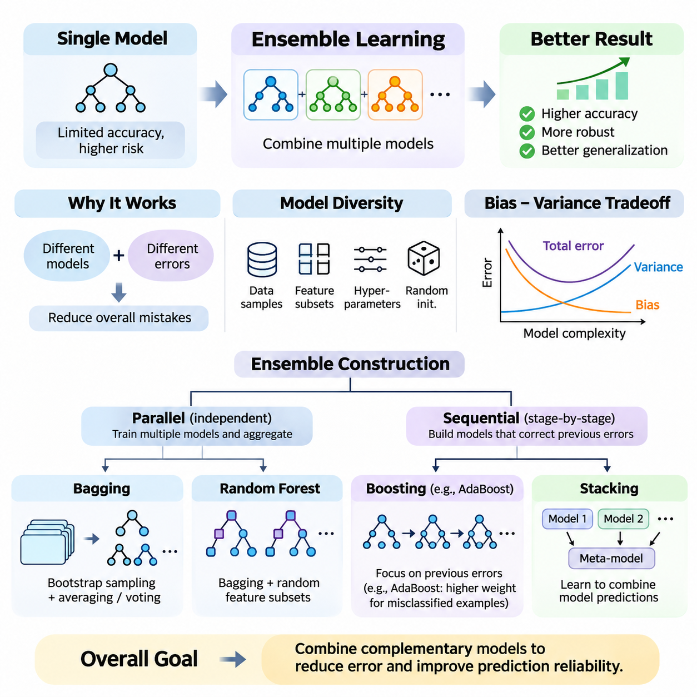
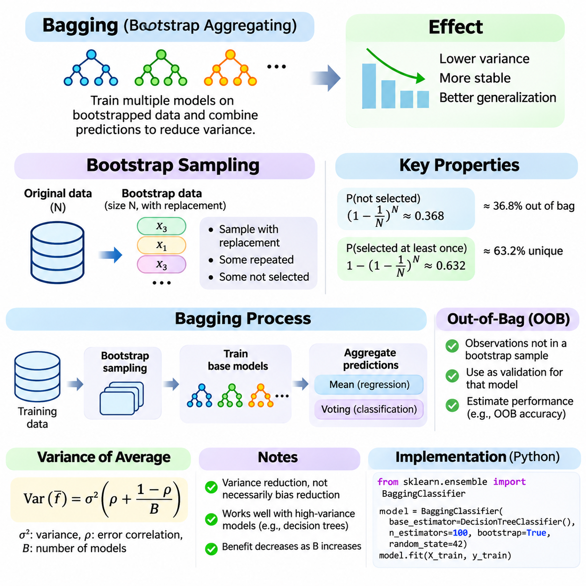
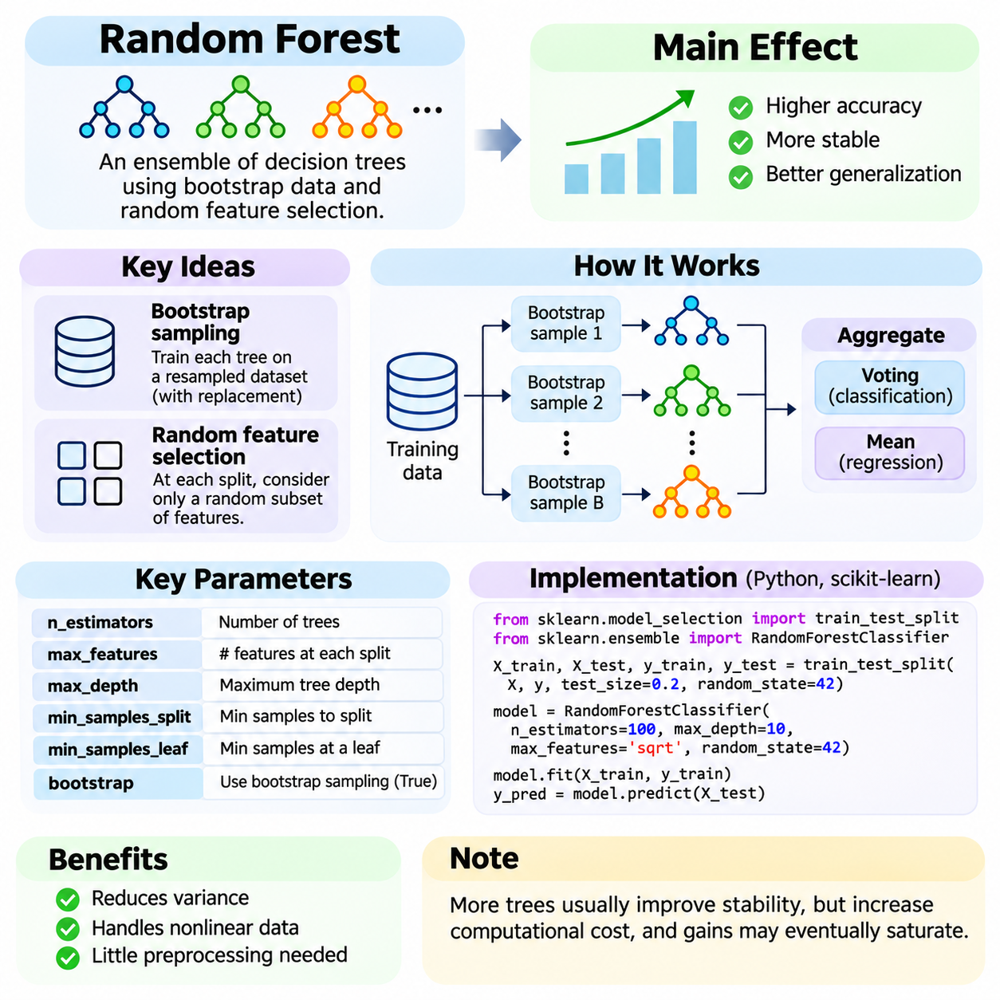
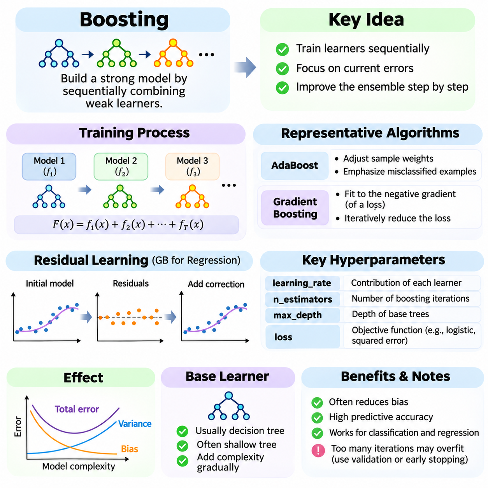
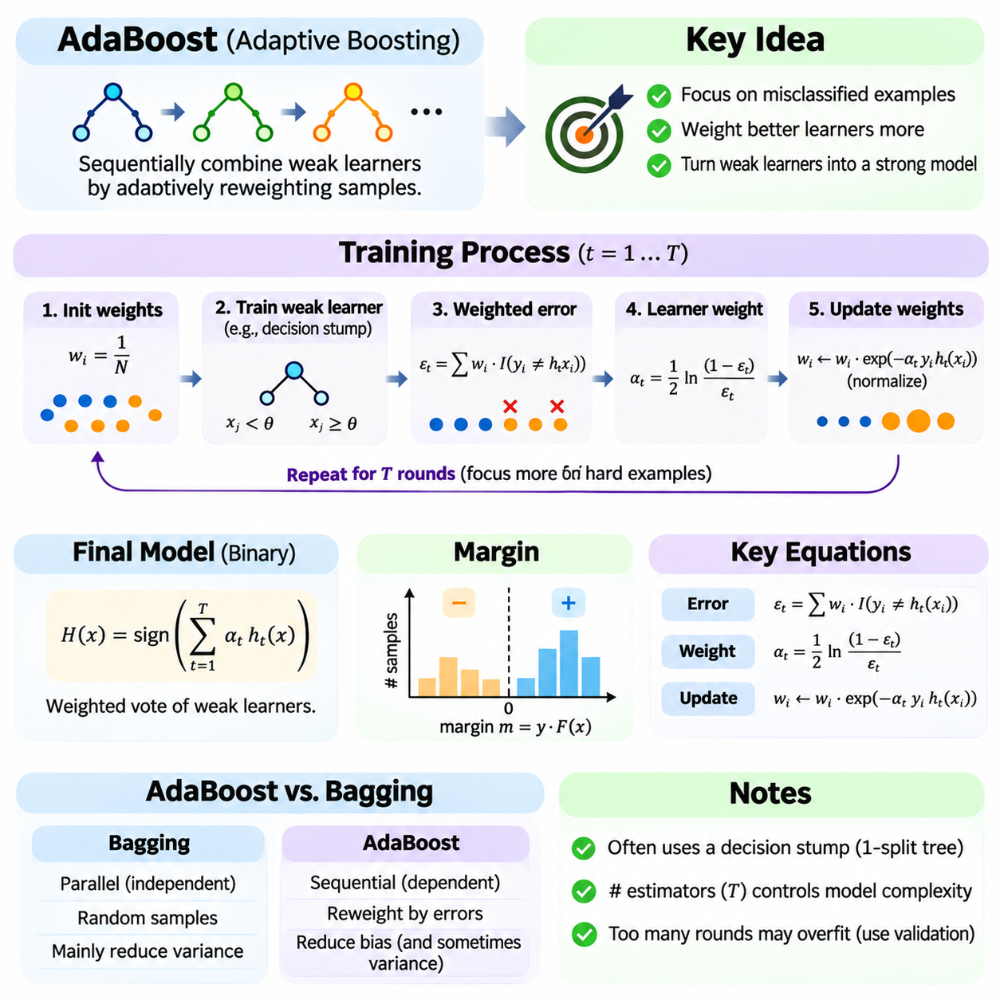
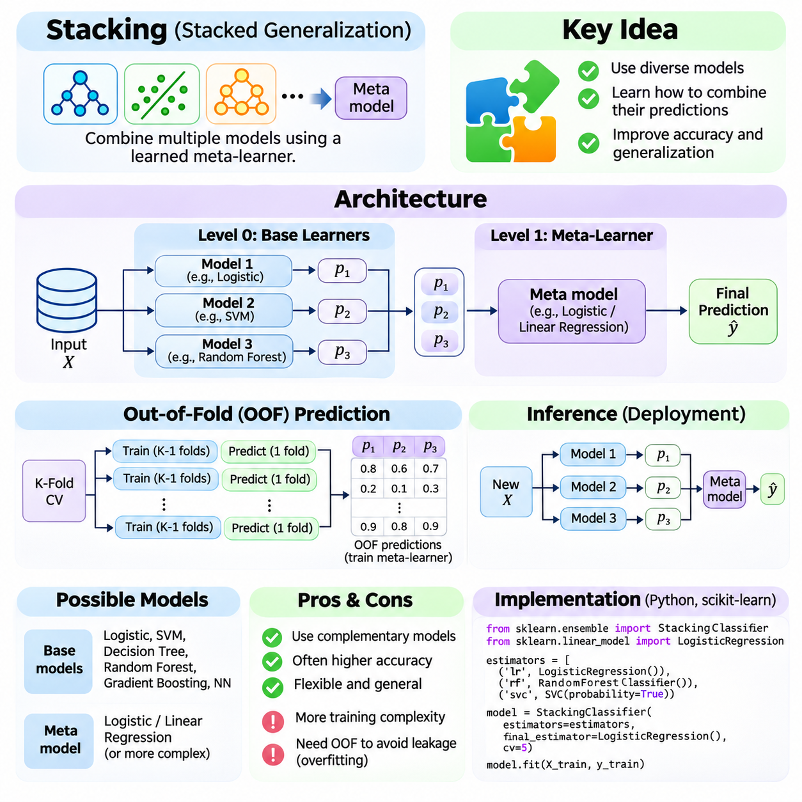
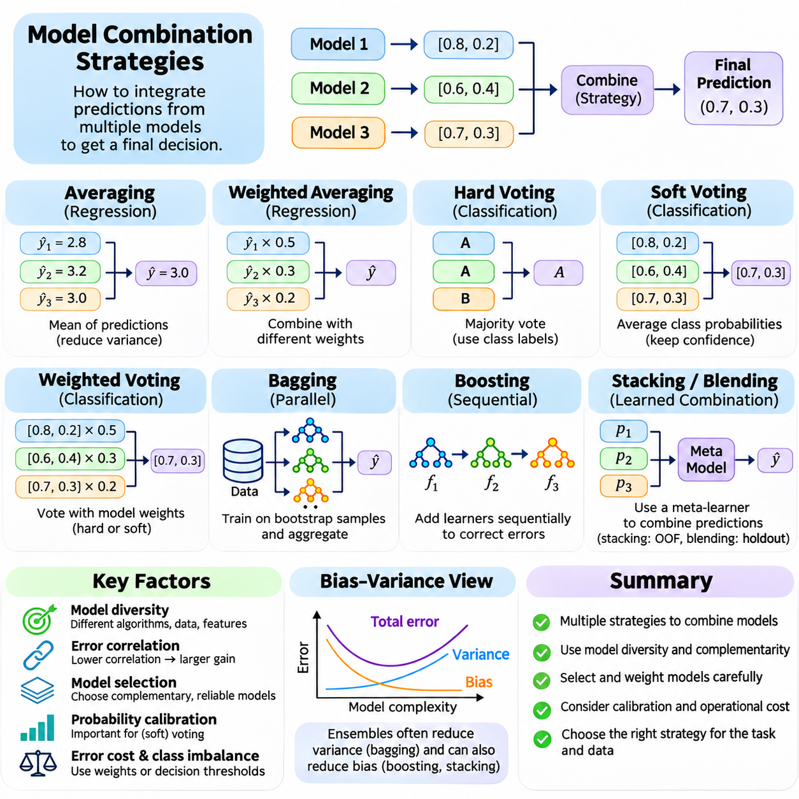
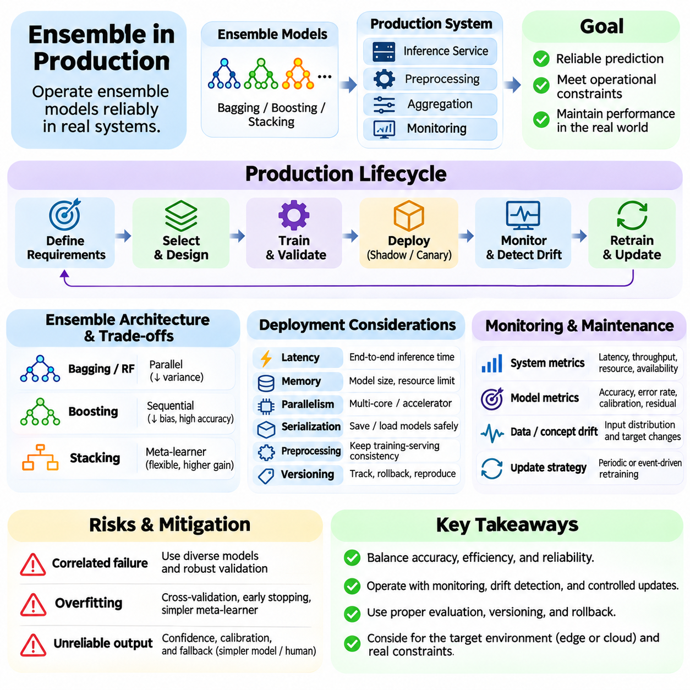

**Volume 08. Supervised Learning**

# 05. Ensemble Methods

## 05.00 Why Ensemble

{width="7.268055555555556in" height="7.268055555555556in"}

Ensemble learning is a machine learning approach that combines predictions from multiple models to produce a more reliable result than a single model can typically achieve. Instead of depending entirely on one learning algorithm, an ensemble integrates several predictors whose strengths and weaknesses may differ. This collective approach often improves predictive accuracy, robustness, and generalization across unfamiliar data.

A single machine learning model learns patterns from a limited representation of the available training data. Its predictions may be affected by sampling variation, measurement noise, inappropriate assumptions, or optimization limitations. Even a carefully trained model can make systematic mistakes in certain regions of the input space. Ensemble methods address these limitations by combining complementary predictions rather than trusting one model exclusively.

The fundamental motivation behind ensemble learning is that different models may make different errors. When their errors are sufficiently diverse, combining predictions can reduce the influence of individual mistakes. For example, one classifier may recognize certain patterns accurately while another performs better on difficult boundary cases. Their combined decision can be more dependable than either prediction alone.

Model diversity is therefore an important ingredient of successful ensemble learning. Diversity may arise from different training samples, feature subsets, algorithm families, hyperparameters, or random initialization. Models do not necessarily need different architectures to provide complementary predictions. Even several decision trees trained with different data samples can develop sufficiently different decision boundaries to improve collective performance.

The statistical foundation of ensemble learning is closely related to the bias-variance tradeoff. Prediction error can be influenced by systematic model assumptions, sensitivity to training data, and irreducible noise. Some ensemble techniques primarily reduce variance, while others can reduce bias by constructing more expressive predictors. Understanding these relationships explains why different ensemble strategies succeed under different conditions.

Variance describes how much a model\'s predictions change when the training dataset changes. High-variance models, such as unrestricted decision trees, may fit training examples closely while responding unpredictably to small sampling differences. Averaging predictions from multiple such models can stabilize their outputs. The reduction becomes especially effective when prediction errors are not strongly correlated.

Consider several regression models producing estimates for the same input. If their errors fluctuate independently around the correct value, averaging their predictions can cancel part of the random variation. For equally weighted models with independent errors of equal variance, the variance of their average decreases approximately in proportion to the number of models. Correlated errors limit this benefit.

Bias represents systematic error caused by restrictive assumptions or insufficient model flexibility. Combining several similarly biased models does not automatically eliminate their shared limitations. However, certain ensemble strategies improve predictive flexibility by learning corrections to earlier predictions. This principle motivates sequential approaches that progressively address errors remaining after previous learning stages.

Ensemble learning can be understood through the distinction between parallel and sequential model construction. Parallel methods train multiple predictors independently or with limited interaction, then aggregate their outputs. Sequential methods construct predictors in stages, allowing later models to respond to weaknesses in earlier ones. These approaches provide different mechanisms for improving accuracy and controlling generalization.

Bagging, or bootstrap aggregating, is a representative parallel ensemble strategy. It trains multiple base learners using datasets generated through sampling with replacement from the original training data. Each learner encounters a slightly different collection of examples, producing variation in its predictions. Their outputs are subsequently combined through averaging or voting to reduce instability.

Random Forest extends this principle by introducing additional randomness during decision tree construction. Along with bootstrap sampling, individual trees generally evaluate randomly selected feature subsets when searching for splits. This reduces similarity among trees and encourages diverse decision structures. Aggregating their predictions often produces strong performance on structured classification and regression problems.

Boosting follows a different philosophy by building an ensemble through successive improvements. Rather than relying primarily on independent learners, boosting constructs models that respond to errors or optimization objectives associated with the current ensemble. Each additional learner contributes information intended to improve the combined prediction. The resulting model can become substantially more expressive than its individual components.

AdaBoost illustrates boosting through the adaptive treatment of training examples. In its traditional classification formulation, examples that are incorrectly classified receive greater relative importance during subsequent learning rounds. New weak learners concentrate more heavily on difficult observations. Their predictions are combined using weights determined by their performance, creating a stronger classifier from relatively simple components.

Stacking introduces another perspective by learning how to combine predictions from different models. Several base learners generate predictions that become inputs to a secondary model, commonly called a meta-learner. The meta-learner discovers relationships between model outputs and target values. This approach can exploit complementary strengths among fundamentally different algorithms when the training procedure prevents information leakage.

The effectiveness of stacking depends heavily on how predictions for meta-learner training are generated. Using predictions from models evaluated on their own training examples can introduce serious overfitting. Cross-validation-based out-of-fold predictions provide a more reliable foundation because each training prediction comes from a model that did not train on that observation. This separation supports meaningful generalization.

Ensemble predictions can be combined using several aggregation rules. Regression systems commonly average numerical predictions, sometimes assigning different weights to individual models. Classification systems may use majority voting, weighted voting, or averaging of predicted class probabilities. The appropriate combination strategy depends on prediction quality, calibration, error relationships, and the requirements of the application.

Majority voting selects the class predicted by the greatest number of participating classifiers. This method is intuitive and can perform well when individual classifiers are reasonably accurate and make sufficiently different mistakes. However, majority voting does not consider differences in model confidence or reliability. A large collection of similar weak classifiers may contribute less value than a smaller diverse group.

Probability averaging combines estimated class probabilities rather than discrete class labels. This can preserve useful confidence information and produce smoother aggregate predictions. Nevertheless, poorly calibrated probabilities may distort the result, especially when some models are excessively confident. Probability calibration and validation-based weighting can improve the reliability of the combined prediction in applications requiring meaningful confidence estimates.

Ensemble methods are particularly valuable when the underlying prediction problem contains complex interactions, nonlinear relationships, or substantial sampling uncertainty. Different learners may capture different aspects of these patterns. Combining their outputs can reduce dependence on one particular modeling assumption. This flexibility helps explain the widespread use of ensembles in tabular classification, regression, forecasting, and industrial analytics.

In industrial predictive maintenance, multiple models may analyze vibration, temperature, electrical current, and operating history to estimate equipment failure risk. One model may identify gradual degradation, while another detects unusual combinations of sensor measurements. Combining these predictions can improve robustness across operating conditions. However, shared sensor failures or systematic data errors can still affect every participating model.

In autonomous robotics, ensemble techniques can support perception confidence estimation, terrain classification, or equipment condition monitoring. Different predictors may respond differently to illumination changes, sensor noise, or environmental variation. Their combined predictions can provide additional evidence for downstream decisions. Nevertheless, ensemble agreement alone does not establish safety, and real-time deployment requires careful evaluation of latency and computational cost.

An important limitation of ensemble learning is that additional models do not guarantee better performance. If participating predictors make nearly identical errors, aggregation offers little improvement. Similarly, including poorly performing models can reduce accuracy when their contributions are not controlled. Ensemble construction therefore requires deliberate attention to model quality, prediction diversity, and the statistical relationships among errors.

Computational complexity is another practical consideration. Training many models can require substantial processing time, memory, and storage. During inference, some ensembles must evaluate every participating model before producing a final prediction. This may increase latency and energy consumption, especially on embedded hardware. Model selection should therefore balance predictive improvement against deployment constraints.

Interpretability can also become more difficult when predictions depend on many interacting learners. A single decision tree may provide a relatively transparent sequence of decisions, while a large forest or boosted ensemble is harder to explain directly. Feature importance, permutation analysis, and local explanation methods can help investigate model behavior. However, such explanations should be interpreted with awareness of their limitations.

Reliable ensemble evaluation requires separating training, validation, and test data appropriately. Hyperparameters, model weights, and combination strategies should be selected using training and validation information without exposing the final test set. Repeated testing during development can create optimistic performance estimates. A disciplined evaluation procedure is necessary to determine whether ensemble improvements reflect genuine generalization.

The choice between a single model and an ensemble should depend on measurable benefits rather than architectural complexity alone. A simple model may be preferable when interpretability, latency, maintenance, or limited computing resources dominate the requirements. An ensemble becomes attractive when its accuracy, stability, or robustness improvements justify additional complexity. The final decision should reflect operational objectives and validated performance.

Ensemble learning demonstrates that predictive intelligence can emerge from the coordinated use of multiple imperfect models. Its central advantage is not simply increasing the number of predictors, but organizing their differences into useful collective behavior. Bagging, Random Forest, boosting, and stacking implement this principle through distinct mechanisms, establishing a foundation for understanding modern ensemble-based supervised learning systems.

## 05.01 Bagging

{width="7.268055555555556in" height="7.268055555555556in"}

Bagging, short for Bootstrap Aggregating, is an ensemble learning technique that improves predictive stability by training multiple models on different versions of the same dataset. Instead of relying on a single predictor, bagging constructs a collection of base learners and combines their outputs. Its primary objective is to reduce prediction variance while preserving useful patterns learned from the original training data.

The central motivation behind bagging is that many machine learning algorithms are sensitive to changes in their training samples. Decision trees, for example, may produce substantially different structures when only a few observations change. Such instability can lead to overfitting and unreliable predictions. Bagging reduces this sensitivity by averaging the behavior of models trained on independently generated bootstrap samples.

Bootstrap sampling is a statistical resampling procedure that creates new datasets by randomly selecting observations from an existing dataset with replacement. Each selected observation is returned to the sampling pool before the next selection. Consequently, some observations may appear multiple times in one bootstrap sample, while others may not appear at all. This mechanism generates different training datasets without requiring additional data collection.

Consider an original dataset containing N observations. A standard bootstrap sample is constructed by performing N independent selections with replacement from these observations. Although the resulting sample contains N entries, it generally includes fewer than N unique observations. As N becomes large, the expected proportion of distinct observations approaches approximately 63.2 percent, while the remaining observations are excluded from that particular sample.

The probability that a specific observation is excluded from one bootstrap selection is 1 minus 1/N. After N independent selections, its probability of remaining unselected is (1 - 1/N)\^N. As N increases, this expression approaches e\^-1, approximately 0.368. Therefore, about 36.8 percent of observations are expected to remain outside an individual bootstrap sample, forming the foundation of out-of-bag evaluation.

Out-of-bag observations are training examples that were not selected for a particular bootstrap sample. Because the corresponding base learner did not train on these observations, they can serve as validation examples for that learner. By collecting predictions from models for which each observation was out of bag, an ensemble can estimate generalization performance without reserving a separate validation subset specifically for this purpose.

Out-of-bag evaluation is especially useful when the available training dataset is relatively small. Each observation may be evaluated by multiple models that did not include it during training. Their predictions are aggregated and compared with the true target value to estimate performance. However, out-of-bag estimates remain statistical approximations and should not automatically replace independent testing when reliable deployment evaluation is required.

The bagging training process begins with a base learning algorithm and a predefined number of estimators. For each estimator, a bootstrap sample is generated from the original training dataset. A separate instance of the learning algorithm is then fitted to that sample. Since bootstrap samples differ, the resulting models generally learn different decision structures, even when they share identical algorithm configurations.

After training, bagging combines predictions from the individual estimators. For regression tasks, the ensemble commonly calculates the arithmetic mean of numerical predictions. For classification tasks, it may use majority voting or average predicted class probabilities. Aggregation reduces the influence of unusual predictions produced by individual models, creating a more stable collective output across different inputs.

The variance reduction achieved through bagging depends strongly on correlations among base learner errors. If individual models produce independent errors with equal variance, averaging B models reduces prediction variance by a factor of B. When errors are correlated, the reduction becomes smaller. Consequently, bagging benefits from base learners that are individually useful but sufficiently different in their prediction behavior.

A simplified variance expression illustrates this relationship. If each estimator has variance sigma squared and every pair of estimators has correlation rho, the variance of their average equals sigma squared multiplied by rho plus (1-rho)/B. As the number of estimators increases, the independent component decreases, but the correlated component remains. This explains why increasing ensemble size eventually produces diminishing returns.

Decision trees are particularly suitable base learners for bagging because they often exhibit high variance. A deep decision tree can adapt closely to individual training observations, creating complex decision boundaries that change substantially across datasets. Training multiple trees on bootstrap samples and averaging their predictions reduces instability while retaining the ability to represent nonlinear relationships and interactions among features.

Bagging does not necessarily reduce systematic bias. If every base learner makes similar errors because of restrictive assumptions or insufficient predictive capacity, aggregation cannot eliminate those shared limitations. For example, combining many severely underfitted models may produce a stable but inaccurate predictor. Bagging is therefore most effective when variance represents a significant component of prediction error.

Implementation typically requires defining the base estimator, ensemble size, bootstrap sampling configuration, and random seed. In Python, scikit-learn provides BaggingClassifier and BaggingRegressor for classification and regression tasks. These implementations automate bootstrap generation, estimator training, and prediction aggregation. Their configurable parameters allow developers to control computational requirements and model diversity.

A typical classification implementation begins by preparing feature matrices and target labels, then separating the available data into training and testing subsets. A decision tree classifier can be selected as the base estimator and supplied to BaggingClassifier. The number of estimators determines how many bootstrap-trained models participate. A fixed random_state supports reproducibility by controlling relevant random sampling operations.

The bootstrap parameter determines whether training observations are sampled with replacement. When bootstrap is enabled, each estimator receives a randomly generated sample that may contain repeated observations. The max_samples parameter controls the number or proportion of observations selected for each estimator. Smaller samples can increase diversity, although excessively limited samples may weaken individual learners and reduce predictive accuracy.

Feature sampling provides another mechanism for introducing diversity into bagging ensembles. The max_features parameter determines how many input features are available to each estimator. When bootstrap_features is enabled, feature sampling also occurs with replacement. Combining observation sampling and feature sampling can reduce similarities among learners, but aggressive feature restriction may remove important predictive information.

The number of estimators is an important hyperparameter because it influences stability, computational cost, and prediction performance. Increasing the ensemble size generally reduces random fluctuations in aggregated predictions, particularly during early expansion. However, performance improvements often diminish as additional estimators are introduced. Validation results should guide ensemble size rather than assuming that more models always provide meaningful benefits.

Bagging supports parallel computation because individual estimators can usually be trained independently. Modern machine learning libraries may distribute estimator training across multiple CPU cores or computing workers. This parallel structure can reduce training time when sufficient resources are available. Nevertheless, memory consumption and data management overhead may increase with ensemble size, limiting practical scalability.

Implementation quality also depends on preprocessing consistency. Missing-value handling, feature transformation, categorical encoding, and other preprocessing operations must be compatible with the selected base estimator. Transformations that learn parameters from data should be fitted without accessing held-out evaluation information. Proper pipeline construction prevents data leakage and ensures that reported ensemble performance reflects legitimate generalization.

Model evaluation should compare bagging against an appropriate single-estimator baseline. Classification performance may be assessed using accuracy, precision, recall, F1-score, or receiver operating characteristic analysis. Regression performance may be measured using mean absolute error, mean squared error, or coefficient of determination. Comparing training and testing results helps determine whether variance reduction produces meaningful improvements.

Cross-validation provides another reliable method for assessing bagging performance. The training dataset is divided into multiple folds, and the ensemble is repeatedly trained using different training-validation partitions. Evaluation scores are aggregated to estimate predictive performance and variability. When hyperparameters are tuned, nested validation or a separate final test set helps prevent optimistic estimates caused by repeated model selection.

Bagging can improve robustness to sampling fluctuations, but it does not automatically protect against corrupted labels, distribution shifts, or systematic measurement errors. Bootstrap samples originate from the same underlying dataset and therefore inherit its limitations. If important operating conditions are absent from the original observations, additional bootstrap samples cannot create genuine information about those missing conditions.

In industrial applications, bagging can support equipment failure prediction, quality inspection, and sensor-based classification. Multiple decision trees trained on different bootstrap samples may identify complementary relationships among temperature, vibration, pressure, and operational measurements. Their aggregated predictions can reduce sensitivity to individual training observations, improving reliability when operational data contain moderate sampling variability.

For edge computing and autonomous systems, bagging introduces a tradeoff between predictive stability and resource consumption. Evaluating many estimators can increase inference latency, memory usage, and energy demand. Developers may reduce ensemble size, constrain tree depth, or select computationally efficient base learners. These adjustments should be evaluated against accuracy requirements and real-time execution constraints.

A practical bagging experiment should examine how ensemble size, sample fraction, tree complexity, and feature sampling affect performance. Training a single decision tree establishes a baseline, while progressively larger ensembles reveal the benefits of aggregation. Recording accuracy, variance across repeated experiments, training duration, and inference latency provides a more complete understanding of the method\'s operational characteristics.

Bagging demonstrates how statistical resampling and collective prediction can transform unstable learning algorithms into more reliable predictive systems. Bootstrap sampling creates diversity, independent model training captures alternative patterns, and aggregation reduces sensitivity to individual estimators. Understanding these mechanisms provides the foundation for implementing bagging effectively and for studying Random Forest, which extends the approach through additional feature-level randomness.

## 05.02 Random Forest

{width="7.268055555555556in" height="7.268055555555556in"}

Random Forest is an ensemble learning algorithm that combines multiple decision trees to improve predictive accuracy, stability, and generalization. It extends bootstrap aggregating by introducing randomness into both training data selection and feature selection. Rather than relying on a single decision tree, Random Forest aggregates predictions from many independently constructed trees, reducing sensitivity to individual training observations.

A single decision tree recursively partitions the feature space into regions associated with target values or class labels. Although this structure can represent nonlinear relationships and complex feature interactions, deep trees often exhibit high variance. Small changes in training data may produce substantially different decision boundaries. Random Forest addresses this instability by combining predictions from diverse trees.

The fundamental principle of Random Forest is to generate a collection of decision trees that are individually useful but not excessively correlated. Each tree learns from a randomized training sample, while additional randomness influences feature selection during splitting. These mechanisms encourage different trees to discover alternative patterns. Aggregating their predictions reduces the influence of unstable individual decisions.

Bootstrap sampling is commonly used to construct the training dataset for each tree. Given an original dataset containing N observations, a bootstrap sample is generated by selecting N observations with replacement. Some observations appear multiple times, while others remain unselected. Each tree therefore receives a different representation of the training data, contributing to diversity across the ensemble.

Random feature selection provides an additional source of diversity beyond bootstrap sampling. At each candidate split, a tree evaluates only a randomly selected subset of available features rather than considering every feature. This prevents highly predictive variables from dominating every tree in exactly the same way. Consequently, different trees may develop alternative structures while retaining useful predictive information.

The max_features hyperparameter controls how many features are considered when searching for the best split. Smaller values generally increase randomness and reduce correlations between trees, although they may weaken individual predictors. Larger values allow trees to consider more candidate features but can increase similarity among their structures. Appropriate values depend on the dataset, task, and validation results.

Random Forest classification combines predictions from individual decision trees to determine the final class. A common conceptual approach is majority voting, where the class receiving the most votes becomes the prediction. In scikit-learn, RandomForestClassifier averages class probability estimates from individual trees and selects the class with the highest average probability. This distinction matters when interpreting model behavior.

For regression tasks, Random Forest combines numerical predictions from multiple regression trees. Each tree estimates a continuous target value based on the terminal leaf containing the input observation. The ensemble calculates the arithmetic mean of these estimates. Averaging reduces sensitivity to individual tree predictions and can improve stability when the underlying relationships are nonlinear or contain interactions.

The effectiveness of Random Forest is closely connected to variance reduction. Averaging predictions from multiple trees reduces fluctuations caused by training sample variation. However, the benefit depends on the correlation between tree errors. Random feature selection helps decrease this correlation, allowing aggregation to achieve greater variance reduction than would be possible with highly similar trees.

Random Forest can model nonlinear relationships without requiring explicit polynomial transformations or manually specified interaction terms. Decision trees naturally partition the feature space according to observed patterns. Combining many trees produces flexible prediction functions capable of representing complicated relationships. This makes Random Forest particularly useful for structured datasets containing mixed predictive signals.

Implementation in Python commonly uses RandomForestClassifier or RandomForestRegressor from the scikit-learn library. These classes provide configurable parameters for ensemble size, tree complexity, feature sampling, bootstrap behavior, and parallel execution. A typical implementation prepares feature matrices and target labels, divides the dataset into training and testing subsets, constructs the estimator, and fits it to the training data.

For classification, the implementation may begin by importing RandomForestClassifier and train_test_split. After loading the dataset, the feature matrix X and target vector y are separated into training and testing partitions. A RandomForestClassifier instance is created with selected hyperparameters, such as n_estimators, max_depth, and random_state. Calling fit trains the ensemble, while predict generates class predictions.

The n_estimators parameter specifies the number of decision trees included in the forest. Increasing this value generally improves prediction stability by reducing random fluctuations in the ensemble output. However, additional trees require more memory, training time, and inference computation. Performance improvements often diminish beyond a certain ensemble size, making validation-based selection important.

Tree complexity can be controlled through max_depth, min_samples_split, and min_samples_leaf. The max_depth parameter limits the maximum depth of each tree, while min_samples_split specifies the minimum number of observations required to split an internal node. The min_samples_leaf parameter controls the minimum number of observations in a terminal leaf. These settings influence overfitting, smoothness, and computational cost.

The bootstrap parameter determines whether individual trees are trained using samples drawn with replacement. When bootstrap is enabled, each tree typically receives a bootstrap sample from the training dataset. The max_samples parameter can further restrict the number or fraction of observations selected for each tree. These controls influence sample diversity, computational requirements, and the strength of individual trees.

Out-of-bag evaluation provides a convenient internal estimate of generalization performance. Since bootstrap sampling leaves some training observations unused for each tree, those observations can be evaluated by trees that did not encounter them during training. In scikit-learn, enabling oob_score with bootstrap sampling allows the estimator to calculate an out-of-bag score after fitting.

Out-of-bag scoring can reduce the need for a separate validation partition during preliminary experimentation. Each training observation receives predictions from trees for which it was excluded from the bootstrap sample. These predictions are aggregated and compared against the true targets. However, an independent test dataset remains valuable for final evaluation, particularly when hyperparameters are repeatedly adjusted.

Feature importance analysis is another practical capability of Random Forest. Scikit-learn exposes impurity-based importance values through the feature_importances\\_ attribute. These values summarize how much individual features contribute to impurity reductions across the forest. Although useful for exploratory analysis, impurity-based importance can favor features with many possible split points and should not be interpreted as causal influence.

Permutation importance provides an alternative approach to examining feature relevance. It measures the change in model performance when the values of a feature are randomly shuffled in an evaluation dataset. A substantial performance decrease suggests that the model relies on information associated with that feature. However, strongly correlated features can complicate interpretation because predictive information may remain available through related variables.

Random Forest generally requires less feature scaling than algorithms based on distances or gradient optimization. Decision tree splits depend on feature thresholds and are largely insensitive to consistent monotonic transformations. Consequently, standardization is often unnecessary for ordinary numerical features. Nevertheless, missing-value handling, categorical encoding, and preprocessing compatibility must still be considered when constructing a reliable pipeline.

Model evaluation should use metrics appropriate to the prediction objective. Classification tasks may employ accuracy, precision, recall, F1-score, and confusion matrices. Regression tasks may use mean absolute error, root mean squared error, and coefficient of determination. Comparing training and testing performance helps reveal overfitting, while cross-validation provides additional evidence about performance stability.

Hyperparameter tuning can be performed using grid search, randomized search, or other optimization strategies. Important parameters include n_estimators, max_features, max_depth, min_samples_leaf, and max_samples. Their effects interact, so changing one parameter may alter the usefulness of another. Cross-validation-based tuning helps identify configurations that balance predictive quality, model complexity, and computational efficiency.

Random Forest supports parallel computation because individual trees can be constructed independently. The n_jobs parameter controls parallel execution in scikit-learn, allowing training and prediction workloads to use multiple CPU cores. Parallelism can reduce execution time on suitable hardware, although memory usage and scheduling overhead may increase. The optimal configuration depends on dataset size and available computing resources.

In industrial applications, Random Forest can support predictive maintenance, quality inspection, fault classification, and equipment condition monitoring. Sensor measurements such as temperature, vibration, pressure, and electrical current can serve as input features. The forest learns nonlinear relationships between these measurements and operational outcomes. Its ensemble structure can improve robustness to training sample variability.

Random Forest can also support autonomous robotics through terrain classification, sensor-based anomaly detection, and operational risk estimation. For example, terrain features derived from camera, LiDAR, or inertial measurements may be used to classify surface conditions. However, Random Forest does not inherently understand temporal dynamics or guarantee safe decisions. System-level validation remains essential for safety-critical applications.

Deployment considerations include model size, inference latency, memory consumption, and maintainability. Large forests containing deep trees may require substantial resources, particularly on embedded processors. Reducing tree count, limiting depth, or increasing minimum leaf size can decrease computational demands. These adjustments should be evaluated against accuracy and robustness requirements under realistic operating conditions.

A practical Random Forest experiment should compare a single decision tree with forests of different sizes and complexity levels. Training and testing metrics can reveal whether ensemble aggregation reduces overfitting. Additional experiments may examine feature importance, out-of-bag scores, and inference time. Recording random seeds, dataset partitions, software versions, and hyperparameters improves reproducibility and supports meaningful comparisons.

Random Forest demonstrates how bootstrap sampling, randomized feature selection, and prediction aggregation can transform unstable decision trees into a powerful supervised learning system. Its effectiveness comes from balancing the predictive strength of individual trees against diversity across the ensemble. Understanding its implementation and limitations provides a foundation for evaluating more advanced ensemble methods and selecting models for real-world applications.

## 05.03 Boosting Overview

{width="7.268055555555556in" height="7.268055555555556in"}

Boosting is an ensemble learning technique that constructs a strong predictive model by combining multiple relatively simple learners through a sequential training process. Unlike bagging, which primarily reduces variance through independent model training, boosting progressively improves an ensemble by addressing weaknesses in its current predictions. This adaptive learning mechanism often produces highly accurate models for classification and regression tasks.

The central principle of boosting is that a collection of weak learners can form a strong learner when their contributions are organized effectively. A weak learner is a predictive model that provides limited but useful predictive capability. In classical binary boosting theory, weak learning requires performance slightly better than random guessing under appropriate assumptions. Modern boosting algorithms extend this idea through more general optimization procedures.

Boosting constructs an ensemble in stages rather than training all participating models independently. Each new learner is influenced by the performance or optimization objective of the existing ensemble. Depending on the algorithm, subsequent learners may focus on difficult observations, residual prediction errors, or gradients of a loss function. This sequential dependency distinguishes boosting from conventional parallel ensemble approaches.

The training process begins with an initial prediction model, which may be a simple constant estimate or a weak classifier. The algorithm evaluates its performance using a predefined learning objective. Additional learners are then constructed to improve the combined predictions. Each stage modifies the ensemble according to a specific update rule, gradually increasing its predictive capability while attempting to minimize the chosen loss.

Boosting algorithms differ in how they identify and correct prediction errors. AdaBoost adjusts the relative importance of training observations according to classification outcomes. Gradient Boosting fits new learners to information derived from the negative gradients of a differentiable loss function. Both approaches improve an ensemble sequentially, but their mathematical formulations and optimization mechanisms are not identical.

AdaBoost, or Adaptive Boosting, is one of the foundational boosting algorithms. In its traditional binary classification formulation, training observations receive weights that influence subsequent learning. Misclassified observations generally gain relative importance, encouraging later learners to focus on difficult examples. The final classifier combines weak learner predictions using performance-dependent weights rather than treating every learner equally.

Gradient Boosting provides a broader optimization framework by interpreting ensemble construction as iterative improvement of a prediction function. At each stage, the algorithm calculates the direction in which predictions should change to reduce the objective function. A new learner approximates this correction, and its output is added to the existing ensemble. This procedure connects boosting directly to numerical optimization and gradient-based learning.

For squared-error regression, Gradient Boosting can be understood through residual learning. The initial model generates predictions, and residuals represent differences between actual targets and predicted values. A subsequent learner attempts to approximate these residuals. Adding its predictions to the existing model reduces remaining errors when the correction generalizes successfully. Repeating this process creates an increasingly expressive predictive function.

The learning rate is a critical hyperparameter in many boosting algorithms because it controls the contribution of newly added learners. A smaller learning rate produces more conservative updates, often requiring additional boosting stages to achieve strong performance. Larger updates may accelerate training but increase the risk of unstable learning or overfitting. The appropriate value depends on ensemble complexity, dataset characteristics, and validation results.

The number of boosting iterations determines how many learners contribute to the final ensemble. Increasing this number can improve predictive performance when additional learners capture meaningful patterns. However, excessive iterations may cause the ensemble to fit noise or unusual training observations. Validation-based model selection and early stopping help determine when further boosting no longer provides reliable generalization improvements.

Decision trees are frequently used as base learners in boosting because they represent nonlinear relationships and feature interactions efficiently. Shallow trees provide relatively simple prediction functions, allowing the ensemble to build complexity gradually. Tree depth controls the complexity of interactions learned at each stage. Deeper trees can capture more intricate patterns but may increase computational cost and overfitting risk.

Boosting is often associated with bias reduction because sequential learners can correct systematic weaknesses in earlier predictions. However, its actual effect depends on the algorithm, base learner complexity, regularization, and training data. Boosting can influence both bias and variance, and it does not guarantee improvement in either component. Its practical objective is to reduce predictive loss while maintaining generalization.

The relationship between boosting and optimization becomes particularly important when selecting a loss function. Classification tasks may use exponential loss or logistic loss, while regression tasks may employ squared error, absolute error, or other objectives. The chosen loss determines how prediction errors influence subsequent learning. Consequently, different loss functions can produce different behavior even when the same base learner architecture is used.

Boosting can be sensitive to noisy labels and outliers because difficult observations may receive substantial attention during training. In AdaBoost, repeatedly misclassified examples can gain increasing relative importance. In gradient-based methods, sensitivity depends on the selected loss function and regularization strategy. Robust objectives, controlled model complexity, and careful data preparation can reduce undesirable effects.

Regularization is essential for controlling the expressive power of boosted ensembles. Common strategies include limiting tree depth, reducing learning rates, constraining leaf sizes, applying subsampling, and restricting the number of boosting stages. These mechanisms discourage excessive adaptation to training observations. Effective regularization allows boosting to capture meaningful patterns without unnecessarily increasing model complexity.

Stochastic Gradient Boosting introduces randomness by training individual learners on subsets of the available observations. This approach can reduce computational requirements and sometimes improve generalization by introducing additional diversity. Feature subsampling provides another mechanism for controlling complexity. These techniques combine elements of randomized ensemble construction with the sequential correction principle of boosting.

Modern boosting frameworks extend classical algorithms through computational optimization and sophisticated regularization. XGBoost incorporates efficient tree construction and regularized objectives. LightGBM emphasizes computational efficiency through histogram-based learning and specialized tree growth strategies. CatBoost provides methods designed to handle categorical features and reduce certain forms of prediction shift during training.

Boosting has achieved strong results on structured tabular datasets containing numerical and categorical information. It can represent nonlinear relationships, interactions, and complex decision boundaries without extensive manual feature engineering. However, performance depends on data characteristics and implementation choices. Neural networks, linear models, or other algorithms may be preferable for particular modalities, resource constraints, or deployment requirements.

Model evaluation should distinguish training improvement from genuine generalization. Boosting may continue reducing training loss even after validation performance stops improving. Monitoring validation metrics across boosting iterations helps identify overfitting and select an appropriate stopping point. Independent testing remains necessary to estimate performance on previously unseen observations after model development and hyperparameter selection.

Classification evaluation may involve accuracy, precision, recall, F1-score, and area under the receiver operating characteristic curve. Regression evaluation may use mean absolute error, root mean squared error, or coefficient of determination. The selected metrics should reflect the operational consequences of prediction errors. For imbalanced datasets, accuracy alone may conceal poor performance on important minority classes.

Boosting generally requires sequential coordination because later learners depend on earlier ensemble predictions. This dependency limits parallelism across boosting stages compared with bagging. Nevertheless, many implementations parallelize operations within individual stages, including feature processing and split evaluation. Efficient implementations can therefore achieve strong performance despite the fundamentally sequential learning structure.

In industrial predictive maintenance, boosting can learn complex relationships among vibration, temperature, electrical current, and equipment operating history. Successive learners may capture patterns that earlier stages failed to represent adequately. This capability supports fault classification, degradation estimation, and failure risk prediction. Reliable deployment still requires representative training data, appropriate validation, and monitoring for distribution changes.

In autonomous robotics, boosting can support terrain classification, sensor-based anomaly detection, and operational condition estimation. Features extracted from cameras, LiDAR, inertial sensors, or other measurement systems can serve as inputs. Boosted models may capture nonlinear relationships among these signals. However, their predictions do not inherently provide temporal understanding, uncertainty guarantees, or safety assurance.

Practical boosting implementation requires selecting a base learner, loss function, learning rate, iteration count, and regularization settings. Experiments should compare boosted ensembles against simple baselines and alternative ensemble approaches. Recording training time, inference latency, memory usage, and validation performance provides a balanced assessment. Reproducible data partitions and fixed random seeds support meaningful comparisons.

Boosting demonstrates how sequential learning can transform multiple limited predictors into a highly capable ensemble. Its defining characteristic is the adaptive construction of new learners based on the current ensemble\'s weaknesses or optimization direction. Understanding AdaBoost, Gradient Boosting, regularization, and evaluation provides the conceptual foundation for studying advanced boosting algorithms and applying them effectively in supervised learning systems.

## 05.04 AdaBoost

{width="7.268055555555556in" height="7.268055555555556in"}

AdaBoost, short for Adaptive Boosting, is an ensemble learning algorithm that combines multiple weak learners into a stronger predictive model through sequential training. Its defining characteristic is the adaptive adjustment of training sample weights based on previous classification errors. By directing subsequent learners toward difficult observations, AdaBoost progressively improves the ensemble\'s ability to distinguish classes.

The central idea behind AdaBoost is that a collection of simple classifiers can achieve strong predictive performance when their contributions are appropriately weighted. Each weak learner needs only to perform better than random guessing under the current weighted distribution in the classical binary formulation. AdaBoost repeatedly constructs these learners and combines their predictions into a weighted decision function.

AdaBoost commonly uses decision stumps as its base learners. A decision stump is a decision tree containing only one split, producing a simple classification rule based on a single feature threshold. Although an individual stump has limited predictive capacity, multiple stumps can collectively represent more complex decision boundaries. Their sequential combination allows the ensemble to address patterns that one stump cannot capture.

The training process begins by assigning equal weights to all training observations. For a dataset containing N examples, each observation initially receives a weight of 1/N. These weights define the relative importance of examples during learning. The first weak classifier is trained using this distribution, and its predictions are compared with the true labels to identify correctly and incorrectly classified observations.

After training a weak learner, AdaBoost calculates its weighted classification error. This error is obtained by summing the weights of incorrectly classified observations and normalizing when necessary. In the standard binary formulation with normalized weights, the error lies between zero and one. A useful weak learner must generally achieve weighted error below 0.5 to contribute positively to the ensemble.

The contribution of each weak learner is determined by its weighted error. In classical binary AdaBoost, the learner coefficient alpha equals one-half multiplied by the natural logarithm of (1-error)/error. A lower weighted error produces a larger positive coefficient, assigning greater influence to the learner. Errors approaching 0.5 produce coefficients near zero, indicating limited predictive value.

Once the learner coefficient is calculated, AdaBoost updates the observation weights. Misclassified examples receive increased relative importance, while correctly classified examples receive decreased relative importance. The updated weights are normalized so their sum equals one. This adjustment changes the training distribution for the next learner, encouraging attention to observations that previous models found difficult.

The weight update can be expressed using exponential weighting. For binary labels represented as -1 and +1, the new weight of observation i is proportional to its previous weight multiplied by exp(-alpha times y_i times h(x_i)). Correct predictions reduce the corresponding weight, while incorrect predictions increase it. Normalization ensures that the updated distribution remains valid.

AdaBoost repeats this process for a predefined number of boosting rounds. Each round trains a new weak learner using the current observation weights, evaluates its weighted error, calculates its contribution, and updates the distribution. The ensemble gradually accumulates complementary classification rules. Its final decision reflects the weighted contributions of all retained learners rather than a simple majority vote.

For binary classification, the final prediction is determined by the sign of the weighted sum of weak learner outputs. Each learner contributes its prediction multiplied by its coefficient alpha. Learners with stronger weighted performance exert greater influence on the decision. This aggregation mechanism allows several individually limited classifiers to produce a more expressive classification function.

AdaBoost can be interpreted as minimizing exponential loss through a stagewise additive modeling process. Each new learner contributes a function that reduces the current objective under suitable conditions. This perspective connects adaptive sample weighting with numerical optimization. It also explains why observations with negative classification margins can receive increasingly strong emphasis during training.

The classification margin measures the relationship between the correct label and the ensemble\'s weighted prediction. A positive margin indicates correct classification, while a negative margin indicates an incorrect prediction. Larger positive margins generally reflect stronger classification decisions. Margin analysis provides insight into how AdaBoost improves the separation of training examples beyond merely reducing classification error.

AdaBoost differs fundamentally from bagging in how models are constructed. Bagging trains learners on randomized samples and aggregates their predictions primarily to reduce variance. AdaBoost trains learners sequentially using changing observation weights, directing attention toward previous errors. This adaptive dependency can improve predictive performance but also makes training more sensitive to difficult or mislabeled observations.

The number of estimators is an important AdaBoost hyperparameter because it determines the maximum number of boosting rounds. Increasing this value allows the ensemble to construct more complex decision functions. However, excessive rounds may increase computational cost or encourage attention to noisy examples. Validation performance should guide the selection of ensemble size rather than assuming that additional learners always improve generalization.

The learning rate controls how strongly newly trained learners contribute to the ensemble. Smaller values reduce the influence of individual learners and may require additional boosting rounds. Larger values produce more aggressive updates and can accelerate adaptation. The interaction between learning rate and estimator count is important, so both parameters should be evaluated together during model development.

The complexity of the base estimator also influences AdaBoost behavior. Decision stumps provide simple rules and encourage gradual construction of the ensemble. Deeper decision trees can capture more complicated interactions within each boosting round but may reduce diversity or increase overfitting risk. Selecting an appropriate base learner requires balancing individual predictive strength against ensemble complexity.

AdaBoost is particularly sensitive to certain forms of label noise and outliers. Observations that remain incorrectly classified can receive increasing relative importance, causing later learners to concentrate on examples that may be mislabeled or unrepresentative. This behavior can reduce generalization when the dataset contains substantial corruption. Careful data inspection and validation are therefore important.

Implementation in Python can use AdaBoostClassifier from the scikit-learn library. A typical workflow prepares a feature matrix and target labels, separates training and testing data, and constructs an AdaBoost classifier with a selected base estimator. The n_estimators and learning_rate parameters control ensemble construction. Calling fit trains the model, while predict generates classification results.

A practical implementation may use DecisionTreeClassifier with max_depth set to one as the base estimator. This configuration creates decision stumps that learn simple threshold-based rules. The estimator is supplied to AdaBoostClassifier, along with a chosen number of boosting rounds and a random seed. The resulting model sequentially trains weak classifiers and combines their contributions.

Model evaluation should compare AdaBoost against a single decision stump, a deeper decision tree, and alternative ensemble methods. Classification metrics may include accuracy, precision, recall, F1-score, and confusion matrices. Cross-validation provides additional evidence about generalization stability. Comparing training and validation performance helps identify whether additional boosting rounds produce meaningful improvements.

AdaBoost can be useful for structured classification problems involving numerical measurements and engineered features. Applications include quality inspection, fault detection, and equipment condition classification. Weak learners may identify complementary thresholds involving temperature, vibration, pressure, or electrical measurements. Their weighted combination can represent more complicated relationships than individual decision stumps.

In autonomous robotics, AdaBoost may support terrain classification, sensor-based anomaly detection, or operational state recognition. Features derived from camera, LiDAR, and inertial measurements can be supplied to the classifier. However, AdaBoost does not inherently model temporal dynamics or provide safety guarantees. Real-time deployment requires evaluation of inference latency, robustness, and changing operating conditions.

AdaBoost demonstrates how adaptive sample weighting and sequential model construction can transform simple classifiers into an effective ensemble. Its central mechanisms are weighted error estimation, learner contribution calculation, observation weight updates, and weighted prediction aggregation. Understanding these principles provides a foundation for studying Gradient Boosting and more advanced ensemble optimization methods.

## 05.05 Stacking

{width="7.268055555555556in" height="7.268055555555556in"}

Stacking, also known as Stacked Generalization, is an ensemble learning technique that combines predictions from multiple base models through an additional learning model. Unlike bagging or boosting, stacking does not rely primarily on averaging or sequential error correction. Instead, it trains a meta-learner to discover how different models should contribute to the final prediction, potentially improving accuracy and generalization.

The central principle of stacking is that different learning algorithms may capture complementary patterns within the same dataset. A linear model can represent relatively simple relationships, while decision trees and kernel-based models can capture nonlinear structures. By combining these diverse perspectives, stacking attempts to exploit the strengths of individual models while reducing the impact of their weaknesses.

A typical stacking architecture contains two learning levels. The first level consists of base learners, sometimes called level-zero models, which generate predictions from the original input features. The second level contains a meta-learner, or level-one model, which receives base model predictions as inputs. The meta-learner learns relationships among these predictions and produces the final ensemble output.

Base learners can include logistic regression, support vector machines, decision trees, random forests, gradient boosting models, or neural networks. Using different model families may increase predictive diversity because their assumptions and learning mechanisms differ. However, diversity alone does not guarantee better performance. Each base learner should provide useful information that contributes to the overall prediction task.

The meta-learner is responsible for combining the information produced by base models. For classification, logistic regression is a common choice because it can learn coefficients associated with base predictions. For regression, linear regression or regularized regression models may serve this purpose. More complex meta-learners can capture nonlinear relationships, but they also increase the risk of overfitting.

A major challenge in stacking is preventing information leakage between base model training and meta-learner training. If the meta-learner is trained directly on predictions generated from the same observations used to fit the base models, it may learn unrealistically optimistic patterns. This can produce excellent training performance but poor generalization. Proper stacking therefore requires carefully constructed out-of-fold predictions.

Out-of-fold prediction uses cross-validation to generate training inputs for the meta-learner. The training dataset is divided into several folds, and each base model is repeatedly trained on all folds except one. Predictions are then generated for the held-out fold. After completing the process, every training observation has base model predictions produced without using that observation during the corresponding model fitting.

The out-of-fold predictions from different base learners are combined into a new feature matrix. Each column typically represents the prediction output of a particular base model, while each row corresponds to a training observation. This matrix becomes the training input for the meta-learner. The original target values remain the supervised learning labels, allowing the meta-learner to learn an effective combination strategy.

For classification tasks, base models may provide predicted class labels, class probabilities, or decision scores. Probability estimates often contain richer information than discrete labels because they describe confidence across possible classes. However, poorly calibrated probabilities may mislead the meta-learner. Probability calibration and consistent prediction formats can improve the reliability of stacking when probabilistic outputs are used.

In regression stacking, each base learner generates continuous numerical predictions. The meta-learner receives these estimates and learns how to combine them to approximate the target variable. A linear meta-learner may assign different coefficients to different models, while a nonlinear meta-learner may learn conditional relationships. The resulting ensemble can adapt to complementary prediction patterns across the input space.

The final inference process differs from the cross-validation procedure used to construct meta-training data. After generating out-of-fold predictions, base learners are commonly refitted using the complete training dataset. For a new observation, these fitted models generate predictions that are passed to the trained meta-learner. The meta-learner then produces the final classification or regression result.

Stacking differs from voting ensembles because the combination mechanism is learned rather than predefined. Hard voting selects a class according to the number of model votes, while soft voting averages predicted probabilities. Stacking instead estimates how base model outputs should influence the final decision. This flexibility can improve performance, although it introduces additional training complexity and validation requirements.

Model diversity is important because highly correlated base learners may provide redundant information. If several models make nearly identical predictions and errors, combining them may offer limited improvement. Selecting learners with different inductive biases can increase the potential benefit of stacking. Nevertheless, predictive quality remains essential, since weak or unstable models may introduce unnecessary noise.

Stacking can reduce prediction error by exploiting complementary model behavior, but its effect on bias and variance depends on the architecture. A well-designed meta-learner may correct systematic weaknesses in individual models. Conversely, an excessively complex meta-learner may overfit the out-of-fold prediction matrix. Regularization, cross-validation, and independent testing are necessary to assess whether stacking genuinely improves generalization.

The number of cross-validation folds influences both computational cost and the quality of meta-training predictions. More folds generally allow base learners to train on larger subsets during each iteration, but they require additional model fitting. Fewer folds reduce computational expense but may produce less representative predictions. The appropriate configuration depends on dataset size, model complexity, and available resources.

Implementation in Python commonly uses StackingClassifier or StackingRegressor from the scikit-learn library. These estimators accept a collection of named base models and a final estimator that acts as the meta-learner. The cv parameter controls cross-validation used to generate meta-training predictions. The stack_method parameter in StackingClassifier determines which prediction interface is used when compatible methods are available.

A practical classification implementation may combine logistic regression, random forest, and support vector machine classifiers as base learners. Logistic regression can serve as the final estimator, learning how their predictions should contribute to classification. The training dataset is passed to the stacking estimator through fit. After training, predict generates class labels, while predict_proba may provide probabilities when supported.

The passthrough option allows original input features to be included alongside base model predictions when training the meta-learner. This configuration gives the final estimator direct access to information that may not be fully represented by base predictions. However, increasing the number of meta-level features can raise model complexity. Validation should determine whether passthrough improves generalization.

Evaluation should compare stacking against each individual base learner and simpler ensemble methods. Classification metrics may include accuracy, precision, recall, F1-score, and area under the receiver operating characteristic curve. Regression metrics may include mean absolute error and root mean squared error. Improvements should be confirmed using validation procedures that remain independent of meta-learner training.

Computational cost is a significant consideration because stacking requires repeated training of multiple base learners. Cross-validation increases the number of fitting operations, and inference requires predictions from every participating model. Memory consumption and deployment complexity may also increase. Parallel execution and careful model selection can reduce some overhead, but they do not eliminate the underlying computational requirements.

Stacking is useful in industrial applications where different algorithms capture complementary characteristics of sensor measurements. For example, linear models may represent stable operating relationships, while tree ensembles detect nonlinear interactions among temperature, vibration, and electrical measurements. A meta-learner can combine these predictions for fault classification or equipment condition estimation.

In autonomous robotics, stacking may combine predictions from models specialized in terrain classification, obstacle risk estimation, or sensor anomaly detection. Different learners can process engineered features derived from cameras, LiDAR, and inertial sensors. However, combining models does not automatically guarantee robustness or safety. Real-time constraints, distribution shifts, and failure dependencies must be evaluated before deployment.

Reliable stacking experiments require strict separation between training, validation, and testing data. Cross-validation folds should respect temporal ordering or group boundaries when observations are dependent. For example, measurements from the same machine or operational session should not be distributed across training and validation folds when doing so would create leakage. Proper evaluation design is essential for realistic performance estimates.

Stacking demonstrates how supervised learning models can be combined through an additional learning process rather than fixed aggregation rules. Its effectiveness depends on complementary base learners, leakage-free out-of-fold predictions, an appropriately regularized meta-learner, and reliable evaluation. Understanding these components provides a foundation for designing flexible ensemble systems that combine diverse predictive models.

## 05.06 Model Combination Strategies

{width="7.268055555555556in" height="7.268055555555556in"}

Model combination strategies are fundamental to ensemble learning because they determine how predictions from multiple models are integrated into a final decision. Different algorithms may capture complementary patterns, respond differently to noise, or exhibit distinct generalization characteristics. An effective combination strategy attempts to exploit these differences while controlling prediction error, computational complexity, and operational reliability.

The simplest combination strategy is averaging, which is commonly used for regression ensembles. Each participating model generates a numerical prediction, and the ensemble calculates their arithmetic mean. Averaging can reduce variance when individual prediction errors are not perfectly correlated. However, its effectiveness depends on model quality and diversity, since combining highly similar or consistently biased predictors may provide limited improvement.

Weighted averaging extends ordinary averaging by assigning different importance levels to participating models. Predictions from more reliable models may receive larger weights, while weaker models contribute less. Weights are commonly constrained to be nonnegative and sum to one, although other formulations are possible. Appropriate weights should be estimated using validation data rather than selected solely from training performance.

Hard voting is a common strategy for classification ensembles. Each model predicts a class label, and the ensemble selects the class receiving the greatest number of votes. This approach is straightforward and does not require probability estimates. However, hard voting discards information about prediction confidence and may perform poorly when some participating classifiers are substantially less reliable than others.

Soft voting combines predicted class probabilities rather than discrete class labels. Each classifier estimates the probability associated with each possible class, and the ensemble averages these probabilities before selecting the most likely class. This method preserves more information than hard voting. Nevertheless, poorly calibrated probabilities can distort the combined prediction, making probability quality an important consideration.

Weighted voting allows models to influence classification decisions according to predefined or learned importance values. In weighted hard voting, each class receives the sum of weights assigned to models predicting that class. In weighted soft voting, predicted probabilities are combined using model-specific weights. These approaches can improve performance when model reliability differs, provided that weights are estimated without validation leakage.

Bagging combines models trained on randomized versions of the original dataset. Bootstrap sampling introduces variation into the training observations, while prediction aggregation reduces sensitivity to individual models. Classification ensembles commonly use voting or averaged class probabilities, whereas regression ensembles use numerical averaging. Bagging is particularly effective when the base learning algorithm exhibits high variance.

Random Forest extends bagging by introducing randomized feature selection during decision tree construction. This additional randomness decreases correlations among trees and can strengthen the benefits of aggregation. The resulting ensemble combines predictions from numerous trees trained on different bootstrap samples and feature subsets. Its performance depends on tree diversity, individual predictive strength, and appropriate complexity control.

Boosting uses a fundamentally different combination strategy because learners are constructed sequentially. Each new learner contributes to correcting weaknesses in the existing ensemble according to an algorithm-specific objective. AdaBoost uses performance-dependent learner weights, while Gradient Boosting adds functions that approximate optimization directions. The resulting prediction reflects an accumulated sequence of adaptive corrections.

Stacking replaces fixed combination rules with a trainable meta-learner. Multiple base models generate predictions, and a second-level model learns how these outputs should be combined. This approach can capture relationships that ordinary averaging or voting cannot represent. However, reliable stacking requires out-of-fold predictions to prevent information leakage and avoid overly optimistic training results.

Blending is a related strategy that trains a meta-learner using predictions generated on a dedicated holdout dataset. Unlike cross-validation-based stacking, blending commonly reserves a separate portion of training data for meta-model development. This simplifies implementation but reduces the observations available for fitting base learners. Its effectiveness depends on holdout size, representativeness, and strict separation from final testing.

Model diversity is a central requirement for successful combination. Diversity may arise from different algorithms, training samples, feature subsets, hyperparameters, or random initializations. Models that make complementary errors can provide greater ensemble benefits than models with nearly identical predictions. However, diversity must be balanced against predictive competence, because combining many inaccurate models does not automatically improve performance.

Error correlation provides a useful perspective on ensemble effectiveness. When prediction errors are strongly correlated, averaging offers limited variance reduction. Lower error correlation generally increases the potential benefit of combining predictions. Consequently, ensemble design should evaluate both individual model performance and relationships among model errors rather than selecting participants solely according to standalone accuracy.

Model selection is therefore an important component of ensemble construction. Adding every available model may increase computational cost without improving predictive quality. A smaller ensemble containing complementary and reliable learners can outperform a larger collection of redundant models. Validation-based selection, ablation experiments, and incremental model addition can help identify useful combinations.

Probability calibration is particularly relevant when combining classification probabilities. A classifier may achieve high accuracy while producing probability estimates that do not accurately reflect observed outcome frequencies. Calibration methods, such as sigmoid calibration or isotonic regression, can improve probabilistic reliability when applied appropriately. Calibration procedures must use suitable validation data to avoid introducing leakage.

Combination strategies should also consider class imbalance and unequal error costs. In applications where missing a rare fault is more serious than producing a false alarm, maximizing overall accuracy may be inappropriate. Weighted voting, decision thresholds, and cost-sensitive evaluation can help align ensemble decisions with operational objectives. These adjustments should be validated using representative class distributions.

Dynamic ensemble selection extends fixed combination methods by choosing or weighting models according to the current input. A model may perform well in one region of the feature space but poorly in another. Dynamic methods attempt to identify locally competent learners and emphasize their predictions. Although potentially effective, they introduce additional complexity and require reliable estimates of local model performance.

Mixture-of-experts architectures provide another adaptive combination mechanism. Multiple specialized models generate candidate predictions, while a gating model determines how strongly each expert contributes for a particular input. Unlike conventional fixed averaging, the combination weights vary across observations. This flexibility can support heterogeneous data patterns but increases training, interpretation, and deployment complexity.

Practical ensemble evaluation should compare combination methods against their strongest individual members. Classification tasks may use accuracy, precision, recall, F1-score, and probability-based metrics. Regression tasks may use mean absolute error and root mean squared error. Improvements should be assessed on independent data, since gains observed during weight tuning or meta-learner training may not generalize.

Computational efficiency influences which combination strategy is appropriate for deployment. Averaging and voting require relatively simple aggregation operations, but all participating models must still generate predictions. Stacking adds meta-model inference, while dynamic methods require additional selection or gating computations. Memory consumption, inference latency, and model maintenance should therefore be evaluated alongside predictive performance.

In industrial predictive maintenance, ensemble combinations may integrate models specialized in vibration analysis, temperature monitoring, and electrical fault detection. Weighted averaging or stacking can combine these predictions into equipment condition estimates. Complementary models may improve robustness when operating conditions vary. However, correlated sensor failures and distribution shifts can still affect the entire ensemble.

Autonomous robotics provides another setting where model combination can support perception and operational decisions. Separate classifiers may analyze terrain characteristics, obstacle risk, or sensor anomalies using different feature representations. Their predictions can be integrated through voting, weighted averaging, or learned fusion. Safety-critical applications additionally require latency guarantees, failure handling, and independent system-level validation.

Reliable implementation requires careful control of data partitions, random seeds, preprocessing pipelines, and model versions. Ensemble weights and meta-learners must be developed without using the final test dataset. Experiments should document individual model performance, error correlations, combination settings, and resource consumption. Reproducible evaluation makes it possible to determine whether added complexity produces meaningful benefits.

Model combination strategies demonstrate that ensemble performance depends not only on the quality of individual learners but also on how their predictions interact. Averaging, voting, bagging, boosting, stacking, blending, and adaptive fusion offer different approaches to exploiting complementary information. Selecting an appropriate strategy requires balancing predictive accuracy, diversity, generalization, interpretability, and deployment constraints.

## 05.07 Ensemble in Production

{width="7.268055555555556in" height="7.268055555555556in"}

Deploying ensemble learning models into production requires more than achieving high predictive accuracy during experimentation. A production system must deliver reliable predictions under operational constraints involving latency, memory, availability, security, and changing data distributions. Ensemble methods introduce additional complexity because multiple learners contribute to each prediction. Successful deployment therefore requires coordinated model management and continuous evaluation.

The production lifecycle begins with a clear definition of operational requirements. These include acceptable prediction latency, throughput, resource consumption, reliability targets, and the consequences of incorrect decisions. A model that performs well in offline experiments may be unsuitable for real-time applications. Deployment decisions should therefore consider both predictive performance and the practical requirements of the surrounding system.

Model selection should balance ensemble complexity against measurable performance improvements. A large Random Forest or boosted ensemble may outperform a simple classifier on validation data, but the improvement must justify additional computational resources. Comparing accuracy, inference time, memory consumption, and maintenance costs helps determine whether the ensemble provides sufficient operational value.

Different ensemble architectures create different deployment requirements. Bagging and Random Forest models can often evaluate individual trees independently, enabling parallel execution. Boosting models typically accumulate contributions across sequential stages, although individual operations may be optimized. Stacking requires predictions from multiple base models followed by meta-learner inference, introducing additional dependencies.

Inference latency is a critical consideration for applications that require immediate responses. The total prediction time includes preprocessing, individual model execution, prediction aggregation, and postprocessing. In stacking architectures, meta-learner execution adds another stage. Measuring end-to-end latency under realistic workloads is more informative than evaluating individual model execution times in isolation.

Memory consumption increases when multiple models must remain available simultaneously. Large forests may contain thousands of decision nodes, while heterogeneous ensembles may require several independent model representations. Memory limitations become particularly important on embedded processors and edge computing devices. Model compression, complexity reduction, and selective model loading can reduce resource requirements.

Parallel execution can improve throughput when ensemble members are computationally independent. Multiple CPU cores may evaluate separate trees or models concurrently, while suitable accelerators can support specialized workloads. However, parallelism introduces scheduling overhead and may increase peak memory usage. Performance should be measured under realistic concurrency levels rather than assuming that additional processing resources always improve efficiency.

Model serialization allows trained ensembles to be stored and restored for production inference. Common Python workflows use serialization mechanisms supported by libraries such as scikit-learn and joblib. Deployment must preserve compatible software versions, preprocessing components, and model configurations. Serialized artifacts should be loaded only from trusted sources because unsafe deserialization can introduce security vulnerabilities.

Preprocessing consistency is essential for reliable predictions. Feature scaling, categorical encoding, missing-value handling, and feature ordering must match the transformations used during training. Even when tree-based ensembles do not require standardization, their input schema must remain consistent. Integrating preprocessing and prediction into a controlled pipeline reduces the risk of training-serving discrepancies.

Model versioning provides traceability across development, testing, and deployment. Each released ensemble should be associated with its training dataset, feature definitions, hyperparameters, software dependencies, and evaluation results. Version records make it possible to reproduce predictions and investigate unexpected behavior. They also support controlled rollback when a newly deployed model performs worse than its predecessor.

Production monitoring should evaluate both system behavior and predictive quality. Operational metrics include inference latency, request throughput, memory utilization, and service availability. Predictive metrics may include classification accuracy, error rates, calibration quality, and regression residuals when ground-truth labels become available. Monitoring these dimensions separately helps distinguish infrastructure problems from model degradation.

Data drift occurs when the statistical properties of production inputs change relative to the training distribution. Concept drift occurs when the relationship between input features and target outcomes changes. Either condition may reduce ensemble performance. Monitoring feature distributions, prediction patterns, and labeled outcomes can reveal emerging problems, although statistical drift alone does not necessarily establish performance degradation.

Ensemble diversity can improve resilience to certain prediction errors, but it does not guarantee robustness against systematic failures. Multiple models trained on similar data may share biases, vulnerabilities, or incorrect assumptions. Correlated failures can affect the entire ensemble simultaneously. Production validation should therefore include distribution shifts, corrupted inputs, missing sensors, and other realistic failure conditions.

Confidence estimation and probability calibration are important when ensemble outputs influence operational decisions. Averaged probabilities or meta-learner outputs do not automatically represent well-calibrated uncertainty. Calibration methods can improve the relationship between predicted probabilities and observed outcome frequencies. Decision thresholds should reflect application-specific error costs and be validated on representative data.

Fallback mechanisms help maintain service continuity when an ensemble cannot produce a reliable prediction. A system may switch to a simpler validated model, reject uncertain inputs, or request human review. The appropriate response depends on operational risk and available alternatives. Safety-critical applications require explicitly defined failure handling rather than assuming that ensemble aggregation will prevent incorrect decisions.

Deployment strategies can reduce the risks associated with introducing new ensemble models. Shadow deployment evaluates a candidate model using production inputs without allowing its predictions to control decisions. Canary deployment gradually exposes a limited portion of traffic to the new model. These approaches provide operational evidence before full deployment, although meaningful assessment still requires suitable monitoring and evaluation criteria.

Continuous integration and continuous deployment pipelines can automate model testing, packaging, and release procedures. Automated checks may verify input schemas, prediction interfaces, software dependencies, and performance thresholds. Reproducible training environments help ensure consistent artifacts. However, automated deployment should include approval gates when model failures could produce significant operational or safety consequences.

Retraining strategies should respond to measured performance changes rather than relying exclusively on fixed schedules. Periodic retraining can incorporate newly collected observations, while event-driven retraining may respond to validated degradation or distribution changes. New models should be compared against the deployed version using independent evaluation data. Retraining does not guarantee improvement and should not bypass release validation.

Resource optimization can involve reducing estimator count, limiting tree depth, selecting fewer base models, or simplifying meta-learners. These adjustments may decrease latency and memory usage but can also reduce predictive accuracy. Profiling identifies the most expensive components of the inference pipeline. Optimization decisions should preserve application-specific performance and reliability requirements.

In industrial predictive maintenance, production ensembles may combine vibration, temperature, pressure, and electrical measurements to estimate equipment condition. Reliable operation requires synchronized sensor inputs, consistent preprocessing, and monitoring for changing operating regimes. Maintenance decisions should account for prediction uncertainty and the consequences of false alarms or missed failures.

Autonomous robotics introduces particularly demanding deployment constraints because perception and decision systems must operate within bounded computational resources. Ensemble classifiers may support terrain recognition, anomaly detection, or operational risk estimation. Their inference workloads must coexist with localization, planning, and control processes. Real-time deadlines and safety mechanisms require system-level verification.

Edge and cloud deployment offer different operational tradeoffs. Edge inference can reduce communication dependency and support local responses, but computing resources may be limited. Cloud inference can provide greater computational capacity while introducing network latency and availability concerns. Hybrid architectures may distribute ensemble components across computing layers, provided that communication delays and failure behavior remain acceptable.

Security and governance requirements extend beyond model accuracy. Production systems should protect model artifacts, validate incoming data, restrict unauthorized changes, and maintain appropriate audit records. Access controls and integrity checks help preserve deployment reliability. For regulated or safety-sensitive applications, documentation should explain model limitations, validation evidence, and operational responsibilities.

A practical production evaluation should compare the deployed ensemble with a simpler baseline under representative workloads. Experiments should measure prediction quality, latency distributions, throughput, memory usage, and behavior during degraded conditions. Monitoring results and incident records should inform subsequent improvements. This process connects offline machine learning evaluation with real operational performance.

Ensemble learning in production requires balancing predictive strength with computational efficiency, operational stability, and maintainability. Bagging, boosting, stacking, and other combination methods offer different advantages, but their value depends on successful integration into reliable systems. Continuous monitoring, controlled updates, reproducible evaluation, and explicit failure handling transform ensemble models into dependable production components.
