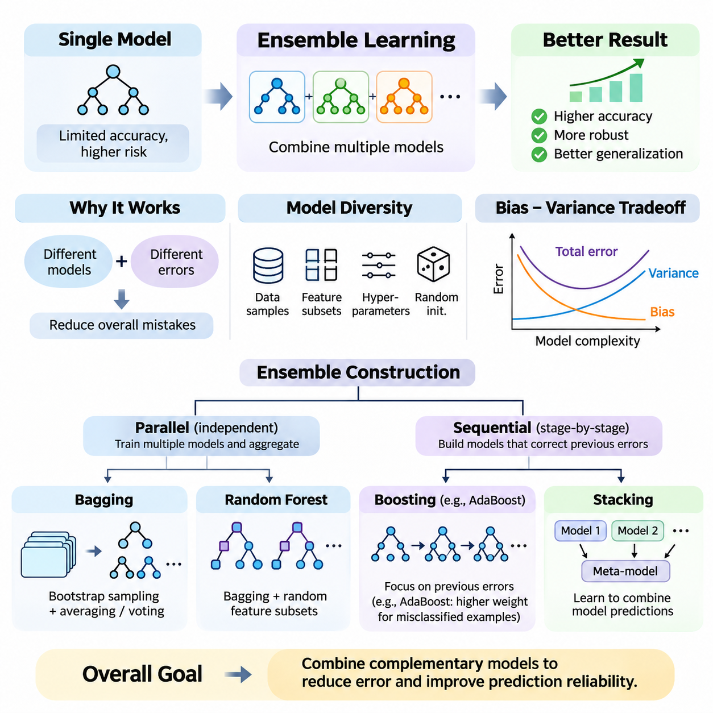
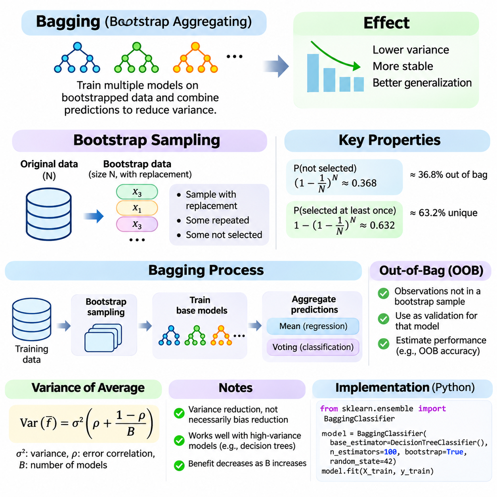
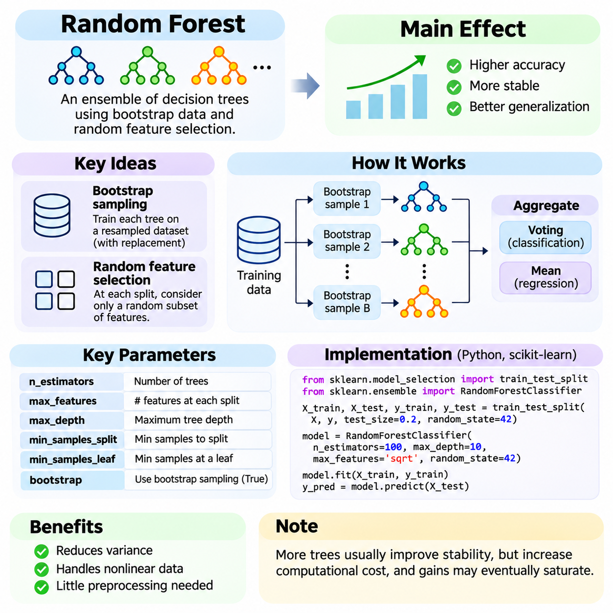
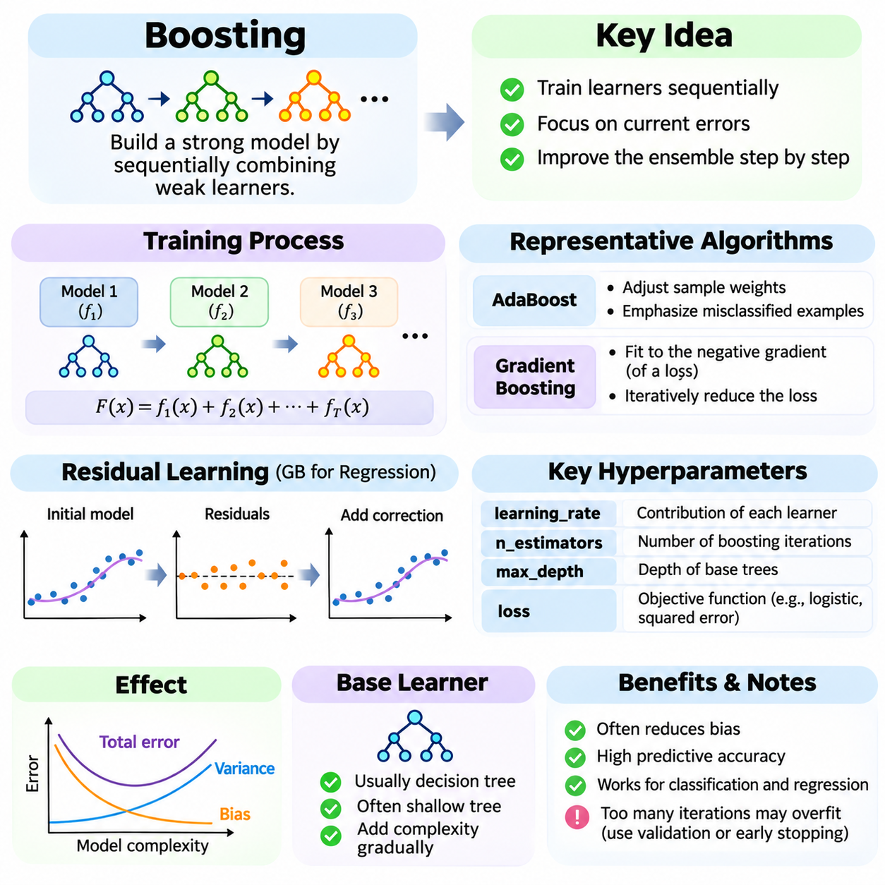
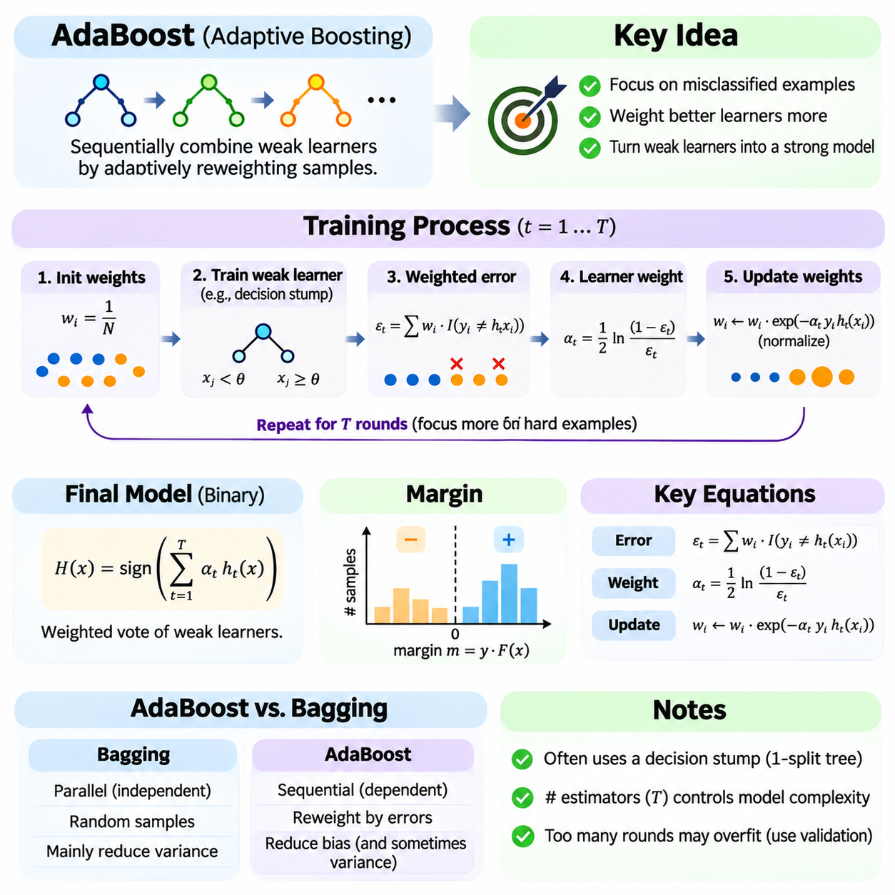
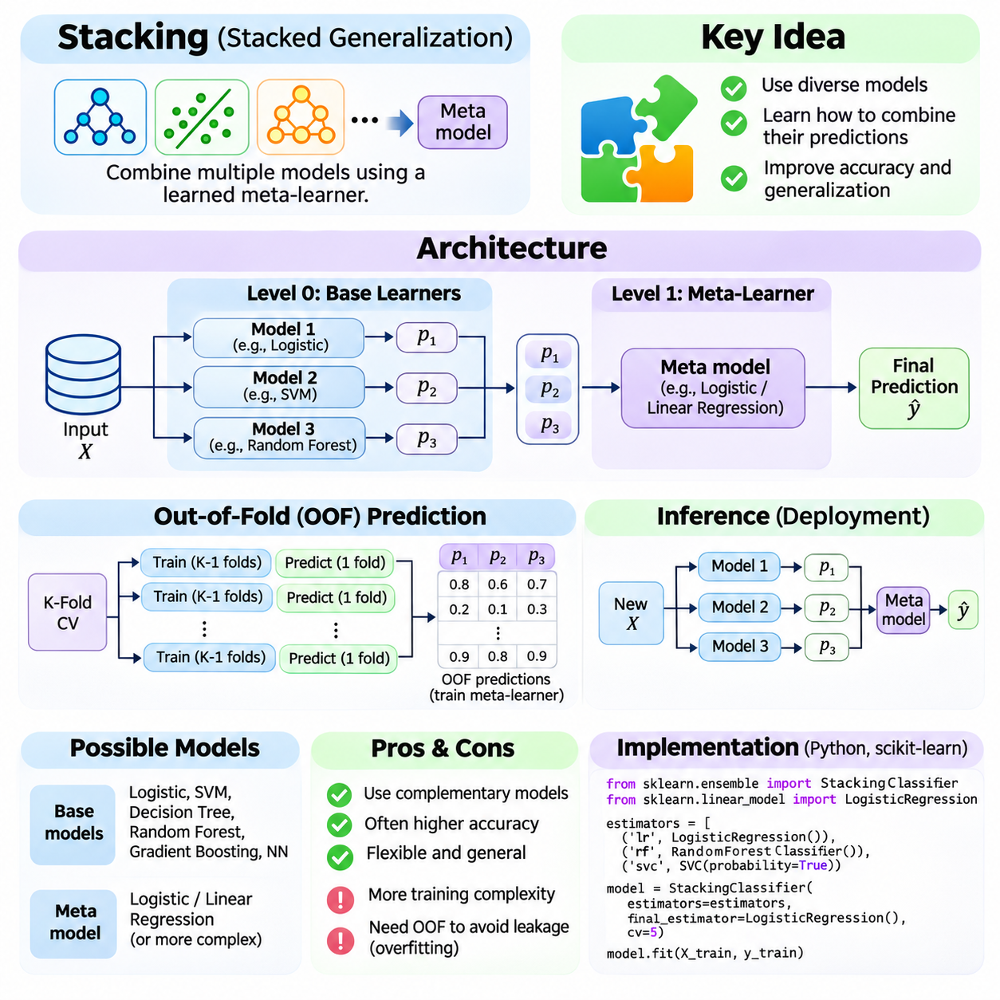
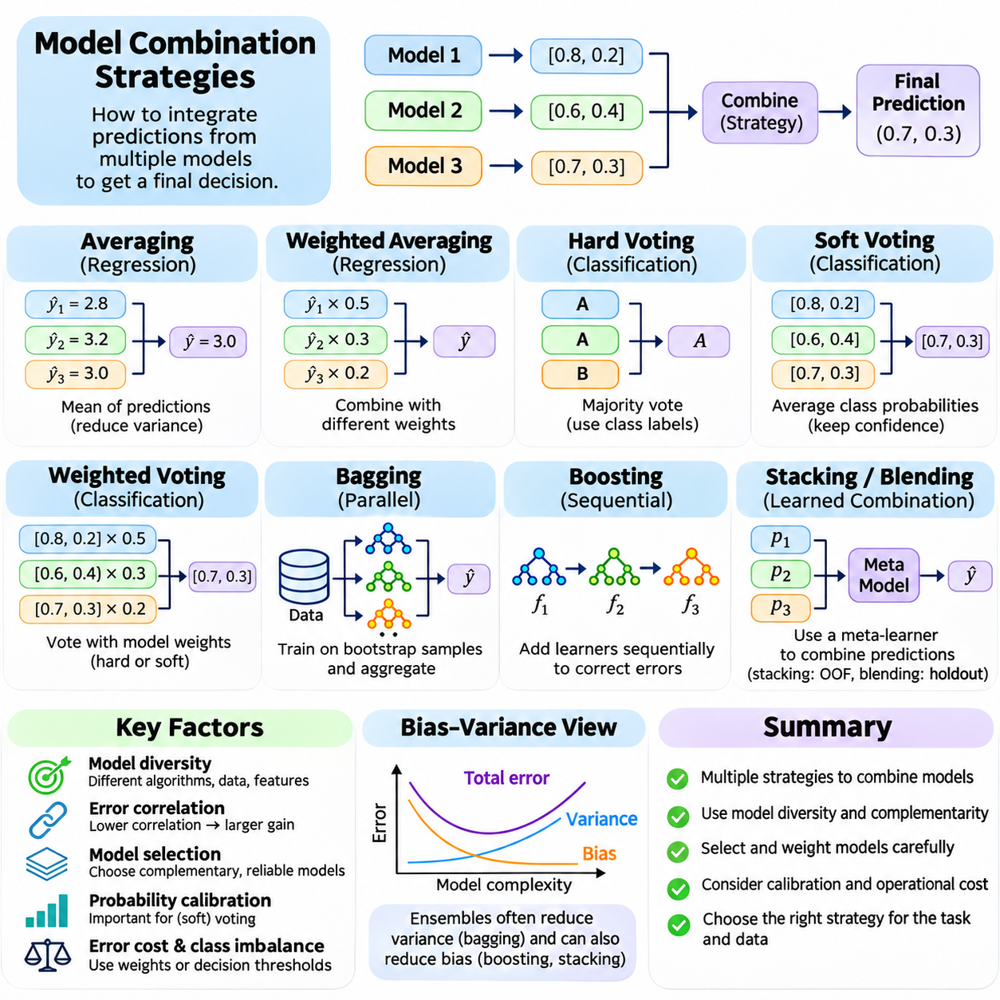
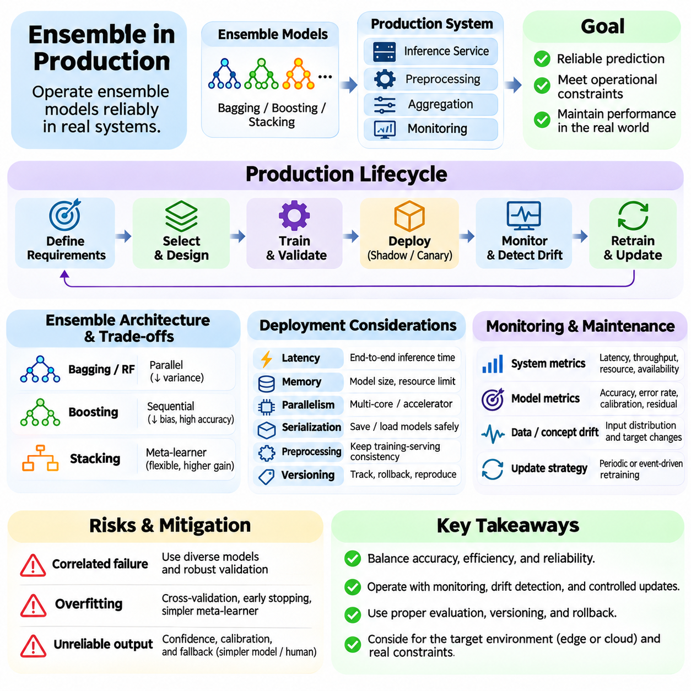

# 05. Ensemble Methods

## 05.00 Why Ensemble

{width="7.268055555555556in" height="7.268055555555556in"}

앙상블 학습(Ensemble Learning)은 여러 모델(Model)의 예측(Prediction)을 결합하여 일반적으로 단일 모델(Single Model)보다 신뢰할 수 있는 결과를 생성하는 기계학습(Machine Learning) 접근법이다. 하나의 학습 알고리즘(Learning Algorithm)에 전적으로 의존하는 대신, 앙상블은 서로 다른 강점과 약점을 가진 여러 예측기(Predictor)를 통합한다. 이러한 집단적 접근법은 예측 정확도(Predictive Accuracy), 강건성(Robustness), 일반화(Generalization) 성능을 향상시키는 데 효과적이다.

단일 기계학습 모델은 사용 가능한 학습 데이터(Training Data)의 제한된 표현(Representation)으로부터 패턴(Pattern)을 학습한다. 모델의 예측은 표본 변동(Sampling Variation), 측정 잡음(Measurement Noise), 부적절한 가정(Assumption), 최적화 한계(Optimization Limitation)의 영향을 받을 수 있다. 신중하게 학습된 모델이라도 입력 공간(Input Space)의 특정 영역에서 체계적인 오류(Systematic Error)를 발생시킬 수 있다. 앙상블 기법(Ensemble Method)은 하나의 모델에 의존하지 않고 상호 보완적인 예측을 결합하여 이러한 한계를 완화한다.

앙상블 학습의 근본적인 동기(Motivation)는 서로 다른 모델이 서로 다른 오류(Error)를 발생시킬 수 있다는 사실에 있다. 모델 간 오류가 충분히 다양하다면 예측을 결합하여 개별 오류의 영향을 줄일 수 있다. 예를 들어, 하나의 분류기(Classifier)는 특정 패턴을 정확하게 인식하는 반면 다른 분류기는 복잡한 결정 경계(Decision Boundary) 부근에서 더 우수한 성능을 보일 수 있다. 이들의 결합된 판단은 개별 예측보다 높은 신뢰성을 제공할 수 있다.

따라서 모델 다양성(Model Diversity)은 성공적인 앙상블 학습의 중요한 구성 요소이다. 다양성은 서로 다른 학습 표본(Training Sample), 특징 부분집합(Feature Subset), 알고리즘 계열(Algorithm Family), 하이퍼파라미터(Hyperparameter), 무작위 초기화(Random Initialization)에서 발생할 수 있다. 상호 보완적인 예측을 생성하기 위해 반드시 서로 다른 모델 구조(Architecture)가 필요한 것은 아니다. 동일한 결정 트리(Decision Tree) 알고리즘이라도 서로 다른 데이터 표본으로 학습하면 집단 성능을 향상시킬 만큼 다양한 결정 경계를 형성할 수 있다.

앙상블 학습의 통계적 기반(Statistical Foundation)은 편향-분산 절충(Bias-Variance Tradeoff)과 밀접하게 관련된다. 예측 오류(Prediction Error)는 체계적인 모델 가정, 학습 데이터에 대한 민감도(Sensitivity), 감소시킬 수 없는 잡음(Irreducible Noise)의 영향을 받는다. 일부 앙상블 기법은 주로 분산(Variance)을 감소시키는 반면, 다른 기법은 더욱 표현력이 높은 예측기를 구성하여 편향(Bias)을 줄일 수 있다. 이러한 관계를 이해하면 서로 다른 앙상블 전략이 특정 조건에서 효과적인 이유를 설명할 수 있다.

분산(Variance)은 학습 데이터셋(Training Dataset)이 변경될 때 모델의 예측이 얼마나 크게 변하는지를 나타낸다. 제한 없이 성장하는 결정 트리와 같은 고분산 모델(High-Variance Model)은 학습 사례에 지나치게 적합하면서 작은 표본 변화에도 불안정하게 반응할 수 있다. 여러 모델의 예측을 평균화(Averaging)하면 출력의 안정성을 높일 수 있다. 특히 모델 간 예측 오류의 상관관계(Correlation)가 낮을수록 분산 감소 효과가 커진다.

동일한 입력에 대해 여러 회귀 모델(Regression Model)이 예측값을 생성하는 상황을 고려할 수 있다. 각 모델의 오류가 실제 값 주변에서 독립적으로 변동한다면 예측값의 평균을 계산하여 무작위 변동(Random Variation)의 일부를 상쇄할 수 있다. 동일한 분산을 가진 독립적인 오류와 동일 가중치(Equal Weight)를 가정하면 평균 예측의 분산은 모델 수에 대략 반비례하여 감소한다. 그러나 오류 간 상관관계가 존재하면 이러한 이점은 제한된다.

편향(Bias)은 제한적인 가정이나 불충분한 모델 유연성(Model Flexibility)에서 발생하는 체계적인 오류를 의미한다. 비슷한 편향을 가진 여러 모델을 결합한다고 해서 공통적인 한계가 자동으로 제거되지는 않는다. 그러나 일부 앙상블 전략은 이전 예측의 오류를 수정하는 방법을 학습하여 예측 유연성을 향상시킨다. 이러한 원리는 이전 학습 단계에서 남아 있는 오류를 점진적으로 해결하는 순차적 접근법(Sequential Approach)의 기반이 된다.

앙상블 학습은 병렬 모델 구성(Parallel Model Construction)과 순차 모델 구성(Sequential Model Construction)의 차이를 통해 이해할 수 있다. 병렬 기법(Parallel Method)은 여러 예측기를 독립적으로 또는 제한적인 상호작용을 통해 학습한 다음 출력을 집계(Aggregation)한다. 순차 기법(Sequential Method)은 모델을 단계적으로 구성하여 후속 모델이 이전 모델의 약점에 대응하도록 한다. 두 접근법은 정확도 향상과 일반화 제어를 위한 서로 다른 메커니즘(Mechanism)을 제공한다.

배깅(Bagging), 즉 부트스트랩 집계(Bootstrap Aggregating)는 대표적인 병렬 앙상블 전략이다. 원본 학습 데이터에서 복원추출(Sampling with Replacement)을 수행하여 생성한 여러 데이터셋을 이용해 기본 학습기(Base Learner)를 학습한다. 각 학습기는 조금씩 다른 사례 집합을 경험하므로 예측 결과에 다양성이 발생한다. 이후 평균화(Averaging) 또는 투표(Voting)를 통해 출력을 결합하여 예측의 불안정성을 줄인다.

랜덤 포레스트(Random Forest)는 결정 트리 구성 과정에 추가적인 무작위성(Randomness)을 도입하여 이러한 원리를 확장한다. 부트스트랩 표본추출(Bootstrap Sampling)과 함께 개별 트리는 일반적으로 분할(Split)을 탐색할 때 무작위로 선택된 특징 부분집합을 평가한다. 이는 트리 간 유사성을 줄이고 다양한 결정 구조(Decision Structure)를 형성하도록 유도한다. 여러 트리의 예측을 집계하면 구조화된 분류(Classification) 및 회귀(Regression) 문제에서 우수한 성능을 얻을 수 있다.

부스팅(Boosting)은 연속적인 개선(Successive Improvement)을 통해 앙상블을 구성한다는 점에서 다른 철학을 따른다. 주로 독립적인 학습기에 의존하는 대신, 현재 앙상블과 관련된 오류 또는 최적화 목적(Optimization Objective)에 대응하는 모델을 순차적으로 구성한다. 추가되는 학습기는 결합된 예측을 개선하기 위한 정보를 제공한다. 결과적으로 완성된 모델은 개별 구성 요소보다 훨씬 높은 표현력(Expressive Power)을 가질 수 있다.

에이다부스트(AdaBoost)는 학습 사례의 중요도를 적응적으로 조정하는 방식으로 부스팅을 구현한다. 전통적인 분류(Classification) 공식에서는 잘못 분류된 사례에 후속 학습 단계에서 더 높은 상대적 중요도(Relative Importance)를 부여한다. 새로운 약한 학습기(Weak Learner)는 어려운 관측값에 더욱 집중한다. 각 학습기의 성능에 따라 결정된 가중치(Weight)를 이용해 예측을 결합함으로써 비교적 단순한 구성 요소로 강력한 분류기를 형성한다.

스태킹(Stacking)은 서로 다른 모델의 예측을 결합하는 방법 자체를 학습한다는 새로운 관점을 제공한다. 여러 기본 학습기(Base Learner)가 생성한 예측은 일반적으로 메타 학습기(Meta-Learner)라고 부르는 2차 모델(Secondary Model)의 입력으로 사용된다. 메타 학습기는 모델 출력과 목표값(Target Value) 사이의 관계를 학습한다. 학습 과정에서 정보 누출(Data Leakage)을 방지한다면 서로 다른 알고리즘의 상호 보완적인 강점을 효과적으로 활용할 수 있다.

스태킹의 효과는 메타 학습기를 학습하기 위한 예측을 생성하는 방식에 크게 의존한다. 기본 모델이 자신의 학습 데이터에 대해 생성한 예측을 그대로 사용하면 심각한 과적합(Overfitting)이 발생할 수 있다. 교차 검증(Cross-Validation)에 기반한 폴드 외 예측(Out-of-Fold Prediction)은 해당 관측값으로 학습하지 않은 모델이 예측을 생성하므로 더욱 신뢰할 수 있는 기반을 제공한다. 이러한 분리는 의미 있는 일반화 성능을 확보하는 데 중요하다.

앙상블 예측은 여러 집계 규칙(Aggregation Rule)을 사용하여 결합할 수 있다. 회귀 시스템(Regression System)은 일반적으로 수치 예측값의 평균을 계산하며, 개별 모델에 서로 다른 가중치를 부여하기도 한다. 분류 시스템(Classification System)은 다수결 투표(Majority Voting), 가중 투표(Weighted Voting), 예측 클래스 확률(Predicted Class Probability)의 평균을 사용할 수 있다. 적절한 결합 전략은 예측 품질, 보정(Calibration), 오류 간 관계 및 응용 요구사항에 따라 달라진다.

다수결 투표(Majority Voting)는 참여하는 분류기 중 가장 많은 모델이 선택한 클래스를 최종 결과로 결정한다. 이 방법은 직관적이며 개별 분류기의 정확도가 적절하고 서로 다른 오류를 충분히 발생시킬 때 효과적이다. 그러나 다수결 투표는 모델별 신뢰도(Confidence)나 신뢰성(Reliability)의 차이를 고려하지 않는다. 유사한 약한 분류기가 다수 존재하는 경우, 다양성이 높은 소수의 모델보다 기여도가 낮을 수 있다.

확률 평균화(Probability Averaging)는 이산적인 클래스 레이블(Class Label) 대신 추정된 클래스 확률(Class Probability)을 결합한다. 이 방법은 유용한 신뢰도 정보를 보존하고 더욱 부드러운 집계 예측을 생성할 수 있다. 그러나 일부 모델이 지나치게 높은 확신을 나타내는 경우, 보정되지 않은 확률(Poorly Calibrated Probability)이 결과를 왜곡할 수 있다. 확률 보정(Probability Calibration)과 검증 기반 가중치(Validation-Based Weighting)는 신뢰도 추정이 중요한 응용 분야에서 예측의 신뢰성을 향상시킬 수 있다.

앙상블 기법은 복잡한 상호작용(Complex Interaction), 비선형 관계(Nonlinear Relationship), 상당한 표본 불확실성(Sampling Uncertainty)이 존재하는 예측 문제에서 특히 유용하다. 서로 다른 학습기는 이러한 패턴의 각기 다른 측면을 포착할 수 있다. 출력을 결합하면 특정 모델링 가정(Modeling Assumption)에 대한 의존도를 줄일 수 있다. 이러한 유연성은 정형 데이터 분류(Tabular Classification), 회귀, 예측(Forecasting), 산업 분석(Industrial Analytics)에서 앙상블이 널리 활용되는 이유를 설명한다.

산업용 예지보전(Predictive Maintenance)에서는 여러 모델이 진동(Vibration), 온도(Temperature), 전류(Electrical Current), 운전 이력(Operating History)을 분석하여 장비 고장 위험(Failure Risk)을 추정할 수 있다. 하나의 모델은 점진적인 열화(Gradual Degradation)를 식별하고 다른 모델은 비정상적인 센서 측정 조합을 탐지할 수 있다. 이러한 예측을 결합하면 다양한 운전 조건에서 강건성을 향상시킬 수 있다. 그러나 공통적인 센서 고장이나 체계적인 데이터 오류는 모든 참여 모델에 영향을 줄 수 있다.

자율 로봇(Autonomous Robotics)에서 앙상블 기법은 인지 신뢰도 추정(Perception Confidence Estimation), 지형 분류(Terrain Classification), 장비 상태 감시(Condition Monitoring)를 지원할 수 있다. 서로 다른 예측기는 조명 변화(Illumination Change), 센서 잡음(Sensor Noise), 환경 변화(Environmental Variation)에 다르게 반응할 수 있다. 결합된 예측은 후속 의사결정(Downstream Decision)에 추가적인 근거를 제공한다. 그러나 앙상블의 일치만으로 안전성이 보장되지는 않으며, 실시간 배포(Real-Time Deployment)에서는 지연시간(Latency)과 계산 비용(Computational Cost)을 신중하게 평가해야 한다.

앙상블 학습의 중요한 한계는 모델을 추가한다고 해서 반드시 성능이 향상되는 것은 아니라는 점이다. 참여하는 예측기가 거의 동일한 오류를 발생시키면 집계의 이점은 제한적이다. 마찬가지로 성능이 낮은 모델을 적절한 제어 없이 포함하면 전체 정확도가 감소할 수 있다. 따라서 앙상블 구성(Ensemble Construction)에서는 모델 품질(Model Quality), 예측 다양성(Prediction Diversity), 오류 사이의 통계적 관계(Statistical Relationship)를 신중하게 고려해야 한다.

계산 복잡도(Computational Complexity) 역시 중요한 실무적 고려사항이다. 많은 모델을 학습하려면 상당한 처리 시간(Processing Time), 메모리(Memory), 저장 공간(Storage)이 필요할 수 있다. 추론(Inference) 과정에서 일부 앙상블은 최종 예측을 생성하기 전에 모든 참여 모델을 실행해야 한다. 이는 특히 임베디드 하드웨어(Embedded Hardware)에서 지연시간과 에너지 소비(Energy Consumption)를 증가시킬 수 있다. 따라서 모델 선택에서는 예측 성능 향상과 배포 제약(Deployment Constraint) 사이의 균형이 필요하다.

예측이 여러 학습기의 복잡한 상호작용에 의존하면 해석 가능성(Interpretability)도 낮아질 수 있다. 단일 결정 트리는 비교적 투명한 의사결정 순서(Decision Sequence)를 제공하지만, 대규모 포레스트(Forest)나 부스팅 앙상블은 직접 설명하기 어렵다. 특징 중요도(Feature Importance), 순열 분석(Permutation Analysis), 국소 설명 기법(Local Explanation Method)은 모델 동작을 분석하는 데 도움이 된다. 그러나 이러한 설명은 각 기법의 한계를 고려하여 해석해야 한다.

신뢰할 수 있는 앙상블 평가(Ensemble Evaluation)를 위해서는 학습 데이터(Training Data), 검증 데이터(Validation Data), 테스트 데이터(Test Data)를 적절하게 분리해야 한다. 하이퍼파라미터, 모델 가중치, 결합 전략은 최종 테스트 데이터에 접근하지 않고 학습 및 검증 정보를 이용하여 선택해야 한다. 개발 과정에서 테스트를 반복하면 실제보다 낙관적인 성능 추정(Optimistic Performance Estimate)이 발생할 수 있다. 앙상블의 개선 효과가 실제 일반화 성능을 반영하는지 판단하려면 체계적인 평가 절차(Evaluation Procedure)가 필요하다.

단일 모델과 앙상블 중 무엇을 선택할지는 구조적 복잡성(Architectural Complexity) 자체보다 측정 가능한 이점(Measurable Benefit)에 따라 결정해야 한다. 해석 가능성, 지연시간, 유지보수(Maintenance), 제한된 계산 자원(Computing Resource)이 중요한 환경에서는 단순한 모델이 더 적합할 수 있다. 앙상블은 정확도, 안정성(Stability), 강건성의 개선 효과가 추가적인 복잡성을 정당화할 때 매력적인 선택이 된다. 최종 결정은 운영 목표(Operational Objective)와 검증된 성능(Validated Performance)을 반영해야 한다.

앙상블 학습은 여러 불완전한 모델을 조정하여 활용함으로써 예측 지능(Predictive Intelligence)을 향상시킬 수 있음을 보여준다. 핵심적인 장점은 단순히 예측기의 수를 늘리는 것이 아니라 모델 간 차이를 유용한 집단적 동작(Collective Behavior)으로 조직하는 데 있다. 배깅(Bagging), 랜덤 포레스트(Random Forest), 부스팅(Boosting), 스태킹(Stacking)은 이러한 원리를 서로 다른 메커니즘으로 구현하며, 현대 앙상블 기반 지도학습(Ensemble-Based Supervised Learning) 시스템을 이해하기 위한 기초를 제공한다.

## 05.01 Bagging

{width="7.268055555555556in" height="7.268055555555556in"}

배깅(Bagging)은 부트스트랩 집계(Bootstrap Aggregating)의 약자로, 동일한 데이터셋(Dataset)의 서로 다른 버전에서 여러 모델(Model)을 학습시켜 예측 안정성(Predictive Stability)을 향상시키는 앙상블 학습(Ensemble Learning) 기법이다. 단일 예측기(Single Predictor)에 의존하는 대신 여러 기본 학습기(Base Learner)를 구성하고 출력을 결합한다. 주요 목적은 원본 학습 데이터(Training Data)에서 학습한 유용한 패턴을 유지하면서 예측 분산(Prediction Variance)을 감소시키는 것이다.

배깅의 핵심적인 동기(Motivation)는 많은 기계학습 알고리즘(Machine Learning Algorithm)이 학습 표본(Training Sample)의 변화에 민감하다는 점이다. 예를 들어 결정 트리(Decision Tree)는 일부 관측값(Observation)만 변경되어도 상당히 다른 구조를 생성할 수 있다. 이러한 불안정성은 과적합(Overfitting)과 신뢰할 수 없는 예측으로 이어질 수 있다. 배깅은 독립적으로 생성된 부트스트랩 표본(Bootstrap Sample)으로 학습한 모델들의 동작을 평균화하여 이러한 민감도를 줄인다.

부트스트랩 표본추출(Bootstrap Sampling)은 기존 데이터셋에서 관측값을 복원추출(Sampling with Replacement)하여 새로운 데이터셋을 생성하는 통계적 재표본추출(Statistical Resampling) 절차이다. 선택된 관측값은 다음 추출 전에 다시 표본 집합(Sampling Pool)으로 반환된다. 따라서 하나의 부트스트랩 표본에는 특정 관측값이 여러 번 포함될 수 있으며, 일부 관측값은 전혀 포함되지 않을 수 있다. 이러한 메커니즘은 추가적인 데이터 수집 없이 서로 다른 학습 데이터셋을 생성한다.

N개의 관측값을 포함하는 원본 데이터셋을 고려할 수 있다. 표준 부트스트랩 표본(Standard Bootstrap Sample)은 해당 관측값에서 복원추출을 통해 N번의 독립적인 선택을 수행하여 구성된다. 결과적으로 생성된 표본에는 N개의 항목이 포함되지만, 일반적으로 고유한 관측값(Unique Observation)의 수는 N보다 작다. N이 충분히 커지면 서로 다른 관측값의 기대 비율(Expected Proportion)은 약 63.2%에 접근하며, 나머지 관측값은 해당 표본에서 제외된다.

특정 관측값이 한 번의 부트스트랩 추출에서 선택되지 않을 확률(Probability)은 1 - 1/N이다. N번의 독립적인 추출 이후에도 선택되지 않을 확률은 (1 - 1/N)\^N으로 표현된다. N이 증가하면 이 식은 e\^-1, 즉 약 0.368에 접근한다. 따라서 개별 부트스트랩 표본에서는 약 36.8%의 관측값이 제외될 것으로 기대되며, 이는 배깅 모델의 배깅 외 평가(Out-of-Bag Evaluation)를 수행하는 통계적 기반이 된다.

배깅 외 관측값(Out-of-Bag Observation)은 특정 부트스트랩 표본에 선택되지 않은 학습 사례를 의미한다. 해당 기본 학습기는 이러한 관측값을 학습에 사용하지 않았으므로 검증 사례(Validation Example)로 활용할 수 있다. 각 관측값이 학습에 포함되지 않았던 모델들의 예측을 수집하면, 별도의 검증 부분집합(Validation Subset)을 특별히 확보하지 않고도 앙상블의 일반화 성능(Generalization Performance)을 추정할 수 있다.

배깅 외 평가(Out-of-Bag Evaluation)는 사용 가능한 학습 데이터셋이 상대적으로 작을 때 특히 유용하다. 각 관측값은 자신을 학습에 포함하지 않았던 여러 모델에 의해 평가될 수 있다. 이러한 예측을 집계(Aggregation)하고 실제 목표값(True Target Value)과 비교하여 성능을 추정한다. 그러나 배깅 외 추정값(Out-of-Bag Estimate)은 통계적 근사치(Statistical Approximation)이므로, 신뢰할 수 있는 배포 평가(Deployment Evaluation)가 필요한 경우 독립적인 테스트(Independent Testing)를 자동으로 대체해서는 안 된다.

배깅의 학습 과정(Training Process)은 기본 학습 알고리즘(Base Learning Algorithm)과 미리 정의된 추정기 수(Number of Estimators)를 설정하는 것으로 시작한다. 각 추정기(Estimator)에 대해 원본 학습 데이터셋에서 부트스트랩 표본을 생성한다. 이후 해당 표본을 이용하여 학습 알고리즘의 독립적인 인스턴스(Instance)를 학습시킨다. 부트스트랩 표본이 서로 다르므로 동일한 알고리즘 설정을 사용하더라도 결과 모델은 일반적으로 서로 다른 결정 구조(Decision Structure)를 학습한다.

학습이 완료되면 배깅은 개별 추정기의 예측을 결합한다. 회귀 작업(Regression Task)에서는 일반적으로 수치 예측값(Numerical Prediction)의 산술평균(Arithmetic Mean)을 계산한다. 분류 작업(Classification Task)에서는 다수결 투표(Majority Voting) 또는 예측 클래스 확률(Predicted Class Probability)의 평균을 사용할 수 있다. 이러한 집계 과정은 개별 모델이 생성한 비정상적인 예측의 영향을 줄이고 다양한 입력에 대해 더욱 안정적인 집단 출력을 생성한다.

배깅을 통해 달성되는 분산 감소(Variance Reduction)는 기본 학습기 사이의 오류 상관관계(Error Correlation)에 크게 의존한다. 개별 모델이 동일한 분산을 가진 독립적인 오류를 생성한다면 B개 모델의 예측을 평균화할 때 분산은 B분의 1로 감소한다. 오류 사이에 상관관계가 존재하면 감소 효과는 작아진다. 따라서 배깅은 개별적으로 유용하면서도 예측 동작(Prediction Behavior)이 충분히 다른 기본 학습기에서 더 큰 이점을 얻는다.

단순화된 분산 식(Variance Expression)은 이러한 관계를 설명한다. 각 추정기의 분산이 시그마 제곱(Sigma Squared)이고 모든 추정기 쌍의 상관계수(Correlation Coefficient)가 로(Rho)라면, 평균 예측의 분산은 시그마 제곱에 로와 (1-로)/B의 합을 곱한 값과 같다. 추정기 수가 증가하면 독립적인 성분(Independent Component)은 감소하지만 상관된 성분(Correlated Component)은 남는다. 이는 앙상블 크기(Ensemble Size)를 늘릴수록 성능 향상 폭이 점차 감소하는 이유를 설명한다.

결정 트리(Decision Tree)는 일반적으로 높은 분산(High Variance)을 나타내므로 배깅의 기본 학습기로 특히 적합하다. 깊은 결정 트리(Deep Decision Tree)는 개별 학습 관측값에 매우 밀접하게 적응하여 데이터셋에 따라 크게 달라지는 복잡한 결정 경계(Decision Boundary)를 생성할 수 있다. 여러 부트스트랩 표본으로 트리를 학습하고 예측을 평균화하면 비선형 관계(Nonlinear Relationship)와 특징 간 상호작용(Feature Interaction)을 표현하는 능력을 유지하면서 불안정성을 줄일 수 있다.

배깅이 반드시 체계적인 편향(Systematic Bias)을 감소시키는 것은 아니다. 모든 기본 학습기가 제한적인 가정(Restrictive Assumption)이나 불충분한 예측 능력(Predictive Capacity) 때문에 유사한 오류를 발생시킨다면 집계만으로 공통적인 한계를 제거할 수 없다. 예를 들어 심각하게 과소적합(Underfitting)된 모델을 다수 결합하면 안정적이지만 부정확한 예측기가 생성될 수 있다. 따라서 배깅은 분산이 예측 오류의 중요한 구성 요소일 때 가장 효과적이다.

배깅 구현(Implementation)에서는 일반적으로 기본 추정기(Base Estimator), 앙상블 크기, 부트스트랩 표본추출 설정(Bootstrap Sampling Configuration), 난수 시드(Random Seed)를 정의해야 한다. 파이썬(Python)의 사이킷런(scikit-learn)은 분류와 회귀 작업을 위한 BaggingClassifier와 BaggingRegressor를 제공한다. 이러한 구현은 부트스트랩 생성, 추정기 학습, 예측 집계를 자동화한다. 설정 가능한 매개변수(Parameter)를 통해 개발자는 계산 요구사항과 모델 다양성을 제어할 수 있다.

일반적인 분류 구현(Classification Implementation)은 특징 행렬(Feature Matrix)과 목표 레이블(Target Label)을 준비한 다음 데이터를 학습 부분집합(Training Subset)과 테스트 부분집합(Test Subset)으로 분리하는 것으로 시작한다. 결정 트리 분류기(Decision Tree Classifier)를 기본 추정기로 선택하여 BaggingClassifier에 전달할 수 있다. 추정기 수는 부트스트랩으로 학습되는 모델의 개수를 결정한다. 고정된 random_state는 관련된 무작위 표본추출을 제어하여 재현성(Reproducibility)을 지원한다.

bootstrap 매개변수는 학습 관측값을 복원추출할지 결정한다. bootstrap이 활성화되면 각 추정기는 반복된 관측값을 포함할 수 있는 무작위 표본을 전달받는다. max_samples 매개변수는 각 추정기에 선택되는 관측값의 수 또는 비율을 제어한다. 작은 표본은 다양성을 증가시킬 수 있지만, 표본 크기가 지나치게 제한되면 개별 학습기의 성능이 약화되어 예측 정확도(Predictive Accuracy)가 감소할 수 있다.

특징 표본추출(Feature Sampling)은 배깅 앙상블에 다양성을 도입하는 또 다른 메커니즘이다. max_features 매개변수는 각 추정기가 사용할 수 있는 입력 특징(Input Feature)의 수를 결정한다. bootstrap_features가 활성화되면 특징 표본추출도 복원추출 방식으로 수행된다. 관측값 표본추출과 특징 표본추출을 결합하면 학습기 간 유사성을 줄일 수 있지만, 지나치게 강한 특징 제한(Feature Restriction)은 중요한 예측 정보를 제거할 수 있다.

추정기 수(Number of Estimators)는 안정성, 계산 비용(Computational Cost), 예측 성능(Predictive Performance)에 영향을 미치는 중요한 하이퍼파라미터(Hyperparameter)이다. 앙상블 크기를 증가시키면 특히 초기 확장 단계에서 집계된 예측의 무작위 변동(Random Fluctuation)이 일반적으로 감소한다. 그러나 추정기가 추가될수록 성능 개선 효과는 점차 작아지는 경우가 많다. 따라서 모델 수를 무조건 늘리기보다 검증 결과(Validation Result)를 바탕으로 앙상블 크기를 결정해야 한다.

배깅은 개별 추정기를 일반적으로 독립적으로 학습할 수 있으므로 병렬 계산(Parallel Computation)을 지원한다. 현대 기계학습 라이브러리(Machine Learning Library)는 추정기 학습을 여러 중앙처리장치 코어(CPU Core) 또는 계산 작업자(Computing Worker)에 분산할 수 있다. 충분한 자원이 제공되면 이러한 병렬 구조는 학습 시간(Training Time)을 단축할 수 있다. 그러나 앙상블 크기가 증가하면 메모리 사용량(Memory Consumption)과 데이터 관리 오버헤드(Data Management Overhead)가 증가하여 실제 확장성(Scalability)을 제한할 수 있다.

구현 품질(Implementation Quality)은 전처리 일관성(Preprocessing Consistency)에도 의존한다. 결측값 처리(Missing-Value Handling), 특징 변환(Feature Transformation), 범주형 인코딩(Categorical Encoding) 및 기타 전처리 작업은 선택한 기본 추정기와 호환되어야 한다. 데이터로부터 매개변수를 학습하는 변환은 평가용 보류 데이터(Held-Out Evaluation Data)에 접근하지 않고 적합(Fitting)되어야 한다. 적절한 파이프라인(Pipeline) 구성은 데이터 누출(Data Leakage)을 방지하고 보고된 앙상블 성능이 정당한 일반화 능력을 반영하도록 한다.

모델 평가(Model Evaluation)에서는 배깅을 적절한 단일 추정기 기준 모델(Single-Estimator Baseline)과 비교해야 한다. 분류 성능은 정확도(Accuracy), 정밀도(Precision), 재현율(Recall), F1 점수(F1-Score), 수신자 조작 특성 분석(Receiver Operating Characteristic Analysis)을 사용하여 평가할 수 있다. 회귀 성능은 평균절대오차(Mean Absolute Error), 평균제곱오차(Mean Squared Error), 결정계수(Coefficient of Determination)로 측정할 수 있다. 학습 및 테스트 결과를 비교하면 분산 감소가 의미 있는 개선으로 이어지는지 판단할 수 있다.

교차 검증(Cross-Validation)은 배깅 성능을 평가하는 또 다른 신뢰할 수 있는 방법이다. 학습 데이터셋을 여러 폴드(Fold)로 나누고 서로 다른 학습-검증 분할(Training-Validation Partition)을 사용하여 앙상블을 반복적으로 학습한다. 평가 점수(Evaluation Score)를 집계하여 예측 성능과 변동성(Variability)을 추정한다. 하이퍼파라미터를 조정하는 경우 중첩 검증(Nested Validation) 또는 별도의 최종 테스트 데이터셋(Final Test Dataset)을 사용하면 반복적인 모델 선택으로 인한 낙관적인 성능 추정을 방지하는 데 도움이 된다.

배깅은 표본 변동(Sampling Fluctuation)에 대한 강건성(Robustness)을 향상시킬 수 있지만, 손상된 레이블(Corrupted Label), 분포 변화(Distribution Shift), 체계적인 측정 오류(Systematic Measurement Error)를 자동으로 해결하지는 못한다. 부트스트랩 표본은 동일한 원본 데이터셋에서 생성되므로 원본 데이터의 한계를 그대로 상속한다. 중요한 운전 조건(Operating Condition)이 원본 관측값에 포함되지 않았다면 추가적인 부트스트랩 표본을 생성하더라도 누락된 조건에 관한 실제 정보를 만들어낼 수 없다.

산업 응용(Industrial Application)에서 배깅은 장비 고장 예측(Equipment Failure Prediction), 품질 검사(Quality Inspection), 센서 기반 분류(Sensor-Based Classification)를 지원할 수 있다. 서로 다른 부트스트랩 표본으로 학습한 여러 결정 트리는 온도, 진동, 압력, 운전 측정값 사이의 상호 보완적인 관계를 식별할 수 있다. 이러한 예측을 집계하면 개별 학습 관측값에 대한 민감도를 줄일 수 있으며, 운전 데이터에 적당한 수준의 표본 변동이 존재하는 경우 신뢰성을 향상시킬 수 있다.

엣지 컴퓨팅(Edge Computing)과 자율 시스템(Autonomous System)에서 배깅은 예측 안정성과 자원 소비(Resource Consumption) 사이의 절충 관계(Tradeoff)를 발생시킨다. 많은 추정기를 실행하면 추론 지연시간(Inference Latency), 메모리 사용량, 에너지 수요(Energy Demand)가 증가할 수 있다. 개발자는 앙상블 크기를 줄이거나 트리 깊이(Tree Depth)를 제한하고 계산 효율적인 기본 학습기를 선택할 수 있다. 이러한 조정은 정확도 요구사항(Accuracy Requirement)과 실시간 실행 제약(Real-Time Execution Constraint)을 기준으로 평가해야 한다.

실용적인 배깅 실험(Practical Bagging Experiment)에서는 앙상블 크기, 표본 비율(Sample Fraction), 트리 복잡도(Tree Complexity), 특징 표본추출이 성능에 미치는 영향을 조사해야 한다. 단일 결정 트리를 학습하여 기준 성능(Baseline Performance)을 설정하고, 점진적으로 더 큰 앙상블을 구성하여 집계의 이점을 확인할 수 있다. 정확도, 반복 실험 간 분산, 학습 시간, 추론 지연시간을 기록하면 배깅 기법의 운영 특성(Operational Characteristic)을 더욱 종합적으로 이해할 수 있다.

배깅은 통계적 재표본추출(Statistical Resampling)과 집단 예측(Collective Prediction)을 통해 불안정한 학습 알고리즘을 더욱 신뢰할 수 있는 예측 시스템(Predictive System)으로 전환할 수 있음을 보여준다. 부트스트랩 표본추출은 다양성을 생성하고, 독립적인 모델 학습은 서로 다른 패턴을 포착하며, 집계는 개별 추정기에 대한 민감도를 감소시킨다. 이러한 메커니즘을 이해하는 것은 배깅을 효과적으로 구현하고, 추가적인 특징 수준 무작위성(Feature-Level Randomness)을 통해 이를 확장한 랜덤 포레스트(Random Forest)를 학습하기 위한 기초가 된다.

## 05.02 Random Forest

{width="7.268055555555556in" height="7.268055555555556in"}

랜덤 포레스트(Random Forest)는 여러 결정 트리(Decision Tree)를 결합하여 예측 정확도(Predictive Accuracy), 안정성(Stability), 일반화(Generalization) 성능을 향상시키는 앙상블 학습(Ensemble Learning) 알고리즘이다. 학습 데이터 선택(Training Data Selection)과 특징 선택(Feature Selection)에 무작위성(Randomness)을 도입하여 부트스트랩 집계(Bootstrap Aggregating)를 확장한다. 단일 결정 트리에 의존하는 대신 독립적으로 구성된 여러 트리의 예측을 집계하여 개별 학습 관측값에 대한 민감도를 감소시킨다.

단일 결정 트리(Single Decision Tree)는 특징 공간(Feature Space)을 목표값(Target Value) 또는 클래스 레이블(Class Label)과 연결된 영역으로 재귀적으로 분할한다. 이러한 구조는 비선형 관계(Nonlinear Relationship)와 복잡한 특징 간 상호작용(Feature Interaction)을 표현할 수 있지만, 깊은 트리(Deep Tree)는 높은 분산(High Variance)을 나타내는 경우가 많다. 학습 데이터의 작은 변화도 상당히 다른 결정 경계(Decision Boundary)를 생성할 수 있다. 랜덤 포레스트는 다양한 트리의 예측을 결합하여 이러한 불안정성을 완화한다.

랜덤 포레스트의 기본 원리는 개별적으로 유용하면서도 서로 지나치게 높은 상관관계(Correlation)를 갖지 않는 결정 트리 집합을 생성하는 것이다. 각 트리는 무작위화된 학습 표본(Randomized Training Sample)으로부터 학습하며, 추가적인 무작위성이 분할 과정의 특징 선택에 영향을 준다. 이러한 메커니즘은 서로 다른 트리가 대안적인 패턴을 발견하도록 유도한다. 예측을 집계하면 불안정한 개별 판단의 영향을 줄일 수 있다.

부트스트랩 표본추출(Bootstrap Sampling)은 일반적으로 각 트리의 학습 데이터셋을 구성하는 데 사용된다. N개의 관측값을 포함하는 원본 데이터셋이 주어지면, 복원추출(Sampling with Replacement)을 통해 N개의 관측값을 선택하여 부트스트랩 표본을 생성한다. 일부 관측값은 여러 번 포함되지만 다른 관측값은 선택되지 않는다. 따라서 각 트리는 학습 데이터의 서로 다른 표현(Representation)을 전달받으며, 이는 앙상블 전체의 다양성(Diversity)에 기여한다.

무작위 특징 선택(Random Feature Selection)은 부트스트랩 표본추출 이외에 추가적인 다양성을 제공한다. 각 후보 분할(Candidate Split)에서 트리는 모든 특징을 고려하는 대신 무작위로 선택된 특징 부분집합(Feature Subset)만 평가한다. 이는 예측력이 높은 변수(Predictive Variable)가 모든 트리에서 동일한 방식으로 지배적인 영향을 미치는 것을 방지한다. 결과적으로 서로 다른 트리는 유용한 예측 정보를 유지하면서 대안적인 구조를 형성할 수 있다.

max_features 하이퍼파라미터(Hyperparameter)는 최적 분할(Best Split)을 탐색할 때 고려하는 특징의 수를 제어한다. 작은 값은 일반적으로 무작위성을 증가시키고 트리 간 상관관계를 감소시키지만, 개별 예측기의 성능을 약화시킬 수 있다. 큰 값은 더 많은 후보 특징을 고려하도록 하지만 트리 구조 사이의 유사성을 증가시킬 수 있다. 적절한 설정값은 데이터셋, 작업 유형(Task Type), 검증 결과(Validation Result)에 따라 달라진다.

랜덤 포레스트 분류(Random Forest Classification)는 개별 결정 트리의 예측을 결합하여 최종 클래스를 결정한다. 일반적인 개념적 접근법은 가장 많은 표를 얻은 클래스를 선택하는 다수결 투표(Majority Voting)이다. 사이킷런(scikit-learn)의 RandomForestClassifier는 개별 트리의 클래스 확률 추정값(Class Probability Estimate)을 평균화한 후 평균 확률이 가장 높은 클래스를 선택한다. 이러한 차이는 모델 동작(Model Behavior)을 해석할 때 중요하다.

회귀 작업(Regression Task)에서 랜덤 포레스트는 여러 회귀 트리(Regression Tree)의 수치 예측값(Numerical Prediction)을 결합한다. 각 트리는 입력 관측값이 속한 말단 리프(Terminal Leaf)를 기반으로 연속적인 목표값(Continuous Target Value)을 추정한다. 앙상블은 이러한 추정값의 산술평균(Arithmetic Mean)을 계산한다. 평균화는 개별 트리의 예측에 대한 민감도를 줄이며, 기본 관계가 비선형이거나 상호작용을 포함할 때 안정성을 향상시킬 수 있다.

랜덤 포레스트의 효과는 분산 감소(Variance Reduction)와 밀접하게 관련된다. 여러 트리의 예측을 평균화하면 학습 표본의 변화(Training Sample Variation)로 인해 발생하는 변동을 줄일 수 있다. 그러나 이러한 이점은 트리 오류(Tree Error) 사이의 상관관계에 따라 달라진다. 무작위 특징 선택은 이러한 상관관계를 감소시키므로, 매우 유사한 트리만 사용하는 경우보다 집계를 통한 분산 감소 효과를 높일 수 있다.

랜덤 포레스트는 명시적인 다항식 변환(Polynomial Transformation)이나 수동으로 지정한 상호작용 항(Interaction Term) 없이도 비선형 관계를 모델링할 수 있다. 결정 트리는 관측된 패턴에 따라 특징 공간을 자연스럽게 분할한다. 여러 트리를 결합하면 복잡한 관계를 표현할 수 있는 유연한 예측 함수(Prediction Function)가 생성된다. 따라서 랜덤 포레스트는 다양한 예측 신호(Predictive Signal)를 포함하는 구조화된 데이터셋(Structured Dataset)에 특히 유용하다.

파이썬(Python)에서는 일반적으로 사이킷런 라이브러리의 RandomForestClassifier 또는 RandomForestRegressor를 사용하여 구현한다. 이러한 클래스는 앙상블 크기(Ensemble Size), 트리 복잡도(Tree Complexity), 특징 표본추출(Feature Sampling), 부트스트랩 동작(Bootstrap Behavior), 병렬 실행(Parallel Execution)을 설정할 수 있는 매개변수를 제공한다. 일반적인 구현에서는 특징 행렬(Feature Matrix)과 목표 레이블(Target Label)을 준비하고, 데이터셋을 학습 및 테스트 부분집합으로 분할한 다음 추정기를 생성하여 학습시킨다.

분류 구현(Classification Implementation)은 RandomForestClassifier와 train_test_split을 가져오는 것으로 시작할 수 있다. 데이터셋을 불러온 후 특징 행렬 X와 목표 벡터(Target Vector) y를 학습 및 테스트 부분집합으로 분리한다. n_estimators, max_depth, random_state와 같은 하이퍼파라미터를 설정하여 RandomForestClassifier 인스턴스(Instance)를 생성한다. fit 메서드(Method)를 호출하면 앙상블이 학습되며, predict 메서드는 클래스 예측(Class Prediction)을 생성한다.

n_estimators 매개변수는 포레스트(Forest)에 포함되는 결정 트리의 수를 지정한다. 이 값을 증가시키면 일반적으로 앙상블 출력(Ensemble Output)의 무작위 변동(Random Fluctuation)이 감소하여 예측 안정성이 향상된다. 그러나 트리를 추가하면 메모리(Memory), 학습 시간(Training Time), 추론 계산량(Inference Computation)이 증가한다. 일정한 앙상블 크기를 초과하면 성능 개선 효과가 감소하는 경우가 많으므로 검증 기반 선택(Validation-Based Selection)이 중요하다.

트리 복잡도는 max_depth, min_samples_split, min_samples_leaf를 통해 제어할 수 있다. max_depth는 각 트리의 최대 깊이(Maximum Depth)를 제한하고, min_samples_split은 내부 노드(Internal Node)를 분할하는 데 필요한 최소 관측값 수를 지정한다. min_samples_leaf는 말단 리프(Terminal Leaf)에 필요한 최소 관측값 수를 제어한다. 이러한 설정은 과적합(Overfitting), 예측의 평활성(Smoothness), 계산 비용(Computational Cost)에 영향을 미친다.

bootstrap 매개변수는 개별 트리가 복원추출로 생성된 표본을 이용하여 학습되는지 결정한다. bootstrap이 활성화되면 각 트리는 일반적으로 학습 데이터셋에서 생성된 부트스트랩 표본을 전달받는다. max_samples 매개변수는 각 트리에 선택되는 관측값의 수 또는 비율을 추가로 제한할 수 있다. 이러한 제어 요소는 표본 다양성(Sample Diversity), 계산 요구사항(Computational Requirement), 개별 트리의 예측 성능에 영향을 미친다.

배깅 외 평가(Out-of-Bag Evaluation)는 일반화 성능을 추정하는 편리한 내부 평가 방법이다. 부트스트랩 표본추출에서는 각 트리의 학습에 사용되지 않은 관측값이 발생하므로, 해당 관측값을 학습하지 않은 트리로 평가할 수 있다. 사이킷런에서는 부트스트랩 표본추출을 활성화한 상태에서 oob_score를 설정하면 학습 완료 후 배깅 외 점수(Out-of-Bag Score)를 계산할 수 있다.

배깅 외 점수화(Out-of-Bag Scoring)는 초기 실험에서 별도의 검증 부분집합(Validation Partition)에 대한 필요성을 줄일 수 있다. 각 학습 관측값은 자신이 부트스트랩 표본에서 제외되었던 트리들로부터 예측을 받는다. 이러한 예측을 집계하고 실제 목표값과 비교한다. 그러나 특히 하이퍼파라미터를 반복적으로 조정하는 경우 최종 평가(Final Evaluation)를 위해 독립적인 테스트 데이터셋(Independent Test Dataset)을 유지하는 것이 중요하다.

특징 중요도 분석(Feature Importance Analysis)은 랜덤 포레스트의 또 다른 실용적인 기능이다. 사이킷런은 feature_importances\\_ 속성(Attribute)을 통해 불순도 기반 중요도(Impurity-Based Importance)를 제공한다. 이 값은 개별 특징이 포레스트 전체에서 불순도 감소(Impurity Reduction)에 얼마나 기여했는지를 요약한다. 탐색적 분석(Exploratory Analysis)에 유용하지만 가능한 분할 지점이 많은 특징에 유리할 수 있으며, 인과적 영향(Causal Influence)으로 해석해서는 안 된다.

순열 중요도(Permutation Importance)는 특징의 관련성(Feature Relevance)을 조사하는 대안적인 접근법이다. 평가 데이터셋에서 특정 특징의 값을 무작위로 섞었을 때 모델 성능이 얼마나 변하는지 측정한다. 성능이 크게 감소하면 모델이 해당 특징과 관련된 정보에 의존하고 있음을 시사한다. 그러나 강한 상관관계를 가진 특징(Correlated Feature)이 존재하면 관련 변수에 예측 정보가 남아 있을 수 있으므로 해석이 복잡해진다.

랜덤 포레스트는 일반적으로 거리 기반 알고리즘(Distance-Based Algorithm)이나 경사 최적화(Gradient Optimization) 기반 알고리즘보다 특징 스케일링(Feature Scaling)의 필요성이 낮다. 결정 트리의 분할은 특징 임계값(Feature Threshold)에 의존하며, 일관된 단조 변환(Monotonic Transformation)의 영향을 거의 받지 않는다. 따라서 일반적인 수치형 특징(Numerical Feature)에는 표준화(Standardization)가 필요하지 않은 경우가 많다. 그러나 신뢰할 수 있는 파이프라인(Pipeline)을 구성하려면 결측값 처리(Missing-Value Handling), 범주형 인코딩(Categorical Encoding), 전처리 호환성(Preprocessing Compatibility)을 고려해야 한다.

모델 평가(Model Evaluation)에서는 예측 목적(Prediction Objective)에 적합한 평가 지표(Evaluation Metric)를 사용해야 한다. 분류 작업은 정확도(Accuracy), 정밀도(Precision), 재현율(Recall), F1 점수(F1-Score), 혼동 행렬(Confusion Matrix)을 사용할 수 있다. 회귀 작업은 평균절대오차(Mean Absolute Error), 평균제곱근오차(Root Mean Squared Error), 결정계수(Coefficient of Determination)를 활용할 수 있다. 학습 성능과 테스트 성능을 비교하면 과적합을 확인할 수 있으며, 교차 검증(Cross-Validation)은 성능 안정성에 관한 추가적인 근거를 제공한다.

하이퍼파라미터 튜닝(Hyperparameter Tuning)은 격자 탐색(Grid Search), 무작위 탐색(Randomized Search), 기타 최적화 전략(Optimization Strategy)을 통해 수행할 수 있다. 중요한 매개변수에는 n_estimators, max_features, max_depth, min_samples_leaf, max_samples가 포함된다. 이들의 효과는 서로 상호작용하므로 하나의 매개변수를 변경하면 다른 매개변수의 유용성이 달라질 수 있다. 교차 검증 기반 튜닝은 예측 품질, 모델 복잡도, 계산 효율성 사이의 균형을 갖춘 설정을 식별하는 데 도움이 된다.

랜덤 포레스트는 개별 트리를 독립적으로 구성할 수 있으므로 병렬 계산(Parallel Computation)을 지원한다. 사이킷런의 n_jobs 매개변수는 병렬 실행을 제어하며, 학습과 예측 작업에 여러 중앙처리장치 코어(CPU Core)를 사용할 수 있도록 한다. 적절한 하드웨어에서는 병렬화를 통해 실행 시간(Execution Time)을 줄일 수 있지만 메모리 사용량과 작업 스케줄링 오버헤드(Scheduling Overhead)가 증가할 수 있다. 최적 설정은 데이터셋 크기와 사용 가능한 계산 자원(Computing Resource)에 따라 달라진다.

산업 응용(Industrial Application)에서 랜덤 포레스트는 예지보전(Predictive Maintenance), 품질 검사(Quality Inspection), 고장 분류(Fault Classification), 장비 상태 감시(Equipment Condition Monitoring)를 지원할 수 있다. 온도, 진동, 압력, 전류와 같은 센서 측정값(Sensor Measurement)을 입력 특징으로 사용할 수 있다. 포레스트는 이러한 측정값과 운전 결과(Operational Outcome) 사이의 비선형 관계를 학습한다. 앙상블 구조는 학습 표본 변동에 대한 강건성을 향상시킬 수 있다.

랜덤 포레스트는 지형 분류(Terrain Classification), 센서 기반 이상 탐지(Sensor-Based Anomaly Detection), 운전 위험 추정(Operational Risk Estimation)을 통해 자율 로봇(Autonomous Robotics)을 지원할 수도 있다. 예를 들어 카메라(Camera), 라이다(LiDAR), 관성 센서(Inertial Sensor) 측정값에서 추출한 지형 특징(Terrain Feature)을 이용하여 노면 상태(Surface Condition)를 분류할 수 있다. 그러나 랜덤 포레스트가 시간적 동역학(Temporal Dynamics)을 본질적으로 이해하거나 안전한 의사결정을 보장하는 것은 아니다. 안전 필수 응용(Safety-Critical Application)에서는 시스템 수준 검증(System-Level Validation)이 필수적이다.

배포 고려사항(Deployment Consideration)에는 모델 크기(Model Size), 추론 지연시간(Inference Latency), 메모리 사용량(Memory Consumption), 유지보수성(Maintainability)이 포함된다. 깊은 트리를 다수 포함하는 대규모 포레스트는 특히 임베디드 프로세서(Embedded Processor)에서 상당한 자원을 요구할 수 있다. 트리 수를 줄이거나 깊이를 제한하고 최소 리프 크기(Minimum Leaf Size)를 증가시키면 계산 요구량을 줄일 수 있다. 이러한 조정은 실제 운전 조건에서 정확도와 강건성 요구사항을 기준으로 평가해야 한다.

실용적인 랜덤 포레스트 실험(Practical Random Forest Experiment)에서는 단일 결정 트리와 서로 다른 크기 및 복잡도를 가진 포레스트를 비교해야 한다. 학습 및 테스트 평가 지표를 통해 앙상블 집계(Ensemble Aggregation)가 과적합을 감소시키는지 확인할 수 있다. 추가 실험에서는 특징 중요도, 배깅 외 점수, 추론 시간을 조사할 수 있다. 난수 시드(Random Seed), 데이터셋 분할(Dataset Partition), 소프트웨어 버전(Software Version), 하이퍼파라미터를 기록하면 재현성을 향상시키고 의미 있는 비교를 지원할 수 있다.

랜덤 포레스트는 부트스트랩 표본추출(Bootstrap Sampling), 무작위 특징 선택(Randomized Feature Selection), 예측 집계(Prediction Aggregation)를 통해 불안정한 결정 트리를 강력한 지도학습(Supervised Learning) 시스템으로 전환할 수 있음을 보여준다. 효과의 핵심은 개별 트리의 예측 능력(Predictive Strength)과 앙상블 전체의 다양성 사이에서 균형을 유지하는 데 있다. 구현 방법과 한계를 이해하면 더욱 발전된 앙상블 기법을 평가하고 실제 응용에 적합한 모델을 선택하기 위한 기초를 마련할 수 있다.

## 05.03 Boosting Overview

{width="7.268055555555556in" height="7.268055555555556in"}

부스팅(Boosting)은 순차적 학습 과정(Sequential Training Process)을 통해 상대적으로 단순한 여러 학습기(Learner)를 결합하여 강력한 예측 모델(Predictive Model)을 구성하는 앙상블 학습(Ensemble Learning) 기법이다. 독립적인 모델 학습을 통해 주로 분산(Variance)을 감소시키는 배깅(Bagging)과 달리, 부스팅은 현재 예측의 약점을 해결하면서 앙상블을 점진적으로 개선한다. 이러한 적응적 학습 메커니즘(Adaptive Learning Mechanism)은 분류(Classification)와 회귀(Regression) 작업에서 높은 예측 정확도(Predictive Accuracy)를 제공하는 경우가 많다.

부스팅의 핵심 원리는 여러 약한 학습기(Weak Learner)의 기여를 효과적으로 조직하면 강한 학습기(Strong Learner)를 형성할 수 있다는 것이다. 약한 학습기는 제한적이지만 유용한 예측 능력(Predictive Capability)을 제공하는 모델이다. 고전적인 이진 부스팅 이론(Classical Binary Boosting Theory)에서 약한 학습은 적절한 가정 아래 무작위 추측(Random Guessing)보다 약간 우수한 성능을 요구한다. 현대 부스팅 알고리즘은 더욱 일반적인 최적화 절차(Optimization Procedure)를 통해 이러한 개념을 확장한다.

부스팅은 모든 참여 모델을 독립적으로 학습시키는 대신 단계적으로 앙상블을 구성한다. 각각의 새로운 학습기는 기존 앙상블의 성능이나 최적화 목적(Optimization Objective)의 영향을 받는다. 알고리즘에 따라 후속 학습기는 분류하기 어려운 관측값(Difficult Observation), 잔차 예측 오류(Residual Prediction Error), 손실 함수(Loss Function)의 기울기(Gradient)에 집중할 수 있다. 이러한 순차적 의존성(Sequential Dependency)은 부스팅을 전통적인 병렬 앙상블 접근법(Parallel Ensemble Approach)과 구별한다.

학습 과정(Training Process)은 단순한 상수 추정값(Constant Estimate)이나 약한 분류기(Weak Classifier)일 수 있는 초기 예측 모델(Initial Prediction Model)에서 시작한다. 알고리즘은 미리 정의된 학습 목적(Learning Objective)을 사용하여 성능을 평가한다. 이후 결합된 예측을 개선하기 위한 추가 학습기를 구성한다. 각 단계에서는 특정 갱신 규칙(Update Rule)에 따라 앙상블을 수정하며, 선택한 손실을 최소화하면서 예측 능력을 점진적으로 향상시킨다.

부스팅 알고리즘은 예측 오류(Prediction Error)를 식별하고 수정하는 방식에서 차이를 보인다. 에이다부스트(AdaBoost)는 분류 결과에 따라 학습 관측값의 상대적 중요도(Relative Importance)를 조정한다. 그래디언트 부스팅(Gradient Boosting)은 미분 가능한 손실 함수(Differentiable Loss Function)의 음의 기울기(Negative Gradient)에서 도출된 정보를 새로운 학습기에 적합시킨다. 두 접근법 모두 앙상블을 순차적으로 개선하지만 수학적 공식화(Mathematical Formulation)와 최적화 메커니즘은 동일하지 않다.

에이다부스트(AdaBoost), 즉 적응형 부스팅(Adaptive Boosting)은 부스팅의 기초를 형성한 대표적인 알고리즘이다. 전통적인 이진 분류(Binary Classification) 공식에서는 학습 관측값에 후속 학습에 영향을 미치는 가중치(Weight)를 부여한다. 잘못 분류된 관측값은 일반적으로 상대적 중요도가 증가하여 후속 학습기가 어려운 사례에 집중하도록 한다. 최종 분류기는 모든 학습기를 동일하게 취급하지 않고 성능에 따라 결정된 가중치를 사용하여 약한 학습기의 예측을 결합한다.

그래디언트 부스팅(Gradient Boosting)은 앙상블 구성을 예측 함수(Prediction Function)의 반복적인 개선으로 해석하여 더욱 광범위한 최적화 프레임워크(Optimization Framework)를 제공한다. 각 단계에서 알고리즘은 목적 함수(Objective Function)를 감소시키기 위해 예측이 변화해야 하는 방향을 계산한다. 새로운 학습기는 이러한 보정(Correction)을 근사하고, 그 출력을 기존 앙상블에 추가한다. 이 과정은 부스팅을 수치 최적화(Numerical Optimization) 및 기울기 기반 학습(Gradient-Based Learning)과 직접 연결한다.

제곱오차 회귀(Squared-Error Regression)에서 그래디언트 부스팅은 잔차 학습(Residual Learning)을 통해 이해할 수 있다. 초기 모델이 예측값을 생성하면 잔차(Residual)는 실제 목표값(Actual Target)과 예측값(Predicted Value)의 차이를 나타낸다. 후속 학습기는 이러한 잔차를 근사하려고 한다. 보정값을 기존 모델에 추가하면 해당 보정이 성공적으로 일반화되는 경우 남아 있는 오류가 감소한다. 이러한 과정을 반복하면 표현력이 점차 높아지는 예측 함수가 생성된다.

학습률(Learning Rate)은 새롭게 추가되는 학습기의 기여도를 제어하므로 많은 부스팅 알고리즘에서 중요한 하이퍼파라미터(Hyperparameter)이다. 작은 학습률은 더욱 보수적인 갱신(Conservative Update)을 생성하며, 우수한 성능을 얻기 위해 추가적인 부스팅 단계(Boosting Stage)가 필요할 수 있다. 큰 갱신값은 학습을 가속할 수 있지만 불안정한 학습(Unstable Learning)이나 과적합(Overfitting)의 위험을 증가시킬 수 있다. 적절한 값은 앙상블 복잡도(Ensemble Complexity), 데이터셋 특성(Dataset Characteristic), 검증 결과(Validation Result)에 따라 달라진다.

부스팅 반복 횟수(Number of Boosting Iterations)는 최종 앙상블에 기여하는 학습기의 수를 결정한다. 추가 학습기가 의미 있는 패턴을 포착한다면 반복 횟수를 늘려 예측 성능을 향상시킬 수 있다. 그러나 지나치게 많은 반복은 앙상블이 잡음(Noise)이나 특이한 학습 관측값에 적합되도록 만들 수 있다. 검증 기반 모델 선택(Validation-Based Model Selection)과 조기 종료(Early Stopping)는 추가적인 부스팅이 더 이상 신뢰할 수 있는 일반화 성능 개선을 제공하지 않는 시점을 결정하는 데 도움이 된다.

결정 트리(Decision Tree)는 비선형 관계(Nonlinear Relationship)와 특징 간 상호작용(Feature Interaction)을 효율적으로 표현할 수 있으므로 부스팅의 기본 학습기(Base Learner)로 자주 사용된다. 얕은 트리(Shallow Tree)는 상대적으로 단순한 예측 함수를 제공하여 앙상블이 복잡도를 점진적으로 증가시킬 수 있도록 한다. 트리 깊이(Tree Depth)는 각 단계에서 학습하는 상호작용의 복잡도를 제어한다. 깊은 트리는 더욱 복잡한 패턴을 포착할 수 있지만 계산 비용(Computational Cost)과 과적합 위험을 증가시킬 수 있다.

부스팅은 순차적인 학습기가 이전 예측의 체계적인 약점을 수정할 수 있으므로 편향 감소(Bias Reduction)와 자주 연관된다. 그러나 실제 효과는 알고리즘, 기본 학습기의 복잡도, 정규화(Regularization), 학습 데이터에 따라 달라진다. 부스팅은 편향(Bias)과 분산(Variance) 모두에 영향을 줄 수 있으며 어느 한쪽의 개선도 보장하지 않는다. 실질적인 목적은 일반화 성능(Generalization Performance)을 유지하면서 예측 손실(Predictive Loss)을 감소시키는 것이다.

부스팅과 최적화(Optimization)의 관계는 손실 함수(Loss Function)를 선택할 때 특히 중요하다. 분류 작업에서는 지수 손실(Exponential Loss)이나 로지스틱 손실(Logistic Loss)을 사용할 수 있으며, 회귀 작업에서는 제곱오차(Squared Error), 절대오차(Absolute Error), 기타 목적 함수를 활용할 수 있다. 선택한 손실 함수는 예측 오류가 후속 학습에 어떤 영향을 미치는지 결정한다. 따라서 동일한 기본 학습기 구조를 사용하더라도 손실 함수에 따라 서로 다른 동작이 나타날 수 있다.

부스팅은 학습 과정에서 어려운 관측값에 상당한 주의를 기울일 수 있으므로 잡음이 포함된 레이블(Noisy Label)과 이상값(Outlier)에 민감할 수 있다. 에이다부스트에서는 반복적으로 잘못 분류되는 사례의 상대적 중요도가 계속 증가할 수 있다. 기울기 기반 기법(Gradient-Based Method)에서는 선택한 손실 함수와 정규화 전략(Regularization Strategy)에 따라 민감도가 달라진다. 강건한 목적 함수(Robust Objective), 제어된 모델 복잡도, 신중한 데이터 준비(Data Preparation)는 바람직하지 않은 영향을 줄일 수 있다.

정규화(Regularization)는 부스팅 앙상블의 표현 능력(Expressive Power)을 제어하는 데 필수적이다. 일반적인 전략에는 트리 깊이 제한, 학습률 감소, 리프 크기(Leaf Size) 제한, 부분 표본추출(Subsampling), 부스팅 단계 수 제한이 포함된다. 이러한 메커니즘은 학습 관측값에 대한 지나친 적응(Excessive Adaptation)을 억제한다. 효과적인 정규화는 불필요하게 모델 복잡도를 증가시키지 않으면서 의미 있는 패턴을 포착할 수 있도록 한다.

확률적 그래디언트 부스팅(Stochastic Gradient Boosting)은 사용 가능한 관측값의 부분집합(Subset)을 이용하여 개별 학습기를 학습함으로써 무작위성을 도입한다. 이러한 접근법은 계산 요구사항(Computational Requirement)을 줄일 수 있으며, 추가적인 다양성을 도입하여 일반화 성능을 개선하는 경우도 있다. 특징 부분 표본추출(Feature Subsampling)은 복잡도를 제어하는 또 다른 메커니즘이다. 이러한 기법은 무작위화된 앙상블 구성(Randomized Ensemble Construction)의 요소와 부스팅의 순차적 보정 원리(Sequential Correction Principle)를 결합한다.

현대 부스팅 프레임워크(Modern Boosting Framework)는 계산 최적화(Computational Optimization)와 정교한 정규화를 통해 고전적인 알고리즘을 확장한다. 엑스지부스트(XGBoost)는 효율적인 트리 구성(Efficient Tree Construction)과 정규화된 목적 함수(Regularized Objective)를 도입한다. 라이트지비엠(LightGBM)은 히스토그램 기반 학습(Histogram-Based Learning)과 특수한 트리 성장 전략(Tree Growth Strategy)을 통해 계산 효율성을 강조한다. 캣부스트(CatBoost)는 범주형 특징(Categorical Feature)을 처리하고 학습 과정에서 특정 형태의 예측 이동(Prediction Shift)을 줄이도록 설계된 방법을 제공한다.

부스팅은 수치형 정보(Numerical Information)와 범주형 정보(Categorical Information)를 포함하는 구조화된 정형 데이터셋(Structured Tabular Dataset)에서 우수한 성능을 달성해 왔다. 광범위한 수동 특징 공학(Manual Feature Engineering) 없이도 비선형 관계, 상호작용, 복잡한 결정 경계(Decision Boundary)를 표현할 수 있다. 그러나 성능은 데이터 특성과 구현 선택(Implementation Choice)에 따라 달라진다. 특정 데이터 형태(Modality), 자원 제약(Resource Constraint), 배포 요구사항(Deployment Requirement)에서는 신경망(Neural Network), 선형 모델(Linear Model), 기타 알고리즘이 더 적합할 수 있다.

모델 평가(Model Evaluation)에서는 학습 성능 향상(Training Improvement)과 실제 일반화(Generalization)를 구별해야 한다. 부스팅은 검증 성능(Validation Performance)의 개선이 중단된 이후에도 학습 손실(Training Loss)을 계속 감소시킬 수 있다. 부스팅 반복 과정에서 검증 지표(Validation Metric)를 관찰하면 과적합을 식별하고 적절한 종료 시점(Stopping Point)을 선택하는 데 도움이 된다. 모델 개발과 하이퍼파라미터 선택이 완료된 이후에는 이전에 관측하지 않은 데이터에 대한 성능을 추정하기 위해 독립적인 테스트(Independent Testing)가 필요하다.

분류 평가(Classification Evaluation)에는 정확도(Accuracy), 정밀도(Precision), 재현율(Recall), F1 점수(F1-Score), 수신자 조작 특성 곡선 아래 면적(Area Under the Receiver Operating Characteristic Curve)이 사용될 수 있다. 회귀 평가(Regression Evaluation)에는 평균절대오차(Mean Absolute Error), 평균제곱근오차(Root Mean Squared Error), 결정계수(Coefficient of Determination)를 활용할 수 있다. 선택한 평가 지표는 예측 오류가 실제 운영에 미치는 영향을 반영해야 한다. 불균형 데이터셋(Imbalanced Dataset)에서는 정확도만으로 중요한 소수 클래스(Minority Class)의 낮은 성능이 드러나지 않을 수 있다.

부스팅은 후속 학습기가 이전 앙상블 예측에 의존하므로 일반적으로 순차적 조정(Sequential Coordination)이 필요하다. 이러한 의존성은 배깅과 비교할 때 부스팅 단계 사이의 병렬화(Parallelism)를 제한한다. 그러나 많은 구현은 특징 처리(Feature Processing)와 분할 평가(Split Evaluation)를 포함하여 개별 단계 내부의 연산을 병렬화한다. 따라서 효율적인 구현은 본질적으로 순차적인 학습 구조에도 불구하고 우수한 계산 성능을 달성할 수 있다.

산업용 예지보전(Industrial Predictive Maintenance)에서 부스팅은 진동(Vibration), 온도(Temperature), 전류(Electrical Current), 장비 운전 이력(Equipment Operating History) 사이의 복잡한 관계를 학습할 수 있다. 연속적으로 추가되는 학습기는 이전 단계에서 충분히 표현하지 못했던 패턴을 포착할 수 있다. 이러한 능력은 고장 분류(Fault Classification), 열화 추정(Degradation Estimation), 고장 위험 예측(Failure Risk Prediction)을 지원한다. 신뢰할 수 있는 배포를 위해서는 대표성 있는 학습 데이터(Representative Training Data), 적절한 검증(Validation), 분포 변화(Distribution Change)에 대한 감시가 필요하다.

자율 로봇(Autonomous Robotics)에서 부스팅은 지형 분류(Terrain Classification), 센서 기반 이상 탐지(Sensor-Based Anomaly Detection), 운전 상태 추정(Operational Condition Estimation)을 지원할 수 있다. 카메라(Camera), 라이다(LiDAR), 관성 센서(Inertial Sensor), 기타 측정 시스템에서 추출한 특징을 입력으로 사용할 수 있다. 부스팅 모델은 이러한 신호 사이의 비선형 관계를 포착할 수 있다. 그러나 예측 결과가 본질적으로 시간적 이해(Temporal Understanding), 불확실성 보장(Uncertainty Guarantee), 안전성 보증(Safety Assurance)을 제공하는 것은 아니다.

실용적인 부스팅 구현(Practical Boosting Implementation)에서는 기본 학습기, 손실 함수, 학습률, 반복 횟수(Iteration Count), 정규화 설정(Regularization Setting)을 선택해야 한다. 실험에서는 부스팅 앙상블을 단순한 기준 모델(Baseline Model) 및 다른 앙상블 접근법과 비교해야 한다. 학습 시간(Training Time), 추론 지연시간(Inference Latency), 메모리 사용량(Memory Usage), 검증 성능을 기록하면 균형 잡힌 평가가 가능하다. 재현 가능한 데이터 분할(Reproducible Data Partition)과 고정된 난수 시드(Random Seed)는 의미 있는 비교를 지원한다.

부스팅은 순차적 학습(Sequential Learning)을 통해 제한적인 예측 능력을 가진 여러 예측기를 고성능 앙상블(High-Performance Ensemble)로 전환할 수 있음을 보여준다. 핵심적인 특징은 현재 앙상블의 약점이나 최적화 방향(Optimization Direction)을 기반으로 새로운 학습기를 적응적으로 구성한다는 것이다. 에이다부스트(AdaBoost), 그래디언트 부스팅(Gradient Boosting), 정규화(Regularization), 평가(Evaluation)를 이해하면 고급 부스팅 알고리즘(Advanced Boosting Algorithm)을 학습하고 지도학습(Supervised Learning) 시스템에 효과적으로 적용하기 위한 개념적 기반을 마련할 수 있다.

## 05.04 AdaBoost

{width="7.268055555555556in" height="7.268055555555556in"}

에이다부스트(AdaBoost)는 적응형 부스팅(Adaptive Boosting)의 약자로, 순차적 학습(Sequential Training)을 통해 여러 약한 학습기(Weak Learner)를 결합하여 더욱 강력한 예측 모델(Predictive Model)을 구성하는 앙상블 학습(Ensemble Learning) 알고리즘이다. 핵심적인 특징은 이전 분류 오류(Classification Error)를 기반으로 학습 표본 가중치(Training Sample Weight)를 적응적으로 조정한다는 것이다. 후속 학습기가 분류하기 어려운 관측값(Difficult Observation)에 집중하도록 유도함으로써 앙상블의 클래스 구분 능력을 점진적으로 향상시킨다.

에이다부스트의 핵심 개념은 여러 단순한 분류기(Simple Classifier)의 기여도를 적절하게 가중하면 강력한 예측 성능(Predictive Performance)을 달성할 수 있다는 것이다. 고전적인 이진 분류 공식(Classical Binary Formulation)에서는 각 약한 학습기가 현재의 가중 분포(Weighted Distribution)에서 무작위 추측(Random Guessing)보다 우수한 성능을 보이면 된다. 에이다부스트는 이러한 학습기를 반복적으로 구성하고 예측 결과를 가중 결정 함수(Weighted Decision Function)로 결합한다.

에이다부스트는 일반적으로 결정 스텀프(Decision Stump)를 기본 학습기(Base Learner)로 사용한다. 결정 스텀프는 단 하나의 분할(Split)만 포함하는 결정 트리(Decision Tree)로, 단일 특징 임계값(Feature Threshold)을 기반으로 단순한 분류 규칙(Classification Rule)을 생성한다. 개별 스텀프의 예측 능력(Predictive Capacity)은 제한적이지만 여러 스텀프를 결합하면 더욱 복잡한 결정 경계(Decision Boundary)를 표현할 수 있다. 순차적 결합을 통해 하나의 스텀프만으로 포착할 수 없는 패턴을 처리할 수 있다.

학습 과정(Training Process)은 모든 학습 관측값(Training Observation)에 동일한 가중치(Weight)를 부여하는 것으로 시작한다. N개의 사례를 포함하는 데이터셋(Dataset)에서는 각 관측값에 초기 가중치 1/N이 할당된다. 이러한 가중치는 학습 과정에서 각 사례의 상대적 중요도(Relative Importance)를 정의한다. 첫 번째 약한 분류기(Weak Classifier)는 이 분포를 이용하여 학습되며, 예측 결과를 실제 레이블(True Label)과 비교하여 올바르게 분류된 관측값과 잘못 분류된 관측값을 식별한다.

약한 학습기를 학습한 후 에이다부스트는 가중 분류 오류(Weighted Classification Error)를 계산한다. 이 오류는 잘못 분류된 관측값의 가중치를 합산하고 필요한 경우 정규화(Normalization)하여 얻는다. 정규화된 가중치를 사용하는 표준 이진 분류 공식(Standard Binary Formulation)에서 오류값은 0과 1 사이에 존재한다. 유용한 약한 학습기가 앙상블에 긍정적으로 기여하려면 일반적으로 가중 오류(Weighted Error)가 0.5보다 작아야 한다.

각 약한 학습기의 기여도(Contribution)는 가중 오류에 따라 결정된다. 고전적인 이진 에이다부스트(Classical Binary AdaBoost)에서 학습기 계수(Learner Coefficient) 알파(Alpha)는 (1-error)/error의 자연로그(Natural Logarithm)에 1/2을 곱한 값이다. 가중 오류가 낮을수록 더 큰 양의 계수(Positive Coefficient)가 생성되어 해당 학습기의 영향력이 증가한다. 오류가 0.5에 가까워지면 계수는 0에 접근하며, 이는 제한적인 예측 가치(Predictive Value)를 의미한다.

학습기 계수를 계산한 후 에이다부스트는 관측값 가중치(Observation Weight)를 갱신한다. 잘못 분류된 사례의 상대적 중요도는 증가하고, 올바르게 분류된 사례의 상대적 중요도는 감소한다. 갱신된 가중치는 전체 합이 1이 되도록 정규화된다. 이러한 조정은 다음 학습기를 위한 학습 분포(Training Distribution)를 변경하며, 이전 모델이 어렵게 판단했던 관측값에 더 많은 주의를 기울이도록 유도한다.

가중치 갱신(Weight Update)은 지수 가중 방식(Exponential Weighting)으로 표현할 수 있다. 이진 레이블(Binary Label)이 -1과 +1로 표현되는 경우, 관측값 i의 새로운 가중치는 이전 가중치에 exp(-alpha × y_i × h(x_i))를 곱한 값에 비례한다. 올바른 예측은 해당 가중치를 감소시키고 잘못된 예측은 증가시킨다. 정규화는 갱신된 분포가 유효한 확률 분포(Probability Distribution)로 유지되도록 보장한다.

에이다부스트는 미리 정의된 부스팅 반복 횟수(Boosting Round)에 따라 이러한 과정을 반복한다. 각 반복에서는 현재 관측값 가중치를 사용하여 새로운 약한 학습기를 학습하고, 가중 오류를 평가하며, 기여도를 계산하고, 분포를 갱신한다. 앙상블은 점진적으로 상호보완적인 분류 규칙(Complementary Classification Rule)을 축적한다. 최종 결정은 단순 다수결 투표(Majority Voting)가 아니라 유지된 모든 학습기의 가중 기여도(Weighted Contribution)를 반영한다.

이진 분류(Binary Classification)에서 최종 예측(Final Prediction)은 약한 학습기 출력의 가중합(Weighted Sum)에 대한 부호(Sign)로 결정된다. 각 학습기는 자신의 예측값에 계수 알파를 곱한 값을 기여한다. 가중 성능(Weighted Performance)이 우수한 학습기는 최종 결정에 더 큰 영향을 미친다. 이러한 집계 메커니즘(Aggregation Mechanism)을 통해 개별적으로 제한적인 분류기 여러 개가 더욱 표현력 있는 분류 함수(Classification Function)를 생성할 수 있다.

에이다부스트는 단계적 가산 모델링(Stagewise Additive Modeling) 과정을 통해 지수 손실(Exponential Loss)을 최소화하는 방법으로 해석할 수 있다. 각각의 새로운 학습기는 적절한 조건에서 현재 목적 함수(Objective Function)를 감소시키는 함수를 추가한다. 이러한 관점은 적응적 표본 가중치 조정(Adaptive Sample Weighting)을 수치 최적화(Numerical Optimization)와 연결한다. 또한 음의 분류 마진(Negative Classification Margin)을 가진 관측값이 학습 과정에서 점점 더 강한 강조를 받는 이유를 설명한다.

분류 마진(Classification Margin)은 올바른 레이블(Correct Label)과 앙상블의 가중 예측(Weighted Prediction) 사이의 관계를 측정한다. 양의 마진(Positive Margin)은 올바른 분류를 의미하고, 음의 마진(Negative Margin)은 잘못된 예측을 의미한다. 더 큰 양의 마진은 일반적으로 더 강한 분류 결정(Classification Decision)을 나타낸다. 마진 분석(Margin Analysis)은 에이다부스트가 단순히 분류 오류를 줄이는 것을 넘어 학습 사례 사이의 구분을 어떻게 개선하는지 이해하는 데 도움이 된다.

에이다부스트는 모델을 구성하는 방식에서 배깅(Bagging)과 근본적으로 다르다. 배깅은 무작위 표본(Randomized Sample)으로 학습기를 훈련하고 예측을 집계하여 주로 분산(Variance)을 감소시킨다. 반면 에이다부스트는 변화하는 관측값 가중치를 사용하여 학습기를 순차적으로 훈련하고 이전 오류에 집중하도록 한다. 이러한 적응적 의존성(Adaptive Dependency)은 예측 성능을 향상시킬 수 있지만 어렵거나 잘못된 레이블이 부여된 관측값(Mislabeled Observation)에 대한 민감도를 높일 수도 있다.

추정기 수(Number of Estimators)는 최대 부스팅 반복 횟수를 결정하므로 중요한 에이다부스트 하이퍼파라미터(Hyperparameter)이다. 이 값을 증가시키면 앙상블이 더욱 복잡한 결정 함수(Decision Function)를 구성할 수 있다. 그러나 지나치게 많은 반복은 계산 비용(Computational Cost)을 증가시키거나 잡음이 포함된 사례(Noisy Example)에 과도하게 집중하도록 만들 수 있다. 추가 학습기가 항상 일반화 성능(Generalization Performance)을 개선한다고 가정하기보다 검증 성능(Validation Performance)을 기준으로 앙상블 크기(Ensemble Size)를 선택해야 한다.

학습률(Learning Rate)은 새롭게 학습된 학습기가 앙상블에 얼마나 강하게 기여하는지를 제어한다. 작은 값은 개별 학습기의 영향력을 감소시키며 더 많은 부스팅 반복이 필요할 수 있다. 큰 값은 더욱 적극적인 갱신(Aggressive Update)을 생성하고 적응 속도(Adaptation Speed)를 높일 수 있다. 학습률과 추정기 수 사이의 상호작용(Interaction)은 중요하므로 모델 개발(Model Development) 과정에서 두 매개변수를 함께 평가해야 한다.

기본 추정기(Base Estimator)의 복잡도 역시 에이다부스트의 동작에 영향을 미친다. 결정 스텀프는 단순한 규칙을 제공하고 앙상블을 점진적으로 구성하도록 유도한다. 더 깊은 결정 트리(Deeper Decision Tree)는 각 부스팅 반복에서 더욱 복잡한 상호작용(Interaction)을 포착할 수 있지만 다양성(Diversity)을 감소시키거나 과적합 위험을 증가시킬 수 있다. 적절한 기본 학습기를 선택하려면 개별 예측 능력(Individual Predictive Strength)과 앙상블 복잡도 사이의 균형을 고려해야 한다.

에이다부스트는 특정 형태의 레이블 잡음(Label Noise)과 이상값(Outlier)에 특히 민감하다. 반복적으로 잘못 분류되는 관측값은 상대적 중요도가 계속 증가할 수 있으며, 이로 인해 후속 학습기가 잘못된 레이블이 부여되었거나 대표성이 부족한 사례(Unrepresentative Example)에 집중할 수 있다. 데이터셋에 상당한 오염(Data Corruption)이 존재하면 이러한 동작은 일반화 성능을 저하시킬 수 있다. 따라서 신중한 데이터 검사(Data Inspection)와 검증(Validation)이 중요하다.

파이썬(Python)에서는 사이킷런(scikit-learn) 라이브러리의 AdaBoostClassifier를 사용하여 에이다부스트를 구현할 수 있다. 일반적인 작업 흐름(Workflow)은 특징 행렬(Feature Matrix)과 목표 레이블(Target Label)을 준비하고, 학습 및 테스트 데이터(Training and Testing Data)를 분리한 다음, 선택한 기본 추정기를 이용하여 에이다부스트 분류기(AdaBoost Classifier)를 구성하는 과정으로 이루어진다. n_estimators와 learning_rate 매개변수는 앙상블 구성을 제어한다. fit 메서드(Method)는 모델을 학습시키고 predict 메서드는 분류 결과를 생성한다.

실용적인 구현(Practical Implementation)에서는 max_depth를 1로 설정한 DecisionTreeClassifier를 기본 추정기로 사용할 수 있다. 이러한 설정은 단순한 임계값 기반 규칙(Threshold-Based Rule)을 학습하는 결정 스텀프를 생성한다. 선택한 부스팅 반복 횟수와 난수 시드(Random Seed)를 함께 지정하여 해당 추정기를 AdaBoostClassifier에 전달한다. 생성된 모델은 약한 분류기를 순차적으로 학습하고 각 분류기의 기여도를 결합한다.

모델 평가(Model Evaluation)에서는 에이다부스트를 단일 결정 스텀프, 더 깊은 결정 트리, 다른 앙상블 기법(Ensemble Method)과 비교해야 한다. 분류 평가 지표(Classification Metric)에는 정확도(Accuracy), 정밀도(Precision), 재현율(Recall), F1 점수(F1-Score), 혼동 행렬(Confusion Matrix)이 포함될 수 있다. 교차 검증(Cross-Validation)은 일반화 안정성(Generalization Stability)에 관한 추가적인 근거를 제공한다. 학습 성능과 검증 성능을 비교하면 추가적인 부스팅 반복이 의미 있는 개선을 제공하는지 확인할 수 있다.

에이다부스트는 수치 측정값(Numerical Measurement)과 설계된 특징(Engineered Feature)을 포함하는 구조화된 분류 문제(Structured Classification Problem)에 유용할 수 있다. 적용 분야에는 품질 검사(Quality Inspection), 고장 탐지(Fault Detection), 장비 상태 분류(Equipment Condition Classification)가 포함된다. 약한 학습기는 온도(Temperature), 진동(Vibration), 압력(Pressure), 전기적 측정값(Electrical Measurement)과 관련된 상호보완적인 임계값을 식별할 수 있다. 이러한 규칙을 가중 결합하면 개별 결정 스텀프보다 복잡한 관계를 표현할 수 있다.

자율 로봇(Autonomous Robotics)에서 에이다부스트는 지형 분류(Terrain Classification), 센서 기반 이상 탐지(Sensor-Based Anomaly Detection), 운전 상태 인식(Operational State Recognition)을 지원할 수 있다. 카메라(Camera), 라이다(LiDAR), 관성 센서(Inertial Sensor) 측정값에서 추출한 특징을 분류기에 입력할 수 있다. 그러나 에이다부스트는 시간적 동역학(Temporal Dynamics)을 본질적으로 모델링하거나 안전성을 보장하지 않는다. 실시간 배포(Real-Time Deployment)를 위해서는 추론 지연시간(Inference Latency), 강건성(Robustness), 변화하는 운전 조건(Operating Condition)에 대한 평가가 필요하다.

에이다부스트는 적응적 표본 가중치 조정(Adaptive Sample Weighting)과 순차적 모델 구성(Sequential Model Construction)을 통해 단순한 분류기를 효과적인 앙상블로 전환할 수 있음을 보여준다. 핵심 메커니즘은 가중 오류 추정(Weighted Error Estimation), 학습기 기여도 계산(Learner Contribution Calculation), 관측값 가중치 갱신(Observation Weight Update), 가중 예측 집계(Weighted Prediction Aggregation)이다. 이러한 원리를 이해하면 그래디언트 부스팅(Gradient Boosting)과 더욱 발전된 앙상블 최적화 기법(Advanced Ensemble Optimization Method)을 학습하기 위한 기초를 마련할 수 있다.

## 05.05 Stacking

{width="7.268055555555556in" height="7.268055555555556in"}

스태킹(Stacking)은 스택 일반화(Stacked Generalization)라고도 하며, 추가적인 학습 모델을 통해 여러 기본 모델(Base Model)의 예측을 결합하는 앙상블 학습(Ensemble Learning) 기법이다. 배깅(Bagging)이나 부스팅(Boosting)과 달리 스태킹은 주로 평균화(Averaging)나 순차적 오류 수정(Sequential Error Correction)에 의존하지 않는다. 대신 메타 학습기(Meta-Learner)를 학습시켜 서로 다른 모델이 최종 예측에 어떻게 기여해야 하는지 발견하며, 이를 통해 정확도(Accuracy)와 일반화(Generalization) 성능을 향상시킬 수 있다.

스태킹의 핵심 원리는 서로 다른 학습 알고리즘(Learning Algorithm)이 동일한 데이터셋(Dataset)에서 상호보완적인 패턴(Complementary Pattern)을 포착할 수 있다는 것이다. 선형 모델(Linear Model)은 상대적으로 단순한 관계를 표현할 수 있으며, 결정 트리(Decision Tree)와 커널 기반 모델(Kernel-Based Model)은 비선형 구조(Nonlinear Structure)를 포착할 수 있다. 스태킹은 이러한 다양한 관점을 결합하여 개별 모델의 강점을 활용하면서 약점의 영향을 줄이려고 한다.

일반적인 스태킹 아키텍처(Stacking Architecture)는 두 개의 학습 수준(Learning Level)으로 구성된다. 첫 번째 수준은 원본 입력 특징(Original Input Feature)으로부터 예측을 생성하는 기본 학습기(Base Learner)로 이루어지며, 이를 레벨 제로 모델(Level-Zero Model)이라고도 한다. 두 번째 수준에는 기본 모델의 예측을 입력으로 받는 메타 학습기(Meta-Learner), 즉 레벨 원 모델(Level-One Model)이 존재한다. 메타 학습기는 이러한 예측 사이의 관계를 학습하여 최종 앙상블 출력(Final Ensemble Output)을 생성한다.

기본 학습기에는 로지스틱 회귀(Logistic Regression), 서포트 벡터 머신(Support Vector Machine), 결정 트리(Decision Tree), 랜덤 포레스트(Random Forest), 그래디언트 부스팅 모델(Gradient Boosting Model), 신경망(Neural Network) 등이 포함될 수 있다. 서로 다른 모델 계열(Model Family)을 사용하면 가정과 학습 메커니즘이 다르므로 예측 다양성(Predictive Diversity)이 증가할 수 있다. 그러나 다양성만으로 더 나은 성능이 보장되지는 않는다. 각 기본 학습기는 전체 예측 작업에 기여할 수 있는 유용한 정보를 제공해야 한다.

메타 학습기(Meta-Learner)는 기본 모델이 생성한 정보를 결합하는 역할을 담당한다. 분류(Classification)에서는 기본 예측과 관련된 계수(Coefficient)를 학습할 수 있으므로 로지스틱 회귀(Logistic Regression)가 일반적인 선택이다. 회귀(Regression)에서는 선형 회귀(Linear Regression) 또는 정규화 회귀 모델(Regularized Regression Model)이 이러한 역할을 수행할 수 있다. 더욱 복잡한 메타 학습기는 비선형 관계(Nonlinear Relationship)를 포착할 수 있지만 과적합(Overfitting)의 위험도 증가시킨다.

스태킹의 주요 과제는 기본 모델 학습(Base Model Training)과 메타 학습기 학습(Meta-Learner Training) 사이의 정보 누출(Information Leakage)을 방지하는 것이다. 기본 모델을 학습하는 데 사용한 동일한 관측값에서 생성된 예측을 메타 학습기의 학습에 직접 사용하면 비현실적으로 낙관적인 패턴(Optimistic Pattern)을 학습할 수 있다. 이로 인해 학습 성능(Training Performance)은 매우 우수하지만 일반화 성능은 낮아질 수 있다. 따라서 올바른 스태킹에는 신중하게 구성된 폴드 외 예측(Out-of-Fold Prediction)이 필요하다.

폴드 외 예측(Out-of-Fold Prediction)은 교차 검증(Cross-Validation)을 사용하여 메타 학습기의 학습 입력을 생성한다. 학습 데이터셋을 여러 폴드(Fold)로 나누고, 각 기본 모델을 하나의 폴드를 제외한 나머지 폴드에서 반복적으로 학습시킨다. 이후 제외된 폴드(Held-Out Fold)에 대한 예측을 생성한다. 이 과정이 완료되면 모든 학습 관측값은 해당 관측값을 모델 학습에 사용하지 않은 상태에서 생성된 기본 모델 예측을 갖게 된다.

서로 다른 기본 학습기에서 생성된 폴드 외 예측은 새로운 특징 행렬(Feature Matrix)로 결합된다. 각 열(Column)은 일반적으로 특정 기본 모델의 예측 출력을 나타내며, 각 행(Row)은 하나의 학습 관측값에 대응한다. 이 행렬은 메타 학습기의 학습 입력(Training Input)이 된다. 원래의 목표값(Target Value)은 지도학습 레이블(Supervised Learning Label)로 유지되므로 메타 학습기는 효과적인 결합 전략(Combination Strategy)을 학습할 수 있다.

분류 작업(Classification Task)에서 기본 모델은 예측 클래스 레이블(Predicted Class Label), 클래스 확률(Class Probability), 결정 점수(Decision Score)를 제공할 수 있다. 확률 추정값(Probability Estimate)은 가능한 클래스 전반에 대한 신뢰도(Confidence)를 나타내므로 이산 레이블(Discrete Label)보다 풍부한 정보를 포함하는 경우가 많다. 그러나 제대로 보정되지 않은 확률(Poorly Calibrated Probability)은 메타 학습기를 잘못된 방향으로 유도할 수 있다. 확률적 출력을 사용하는 경우 확률 보정(Probability Calibration)과 일관된 예측 형식(Consistent Prediction Format)은 스태킹의 신뢰성을 향상시킬 수 있다.

회귀 스태킹(Regression Stacking)에서는 각 기본 학습기가 연속적인 수치 예측값(Continuous Numerical Prediction)을 생성한다. 메타 학습기는 이러한 추정값을 입력받아 목표 변수(Target Variable)를 근사하도록 결합하는 방법을 학습한다. 선형 메타 학습기(Linear Meta-Learner)는 서로 다른 모델에 각기 다른 계수를 부여할 수 있으며, 비선형 메타 학습기(Nonlinear Meta-Learner)는 조건부 관계(Conditional Relationship)를 학습할 수 있다. 최종 앙상블은 입력 공간(Input Space) 전반에서 상호보완적인 예측 패턴에 적응할 수 있다.

최종 추론 과정(Final Inference Process)은 메타 학습 데이터를 구성하는 데 사용된 교차 검증 절차와 다르다. 폴드 외 예측을 생성한 후 기본 학습기는 일반적으로 전체 학습 데이터셋(Complete Training Dataset)을 사용하여 다시 학습된다. 새로운 관측값(New Observation)이 입력되면 이렇게 학습된 모델들이 예측을 생성하고, 해당 예측은 학습된 메타 학습기에 전달된다. 이후 메타 학습기가 최종 분류 또는 회귀 결과를 생성한다.

스태킹은 결합 메커니즘(Combination Mechanism)이 미리 정의되는 대신 학습된다는 점에서 투표 앙상블(Voting Ensemble)과 다르다. 하드 투표(Hard Voting)는 모델의 투표 수에 따라 클래스를 선택하며, 소프트 투표(Soft Voting)는 예측 확률을 평균화한다. 반면 스태킹은 기본 모델의 출력이 최종 결정에 어떤 영향을 미쳐야 하는지 추정한다. 이러한 유연성(Flexibility)은 성능을 향상시킬 수 있지만 추가적인 학습 복잡도(Training Complexity)와 검증 요구사항(Validation Requirement)을 발생시킨다.

모델 다양성(Model Diversity)은 높은 상관관계(Correlation)를 가진 기본 학습기가 중복된 정보를 제공할 수 있기 때문에 중요하다. 여러 모델이 거의 동일한 예측과 오류를 생성한다면 이들을 결합하더라도 개선 효과가 제한적일 수 있다. 서로 다른 귀납적 편향(Inductive Bias)을 가진 학습기를 선택하면 스태킹의 잠재적인 이점을 높일 수 있다. 그러나 예측 품질(Predictive Quality)은 여전히 필수적이며, 약하거나 불안정한 모델은 불필요한 잡음(Noise)을 도입할 수 있다.

스태킹은 상호보완적인 모델 동작(Model Behavior)을 활용하여 예측 오류(Prediction Error)를 줄일 수 있지만, 편향(Bias)과 분산(Variance)에 미치는 영향은 아키텍처에 따라 달라진다. 잘 설계된 메타 학습기는 개별 모델의 체계적인 약점(Systematic Weakness)을 수정할 수 있다. 반대로 지나치게 복잡한 메타 학습기는 폴드 외 예측 행렬(Out-of-Fold Prediction Matrix)에 과적합될 수 있다. 스태킹이 실제로 일반화 성능을 개선하는지 평가하려면 정규화(Regularization), 교차 검증, 독립적인 테스트(Independent Testing)가 필요하다.

교차 검증 폴드 수(Number of Cross-Validation Folds)는 계산 비용(Computational Cost)과 메타 학습 예측(Meta-Training Prediction)의 품질 모두에 영향을 미친다. 폴드 수가 많으면 일반적으로 각 반복에서 기본 학습기가 더 큰 부분집합으로 학습할 수 있지만 추가적인 모델 학습이 필요하다. 폴드 수가 적으면 계산 비용은 감소하지만 대표성이 낮은 예측이 생성될 수 있다. 적절한 설정은 데이터셋 크기(Dataset Size), 모델 복잡도(Model Complexity), 사용 가능한 자원(Available Resource)에 따라 달라진다.

파이썬(Python)에서는 일반적으로 사이킷런(scikit-learn) 라이브러리의 StackingClassifier 또는 StackingRegressor를 사용하여 스태킹을 구현한다. 이러한 추정기(Estimator)는 이름이 지정된 기본 모델의 집합과 메타 학습기로 동작하는 최종 추정기(Final Estimator)를 입력받는다. cv 매개변수(Parameter)는 메타 학습 예측을 생성하는 교차 검증을 제어한다. StackingClassifier의 stack_method 매개변수는 호환되는 메서드가 제공될 때 사용할 예측 인터페이스(Prediction Interface)를 결정한다.

실용적인 분류 구현(Practical Classification Implementation)에서는 로지스틱 회귀, 랜덤 포레스트, 서포트 벡터 머신 분류기(Support Vector Machine Classifier)를 기본 학습기로 결합할 수 있다. 로지스틱 회귀는 최종 추정기로 사용되어 각 모델의 예측이 분류에 어떻게 기여해야 하는지 학습할 수 있다. 학습 데이터셋은 fit 메서드(Method)를 통해 스태킹 추정기에 전달된다. 학습 후 predict는 클래스 레이블을 생성하며, 지원되는 경우 predict_proba는 확률을 제공할 수 있다.

passthrough 옵션(Option)은 메타 학습기를 학습할 때 기본 모델의 예측과 함께 원본 입력 특징(Original Input Feature)을 포함하도록 한다. 이러한 설정을 통해 최종 추정기는 기본 예측에 충분히 표현되지 않은 정보에 직접 접근할 수 있다. 그러나 메타 수준 특징(Meta-Level Feature)의 수가 증가하면 모델 복잡도가 높아질 수 있다. 따라서 passthrough가 일반화 성능을 향상시키는지는 검증을 통해 판단해야 한다.

평가(Evaluation)에서는 스태킹을 각각의 개별 기본 학습기 및 단순한 앙상블 기법(Simple Ensemble Method)과 비교해야 한다. 분류 평가 지표(Classification Metric)에는 정확도(Accuracy), 정밀도(Precision), 재현율(Recall), F1 점수(F1-Score), 수신자 조작 특성 곡선 아래 면적(Area Under the Receiver Operating Characteristic Curve)이 포함될 수 있다. 회귀 평가 지표(Regression Metric)에는 평균절대오차(Mean Absolute Error)와 평균제곱근오차(Root Mean Squared Error)가 포함될 수 있다. 성능 개선은 메타 학습기 학습과 독립적인 검증 절차를 통해 확인해야 한다.

계산 비용(Computational Cost)은 스태킹이 여러 기본 학습기를 반복적으로 학습해야 하므로 중요한 고려사항이다. 교차 검증은 모델 적합 연산(Fitting Operation)의 횟수를 증가시키며, 추론(Inference)에는 참여하는 모든 모델의 예측이 필요하다. 메모리 사용량(Memory Consumption)과 배포 복잡도(Deployment Complexity) 역시 증가할 수 있다. 병렬 실행(Parallel Execution)과 신중한 모델 선택(Model Selection)은 일부 부담을 줄일 수 있지만 근본적인 계산 요구사항을 제거하지는 못한다.

스태킹은 서로 다른 알고리즘이 센서 측정값(Sensor Measurement)의 상호보완적인 특성을 포착하는 산업 응용(Industrial Application)에 유용하다. 예를 들어 선형 모델은 안정적인 운전 관계(Stable Operating Relationship)를 표현할 수 있으며, 트리 앙상블(Tree Ensemble)은 온도, 진동, 전기적 측정값 사이의 비선형 상호작용(Nonlinear Interaction)을 탐지할 수 있다. 메타 학습기는 이러한 예측을 결합하여 고장 분류(Fault Classification) 또는 장비 상태 추정(Equipment Condition Estimation)에 활용할 수 있다.

자율 로봇(Autonomous Robotics)에서 스태킹은 지형 분류(Terrain Classification), 장애물 위험 추정(Obstacle Risk Estimation), 센서 이상 탐지(Sensor Anomaly Detection)에 특화된 모델의 예측을 결합할 수 있다. 서로 다른 학습기는 카메라(Camera), 라이다(LiDAR), 관성 센서(Inertial Sensor)에서 추출한 설계 특징(Engineered Feature)을 처리할 수 있다. 그러나 모델을 결합한다고 해서 강건성(Robustness)이나 안전성(Safety)이 자동으로 보장되는 것은 아니다. 배포 전에 실시간 제약(Real-Time Constraint), 분포 변화(Distribution Shift), 고장 의존성(Failure Dependency)을 평가해야 한다.

신뢰할 수 있는 스태킹 실험(Reliable Stacking Experiment)을 위해서는 학습 데이터(Training Data), 검증 데이터(Validation Data), 테스트 데이터(Testing Data)를 엄격하게 분리해야 한다. 관측값 사이에 의존성이 존재하는 경우 교차 검증 폴드는 시간적 순서(Temporal Ordering)나 그룹 경계(Group Boundary)를 준수해야 한다. 예를 들어 동일한 장비나 운전 세션(Operational Session)에서 수집된 측정값을 학습 및 검증 폴드에 분산시키는 것이 정보 누출을 발생시킨다면 이를 방지해야 한다. 현실적인 성능 추정(Realistic Performance Estimate)을 위해서는 적절한 평가 설계(Evaluation Design)가 필수적이다.

스태킹은 고정된 집계 규칙(Fixed Aggregation Rule)이 아니라 추가적인 학습 과정(Additional Learning Process)을 통해 지도학습 모델(Supervised Learning Model)을 결합할 수 있음을 보여준다. 효과는 상호보완적인 기본 학습기(Complementary Base Learner), 정보 누출이 없는 폴드 외 예측(Leakage-Free Out-of-Fold Prediction), 적절하게 정규화된 메타 학습기(Regularized Meta-Learner), 신뢰할 수 있는 평가(Reliable Evaluation)에 달려 있다. 이러한 구성 요소를 이해하면 다양한 예측 모델을 결합하는 유연한 앙상블 시스템(Flexible Ensemble System)을 설계하기 위한 기반을 마련할 수 있다.

## 05.06 Model Combination Strategies

{width="7.268055555555556in" height="7.268055555555556in"}

모델 결합 전략(Model Combination Strategy)은 여러 모델의 예측을 최종 의사결정(Final Decision)에 통합하는 방법을 결정하므로 앙상블 학습(Ensemble Learning)의 핵심 요소이다. 서로 다른 알고리즘은 상호보완적인 패턴(Complementary Pattern)을 포착하거나 잡음(Noise)에 다르게 반응하며, 서로 다른 일반화 특성(Generalization Characteristic)을 나타낼 수 있다. 효과적인 결합 전략은 이러한 차이를 활용하면서 예측 오류(Prediction Error), 계산 복잡도(Computational Complexity), 운영 신뢰성(Operational Reliability)을 제어하려고 한다.

가장 단순한 결합 전략은 평균화(Averaging)이며, 일반적으로 회귀 앙상블(Regression Ensemble)에 사용된다. 각 참여 모델이 수치 예측값(Numerical Prediction)을 생성하면 앙상블은 이들의 산술평균(Arithmetic Mean)을 계산한다. 개별 예측 오류가 완벽하게 상관되어 있지 않다면 평균화는 분산(Variance)을 감소시킬 수 있다. 그러나 효과는 모델 품질(Model Quality)과 다양성(Diversity)에 따라 달라지며, 매우 유사하거나 일관된 편향(Bias)을 가진 예측기를 결합하면 개선 효과가 제한적일 수 있다.

가중 평균화(Weighted Averaging)는 참여 모델에 서로 다른 중요도(Importance Level)를 부여하여 일반적인 평균화를 확장한다. 신뢰성이 높은 모델의 예측에는 더 큰 가중치(Weight)를 부여하고, 상대적으로 약한 모델의 기여도는 낮출 수 있다. 가중치는 일반적으로 음수가 아니며 합이 1이 되도록 제한하지만 다른 공식화(Formulation)도 가능하다. 적절한 가중치는 학습 성능(Training Performance)만으로 결정하기보다 검증 데이터(Validation Data)를 사용하여 추정해야 한다.

하드 투표(Hard Voting)는 분류 앙상블(Classification Ensemble)에서 일반적으로 사용하는 전략이다. 각 모델이 클래스 레이블(Class Label)을 예측하면 앙상블은 가장 많은 표를 받은 클래스를 선택한다. 이 접근법은 간단하며 확률 추정값(Probability Estimate)을 요구하지 않는다. 그러나 하드 투표는 예측 신뢰도(Prediction Confidence)에 관한 정보를 버리므로 일부 참여 분류기의 신뢰성이 다른 분류기보다 상당히 낮은 경우 성능이 저하될 수 있다.

소프트 투표(Soft Voting)는 이산적인 클래스 레이블 대신 예측된 클래스 확률(Class Probability)을 결합한다. 각 분류기는 가능한 클래스마다 확률을 추정하며, 앙상블은 이러한 확률을 평균화한 후 가장 가능성이 높은 클래스를 선택한다. 이 방법은 하드 투표보다 많은 정보를 보존한다. 그러나 보정되지 않은 확률(Poorly Calibrated Probability)은 결합된 예측을 왜곡할 수 있으므로 확률 품질(Probability Quality)이 중요한 고려사항이다.

가중 투표(Weighted Voting)는 미리 정의되거나 학습된 중요도에 따라 모델이 분류 결정에 영향을 미치도록 한다. 가중 하드 투표(Weighted Hard Voting)에서는 각 클래스가 해당 클래스를 예측한 모델에 할당된 가중치의 합을 받는다. 가중 소프트 투표(Weighted Soft Voting)에서는 모델별 가중치를 사용하여 예측 확률을 결합한다. 이러한 접근법은 모델 신뢰성이 서로 다를 때 성능을 개선할 수 있지만, 가중치는 검증 정보 누출(Validation Leakage) 없이 추정되어야 한다.

배깅(Bagging)은 원본 데이터셋의 무작위화된 버전(Randomized Version)으로 학습한 모델들을 결합한다. 부트스트랩 표본추출(Bootstrap Sampling)은 학습 관측값(Training Observation)에 변화를 도입하며, 예측 집계(Prediction Aggregation)는 개별 모델에 대한 민감도를 감소시킨다. 분류 앙상블은 일반적으로 투표 또는 평균화된 클래스 확률을 사용하고, 회귀 앙상블은 수치 평균화(Numerical Averaging)를 사용한다. 배깅은 기본 학습 알고리즘(Base Learning Algorithm)이 높은 분산(High Variance)을 나타낼 때 특히 효과적이다.

랜덤 포레스트(Random Forest)는 결정 트리(Decision Tree)를 구성하는 과정에서 무작위 특징 선택(Randomized Feature Selection)을 도입하여 배깅을 확장한다. 이러한 추가적인 무작위성은 트리 간 상관관계(Correlation)를 감소시키고 집계의 이점을 강화할 수 있다. 최종 앙상블은 서로 다른 부트스트랩 표본과 특징 부분집합(Feature Subset)으로 학습된 다수의 트리 예측을 결합한다. 성능은 트리 다양성(Tree Diversity), 개별 예측 능력(Individual Predictive Strength), 적절한 복잡도 제어(Complexity Control)에 따라 달라진다.

부스팅(Boosting)은 학습기를 순차적으로 구성하므로 근본적으로 다른 결합 전략을 사용한다. 각각의 새로운 학습기는 알고리즘별 목적 함수(Algorithm-Specific Objective)에 따라 기존 앙상블의 약점을 수정하는 데 기여한다. 에이다부스트(AdaBoost)는 성능에 따라 결정된 학습기 가중치(Learner Weight)를 사용하며, 그래디언트 부스팅(Gradient Boosting)은 최적화 방향(Optimization Direction)을 근사하는 함수를 추가한다. 최종 예측은 적응적 보정(Adaptive Correction)이 순차적으로 누적된 결과를 반영한다.

스태킹(Stacking)은 고정된 결합 규칙(Fixed Combination Rule)을 학습 가능한 메타 학습기(Trainable Meta-Learner)로 대체한다. 여러 기본 모델(Base Model)이 예측을 생성하면 두 번째 수준의 모델(Second-Level Model)이 이러한 출력을 결합하는 방법을 학습한다. 이 접근법은 일반적인 평균화나 투표로 표현할 수 없는 관계를 포착할 수 있다. 그러나 신뢰할 수 있는 스태킹을 위해서는 정보 누출(Information Leakage)을 방지하고 지나치게 낙관적인 학습 결과를 피할 수 있도록 폴드 외 예측(Out-of-Fold Prediction)이 필요하다.

블렌딩(Blending)은 별도로 확보한 홀드아웃 데이터셋(Holdout Dataset)에서 생성된 예측을 사용하여 메타 학습기를 학습하는 관련 전략이다. 교차 검증 기반 스태킹(Cross-Validation-Based Stacking)과 달리 블렌딩은 일반적으로 학습 데이터의 일부를 메타 모델 개발(Meta-Model Development)을 위해 별도로 확보한다. 이는 구현을 단순화하지만 기본 학습기를 학습하는 데 사용할 수 있는 관측값 수를 감소시킨다. 효과는 홀드아웃 크기(Holdout Size), 대표성(Representativeness), 최종 테스트와의 엄격한 분리(Strict Separation)에 따라 달라진다.

모델 다양성(Model Diversity)은 성공적인 결합을 위한 핵심 요구사항이다. 다양성은 서로 다른 알고리즘, 학습 표본(Training Sample), 특징 부분집합, 하이퍼파라미터(Hyperparameter), 무작위 초기화(Random Initialization)에서 발생할 수 있다. 상호보완적인 오류(Complementary Error)를 생성하는 모델은 거의 동일한 예측을 생성하는 모델보다 더 큰 앙상블 효과를 제공할 수 있다. 그러나 부정확한 모델을 많이 결합한다고 해서 성능이 자동으로 향상되는 것은 아니므로 다양성과 예측 능력(Predictive Competence) 사이의 균형이 필요하다.

오류 상관관계(Error Correlation)는 앙상블의 효과를 이해하는 데 유용한 관점을 제공한다. 예측 오류가 강하게 상관되어 있으면 평균화를 통한 분산 감소 효과는 제한적이다. 오류 상관관계가 낮을수록 일반적으로 예측을 결합하여 얻을 수 있는 잠재적인 이점이 증가한다. 따라서 앙상블 설계(Ensemble Design)에서는 개별 모델의 성능뿐 아니라 모델 오류 사이의 관계도 평가해야 하며, 독립적인 정확도(Standalone Accuracy)만으로 참여 모델을 선택해서는 안 된다.

따라서 모델 선택(Model Selection)은 앙상블 구성(Ensemble Construction)의 중요한 요소이다. 사용 가능한 모든 모델을 추가하면 예측 품질을 개선하지 못하면서 계산 비용만 증가할 수 있다. 상호보완적이고 신뢰할 수 있는 학습기로 구성된 작은 앙상블이 중복된 모델을 다수 포함하는 큰 앙상블보다 우수할 수 있다. 검증 기반 선택(Validation-Based Selection), 제거 실험(Ablation Experiment), 점진적 모델 추가(Incremental Model Addition)는 유용한 결합을 식별하는 데 도움이 된다.

확률 보정(Probability Calibration)은 분류 확률(Classification Probability)을 결합할 때 특히 중요하다. 분류기가 높은 정확도를 달성하더라도 예측 확률이 실제 관측된 결과 빈도(Observed Outcome Frequency)를 정확하게 반영하지 못할 수 있다. 시그모이드 보정(Sigmoid Calibration)이나 등장 회귀(Isotonic Regression)와 같은 보정 방법은 적절하게 적용하면 확률적 신뢰성(Probabilistic Reliability)을 향상시킬 수 있다. 보정 절차는 정보 누출을 방지하기 위해 적절한 검증 데이터를 사용해야 한다.

결합 전략에서는 클래스 불균형(Class Imbalance)과 서로 다른 오류 비용(Unequal Error Cost)도 고려해야 한다. 드물게 발생하는 고장을 놓치는 것이 오경보(False Alarm)를 발생시키는 것보다 심각한 응용에서는 전체 정확도(Overall Accuracy)를 최대화하는 것이 적절하지 않을 수 있다. 가중 투표, 결정 임계값(Decision Threshold), 비용 민감 평가(Cost-Sensitive Evaluation)는 앙상블 결정을 운영 목적(Operational Objective)에 맞추는 데 도움이 된다. 이러한 조정은 대표성 있는 클래스 분포(Representative Class Distribution)를 사용하여 검증해야 한다.

동적 앙상블 선택(Dynamic Ensemble Selection)은 현재 입력(Current Input)에 따라 모델을 선택하거나 가중치를 부여함으로써 고정된 결합 방법을 확장한다. 특정 모델은 특징 공간(Feature Space)의 한 영역에서는 우수하지만 다른 영역에서는 낮은 성능을 나타낼 수 있다. 동적 방법은 국소적으로 우수한 학습기(Locally Competent Learner)를 식별하고 해당 예측을 강조하려고 한다. 잠재적으로 효과적이지만 추가적인 복잡도를 도입하며 국소 모델 성능(Local Model Performance)에 대한 신뢰할 수 있는 추정이 필요하다.

전문가 혼합 아키텍처(Mixture-of-Experts Architecture)는 또 다른 적응적 결합 메커니즘(Adaptive Combination Mechanism)을 제공한다. 여러 전문화된 모델(Specialized Model)이 후보 예측(Candidate Prediction)을 생성하면 게이팅 모델(Gating Model)이 특정 입력에 대해 각 전문가(Expert)가 얼마나 강하게 기여할지 결정한다. 전통적인 고정 평균화(Fixed Averaging)와 달리 결합 가중치(Combination Weight)는 관측값에 따라 달라진다. 이러한 유연성은 이질적인 데이터 패턴(Heterogeneous Data Pattern)을 처리할 수 있지만 학습, 해석, 배포의 복잡도를 증가시킨다.

실용적인 앙상블 평가(Practical Ensemble Evaluation)에서는 결합 방법을 가장 우수한 개별 모델(Strongest Individual Model)과 비교해야 한다. 분류 작업에서는 정확도, 정밀도(Precision), 재현율(Recall), F1 점수(F1-Score), 확률 기반 평가 지표(Probability-Based Metric)를 사용할 수 있다. 회귀 작업에서는 평균절대오차(Mean Absolute Error)와 평균제곱근오차(Root Mean Squared Error)를 사용할 수 있다. 가중치 튜닝(Weight Tuning)이나 메타 학습기 학습에서 관찰된 성능 향상이 일반화되지 않을 수 있으므로 독립적인 데이터(Independent Data)에서 개선 여부를 평가해야 한다.

계산 효율성(Computational Efficiency)은 배포에 적합한 결합 전략을 결정하는 데 영향을 미친다. 평균화와 투표는 비교적 단순한 집계 연산(Aggregation Operation)을 필요로 하지만 모든 참여 모델이 여전히 예측을 생성해야 한다. 스태킹은 메타 모델 추론(Meta-Model Inference)을 추가하며, 동적 방법은 추가적인 선택 또는 게이팅 연산(Gating Computation)을 요구한다. 따라서 예측 성능과 함께 메모리 사용량(Memory Consumption), 추론 지연시간(Inference Latency), 모델 유지보수(Model Maintenance)를 평가해야 한다.

산업용 예지보전(Industrial Predictive Maintenance)에서 앙상블 결합은 진동 분석(Vibration Analysis), 온도 감시(Temperature Monitoring), 전기적 고장 탐지(Electrical Fault Detection)에 특화된 모델을 통합할 수 있다. 가중 평균화 또는 스태킹을 사용하여 이러한 예측을 장비 상태 추정값(Equipment Condition Estimate)으로 결합할 수 있다. 상호보완적인 모델은 운전 조건(Operating Condition)이 변화할 때 강건성(Robustness)을 향상시킬 수 있다. 그러나 상관된 센서 고장(Correlated Sensor Failure)과 분포 변화(Distribution Shift)는 여전히 전체 앙상블에 영향을 미칠 수 있다.

자율 로봇(Autonomous Robotics)은 모델 결합이 인지(Perception)와 운전 의사결정(Operational Decision)을 지원할 수 있는 또 다른 환경이다. 서로 다른 분류기(Classifier)는 다양한 특징 표현(Feature Representation)을 사용하여 지형 특성(Terrain Characteristic), 장애물 위험(Obstacle Risk), 센서 이상(Sensor Anomaly)을 분석할 수 있다. 이러한 예측은 투표, 가중 평균화, 학습 기반 융합(Learned Fusion)을 통해 통합할 수 있다. 안전 필수 응용(Safety-Critical Application)에서는 추가적으로 지연시간 보장(Latency Guarantee), 고장 처리(Failure Handling), 독립적인 시스템 수준 검증(Independent System-Level Validation)이 필요하다.

신뢰할 수 있는 구현(Reliable Implementation)을 위해서는 데이터 분할(Data Partition), 난수 시드(Random Seed), 전처리 파이프라인(Preprocessing Pipeline), 모델 버전(Model Version)을 신중하게 관리해야 한다. 앙상블 가중치와 메타 학습기는 최종 테스트 데이터셋(Final Test Dataset)을 사용하지 않고 개발해야 한다. 실험에서는 개별 모델 성능, 오류 상관관계, 결합 설정(Combination Setting), 자원 소비(Resource Consumption)를 문서화해야 한다. 재현 가능한 평가(Reproducible Evaluation)를 통해 추가적인 복잡도가 의미 있는 이점을 제공하는지 판단할 수 있다.

모델 결합 전략은 앙상블 성능(Ensemble Performance)이 개별 학습기의 품질뿐 아니라 예측 사이의 상호작용(Interaction)에 의해서도 결정된다는 사실을 보여준다. 평균화(Averaging), 투표(Voting), 배깅(Bagging), 부스팅(Boosting), 스태킹(Stacking), 블렌딩(Blending), 적응적 융합(Adaptive Fusion)은 상호보완적인 정보를 활용하는 서로 다른 접근법을 제공한다. 적절한 전략을 선택하려면 예측 정확도(Predictive Accuracy), 다양성(Diversity), 일반화(Generalization), 해석 가능성(Interpretability), 배포 제약(Deployment Constraint) 사이의 균형을 고려해야 한다.

## 05.07 Ensemble in Production

{width="7.268055555555556in" height="7.268055555555556in"}

앙상블 학습(Ensemble Learning) 모델을 실제 운영 환경(Production Environment)에 배포하려면 실험 과정에서 높은 예측 정확도(Predictive Accuracy)를 달성하는 것 이상의 노력이 필요하다. 운영 시스템(Production System)은 지연시간(Latency), 메모리(Memory), 가용성(Availability), 보안(Security), 변화하는 데이터 분포(Data Distribution)와 관련된 운영 제약(Operational Constraint) 아래에서도 신뢰할 수 있는 예측을 제공해야 한다. 앙상블 기법은 여러 학습기(Learner)가 각 예측에 기여하므로 추가적인 복잡도를 발생시킨다. 따라서 성공적인 배포를 위해서는 체계적인 모델 관리(Model Management)와 지속적인 평가(Continuous Evaluation)가 필요하다.

운영 수명주기(Production Lifecycle)는 운영 요구사항(Operational Requirement)을 명확하게 정의하는 것에서 시작한다. 여기에는 허용 가능한 예측 지연시간(Prediction Latency), 처리량(Throughput), 자원 소비(Resource Consumption), 신뢰성 목표(Reliability Target), 잘못된 의사결정의 결과가 포함된다. 오프라인 실험(Offline Experiment)에서 우수한 성능을 보이는 모델이라도 실시간 응용(Real-Time Application)에는 적합하지 않을 수 있다. 따라서 배포 결정(Deployment Decision)에서는 예측 성능과 주변 시스템의 실질적인 요구사항을 함께 고려해야 한다.

모델 선택(Model Selection)에서는 앙상블 복잡도(Ensemble Complexity)와 측정 가능한 성능 개선(Measurable Performance Improvement) 사이의 균형을 유지해야 한다. 대규모 랜덤 포레스트(Random Forest)나 부스팅 앙상블(Boosted Ensemble)은 검증 데이터(Validation Data)에서 단순한 분류기(Simple Classifier)보다 우수할 수 있지만, 이러한 개선이 추가적인 계산 자원(Computational Resource)을 정당화해야 한다. 정확도(Accuracy), 추론 시간(Inference Time), 메모리 사용량(Memory Consumption), 유지보수 비용(Maintenance Cost)을 비교하면 앙상블이 충분한 운영 가치(Operational Value)를 제공하는지 판단할 수 있다.

서로 다른 앙상블 아키텍처(Ensemble Architecture)는 서로 다른 배포 요구사항(Deployment Requirement)을 발생시킨다. 배깅(Bagging)과 랜덤 포레스트 모델은 일반적으로 개별 트리(Individual Tree)를 독립적으로 평가할 수 있으므로 병렬 실행(Parallel Execution)이 가능하다. 부스팅(Boosting) 모델은 일반적으로 순차적인 단계(Sequential Stage)를 거쳐 기여도를 누적하지만 개별 연산은 최적화할 수 있다. 스태킹(Stacking)은 여러 기본 모델(Base Model)의 예측 이후 메타 학습기 추론(Meta-Learner Inference)이 필요하므로 추가적인 의존성(Dependency)이 발생한다.

추론 지연시간(Inference Latency)은 즉각적인 응답을 요구하는 응용에서 중요한 고려사항이다. 전체 예측 시간(Total Prediction Time)에는 전처리(Preprocessing), 개별 모델 실행(Individual Model Execution), 예측 집계(Prediction Aggregation), 후처리(Postprocessing)가 포함된다. 스태킹 아키텍처에서는 메타 학습기 실행(Meta-Learner Execution)이 추가적인 단계를 형성한다. 실제 작업 부하(Realistic Workload)에서 종단 간 지연시간(End-to-End Latency)을 측정하는 것이 개별 모델의 실행 시간만 독립적으로 평가하는 것보다 유용하다.

여러 모델을 동시에 사용할 수 있는 상태로 유지해야 하므로 메모리 사용량(Memory Consumption)이 증가한다. 대규모 포레스트(Large Forest)는 수천 개의 결정 노드(Decision Node)를 포함할 수 있으며, 이질적인 앙상블(Heterogeneous Ensemble)은 여러 개의 독립적인 모델 표현(Model Representation)을 요구할 수 있다. 메모리 제약(Memory Constraint)은 임베디드 프로세서(Embedded Processor)와 엣지 컴퓨팅 장치(Edge Computing Device)에서 특히 중요하다. 모델 압축(Model Compression), 복잡도 감소(Complexity Reduction), 선택적 모델 로딩(Selective Model Loading)은 자원 요구사항을 줄일 수 있다.

앙상블 구성원이 계산적으로 독립적인 경우 병렬 실행(Parallel Execution)은 처리량(Throughput)을 향상시킬 수 있다. 여러 중앙처리장치 코어(CPU Core)는 별도의 트리나 모델을 동시에 평가할 수 있으며, 적절한 가속기(Accelerator)는 특수한 작업 부하(Specialized Workload)를 지원할 수 있다. 그러나 병렬화(Parallelism)는 스케줄링 오버헤드(Scheduling Overhead)를 발생시키고 최대 메모리 사용량(Peak Memory Usage)을 증가시킬 수 있다. 추가적인 처리 자원이 항상 효율성을 향상시킨다고 가정하기보다 실제 동시 실행 수준(Concurrency Level)에서 성능을 측정해야 한다.

모델 직렬화(Model Serialization)를 사용하면 학습된 앙상블을 저장하고 운영 추론(Production Inference)을 위해 복원할 수 있다. 일반적인 파이썬(Python) 작업 흐름에서는 사이킷런(scikit-learn)과 잡립(joblib) 같은 라이브러리가 지원하는 직렬화 메커니즘(Serialization Mechanism)을 사용한다. 배포 과정에서는 호환되는 소프트웨어 버전(Software Version), 전처리 구성 요소(Preprocessing Component), 모델 설정(Model Configuration)을 유지해야 한다. 안전하지 않은 역직렬화(Unsafe Deserialization)는 보안 취약점(Security Vulnerability)을 발생시킬 수 있으므로 신뢰할 수 있는 출처(Trusted Source)의 직렬화된 산출물(Serialized Artifact)만 로드해야 한다.

전처리 일관성(Preprocessing Consistency)은 신뢰할 수 있는 예측을 위해 필수적이다. 특징 스케일링(Feature Scaling), 범주형 인코딩(Categorical Encoding), 결측값 처리(Missing-Value Handling), 특징 순서(Feature Ordering)는 학습 과정에서 사용한 변환과 일치해야 한다. 트리 기반 앙상블(Tree-Based Ensemble)이 표준화(Standardization)를 요구하지 않더라도 입력 스키마(Input Schema)는 일관되게 유지되어야 한다. 전처리와 예측을 통제된 파이프라인(Controlled Pipeline)에 통합하면 학습-서빙 불일치(Training-Serving Discrepancy)의 위험을 줄일 수 있다.

모델 버전 관리(Model Versioning)는 개발, 테스트, 배포 전반에 걸쳐 추적 가능성(Traceability)을 제공한다. 출시된 각 앙상블은 학습 데이터셋(Training Dataset), 특징 정의(Feature Definition), 하이퍼파라미터(Hyperparameter), 소프트웨어 의존성(Software Dependency), 평가 결과(Evaluation Result)와 연결되어야 한다. 버전 기록(Version Record)은 예측을 재현하고 예상하지 못한 동작을 조사할 수 있도록 한다. 또한 새롭게 배포된 모델이 이전 모델보다 낮은 성능을 보일 경우 통제된 롤백(Controlled Rollback)을 지원한다.

운영 모니터링(Production Monitoring)에서는 시스템 동작(System Behavior)과 예측 품질(Predictive Quality)을 모두 평가해야 한다. 운영 지표(Operational Metric)에는 추론 지연시간, 요청 처리량(Request Throughput), 메모리 활용률(Memory Utilization), 서비스 가용성(Service Availability)이 포함된다. 실제 정답 레이블(Ground-Truth Label)을 사용할 수 있는 경우 예측 지표(Predictive Metric)에는 분류 정확도(Classification Accuracy), 오류율(Error Rate), 보정 품질(Calibration Quality), 회귀 잔차(Regression Residual)가 포함될 수 있다. 이러한 차원을 분리하여 모니터링하면 인프라 문제(Infrastructure Problem)와 모델 성능 저하(Model Degradation)를 구별하는 데 도움이 된다.

데이터 드리프트(Data Drift)는 운영 입력(Production Input)의 통계적 특성(Statistical Property)이 학습 분포(Training Distribution)에 비해 변화할 때 발생한다. 개념 드리프트(Concept Drift)는 입력 특징(Input Feature)과 목표 결과(Target Outcome) 사이의 관계가 변화할 때 발생한다. 두 조건 모두 앙상블 성능을 저하시킬 수 있다. 특징 분포(Feature Distribution), 예측 패턴(Prediction Pattern), 레이블이 확보된 결과(Labeled Outcome)를 모니터링하면 새로운 문제를 발견할 수 있지만, 통계적 드리프트만으로 성능 저하가 입증되는 것은 아니다.

앙상블 다양성(Ensemble Diversity)은 특정 예측 오류에 대한 회복력(Resilience)을 향상시킬 수 있지만 체계적인 고장(Systematic Failure)에 대한 강건성(Robustness)을 보장하지는 않는다. 유사한 데이터로 학습된 여러 모델은 편향(Bias), 취약점(Vulnerability), 잘못된 가정(Incorrect Assumption)을 공유할 수 있다. 상관된 고장(Correlated Failure)은 전체 앙상블에 동시에 영향을 미칠 수 있다. 따라서 운영 검증(Production Validation)에는 분포 변화(Distribution Shift), 손상된 입력(Corrupted Input), 센서 누락(Missing Sensor), 기타 현실적인 고장 조건(Failure Condition)이 포함되어야 한다.

앙상블 출력(Ensemble Output)이 운영 의사결정(Operational Decision)에 영향을 미치는 경우 신뢰도 추정(Confidence Estimation)과 확률 보정(Probability Calibration)이 중요하다. 평균화된 확률(Averaged Probability)이나 메타 학습기 출력(Meta-Learner Output)이 자동으로 적절하게 보정된 불확실성(Calibrated Uncertainty)을 나타내는 것은 아니다. 보정 방법(Calibration Method)은 예측 확률과 실제 관측 결과 빈도(Observed Outcome Frequency) 사이의 관계를 개선할 수 있다. 결정 임계값(Decision Threshold)은 응용별 오류 비용(Application-Specific Error Cost)을 반영해야 하며 대표성 있는 데이터(Representative Data)에서 검증되어야 한다.

대체 처리 메커니즘(Fallback Mechanism)은 앙상블이 신뢰할 수 있는 예측을 생성하지 못할 때 서비스 연속성(Service Continuity)을 유지하는 데 도움이 된다. 시스템은 검증된 단순 모델(Simpler Validated Model)로 전환하거나 불확실한 입력(Uncertain Input)을 거부하거나 사람의 검토(Human Review)를 요청할 수 있다. 적절한 대응은 운영 위험(Operational Risk)과 사용 가능한 대안(Available Alternative)에 따라 달라진다. 안전 필수 응용(Safety-Critical Application)에서는 앙상블 집계가 잘못된 결정을 방지할 것이라고 가정하기보다 명시적으로 정의된 고장 처리(Failure Handling)가 필요하다.

배포 전략(Deployment Strategy)은 새로운 앙상블 모델을 도입할 때 발생하는 위험을 줄일 수 있다. 섀도 배포(Shadow Deployment)는 후보 모델(Candidate Model)이 운영 입력을 사용하여 평가되지만 그 예측이 실제 의사결정을 제어하지 않도록 한다. 카나리 배포(Canary Deployment)는 새로운 모델에 노출되는 트래픽(Traffic)의 비율을 제한적으로 시작하여 점진적으로 확대한다. 이러한 접근법은 전체 배포(Full Deployment) 전에 운영 근거(Operational Evidence)를 제공하지만, 의미 있는 평가를 위해서는 적절한 모니터링과 평가 기준(Evaluation Criteria)이 여전히 필요하다.

지속적 통합(Continuous Integration)과 지속적 배포(Continuous Deployment) 파이프라인은 모델 테스트(Model Testing), 패키징(Packaging), 출시 절차(Release Procedure)를 자동화할 수 있다. 자동화된 검사(Automated Check)는 입력 스키마, 예측 인터페이스(Prediction Interface), 소프트웨어 의존성, 성능 임계값(Performance Threshold)을 검증할 수 있다. 재현 가능한 학습 환경(Reproducible Training Environment)은 일관된 산출물(Consistent Artifact)을 보장하는 데 도움이 된다. 그러나 모델 고장이 중대한 운영 또는 안전 문제를 발생시킬 수 있다면 자동화된 배포에도 승인 게이트(Approval Gate)가 포함되어야 한다.

재학습 전략(Retraining Strategy)은 고정된 일정에만 의존하기보다 측정된 성능 변화(Measured Performance Change)에 대응해야 한다. 주기적 재학습(Periodic Retraining)은 새롭게 수집된 관측값을 반영할 수 있으며, 이벤트 기반 재학습(Event-Driven Retraining)은 검증된 성능 저하나 분포 변화에 대응할 수 있다. 새로운 모델은 독립적인 평가 데이터(Independent Evaluation Data)를 사용하여 현재 배포된 모델과 비교해야 한다. 재학습이 반드시 성능 개선을 보장하는 것은 아니며 출시 검증(Release Validation)을 생략해서는 안 된다.

자원 최적화(Resource Optimization)에는 추정기 수(Estimator Count) 감소, 트리 깊이(Tree Depth) 제한, 기본 모델 수(Base Model Count) 축소, 메타 학습기 단순화(Meta-Learner Simplification)가 포함될 수 있다. 이러한 조정은 지연시간과 메모리 사용량을 줄일 수 있지만 예측 정확도를 저하시킬 수도 있다. 프로파일링(Profiling)은 추론 파이프라인(Inference Pipeline)에서 가장 많은 비용이 발생하는 구성 요소를 식별한다. 최적화 결정은 응용별 성능 및 신뢰성 요구사항을 유지해야 한다.

산업용 예지보전(Industrial Predictive Maintenance)에서 운영 앙상블은 진동(Vibration), 온도(Temperature), 압력(Pressure), 전기적 측정값(Electrical Measurement)을 결합하여 장비 상태(Equipment Condition)를 추정할 수 있다. 신뢰할 수 있는 운영을 위해서는 동기화된 센서 입력(Synchronized Sensor Input), 일관된 전처리(Consistent Preprocessing), 변화하는 운전 영역(Operating Regime)에 대한 모니터링이 필요하다. 유지보수 의사결정(Maintenance Decision)에서는 예측 불확실성(Prediction Uncertainty)과 오경보(False Alarm) 또는 고장 미탐지(Missed Failure)의 결과를 고려해야 한다.

자율 로봇(Autonomous Robotics)은 인지 및 의사결정 시스템(Perception and Decision System)이 제한된 계산 자원(Bounded Computational Resource) 내에서 작동해야 하므로 특히 까다로운 배포 제약(Deployment Constraint)을 가진다. 앙상블 분류기(Ensemble Classifier)는 지형 인식(Terrain Recognition), 이상 탐지(Anomaly Detection), 운전 위험 추정(Operational Risk Estimation)을 지원할 수 있다. 이러한 추론 작업 부하(Inference Workload)는 위치 추정(Localization), 경로 계획(Planning), 제어(Control) 프로세스와 계산 자원을 공유해야 한다. 실시간 마감시간(Real-Time Deadline)과 안전 메커니즘(Safety Mechanism)은 시스템 수준 검증(System-Level Verification)을 요구한다.

엣지 배포(Edge Deployment)와 클라우드 배포(Cloud Deployment)는 서로 다른 운영상의 절충관계(Operational Tradeoff)를 제공한다. 엣지 추론(Edge Inference)은 통신 의존성(Communication Dependency)을 줄이고 로컬 응답(Local Response)을 지원할 수 있지만 계산 자원이 제한될 수 있다. 클라우드 추론(Cloud Inference)은 더 큰 계산 용량(Computational Capacity)을 제공할 수 있지만 네트워크 지연시간(Network Latency)과 가용성 문제(Availability Concern)를 발생시킨다. 하이브리드 아키텍처(Hybrid Architecture)는 통신 지연과 고장 동작(Failure Behavior)이 허용 가능한 범위로 유지된다면 앙상블 구성 요소를 여러 컴퓨팅 계층(Computing Layer)에 분산할 수 있다.

보안 및 거버넌스 요구사항(Security and Governance Requirement)은 모델 정확도 이상의 영역을 포함한다. 운영 시스템은 모델 산출물(Model Artifact)을 보호하고 입력 데이터(Incoming Data)를 검증하며 승인되지 않은 변경(Unauthorized Change)을 제한하고 적절한 감사 기록(Audit Record)을 유지해야 한다. 접근 제어(Access Control)와 무결성 검사(Integrity Check)는 배포 신뢰성(Deployment Reliability)을 유지하는 데 도움이 된다. 규제 대상(Regulated Application)이나 안전 민감 응용(Safety-Sensitive Application)에서는 모델 한계(Model Limitation), 검증 근거(Validation Evidence), 운영 책임(Operational Responsibility)을 설명하는 문서가 필요하다.

실용적인 운영 평가(Practical Production Evaluation)에서는 대표성 있는 작업 부하(Representative Workload)에서 배포된 앙상블을 단순한 기준 모델(Baseline Model)과 비교해야 한다. 실험에서는 예측 품질(Prediction Quality), 지연시간 분포(Latency Distribution), 처리량, 메모리 사용량, 성능 저하 조건(Degraded Condition)에서의 동작을 측정해야 한다. 모니터링 결과(Monitoring Result)와 사고 기록(Incident Record)은 후속 개선에 반영되어야 한다. 이러한 과정은 오프라인 머신러닝 평가(Offline Machine Learning Evaluation)를 실제 운영 성능(Operational Performance)과 연결한다.

운영 환경에서의 앙상블 학습(Ensemble Learning in Production)은 예측 능력(Predictive Strength), 계산 효율성(Computational Efficiency), 운영 안정성(Operational Stability), 유지보수성(Maintainability) 사이의 균형을 요구한다. 배깅(Bagging), 부스팅(Boosting), 스태킹(Stacking), 기타 결합 방법(Combination Method)은 서로 다른 장점을 제공하지만 실제 가치는 신뢰할 수 있는 시스템에 성공적으로 통합되는지에 따라 결정된다. 지속적인 모니터링(Continuous Monitoring), 통제된 갱신(Controlled Update), 재현 가능한 평가(Reproducible Evaluation), 명시적인 고장 처리(Explicit Failure Handling)는 앙상블 모델을 신뢰할 수 있는 운영 구성 요소(Dependable Production Component)로 전환한다.
