**Volume 08. Supervised Learning**


# 06. Gradient Boosting

## 06.00 Boosting Core Concept

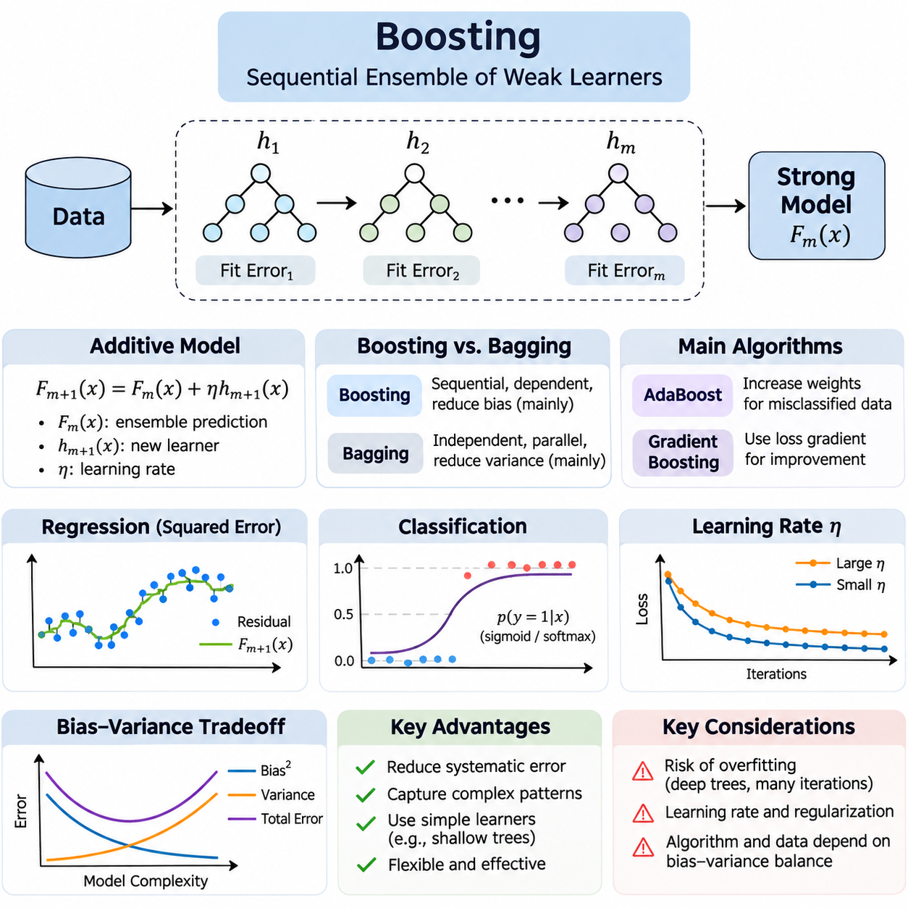{width="7.268055555555556in" height="7.268055555555556in"}

Boosting is an ensemble learning technique that combines multiple weak learners into a stronger predictive model through sequential training. Unlike methods that construct independent models, boosting trains each new learner to address limitations in the existing ensemble. This progressive improvement allows relatively simple models to capture complex relationships while reducing prediction errors across successive training stages.

The central principle of boosting is that a collection of moderately accurate learners can produce a highly accurate predictor when their contributions are coordinated. A weak learner is typically a simple model, such as a shallow decision tree, that captures limited patterns in the training data. Rather than requiring every learner to solve the entire prediction problem, boosting assigns each learner a specific corrective role within the evolving ensemble.

Boosting begins with an initial prediction model that provides a baseline estimate for the target variable. The algorithm evaluates this estimate against observed training labels and identifies the remaining prediction errors. A subsequent learner is trained to improve the current predictions, and its contribution is incorporated into the ensemble. Repeating this process gradually produces a model capable of representing increasingly complex relationships.

The sequential nature of boosting distinguishes it from bagging, another major ensemble learning strategy. Bagging trains multiple models independently, often using different bootstrap samples, and combines their predictions through averaging or voting. Boosting instead establishes dependencies between training stages because each learner responds to the performance of earlier learners. These different approaches influence model diversity, computational efficiency, and error reduction.

In a typical boosting system, decision trees serve as the base learners because they can represent nonlinear relationships and interactions between input features. Shallow trees are particularly useful because their restricted complexity encourages each learner to capture relatively simple patterns. When many such trees are combined sequentially, the resulting ensemble can approximate complicated decision boundaries without requiring individual trees to become excessively deep.

The mathematical structure of boosting can be understood as an additive model. If F_m(x) represents the ensemble prediction after m stages, the next prediction can be expressed as F\\_(m+1)(x) = F_m(x) + ηh\\_(m+1)(x). Here, h\\_(m+1)(x) is the newly trained learner, and η controls its contribution. This formulation illustrates how boosting progressively constructs a predictive function by adding corrective components.

The learning rate is an important mechanism for controlling the influence of each newly added learner. A smaller learning rate reduces the magnitude of individual updates, allowing the ensemble to improve through more gradual adjustments. This often requires additional boosting stages but can support better generalization when combined with suitable regularization. An excessively large learning rate may cause unstable improvements or overfitting.

Different boosting algorithms define corrective learning in different ways. AdaBoost emphasizes training examples that previous learners classified incorrectly by adjusting their relative importance. Gradient boosting instead uses the gradient of a differentiable loss function to determine the direction of improvement. Both approaches construct sequential ensembles, but their optimization mechanisms and mathematical interpretations are fundamentally different.

Gradient boosting extends the additive modeling principle by interpreting each training stage as an optimization step in function space. Instead of directly modifying a fixed vector of model parameters, the algorithm introduces a new function that approximates a useful direction for reducing prediction loss. This perspective connects boosting with gradient-based optimization while preserving the flexibility of decision trees as nonlinear predictive components.

For regression problems using squared error loss, gradient boosting can be interpreted as learning from residual errors. The initial model predicts a baseline value, often the mean of the training targets. The difference between each observed target and its current prediction represents a residual. A new regression tree learns patterns in these residuals, allowing the ensemble to correct systematic errors that remain after previous stages.

For classification problems, boosting must account for the relationship between model outputs and class probabilities. Gradient boosting commonly constructs additive scores that are transformed into probabilities through logistic or softmax functions. The training process minimizes an appropriate classification loss, such as cross-entropy. Consequently, corrective learners operate on loss gradients rather than simply fitting differences between predicted class labels and observed labels.

An important advantage of boosting is its ability to reduce systematic prediction errors by progressively increasing model expressiveness. Simple learners may initially exhibit substantial bias because they cannot represent complex patterns independently. Adding corrective learners allows the ensemble to capture previously unexplained relationships. However, the improvement is not unlimited, and excessive model complexity can eventually increase sensitivity to training noise.

The relationship between boosting and the bias-variance tradeoff requires careful interpretation. Boosting often reduces bias by combining many restricted learners, but its effect on variance depends on the algorithm, dataset, and regularization settings. Deep trees, excessive boosting iterations, and aggressive updates may increase overfitting. Therefore, successful boosting requires balancing predictive capacity against the risk of learning accidental patterns in training observations.

The number of boosting iterations determines how many learners contribute to the final ensemble. Too few iterations may leave important relationships unexplained, resulting in underfitting. Too many iterations may produce unnecessarily complex models, particularly when regularization is insufficient. Validation performance provides a practical criterion for selecting an appropriate stopping point, while early stopping can terminate training when further improvement becomes negligible.

Boosting is especially effective for structured tabular datasets containing numerical, categorical, and engineered features. Applications include financial risk assessment, customer behavior prediction, equipment fault detection, and industrial quality monitoring. Tree-based boosting can model nonlinear feature interactions without requiring extensive manual transformation, although preprocessing requirements vary across implementations and categorical encoding strategies.

The effectiveness of boosting also depends on data quality and the characteristics of prediction errors. Incorrect labels, extreme outliers, and unstable measurements can influence the corrective learners, sometimes causing the ensemble to focus on misleading patterns. Robust loss functions, careful feature validation, and appropriate regularization can reduce these risks. Boosting improves predictive performance through repeated correction, but it cannot automatically eliminate weaknesses in the underlying dataset.

Modern boosting frameworks demonstrate how the foundational concept can be extended into efficient machine learning systems. XGBoost introduces regularized objectives and optimized tree construction, LightGBM emphasizes computational efficiency through histogram-based and leaf-wise learning strategies, and CatBoost provides specialized mechanisms for handling categorical features. Despite their architectural differences, these frameworks preserve the principle of sequentially improving an additive ensemble.

The computational characteristics of boosting reflect its sequential dependency structure. Because each training stage depends on the current ensemble, boosting iterations generally cannot be trained independently in the same manner as bagged trees. Nevertheless, operations within individual stages can be parallelized, including feature evaluation and histogram construction. Efficient implementations exploit these opportunities to support large datasets and high-dimensional feature spaces.

Interpretability is another important consideration when applying boosting to practical systems. Although individual decision trees are relatively understandable, an ensemble containing hundreds of trees becomes difficult to inspect directly. Feature importance measures, partial dependence analysis, and SHAP-based explanations can help characterize model behavior. These techniques provide useful diagnostic information, although they do not automatically establish causal relationships between features and predictions.

In industrial applications, boosting can support predictive maintenance by combining sensor measurements, operational conditions, and historical equipment records. Each successive learner may capture error patterns associated with temperature, vibration, operating load, or environmental variation. The resulting ensemble can estimate failure probabilities or remaining performance indicators, provided that training labels are reliable and evaluation procedures reflect realistic deployment conditions.

The practical value of boosting comes from combining simple predictive components into a coordinated optimization process. Its success depends not merely on adding more learners but on controlling how each learner contributes to the evolving model. Learning rate selection, tree complexity, iteration count, loss function design, and validation strategy collectively determine whether sequential correction produces meaningful improvements that generalize beyond the training dataset.

Understanding boosting as progressive error correction provides the conceptual foundation for gradient boosting theory, residual learning, and advanced gradient-boosted decision tree frameworks. The essential idea is that predictive strength emerges from the structured accumulation of complementary improvements. This principle connects ensemble learning with numerical optimization and explains why boosting remains a powerful approach for supervised learning across research and industrial applications.

부스팅(Boosting)은 여러 개의 약한 학습기(Weak Learner)를 순차적 학습(Sequential Training)을 통해 결합하여 더 강력한 예측 모델(Predictive Model)을 구성하는 앙상블 학습(Ensemble Learning) 기법이다. 독립적인 모델을 생성하는 방법과 달리, 부스팅은 새로운 학습기가 기존 앙상블의 한계를 보완하도록 학습한다. 이러한 점진적 개선(Progressive Improvement)을 통해 비교적 단순한 모델들이 복잡한 관계를 학습하고 연속적인 학습 단계에서 예측 오차(Prediction Error)를 감소시킬 수 있다.

부스팅의 핵심 원리(Core Principle)는 적절히 조정된 여러 학습기를 결합하면 개별 학습기보다 높은 예측 정확도(Prediction Accuracy)를 달성할 수 있다는 것이다. 약한 학습기(Weak Learner)는 일반적으로 얕은 결정 트리(Shallow Decision Tree)처럼 학습 데이터(Training Data)의 제한된 패턴을 포착하는 단순한 모델이다. 부스팅은 각 학습기가 전체 예측 문제를 독립적으로 해결하도록 요구하지 않고, 발전하는 앙상블 내에서 특정한 오류 수정 역할(Corrective Role)을 수행하도록 한다.

부스팅은 목표 변수(Target Variable)에 대한 기준 추정값(Baseline Estimate)을 제공하는 초기 예측 모델(Initial Prediction Model)에서 시작한다. 알고리즘은 이 추정값을 실제 학습 레이블(Training Label)과 비교하여 남아 있는 예측 오차를 식별한다. 이후 새로운 학습기가 현재 예측을 개선하도록 학습되고, 그 결과가 앙상블에 반영된다. 이러한 과정을 반복하면 점차 복잡한 관계를 표현할 수 있는 모델이 형성된다.

부스팅의 순차적 특성(Sequential Nature)은 또 다른 주요 앙상블 학습 전략인 배깅(Bagging)과 구별되는 핵심 요소이다. 배깅은 일반적으로 서로 다른 부트스트랩 표본(Bootstrap Sample)을 사용하여 여러 모델을 독립적으로 학습하고 평균화(Averaging) 또는 투표(Voting)를 통해 예측을 결합한다. 반면 부스팅은 각 학습기가 이전 학습기의 성능에 대응하므로 학습 단계 사이에 의존 관계가 형성된다. 이러한 차이는 모델 다양성(Model Diversity), 계산 효율성(Computational Efficiency), 오차 감소(Error Reduction)에 영향을 미친다.

일반적인 부스팅 시스템에서는 결정 트리(Decision Tree)가 기본 학습기(Base Learner)로 사용된다. 결정 트리는 입력 특징(Input Feature) 사이의 비선형 관계(Nonlinear Relationship)와 상호작용(Interaction)을 표현할 수 있기 때문이다. 특히 얕은 트리는 제한된 복잡도를 통해 각 학습기가 비교적 단순한 패턴을 학습하도록 유도한다. 이러한 트리들을 순차적으로 결합하면 개별 트리를 지나치게 깊게 만들지 않고도 복잡한 결정 경계(Decision Boundary)를 근사할 수 있다.

부스팅의 수학적 구조(Mathematical Structure)는 가산 모델(Additive Model)로 이해할 수 있다. m번째 단계까지의 앙상블 예측을 F_m(x)라고 하면 다음 예측은 F\\_(m+1)(x) = F_m(x) + ηh\\_(m+1)(x)로 표현된다. 여기서 h\\_(m+1)(x)는 새롭게 학습된 학습기이며, η는 해당 학습기의 기여도를 제어한다. 이 수식은 부스팅이 오류 수정 요소(Corrective Component)를 순차적으로 추가하면서 예측 함수(Predictive Function)를 점진적으로 구성하는 과정을 보여준다.

학습률(Learning Rate)은 새롭게 추가되는 학습기의 영향력을 제어하는 중요한 메커니즘이다. 작은 학습률은 개별 갱신(Update)의 크기를 줄여 앙상블이 더욱 점진적으로 개선되도록 한다. 이러한 접근은 일반적으로 더 많은 부스팅 단계(Boosting Stage)를 필요로 하지만, 적절한 정규화(Regularization)와 결합하면 일반화 성능(Generalization Performance)을 향상시킬 수 있다. 반대로 지나치게 큰 학습률은 불안정한 성능 개선이나 과적합(Overfitting)을 유발할 수 있다.

서로 다른 부스팅 알고리즘(Boosting Algorithm)은 오류 수정 학습(Corrective Learning)을 서로 다른 방식으로 정의한다. 에이다부스트(AdaBoost)는 이전 학습기가 잘못 분류한 학습 사례의 상대적 중요도를 조정하여 해당 사례에 더 집중한다. 반면 그래디언트 부스팅(Gradient Boosting)은 미분 가능한 손실 함수(Differentiable Loss Function)의 기울기(Gradient)를 이용하여 개선 방향을 결정한다. 두 방법 모두 순차적 앙상블을 구성하지만 최적화 메커니즘(Optimization Mechanism)과 수학적 해석(Mathematical Interpretation)은 근본적으로 다르다.

그래디언트 부스팅은 각 학습 단계를 함수 공간(Function Space)에서 수행되는 최적화 단계(Optimization Step)로 해석하여 가산 모델의 원리를 확장한다. 고정된 모델 매개변수(Model Parameter) 벡터를 직접 수정하는 대신, 알고리즘은 예측 손실(Prediction Loss)을 감소시키는 유용한 방향을 근사하는 새로운 함수를 도입한다. 이러한 관점은 결정 트리의 비선형 예측 능력을 유지하면서 부스팅을 기울기 기반 최적화(Gradient-Based Optimization)와 연결한다.

제곱 오차 손실(Squared Error Loss)을 사용하는 회귀 문제(Regression Problem)에서 그래디언트 부스팅은 잔차 학습(Residual Learning)으로 해석할 수 있다. 초기 모델은 일반적으로 학습 목표값의 평균과 같은 기준값을 예측한다. 각 실제 목표값과 현재 예측값 사이의 차이가 잔차(Residual)를 나타낸다. 새로운 회귀 트리(Regression Tree)는 이러한 잔차에 포함된 패턴을 학습하여 이전 단계 이후에도 남아 있는 체계적인 예측 오차(Systematic Prediction Error)를 수정한다.

분류 문제(Classification Problem)에서 부스팅은 모델 출력(Model Output)과 클래스 확률(Class Probability) 사이의 관계를 고려해야 한다. 그래디언트 부스팅은 일반적으로 로지스틱 함수(Logistic Function) 또는 소프트맥스 함수(Softmax Function)를 통해 확률로 변환되는 가산 점수(Additive Score)를 구성한다. 학습 과정에서는 교차 엔트로피(Cross-Entropy)와 같은 적절한 분류 손실(Classification Loss)을 최소화한다. 따라서 오류 수정 학습기는 단순한 클래스 레이블 차이가 아니라 손실 기울기(Loss Gradient)를 기반으로 작동한다.

부스팅의 중요한 장점은 모델의 표현 능력(Expressiveness)을 점진적으로 증가시켜 체계적인 예측 오차를 감소시킬 수 있다는 점이다. 단순한 학습기는 복잡한 패턴을 독립적으로 표현하기 어렵기 때문에 초기에는 높은 편향(Bias)을 보일 수 있다. 오류 수정 학습기를 추가하면 앙상블은 이전에 설명하지 못했던 관계를 포착할 수 있다. 그러나 이러한 개선에는 한계가 있으며, 모델 복잡도가 지나치게 증가하면 학습 데이터의 잡음(Noise)에 대한 민감도가 높아질 수 있다.

부스팅과 편향-분산 절충(Bias-Variance Tradeoff)의 관계는 신중하게 해석해야 한다. 부스팅은 제한된 학습기를 여러 개 결합하여 편향을 감소시키는 경우가 많지만, 분산(Variance)에 미치는 영향은 알고리즘, 데이터셋(Dataset), 정규화 설정에 따라 달라진다. 깊은 트리, 과도한 부스팅 반복, 공격적인 갱신은 과적합 위험을 증가시킬 수 있다. 따라서 성공적인 부스팅을 위해서는 예측 능력(Predictive Capacity)과 학습 데이터의 우연한 패턴을 학습할 위험 사이의 균형이 필요하다.

부스팅 반복 횟수(Number of Boosting Iterations)는 최종 앙상블에 기여하는 학습기의 수를 결정한다. 반복 횟수가 너무 적으면 중요한 관계를 충분히 학습하지 못하여 과소적합(Underfitting)이 발생할 수 있다. 반대로 반복 횟수가 지나치게 많으면 특히 정규화가 부족한 경우 불필요하게 복잡한 모델이 형성될 수 있다. 검증 성능(Validation Performance)은 적절한 중단 시점(Stopping Point)을 선택하는 실용적인 기준이며, 조기 종료(Early Stopping)는 추가적인 성능 개선이 미미할 때 학습을 종료할 수 있도록 한다.

부스팅은 수치형 특징(Numerical Feature), 범주형 특징(Categorical Feature), 특징 공학(Feature Engineering)을 통해 생성된 특징을 포함하는 정형 데이터셋(Structured Tabular Dataset)에서 특히 효과적이다. 주요 응용 분야에는 금융 위험 평가(Financial Risk Assessment), 고객 행동 예측(Customer Behavior Prediction), 장비 고장 탐지(Equipment Fault Detection), 산업 품질 모니터링(Industrial Quality Monitoring)이 포함된다. 트리 기반 부스팅은 광범위한 수작업 변환 없이도 비선형 특징 상호작용을 모델링할 수 있지만, 전처리(Preprocessing) 요구사항은 구현 방식과 범주형 인코딩(Categorical Encoding) 전략에 따라 달라진다.

부스팅의 효과는 데이터 품질(Data Quality)과 예측 오차의 특성에도 영향을 받는다. 잘못된 레이블(Incorrect Label), 극단적인 이상치(Extreme Outlier), 불안정한 측정값(Unstable Measurement)은 오류 수정 학습기에 영향을 주어 앙상블이 잘못된 패턴에 집중하도록 만들 수 있다. 강건한 손실 함수(Robust Loss Function), 신중한 특징 검증(Feature Validation), 적절한 정규화는 이러한 위험을 줄일 수 있다. 부스팅은 반복적인 오류 수정을 통해 예측 성능을 개선하지만, 기본 데이터셋의 결함을 자동으로 제거하지는 못한다.

현대적인 부스팅 프레임워크(Boosting Framework)는 기본 개념을 효율적인 머신러닝 시스템(Machine Learning System)으로 확장할 수 있음을 보여준다. XGBoost는 정규화된 목적 함수(Regularized Objective Function)와 최적화된 트리 구성(Optimized Tree Construction)을 도입한다. LightGBM은 히스토그램 기반 학습(Histogram-Based Learning)과 리프 중심 학습(Leaf-Wise Learning)을 통해 계산 효율성을 강조하며, CatBoost는 범주형 특징을 처리하기 위한 특화된 메커니즘을 제공한다. 이러한 구조적 차이에도 불구하고 세 프레임워크는 가산 앙상블을 순차적으로 개선한다는 핵심 원리를 유지한다.

부스팅의 계산 특성(Computational Characteristics)은 순차적 의존 구조(Sequential Dependency Structure)를 반영한다. 각 학습 단계가 현재 앙상블에 의존하므로 부스팅 반복은 일반적으로 배깅된 트리처럼 독립적으로 학습할 수 없다. 그러나 개별 단계 내부에서는 특징 평가(Feature Evaluation)와 히스토그램 구성(Histogram Construction)을 포함한 여러 연산을 병렬화(Parallelization)할 수 있다. 효율적인 구현은 이러한 기회를 활용하여 대규모 데이터셋과 고차원 특징 공간(High-Dimensional Feature Space)을 지원한다.

해석 가능성(Interpretability)은 부스팅을 실제 시스템에 적용할 때 고려해야 하는 또 다른 중요한 요소이다. 개별 결정 트리는 비교적 이해하기 쉽지만, 수백 개의 트리로 구성된 앙상블은 직접 분석하기 어렵다. 특징 중요도(Feature Importance), 부분 의존성 분석(Partial Dependence Analysis), SHAP 기반 설명(SHAP-Based Explanation)은 모델 동작(Model Behavior)을 파악하는 데 도움을 줄 수 있다. 그러나 이러한 기법이 특징과 예측 사이의 인과관계(Causal Relationship)를 자동으로 입증하는 것은 아니다.

산업 응용(Industrial Application)에서 부스팅은 센서 측정값(Sensor Measurement), 운전 조건(Operating Condition), 과거 장비 기록(Historical Equipment Record)을 결합하여 예지 보전(Predictive Maintenance)을 지원할 수 있다. 연속적으로 추가되는 학습기는 온도, 진동, 운전 부하, 환경 변화와 관련된 오차 패턴을 포착할 수 있다. 이를 통해 앙상블은 고장 확률(Failure Probability)이나 잔여 성능 지표(Remaining Performance Indicator)를 추정할 수 있으며, 이를 위해서는 신뢰할 수 있는 학습 레이블과 실제 배포 환경을 반영한 평가 절차(Evaluation Procedure)가 필요하다.

부스팅의 실용적 가치(Practical Value)는 단순한 예측 구성 요소를 조정된 최적화 과정(Coordinated Optimization Process)으로 결합하는 데 있다. 부스팅의 성공은 단순히 학습기를 더 많이 추가하는 것이 아니라, 각 학습기가 발전하는 모델에 어떻게 기여하는지를 제어하는 데 달려 있다. 학습률 선택(Learning Rate Selection), 트리 복잡도(Tree Complexity), 반복 횟수(Iteration Count), 손실 함수 설계(Loss Function Design), 검증 전략(Validation Strategy)은 순차적 오류 수정이 학습 데이터 외부에서도 일반화되는 의미 있는 개선을 만들어 내는지를 공동으로 결정한다.

부스팅을 점진적 오류 수정(Progressive Error Correction)으로 이해하는 것은 그래디언트 부스팅 이론(Gradient Boosting Theory), 잔차 학습(Residual Learning), 고급 그래디언트 부스팅 결정 트리(Gradient-Boosted Decision Tree) 프레임워크를 학습하기 위한 개념적 토대를 제공한다. 핵심 개념은 상호 보완적인 개선을 구조적으로 축적함으로써 강력한 예측 능력이 형성된다는 것이다. 이러한 원리는 앙상블 학습을 수치 최적화(Numerical Optimization)와 연결하며, 부스팅이 연구와 산업 응용 전반의 지도 학습(Supervised Learning)에서 강력한 접근법으로 유지되는 이유를 설명한다.

## 06.01 Gradient Boosting Theory

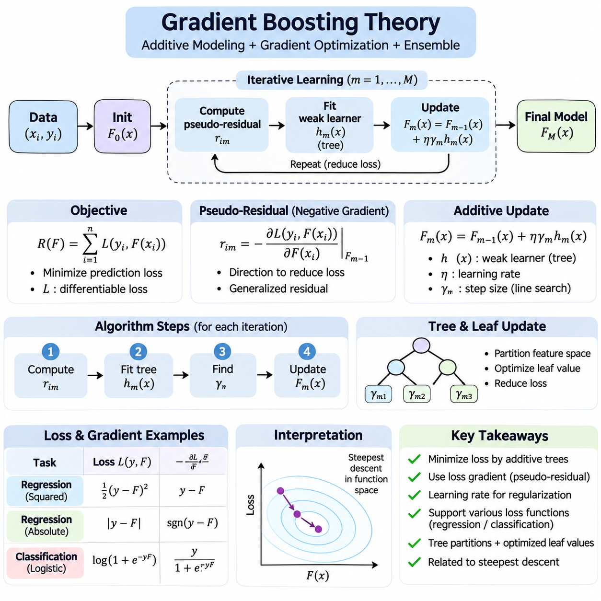{width="7.268055555555556in" height="7.268055555555556in"}

Gradient boosting is a supervised learning method that constructs a powerful predictive model through the sequential addition of weak learners. Its theoretical foundation combines additive modeling, gradient-based optimization, and ensemble learning. Rather than optimizing all model components simultaneously, gradient boosting introduces new learners that progressively reduce a specified loss function, allowing complex predictive relationships to emerge from relatively simple models.

The fundamental objective of gradient boosting is to minimize the expected prediction loss over a training dataset. Given input observations x_i and corresponding targets y_i, the algorithm seeks a function F(x) that minimizes the empirical risk R(F) = ΣL(y_i, F(x_i)). Here, L represents a differentiable loss function measuring prediction errors. This formulation establishes gradient boosting as a general optimization framework rather than a technique restricted to regression.

The distinguishing characteristic of gradient boosting is its optimization in function space. Traditional gradient descent adjusts numerical parameters within a predefined model structure, whereas gradient boosting improves an entire prediction function by adding new functional components. Each learner approximates a direction that decreases the objective function, enabling the ensemble to evolve without requiring a fixed global parameterization of its final predictive structure.

The learning process begins by selecting an initial constant prediction that minimizes the training loss. For squared error regression, this initial estimate is typically the mean of the target values. For binary classification using logistic loss, the initialization can be expressed through the log-odds of the positive class frequency. This initial model provides a reference point from which successive learners construct increasingly accurate predictions.

At each boosting iteration, the algorithm evaluates the negative gradient of the loss function with respect to the current model predictions. These values are called pseudo-residuals because they generalize the conventional residuals used in regression. Mathematically, the pseudo-residual for observation i is r_im = -∂L(y_i, F(x_i))/∂F(x_i), evaluated at the current ensemble F\\_(m-1). They indicate directions for reducing prediction loss.

A new weak learner is trained to approximate the pseudo-residuals using the original input features. Decision trees are commonly selected because they can model nonlinear relationships and feature interactions while remaining computationally manageable. The learner does not directly predict the original target values. Instead, it estimates the correction required by the current ensemble, making each training stage dependent on the accumulated predictions of preceding stages.

After fitting the new learner, gradient boosting determines how strongly its predictions should influence the ensemble. A line search may identify a step size that minimizes the loss along the learner\'s direction. The model is then updated according to F_m(x) = F\\_(m-1)(x) + ηγ_m h_m(x), where η denotes the learning rate, γ_m represents the selected step size, and h_m(x) is the newly fitted learner.

The learning rate controls the magnitude of each update and acts as an important regularization mechanism. Smaller learning rates distribute the optimization process across more boosting iterations, potentially improving generalization by preventing individual learners from making excessively large corrections. However, reducing the learning rate also increases the number of learners required to reach comparable training performance, creating a tradeoff between computational cost and predictive stability.

For squared error regression, the negative gradient has a particularly intuitive interpretation. When the loss is defined as one-half of the squared difference between target and prediction, its negative gradient equals the ordinary residual y_i - F(x_i). Consequently, each new regression tree approximates the remaining prediction errors. This special case demonstrates how gradient boosting generalizes residual correction into a broader framework based on differentiable loss functions.

Different loss functions produce different optimization behaviors. Squared error emphasizes larger deviations, while absolute error provides greater resistance to extreme observations but requires appropriate handling of nondifferentiable points. Huber loss combines quadratic and linear behavior to balance sensitivity and robustness. For classification, logistic and multinomial cross-entropy losses guide the ensemble toward improved class probability estimates rather than minimizing numerical differences between class labels.

When decision trees serve as weak learners, the gradient boosting procedure can be interpreted through terminal regions. Each tree partitions the feature space into regions containing observations with related correction patterns. The algorithm may then calculate an optimal output value for each terminal region by minimizing the original loss. These region-specific adjustments improve the correspondence between the fitted tree structure and the objective being optimized.

The distinction between fitting gradients and optimizing terminal leaf values is important for understanding practical implementations. A regression tree may first approximate pseudo-residuals to determine useful partitions, while subsequent calculations refine the prediction assigned to each leaf. For some losses, these values have convenient analytical solutions. For others, numerical optimization or approximate second-order methods may be necessary to obtain effective updates.

Gradient boosting is closely related to steepest descent because each stage attempts to move the predictive function in a direction that reduces loss. However, the available update directions are constrained by the chosen weak learner family. A shallow decision tree cannot represent every possible negative gradient function exactly. Therefore, boosting performs an approximate functional optimization process whose effectiveness depends on the expressive capacity of its base learners.

The complexity of individual learners strongly influences the behavior of the resulting ensemble. Decision stumps, consisting of a single split, provide simple corrections and primarily capture additive feature effects. Deeper trees can represent interactions among several variables, allowing more complex corrections. Increasing tree depth improves representational flexibility but may also increase variance, computational requirements, and sensitivity to noise within the training dataset.

The number of boosting stages determines how extensively the ensemble explores corrective patterns. Early iterations often capture dominant relationships, while later iterations refine smaller prediction errors and more localized structures. Although additional stages generally improve training loss when updates are appropriately chosen, validation performance may eventually deteriorate. Early stopping provides a practical mechanism for limiting complexity based on predictive performance on unseen validation observations.

Stochastic gradient boosting introduces randomness by training individual learners on subsets of the available observations. This approach reduces the correlation between successive corrective models and can improve generalization under suitable conditions. Subsampling also decreases the computational workload of individual iterations. However, excessively small subsets may introduce unstable gradient estimates, making the sampling fraction an important parameter for controlling learning behavior.

Regularization in gradient boosting extends beyond learning rate reduction and early stopping. Tree depth constraints, minimum leaf sample requirements, feature subsampling, and penalties on leaf outputs can restrict model complexity. These mechanisms discourage the ensemble from constructing overly specialized corrections. Their combined effect determines how effectively the model balances training accuracy against robustness when encountering observations outside the training dataset.

Second-order optimization provides another important extension of classical gradient boosting. Instead of relying exclusively on first-order gradients, some implementations incorporate second derivatives of the loss function. These derivatives describe local curvature and support more informed estimates of beneficial prediction updates. Newton-style boosting methods exploit this information to improve optimization efficiency, particularly when the objective function has useful second-order structure.

The theoretical relationship between gradient boosting and regularized optimization helps explain the effectiveness of small incremental updates. By limiting the contribution of each learner, the algorithm follows a gradual trajectory through function space. This approach can prevent rapid adaptation to isolated training examples, although it does not guarantee immunity from overfitting. Generalization remains dependent on dataset properties, model complexity, optimization settings, and validation procedures.

Gradient boosting also has an important connection to statistical additive models. The final predictor is expressed as a sum of functions, each representing a learned correction. Unlike conventional additive models that often assign separate smooth functions to individual features, tree-based gradient boosting can capture interactions through multivariable partitions. This flexibility makes the approach suitable for structured datasets containing heterogeneous relationships and nonlinear dependencies.

From a computational perspective, gradient boosting combines sequential optimization with opportunities for parallel processing within each training stage. Tree construction, feature histogram generation, and split evaluation can often be accelerated through parallel algorithms. Nevertheless, later boosting stages depend on earlier ensemble predictions, limiting complete parallelization across iterations. This characteristic motivates specialized implementations designed to improve memory efficiency and training throughput.

The theoretical framework also clarifies why gradient boosting performs well across diverse supervised learning tasks. Regression, binary classification, multiclass classification, and ranking can be addressed by selecting suitable objectives and output transformations. The essential training mechanism remains consistent: calculate corrective information from the current loss, fit a weak learner, determine its contribution, and update the ensemble to improve predictive performance.

Understanding gradient boosting requires recognizing that its strength emerges from the interaction between functional optimization, weak learner design, and regularization. Each component contributes to the balance between flexibility and generalization. This theoretical foundation supports the study of residual learning, XGBoost, LightGBM, CatBoost, and modern gradient-boosted decision tree systems, where the same underlying principles are extended through specialized optimization and computational strategies.

그래디언트 부스팅(Gradient Boosting)은 약한 학습기(Weak Learner)를 순차적으로 추가하여 강력한 예측 모델(Predictive Model)을 구성하는 지도 학습(Supervised Learning) 방법이다. 이론적 기반(Theoretical Foundation)은 가산 모델링(Additive Modeling), 기울기 기반 최적화(Gradient-Based Optimization), 앙상블 학습(Ensemble Learning)을 결합한다. 모든 모델 구성 요소를 동시에 최적화하는 대신, 그래디언트 부스팅은 지정된 손실 함수(Loss Function)를 점진적으로 감소시키는 새로운 학습기를 도입하여 비교적 단순한 모델로부터 복잡한 예측 관계를 학습한다.

그래디언트 부스팅의 기본 목적(Fundamental Objective)은 학습 데이터셋(Training Dataset)에 대한 예측 손실(Prediction Loss)을 최소화하는 것이다. 입력 관측값(Input Observation) x_i와 해당 목표값(Target Value) y_i가 주어지면, 알고리즘은 경험적 위험(Empirical Risk) R(F) = ΣL(y_i, F(x_i))를 최소화하는 함수 F(x)를 찾는다. 여기서 L은 예측 오차를 측정하는 미분 가능한 손실 함수(Differentiable Loss Function)를 나타낸다. 이러한 수학적 정의는 그래디언트 부스팅이 회귀 문제에만 제한되지 않는 일반적인 최적화 프레임워크(Optimization Framework)임을 보여준다.

그래디언트 부스팅의 가장 중요한 특징은 함수 공간(Function Space)에서 최적화를 수행한다는 점이다. 전통적인 경사 하강법(Gradient Descent)은 미리 정의된 모델 구조 내에서 수치 매개변수(Numerical Parameter)를 조정하지만, 그래디언트 부스팅은 새로운 함수 구성 요소(Functional Component)를 추가하여 전체 예측 함수를 개선한다. 각 학습기는 목적 함수(Objective Function)를 감소시키는 방향을 근사하며, 최종 예측 구조에 대한 고정된 전역 매개변수화(Global Parameterization) 없이 앙상블을 발전시킨다.

학습 과정(Learning Process)은 학습 손실을 최소화하는 초기 상수 예측값(Initial Constant Prediction)을 선택하는 것으로 시작한다. 제곱 오차 회귀(Squared Error Regression)에서는 일반적으로 목표값의 평균이 초기 추정값으로 사용된다. 로지스틱 손실(Logistic Loss)을 사용하는 이진 분류(Binary Classification)에서는 양성 클래스 비율(Positive Class Frequency)의 로그 오즈(Log-Odds)를 통해 초기값을 표현할 수 있다. 이러한 초기 모델(Initial Model)은 이후 학습기들이 점진적으로 정확한 예측을 구성하는 기준점(Reference Point)을 제공한다.

각 부스팅 반복(Boosting Iteration)에서 알고리즘은 현재 모델 예측값에 대한 손실 함수의 음의 기울기(Negative Gradient)를 계산한다. 이러한 값은 회귀에서 사용하는 일반적인 잔차(Residual)를 일반화한 것이므로 의사 잔차(Pseudo-Residual)라고 한다. 수학적으로 관측값 i에 대한 의사 잔차는 r_im = -∂L(y_i, F(x_i))/∂F(x_i)이며, 현재 앙상블 F\\_(m-1)에서 평가된다. 이 값은 예측 손실을 감소시키기 위해 모델이 수정되어야 하는 방향을 나타낸다.

새로운 약한 학습기(Weak Learner)는 원래의 입력 특징(Input Feature)을 사용하여 의사 잔차를 근사하도록 학습된다. 결정 트리(Decision Tree)는 비선형 관계(Nonlinear Relationship)와 특징 상호작용(Feature Interaction)을 모델링하면서도 계산적으로 관리하기 쉽기 때문에 일반적으로 선택된다. 이 학습기는 원래 목표값을 직접 예측하지 않는다. 대신 현재 앙상블에 필요한 수정값(Correction)을 추정하므로 각 학습 단계는 이전 단계에서 누적된 예측 결과에 의존한다.

새로운 학습기를 적합(Fitting)한 이후 그래디언트 부스팅은 해당 학습기의 예측이 앙상블에 얼마나 강하게 반영되어야 하는지를 결정한다. 선 탐색(Line Search)을 통해 학습기 방향을 따라 손실을 최소화하는 단계 크기(Step Size)를 찾을 수 있다. 이후 모델은 F_m(x) = F\\_(m-1)(x) + ηγ_m h_m(x)에 따라 갱신된다. 여기서 η는 학습률(Learning Rate), γ_m은 선택된 단계 크기, h_m(x)는 새롭게 학습된 학습기를 의미한다.

학습률(Learning Rate)은 각 갱신(Update)의 크기를 제어하며 중요한 정규화 메커니즘(Regularization Mechanism)으로 작용한다. 작은 학습률은 최적화 과정(Optimization Process)을 더 많은 부스팅 반복에 분산시켜 개별 학습기가 지나치게 큰 수정을 수행하지 않도록 함으로써 일반화 성능(Generalization Performance)을 향상시킬 수 있다. 그러나 학습률을 줄이면 비슷한 학습 성능(Training Performance)에 도달하기 위해 더 많은 학습기가 필요하므로 계산 비용(Computational Cost)과 예측 안정성(Predictive Stability) 사이의 절충 관계가 형성된다.

제곱 오차 회귀(Squared Error Regression)에서 음의 기울기(Negative Gradient)는 특히 직관적으로 해석할 수 있다. 손실을 목표값과 예측값 차이의 제곱에 1/2을 곱한 값으로 정의하면, 음의 기울기는 일반적인 잔차 y_i - F(x_i)와 같아진다. 따라서 새로운 회귀 트리(Regression Tree)는 남아 있는 예측 오차를 근사한다. 이러한 특수한 사례는 그래디언트 부스팅이 잔차 수정(Residual Correction)을 미분 가능한 손실 함수에 기반한 더 일반적인 프레임워크로 확장한다는 사실을 보여준다.

서로 다른 손실 함수(Loss Function)는 서로 다른 최적화 동작(Optimization Behavior)을 만들어 낸다. 제곱 오차(Squared Error)는 큰 편차(Deviation)를 강조하는 반면, 절대 오차(Absolute Error)는 극단적인 관측값에 더 강건하지만 미분 불가능한 지점(Non-Differentiable Point)에 대한 적절한 처리가 필요하다. 허버 손실(Huber Loss)은 이차적 특성과 선형적 특성을 결합하여 민감도와 강건성(Robustness)의 균형을 맞춘다. 분류에서는 로지스틱 손실과 다항 교차 엔트로피 손실(Multinomial Cross-Entropy Loss)이 클래스 레이블 사이의 수치적 차이를 최소화하는 대신 클래스 확률(Class Probability) 추정을 개선하도록 앙상블을 유도한다.

결정 트리가 약한 학습기로 사용되는 경우 그래디언트 부스팅 과정은 말단 영역(Terminal Region)을 통해 해석할 수 있다. 각 트리는 특징 공간(Feature Space)을 유사한 수정 패턴(Correction Pattern)을 가진 관측값들이 포함된 영역으로 분할한다. 이후 알고리즘은 원래의 손실 함수를 최소화하여 각 말단 영역에 대한 최적 출력값(Optimal Output Value)을 계산할 수 있다. 이러한 영역별 조정(Region-Specific Adjustment)은 학습된 트리 구조와 최적화 대상 목적 함수 사이의 대응 관계를 개선한다.

기울기 적합(Gradient Fitting)과 말단 리프 값 최적화(Terminal Leaf Value Optimization)의 차이는 실제 구현을 이해하는 데 중요하다. 회귀 트리는 먼저 의사 잔차를 근사하여 유용한 분할(Partition)을 결정하고, 이후 계산을 통해 각 리프(Leaf)에 할당되는 예측값을 정교하게 조정할 수 있다. 일부 손실 함수에서는 이러한 값에 대한 편리한 해석적 해(Analytical Solution)가 존재한다. 다른 손실 함수에서는 효과적인 갱신을 얻기 위해 수치 최적화(Numerical Optimization) 또는 근사적인 이차 방법(Second-Order Method)이 필요할 수 있다.

그래디언트 부스팅은 각 단계에서 손실을 감소시키는 방향으로 예측 함수를 이동시키려 한다는 점에서 최급강하법(Steepest Descent)과 밀접한 관련이 있다. 그러나 사용 가능한 갱신 방향(Update Direction)은 선택된 약한 학습기 계열(Weak Learner Family)에 의해 제한된다. 얕은 결정 트리는 가능한 모든 음의 기울기 함수를 정확하게 표현할 수 없다. 따라서 부스팅은 기본 학습기(Base Learner)의 표현 능력(Expressive Capacity)에 따라 효과가 달라지는 근사적 함수 최적화(Approximate Functional Optimization)를 수행한다.

개별 학습기의 복잡도(Learner Complexity)는 최종 앙상블의 동작에 큰 영향을 미친다. 하나의 분할로 구성된 결정 스텀프(Decision Stump)는 단순한 수정값을 제공하며 주로 가산적 특징 효과(Additive Feature Effect)를 포착한다. 더 깊은 트리는 여러 변수 사이의 상호작용을 표현하여 더욱 복잡한 수정을 수행할 수 있다. 트리 깊이(Tree Depth)를 증가시키면 표현 유연성(Representational Flexibility)이 향상되지만, 분산(Variance), 계산 요구량(Computational Requirement), 학습 데이터의 잡음에 대한 민감도도 증가할 수 있다.

부스팅 단계 수(Number of Boosting Stages)는 앙상블이 오류 수정 패턴을 얼마나 광범위하게 탐색하는지를 결정한다. 초기 반복은 주로 지배적인 관계(Dominant Relationship)를 포착하고, 이후 반복은 작은 예측 오차와 더욱 국소적인 구조(Localized Structure)를 정교하게 수정한다. 적절한 갱신이 선택되면 추가 단계는 일반적으로 학습 손실을 개선하지만, 검증 성능(Validation Performance)은 어느 시점부터 악화될 수 있다. 조기 종료(Early Stopping)는 관측되지 않은 검증 데이터(Validation Data)에 대한 예측 성능을 기준으로 모델 복잡도를 제한하는 실용적인 메커니즘을 제공한다.

확률적 그래디언트 부스팅(Stochastic Gradient Boosting)은 사용 가능한 관측값의 부분집합(Subset)을 이용하여 개별 학습기를 학습함으로써 무작위성(Randomness)을 도입한다. 이러한 접근은 연속적인 오류 수정 모델 사이의 상관관계(Correlation)를 감소시키고, 적절한 조건에서 일반화 성능을 개선할 수 있다. 부분 표본 추출(Subsampling)은 개별 반복의 계산 작업량도 줄인다. 그러나 지나치게 작은 부분집합은 불안정한 기울기 추정(Gradient Estimate)을 유발할 수 있으므로 표본 추출 비율(Sampling Fraction)은 학습 동작을 제어하는 중요한 매개변수이다.

그래디언트 부스팅의 정규화(Regularization)는 학습률 감소와 조기 종료에만 국한되지 않는다. 트리 깊이 제한(Tree Depth Constraint), 최소 리프 표본 수(Minimum Leaf Sample Requirement), 특징 부분 표본 추출(Feature Subsampling), 리프 출력값에 대한 벌점(Penalty)은 모델 복잡도를 제한할 수 있다. 이러한 메커니즘은 앙상블이 지나치게 특수화된 수정값을 구성하지 않도록 억제한다. 이들의 결합 효과는 학습 정확도(Training Accuracy)와 학습 데이터 외부의 관측값에 대한 강건성 사이의 균형을 결정한다.

이차 최적화(Second-Order Optimization)는 고전적인 그래디언트 부스팅(Classical Gradient Boosting)의 또 다른 중요한 확장이다. 일부 구현은 일차 기울기(First-Order Gradient)에만 의존하지 않고 손실 함수의 이차 도함수(Second Derivative)를 함께 활용한다. 이러한 도함수는 국소 곡률(Local Curvature)을 설명하며 유리한 예측 갱신을 더욱 정확하게 추정하도록 지원한다. 뉴턴 방식 부스팅(Newton-Style Boosting)은 이러한 정보를 활용하여 목적 함수가 유용한 이차 구조(Second-Order Structure)를 가질 때 최적화 효율성을 향상시킨다.

그래디언트 부스팅과 정규화된 최적화(Regularized Optimization) 사이의 이론적 관계는 작은 점진적 갱신(Incremental Update)이 효과적인 이유를 설명한다. 각 학습기의 기여도를 제한하면 알고리즘은 함수 공간에서 점진적인 최적화 경로(Optimization Trajectory)를 따른다. 이러한 접근은 개별 학습 사례에 대한 급격한 적응을 방지할 수 있지만, 과적합에 대한 완전한 면역을 보장하지는 않는다. 일반화 성능은 여전히 데이터셋 특성, 모델 복잡도, 최적화 설정, 검증 절차에 의존한다.

그래디언트 부스팅은 통계적 가산 모델(Statistical Additive Model)과도 중요한 관련이 있다. 최종 예측기(Final Predictor)는 학습된 수정값을 나타내는 함수들의 합으로 표현된다. 일반적으로 개별 특징에 별도의 평활 함수(Smooth Function)를 할당하는 전통적인 가산 모델과 달리, 트리 기반 그래디언트 부스팅(Tree-Based Gradient Boosting)은 다변수 분할(Multivariable Partition)을 통해 특징 사이의 상호작용을 포착할 수 있다. 이러한 유연성은 이질적인 관계와 비선형 의존성을 포함하는 정형 데이터셋(Structured Dataset)에 적합하다.

계산 관점(Computational Perspective)에서 그래디언트 부스팅은 순차적 최적화(Sequential Optimization)와 각 학습 단계 내부의 병렬 처리(Parallel Processing) 기회를 결합한다. 트리 구성(Tree Construction), 특징 히스토그램 생성(Feature Histogram Generation), 분할 평가(Split Evaluation)는 병렬 알고리즘(Parallel Algorithm)을 통해 가속할 수 있다. 그러나 이후 부스팅 단계는 이전 앙상블 예측에 의존하므로 반복 단계 전체를 완전히 병렬화하는 데는 한계가 있다. 이러한 특성은 메모리 효율성(Memory Efficiency)과 학습 처리량(Training Throughput)을 개선하기 위한 특화된 구현의 개발을 촉진한다.

이론적 프레임워크(Theoretical Framework)는 그래디언트 부스팅이 다양한 지도 학습 작업에서 우수한 성능을 보이는 이유도 설명한다. 회귀(Regression), 이진 분류(Binary Classification), 다중 클래스 분류(Multiclass Classification), 순위 학습(Ranking)은 적절한 목적 함수(Objective Function)와 출력 변환(Output Transformation)을 선택하여 처리할 수 있다. 핵심 학습 메커니즘은 일관되게 유지된다. 현재 손실에서 수정 정보를 계산하고, 약한 학습기를 적합하며, 기여도를 결정한 다음, 예측 성능을 개선하도록 앙상블을 갱신한다.

그래디언트 부스팅을 이해하려면 함수 최적화(Functional Optimization), 약한 학습기 설계(Weak Learner Design), 정규화(Regularization) 사이의 상호작용에서 강력한 예측 능력이 형성된다는 점을 인식해야 한다. 각 구성 요소는 유연성(Flexibility)과 일반화(Generalization) 사이의 균형에 기여한다. 이러한 이론적 기반은 잔차 학습(Residual Learning), XGBoost, LightGBM, CatBoost, 현대적인 그래디언트 부스팅 결정 트리(Gradient-Boosted Decision Tree) 시스템의 학습을 뒷받침하며, 이들 시스템에서는 동일한 기본 원리가 특화된 최적화 및 계산 전략을 통해 확장된다.

## 06.02 Residual Learning

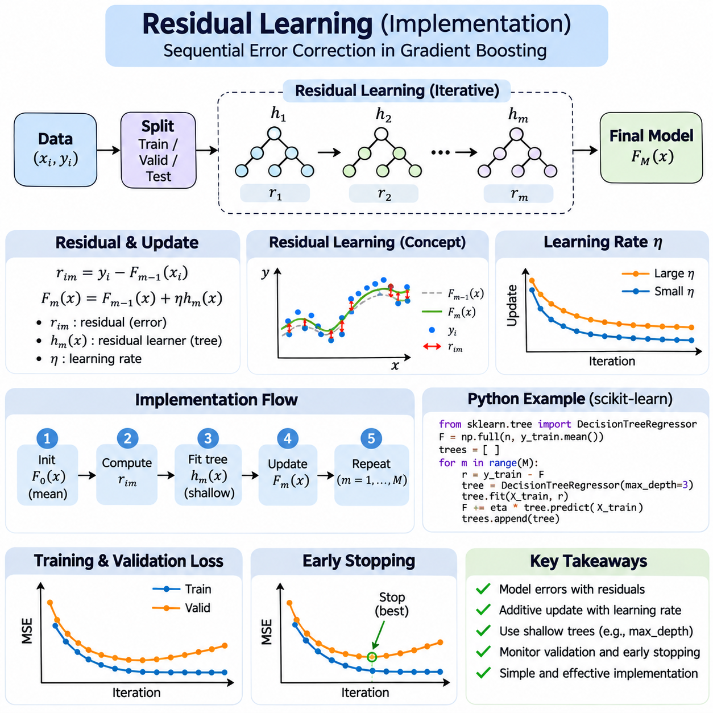{width="7.268055555555556in" height="7.268055555555556in"}

Residual learning is a fundamental mechanism of gradient boosting that improves predictions by repeatedly modeling errors left by earlier learners. Instead of training every model to predict the original target independently, residual learning directs each new learner toward the remaining discrepancies. This sequential correction process transforms simple regression models into an increasingly expressive ensemble capable of capturing complex patterns.

The implementation begins with a supervised dataset containing input features and corresponding target values. Each observation is represented by a feature vector x_i and a target y_i. Before training, the dataset should be divided into training, validation, and test subsets. These partitions support model fitting, hyperparameter selection, and independent performance evaluation while reducing the risk of overly optimistic results.

An initial prediction function establishes the baseline from which residual learning proceeds. For regression with squared error loss, the initial model commonly predicts the mean of the training targets for every observation. This constant prediction minimizes the sum of squared errors among all possible constant estimates. Although simple, it provides a mathematically appropriate starting point for subsequent corrective learning.

Once the initial predictions are available, residuals are calculated by subtracting predicted values from observed targets. For observation i at iteration m, the residual is expressed as r_im = y_i - F\\_(m-1)(x_i). Positive residuals indicate that the current ensemble underestimates the target, while negative residuals indicate overestimation. Their magnitudes describe the remaining prediction discrepancies.

The next implementation stage trains a weak regression learner using the original input features and calculated residuals as temporary targets. A shallow decision tree is commonly used because it can identify nonlinear relationships without excessive complexity. The tree learns which feature combinations explain the remaining errors, producing corrective predictions that can be incorporated into the existing ensemble.

After fitting the residual learner, the ensemble prediction is updated by adding a scaled version of its output. The update follows F_m(x) = F\\_(m-1)(x) + ηh_m(x), where h_m(x) represents the residual prediction and η is the learning rate. This additive structure ensures that each learner contributes an incremental correction rather than replacing the predictions generated by earlier stages.

The learning rate determines how strongly each corrective learner influences the ensemble. A value below one reduces the magnitude of residual corrections and encourages gradual optimization. Smaller values often require more boosting iterations but may improve generalization when combined with suitable model complexity. Larger values accelerate training progress but can produce unstable corrections or increase overfitting.

A practical implementation can begin with a synthetic regression dataset containing nonlinear relationships between input variables and target values. For example, the target may depend on polynomial terms, interactions between features, and random measurement noise. Such a dataset makes it possible to observe how successive residual learners capture relationships that a constant baseline or individual shallow tree cannot represent adequately.

The implementation can maintain an array containing the current ensemble predictions for all training observations. Initially, this array is filled with the mean target value. At each iteration, residuals are computed, a new regression tree is fitted, and its scaled predictions are added to the array. The fitted tree is then stored so that the complete ensemble can later reproduce the same sequence of corrections.

A minimal Python implementation can use NumPy for numerical operations and DecisionTreeRegressor from scikit-learn as the weak learner. The training procedure initializes the baseline, creates a sequence of shallow trees, and updates predictions after each fitted model. This manual construction exposes the essential mechanics of residual learning without relying on a complete gradient boosting library.

The prediction procedure must reproduce the same additive structure used during training. For a new observation, the model first generates the stored baseline prediction and then evaluates every fitted residual tree in training order. Each tree output is multiplied by the learning rate and added to the accumulated prediction. The final result represents the combined contribution of all corrective learners.

Training performance can be monitored by calculating mean squared error after every boosting iteration. Initially, the error reflects the limitations of the constant baseline. As new trees are introduced, training error generally decreases because the ensemble captures additional residual structure. However, improvements on training observations do not necessarily indicate equivalent improvements on previously unseen data.

Validation monitoring is essential for determining whether residual learning produces meaningful generalization. After each iteration, the current ensemble can predict validation observations, and the corresponding validation loss can be recorded. A decreasing validation loss indicates improved predictive performance on held-out data. If validation loss begins increasing while training loss continues decreasing, the ensemble may be overfitting.

Early stopping provides a practical method for controlling excessive boosting iterations. The training procedure tracks the best validation score and terminates when additional learners fail to improve performance for a specified number of rounds. The best-performing iteration should be retained for final prediction. This approach reduces unnecessary computation and helps prevent the ensemble from fitting progressively smaller noise patterns.

Tree complexity is another important implementation parameter. Shallow trees provide relatively simple residual corrections, while deeper trees can model more complicated feature interactions. Increasing maximum depth may accelerate training error reduction but can also make the ensemble sensitive to local irregularities. Minimum leaf size and maximum leaf count provide additional mechanisms for restricting corrective model complexity.

Residual learning can be extended beyond ordinary squared error regression by replacing conventional residuals with negative loss gradients. For a general differentiable loss function, the correction target becomes the negative derivative of the loss with respect to the current prediction. These pseudo-residuals identify locally beneficial update directions, allowing the same sequential learning architecture to support classification and robust regression objectives.

For binary classification, residual learning operates on continuous prediction scores rather than directly correcting discrete class labels. With logistic loss, pseudo-residuals are related to the difference between observed binary targets and predicted probabilities. The ensemble updates its score function, and a logistic transformation converts the resulting scores into probabilities. This distinction is essential when adapting regression-based implementations to classification.

The implementation must also consider numerical stability and data quality. Extreme target values can dominate squared error residuals, while incorrect labels may encourage the ensemble to learn misleading corrections. Robust loss functions, outlier analysis, and appropriate feature preprocessing can reduce these problems. Consistent numerical precision and careful handling of missing values further improve implementation reliability.

Computational efficiency depends on the number of observations, feature dimensions, tree complexity, and boosting iterations. Each stage requires calculating current residuals and fitting another learner, creating a sequential dependency across iterations. Memory consumption also increases because fitted trees must be retained for prediction. Efficient tree construction and controlled ensemble size are therefore important for practical deployment.

Residual analysis provides useful insight into whether the ensemble has learned meaningful structure. After training, remaining errors can be examined against input features, predicted values, and relevant operating conditions. Persistent systematic patterns may indicate insufficient model capacity, missing features, or unsuitable loss functions. Random-looking residuals can be encouraging, although they do not independently establish model correctness or generalization.

A reliable implementation should compare the manually constructed residual learning ensemble against an established GradientBoostingRegressor implementation. Both models can be trained using comparable learning rates, tree depths, and iteration counts. Their predictions and evaluation metrics can then be examined to verify the conceptual implementation, while recognizing that library-specific optimization details may produce different numerical results.

Reproducibility requires controlling random seeds, preserving dataset partitions, and recording model configuration. The initial baseline, fitted learners, learning rate, and selected stopping iteration should be stored together as a complete predictive artifact. Testing the reconstructed model on previously unseen observations verifies that the implementation preserves its training behavior and produces consistent predictions after deployment.

In industrial applications, residual learning can improve predictions involving equipment degradation, energy consumption, process quality, and sensor-based estimation. Early learners may capture dominant operating relationships, while later learners correct systematic deviations associated with load, temperature, or environmental conditions. Reliable deployment nevertheless requires monitoring for data drift, changing operating regimes, and unexpected prediction errors.

Residual learning demonstrates how gradient boosting transforms iterative error correction into a systematic model construction procedure. Its implementation follows a consistent sequence of baseline initialization, residual calculation, weak learner fitting, scaled prediction updates, and performance evaluation. Understanding these operations provides a practical foundation for advanced gradient boosting frameworks and their applications in reliable supervised learning systems.

잔차 학습(Residual Learning)은 이전 학습기(Learner)가 남긴 오차를 반복적으로 모델링하여 예측을 개선하는 그래디언트 부스팅(Gradient Boosting)의 핵심 메커니즘이다. 모든 모델이 원래 목표값(Target Value)을 독립적으로 예측하도록 학습하는 대신, 잔차 학습은 새로운 학습기가 남아 있는 예측 차이(Prediction Discrepancy)에 집중하도록 한다. 이러한 순차적 오류 수정 과정(Sequential Correction Process)은 단순한 회귀 모델(Regression Model)을 복잡한 패턴을 포착할 수 있는 표현력이 높은 앙상블(Ensemble)로 발전시킨다.

구현(Implementation)은 입력 특징(Input Feature)과 해당 목표값(Target Value)을 포함하는 지도 학습 데이터셋(Supervised Dataset)에서 시작한다. 각 관측값(Observation)은 특징 벡터(Feature Vector) x_i와 목표값 y_i로 표현된다. 학습 전에 데이터셋을 학습용(Training), 검증용(Validation), 테스트용(Test) 부분집합으로 분할해야 한다. 이러한 분할은 모델 적합(Model Fitting), 하이퍼파라미터 선택(Hyperparameter Selection), 독립적인 성능 평가(Independent Performance Evaluation)를 지원하며 지나치게 낙관적인 평가 결과가 발생할 위험을 줄인다.

초기 예측 함수(Initial Prediction Function)는 잔차 학습이 진행되는 기준선(Baseline)을 설정한다. 제곱 오차 손실(Squared Error Loss)을 사용하는 회귀에서는 초기 모델이 일반적으로 모든 관측값에 대해 학습 목표값의 평균을 예측한다. 이러한 상수 예측(Constant Prediction)은 가능한 모든 상수 추정값(Constant Estimate) 중 제곱 오차 합(Sum of Squared Errors)을 최소화한다. 단순한 방식이지만 이후의 오류 수정 학습(Corrective Learning)을 위한 수학적으로 적절한 출발점을 제공한다.

초기 예측값(Initial Prediction)이 생성되면 실제 목표값에서 예측값을 빼서 잔차(Residual)를 계산한다. 반복 단계 m에서 관측값 i의 잔차는 r_im = y_i - F\\_(m-1)(x_i)로 표현된다. 양의 잔차(Positive Residual)는 현재 앙상블이 목표값을 과소추정(Underestimation)하고 있음을 의미하며, 음의 잔차(Negative Residual)는 과대추정(Overestimation)을 의미한다. 잔차의 크기(Magnitude)는 아직 해결되지 않은 예측 차이를 나타낸다.

다음 구현 단계에서는 원래 입력 특징(Input Feature)과 계산된 잔차를 임시 목표값(Temporary Target)으로 사용하여 약한 회귀 학습기(Weak Regression Learner)를 학습한다. 얕은 결정 트리(Shallow Decision Tree)는 지나치게 복잡하지 않으면서 비선형 관계(Nonlinear Relationship)를 식별할 수 있기 때문에 일반적으로 사용된다. 트리는 남아 있는 오차를 설명하는 특징 조합(Feature Combination)을 학습하고, 기존 앙상블에 반영할 수 있는 수정 예측값(Corrective Prediction)을 생성한다.

잔차 학습기(Residual Learner)를 적합한 이후에는 해당 출력값에 비례 계수(Scaling Factor)를 적용하여 앙상블 예측을 갱신한다. 갱신 과정은 F_m(x) = F\\_(m-1)(x) + ηh_m(x)를 따른다. 여기서 h_m(x)는 잔차 예측값(Residual Prediction)을 나타내며, η는 학습률(Learning Rate)이다. 이러한 가산 구조(Additive Structure)는 각 학습기가 이전 단계에서 생성된 예측을 대체하는 대신 점진적인 수정값(Incremental Correction)을 추가하도록 보장한다.

학습률(Learning Rate)은 각 오류 수정 학습기(Corrective Learner)가 앙상블에 미치는 영향의 크기를 결정한다. 1보다 작은 학습률은 잔차 수정값의 크기를 줄여 점진적인 최적화(Gradual Optimization)를 유도한다. 작은 학습률은 일반적으로 더 많은 부스팅 반복(Boosting Iteration)을 필요로 하지만, 적절한 모델 복잡도(Model Complexity)와 결합하면 일반화 성능(Generalization Performance)을 개선할 수 있다. 반면 큰 학습률은 학습 진행을 가속하지만 불안정한 수정이나 과적합(Overfitting)을 증가시킬 수 있다.

실용적인 구현은 입력 변수(Input Variable)와 목표값 사이에 비선형 관계(Nonlinear Relationship)가 포함된 합성 회귀 데이터셋(Synthetic Regression Dataset)으로 시작할 수 있다. 예를 들어 목표값은 다항식 항(Polynomial Term), 특징 사이의 상호작용(Feature Interaction), 무작위 측정 잡음(Random Measurement Noise)에 따라 결정될 수 있다. 이러한 데이터셋은 연속적인 잔차 학습기가 상수 기준 모델(Constant Baseline Model)이나 개별 얕은 트리로는 충분히 표현하기 어려운 관계를 어떻게 포착하는지 관찰할 수 있게 한다.

구현 과정에서는 모든 학습 관측값에 대한 현재 앙상블 예측값(Current Ensemble Prediction)을 저장하는 배열(Array)을 유지할 수 있다. 초기에는 이 배열을 목표값의 평균으로 채운다. 각 반복에서 잔차를 계산하고 새로운 회귀 트리(Regression Tree)를 적합한 다음, 비례 조정된 예측값(Scaled Prediction)을 배열에 추가한다. 이후 적합된 트리를 저장하여 전체 앙상블이 나중에 동일한 수정 순서(Correction Sequence)를 재현할 수 있도록 한다.

최소한의 파이썬 구현(Minimal Python Implementation)은 수치 연산(Numerical Operation)에 NumPy를 사용하고, 약한 학습기(Weak Learner)로 사이킷런(scikit-learn)의 DecisionTreeRegressor를 사용할 수 있다. 학습 절차(Training Procedure)는 기준값을 초기화하고, 얕은 트리를 순차적으로 생성하며, 각 모델을 적합한 이후 예측값을 갱신한다. 이러한 수동 구성(Manual Construction)은 완전한 그래디언트 부스팅 라이브러리(Gradient Boosting Library)에 의존하지 않고 잔차 학습의 핵심 작동 원리를 드러낸다.

예측 절차(Prediction Procedure)는 학습 중 사용된 것과 동일한 가산 구조(Additive Structure)를 재현해야 한다. 새로운 관측값(New Observation)에 대해 모델은 먼저 저장된 기준 예측값(Baseline Prediction)을 생성한 다음, 학습 순서대로 적합된 모든 잔차 트리(Residual Tree)를 평가한다. 각 트리의 출력값에 학습률을 곱하고 누적 예측값(Accumulated Prediction)에 더한다. 최종 결과는 모든 오류 수정 학습기의 기여도를 결합한 예측값을 나타낸다.

학습 성능(Training Performance)은 각 부스팅 반복 이후 평균 제곱 오차(Mean Squared Error)를 계산하여 모니터링할 수 있다. 초기 오차는 상수 기준 모델(Constant Baseline)의 한계를 반영한다. 새로운 트리가 추가되면 앙상블이 추가적인 잔차 구조(Residual Structure)를 포착하므로 일반적으로 학습 오차(Training Error)가 감소한다. 그러나 학습 관측값에서의 성능 개선이 이전에 관찰하지 않은 데이터(Unseen Data)에서도 동일한 개선을 의미하는 것은 아니다.

검증 모니터링(Validation Monitoring)은 잔차 학습이 의미 있는 일반화(Generalization)를 만들어 내는지 판단하는 데 필수적이다. 각 반복 이후 현재 앙상블을 사용하여 검증 관측값(Validation Observation)을 예측하고 해당 검증 손실(Validation Loss)을 기록할 수 있다. 검증 손실이 감소하면 보류된 데이터(Held-Out Data)에 대한 예측 성능이 개선되고 있음을 의미한다. 반대로 학습 손실은 계속 감소하지만 검증 손실이 증가하기 시작하면 앙상블이 과적합되고 있을 가능성이 있다.

조기 종료(Early Stopping)는 과도한 부스팅 반복(Excessive Boosting Iteration)을 제어하는 실용적인 방법이다. 학습 절차는 최상의 검증 점수(Best Validation Score)를 추적하고, 지정된 반복 횟수 동안 추가 학습기가 성능을 개선하지 못하면 학습을 종료한다. 최종 예측에는 가장 우수한 성능을 보인 반복 단계(Best-Performing Iteration)를 유지해야 한다. 이러한 접근은 불필요한 계산을 줄이고 앙상블이 점점 더 작은 잡음 패턴(Noise Pattern)을 학습하는 것을 방지하는 데 도움을 준다.

트리 복잡도(Tree Complexity)는 또 다른 중요한 구현 매개변수(Implementation Parameter)이다. 얕은 트리는 비교적 단순한 잔차 수정(Residual Correction)을 제공하지만, 깊은 트리는 더욱 복잡한 특징 상호작용(Feature Interaction)을 모델링할 수 있다. 최대 깊이(Maximum Depth)를 증가시키면 학습 오차 감소가 빨라질 수 있지만, 앙상블이 국소적인 불규칙성(Local Irregularity)에 민감해질 수도 있다. 최소 리프 크기(Minimum Leaf Size)와 최대 리프 수(Maximum Leaf Count)는 오류 수정 모델의 복잡도를 제한하는 추가적인 메커니즘을 제공한다.

잔차 학습은 일반적인 제곱 오차 회귀를 넘어 기존 잔차를 음의 손실 기울기(Negative Loss Gradient)로 대체하여 확장할 수 있다. 일반적인 미분 가능한 손실 함수(Differentiable Loss Function)에서는 수정 목표값(Correction Target)이 현재 예측값에 대한 손실의 음의 도함수(Negative Derivative)가 된다. 이러한 의사 잔차(Pseudo-Residual)는 국소적으로 유리한 갱신 방향(Update Direction)을 식별하며, 동일한 순차적 학습 구조(Sequential Learning Architecture)가 분류(Classification)와 강건 회귀(Robust Regression) 목적 함수를 지원하도록 한다.

이진 분류(Binary Classification)에서 잔차 학습은 이산적인 클래스 레이블(Discrete Class Label)을 직접 수정하는 대신 연속적인 예측 점수(Continuous Prediction Score)를 대상으로 작동한다. 로지스틱 손실(Logistic Loss)을 사용하는 경우 의사 잔차는 관측된 이진 목표값(Binary Target)과 예측 확률(Predicted Probability)의 차이와 관련된다. 앙상블은 점수 함수(Score Function)를 갱신하고, 로지스틱 변환(Logistic Transformation)을 통해 결과 점수를 확률로 변환한다. 이러한 차이는 회귀 기반 구현을 분류 문제에 적용할 때 필수적으로 이해해야 한다.

구현에서는 수치 안정성(Numerical Stability)과 데이터 품질(Data Quality)도 고려해야 한다. 극단적인 목표값(Extreme Target Value)은 제곱 오차 잔차(Squared Error Residual)에 지배적인 영향을 미칠 수 있으며, 잘못된 레이블(Incorrect Label)은 앙상블이 오해를 유발하는 수정 패턴을 학습하도록 만들 수 있다. 강건한 손실 함수(Robust Loss Function), 이상치 분석(Outlier Analysis), 적절한 특징 전처리(Feature Preprocessing)는 이러한 문제를 줄일 수 있다. 일관된 수치 정밀도(Numerical Precision)와 결측값(Missing Value)의 신중한 처리 역시 구현의 신뢰성을 향상시킨다.

계산 효율성(Computational Efficiency)은 관측값의 수(Number of Observations), 특징 차원(Feature Dimension), 트리 복잡도(Tree Complexity), 부스팅 반복 횟수(Number of Boosting Iterations)에 따라 달라진다. 각 단계에서는 현재 잔차를 계산하고 새로운 학습기를 적합해야 하므로 반복 단계 사이에 순차적 의존성(Sequential Dependency)이 형성된다. 적합된 트리를 예측에 사용하기 위해 보관해야 하므로 메모리 사용량(Memory Consumption)도 증가한다. 따라서 효율적인 트리 구성(Efficient Tree Construction)과 앙상블 크기 제어(Controlled Ensemble Size)는 실제 배포에서 중요하다.

잔차 분석(Residual Analysis)은 앙상블이 의미 있는 구조를 학습했는지 이해하는 데 유용한 정보를 제공한다. 학습 이후 남아 있는 오차를 입력 특징(Input Feature), 예측값(Predicted Value), 관련 운전 조건(Operating Condition)과 비교하여 분석할 수 있다. 지속적인 체계적 패턴(Systematic Pattern)은 모델 용량(Model Capacity)의 부족, 누락된 특징(Missing Feature), 부적절한 손실 함수(Unsuitable Loss Function)를 나타낼 수 있다. 잔차가 무작위적인 형태를 보이는 것은 긍정적인 신호일 수 있지만, 그것만으로 모델의 정확성이나 일반화 성능이 입증되는 것은 아니다.

신뢰할 수 있는 구현(Reliable Implementation)을 위해서는 수동으로 구성한 잔차 학습 앙상블(Residual Learning Ensemble)을 검증된 GradientBoostingRegressor 구현과 비교해야 한다. 두 모델은 유사한 학습률(Learning Rate), 트리 깊이(Tree Depth), 반복 횟수(Iteration Count)를 사용하여 학습할 수 있다. 이후 예측값과 평가 지표(Evaluation Metric)를 비교하여 개념적 구현(Conceptual Implementation)을 검증할 수 있다. 다만 라이브러리별 최적화 세부 사항(Optimization Detail)에 따라 수치 결과가 달라질 수 있다는 점을 고려해야 한다.

재현성(Reproducibility)을 확보하려면 무작위 시드(Random Seed)를 제어하고, 데이터셋 분할(Dataset Partition)을 유지하며, 모델 설정(Model Configuration)을 기록해야 한다. 초기 기준값(Initial Baseline), 적합된 학습기(Fitted Learner), 학습률(Learning Rate), 선택된 종료 반복 단계(Selected Stopping Iteration)를 완전한 예측 산출물(Predictive Artifact)로 함께 저장해야 한다. 이전에 관찰하지 않은 데이터에 대해 복원된 모델(Reconstructed Model)을 테스트하면 구현이 학습 동작을 보존하고 배포 이후에도 일관된 예측을 생성하는지 검증할 수 있다.

산업 응용(Industrial Application)에서 잔차 학습은 장비 열화(Equipment Degradation), 에너지 소비(Energy Consumption), 공정 품질(Process Quality), 센서 기반 추정(Sensor-Based Estimation)과 관련된 예측을 개선할 수 있다. 초기 학습기는 주요 운전 관계(Dominant Operating Relationship)를 포착하고, 이후 학습기는 부하(Load), 온도(Temperature), 환경 조건(Environmental Condition)에 따른 체계적인 편차(Systematic Deviation)를 수정할 수 있다. 그러나 신뢰할 수 있는 배포를 위해서는 데이터 드리프트(Data Drift), 변화하는 운전 영역(Operating Regime), 예상하지 못한 예측 오차(Unexpected Prediction Error)에 대한 지속적인 모니터링이 필요하다.

잔차 학습(Residual Learning)은 그래디언트 부스팅이 반복적인 오류 수정(Iterative Error Correction)을 체계적인 모델 구성 절차(Systematic Model Construction Procedure)로 전환하는 방법을 보여준다. 구현은 기준값 초기화(Baseline Initialization), 잔차 계산(Residual Calculation), 약한 학습기 적합(Weak Learner Fitting), 비례 조정된 예측 갱신(Scaled Prediction Update), 성능 평가(Performance Evaluation)의 일관된 순서를 따른다. 이러한 과정을 이해하는 것은 고급 그래디언트 부스팅 프레임워크(Advanced Gradient Boosting Framework)와 신뢰할 수 있는 지도 학습 시스템(Reliable Supervised Learning System)의 실제 응용을 위한 실용적인 기초를 제공한다.

## 06.03 XGBoost

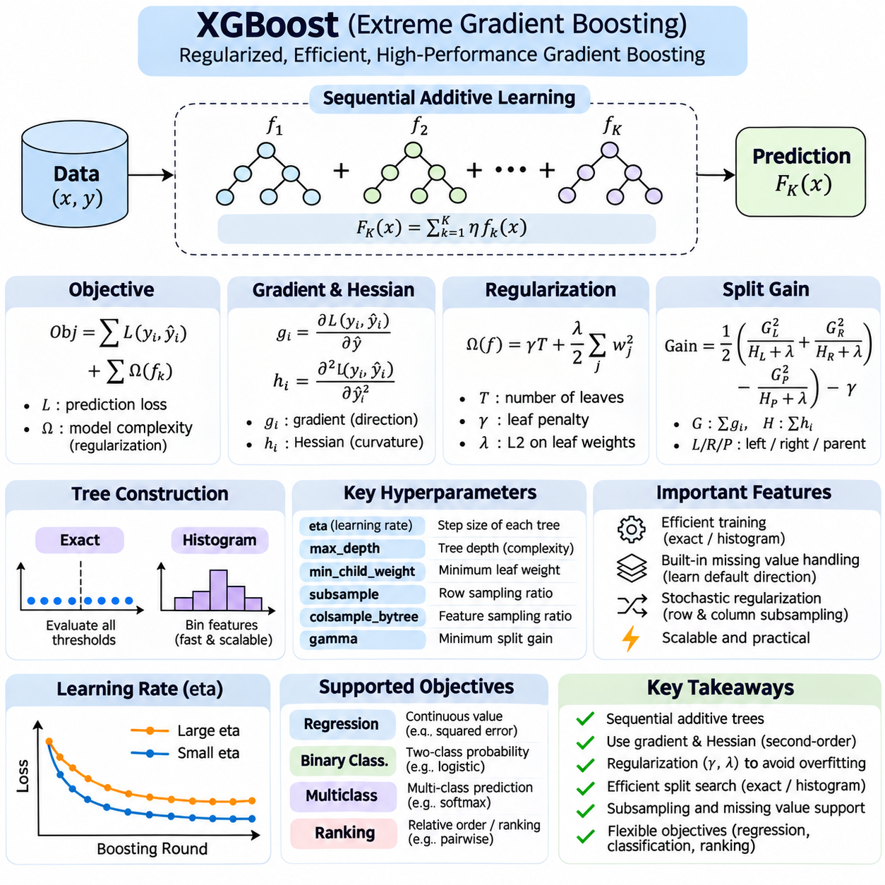{width="7.268055555555556in" height="7.268055555555556in"}

XGBoost, or Extreme Gradient Boosting, is an advanced implementation of gradient-boosted decision trees designed to deliver high predictive accuracy and computational efficiency. It extends conventional gradient boosting through regularized optimization, efficient tree construction, and scalable training algorithms. XGBoost is particularly effective for structured tabular data, where nonlinear relationships and complex feature interactions frequently determine predictive performance.

The fundamental principle of XGBoost is sequential additive learning, in which each new decision tree improves predictions generated by the existing ensemble. Instead of constructing a single complex model, XGBoost combines numerous relatively simple trees into a unified predictor. Each tree contributes corrective values that reduce the objective function, allowing the ensemble to represent increasingly sophisticated relationships across successive boosting iterations.

XGBoost formulates learning as the minimization of an objective containing both prediction loss and model complexity penalties. The objective can be expressed as Obj = ΣL(y_i, ŷ_i) + ΣΩ(f_k), where L measures prediction error and Ω penalizes tree complexity. This regularized formulation discourages unnecessarily complicated trees and helps control overfitting while maintaining sufficient flexibility to model nonlinear patterns.

A central innovation of XGBoost is its use of second-order information during optimization. Conventional first-order gradient boosting primarily relies on gradients of the loss function, whereas XGBoost commonly incorporates both first and second derivatives. These quantities describe the direction and local curvature of the loss surface. Their combination enables efficient approximations of objective changes when evaluating candidate tree structures and leaf predictions.

During each boosting iteration, XGBoost calculates gradients and Hessians for training observations based on current ensemble predictions. The gradient indicates how prediction changes affect the loss, while the Hessian describes local curvature. These values are aggregated within candidate tree leaves to estimate optimal leaf weights and split improvements. This mechanism connects tree construction directly to the mathematical objective being minimized.

The regularization function in XGBoost commonly includes penalties on the number of leaves and the magnitude of leaf outputs. A typical expression is Ω(f) = γT + (λ/2)Σw_j², where T represents the number of leaves, γ penalizes additional leaves, and λ controls L2 regularization of leaf weights. These penalties encourage simpler tree structures and reduce the influence of excessively large corrective predictions.

Tree construction in XGBoost relies on evaluating candidate splits according to their estimated improvement in the regularized objective. The split gain is calculated using aggregated gradient and Hessian statistics from the parent and child regions. A split is accepted when its improvement justifies the additional complexity penalty. This criterion helps the algorithm construct trees that balance prediction accuracy with structural simplicity.

XGBoost supports several tree construction strategies, including exact and histogram-based split finding. Exact methods evaluate candidate thresholds more directly but can become expensive on large datasets. Histogram-based methods group feature values into discrete bins and evaluate splits using aggregated statistics. This approximation substantially reduces computational requirements and is widely used for efficient training on large structured datasets.

The learning rate, commonly represented by eta, controls the contribution of each newly constructed tree. Smaller learning rates reduce the magnitude of corrective updates and typically require more boosting rounds. This gradual optimization can improve generalization when combined with suitable regularization and validation procedures. However, excessively small learning rates increase training time without guaranteeing better predictive performance.

Tree depth is another important hyperparameter controlling model expressiveness. Shallow trees capture relatively simple relationships, while deeper trees represent more complex interactions among input variables. Excessive depth can increase overfitting and computational cost, especially when the dataset contains noise. Parameters such as max_depth and min_child_weight help restrict tree growth and improve the stability of learned corrections.

XGBoost also introduces stochastic regularization through row and column subsampling. Row subsampling selects a fraction of training observations for constructing individual trees, while column subsampling restricts the features considered during tree construction. These mechanisms introduce controlled randomness, reduce computational workload, and may improve generalization by preventing excessive dependence on particular observations or features.

Missing-value handling is an important practical capability of XGBoost. During tree construction, the algorithm can learn a default direction for observations whose splitting feature is missing. This allows many datasets containing incomplete numerical measurements to be processed without mandatory external imputation. Nevertheless, missingness patterns should still be examined because systematic missing values may reflect operational or data collection problems.

XGBoost supports multiple supervised learning objectives, including regression, binary classification, multiclass classification, and ranking. The selected objective determines the loss function, gradient calculations, and interpretation of model outputs. Regression objectives produce continuous predictions, while classification objectives can produce probabilities or class-related scores. Ranking objectives optimize relationships among ordered observations rather than treating each prediction independently.

For binary classification, XGBoost commonly uses logistic loss and constructs additive prediction scores that are transformed into probabilities. Each tree modifies the current score based on gradient and curvature information. The logistic transformation maps the accumulated score into the interval between zero and one. This approach allows nonlinear decision boundaries while maintaining a probabilistic interpretation of model outputs.

A practical XGBoost implementation typically begins with data preparation, feature selection, and the creation of training and validation partitions. The model is configured with an objective function, learning rate, tree complexity constraints, and boosting iteration limits. During training, evaluation metrics are monitored on held-out data. Early stopping can identify a suitable number of boosting rounds and reduce unnecessary model complexity.

The Python XGBoost library provides interfaces compatible with scikit-learn, including XGBRegressor and XGBClassifier. These interfaces support familiar operations such as fitting models, generating predictions, and evaluating performance. The lower-level training interface offers additional control over data structures, evaluation procedures, and training configuration. Both approaches implement the same underlying principle of regularized gradient-boosted tree learning.

Hyperparameter tuning is essential because XGBoost performance depends on interactions among learning rate, tree depth, sampling ratios, and regularization strength. Grid search, randomized search, and Bayesian optimization can explore alternative configurations. Cross-validation provides more reliable estimates of generalization than evaluating a single training partition. Careful experimental design is particularly important when observations contain temporal or group dependencies.

Early stopping is especially valuable when training ensembles with many boosting rounds. The procedure monitors a validation metric and identifies when additional trees no longer produce meaningful improvements. Depending on the interface and configuration, training may stop after a specified patience interval, while prediction can use the best recorded iteration. This reduces unnecessary computation and limits the tendency to fit progressively smaller training irregularities.

Feature importance analysis can help identify variables that influence XGBoost predictions. Common importance measures include split frequency, gain, and coverage, each describing a different aspect of feature contribution. SHAP-based explanations can provide more detailed information about individual predictions. However, correlated features and dataset characteristics may complicate interpretation, and feature importance should not be mistaken for causal influence.

XGBoost is widely applicable to industrial prediction problems involving equipment health, energy consumption, manufacturing quality, and operational risk. Sensor statistics, historical measurements, environmental conditions, and engineered indicators can be combined into structured feature vectors. The resulting ensemble can learn nonlinear interactions that are difficult to capture with simple linear models, provided that training data accurately represents relevant operating conditions.

Computational efficiency is a major reason for XGBoost\'s practical adoption. Histogram-based split evaluation, parallel processing, efficient data structures, and optimized memory access reduce training overhead. The framework also supports accelerator-based training in suitable environments. Nevertheless, performance depends on dataset size, feature characteristics, hardware resources, and selected algorithms, making benchmarking necessary for demanding deployment scenarios.

Model reliability requires more than high accuracy on a static benchmark. Data leakage, class imbalance, distribution shifts, and unstable feature definitions can produce misleading evaluation results. Robust deployment therefore requires appropriate validation strategies, calibration analysis when probabilities are important, and monitoring of changing input distributions. Retraining procedures should be established when operational conditions evolve beyond those represented in the original dataset.

XGBoost demonstrates how gradient boosting can be transformed into a scalable and strongly regularized machine learning framework. Its combination of additive tree learning, second-order optimization, complexity penalties, and efficient split evaluation provides a powerful foundation for structured-data prediction. Understanding these mechanisms supports effective implementation, systematic hyperparameter tuning, and reliable application of gradient-boosted models in research and industrial systems.

XGBoost(Extreme Gradient Boosting)는 높은 예측 정확도(Predictive Accuracy)와 계산 효율성(Computational Efficiency)을 제공하도록 설계된 고급 그래디언트 부스팅 결정 트리(Gradient-Boosted Decision Tree) 구현이다. XGBoost는 정규화된 최적화(Regularized Optimization), 효율적인 트리 구성(Efficient Tree Construction), 확장 가능한 학습 알고리즘(Scalable Training Algorithm)을 통해 기존 그래디언트 부스팅을 확장한다. 특히 비선형 관계(Nonlinear Relationship)와 복잡한 특징 상호작용(Feature Interaction)이 예측 성능을 결정하는 정형 테이블 데이터(Structured Tabular Data)에서 효과적이다.

XGBoost의 기본 원리(Fundamental Principle)는 순차적 가산 학습(Sequential Additive Learning)으로, 새로운 결정 트리(Decision Tree)가 기존 앙상블(Ensemble)에서 생성된 예측을 개선하는 방식이다. 하나의 복잡한 모델을 구성하는 대신, XGBoost는 비교적 단순한 여러 트리를 결합하여 통합 예측기(Unified Predictor)를 형성한다. 각 트리는 목적 함수(Objective Function)를 감소시키는 수정값(Corrective Value)을 제공하며, 앙상블은 연속적인 부스팅 반복(Boosting Iteration)을 통해 점점 더 정교한 관계를 표현할 수 있다.

XGBoost는 예측 손실(Prediction Loss)과 모델 복잡도 벌점(Model Complexity Penalty)을 모두 포함하는 목적 함수를 최소화하는 방식으로 학습을 정의한다. 목적 함수는 Obj = ΣL(y_i, ŷ_i) + ΣΩ(f_k)로 표현할 수 있으며, 여기서 L은 예측 오차를 측정하고 Ω는 트리 복잡도에 벌점을 부과한다. 이러한 정규화된 공식(Regularized Formulation)은 불필요하게 복잡한 트리의 생성을 억제하고, 비선형 패턴을 모델링하는 데 필요한 유연성을 유지하면서 과적합(Overfitting)을 제어하는 데 도움을 준다.

XGBoost의 핵심적인 혁신(Core Innovation)은 최적화 과정에서 이차 정보(Second-Order Information)를 활용한다는 점이다. 기존의 일차 그래디언트 부스팅(First-Order Gradient Boosting)은 주로 손실 함수의 기울기(Gradient)에 의존하지만, XGBoost는 일반적으로 일차 도함수(First Derivative)와 이차 도함수(Second Derivative)를 모두 활용한다. 이러한 값은 손실 곡면(Loss Surface)의 방향과 국소 곡률(Local Curvature)을 설명하며, 후보 트리 구조와 리프 예측값을 평가할 때 목적 함수 변화량을 효율적으로 근사할 수 있도록 한다.

각 부스팅 반복(Boosting Iteration)에서 XGBoost는 현재 앙상블 예측을 기반으로 학습 관측값(Training Observation)의 기울기(Gradient)와 헤시안(Hessian)을 계산한다. 기울기는 예측값의 변화가 손실에 미치는 영향을 나타내고, 헤시안은 국소 곡률을 설명한다. 이러한 값은 후보 트리의 리프(Leaf) 내부에서 집계되어 최적 리프 가중치(Optimal Leaf Weight)와 분할 개선량(Split Improvement)을 추정하는 데 사용된다. 이 메커니즘은 트리 구성을 최소화하려는 수학적 목적 함수와 직접 연결한다.

XGBoost의 정규화 함수(Regularization Function)는 일반적으로 리프 수(Number of Leaves)와 리프 출력값(Leaf Output)의 크기에 대한 벌점을 포함한다. 대표적인 표현은 Ω(f) = γT + (λ/2)Σw_j²이며, 여기서 T는 리프 수, γ는 추가 리프에 대한 벌점, λ는 리프 가중치에 대한 L2 정규화(L2 Regularization)를 제어한다. 이러한 벌점은 더 단순한 트리 구조(Tree Structure)를 유도하고 지나치게 큰 수정 예측값(Corrective Prediction)의 영향을 줄인다.

XGBoost의 트리 구성(Tree Construction)은 정규화된 목적 함수(Regularized Objective Function)의 예상 개선량을 기준으로 후보 분할(Candidate Split)을 평가한다. 분할 이득(Split Gain)은 부모 영역(Parent Region)과 자식 영역(Child Region)의 집계된 기울기 및 헤시안 통계량을 사용하여 계산된다. 분할에 따른 개선 효과가 추가적인 복잡도 벌점(Complexity Penalty)을 정당화할 때 해당 분할이 허용된다. 이러한 기준은 예측 정확도와 구조적 단순성(Structural Simplicity) 사이의 균형을 유지하는 트리를 구성하도록 돕는다.

XGBoost는 정확한 분할 탐색(Exact Split Finding)과 히스토그램 기반 분할 탐색(Histogram-Based Split Finding)을 포함한 여러 트리 구성 전략을 지원한다. 정확한 방법(Exact Method)은 후보 임계값(Candidate Threshold)을 보다 직접적으로 평가하지만 대규모 데이터셋에서는 계산 비용이 증가할 수 있다. 히스토그램 기반 방법은 특징값(Feature Value)을 이산 구간(Discrete Bin)으로 묶고 집계된 통계량을 사용하여 분할을 평가한다. 이러한 근사 방식은 계산 요구량을 크게 줄이며 대규모 정형 데이터셋의 효율적인 학습에 널리 사용된다.

일반적으로 eta로 표현되는 학습률(Learning Rate)은 새롭게 구성된 각 트리의 기여도를 제어한다. 작은 학습률은 수정 갱신(Corrective Update)의 크기를 줄이며 일반적으로 더 많은 부스팅 라운드(Boosting Round)를 필요로 한다. 이러한 점진적 최적화(Gradual Optimization)는 적절한 정규화와 검증 절차(Validation Procedure)를 결합할 경우 일반화 성능(Generalization Performance)을 개선할 수 있다. 그러나 지나치게 작은 학습률은 더 나은 예측 성능을 보장하지 않으면서 학습 시간(Training Time)을 증가시킨다.

트리 깊이(Tree Depth)는 모델 표현 능력(Model Expressiveness)을 제어하는 또 다른 중요한 하이퍼파라미터(Hyperparameter)이다. 얕은 트리는 비교적 단순한 관계를 포착하지만, 깊은 트리는 입력 변수(Input Variable) 사이의 더욱 복잡한 상호작용을 표현한다. 특히 데이터셋에 잡음(Noise)이 포함된 경우 지나치게 깊은 트리는 과적합과 계산 비용을 증가시킬 수 있다. max_depth와 min_child_weight 같은 매개변수는 트리 성장을 제한하고 학습된 수정값의 안정성(Stability)을 향상시키는 데 도움을 준다.

XGBoost는 행 및 열 부분 표본 추출(Row and Column Subsampling)을 통해 확률적 정규화(Stochastic Regularization)도 도입한다. 행 부분 표본 추출(Row Subsampling)은 개별 트리를 구성할 때 학습 관측값의 일부를 선택하고, 열 부분 표본 추출(Column Subsampling)은 트리 구성 과정에서 고려하는 특징을 제한한다. 이러한 메커니즘은 제어된 무작위성(Controlled Randomness)을 도입하여 계산 작업량을 줄이고 특정 관측값이나 특징에 대한 과도한 의존을 방지함으로써 일반화 성능을 개선할 수 있다.

결측값 처리(Missing-Value Handling)는 XGBoost의 중요한 실용적 기능이다. 트리 구성 과정에서 알고리즘은 분할에 사용되는 특징값이 누락된 관측값에 대한 기본 이동 방향(Default Direction)을 학습할 수 있다. 이를 통해 불완전한 수치 측정값(Incomplete Numerical Measurement)을 포함하는 많은 데이터셋을 외부 결측값 대체(External Imputation) 없이 처리할 수 있다. 그러나 체계적인 결측 패턴(Systematic Missingness Pattern)은 운영 문제나 데이터 수집 문제(Data Collection Problem)를 반영할 수 있으므로 여전히 분석해야 한다.

XGBoost는 회귀(Regression), 이진 분류(Binary Classification), 다중 클래스 분류(Multiclass Classification), 순위 학습(Ranking)을 포함한 다양한 지도 학습 목적 함수(Supervised Learning Objective)를 지원한다. 선택된 목적 함수는 손실 함수(Loss Function), 기울기 계산(Gradient Calculation), 모델 출력(Model Output)의 해석 방식을 결정한다. 회귀 목적 함수는 연속적인 예측값(Continuous Prediction)을 생성하고, 분류 목적 함수는 확률 또는 클래스 관련 점수(Class-Related Score)를 생성할 수 있다. 순위 학습 목적 함수는 각 예측을 독립적으로 처리하는 대신 관측값 사이의 순서 관계(Ordered Relationship)를 최적화한다.

이진 분류(Binary Classification)에서 XGBoost는 일반적으로 로지스틱 손실(Logistic Loss)을 사용하고, 확률로 변환되는 가산 예측 점수(Additive Prediction Score)를 구성한다. 각 트리는 기울기와 곡률 정보(Curvature Information)를 기반으로 현재 점수를 수정한다. 로지스틱 변환(Logistic Transformation)은 누적 점수(Accumulated Score)를 0과 1 사이의 구간으로 변환한다. 이러한 접근은 모델 출력에 확률적 해석(Probabilistic Interpretation)을 유지하면서 비선형 결정 경계(Nonlinear Decision Boundary)를 형성할 수 있도록 한다.

실용적인 XGBoost 구현(Practical XGBoost Implementation)은 일반적으로 데이터 준비(Data Preparation), 특징 선택(Feature Selection), 학습 및 검증 데이터 분할(Training and Validation Partition)에서 시작한다. 모델은 목적 함수(Objective Function), 학습률(Learning Rate), 트리 복잡도 제약(Tree Complexity Constraint), 부스팅 반복 제한(Boosting Iteration Limit)을 사용하여 설정된다. 학습 중에는 보류된 데이터(Held-Out Data)에 대한 평가 지표(Evaluation Metric)를 모니터링한다. 조기 종료(Early Stopping)는 적절한 부스팅 라운드 수를 식별하고 불필요한 모델 복잡도를 줄이는 데 활용할 수 있다.

파이썬 XGBoost 라이브러리(Python XGBoost Library)는 XGBRegressor와 XGBClassifier를 포함하여 사이킷런(scikit-learn)과 호환되는 인터페이스(Interface)를 제공한다. 이러한 인터페이스는 모델 적합(Model Fitting), 예측 생성(Prediction Generation), 성능 평가(Performance Evaluation)와 같은 익숙한 작업을 지원한다. 저수준 학습 인터페이스(Lower-Level Training Interface)는 데이터 구조(Data Structure), 평가 절차(Evaluation Procedure), 학습 설정(Training Configuration)에 대한 추가적인 제어 기능을 제공한다. 두 접근법 모두 정규화된 그래디언트 부스팅 트리 학습(Regularized Gradient-Boosted Tree Learning)이라는 동일한 기본 원리를 구현한다.

XGBoost의 성능은 학습률, 트리 깊이, 표본 추출 비율(Sampling Ratio), 정규화 강도(Regularization Strength) 사이의 상호작용에 의존하므로 하이퍼파라미터 튜닝(Hyperparameter Tuning)이 필수적이다. 격자 탐색(Grid Search), 무작위 탐색(Randomized Search), 베이지안 최적화(Bayesian Optimization)를 사용하여 다양한 설정을 탐색할 수 있다. 교차 검증(Cross-Validation)은 단일 학습 데이터 분할을 평가하는 것보다 일반화 성능에 대한 신뢰할 수 있는 추정값을 제공한다. 관측값 사이에 시간적 의존성(Temporal Dependency)이나 그룹 의존성(Group Dependency)이 존재하는 경우에는 신중한 실험 설계(Experimental Design)가 특히 중요하다.

조기 종료(Early Stopping)는 많은 부스팅 라운드로 구성된 앙상블을 학습할 때 특히 유용하다. 이 절차는 검증 지표(Validation Metric)를 모니터링하고 추가적인 트리가 더 이상 의미 있는 개선을 제공하지 않는 시점을 식별한다. 인터페이스와 설정에 따라 지정된 인내 구간(Patience Interval) 이후 학습이 중단될 수 있으며, 예측에는 기록된 최적 반복 단계(Best Recorded Iteration)를 사용할 수 있다. 이러한 방법은 불필요한 계산을 줄이고 점점 더 작은 학습 데이터의 불규칙성(Training Irregularity)에 과도하게 적합되는 경향을 제한한다.

특징 중요도 분석(Feature Importance Analysis)은 XGBoost의 예측에 영향을 미치는 변수를 식별하는 데 도움을 줄 수 있다. 일반적인 중요도 측정 방법에는 분할 빈도(Split Frequency), 이득(Gain), 커버리지(Coverage)가 있으며, 각각 특징 기여도(Feature Contribution)의 서로 다른 측면을 설명한다. SHAP 기반 설명(SHAP-Based Explanation)은 개별 예측에 대한 더욱 상세한 정보를 제공할 수 있다. 그러나 상관관계가 있는 특징(Correlated Feature)과 데이터셋 특성은 해석을 복잡하게 만들 수 있으며, 특징 중요도를 인과적 영향(Causal Influence)으로 오해해서는 안 된다.

XGBoost는 장비 상태(Equipment Health), 에너지 소비(Energy Consumption), 제조 품질(Manufacturing Quality), 운영 위험(Operational Risk)과 관련된 산업 예측 문제에 폭넓게 적용할 수 있다. 센서 통계량(Sensor Statistics), 과거 측정값(Historical Measurement), 환경 조건(Environmental Condition), 특징 공학으로 생성된 지표(Engineered Indicator)를 정형 특징 벡터(Structured Feature Vector)로 결합할 수 있다. 학습 데이터가 관련 운전 조건(Operating Condition)을 정확하게 반영한다면, 생성된 앙상블은 단순한 선형 모델(Linear Model)로 포착하기 어려운 비선형 상호작용을 학습할 수 있다.

계산 효율성(Computational Efficiency)은 XGBoost가 실무에서 널리 채택되는 주요 이유 중 하나이다. 히스토그램 기반 분할 평가(Histogram-Based Split Evaluation), 병렬 처리(Parallel Processing), 효율적인 데이터 구조(Efficient Data Structure), 최적화된 메모리 접근(Optimized Memory Access)은 학습 오버헤드(Training Overhead)를 줄인다. 또한 적절한 환경에서는 가속기 기반 학습(Accelerator-Based Training)도 지원한다. 그러나 실제 성능은 데이터셋 크기(Dataset Size), 특징 특성(Feature Characteristics), 하드웨어 자원(Hardware Resource), 선택된 알고리즘에 따라 달라지므로 높은 요구사항을 가진 배포 환경에서는 벤치마킹(Benchmarking)이 필요하다.

모델 신뢰성(Model Reliability)을 확보하려면 정적인 벤치마크(Static Benchmark)에서 높은 정확도를 달성하는 것만으로는 충분하지 않다. 데이터 누출(Data Leakage), 클래스 불균형(Class Imbalance), 분포 변화(Distribution Shift), 불안정한 특징 정의(Unstable Feature Definition)는 잘못된 평가 결과를 만들어 낼 수 있다. 따라서 강건한 배포(Robust Deployment)를 위해서는 적절한 검증 전략(Validation Strategy), 확률이 중요한 경우의 보정 분석(Calibration Analysis), 입력 분포 변화에 대한 모니터링(Monitoring)이 필요하다. 운영 조건이 원래 데이터셋에 포함된 범위를 벗어나 변화하는 경우에는 재학습 절차(Retraining Procedure)를 마련해야 한다.

XGBoost는 그래디언트 부스팅(Gradient Boosting)이 확장 가능하고 강력하게 정규화된 머신러닝 프레임워크(Scalable and Strongly Regularized Machine Learning Framework)로 발전할 수 있음을 보여준다. 가산 트리 학습(Additive Tree Learning), 이차 최적화(Second-Order Optimization), 복잡도 벌점(Complexity Penalty), 효율적인 분할 평가(Efficient Split Evaluation)의 결합은 정형 데이터 예측(Structured-Data Prediction)을 위한 강력한 기반을 제공한다. 이러한 메커니즘을 이해하면 효과적인 구현, 체계적인 하이퍼파라미터 튜닝, 연구 및 산업 시스템에서 그래디언트 부스팅 모델을 신뢰성 있게 적용하는 데 도움이 된다.

## 06.04 LightGBM

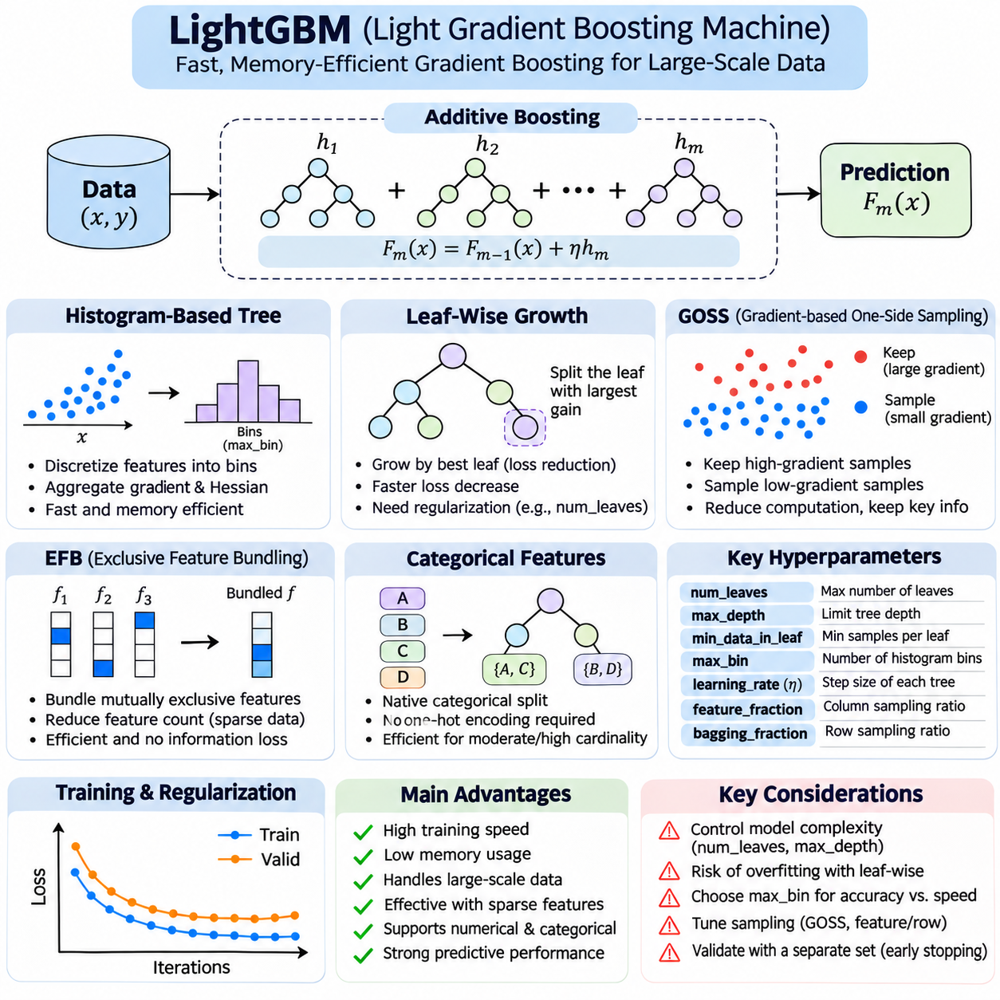{width="7.268055555555556in" height="7.268055555555556in"}

LightGBM, or Light Gradient Boosting Machine, is an efficient gradient-boosted decision tree framework designed for large-scale supervised learning. It emphasizes high training speed, reduced memory consumption, and strong predictive performance on structured datasets. By combining histogram-based tree construction with specialized sampling and feature optimization techniques, LightGBM makes gradient boosting practical for datasets containing millions of observations and numerous input features.

The fundamental learning principle of LightGBM follows the additive boosting framework. Each new decision tree attempts to reduce prediction errors remaining in the current ensemble. The model is updated through F_m(x) = F\\_(m-1)(x) + ηh_m(x), where η represents the learning rate and h_m(x) denotes the newly trained tree. This sequential correction process allows relatively simple learners to represent complex nonlinear relationships and interactions.

A defining characteristic of LightGBM is its histogram-based decision tree algorithm. Continuous feature values are grouped into discrete bins before split evaluation, allowing the algorithm to operate on compact histogram statistics rather than repeatedly examining every individual value. This representation reduces memory requirements and accelerates split calculations, particularly when training on large datasets with many numerical features.

Histogram construction aggregates gradient and Hessian statistics for observations assigned to each feature bin. Candidate split points are evaluated using cumulative statistics derived from these histograms. Because the number of bins is generally much smaller than the number of unique feature values, split evaluation becomes computationally efficient. The max_bin parameter controls histogram resolution and influences the balance between computational cost and split precision.

LightGBM commonly uses leaf-wise tree growth rather than the level-wise strategy employed by many traditional boosting implementations. In leaf-wise growth, the algorithm selects the leaf offering the greatest estimated reduction in training loss and splits that leaf first. This approach can achieve rapid loss reduction with a limited number of leaves, although it may create unbalanced trees that require careful regularization.

The distinction between leaf-wise and level-wise growth affects both predictive capacity and overfitting risk. Level-wise algorithms expand nodes at similar depths, producing relatively balanced trees. Leaf-wise growth concentrates computational effort on regions where additional splits offer the greatest improvement. Although this can increase learning efficiency, unrestricted leaf-wise growth may produce highly specialized branches, particularly when training datasets are small or noisy.

The num_leaves parameter is one of the most important controls in LightGBM. It limits the maximum number of terminal leaves in each tree and therefore constrains model complexity. Larger values permit more detailed partitions and stronger feature interactions, while smaller values encourage simpler corrections. Appropriate selection should consider dataset size, feature dimensionality, noise characteristics, and validation performance.

LightGBM also provides max_depth and min_data_in_leaf parameters to control tree growth. Maximum depth limits the length of decision paths, while minimum leaf data requirements discourage splits supported by very few observations. These restrictions are particularly important for leaf-wise learning because the algorithm may otherwise create deep branches that fit isolated training patterns rather than relationships that generalize.

Gradient-based One-Side Sampling, commonly abbreviated GOSS, is a specialized sampling technique associated with LightGBM. It retains observations with large gradient magnitudes while randomly sampling a portion of observations with smaller gradients. The smaller-gradient observations receive appropriate weighting adjustments when estimating split gains. This approach aims to preserve informative gradient statistics while reducing the number of observations used during tree construction.

The intuition behind GOSS is that observations with large gradients often contribute more strongly to immediate optimization decisions. Examples already predicted accurately tend to produce smaller gradients under common losses, whereas difficult observations may generate larger gradients. By retaining high-gradient observations and sampling others, GOSS can reduce computation while maintaining useful information for identifying promising tree splits.

Exclusive Feature Bundling, or EFB, is another optimization technique introduced in LightGBM. It combines features that are rarely nonzero simultaneously into shared representations, reducing the effective number of features processed during training. This approach is especially useful for sparse datasets containing one-hot encoded variables or other mutually exclusive indicators. Efficient bundling can substantially reduce feature-processing overhead without discarding important information.

EFB relies on the observation that many sparse features occupy nonoverlapping regions of the dataset. When features are mutually exclusive, their values can be assigned distinct histogram ranges within a bundled feature. Features with limited conflicts may also be bundled using approximate strategies. The effectiveness of this technique depends on sparsity patterns and the degree of overlap among candidate features.

LightGBM supports numerical and categorical features through specialized split procedures. For categorical variables, the framework can evaluate category partitions without requiring every category to be converted into separate one-hot encoded columns. This capability can improve efficiency when categorical cardinality is moderate or high. However, correct category representation, appropriate regularization, and consistent preprocessing remain essential for reliable model behavior.

Missing-value handling is integrated into LightGBM\'s tree construction process. The algorithm can learn how observations with missing feature values should be directed during splitting. This reduces the need for mandatory imputation in many applications. Nevertheless, missing values may contain operational meaning, and their distribution should be examined to identify possible sensor failures, data collection inconsistencies, or systematic sampling biases.

LightGBM supports regression, binary classification, multiclass classification, and ranking objectives. Each objective defines an appropriate loss function and determines how gradients and Hessians are calculated. Regression produces continuous predictions, while classification models can generate probability estimates through suitable output transformations. Ranking objectives are useful when relative ordering is more important than predicting independent numerical targets.

Regularization in LightGBM combines learning rate control, tree complexity restrictions, and penalties on leaf outputs. Parameters such as lambda_l1 and lambda_l2 apply L1 and L2 regularization, while min_gain_to_split requires sufficient improvement before introducing additional partitions. Feature subsampling and row subsampling provide further mechanisms for controlling variance and computational cost. Their effectiveness depends on the selected training configuration.

The learning rate determines the contribution of each new tree to the accumulated ensemble. Smaller values generally produce gradual optimization and require more boosting iterations. Larger values can accelerate training but may increase instability or overfitting. The number of boosting rounds should therefore be selected together with the learning rate, preferably using validation monitoring and early stopping rather than relying exclusively on training loss.

A practical LightGBM implementation begins with preparing structured features and separating training, validation, and test datasets. The model is configured with an objective, evaluation metric, learning rate, number of leaves, and regularization parameters. Training proceeds by constructing sequential trees while monitoring validation performance. The final model should be evaluated on independent observations that were not used for hyperparameter selection.

The Python LightGBM library provides scikit-learn-compatible interfaces such as LGBMRegressor and LGBMClassifier. These interfaces support familiar model fitting, prediction, and evaluation procedures. A lower-level training interface offers additional control over dataset construction, evaluation callbacks, and boosting configuration. Both approaches use the same underlying histogram-based gradient boosting principles.

Hyperparameter optimization is particularly important because LightGBM\'s leaf-wise growth can produce highly expressive trees. The interaction among num_leaves, max_depth, min_data_in_leaf, learning_rate, and sampling parameters strongly influences performance. Randomized search, Bayesian optimization, and cross-validation can identify suitable configurations. Validation strategies must preserve temporal or group dependencies when these are present in the dataset.

LightGBM is especially useful in industrial applications involving equipment condition monitoring, predictive maintenance, energy forecasting, and manufacturing quality estimation. Structured sensor statistics, operational histories, and engineered features can be combined to predict equipment failures or process deviations. Its efficient training architecture is advantageous when large operational datasets must be analyzed repeatedly or models require periodic retraining.

Computational performance depends on dataset size, feature sparsity, histogram resolution, and available hardware resources. LightGBM supports parallel processing and distributed training, and suitable configurations can use accelerator-based computation. However, its speed advantage is not universal. Small datasets, categorical distributions, memory limitations, and hardware characteristics may influence whether LightGBM outperforms alternative gradient boosting frameworks.

Model interpretability can be supported through feature importance measures, partial dependence analysis, and SHAP-based explanations. These methods help identify influential variables and characterize prediction behavior. Nevertheless, correlated features and changing data distributions can complicate interpretation. Feature importance indicates statistical contribution within the trained model rather than establishing a causal relationship between an input variable and an observed outcome.

LightGBM demonstrates how algorithmic design can improve the scalability of gradient boosting without abandoning its fundamental learning principles. Histogram-based splitting, leaf-wise growth, GOSS, and EFB collectively address computational and statistical challenges associated with large structured datasets. Understanding these mechanisms provides a foundation for effective implementation, systematic tuning, and reliable deployment of efficient gradient-boosted decision tree models.

LightGBM(Light Gradient Boosting Machine)은 대규모 지도 학습(Supervised Learning)을 위해 설계된 효율적인 그래디언트 부스팅 결정 트리(Gradient-Boosted Decision Tree) 프레임워크이다. 높은 학습 속도(Training Speed), 낮은 메모리 사용량(Memory Consumption), 정형 데이터셋(Structured Dataset)에 대한 우수한 예측 성능(Predictive Performance)을 강조한다. 히스토그램 기반 트리 구성(Histogram-Based Tree Construction)과 특화된 표본 추출(Sampling) 및 특징 최적화(Feature Optimization) 기법을 결합하여 수백만 개의 관측값과 다수의 입력 특징을 포함하는 데이터셋에서도 그래디언트 부스팅을 실용적으로 활용할 수 있도록 한다.

LightGBM의 기본 학습 원리(Fundamental Learning Principle)는 가산 부스팅 프레임워크(Additive Boosting Framework)를 따른다. 새로운 결정 트리(Decision Tree)는 현재 앙상블(Ensemble)에 남아 있는 예측 오차(Prediction Error)를 감소시키도록 학습된다. 모델은 F_m(x) = F\\_(m-1)(x) + ηh_m(x)를 통해 갱신되며, 여기서 η는 학습률(Learning Rate), h_m(x)는 새롭게 학습된 트리를 의미한다. 이러한 순차적 오류 수정 과정(Sequential Correction Process)은 비교적 단순한 학습기(Learner)들이 복잡한 비선형 관계(Nonlinear Relationship)와 상호작용(Interaction)을 표현할 수 있도록 한다.

LightGBM의 대표적인 특징은 히스토그램 기반 결정 트리 알고리즘(Histogram-Based Decision Tree Algorithm)이다. 연속형 특징값(Continuous Feature Value)은 분할 평가(Split Evaluation) 이전에 이산 구간(Discrete Bin)으로 그룹화된다. 이를 통해 알고리즘은 모든 개별 값을 반복적으로 검사하는 대신 압축된 히스토그램 통계량(Histogram Statistics)을 사용하여 연산한다. 이러한 표현 방식은 특히 수치형 특징(Numerical Feature)이 많은 대규모 데이터셋에서 메모리 요구량을 줄이고 분할 계산을 가속한다.

히스토그램 구성(Histogram Construction)은 각 특징 구간(Feature Bin)에 할당된 관측값의 기울기(Gradient)와 헤시안(Hessian) 통계량을 집계한다. 후보 분할점(Candidate Split Point)은 이러한 히스토그램에서 계산된 누적 통계량(Cumulative Statistics)을 사용하여 평가된다. 구간 수가 일반적으로 고유한 특징값(Unique Feature Value)의 수보다 훨씬 적기 때문에 분할 평가의 계산 효율성이 높아진다. max_bin 매개변수는 히스토그램 해상도(Histogram Resolution)를 제어하며 계산 비용(Computational Cost)과 분할 정밀도(Split Precision) 사이의 균형에 영향을 미친다.

LightGBM은 많은 전통적인 부스팅 구현에서 사용하는 레벨 중심 트리 성장(Level-Wise Tree Growth) 대신 일반적으로 리프 중심 트리 성장(Leaf-Wise Tree Growth)을 사용한다. 리프 중심 성장에서는 학습 손실(Training Loss)을 가장 크게 감소시킬 것으로 예상되는 리프(Leaf)를 선택하여 먼저 분할한다. 이러한 접근은 제한된 리프 수로도 빠른 손실 감소를 달성할 수 있지만, 불균형 트리(Unbalanced Tree)를 생성할 수 있으므로 신중한 정규화(Regularization)가 필요하다.

리프 중심 성장(Leaf-Wise Growth)과 레벨 중심 성장(Level-Wise Growth)의 차이는 예측 능력(Predictive Capacity)과 과적합 위험(Overfitting Risk)에 모두 영향을 미친다. 레벨 중심 알고리즘은 비슷한 깊이에 있는 노드(Node)를 확장하여 비교적 균형 잡힌 트리를 생성한다. 반면 리프 중심 성장은 추가 분할이 가장 큰 개선 효과를 제공하는 영역에 계산 자원을 집중한다. 이러한 방식은 학습 효율성(Learning Efficiency)을 높일 수 있지만, 제한 없이 성장하면 특히 작거나 잡음이 많은 데이터셋에서 지나치게 특수화된 분기(Branch)를 생성할 수 있다.

num_leaves 매개변수는 LightGBM에서 가장 중요한 제어 요소 중 하나이다. 이 매개변수는 각 트리의 최대 말단 리프 수(Maximum Number of Terminal Leaves)를 제한하여 모델 복잡도(Model Complexity)를 제어한다. 큰 값은 더욱 세밀한 분할(Partition)과 강한 특징 상호작용(Feature Interaction)을 허용하지만, 작은 값은 단순한 수정값(Correction)을 유도한다. 적절한 값은 데이터셋 크기(Dataset Size), 특징 차원(Feature Dimensionality), 잡음 특성(Noise Characteristics), 검증 성능(Validation Performance)을 고려하여 선택해야 한다.

LightGBM은 트리 성장을 제어하기 위해 max_depth와 min_data_in_leaf 매개변수도 제공한다. 최대 깊이(Maximum Depth)는 결정 경로(Decision Path)의 길이를 제한하며, 최소 리프 데이터 요구사항(Minimum Leaf Data Requirement)은 극히 적은 관측값으로 구성된 분할을 억제한다. 이러한 제한은 리프 중심 학습(Leaf-Wise Learning)에서 특히 중요하다. 제한이 없으면 알고리즘이 일반화 가능한 관계보다 개별 학습 패턴(Isolated Training Pattern)에 적합된 깊은 분기를 생성할 수 있기 때문이다.

기울기 기반 단측 표본 추출(Gradient-Based One-Side Sampling, GOSS)은 LightGBM과 관련된 특화된 표본 추출 기법(Sampling Technique)이다. GOSS는 기울기 크기(Gradient Magnitude)가 큰 관측값을 유지하면서 기울기가 작은 관측값의 일부를 무작위로 선택한다. 작은 기울기를 가진 관측값에는 분할 이득(Split Gain)을 추정할 때 적절한 가중치 조정(Weighting Adjustment)이 적용된다. 이러한 접근은 트리 구성에 사용되는 관측값 수를 줄이면서 유용한 기울기 통계량(Gradient Statistics)을 보존하는 것을 목표로 한다.

GOSS의 핵심 직관(Intuition)은 기울기가 큰 관측값이 즉각적인 최적화 결정(Optimization Decision)에 더 크게 기여하는 경우가 많다는 것이다. 일반적인 손실 함수에서 이미 정확하게 예측된 사례는 작은 기울기를 생성하는 경향이 있지만, 예측하기 어려운 관측값은 큰 기울기를 생성할 수 있다. GOSS는 기울기가 큰 관측값을 유지하고 나머지를 표본 추출함으로써 유망한 트리 분할(Tree Split)을 식별하는 데 필요한 정보를 유지하면서 계산량을 감소시킬 수 있다.

배타적 특징 묶음(Exclusive Feature Bundling, EFB)은 LightGBM에서 도입된 또 다른 최적화 기법(Optimization Technique)이다. 이 기법은 동시에 0이 아닌 값을 갖는 경우가 드문 특징들을 공유 표현(Shared Representation)으로 결합하여 학습 중 처리해야 하는 실질적인 특징 수(Effective Number of Features)를 줄인다. 특히 원-핫 인코딩(One-Hot Encoding) 변수나 상호 배타적 지표(Mutually Exclusive Indicator)를 포함하는 희소 데이터셋(Sparse Dataset)에서 유용하다. 효율적인 특징 묶음은 중요한 정보를 버리지 않으면서 특징 처리 오버헤드(Feature-Processing Overhead)를 크게 줄일 수 있다.

EFB는 많은 희소 특징(Sparse Feature)이 데이터셋에서 서로 겹치지 않는 영역(Nonoverlapping Region)을 차지한다는 관찰에 기반한다. 특징들이 상호 배타적(Mutually Exclusive)이라면 각 특징값을 하나의 묶음 특징(Bundled Feature) 내부에서 서로 다른 히스토그램 범위(Histogram Range)에 할당할 수 있다. 충돌(Conflict)이 제한적으로 발생하는 특징도 근사 전략(Approximate Strategy)을 사용하여 묶을 수 있다. 이 기법의 효과는 희소성 패턴(Sparsity Pattern)과 후보 특징 사이의 중첩 정도(Degree of Overlap)에 따라 달라진다.

LightGBM은 특화된 분할 절차(Specialized Split Procedure)를 통해 수치형 특징(Numerical Feature)과 범주형 특징(Categorical Feature)을 지원한다. 범주형 변수(Categorical Variable)의 경우 모든 범주를 별도의 원-핫 인코딩 열(One-Hot Encoded Column)로 변환하지 않고도 범주 분할(Category Partition)을 평가할 수 있다. 이러한 기능은 범주 기수(Cardinality)가 중간 또는 높은 수준일 때 효율성을 향상시킬 수 있다. 그러나 신뢰할 수 있는 모델 동작을 위해서는 올바른 범주 표현(Category Representation), 적절한 정규화, 일관된 전처리(Consistent Preprocessing)가 여전히 중요하다.

결측값 처리(Missing-Value Handling)는 LightGBM의 트리 구성 과정에 통합되어 있다. 알고리즘은 특징값이 누락된 관측값을 분할 과정에서 어느 방향으로 이동시킬지 학습할 수 있다. 이를 통해 많은 응용에서 필수적인 결측값 대체(Imputation)의 필요성이 감소한다. 그러나 결측값 자체가 운영상 의미(Operational Meaning)를 가질 수 있으므로 센서 고장(Sensor Failure), 데이터 수집 불일치(Data Collection Inconsistency), 체계적인 표본 추출 편향(Systematic Sampling Bias)을 식별하기 위해 결측값의 분포를 분석해야 한다.

LightGBM은 회귀(Regression), 이진 분류(Binary Classification), 다중 클래스 분류(Multiclass Classification), 순위 학습(Ranking)을 위한 목적 함수(Objective Function)를 지원한다. 각 목적 함수는 적절한 손실 함수(Loss Function)를 정의하고 기울기와 헤시안의 계산 방식을 결정한다. 회귀는 연속적인 예측값(Continuous Prediction)을 생성하고, 분류 모델은 적절한 출력 변환(Output Transformation)을 통해 확률 추정값(Probability Estimate)을 생성할 수 있다. 순위 학습 목적 함수는 독립적인 수치 목표값을 예측하는 것보다 상대적인 순서(Relative Ordering)가 중요한 경우에 유용하다.

LightGBM의 정규화(Regularization)는 학습률 제어(Learning Rate Control), 트리 복잡도 제한(Tree Complexity Restriction), 리프 출력값에 대한 벌점(Penalty)을 결합한다. lambda_l1과 lambda_l2 같은 매개변수는 L1 및 L2 정규화(L1 and L2 Regularization)를 적용하며, min_gain_to_split은 추가 분할을 수행하기 전에 충분한 개선량(Improvement)을 요구한다. 특징 부분 표본 추출(Feature Subsampling)과 행 부분 표본 추출(Row Subsampling)은 분산(Variance)과 계산 비용을 제어하는 추가적인 방법을 제공한다. 이러한 방법의 효과는 선택된 학습 설정(Training Configuration)에 따라 달라진다.

학습률(Learning Rate)은 새롭게 추가되는 각 트리가 누적 앙상블(Accumulated Ensemble)에 기여하는 정도를 결정한다. 작은 학습률은 일반적으로 점진적인 최적화(Gradual Optimization)를 수행하며 더 많은 부스팅 반복(Boosting Iteration)을 필요로 한다. 큰 학습률은 학습을 가속할 수 있지만 불안정성(Instability)이나 과적합을 증가시킬 수 있다. 따라서 부스팅 라운드 수(Number of Boosting Rounds)는 학습률과 함께 선택해야 하며, 학습 손실에만 의존하기보다 검증 모니터링(Validation Monitoring)과 조기 종료(Early Stopping)를 활용하는 것이 바람직하다.

실용적인 LightGBM 구현(Practical LightGBM Implementation)은 정형 특징(Structured Feature)을 준비하고 데이터셋을 학습용(Training), 검증용(Validation), 테스트용(Test)으로 분리하는 것에서 시작한다. 모델은 목적 함수(Objective), 평가 지표(Evaluation Metric), 학습률, 리프 수(Number of Leaves), 정규화 매개변수(Regularization Parameter)를 사용하여 설정된다. 학습은 검증 성능을 모니터링하면서 순차적인 트리를 구성하는 방식으로 진행된다. 최종 모델은 하이퍼파라미터 선택에 사용되지 않은 독립적인 관측값(Independent Observation)을 대상으로 평가해야 한다.

파이썬 LightGBM 라이브러리(Python LightGBM Library)는 LGBMRegressor와 LGBMClassifier 같은 사이킷런 호환 인터페이스(scikit-learn-Compatible Interface)를 제공한다. 이러한 인터페이스는 익숙한 모델 적합(Model Fitting), 예측(Prediction), 평가(Evaluation) 절차를 지원한다. 저수준 학습 인터페이스(Lower-Level Training Interface)는 데이터셋 구성(Dataset Construction), 평가 콜백(Evaluation Callback), 부스팅 설정(Boosting Configuration)에 대한 추가적인 제어 기능을 제공한다. 두 접근법 모두 동일한 히스토그램 기반 그래디언트 부스팅(Histogram-Based Gradient Boosting) 원리를 사용한다.

LightGBM의 리프 중심 성장(Leaf-Wise Growth)은 표현력이 높은 트리를 생성할 수 있으므로 하이퍼파라미터 최적화(Hyperparameter Optimization)가 특히 중요하다. num_leaves, max_depth, min_data_in_leaf, learning_rate 및 표본 추출 매개변수(Sampling Parameter) 사이의 상호작용은 성능에 큰 영향을 미친다. 무작위 탐색(Randomized Search), 베이지안 최적화(Bayesian Optimization), 교차 검증(Cross-Validation)을 통해 적절한 설정을 찾을 수 있다. 데이터셋에 시간적 의존성(Temporal Dependency)이나 그룹 의존성(Group Dependency)이 존재하는 경우 검증 전략(Validation Strategy)은 이러한 구조를 보존해야 한다.

LightGBM은 장비 상태 모니터링(Equipment Condition Monitoring), 예지 보전(Predictive Maintenance), 에너지 예측(Energy Forecasting), 제조 품질 추정(Manufacturing Quality Estimation)과 관련된 산업 응용(Industrial Application)에서 특히 유용하다. 정형 센서 통계량(Structured Sensor Statistics), 운영 이력(Operational History), 특징 공학으로 생성된 특징(Engineered Feature)을 결합하여 장비 고장(Equipment Failure)이나 공정 편차(Process Deviation)를 예측할 수 있다. 효율적인 학습 구조(Efficient Training Architecture)는 대규모 운영 데이터셋을 반복적으로 분석하거나 모델의 주기적인 재학습(Periodic Retraining)이 필요한 경우 유리하다.

계산 성능(Computational Performance)은 데이터셋 크기(Dataset Size), 특징 희소성(Feature Sparsity), 히스토그램 해상도(Histogram Resolution), 사용 가능한 하드웨어 자원(Hardware Resource)에 따라 달라진다. LightGBM은 병렬 처리(Parallel Processing)와 분산 학습(Distributed Training)을 지원하며, 적절한 설정에서는 가속기 기반 연산(Accelerator-Based Computation)을 사용할 수 있다. 그러나 속도상의 이점이 모든 상황에서 보장되는 것은 아니다. 작은 데이터셋, 범주형 특징의 분포(Categorical Distribution), 메모리 제약(Memory Limitation), 하드웨어 특성은 LightGBM이 다른 그래디언트 부스팅 프레임워크보다 우수한 성능을 보이는지에 영향을 미칠 수 있다.

모델 해석 가능성(Model Interpretability)은 특징 중요도 측정(Feature Importance Measure), 부분 의존성 분석(Partial Dependence Analysis), SHAP 기반 설명(SHAP-Based Explanation)을 통해 지원할 수 있다. 이러한 방법은 영향력이 큰 변수(Influential Variable)를 식별하고 예측 동작(Prediction Behavior)의 특성을 파악하는 데 도움을 준다. 그러나 상관관계가 있는 특징(Correlated Feature)과 변화하는 데이터 분포(Changing Data Distribution)는 해석을 복잡하게 만들 수 있다. 특징 중요도는 학습된 모델 내부의 통계적 기여도(Statistical Contribution)를 나타내며, 입력 변수와 관측 결과 사이의 인과관계(Causal Relationship)를 입증하는 것은 아니다.

LightGBM은 알고리즘 설계(Algorithmic Design)를 통해 그래디언트 부스팅의 기본 학습 원리(Fundamental Learning Principle)를 유지하면서 확장성(Scalability)을 개선할 수 있음을 보여준다. 히스토그램 기반 분할(Histogram-Based Splitting), 리프 중심 성장(Leaf-Wise Growth), GOSS, EFB는 대규모 정형 데이터셋과 관련된 계산적·통계적 문제(Computational and Statistical Challenge)를 함께 해결한다. 이러한 메커니즘을 이해하는 것은 효율적인 그래디언트 부스팅 결정 트리(Gradient-Boosted Decision Tree) 모델의 효과적인 구현(Implementation), 체계적인 튜닝(Systematic Tuning), 신뢰할 수 있는 배포(Reliable Deployment)를 위한 기반을 제공한다.

## 06.05 CatBoost

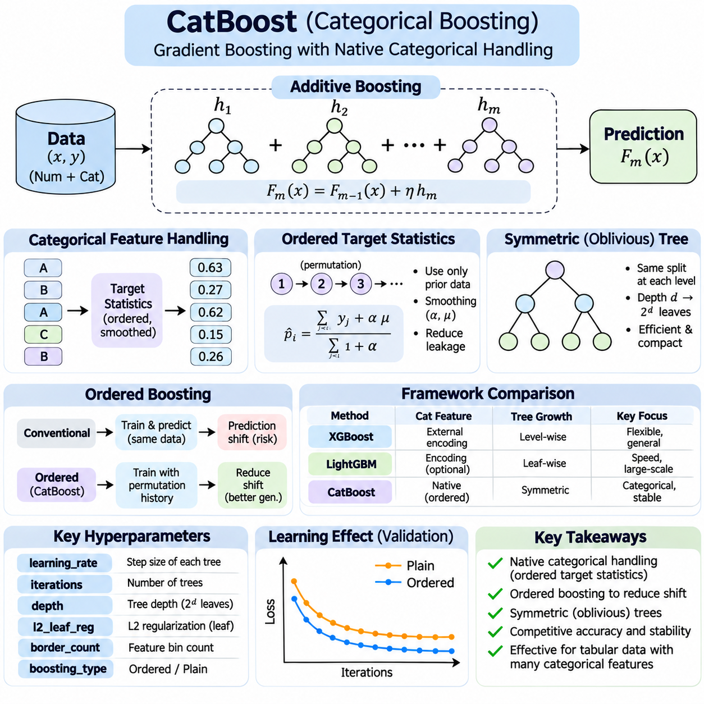{width="7.268055555555556in" height="7.268055555555556in"}

CatBoost, or Categorical Boosting, is a gradient-boosted decision tree framework designed to achieve strong predictive performance while handling categorical features efficiently. It addresses limitations of conventional boosting methods through ordered target statistics, ordered boosting, and symmetric tree construction. These mechanisms help reduce target leakage, improve training stability, and simplify the development of supervised learning models for structured datasets.

The fundamental learning principle of CatBoost follows sequential additive modeling, where each new decision tree corrects errors remaining in the current ensemble. The prediction function is updated through F_m(x) = F\\_(m-1)(x) + ηh_m(x), where η represents the learning rate and h_m(x) denotes the newly trained tree. This iterative process enables the ensemble to capture nonlinear relationships and feature interactions that individual shallow trees cannot represent adequately.

A distinguishing characteristic of CatBoost is its native treatment of categorical variables. Conventional gradient boosting workflows often require categorical features to be converted into numerical representations before training. Common approaches include one-hot encoding and target encoding, but these methods can increase dimensionality or introduce information leakage. CatBoost integrates categorical feature transformation into its learning procedure, reducing the need for extensive manual preprocessing.

Categorical features frequently contain values such as product identifiers, equipment types, manufacturing locations, and operating modes. These variables represent discrete categories rather than meaningful numerical magnitudes. Assigning arbitrary integer values may introduce artificial ordering, while one-hot encoding can generate high-dimensional sparse representations. CatBoost addresses these challenges through statistically informed category representations that can preserve useful predictive relationships.

CatBoost uses target statistics to transform selected categorical values into numerical features. A category may be represented by a smoothed estimate derived from target observations associated with that category. However, directly computing target statistics from the complete training dataset can cause target leakage because an observation\'s own target influences its encoded value. Such leakage can produce misleading training performance and weaken generalization.

Ordered target statistics reduce this problem by constructing categorical representations using only observations appearing earlier in a randomized permutation. For each training observation, the encoded category value is calculated without directly using that observation\'s target. Prior values and smoothing parameters provide stable estimates when categories have limited observations. This procedure reduces prediction shift caused by conventional target encoding.

Ordered boosting extends the same principle to gradient estimation. In conventional gradient boosting, gradients are calculated using predictions from models trained on the same observations, which can introduce a form of prediction shift. CatBoost\'s ordered boosting approach uses permutation-based training histories to reduce this dependency. Although computationally demanding, the method can improve generalization, particularly on smaller datasets.

CatBoost provides both ordered and plain boosting modes, allowing different tradeoffs between computational efficiency and statistical behavior. Ordered boosting emphasizes reducing prediction shift, while plain boosting follows a more conventional training procedure. The appropriate choice depends on dataset characteristics, training configuration, and computational resources. Validation experiments are necessary because neither mode guarantees superior performance across every application.

Another defining feature of CatBoost is its use of symmetric decision trees, also called oblivious trees. In these trees, all nodes at the same depth apply the same splitting condition. Consequently, a tree of depth d has a regular structure with up to 2\^d terminal leaves. This symmetry supports efficient prediction and compact model representations while restricting the variety of tree structures available during training.

Symmetric trees differ from the leaf-wise growth strategy commonly associated with LightGBM. Rather than expanding individual leaves independently, CatBoost applies a shared split across each level of the tree. This design can improve inference efficiency and provide structural regularization. However, the restricted tree structure may require additional trees or different depth settings to represent relationships captured by more flexible tree-growing strategies.

CatBoost evaluates candidate splits using gradient-based optimization criteria. As in other gradient boosting frameworks, the objective combines prediction loss with mechanisms that control model complexity. The selected loss function determines how prediction errors are measured and how corrective updates are calculated. CatBoost supports regression, classification, and ranking tasks, with specialized objectives appropriate to each prediction problem.

The learning_rate parameter controls the contribution of each newly trained tree to the ensemble. Smaller learning rates encourage gradual optimization and generally require more boosting iterations. Larger learning rates can reduce training time but may increase overfitting or unstable updates. The iterations parameter determines the maximum number of trees, while validation monitoring and early stopping help identify an appropriate ensemble size.

Tree depth is an important hyperparameter because symmetric trees expand their leaf structure according to the selected depth. Increasing depth allows the model to represent more complex feature interactions but also increases computational requirements and overfitting risk. Moderate depths are often effective for structured datasets, although optimal values depend on sample size, categorical cardinality, noise, and the complexity of underlying relationships.

CatBoost includes regularization mechanisms that constrain tree predictions and improve generalization. The l2_leaf_reg parameter controls L2 regularization of leaf values, while random_strength introduces randomness into split scoring. Additional sampling and tree construction settings can influence model variance and computational cost. These parameters should be tuned together rather than independently because their effects interact with tree depth and learning rate.

Categorical feature combinations provide another important source of predictive information. CatBoost can construct combinations of categorical variables to represent interactions that individual features cannot express. For example, equipment type and operating mode may jointly influence failure probability. Combination complexity must be controlled because excessive categorical interactions can increase memory consumption and encourage overfitting.

CatBoost also supports numerical features without requiring all inputs to be categorical. Numerical variables are quantized into discrete bins that support efficient split evaluation. The model can therefore combine continuous sensor measurements, engineered statistical indicators, and categorical operating conditions within a unified framework. Appropriate feature definitions remain essential because the algorithm cannot compensate for fundamentally misleading or unavailable information.

Missing-value handling depends on feature type and representation. CatBoost provides mechanisms for processing missing numerical values, while missing categorical values generally require explicit representation as valid category tokens. Consistent preprocessing is important because training and inference must interpret missing values identically. Missingness patterns should also be analyzed when they reflect sensor failures, operational interruptions, or data collection limitations.

A practical CatBoost implementation begins by identifying categorical feature columns and preparing training, validation, and test partitions. The model is configured with a suitable loss function, evaluation metric, learning rate, depth, and iteration limit. Categorical columns are explicitly identified so that CatBoost can apply its internal transformation procedures. Validation data is used to monitor performance and guide model selection without contaminating the final test evaluation.

The Python CatBoost library provides CatBoostRegressor and CatBoostClassifier interfaces for common supervised learning tasks. These classes support model fitting, prediction, probability estimation, and evaluation. The Pool data structure can store features, targets, and categorical feature metadata together. This representation helps maintain consistent feature interpretation and simplifies workflows involving mixed numerical and categorical inputs.

Hyperparameter optimization should consider interactions among depth, iterations, learning_rate, l2_leaf_reg, and categorical processing settings. Cross-validation, randomized search, and Bayesian optimization can identify configurations with favorable generalization performance. For temporal or grouped observations, validation partitions must preserve the underlying dependency structure. Random splitting may otherwise produce optimistic results through information shared across related observations.

CatBoost provides feature importance measures and model explanation capabilities that support analysis of learned predictions. SHAP values can describe how individual features contribute to specific model outputs, while global importance measures summarize influential variables across a dataset. These explanations are useful for identifying operational patterns, but correlated features and observational biases can complicate interpretation. Predictive importance does not establish causality.

Industrial applications of CatBoost include equipment fault prediction, manufacturing quality assessment, maintenance prioritization, and operational risk estimation. These problems often combine continuous sensor measurements with categorical information such as machine identity, product type, and operating state. CatBoost can learn interactions among these heterogeneous features while reducing the preprocessing burden associated with categorical encoding.

Computational performance depends on dataset size, categorical cardinality, tree depth, boosting mode, and hardware configuration. CatBoost supports CPU and GPU training, although supported features and performance characteristics can differ between processing modes. Ordered boosting and categorical transformations may introduce additional computational overhead. Benchmarking against XGBoost and LightGBM is therefore important when selecting a framework for production deployment.

CatBoost demonstrates how specialized categorical processing and statistically motivated training procedures can strengthen gradient boosting. Ordered target statistics reduce target leakage, ordered boosting addresses prediction shift, and symmetric trees provide efficient structured inference. Understanding these mechanisms enables systematic implementation, informed hyperparameter tuning, and reliable application of gradient-boosted decision trees to complex supervised learning problems.

CatBoost(Categorical Boosting)는 범주형 특징(Categorical Feature)을 효율적으로 처리하면서 높은 예측 성능(Predictive Performance)을 달성하도록 설계된 그래디언트 부스팅 결정 트리(Gradient-Boosted Decision Tree) 프레임워크이다. 순서 기반 목표 통계량(Ordered Target Statistics), 순서 기반 부스팅(Ordered Boosting), 대칭 트리 구성(Symmetric Tree Construction)을 통해 기존 부스팅 기법의 한계를 해결한다. 이러한 메커니즘은 목표값 누출(Target Leakage)을 줄이고 학습 안정성(Training Stability)을 개선하며 정형 데이터셋(Structured Dataset)을 위한 지도 학습 모델(Supervised Learning Model)의 개발을 간소화한다.

CatBoost의 기본 학습 원리(Fundamental Learning Principle)는 순차적 가산 모델링(Sequential Additive Modeling)을 따르며, 새로운 결정 트리(Decision Tree)가 현재 앙상블(Ensemble)에 남아 있는 오차를 수정한다. 예측 함수(Prediction Function)는 F_m(x) = F\\_(m-1)(x) + ηh_m(x)를 통해 갱신되며, 여기서 η는 학습률(Learning Rate), h_m(x)는 새롭게 학습된 트리를 나타낸다. 이러한 반복 과정(Iterative Process)을 통해 앙상블은 개별 얕은 트리(Shallow Tree)만으로는 충분히 표현하기 어려운 비선형 관계(Nonlinear Relationship)와 특징 상호작용(Feature Interaction)을 포착할 수 있다.

CatBoost의 차별화된 특징(Distinguishing Characteristic)은 범주형 변수(Categorical Variable)를 기본적으로 처리하는 기능이다. 기존 그래디언트 부스팅(Gradient Boosting) 작업 흐름에서는 학습 전에 범주형 특징을 수치형 표현(Numerical Representation)으로 변환해야 하는 경우가 많다. 일반적인 방법에는 원-핫 인코딩(One-Hot Encoding)과 목표값 인코딩(Target Encoding)이 있지만, 이러한 방법은 차원(Dimensionality)을 증가시키거나 정보 누출(Information Leakage)을 발생시킬 수 있다. CatBoost는 범주형 특징 변환(Categorical Feature Transformation)을 학습 절차에 통합하여 광범위한 수동 전처리(Manual Preprocessing)의 필요성을 줄인다.

범주형 특징(Categorical Feature)은 제품 식별자(Product Identifier), 장비 유형(Equipment Type), 제조 위치(Manufacturing Location), 운전 모드(Operating Mode)와 같은 값을 포함하는 경우가 많다. 이러한 변수는 의미 있는 수치적 크기(Numerical Magnitude)가 아니라 이산적인 범주(Discrete Category)를 나타낸다. 임의의 정수값을 부여하면 인위적인 순서(Artificial Ordering)가 발생할 수 있으며, 원-핫 인코딩은 고차원 희소 표현(High-Dimensional Sparse Representation)을 생성할 수 있다. CatBoost는 유용한 예측 관계(Predictive Relationship)를 보존할 수 있는 통계 기반 범주 표현(Statistically Informed Category Representation)을 통해 이러한 문제를 해결한다.

CatBoost는 목표 통계량(Target Statistics)을 사용하여 선택된 범주형 값을 수치형 특징(Numerical Feature)으로 변환한다. 하나의 범주는 해당 범주와 관련된 목표 관측값(Target Observation)에서 계산된 평활화 추정값(Smoothed Estimate)으로 표현될 수 있다. 그러나 전체 학습 데이터셋(Training Dataset)을 사용하여 목표 통계량을 직접 계산하면 관측값 자신의 목표값이 인코딩된 값에 영향을 미치므로 목표값 누출(Target Leakage)이 발생할 수 있다. 이러한 누출은 잘못된 학습 성능(Training Performance)을 만들어 내고 일반화 성능(Generalization Performance)을 약화시킬 수 있다.

순서 기반 목표 통계량(Ordered Target Statistics)은 무작위 순열(Randomized Permutation)에서 현재 관측값보다 앞에 위치한 관측값만 사용하여 범주 표현(Category Representation)을 구성함으로써 이러한 문제를 줄인다. 각 학습 관측값의 인코딩된 범주값(Encoded Category Value)은 해당 관측값 자신의 목표값을 직접 사용하지 않고 계산된다. 사전값(Prior Value)과 평활화 매개변수(Smoothing Parameter)는 특정 범주에 속한 관측값이 적을 때 안정적인 추정값을 제공한다. 이러한 절차는 기존 목표값 인코딩으로 인해 발생하는 예측 이동(Prediction Shift)을 줄인다.

순서 기반 부스팅(Ordered Boosting)은 동일한 원리를 기울기 추정(Gradient Estimation)으로 확장한다. 기존 그래디언트 부스팅에서는 동일한 관측값을 사용하여 학습된 모델의 예측값을 기반으로 기울기를 계산하므로 일종의 예측 이동(Prediction Shift)이 발생할 수 있다. CatBoost의 순서 기반 부스팅 접근법은 순열 기반 학습 이력(Permutation-Based Training History)을 사용하여 이러한 의존성을 줄인다. 계산 비용이 높을 수 있지만, 특히 작은 데이터셋에서 일반화 성능을 개선할 수 있다.

CatBoost는 순서 기반 부스팅 모드(Ordered Boosting Mode)와 일반 부스팅 모드(Plain Boosting Mode)를 모두 제공하여 계산 효율성(Computational Efficiency)과 통계적 특성(Statistical Behavior) 사이에서 서로 다른 절충안(Tradeoff)을 선택할 수 있도록 한다. 순서 기반 부스팅은 예측 이동을 줄이는 데 중점을 두지만, 일반 부스팅은 보다 전통적인 학습 절차(Conventional Training Procedure)를 따른다. 적절한 선택은 데이터셋 특성(Dataset Characteristics), 학습 설정(Training Configuration), 계산 자원(Computational Resources)에 따라 달라진다. 어느 모드도 모든 응용에서 우수한 성능을 보장하지 않으므로 검증 실험(Validation Experiment)이 필요하다.

CatBoost의 또 다른 대표적인 특징은 망각 트리(Oblivious Tree)라고도 불리는 대칭 결정 트리(Symmetric Decision Tree)를 사용한다는 점이다. 이러한 트리에서는 동일한 깊이(Depth)에 있는 모든 노드(Node)가 동일한 분할 조건(Splitting Condition)을 적용한다. 따라서 깊이가 d인 트리는 최대 2\^d개의 말단 리프(Terminal Leaf)를 갖는 규칙적인 구조를 형성한다. 이러한 대칭성(Symmetry)은 효율적인 예측(Inference)과 압축된 모델 표현(Compact Model Representation)을 지원하는 동시에 학습 과정에서 사용할 수 있는 트리 구조의 다양성을 제한한다.

대칭 트리(Symmetric Tree)는 LightGBM에서 일반적으로 사용하는 리프 중심 성장 전략(Leaf-Wise Growth Strategy)과 다르다. 개별 리프를 독립적으로 확장하는 대신, CatBoost는 트리의 각 레벨(Level)에 공통 분할(Shared Split)을 적용한다. 이러한 설계는 추론 효율성(Inference Efficiency)을 높이고 구조적 정규화(Structural Regularization)를 제공할 수 있다. 그러나 제한된 트리 구조(Restricted Tree Structure)로 인해 더욱 유연한 트리 성장 전략으로 표현할 수 있는 관계를 학습하려면 추가적인 트리나 다른 깊이 설정이 필요할 수 있다.

CatBoost는 기울기 기반 최적화 기준(Gradient-Based Optimization Criterion)을 사용하여 후보 분할(Candidate Split)을 평가한다. 다른 그래디언트 부스팅 프레임워크와 마찬가지로 목적 함수(Objective Function)는 예측 손실(Prediction Loss)과 모델 복잡도(Model Complexity)를 제어하는 메커니즘을 결합한다. 선택된 손실 함수(Loss Function)는 예측 오차를 측정하는 방식과 수정 갱신(Corrective Update)을 계산하는 방식을 결정한다. CatBoost는 회귀(Regression), 분류(Classification), 순위 학습(Ranking)을 지원하며, 각 예측 문제에 적합한 특화된 목적 함수를 제공한다.

learning_rate 매개변수는 새롭게 학습된 각 트리가 앙상블에 기여하는 정도를 제어한다. 작은 학습률(Learning Rate)은 점진적인 최적화(Gradual Optimization)를 유도하며 일반적으로 더 많은 부스팅 반복(Boosting Iteration)을 필요로 한다. 큰 학습률은 학습 시간을 줄일 수 있지만 과적합(Overfitting)이나 불안정한 갱신(Unstable Update)을 증가시킬 수 있다. iterations 매개변수는 최대 트리 수(Maximum Number of Trees)를 결정하며, 검증 모니터링(Validation Monitoring)과 조기 종료(Early Stopping)는 적절한 앙상블 크기(Ensemble Size)를 식별하는 데 도움을 준다.

트리 깊이(Tree Depth)는 대칭 트리가 선택된 깊이에 따라 리프 구조(Leaf Structure)를 확장하므로 중요한 하이퍼파라미터(Hyperparameter)이다. 깊이를 증가시키면 모델이 더욱 복잡한 특징 상호작용(Feature Interaction)을 표현할 수 있지만 계산 요구량(Computational Requirement)과 과적합 위험도 증가한다. 정형 데이터셋(Structured Dataset)에서는 중간 수준의 깊이가 효과적인 경우가 많지만, 최적값은 표본 크기(Sample Size), 범주 기수(Categorical Cardinality), 잡음(Noise), 기본 관계의 복잡도(Complexity of Underlying Relationships)에 따라 달라진다.

CatBoost는 트리 예측값(Tree Prediction)을 제한하고 일반화 성능(Generalization Performance)을 개선하는 정규화 메커니즘(Regularization Mechanism)을 포함한다. l2_leaf_reg 매개변수는 리프 값(Leaf Value)에 대한 L2 정규화(L2 Regularization)를 제어하며, random_strength는 분할 점수(Split Scoring)에 무작위성(Randomness)을 도입한다. 추가적인 표본 추출(Sampling) 및 트리 구성 설정(Tree Construction Setting)은 모델 분산(Model Variance)과 계산 비용에 영향을 미칠 수 있다. 이러한 매개변수는 트리 깊이와 학습률에 대한 영향이 서로 상호작용하므로 독립적으로 조정하기보다 함께 튜닝해야 한다.

범주형 특징 조합(Categorical Feature Combination)은 예측 정보를 제공하는 또 다른 중요한 요소이다. CatBoost는 개별 특징만으로는 표현할 수 없는 상호작용을 나타내기 위해 범주형 변수의 조합을 구성할 수 있다. 예를 들어 장비 유형(Equipment Type)과 운전 모드(Operating Mode)는 함께 고장 확률(Failure Probability)에 영향을 미칠 수 있다. 과도한 범주형 상호작용은 메모리 사용량(Memory Consumption)을 증가시키고 과적합을 유발할 수 있으므로 조합 복잡도(Combination Complexity)를 제어해야 한다.

CatBoost는 모든 입력값이 범주형일 필요 없이 수치형 특징(Numerical Feature)도 지원한다. 수치형 변수(Numerical Variable)는 효율적인 분할 평가(Split Evaluation)를 지원하는 이산 구간(Discrete Bin)으로 양자화(Quantization)된다. 따라서 모델은 연속적인 센서 측정값(Continuous Sensor Measurement), 특징 공학으로 생성된 통계 지표(Engineered Statistical Indicator), 범주형 운전 조건(Categorical Operating Condition)을 하나의 통합 프레임워크(Unified Framework)에서 결합할 수 있다. 그러나 알고리즘이 근본적으로 잘못되거나 사용할 수 없는 정보를 보완할 수는 없으므로 적절한 특징 정의(Feature Definition)가 여전히 필수적이다.

결측값 처리(Missing-Value Handling)는 특징 유형(Feature Type)과 표현 방식(Representation)에 따라 달라진다. CatBoost는 누락된 수치형 값(Missing Numerical Value)을 처리하는 메커니즘을 제공하지만, 누락된 범주형 값(Missing Categorical Value)은 일반적으로 유효한 범주 토큰(Category Token)으로 명시적으로 표현해야 한다. 학습과 추론(Inference)에서 결측값을 동일하게 해석해야 하므로 일관된 전처리(Consistent Preprocessing)가 중요하다. 또한 결측 패턴(Missingness Pattern)이 센서 고장(Sensor Failure), 운영 중단(Operational Interruption), 데이터 수집 한계(Data Collection Limitation)를 반영하는 경우 이를 분석해야 한다.

실용적인 CatBoost 구현(Practical CatBoost Implementation)은 범주형 특징 열(Categorical Feature Column)을 식별하고 학습용(Training), 검증용(Validation), 테스트용(Test) 데이터 분할을 준비하는 것에서 시작한다. 모델은 적절한 손실 함수(Loss Function), 평가 지표(Evaluation Metric), 학습률(Learning Rate), 깊이(Depth), 반복 횟수 제한(Iteration Limit)을 사용하여 설정된다. CatBoost가 내부 변환 절차(Internal Transformation Procedure)를 적용할 수 있도록 범주형 열을 명시적으로 지정한다. 검증 데이터(Validation Data)는 최종 테스트 평가(Final Test Evaluation)를 오염시키지 않으면서 성능을 모니터링하고 모델 선택(Model Selection)을 안내하는 데 사용된다.

파이썬 CatBoost 라이브러리(Python CatBoost Library)는 일반적인 지도 학습 작업(Supervised Learning Task)을 위한 CatBoostRegressor와 CatBoostClassifier 인터페이스를 제공한다. 이러한 클래스(Class)는 모델 적합(Model Fitting), 예측(Prediction), 확률 추정(Probability Estimation), 평가(Evaluation)를 지원한다. Pool 데이터 구조(Data Structure)는 특징(Feature), 목표값(Target), 범주형 특징 메타데이터(Categorical Feature Metadata)를 함께 저장할 수 있다. 이러한 표현은 일관된 특징 해석(Consistent Feature Interpretation)을 유지하고 수치형 입력과 범주형 입력이 혼합된 작업 흐름(Workflow)을 간소화하는 데 도움을 준다.

하이퍼파라미터 최적화(Hyperparameter Optimization)에서는 depth, iterations, learning_rate, l2_leaf_reg 및 범주형 처리 설정(Categorical Processing Setting) 사이의 상호작용을 고려해야 한다. 교차 검증(Cross-Validation), 무작위 탐색(Randomized Search), 베이지안 최적화(Bayesian Optimization)를 통해 일반화 성능이 우수한 설정을 식별할 수 있다. 시간적 관측값(Temporal Observation)이나 그룹화된 관측값(Grouped Observation)의 경우 검증 데이터 분할(Validation Partition)이 기본적인 의존성 구조(Dependency Structure)를 보존해야 한다. 그렇지 않으면 무작위 분할(Random Splitting)로 인해 관련 관측값 사이에 공유된 정보가 누출되어 지나치게 낙관적인 결과가 발생할 수 있다.

CatBoost는 학습된 예측을 분석할 수 있도록 특징 중요도 측정(Feature Importance Measure)과 모델 설명 기능(Model Explanation Capability)을 제공한다. SHAP 값(SHAP Value)은 개별 특징이 특정 모델 출력(Model Output)에 어떻게 기여하는지 설명할 수 있으며, 전역 중요도 측정(Global Importance Measure)은 데이터셋 전체에서 영향력이 큰 변수를 요약한다. 이러한 설명은 운영 패턴(Operational Pattern)을 식별하는 데 유용하지만, 상관관계가 있는 특징(Correlated Feature)과 관측 편향(Observational Bias)은 해석을 복잡하게 만들 수 있다. 예측 중요도(Predictive Importance)가 인과관계(Causality)를 입증하는 것은 아니다.

CatBoost의 산업 응용(Industrial Application)에는 장비 고장 예측(Equipment Fault Prediction), 제조 품질 평가(Manufacturing Quality Assessment), 유지보수 우선순위 결정(Maintenance Prioritization), 운영 위험 추정(Operational Risk Estimation)이 포함된다. 이러한 문제는 연속적인 센서 측정값(Continuous Sensor Measurement)과 장비 식별 정보(Machine Identity), 제품 유형(Product Type), 운전 상태(Operating State) 등의 범주형 정보를 함께 포함하는 경우가 많다. CatBoost는 범주형 인코딩(Categorical Encoding)에 필요한 전처리 부담을 줄이면서 이러한 이질적인 특징(Heterogeneous Feature) 사이의 상호작용을 학습할 수 있다.

계산 성능(Computational Performance)은 데이터셋 크기(Dataset Size), 범주 기수(Categorical Cardinality), 트리 깊이(Tree Depth), 부스팅 모드(Boosting Mode), 하드웨어 구성(Hardware Configuration)에 따라 달라진다. CatBoost는 CPU 및 GPU 학습(CPU and GPU Training)을 지원하지만, 지원되는 기능과 성능 특성(Performance Characteristics)은 처리 모드(Processing Mode)에 따라 차이가 있을 수 있다. 순서 기반 부스팅(Ordered Boosting)과 범주형 변환(Categorical Transformation)은 추가적인 계산 오버헤드(Computational Overhead)를 발생시킬 수 있다. 따라서 실제 운영 환경(Production Deployment)에 사용할 프레임워크를 선택할 때는 XGBoost 및 LightGBM과의 벤치마킹(Benchmarking)이 중요하다.

CatBoost는 특화된 범주형 처리(Specialized Categorical Processing)와 통계적으로 설계된 학습 절차(Statistically Motivated Training Procedure)가 그래디언트 부스팅(Gradient Boosting)을 어떻게 강화할 수 있는지 보여준다. 순서 기반 목표 통계량(Ordered Target Statistics)은 목표값 누출(Target Leakage)을 줄이고, 순서 기반 부스팅(Ordered Boosting)은 예측 이동(Prediction Shift)을 완화하며, 대칭 트리(Symmetric Tree)는 효율적인 구조적 추론(Structured Inference)을 제공한다. 이러한 메커니즘을 이해하면 체계적인 구현(Systematic Implementation), 합리적인 하이퍼파라미터 튜닝(Informed Hyperparameter Tuning), 복잡한 지도 학습 문제에 대한 그래디언트 부스팅 결정 트리(Gradient-Boosted Decision Tree)의 신뢰할 수 있는 적용(Reliable Application)이 가능해진다.

## 06.06 Hyperparameter Tuning [w/Code]

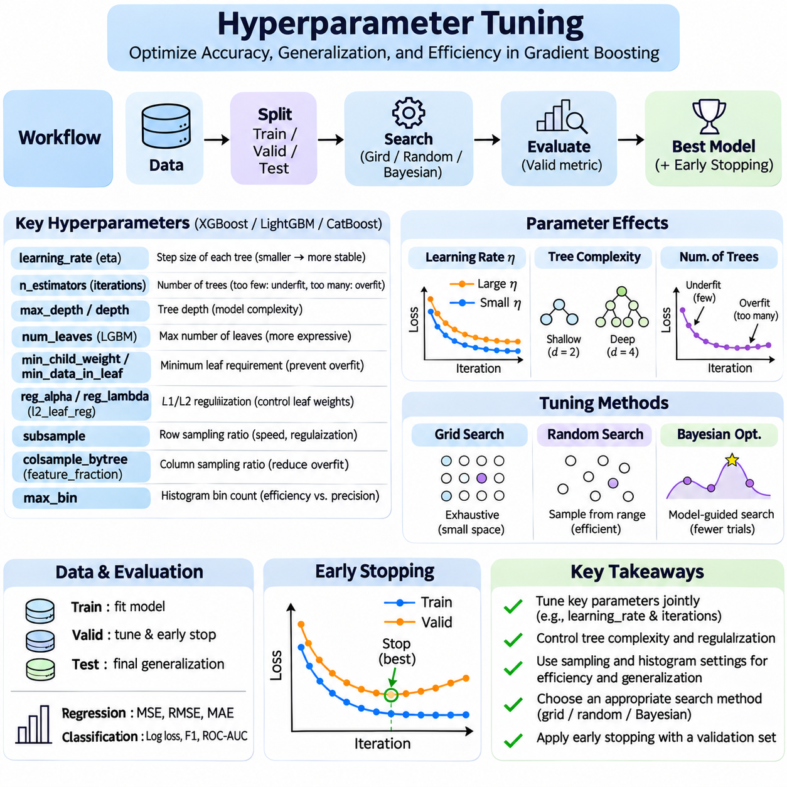{width="7.268055555555556in" height="7.268055555555556in"}

Hyperparameter tuning is a critical process in gradient boosting that determines how effectively an ensemble balances predictive accuracy, computational efficiency, and generalization. Unlike model parameters learned directly from training data, hyperparameters control the learning procedure and tree construction. Their selection strongly influences whether gradient-boosted decision trees capture meaningful patterns or overfit noise in the training dataset.

Gradient boosting frameworks such as XGBoost, LightGBM, and CatBoost expose numerous hyperparameters governing optimization, model complexity, sampling, and regularization. Although their implementations differ, they share fundamental tuning principles. Effective optimization requires understanding how parameters interact rather than adjusting each value independently, because improvements in one configuration may depend on compensating changes elsewhere.

The learning rate is one of the most influential hyperparameters in gradient boosting. It determines how strongly each newly constructed tree contributes to the accumulated ensemble prediction. Smaller learning rates encourage gradual correction and often improve stability, but require more boosting iterations. Larger learning rates accelerate convergence while potentially increasing overfitting or causing unstable optimization behavior.

The number of boosting iterations determines how many corrective trees are added to the ensemble. Too few iterations may produce underfitting because the model cannot capture sufficient structure. Excessive iterations can increase computational cost and eventually fit training noise. Learning rate and iteration count should therefore be tuned jointly, with validation performance guiding the selection of an appropriate stopping point.

Tree complexity determines the interactions and nonlinear relationships that individual learners can represent. Parameters such as max_depth in XGBoost and depth in CatBoost control tree depth, while num_leaves in LightGBM directly restricts terminal leaf count. Greater complexity can reduce training error but may weaken generalization. Appropriate constraints depend on dataset size, feature interactions, and noise characteristics.

Minimum leaf requirements provide another important mechanism for controlling model complexity. XGBoost uses min_child_weight to restrict splits according to accumulated Hessian statistics, while LightGBM provides min_data_in_leaf to limit leaves containing too few observations. CatBoost relies on its symmetric tree structure and additional regularization settings. These controls help prevent overly specialized partitions that capture isolated training examples.

Regularization parameters influence the magnitude of corrective predictions and the complexity of fitted trees. XGBoost provides reg_alpha and reg_lambda for L1 and L2 penalties, while LightGBM offers lambda_l1 and lambda_l2. CatBoost uses l2_leaf_reg to penalize leaf values. Stronger regularization can improve robustness but may cause underfitting when excessive, making validation-based adjustment essential.

Sampling parameters introduce controlled randomness into gradient boosting. Row subsampling limits the observations used during tree construction, while column subsampling restricts candidate features. XGBoost provides subsample and colsample_bytree, and LightGBM offers corresponding sampling controls. These settings can reduce computation and overfitting, although aggressive sampling may discard information required for accurate predictions.

Histogram-related parameters influence the balance between split precision and computational efficiency. LightGBM uses max_bin to control feature discretization, while XGBoost provides histogram construction settings such as max_bin when histogram-based methods are selected. Smaller bin counts reduce memory and computation but may overlook useful split thresholds. Larger counts improve resolution at additional computational cost.

A reliable tuning workflow begins by defining the prediction objective and evaluation metric. Regression tasks may use mean squared error, root mean squared error, or mean absolute error, while classification tasks may use log loss, F1-score, or area under the ROC curve. The selected metric should reflect the practical cost of prediction errors rather than simply maximizing a convenient benchmark score.

Data partitioning is essential because hyperparameter optimization repeatedly evaluates candidate models. Training data is used for fitting, validation data guides configuration selection, and an independent test set estimates final generalization. Cross-validation can reduce dependence on a single partition. However, temporal, grouped, or correlated observations require specialized splitting strategies to avoid leakage between training and validation subsets.

Grid search evaluates combinations drawn from predefined parameter values. This approach is straightforward and reproducible but becomes expensive as the number of parameters increases. Randomized search samples configurations from specified distributions, often exploring broader parameter ranges with fewer evaluations. Logarithmic sampling is particularly useful for parameters whose effective values span several orders of magnitude.

Bayesian optimization provides a more adaptive approach by using previous evaluation results to guide the selection of new configurations. A surrogate model estimates relationships between hyperparameters and validation performance, while an acquisition strategy balances exploration and exploitation. This method can reduce expensive evaluations, although its effectiveness depends on the search space, optimization budget, and variability of measured results.

Early stopping is an important complement to hyperparameter search. During training, a validation metric is monitored and boosting stops when additional iterations fail to improve performance for a specified patience interval. The best-performing iteration can then be retained for prediction. This approach reduces unnecessary computation and allows the number of trees to adapt to each candidate configuration.

Hyperparameter interactions should guide the search strategy. A smaller learning rate often requires more boosting rounds, while deeper trees may require stronger regularization or larger minimum leaf sizes. Increasing the number of leaves in LightGBM can improve representation capacity but also increase overfitting risk. Searching these parameters jointly is generally more effective than optimizing them in complete isolation.

A practical optimization procedure can begin with conservative baseline settings and a limited search over learning rate, tree complexity, and iteration count. Once a stable configuration is identified, sampling and regularization parameters can be refined. This staged approach reduces the initial search space and helps identify influential parameters. However, final validation should account for interactions across the complete configuration.

Automated tuning libraries can coordinate repeated model training and evaluation. Scikit-learn provides GridSearchCV and RandomizedSearchCV, while optimization frameworks such as Optuna support adaptive search strategies. Each trial trains a model using a selected configuration and reports validation performance. Reproducible experiments require fixed random seeds, recorded parameter ranges, consistent data partitions, and preserved software configurations.

Computational budgets should be treated as explicit constraints during tuning. A configuration producing a small accuracy improvement may require substantially more training time, memory, or inference latency. For industrial systems, the preferred model may therefore be one that provides sufficient accuracy with predictable resource consumption. Multi-objective optimization can evaluate performance alongside computational and deployment requirements.

Class imbalance and asymmetric error costs can substantially change the optimal hyperparameter configuration. In fault detection, rare failures may be more important than frequent normal observations. Appropriate evaluation metrics, class weighting, and threshold selection should reflect this imbalance. Hyperparameter tuning must avoid selecting models solely through overall accuracy when minority-class performance determines operational usefulness.

The reliability of tuning results depends on the stability of validation measurements. Small datasets, noisy labels, and stochastic training procedures can produce substantial variation across trials. Repeated cross-validation or evaluation across multiple random seeds can help estimate uncertainty. Differences smaller than the observed evaluation variability should not automatically be interpreted as meaningful improvements.

Feature engineering and hyperparameter tuning are closely connected. New statistical features, categorical representations, or interaction variables may change the optimal tree depth, regularization strength, and sampling settings. Consequently, tuning results obtained before substantial feature changes may no longer remain optimal. Feature selection and model configuration should be evaluated together within a leakage-resistant experimental workflow.

Final model selection should consider accuracy, stability, interpretability, and operational constraints. After selecting hyperparameters using validation data, the model can be refitted according to a predefined procedure and evaluated once on the untouched test set. The complete configuration, feature definitions, preprocessing steps, and training metadata should be preserved to support reproducibility and reliable deployment.

Hyperparameter tuning transforms gradient boosting from a powerful default algorithm into a carefully controlled predictive system. Learning rate, tree complexity, regularization, sampling, and stopping criteria collectively determine model behavior. Systematic experimentation, leakage-resistant validation, and computationally aware optimization provide the foundation for selecting robust XGBoost, LightGBM, and CatBoost models across practical supervised learning applications.

하이퍼파라미터 튜닝(Hyperparameter Tuning)은 앙상블(Ensemble)이 예측 정확도(Predictive Accuracy), 계산 효율성(Computational Efficiency), 일반화 성능(Generalization) 사이에서 얼마나 효과적으로 균형을 유지하는지를 결정하는 그래디언트 부스팅(Gradient Boosting)의 핵심 과정이다. 학습 데이터(Training Data)에서 직접 학습되는 모델 매개변수(Model Parameter)와 달리, 하이퍼파라미터(Hyperparameter)는 학습 절차(Training Procedure)와 트리 구성(Tree Construction)을 제어한다. 하이퍼파라미터의 선택은 그래디언트 부스팅 결정 트리(Gradient-Boosted Decision Tree)가 의미 있는 패턴을 포착할지, 학습 데이터셋의 잡음(Noise)에 과적합(Overfitting)될지를 크게 좌우한다.

XGBoost, LightGBM, CatBoost와 같은 그래디언트 부스팅 프레임워크(Gradient Boosting Framework)는 최적화(Optimization), 모델 복잡도(Model Complexity), 표본 추출(Sampling), 정규화(Regularization)를 제어하는 다양한 하이퍼파라미터를 제공한다. 구현 방식(Implementation)은 서로 다르지만 기본적인 튜닝 원리(Tuning Principle)는 공유한다. 효과적인 최적화를 위해서는 각 매개변수를 독립적으로 조정하기보다 매개변수 사이의 상호작용(Parameter Interaction)을 이해해야 한다. 특정 설정에서의 성능 개선이 다른 매개변수의 보완적인 변화에 의존할 수 있기 때문이다.

학습률(Learning Rate)은 그래디언트 부스팅에서 가장 영향력이 큰 하이퍼파라미터 중 하나이다. 학습률은 새롭게 구성된 각 트리가 누적 앙상블 예측(Accumulated Ensemble Prediction)에 얼마나 강하게 기여하는지를 결정한다. 작은 학습률은 점진적인 오류 수정(Gradual Correction)을 유도하고 안정성(Stability)을 개선하는 경우가 많지만, 더 많은 부스팅 반복(Boosting Iteration)이 필요하다. 큰 학습률은 수렴(Convergence)을 가속하지만 과적합을 증가시키거나 불안정한 최적화 동작(Unstable Optimization Behavior)을 유발할 수 있다.

부스팅 반복 횟수(Number of Boosting Iterations)는 앙상블에 추가되는 오류 수정 트리(Corrective Tree)의 수를 결정한다. 반복 횟수가 너무 적으면 모델이 충분한 구조를 포착하지 못해 과소적합(Underfitting)이 발생할 수 있다. 반대로 지나치게 많은 반복은 계산 비용(Computational Cost)을 증가시키고 결국 학습 데이터의 잡음을 학습할 수 있다. 따라서 학습률과 반복 횟수는 함께 튜닝해야 하며, 적절한 종료 시점(Stopping Point)은 검증 성능(Validation Performance)을 기준으로 선택해야 한다.

트리 복잡도(Tree Complexity)는 개별 학습기(Individual Learner)가 표현할 수 있는 상호작용(Interaction)과 비선형 관계(Nonlinear Relationship)를 결정한다. XGBoost의 max_depth와 CatBoost의 depth는 트리 깊이(Tree Depth)를 제어하며, LightGBM의 num_leaves는 말단 리프 수(Terminal Leaf Count)를 직접 제한한다. 복잡도가 높아지면 학습 오차(Training Error)를 줄일 수 있지만 일반화 성능이 약화될 수 있다. 적절한 제약 조건(Constraint)은 데이터셋 크기(Dataset Size), 특징 상호작용(Feature Interaction), 잡음 특성(Noise Characteristics)에 따라 달라진다.

최소 리프 요구사항(Minimum Leaf Requirement)은 모델 복잡도를 제어하는 또 다른 중요한 메커니즘이다. XGBoost는 min_child_weight를 사용하여 누적 헤시안 통계량(Accumulated Hessian Statistics)을 기준으로 분할(Split)을 제한하며, LightGBM은 min_data_in_leaf를 제공하여 지나치게 적은 관측값을 포함하는 리프를 제한한다. CatBoost는 대칭 트리 구조(Symmetric Tree Structure)와 추가적인 정규화 설정(Regularization Setting)을 활용한다. 이러한 제어 기능은 개별 학습 사례(Isolated Training Example)를 포착하는 지나치게 특수화된 분할(Overly Specialized Partition)을 방지하는 데 도움을 준다.

정규화 매개변수(Regularization Parameter)는 수정 예측값(Corrective Prediction)의 크기와 적합된 트리(Fitted Tree)의 복잡도에 영향을 미친다. XGBoost는 L1 및 L2 벌점(L1 and L2 Penalty)을 위한 reg_alpha와 reg_lambda를 제공하며, LightGBM은 lambda_l1과 lambda_l2를 제공한다. CatBoost는 l2_leaf_reg를 사용하여 리프 값(Leaf Value)에 벌점을 부과한다. 강한 정규화는 강건성(Robustness)을 개선할 수 있지만 지나치게 적용하면 과소적합을 유발할 수 있으므로 검증 기반 조정(Validation-Based Adjustment)이 필수적이다.

표본 추출 매개변수(Sampling Parameter)는 그래디언트 부스팅에 제어된 무작위성(Controlled Randomness)을 도입한다. 행 부분 표본 추출(Row Subsampling)은 트리 구성에 사용되는 관측값을 제한하며, 열 부분 표본 추출(Column Subsampling)은 후보 특징(Candidate Feature)을 제한한다. XGBoost는 subsample과 colsample_bytree를 제공하고, LightGBM도 이에 대응하는 표본 추출 제어 기능을 제공한다. 이러한 설정은 계산량과 과적합을 줄일 수 있지만, 지나치게 공격적인 표본 추출(Aggressive Sampling)은 정확한 예측에 필요한 정보를 제거할 수 있다.

히스토그램 관련 매개변수(Histogram-Related Parameter)는 분할 정밀도(Split Precision)와 계산 효율성(Computational Efficiency) 사이의 균형에 영향을 미친다. LightGBM은 max_bin을 사용하여 특징 이산화(Feature Discretization)를 제어하며, XGBoost도 히스토그램 기반 방법(Histogram-Based Method)을 선택한 경우 max_bin과 같은 히스토그램 구성 설정(Histogram Construction Setting)을 제공한다. 구간 수(Bin Count)가 적으면 메모리와 계산량이 감소하지만 유용한 분할 임계값(Split Threshold)을 놓칠 수 있다. 구간 수가 많으면 해상도(Resolution)가 향상되지만 추가적인 계산 비용이 발생한다.

신뢰할 수 있는 튜닝 작업 흐름(Reliable Tuning Workflow)은 예측 목적(Prediction Objective)과 평가 지표(Evaluation Metric)를 정의하는 것에서 시작한다. 회귀 작업(Regression Task)에서는 평균 제곱 오차(Mean Squared Error), 평균 제곱근 오차(Root Mean Squared Error), 평균 절대 오차(Mean Absolute Error)를 사용할 수 있으며, 분류 작업(Classification Task)에서는 로그 손실(Log Loss), F1 점수(F1-Score), ROC 곡선 아래 면적(Area Under the ROC Curve)을 사용할 수 있다. 선택된 지표는 단순히 편리한 벤치마크 점수(Benchmark Score)를 최대화하는 것이 아니라 예측 오차의 실제 비용(Practical Cost)을 반영해야 한다.

하이퍼파라미터 최적화(Hyperparameter Optimization)는 후보 모델(Candidate Model)을 반복적으로 평가하므로 데이터 분할(Data Partitioning)이 필수적이다. 학습 데이터(Training Data)는 모델 적합(Model Fitting)에 사용되고, 검증 데이터(Validation Data)는 설정 선택(Configuration Selection)을 안내하며, 독립적인 테스트 데이터셋(Independent Test Set)은 최종 일반화 성능을 추정한다. 교차 검증(Cross-Validation)은 단일 분할에 대한 의존성을 줄일 수 있다. 그러나 시간적(Temporal), 그룹화된(Grouped), 상관관계가 있는(Correlated) 관측값에는 학습 및 검증 부분집합 사이의 정보 누출(Information Leakage)을 방지하기 위한 특화된 분할 전략(Splitting Strategy)이 필요하다.

격자 탐색(Grid Search)은 미리 정의된 매개변수 값(Parameter Value)에서 생성된 조합을 평가한다. 이 접근법은 이해하기 쉽고 재현 가능(Reproducible)하지만 매개변수 수가 증가하면 계산 비용이 커진다. 무작위 탐색(Randomized Search)은 지정된 분포(Distribution)에서 설정을 표본 추출하여 더 적은 평가 횟수로 넓은 매개변수 범위(Parameter Range)를 탐색하는 경우가 많다. 로그 척도 표본 추출(Logarithmic Sampling)은 효과적인 값의 범위가 여러 자릿수 규모(Orders of Magnitude)에 걸쳐 있는 매개변수에 특히 유용하다.

베이지안 최적화(Bayesian Optimization)는 이전 평가 결과를 사용하여 새로운 설정을 선택하는 보다 적응적인 접근법(Adaptive Approach)을 제공한다. 대리 모델(Surrogate Model)은 하이퍼파라미터와 검증 성능 사이의 관계를 추정하며, 획득 전략(Acquisition Strategy)은 탐색(Exploration)과 활용(Exploitation) 사이의 균형을 조절한다. 이 방법은 비용이 높은 평가 횟수를 줄일 수 있지만, 효과는 탐색 공간(Search Space), 최적화 예산(Optimization Budget), 측정 결과의 변동성(Variability)에 따라 달라진다.

조기 종료(Early Stopping)는 하이퍼파라미터 탐색(Hyperparameter Search)을 보완하는 중요한 기법이다. 학습 중 검증 지표(Validation Metric)를 모니터링하고, 지정된 인내 구간(Patience Interval) 동안 추가 반복이 성능을 개선하지 못하면 부스팅을 종료한다. 이후 가장 우수한 성능을 보인 반복 단계(Best-Performing Iteration)를 예측에 사용할 수 있다. 이러한 접근은 불필요한 계산을 줄이고 각 후보 설정(Candidate Configuration)에 맞게 트리 수(Number of Trees)를 조정할 수 있도록 한다.

하이퍼파라미터 사이의 상호작용(Hyperparameter Interaction)은 탐색 전략(Search Strategy)을 결정하는 기준이 되어야 한다. 작은 학습률은 일반적으로 더 많은 부스팅 라운드(Boosting Round)를 필요로 하며, 깊은 트리는 더 강한 정규화 또는 더 큰 최소 리프 크기(Minimum Leaf Size)를 필요로 할 수 있다. LightGBM에서 리프 수(Number of Leaves)를 증가시키면 표현 능력(Representation Capacity)이 향상될 수 있지만 과적합 위험도 증가한다. 이러한 매개변수를 함께 탐색하는 것이 완전히 독립적으로 최적화하는 것보다 일반적으로 효과적이다.

실용적인 최적화 절차(Practical Optimization Procedure)는 보수적인 기준 설정(Conservative Baseline Setting)과 학습률, 트리 복잡도, 반복 횟수에 대한 제한적인 탐색에서 시작할 수 있다. 안정적인 설정(Stable Configuration)이 확인되면 표본 추출과 정규화 매개변수를 세부적으로 조정할 수 있다. 이러한 단계적 접근(Staged Approach)은 초기 탐색 공간을 줄이고 영향력이 큰 매개변수(Influential Parameter)를 식별하는 데 도움을 준다. 그러나 최종 검증(Final Validation)에서는 전체 설정 사이의 상호작용을 고려해야 한다.

자동 튜닝 라이브러리(Automated Tuning Library)는 반복적인 모델 학습과 평가를 조정할 수 있다. 사이킷런(scikit-learn)은 GridSearchCV와 RandomizedSearchCV를 제공하며, Optuna와 같은 최적화 프레임워크(Optimization Framework)는 적응형 탐색 전략(Adaptive Search Strategy)을 지원한다. 각 시행(Trial)은 선택된 설정을 사용하여 모델을 학습하고 검증 성능을 보고한다. 재현 가능한 실험(Reproducible Experiment)을 위해서는 고정된 무작위 시드(Random Seed), 기록된 매개변수 범위(Parameter Range), 일관된 데이터 분할(Data Partition), 보존된 소프트웨어 설정(Software Configuration)이 필요하다.

계산 예산(Computational Budget)은 튜닝 과정에서 명시적인 제약 조건(Explicit Constraint)으로 취급해야 한다. 정확도를 조금 개선하는 설정이 훨씬 더 많은 학습 시간(Training Time), 메모리(Memory), 추론 지연 시간(Inference Latency)을 요구할 수 있다. 따라서 산업 시스템(Industrial System)에서는 예측 가능한 자원 소비(Resource Consumption)를 유지하면서 충분한 정확도를 제공하는 모델이 선호될 수 있다. 다목적 최적화(Multi-Objective Optimization)는 계산 및 배포 요구사항(Deployment Requirement)과 함께 성능을 평가할 수 있다.

클래스 불균형(Class Imbalance)과 비대칭 오류 비용(Asymmetric Error Cost)은 최적의 하이퍼파라미터 설정을 크게 변화시킬 수 있다. 고장 탐지(Fault Detection)에서는 드물게 발생하는 고장(Rare Failure)이 빈번한 정상 관측값(Normal Observation)보다 더 중요할 수 있다. 적절한 평가 지표(Evaluation Metric), 클래스 가중치(Class Weighting), 임계값 선택(Threshold Selection)은 이러한 불균형을 반영해야 한다. 소수 클래스 성능(Minority-Class Performance)이 운영상의 유용성(Operational Usefulness)을 결정하는 경우, 하이퍼파라미터 튜닝은 전체 정확도(Overall Accuracy)만으로 모델을 선택해서는 안 된다.

튜닝 결과의 신뢰성(Reliability)은 검증 측정값(Validation Measurement)의 안정성에 따라 달라진다. 작은 데이터셋(Small Dataset), 잡음이 포함된 레이블(Noisy Label), 확률적 학습 절차(Stochastic Training Procedure)는 시행 사이에 상당한 변동(Variation)을 발생시킬 수 있다. 반복 교차 검증(Repeated Cross-Validation)이나 여러 무작위 시드(Multiple Random Seeds)에 대한 평가는 불확실성(Uncertainty)을 추정하는 데 도움을 준다. 관측된 평가 변동성(Evaluation Variability)보다 작은 차이를 자동으로 의미 있는 성능 개선(Meaningful Improvement)으로 해석해서는 안 된다.

특징 공학(Feature Engineering)과 하이퍼파라미터 튜닝은 밀접하게 연결되어 있다. 새로운 통계적 특징(Statistical Feature), 범주형 표현(Categorical Representation), 상호작용 변수(Interaction Variable)는 최적 트리 깊이(Optimal Tree Depth), 정규화 강도(Regularization Strength), 표본 추출 설정(Sampling Setting)을 변화시킬 수 있다. 따라서 상당한 특징 변경(Feature Change) 이전에 얻은 튜닝 결과가 이후에도 최적 상태를 유지한다고 보장할 수 없다. 특징 선택(Feature Selection)과 모델 설정(Model Configuration)은 정보 누출에 강한 실험 작업 흐름(Leakage-Resistant Experimental Workflow) 안에서 함께 평가해야 한다.

최종 모델 선택(Final Model Selection)은 정확도(Accuracy), 안정성(Stability), 해석 가능성(Interpretability), 운영 제약 조건(Operational Constraint)을 고려해야 한다. 검증 데이터를 사용하여 하이퍼파라미터를 선택한 이후에는 미리 정의된 절차(Predefined Procedure)에 따라 모델을 재학습(Refitting)하고, 사용하지 않은 테스트 데이터셋(Untouched Test Set)에서 한 번 평가할 수 있다. 완전한 설정(Configuration), 특징 정의(Feature Definition), 전처리 단계(Preprocessing Step), 학습 메타데이터(Training Metadata)는 재현성과 신뢰할 수 있는 배포(Reliable Deployment)를 지원하도록 보존해야 한다.

하이퍼파라미터 튜닝(Hyperparameter Tuning)은 그래디언트 부스팅을 강력한 기본 알고리즘(Powerful Default Algorithm)에서 정교하게 제어되는 예측 시스템(Carefully Controlled Predictive System)으로 발전시킨다. 학습률(Learning Rate), 트리 복잡도(Tree Complexity), 정규화(Regularization), 표본 추출(Sampling), 종료 기준(Stopping Criteria)은 함께 모델 동작(Model Behavior)을 결정한다. 체계적인 실험(Systematic Experimentation), 정보 누출에 강한 검증(Leakage-Resistant Validation), 계산 자원을 고려한 최적화(Computationally Aware Optimization)는 다양한 실제 지도 학습 응용에서 강건한 XGBoost, LightGBM, CatBoost 모델을 선택하기 위한 기반을 제공한다.

## 06.07 Regularization in GBDT

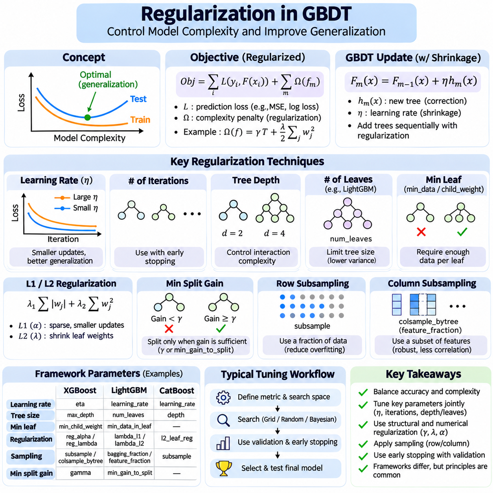{width="7.268055555555556in" height="7.268055555555556in"}

Regularization in Gradient Boosted Decision Trees (GBDT) refers to techniques that control model complexity and prevent the ensemble from fitting noise rather than meaningful patterns. Because boosting sequentially adds trees to correct prediction errors, an unrestricted model may gradually memorize training observations. Regularization balances predictive flexibility with generalization, ensuring that improvements on training data remain useful for unseen observations.

The need for regularization arises from the high expressive capacity of tree ensembles. Individual decision trees can partition feature space into increasingly specific regions, while boosting combines many such partitions into a complex prediction function. Although this flexibility captures nonlinear relationships and feature interactions, it can also amplify measurement noise, outliers, and accidental correlations. Effective regularization limits these undesirable effects.

The general objective of regularized GBDT combines prediction loss with penalties on model complexity. It can be expressed as Obj = ΣL(y_i, F(x_i)) + ΣΩ(f_m), where L measures prediction error and Ω represents complexity penalties applied to individual trees. The regularization term discourages unnecessarily complicated corrections while allowing the ensemble to learn relationships that provide sufficient predictive improvement.

Learning rate shrinkage is one of the most widely used regularization mechanisms in gradient boosting. Each new tree contributes a scaled correction according to F_m(x) = F\\_(m-1)(x) + ηh_m(x), where η is the learning rate. Smaller learning rates reduce the influence of individual trees and encourage gradual learning. This often improves generalization, although more boosting iterations are usually required to achieve comparable training accuracy.

The number of boosting iterations also influences model complexity. Adding too few trees may leave important patterns unexplained, producing underfitting. Adding excessive trees can progressively fit smaller residual fluctuations, including noise that does not generalize. Early stopping addresses this problem by monitoring validation performance and terminating training when additional trees no longer provide meaningful improvements.

Tree depth controls the complexity of interactions represented by individual learners. Shallow trees capture relatively simple relationships, whereas deeper trees can model higher-order interactions among multiple features. Excessive depth increases the risk of fitting isolated observations or unstable patterns. Restricting maximum depth therefore acts as structural regularization, particularly when datasets contain limited observations or substantial measurement noise.

Leaf-count constraints provide another mechanism for limiting tree complexity. XGBoost and LightGBM expose parameters that restrict tree growth, although their growth strategies differ. LightGBM\'s num_leaves directly controls the maximum number of terminal regions, while XGBoost commonly uses max_depth and related constraints. Smaller trees generally reduce variance but may introduce additional bias when the underlying relationships are highly complex.

Minimum leaf requirements discourage splits supported by insufficient training evidence. LightGBM uses min_data_in_leaf to restrict the number of observations assigned to a leaf, while XGBoost uses min_child_weight to impose a threshold on accumulated Hessian statistics. Increasing these thresholds can prevent overly specialized partitions. However, excessively restrictive values may suppress meaningful patterns associated with rare but important observations.

L1 and L2 regularization constrain the numerical values assigned to tree leaves. L1 penalties encourage smaller or potentially zero-valued corrections, while L2 penalties smoothly reduce the magnitude of leaf outputs. XGBoost supports these mechanisms through reg_alpha and reg_lambda, and LightGBM provides corresponding parameters. Their purpose is to reduce overly aggressive prediction updates and improve model stability.

XGBoost expresses tree complexity through a regularization function such as Ω(f) = γT + (λ/2)Σw_j², where T denotes the number of leaves and w_j represents leaf weights. The parameter γ penalizes additional leaves, while λ controls the magnitude of corrective predictions. This formulation integrates structural and numerical regularization directly into the optimization objective used during tree construction.

Minimum split gain provides an explicit mechanism for preventing weak improvements from increasing model complexity. XGBoost uses gamma, while LightGBM provides min_gain_to_split. These parameters require candidate splits to produce sufficient improvement before being accepted. Higher thresholds reduce unnecessary partitions and can improve generalization, but overly aggressive settings may prevent the model from learning subtle relationships.

Row subsampling introduces stochastic regularization by training individual trees using only a fraction of available observations. This reduces dependence on particular training examples and may limit the influence of noise or outliers. The subsample parameter in XGBoost controls this behavior, while LightGBM offers related sampling settings. Moderate subsampling can improve robustness, although very small samples may produce unstable gradient estimates.

Column subsampling restricts the features considered during tree construction. Parameters such as colsample_bytree in XGBoost and feature_fraction in LightGBM introduce randomness into feature selection. This can prevent the ensemble from repeatedly relying on a small group of dominant variables. Column sampling is particularly useful when many correlated features exist, but excessive restriction may exclude important predictive information.

CatBoost applies regularization through symmetric tree structures, leaf-value penalties, and controlled randomness during split selection. Its l2_leaf_reg parameter limits the magnitude of leaf predictions, while random_strength influences variability in split scoring. Tree depth also restricts interaction complexity. These mechanisms complement CatBoost\'s ordered training procedures, which primarily address prediction shift rather than serving as conventional complexity penalties.

Regularization must account for the relationship between bias and variance. Strong restrictions generally reduce model variance by limiting sensitivity to training observations, but they can increase bias by preventing the ensemble from representing complex relationships. Weak restrictions allow greater flexibility but may increase overfitting. Effective model selection seeks a balance that minimizes expected prediction error on unseen data.

The interaction among regularization parameters is important because their effects are not independent. A smaller learning rate may permit more boosting rounds, while deeper trees may require stronger leaf penalties or larger minimum leaf sizes. Aggressive row sampling may also require adjustments to tree complexity. Consequently, tuning one parameter without considering the others can produce misleading conclusions about its effectiveness.

Validation-based regularization provides an empirical method for selecting appropriate complexity. Training and validation losses should be monitored throughout boosting to identify divergence between memorization and generalization. Cross-validation can provide more reliable estimates when datasets are limited. Temporal or grouped data requires specialized validation strategies because random partitioning may introduce leakage and conceal overfitting.

Regularization is particularly important when training data contains outliers, noisy labels, or class imbalance. Large residuals may cause boosting to concentrate on difficult observations, including incorrectly labeled examples. Robust loss functions, suitable sample weights, and controlled tree complexity can reduce undesirable sensitivity. However, regularization alone cannot correct systematic labeling errors or compensate for fundamentally unrepresentative datasets.

In industrial applications, regularization helps maintain stable predictions across changing operating conditions. Equipment monitoring and manufacturing quality models often contain correlated sensor measurements, rare failure events, and environmental variability. Overly complex ensembles may learn patterns specific to individual machines or production periods. Appropriate regularization, combined with representative validation data, can improve reliability across operating environments.

Computational efficiency is also affected by regularization choices. Shallower trees, fewer leaves, and early stopping can reduce training time, memory consumption, and inference latency. However, extremely small learning rates may increase the number of required trees and offset these savings. Practical optimization should therefore evaluate prediction quality together with computational requirements rather than assuming stronger regularization always produces cheaper models.

A systematic regularization workflow begins with a baseline configuration and evaluates validation performance under controlled parameter changes. Learning rate, tree complexity, leaf constraints, and sampling ratios can then be adjusted while preserving reproducible experimental conditions. The selected configuration should be tested on an independent dataset, with all preprocessing steps and model settings recorded for deployment.

Regularization in GBDT is not a single technique but a coordinated framework for controlling how an ensemble learns. Shrinkage, tree constraints, leaf penalties, stochastic sampling, and early stopping influence different aspects of model complexity. Understanding their interactions enables the construction of gradient-boosted models that combine strong predictive performance with stability, efficiency, and reliable generalization.

그래디언트 부스팅 결정 트리(Gradient Boosted Decision Trees, GBDT)의 정규화(Regularization)는 모델 복잡도(Model Complexity)를 제어하고 앙상블(Ensemble)이 의미 있는 패턴 대신 잡음(Noise)에 적합되는 것을 방지하는 기법을 의미한다. 부스팅(Boosting)은 예측 오차(Prediction Error)를 수정하기 위해 트리를 순차적으로 추가하므로, 제약이 없는 모델은 학습 관측값(Training Observation)을 점진적으로 암기할 수 있다. 정규화는 예측 유연성(Predictive Flexibility)과 일반화 성능(Generalization) 사이의 균형을 유지하여 학습 데이터에서의 개선이 이전에 관찰하지 않은 데이터(Unseen Data)에서도 유효하도록 한다.

정규화의 필요성은 트리 앙상블(Tree Ensemble)의 높은 표현 능력(Expressive Capacity)에서 비롯된다. 개별 결정 트리(Decision Tree)는 특징 공간(Feature Space)을 점점 더 세분화된 영역으로 분할할 수 있으며, 부스팅은 이러한 여러 분할을 결합하여 복잡한 예측 함수(Prediction Function)를 형성한다. 이러한 유연성은 비선형 관계(Nonlinear Relationship)와 특징 상호작용(Feature Interaction)을 포착하지만, 측정 잡음(Measurement Noise), 이상치(Outlier), 우연한 상관관계(Accidental Correlation)를 증폭시킬 수도 있다. 효과적인 정규화는 이러한 바람직하지 않은 영향을 제한한다.

정규화된 GBDT의 일반적인 목적 함수(Objective Function)는 예측 손실(Prediction Loss)과 모델 복잡도에 대한 벌점(Penalty)을 결합한다. 이는 Obj = ΣL(y_i, F(x_i)) + ΣΩ(f_m)으로 표현할 수 있으며, 여기서 L은 예측 오차를 측정하고 Ω는 개별 트리에 적용되는 복잡도 벌점(Complexity Penalty)을 나타낸다. 정규화 항(Regularization Term)은 불필요하게 복잡한 수정(Correction)을 억제하면서도 충분한 예측 개선(Predictive Improvement)을 제공하는 관계는 앙상블이 학습할 수 있도록 한다.

학습률 축소(Learning Rate Shrinkage)는 그래디언트 부스팅에서 가장 널리 사용되는 정규화 메커니즘(Regularization Mechanism) 중 하나이다. 새로운 각 트리는 F_m(x) = F\\_(m-1)(x) + ηh_m(x)에 따라 크기가 조정된 수정값(Scaled Correction)을 제공하며, 여기서 η는 학습률(Learning Rate)이다. 작은 학습률은 개별 트리의 영향을 줄이고 점진적인 학습(Gradual Learning)을 유도한다. 이는 일반화 성능을 개선하는 경우가 많지만, 일반적으로 비슷한 학습 정확도(Training Accuracy)를 달성하기 위해 더 많은 부스팅 반복(Boosting Iteration)이 필요하다.

부스팅 반복 횟수(Number of Boosting Iterations)도 모델 복잡도에 영향을 미친다. 트리를 너무 적게 추가하면 중요한 패턴을 충분히 설명하지 못하여 과소적합(Underfitting)이 발생할 수 있다. 반대로 지나치게 많은 트리를 추가하면 일반화되지 않는 잡음을 포함하여 점점 더 작은 잔차 변동(Residual Fluctuation)에 적합될 수 있다. 조기 종료(Early Stopping)는 검증 성능(Validation Performance)을 모니터링하고 추가적인 트리가 더 이상 의미 있는 개선을 제공하지 않을 때 학습을 종료함으로써 이러한 문제를 해결한다.

트리 깊이(Tree Depth)는 개별 학습기(Individual Learner)가 표현할 수 있는 상호작용의 복잡도(Interaction Complexity)를 제어한다. 얕은 트리(Shallow Tree)는 비교적 단순한 관계를 포착하지만, 깊은 트리(Deep Tree)는 여러 특징 사이의 고차 상호작용(Higher-Order Interaction)을 모델링할 수 있다. 지나치게 깊은 트리는 개별 관측값이나 불안정한 패턴(Unstable Pattern)에 적합될 위험을 증가시킨다. 따라서 최대 깊이(Maximum Depth)를 제한하는 것은 특히 관측값이 적거나 측정 잡음이 많은 데이터셋에서 구조적 정규화(Structural Regularization)로 작용한다.

리프 수 제약(Leaf-Count Constraint)은 트리 복잡도를 제한하는 또 다른 메커니즘을 제공한다. XGBoost와 LightGBM은 서로 다른 트리 성장 전략(Tree Growth Strategy)을 사용하지만 트리 성장을 제한하는 매개변수를 제공한다. LightGBM의 num_leaves는 말단 영역(Terminal Region)의 최대 수를 직접 제어하며, XGBoost는 일반적으로 max_depth와 관련 제약 조건을 사용한다. 작은 트리는 일반적으로 분산(Variance)을 줄이지만, 기본 관계(Underlying Relationship)가 매우 복잡한 경우에는 추가적인 편향(Bias)을 유발할 수 있다.

최소 리프 요구사항(Minimum Leaf Requirement)은 충분한 학습 근거(Training Evidence)가 없는 분할을 억제한다. LightGBM은 min_data_in_leaf를 사용하여 리프에 할당되는 관측값의 수를 제한하며, XGBoost는 min_child_weight를 사용하여 누적 헤시안 통계량(Accumulated Hessian Statistics)에 대한 임계값(Threshold)을 적용한다. 이러한 임계값을 높이면 지나치게 특수화된 분할(Overly Specialized Partition)을 방지할 수 있다. 그러나 과도하게 제한하면 드물지만 중요한 관측값(Rare but Important Observation)과 관련된 의미 있는 패턴을 학습하지 못할 수 있다.

L1 및 L2 정규화(L1 and L2 Regularization)는 트리 리프(Tree Leaf)에 할당되는 수치값을 제한한다. L1 벌점(L1 Penalty)은 더 작거나 경우에 따라 0이 되는 수정값을 유도하며, L2 벌점(L2 Penalty)은 리프 출력값(Leaf Output)의 크기를 부드럽게 감소시킨다. XGBoost는 reg_alpha와 reg_lambda를 통해 이러한 메커니즘을 지원하며, LightGBM도 이에 대응하는 매개변수를 제공한다. 이들의 목적은 지나치게 공격적인 예측 갱신(Prediction Update)을 줄이고 모델 안정성(Model Stability)을 개선하는 것이다.

XGBoost는 Ω(f) = γT + (λ/2)Σw_j²와 같은 정규화 함수(Regularization Function)를 통해 트리 복잡도를 표현한다. 여기서 T는 리프 수(Number of Leaves)를 나타내며, w_j는 리프 가중치(Leaf Weight)를 의미한다. γ 매개변수는 추가 리프에 벌점을 부과하고, λ는 수정 예측값(Corrective Prediction)의 크기를 제어한다. 이러한 공식은 구조적 정규화(Structural Regularization)와 수치적 정규화(Numerical Regularization)를 트리 구성 과정에서 사용하는 최적화 목적 함수(Optimization Objective)에 직접 통합한다.

최소 분할 이득(Minimum Split Gain)은 미미한 개선으로 인해 모델 복잡도가 증가하는 것을 방지하는 명시적인 메커니즘이다. XGBoost는 gamma를 사용하며, LightGBM은 min_gain_to_split을 제공한다. 이러한 매개변수는 후보 분할(Candidate Split)이 허용되기 전에 충분한 개선량(Improvement)을 생성하도록 요구한다. 높은 임계값은 불필요한 분할을 줄이고 일반화 성능을 개선할 수 있지만, 지나치게 엄격한 설정은 모델이 미묘한 관계(Subtle Relationship)를 학습하지 못하게 할 수 있다.

행 부분 표본 추출(Row Subsampling)은 사용 가능한 관측값의 일부만 사용하여 개별 트리를 학습함으로써 확률적 정규화(Stochastic Regularization)를 도입한다. 이는 특정 학습 사례(Training Example)에 대한 의존성을 줄이고 잡음이나 이상치의 영향을 제한할 수 있다. XGBoost의 subsample 매개변수는 이러한 동작을 제어하며, LightGBM도 관련 표본 추출 설정(Sampling Setting)을 제공한다. 적절한 부분 표본 추출은 강건성(Robustness)을 개선할 수 있지만, 표본 크기가 지나치게 작으면 불안정한 기울기 추정(Gradient Estimation)이 발생할 수 있다.

열 부분 표본 추출(Column Subsampling)은 트리 구성 과정에서 고려하는 특징(Feature)을 제한한다. XGBoost의 colsample_bytree와 LightGBM의 feature_fraction 같은 매개변수는 특징 선택(Feature Selection)에 무작위성(Randomness)을 도입한다. 이는 앙상블이 소수의 지배적인 변수(Dominant Variable)에 반복적으로 의존하는 것을 방지할 수 있다. 열 표본 추출은 상관관계가 높은 특징(Correlated Feature)이 많은 경우 특히 유용하지만, 지나친 제한은 중요한 예측 정보(Predictive Information)를 제외할 수 있다.

CatBoost는 대칭 트리 구조(Symmetric Tree Structure), 리프 값 벌점(Leaf-Value Penalty), 분할 선택(Split Selection) 과정의 제어된 무작위성(Controlled Randomness)을 통해 정규화를 적용한다. l2_leaf_reg 매개변수는 리프 예측값(Leaf Prediction)의 크기를 제한하며, random_strength는 분할 점수(Split Scoring)의 변동성(Variability)에 영향을 미친다. 트리 깊이도 상호작용 복잡도(Interaction Complexity)를 제한한다. 이러한 메커니즘은 주로 예측 이동(Prediction Shift)을 해결하기 위한 CatBoost의 순서 기반 학습 절차(Ordered Training Procedure)를 보완하며, 기존의 복잡도 벌점(Complexity Penalty)과는 구별된다.

정규화는 편향과 분산(Bias and Variance) 사이의 관계를 고려해야 한다. 강한 제약 조건(Strong Restriction)은 일반적으로 학습 관측값에 대한 민감도(Sensitivity)를 제한하여 모델 분산(Model Variance)을 줄이지만, 앙상블이 복잡한 관계를 표현하지 못하게 하여 편향을 증가시킬 수 있다. 약한 제약 조건(Weak Restriction)은 더 큰 유연성을 허용하지만 과적합을 증가시킬 수 있다. 효과적인 모델 선택(Model Selection)은 이전에 관찰하지 않은 데이터에 대한 기대 예측 오차(Expected Prediction Error)를 최소화하는 균형을 추구한다.

정규화 매개변수 사이의 상호작용(Interaction Among Regularization Parameters)은 각 매개변수의 효과가 독립적이지 않기 때문에 중요하다. 작은 학습률은 더 많은 부스팅 라운드(Boosting Round)를 허용할 수 있으며, 깊은 트리는 더 강한 리프 벌점(Leaf Penalty)이나 더 큰 최소 리프 크기(Minimum Leaf Size)를 필요로 할 수 있다. 공격적인 행 표본 추출(Aggressive Row Sampling) 역시 트리 복잡도 조정을 요구할 수 있다. 따라서 다른 매개변수를 고려하지 않고 하나의 매개변수만 튜닝하면 효과에 대해 잘못된 결론을 얻을 수 있다.

검증 기반 정규화(Validation-Based Regularization)는 적절한 복잡도를 선택하기 위한 경험적 방법(Empirical Method)을 제공한다. 부스팅 과정 전체에서 학습 손실(Training Loss)과 검증 손실(Validation Loss)을 모니터링하여 암기(Memorization)와 일반화(Generalization) 사이의 차이가 확대되는 시점을 식별해야 한다. 데이터셋이 제한적인 경우 교차 검증(Cross-Validation)은 더 신뢰할 수 있는 추정값을 제공할 수 있다. 시간적 데이터(Temporal Data)나 그룹화된 데이터(Grouped Data)는 무작위 분할(Random Partitioning)이 정보 누출(Information Leakage)을 유발하고 과적합을 숨길 수 있으므로 특화된 검증 전략(Validation Strategy)이 필요하다.

학습 데이터에 이상치(Outlier), 잡음이 포함된 레이블(Noisy Label), 클래스 불균형(Class Imbalance)이 존재하는 경우 정규화는 특히 중요하다. 큰 잔차(Large Residual)는 부스팅이 잘못된 레이블을 가진 사례를 포함하여 예측하기 어려운 관측값에 집중하도록 만들 수 있다. 강건한 손실 함수(Robust Loss Function), 적절한 표본 가중치(Sample Weight), 제어된 트리 복잡도(Controlled Tree Complexity)는 바람직하지 않은 민감도를 줄일 수 있다. 그러나 정규화만으로 체계적인 레이블 오류(Systematic Labeling Error)를 수정하거나 근본적으로 대표성이 부족한 데이터셋(Unrepresentative Dataset)을 보완할 수는 없다.

산업 응용(Industrial Application)에서 정규화는 변화하는 운전 조건(Operating Condition)에서도 안정적인 예측(Stable Prediction)을 유지하는 데 도움을 준다. 장비 모니터링(Equipment Monitoring)과 제조 품질 모델(Manufacturing Quality Model)은 상관관계가 있는 센서 측정값(Correlated Sensor Measurement), 드문 고장 사건(Rare Failure Event), 환경 변동성(Environmental Variability)을 포함하는 경우가 많다. 지나치게 복잡한 앙상블은 특정 장비나 생산 기간(Production Period)에만 해당하는 패턴을 학습할 수 있다. 적절한 정규화와 대표성 있는 검증 데이터(Representative Validation Data)를 결합하면 다양한 운전 환경(Operating Environment)에서 신뢰성을 개선할 수 있다.

계산 효율성(Computational Efficiency)도 정규화 설정(Regularization Choice)의 영향을 받는다. 얕은 트리, 적은 리프 수, 조기 종료는 학습 시간(Training Time), 메모리 사용량(Memory Consumption), 추론 지연 시간(Inference Latency)을 줄일 수 있다. 그러나 지나치게 작은 학습률은 필요한 트리 수를 증가시켜 이러한 이점을 상쇄할 수 있다. 따라서 실용적인 최적화(Practical Optimization)에서는 강한 정규화가 항상 더 저렴한 모델을 생성한다고 가정하기보다 예측 품질(Prediction Quality)과 계산 요구사항(Computational Requirement)을 함께 평가해야 한다.

체계적인 정규화 작업 흐름(Systematic Regularization Workflow)은 기준 설정(Baseline Configuration)에서 시작하여 통제된 매개변수 변경(Controlled Parameter Change)에 따른 검증 성능을 평가한다. 이후 재현 가능한 실험 조건(Reproducible Experimental Condition)을 유지하면서 학습률, 트리 복잡도, 리프 제약 조건(Leaf Constraint), 표본 추출 비율(Sampling Ratio)을 조정할 수 있다. 선택된 설정은 독립적인 데이터셋(Independent Dataset)에서 테스트해야 하며, 배포(Deployment)를 위해 모든 전처리 단계(Preprocessing Step)와 모델 설정(Model Setting)을 기록해야 한다.

GBDT의 정규화(Regularization)는 단일 기법이 아니라 앙상블이 학습하는 방식을 제어하기 위한 통합적인 프레임워크(Coordinated Framework)이다. 축소(Shrinkage), 트리 제약 조건(Tree Constraint), 리프 벌점(Leaf Penalty), 확률적 표본 추출(Stochastic Sampling), 조기 종료(Early Stopping)는 모델 복잡도의 서로 다른 측면에 영향을 미친다. 이러한 요소의 상호작용을 이해하면 높은 예측 성능(Predictive Performance)과 안정성(Stability), 효율성(Efficiency), 신뢰할 수 있는 일반화 성능(Reliable Generalization)을 결합한 그래디언트 부스팅 모델(Gradient-Boosted Model)을 구성할 수 있다.

## 06.08 Performance Optimization

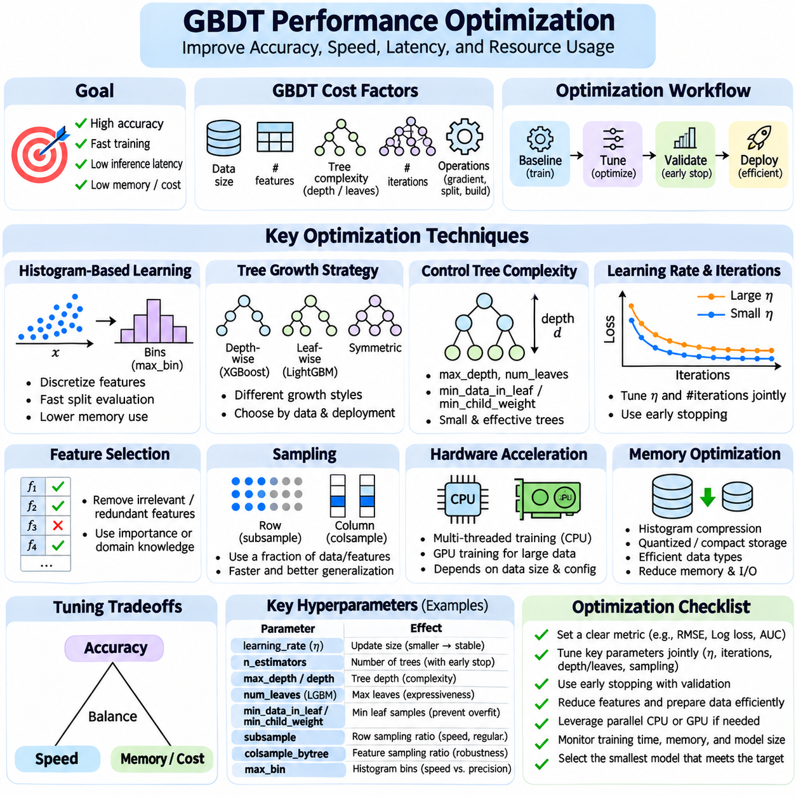{width="7.268055555555556in" height="7.268055555555556in"}

Performance optimization in Gradient Boosted Decision Trees (GBDT) focuses on improving predictive accuracy, training efficiency, inference latency, and resource utilization. Although gradient boosting is highly effective for structured data, large datasets and complex ensembles can create substantial computational demands. Optimization therefore requires balancing model quality with execution time, memory consumption, and deployment constraints rather than maximizing accuracy alone.

The computational cost of GBDT depends on dataset size, feature dimensionality, tree complexity, and the number of boosting iterations. Each iteration requires calculating prediction gradients, evaluating candidate splits, and constructing a new tree. As the ensemble grows, training time and model size increase. Understanding these operations helps identify whether performance limitations originate from data processing, split evaluation, tree construction, or prediction.

Histogram-based learning is a major optimization technique used by modern boosting frameworks. Continuous feature values are discretized into a limited number of bins, allowing split statistics to be accumulated efficiently. Instead of evaluating every unique feature value, the algorithm searches candidate boundaries between bins. This approach reduces memory requirements and computational complexity while generally preserving sufficient resolution for accurate learning.

The number of histogram bins influences the tradeoff between computational efficiency and split precision. Smaller bin counts accelerate histogram construction and reduce memory consumption, but may overlook informative thresholds. Larger bin counts provide finer numerical resolution at additional computational cost. Parameters such as max_bin in LightGBM and histogram-based XGBoost implementations should therefore be selected according to feature distributions and available resources.

Tree growth strategies strongly influence training and inference performance. XGBoost commonly supports depth-wise growth, LightGBM emphasizes leaf-wise expansion, and CatBoost typically constructs symmetric trees. Depth-wise growth provides regular tree structures, while leaf-wise growth concentrates computation on promising regions. Symmetric trees offer predictable inference paths. The most efficient strategy depends on dataset characteristics and deployment requirements.

Controlling tree complexity is an effective way to improve computational performance. Maximum depth, leaf count, and minimum leaf requirements determine how extensively feature space is partitioned. Smaller trees generally require less memory and fewer split evaluations, while larger trees capture more complex interactions. Performance optimization should identify the smallest tree structure that achieves acceptable validation accuracy rather than assuming deeper trees are always beneficial.

The learning rate and number of boosting iterations jointly determine optimization efficiency. A smaller learning rate often improves stability but requires additional trees, increasing training time and inference cost. A larger learning rate reduces the number of required iterations but may weaken generalization. Early stopping can identify a suitable ensemble size by monitoring validation performance and terminating training when further improvements become negligible.

Feature selection reduces computational requirements by eliminating irrelevant or redundant inputs. High-dimensional datasets increase the number of candidate splits and may contain correlated variables that provide little additional information. Statistical screening, permutation importance, and domain knowledge can identify useful features. However, feature removal must be validated because seemingly weak variables may contribute through interactions with other features.

Data preprocessing can substantially affect training throughput. Efficient numerical data types, compact categorical representations, and consistent missing-value handling reduce memory overhead. Converting unnecessarily high-precision numerical arrays into suitable lower-precision formats may improve resource utilization. Such transformations must preserve sufficient numerical accuracy and avoid changing the meaning of important measurements or categorical identifiers.

Row and column sampling can accelerate training by reducing the observations and features considered during tree construction. Subsampling also introduces randomness that may improve generalization. XGBoost and LightGBM provide configurable sampling mechanisms, although implementation details differ. Aggressive sampling can reduce computation but may increase prediction variance or exclude rare events, requiring careful validation.

Parallel processing improves GBDT training by distributing histogram construction and split evaluation across multiple CPU threads. Efficient implementations exploit data-level parallelism and optimized memory access patterns. However, increasing thread count does not guarantee proportional speedup because synchronization, memory bandwidth, and scheduling overhead can become limiting factors. Thread settings should be benchmarked on the target hardware.

GPU acceleration can improve training performance for sufficiently large datasets by processing histogram operations and related computations in parallel. XGBoost, LightGBM, and CatBoost provide GPU-capable training configurations, although supported features and execution behavior vary. GPU effectiveness depends on dataset dimensions, transfer overhead, memory capacity, and algorithm configuration. Small datasets may not benefit substantially from acceleration.

Memory optimization becomes particularly important when datasets contain millions of observations or thousands of features. Histogram compression, quantized feature storage, and efficient data structures reduce memory consumption. Training pipelines should avoid unnecessary dataset copies and intermediate representations. Monitoring peak memory usage is essential because excessive allocation can trigger swapping, slow execution, or training failure.

Categorical feature processing introduces additional performance considerations. CatBoost supports specialized categorical transformations, while LightGBM provides native categorical splitting mechanisms. High-cardinality variables may increase processing costs and create sparse statistical evidence. Category grouping, appropriate encoding strategies, and controlled interaction complexity can improve efficiency, provided that useful predictive distinctions are preserved.

Hyperparameter optimization can become a major computational expense because each candidate configuration requires model training and evaluation. Randomized search, Bayesian optimization, and pruning strategies can reduce unnecessary trials. Search spaces should prioritize parameters with substantial effects on accuracy or runtime. Resource-aware tuning can reject configurations that exceed memory, latency, or training-time constraints before completing expensive evaluations.

Inference optimization is essential when GBDT models operate in real-time applications. Prediction latency depends on the number of trees, tree depth, branching structure, and implementation efficiency. Smaller ensembles and shallower trees generally reduce evaluation cost. Batch prediction can improve throughput by processing multiple observations together, while single-sample latency remains important for time-sensitive control and monitoring systems.

Model compression and deployment optimization can further reduce operational requirements. Removing unnecessary features, limiting ensemble size, and selecting efficient prediction runtimes may improve memory usage and execution speed. Some deployment environments support specialized model representations or compiled inference implementations. Any transformation must be verified against the original model to ensure that numerical differences remain within acceptable limits.

Performance evaluation should distinguish training throughput, inference throughput, and prediction latency. Training throughput measures how quickly models process observations during learning, while inference throughput describes predictions completed per unit time. Latency measures the time required to produce individual predictions. These metrics respond differently to batching, parallelism, and hardware acceleration, so optimization targets must reflect the intended application.

Industrial deployment introduces additional constraints involving reliability, determinism, and hardware availability. Edge computing systems may operate with limited CPU resources, memory, and power budgets. Models used for equipment monitoring or autonomous systems must satisfy operational timing requirements without compromising prediction quality. Benchmarking should therefore use representative hardware, realistic input distributions, and expected concurrent workloads.

A systematic optimization workflow begins by profiling the complete pipeline to identify dominant computational costs. Data loading, preprocessing, model fitting, validation, and inference should be measured separately. Optimization changes should be introduced incrementally and evaluated against a stable baseline. Recording execution time, peak memory, model size, and predictive metrics enables objective comparison across configurations.

Performance optimization must also preserve reproducibility and statistical validity. Hardware acceleration, parallel execution, and stochastic sampling may introduce numerical or procedural variability. Consistent random seeds, documented software versions, and controlled evaluation conditions help distinguish genuine improvements from experimental noise. Accuracy comparisons should use identical validation partitions and evaluation metrics whenever possible.

GBDT performance optimization is a coordinated engineering process rather than a single algorithmic adjustment. Histogram learning, efficient tree growth, sampling, parallel processing, GPU acceleration, and inference optimization address different computational bottlenecks. Combining these techniques with careful validation enables XGBoost, LightGBM, and CatBoost models to deliver strong predictive performance within practical training and deployment constraints.

그래디언트 부스팅 결정 트리(Gradient Boosted Decision Trees, GBDT)의 성능 최적화(Performance Optimization)는 예측 정확도(Predictive Accuracy), 학습 효율성(Training Efficiency), 추론 지연 시간(Inference Latency), 자원 활용률(Resource Utilization)을 개선하는 데 중점을 둔다. 그래디언트 부스팅(Gradient Boosting)은 정형 데이터(Structured Data)에 매우 효과적이지만, 대규모 데이터셋(Large Dataset)과 복잡한 앙상블(Complex Ensemble)은 상당한 계산 요구량(Computational Demand)을 발생시킬 수 있다. 따라서 최적화는 정확도만 최대화하는 것이 아니라 모델 품질(Model Quality), 실행 시간(Execution Time), 메모리 사용량(Memory Consumption), 배포 제약 조건(Deployment Constraint) 사이의 균형을 유지해야 한다.

GBDT의 계산 비용(Computational Cost)은 데이터셋 크기(Dataset Size), 특징 차원(Feature Dimensionality), 트리 복잡도(Tree Complexity), 부스팅 반복 횟수(Number of Boosting Iterations)에 따라 달라진다. 각 반복에서는 예측 기울기(Prediction Gradient)를 계산하고, 후보 분할(Candidate Split)을 평가하며, 새로운 트리를 구성해야 한다. 앙상블이 커질수록 학습 시간(Training Time)과 모델 크기(Model Size)가 증가한다. 이러한 연산을 이해하면 성능 제약(Performance Limitation)이 데이터 처리(Data Processing), 분할 평가(Split Evaluation), 트리 구성(Tree Construction), 예측(Prediction) 중 어디에서 발생하는지 식별할 수 있다.

히스토그램 기반 학습(Histogram-Based Learning)은 최신 부스팅 프레임워크(Boosting Framework)에서 사용하는 주요 최적화 기법(Optimization Technique)이다. 연속형 특징값(Continuous Feature Value)을 제한된 수의 구간(Bin)으로 이산화(Discretization)하여 분할 통계량(Split Statistics)을 효율적으로 누적할 수 있도록 한다. 알고리즘은 모든 고유 특징값(Unique Feature Value)을 평가하는 대신 구간 사이의 후보 경계(Candidate Boundary)를 탐색한다. 이러한 접근법은 정확한 학습에 필요한 충분한 해상도(Resolution)를 대체로 유지하면서 메모리 요구량(Memory Requirement)과 계산 복잡도(Computational Complexity)를 줄인다.

히스토그램 구간 수(Number of Histogram Bins)는 계산 효율성(Computational Efficiency)과 분할 정밀도(Split Precision) 사이의 절충 관계(Tradeoff)에 영향을 미친다. 구간 수가 적으면 히스토그램 구성(Histogram Construction)이 빨라지고 메모리 사용량이 감소하지만 중요한 임계값(Informative Threshold)을 놓칠 수 있다. 구간 수가 많으면 수치 해상도(Numerical Resolution)가 높아지는 대신 추가적인 계산 비용이 발생한다. 따라서 LightGBM의 max_bin과 히스토그램 기반 XGBoost 구현(Histogram-Based XGBoost Implementation)의 관련 매개변수는 특징 분포(Feature Distribution)와 사용 가능한 자원(Available Resources)을 고려하여 선택해야 한다.

트리 성장 전략(Tree Growth Strategy)은 학습 및 추론 성능(Training and Inference Performance)에 큰 영향을 미친다. XGBoost는 일반적으로 깊이 중심 성장(Depth-Wise Growth)을 지원하고, LightGBM은 리프 중심 확장(Leaf-Wise Expansion)을 강조하며, CatBoost는 일반적으로 대칭 트리(Symmetric Tree)를 구성한다. 깊이 중심 성장은 규칙적인 트리 구조(Regular Tree Structure)를 제공하고, 리프 중심 성장은 유망한 영역(Promising Region)에 계산을 집중한다. 대칭 트리는 예측 가능한 추론 경로(Predictable Inference Path)를 제공한다. 가장 효율적인 전략은 데이터셋 특성(Dataset Characteristics)과 배포 요구사항(Deployment Requirement)에 따라 달라진다.

트리 복잡도(Tree Complexity)를 제어하는 것은 계산 성능(Computational Performance)을 개선하는 효과적인 방법이다. 최대 깊이(Maximum Depth), 리프 수(Leaf Count), 최소 리프 요구사항(Minimum Leaf Requirement)은 특징 공간(Feature Space)이 얼마나 세밀하게 분할되는지를 결정한다. 작은 트리는 일반적으로 메모리를 적게 사용하고 분할 평가(Split Evaluation) 횟수도 적지만, 큰 트리는 더 복잡한 상호작용(Complex Interaction)을 포착할 수 있다. 성능 최적화에서는 깊은 트리가 항상 유리하다고 가정하기보다 허용 가능한 검증 정확도(Validation Accuracy)를 달성하는 가장 작은 트리 구조를 찾아야 한다.

학습률(Learning Rate)과 부스팅 반복 횟수(Number of Boosting Iterations)는 최적화 효율성(Optimization Efficiency)을 함께 결정한다. 작은 학습률은 안정성(Stability)을 개선하는 경우가 많지만 추가적인 트리가 필요하므로 학습 시간(Training Time)과 추론 비용(Inference Cost)이 증가한다. 큰 학습률은 필요한 반복 횟수를 줄이지만 일반화 성능(Generalization Performance)을 약화시킬 수 있다. 조기 종료(Early Stopping)는 검증 성능(Validation Performance)을 모니터링하고 추가적인 개선이 미미해질 때 학습을 종료하여 적절한 앙상블 크기(Ensemble Size)를 식별할 수 있다.

특징 선택(Feature Selection)은 관련성이 없거나 중복된 입력값을 제거하여 계산 요구량(Computational Requirement)을 줄인다. 고차원 데이터셋(High-Dimensional Dataset)은 후보 분할(Candidate Split)의 수를 증가시키며, 추가적인 정보를 거의 제공하지 않는 상관관계 변수(Correlated Variable)를 포함할 수 있다. 통계적 선별(Statistical Screening), 순열 중요도(Permutation Importance), 도메인 지식(Domain Knowledge)을 활용하여 유용한 특징을 식별할 수 있다. 그러나 중요도가 낮아 보이는 변수도 다른 특징과의 상호작용(Feature Interaction)을 통해 기여할 수 있으므로 특징 제거(Feature Removal)는 반드시 검증해야 한다.

데이터 전처리(Data Preprocessing)는 학습 처리량(Training Throughput)에 상당한 영향을 미칠 수 있다. 효율적인 수치 자료형(Numerical Data Type), 압축된 범주형 표현(Compact Categorical Representation), 일관된 결측값 처리(Missing-Value Handling)는 메모리 오버헤드(Memory Overhead)를 줄인다. 불필요하게 높은 정밀도의 수치 배열(High-Precision Numerical Array)을 적절한 저정밀도 형식(Lower-Precision Format)으로 변환하면 자원 활용률(Resource Utilization)을 개선할 수 있다. 다만 이러한 변환은 충분한 수치 정확도(Numerical Accuracy)를 유지해야 하며 중요한 측정값이나 범주 식별자(Categorical Identifier)의 의미를 변경해서는 안 된다.

행 및 열 표본 추출(Row and Column Sampling)은 트리 구성 과정에서 고려하는 관측값(Observation)과 특징(Feature)을 줄여 학습 속도를 높일 수 있다. 부분 표본 추출(Subsampling)은 일반화 성능을 개선할 수 있는 무작위성(Randomness)도 도입한다. XGBoost와 LightGBM은 설정 가능한 표본 추출 메커니즘(Sampling Mechanism)을 제공하지만 구현 세부사항(Implementation Detail)은 서로 다르다. 공격적인 표본 추출(Aggressive Sampling)은 계산량을 줄일 수 있지만 예측 분산(Prediction Variance)을 증가시키거나 드문 사건(Rare Event)을 제외할 수 있으므로 신중한 검증이 필요하다.

병렬 처리(Parallel Processing)는 여러 CPU 스레드(CPU Thread)에 히스토그램 구성(Histogram Construction)과 분할 평가(Split Evaluation)를 분산하여 GBDT 학습 성능을 개선한다. 효율적인 구현(Efficient Implementation)은 데이터 수준 병렬성(Data-Level Parallelism)과 최적화된 메모리 접근 패턴(Optimized Memory Access Pattern)을 활용한다. 그러나 스레드 수(Thread Count)를 늘린다고 성능이 비례하여 향상되는 것은 아니다. 동기화(Synchronization), 메모리 대역폭(Memory Bandwidth), 스케줄링 오버헤드(Scheduling Overhead)가 병목 요인(Bottleneck)이 될 수 있기 때문이다. 따라서 스레드 설정은 목표 하드웨어(Target Hardware)에서 벤치마킹해야 한다.

GPU 가속(GPU Acceleration)은 히스토그램 연산(Histogram Operation)과 관련 계산을 병렬로 처리하여 충분히 큰 데이터셋에서 학습 성능을 개선할 수 있다. XGBoost, LightGBM, CatBoost는 GPU 기반 학습 설정(GPU-Capable Training Configuration)을 제공하지만 지원 기능(Supported Feature)과 실행 동작(Execution Behavior)은 서로 다르다. GPU의 효과는 데이터셋 차원(Dataset Dimension), 데이터 전송 오버헤드(Transfer Overhead), 메모리 용량(Memory Capacity), 알고리즘 설정(Algorithm Configuration)에 따라 달라진다. 작은 데이터셋에서는 가속 효과가 크지 않을 수 있다.

메모리 최적화(Memory Optimization)는 데이터셋에 수백만 개의 관측값이나 수천 개의 특징이 포함된 경우 특히 중요하다. 히스토그램 압축(Histogram Compression), 양자화된 특징 저장(Quantized Feature Storage), 효율적인 데이터 구조(Efficient Data Structure)는 메모리 사용량을 줄인다. 학습 파이프라인(Training Pipeline)은 불필요한 데이터셋 복사(Dataset Copy)와 중간 표현(Intermediate Representation)을 피해야 한다. 과도한 메모리 할당(Memory Allocation)은 스와핑(Swapping), 실행 속도 저하(Slow Execution), 학습 실패(Training Failure)를 유발할 수 있으므로 최대 메모리 사용량(Peak Memory Usage)을 모니터링하는 것이 필수적이다.

범주형 특징 처리(Categorical Feature Processing)는 추가적인 성능 고려사항(Performance Consideration)을 발생시킨다. CatBoost는 특화된 범주형 변환(Specialized Categorical Transformation)을 지원하며, LightGBM은 기본 범주형 분할 메커니즘(Native Categorical Splitting Mechanism)을 제공한다. 고기수 변수(High-Cardinality Variable)는 처리 비용을 증가시키고 희소한 통계적 근거(Sparse Statistical Evidence)를 생성할 수 있다. 범주 그룹화(Category Grouping), 적절한 인코딩 전략(Encoding Strategy), 제어된 상호작용 복잡도(Controlled Interaction Complexity)는 유용한 예측상의 구분(Predictive Distinction)을 유지하는 조건에서 효율성을 개선할 수 있다.

하이퍼파라미터 최적화(Hyperparameter Optimization)는 각 후보 설정(Candidate Configuration)에 대해 모델 학습과 평가가 필요하므로 주요 계산 비용 요인이 될 수 있다. 무작위 탐색(Randomized Search), 베이지안 최적화(Bayesian Optimization), 가지치기 전략(Pruning Strategy)은 불필요한 시행(Trial)을 줄일 수 있다. 탐색 공간(Search Space)은 정확도나 실행 시간에 상당한 영향을 미치는 매개변수를 우선해야 한다. 자원 인식 튜닝(Resource-Aware Tuning)은 비용이 높은 평가를 완료하기 전에 메모리, 지연 시간, 학습 시간 제약을 초과하는 설정을 제외할 수 있다.

추론 최적화(Inference Optimization)는 GBDT 모델이 실시간 응용(Real-Time Application)에서 동작할 때 필수적이다. 예측 지연 시간(Prediction Latency)은 트리 수(Number of Trees), 트리 깊이(Tree Depth), 분기 구조(Branching Structure), 구현 효율성(Implementation Efficiency)에 따라 달라진다. 작은 앙상블과 얕은 트리는 일반적으로 평가 비용(Evaluation Cost)을 줄인다. 배치 예측(Batch Prediction)은 여러 관측값을 함께 처리하여 처리량(Throughput)을 개선할 수 있지만, 시간에 민감한 제어 및 모니터링 시스템(Time-Sensitive Control and Monitoring System)에서는 단일 표본 지연 시간(Single-Sample Latency)도 중요하다.

모델 압축(Model Compression)과 배포 최적화(Deployment Optimization)는 운영 요구사항(Operational Requirement)을 추가로 줄일 수 있다. 불필요한 특징 제거(Removal of Unnecessary Features), 앙상블 크기 제한(Limiting Ensemble Size), 효율적인 예측 실행 환경(Efficient Prediction Runtime) 선택은 메모리 사용량과 실행 속도를 개선할 수 있다. 일부 배포 환경(Deployment Environment)은 특화된 모델 표현(Specialized Model Representation)이나 컴파일된 추론 구현(Compiled Inference Implementation)을 지원한다. 모든 변환은 원본 모델(Original Model)과 비교하여 수치적 차이(Numerical Difference)가 허용 범위(Acceptable Limit) 안에 있는지 검증해야 한다.

성능 평가(Performance Evaluation)에서는 학습 처리량(Training Throughput), 추론 처리량(Inference Throughput), 예측 지연 시간(Prediction Latency)을 구분해야 한다. 학습 처리량은 학습 과정에서 모델이 관측값을 처리하는 속도를 측정하며, 추론 처리량은 단위 시간당 완료되는 예측 수를 나타낸다. 지연 시간(Latency)은 개별 예측 결과를 생성하는 데 필요한 시간을 측정한다. 이러한 지표는 배치 처리(Batching), 병렬성(Parallelism), 하드웨어 가속(Hardware Acceleration)에 서로 다르게 반응하므로 최적화 목표(Optimization Target)는 실제 응용 목적을 반영해야 한다.

산업용 배포(Industrial Deployment)에는 신뢰성(Reliability), 결정성(Determinism), 하드웨어 가용성(Hardware Availability)에 관한 추가 제약 조건이 존재한다. 엣지 컴퓨팅 시스템(Edge Computing System)은 제한된 CPU 자원(CPU Resource), 메모리(Memory), 전력 예산(Power Budget)으로 동작할 수 있다. 장비 모니터링(Equipment Monitoring)이나 자율 시스템(Autonomous System)에 사용되는 모델은 예측 품질(Prediction Quality)을 저하시키지 않으면서 운영 시간 요구사항(Operational Timing Requirement)을 충족해야 한다. 따라서 벤치마킹(Benchmarking)은 대표성 있는 하드웨어(Representative Hardware), 실제적인 입력 분포(Realistic Input Distribution), 예상되는 동시 작업 부하(Concurrent Workload)를 사용해야 한다.

체계적인 최적화 작업 흐름(Systematic Optimization Workflow)은 전체 파이프라인(Complete Pipeline)을 프로파일링(Profiling)하여 주요 계산 비용(Dominant Computational Cost)을 식별하는 것에서 시작한다. 데이터 로딩(Data Loading), 전처리(Preprocessing), 모델 적합(Model Fitting), 검증(Validation), 추론(Inference)은 각각 별도로 측정해야 한다. 최적화 변경사항(Optimization Change)은 점진적으로 도입하고 안정적인 기준 모델(Stable Baseline)과 비교하여 평가해야 한다. 실행 시간(Execution Time), 최대 메모리 사용량(Peak Memory Usage), 모델 크기(Model Size), 예측 지표(Predictive Metric)를 기록하면 서로 다른 설정을 객관적으로 비교할 수 있다.

성능 최적화(Performance Optimization)는 재현성(Reproducibility)과 통계적 타당성(Statistical Validity)도 유지해야 한다. 하드웨어 가속(Hardware Acceleration), 병렬 실행(Parallel Execution), 확률적 표본 추출(Stochastic Sampling)은 수치적 변동성(Numerical Variability)이나 절차적 변동성(Procedural Variability)을 유발할 수 있다. 일관된 무작위 시드(Random Seed), 문서화된 소프트웨어 버전(Software Version), 통제된 평가 조건(Controlled Evaluation Condition)은 실제 개선과 실험 잡음(Experimental Noise)을 구분하는 데 도움을 준다. 정확도 비교(Accuracy Comparison)는 가능한 한 동일한 검증 데이터 분할(Validation Partition)과 평가 지표(Evaluation Metric)를 사용해야 한다.

GBDT 성능 최적화(GBDT Performance Optimization)는 단일 알고리즘 조정(Algorithmic Adjustment)이 아니라 여러 요소를 조율하는 공학적 과정(Coordinated Engineering Process)이다. 히스토그램 학습(Histogram Learning), 효율적인 트리 성장(Efficient Tree Growth), 표본 추출(Sampling), 병렬 처리(Parallel Processing), GPU 가속(GPU Acceleration), 추론 최적화(Inference Optimization)는 서로 다른 계산 병목(Computational Bottleneck)을 해결한다. 이러한 기법을 신중한 검증(Careful Validation)과 결합하면 XGBoost, LightGBM, CatBoost 모델이 실제 학습 및 배포 제약 조건(Practical Training and Deployment Constraints) 안에서 높은 예측 성능(Predictive Performance)을 제공할 수 있다.

## 06.09 GBDT vs DL

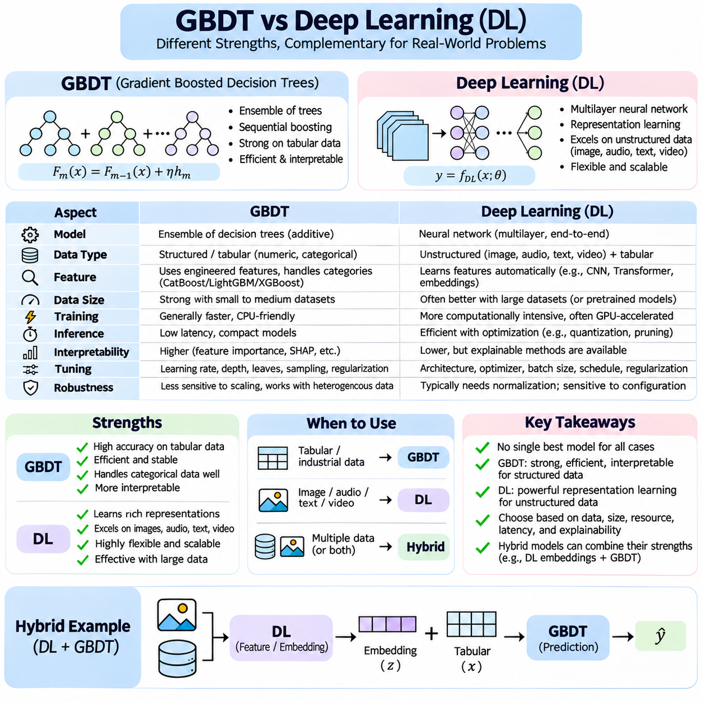{width="7.268055555555556in" height="7.268055555555556in"}

Gradient Boosted Decision Trees (GBDT) and Deep Learning (DL) represent two powerful approaches to supervised learning, but they differ fundamentally in architecture, optimization, and data representation. GBDT combines decision trees sequentially to correct prediction errors, while deep learning trains multilayer neural networks through gradient-based optimization. Understanding these differences is essential for selecting appropriate models across practical applications.

GBDT is particularly effective for structured tabular datasets containing numerical and categorical features. Decision trees naturally partition feature space using threshold-based rules, enabling models to capture nonlinear relationships without extensive feature scaling. Deep learning can also process tabular data, but its performance depends more strongly on architecture, feature representation, regularization, and training configuration.

Deep learning has a major advantage when working with unstructured information such as images, audio, text, and video. Convolutional networks, transformers, and related architectures learn hierarchical representations directly from raw or minimally processed inputs. GBDT generally requires meaningful numerical features extracted from such data before training. Consequently, representation learning is a central distinction between these approaches.

Dataset size strongly influences the relative effectiveness of GBDT and deep learning. On many small and medium-sized tabular datasets, gradient boosting provides competitive or superior accuracy with relatively limited tuning. Neural networks often benefit from larger datasets, although suitable architectures and pretrained representations can improve performance with fewer labeled examples. Neither approach is universally superior across all dataset sizes.

Feature engineering plays different roles in the two approaches. GBDT can learn nonlinear interactions among engineered features, but its performance still depends on the information represented by those inputs. Deep learning can discover intermediate representations through multiple trainable layers, reducing some manual feature engineering requirements. However, domain knowledge remains valuable for both methods, especially when measurements are incomplete or noisy.

Categorical variables illustrate another important difference. CatBoost provides specialized categorical encoding, while LightGBM and XGBoost support categorical processing through framework-specific mechanisms. Neural networks commonly represent categories using embeddings that are optimized jointly with prediction layers. Embeddings can capture distributed relationships, but their effectiveness depends on sufficient observations and appropriate training procedures.

Training efficiency often favors GBDT on conventional tabular problems. Histogram-based tree construction and optimized CPU implementations allow boosting frameworks to train effectively without extensive accelerator resources. Deep learning relies on repeated tensor operations and frequently benefits from GPU acceleration. However, actual training time depends on dataset dimensions, architecture, hardware, and optimization settings rather than algorithm family alone.

Inference requirements can also influence model selection. Compact GBDT ensembles may provide low-latency predictions on ordinary CPUs, making them attractive for industrial monitoring and embedded applications. Neural networks can achieve efficient inference through quantization, pruning, and optimized runtimes. The appropriate choice depends on model size, batch characteristics, memory availability, and strict timing constraints.

Interpretability is frequently considered an advantage of tree-based models. Feature importance, partial dependence analysis, and SHAP explanations can help identify influential variables and local prediction contributions. Deep learning models also support attribution and explanation techniques, but complex internal representations may be harder to interpret. Neither approach guarantees causal explanations or immunity from misleading correlations.

Robustness to preprocessing choices differs between the methods. Tree-based models are generally insensitive to monotonic transformations of numerical features and often tolerate heterogeneous feature scales. Neural networks usually benefit from normalization or standardization to support stable optimization. Both approaches require careful handling of missing values, distribution shifts, label noise, and information leakage during training and evaluation.

Hyperparameter optimization presents different challenges. GBDT tuning emphasizes learning rate, tree depth, leaf constraints, sampling, and regularization. Deep learning requires decisions about network architecture, optimizer, batch size, learning schedule, normalization, and regularization. Neural networks may involve larger and more computationally expensive search spaces, although automated optimization can improve efficiency for both approaches.

Industrial datasets often combine sensor statistics, equipment identifiers, operating conditions, and maintenance records. GBDT is well suited to these heterogeneous tabular inputs and can provide strong baseline models for fault prediction or quality assessment. Deep learning becomes particularly attractive when raw vibration signals, images, acoustic measurements, or long temporal sequences contain information that engineered summaries cannot preserve.

Hybrid architectures can combine the strengths of both approaches. A neural network may extract embeddings from images, waveforms, or sequential sensor measurements, while a GBDT model combines those embeddings with structured operational features. This arrangement separates representation learning from final prediction. However, feature extraction and downstream training must be organized carefully to prevent leakage and maintain reproducibility.

Model comparison requires consistent experimental conditions rather than assumptions about algorithm superiority. Training, validation, and test partitions should remain identical across approaches, with suitable preprocessing performed independently within each training partition. Accuracy, calibration, robustness, training cost, and inference latency should be evaluated together. Multiple random seeds can help distinguish genuine performance differences from experimental variability.

The practical choice between GBDT and deep learning depends on data modality, sample availability, computational resources, and deployment requirements. GBDT is often a strong first choice for conventional tabular prediction, while deep learning excels when complex representation learning is necessary. In demanding applications, combining both approaches may provide greater value than treating them as competing alternatives.

그래디언트 부스팅 결정 트리(Gradient Boosted Decision Trees, GBDT)와 딥러닝(Deep Learning, DL)은 지도 학습(Supervised Learning)을 위한 두 가지 강력한 접근법이지만, 아키텍처(Architecture), 최적화(Optimization), 데이터 표현(Data Representation) 측면에서 근본적인 차이가 있다. GBDT는 예측 오차(Prediction Error)를 수정하기 위해 결정 트리(Decision Tree)를 순차적으로 결합하는 반면, 딥러닝은 기울기 기반 최적화(Gradient-Based Optimization)를 통해 다층 신경망(Multilayer Neural Network)을 학습한다. 이러한 차이를 이해하는 것은 실제 응용 분야에서 적절한 모델을 선택하는 데 필수적이다.

GBDT는 수치형 특징(Numerical Feature)과 범주형 특징(Categorical Feature)을 포함하는 정형 테이블 데이터셋(Structured Tabular Dataset)에 특히 효과적이다. 결정 트리는 임계값 기반 규칙(Threshold-Based Rule)을 사용하여 특징 공간(Feature Space)을 자연스럽게 분할하므로 광범위한 특징 스케일링(Feature Scaling) 없이도 비선형 관계(Nonlinear Relationship)를 포착할 수 있다. 딥러닝도 테이블 데이터를 처리할 수 있지만, 성능은 아키텍처(Architecture), 특징 표현(Feature Representation), 정규화(Regularization), 학습 설정(Training Configuration)에 더 크게 의존한다.

딥러닝은 이미지(Image), 오디오(Audio), 텍스트(Text), 비디오(Video)와 같은 비정형 정보(Unstructured Information)를 처리할 때 큰 장점을 가진다. 합성곱 신경망(Convolutional Neural Network), 트랜스포머(Transformer) 및 관련 아키텍처는 원시 입력(Raw Input)이나 최소한으로 전처리된 입력(Minimally Processed Input)에서 계층적 표현(Hierarchical Representation)을 직접 학습한다. 반면 GBDT는 일반적으로 이러한 데이터에서 의미 있는 수치형 특징(Numerical Feature)을 추출한 후 학습해야 한다. 따라서 표현 학습(Representation Learning)은 두 접근법을 구분하는 핵심적인 요소이다.

데이터셋 크기(Dataset Size)는 GBDT와 딥러닝의 상대적인 효과에 큰 영향을 미친다. 많은 소규모 및 중간 규모 테이블 데이터셋(Small and Medium-Sized Tabular Dataset)에서 그래디언트 부스팅(Gradient Boosting)은 비교적 제한적인 튜닝(Tuning)만으로 경쟁력 있거나 더 높은 정확도(Accuracy)를 제공한다. 신경망(Neural Network)은 일반적으로 더 큰 데이터셋에서 이점을 얻지만, 적절한 아키텍처와 사전 학습된 표현(Pretrained Representation)을 활용하면 적은 수의 레이블이 있는 사례(Labeled Example)에서도 성능을 개선할 수 있다. 어느 접근법도 모든 데이터셋 크기에서 보편적으로 우수한 것은 아니다.

특징 공학(Feature Engineering)은 두 접근법에서 서로 다른 역할을 수행한다. GBDT는 특징 공학으로 생성된 특징(Engineered Feature) 사이의 비선형 상호작용(Nonlinear Interaction)을 학습할 수 있지만, 성능은 여전히 입력값에 포함된 정보에 의존한다. 딥러닝은 여러 학습 가능한 계층(Trainable Layer)을 통해 중간 표현(Intermediate Representation)을 발견할 수 있으므로 일부 수동 특징 공학(Manual Feature Engineering)의 필요성을 줄인다. 그러나 측정값(Measurement)이 불완전하거나 잡음(Noise)이 포함된 경우에는 특히 두 방법 모두에서 도메인 지식(Domain Knowledge)이 중요하다.

범주형 변수(Categorical Variable)는 두 접근법의 또 다른 중요한 차이를 보여준다. CatBoost는 특화된 범주형 인코딩(Specialized Categorical Encoding)을 제공하며, LightGBM과 XGBoost는 각 프레임워크에 특화된 메커니즘(Framework-Specific Mechanism)을 통해 범주형 처리를 지원한다. 신경망은 일반적으로 예측 계층(Prediction Layer)과 함께 최적화되는 임베딩(Embedding)을 사용하여 범주를 표현한다. 임베딩은 분산 표현 관계(Distributed Relationship)를 포착할 수 있지만, 그 효과는 충분한 관측값(Observation)과 적절한 학습 절차(Training Procedure)에 따라 달라진다.

일반적인 테이블 데이터 문제(Conventional Tabular Problem)에서는 학습 효율성(Training Efficiency) 측면에서 GBDT가 유리한 경우가 많다. 히스토그램 기반 트리 구성(Histogram-Based Tree Construction)과 최적화된 CPU 구현(Optimized CPU Implementation)을 통해 부스팅 프레임워크는 대규모 가속기 자원(Accelerator Resource) 없이도 효과적으로 학습할 수 있다. 딥러닝은 반복적인 텐서 연산(Tensor Operation)에 의존하며 GPU 가속(GPU Acceleration)의 이점을 얻는 경우가 많다. 그러나 실제 학습 시간(Training Time)은 알고리즘 계열(Algorithm Family) 자체보다는 데이터셋 차원(Dataset Dimension), 아키텍처, 하드웨어(Hardware), 최적화 설정(Optimization Setting)에 따라 달라진다.

추론 요구사항(Inference Requirement)도 모델 선택(Model Selection)에 영향을 미칠 수 있다. 소형 GBDT 앙상블(Compact GBDT Ensemble)은 일반적인 CPU에서 낮은 지연 시간(Low-Latency)의 예측을 제공할 수 있으므로 산업 모니터링(Industrial Monitoring)과 임베디드 응용(Embedded Application)에 적합하다. 신경망도 양자화(Quantization), 가지치기(Pruning), 최적화된 실행 환경(Optimized Runtime)을 통해 효율적인 추론(Efficient Inference)을 달성할 수 있다. 적절한 선택은 모델 크기(Model Size), 배치 특성(Batch Characteristics), 메모리 가용성(Memory Availability), 엄격한 시간 제약(Strict Timing Constraint)에 따라 달라진다.

해석 가능성(Interpretability)은 트리 기반 모델(Tree-Based Model)의 장점으로 자주 언급된다. 특징 중요도(Feature Importance), 부분 의존성 분석(Partial Dependence Analysis), SHAP 설명(SHAP Explanation)은 영향력이 큰 변수(Influential Variable)와 개별 예측에 대한 국소적 기여도(Local Prediction Contribution)를 식별하는 데 도움을 준다. 딥러닝 모델도 기여도 분석(Attribution Analysis)과 설명 기법(Explanation Technique)을 지원하지만, 복잡한 내부 표현(Internal Representation)은 해석하기 더 어려울 수 있다. 그러나 어느 접근법도 인과적 설명(Causal Explanation)을 보장하거나 잘못된 상관관계(Misleading Correlation)로부터 완전히 자유로운 것은 아니다.

전처리 선택(Preprocessing Choice)에 대한 강건성(Robustness)은 두 방법에서 차이를 보인다. 트리 기반 모델은 일반적으로 수치형 특징의 단조 변환(Monotonic Transformation)에 민감하지 않으며, 서로 다른 특징 척도(Heterogeneous Feature Scale)를 비교적 잘 처리한다. 신경망은 안정적인 최적화(Stable Optimization)를 지원하기 위해 정규화(Normalization) 또는 표준화(Standardization)의 이점을 얻는 경우가 많다. 두 접근법 모두 학습과 평가 과정에서 결측값(Missing Value), 분포 이동(Distribution Shift), 레이블 잡음(Label Noise), 정보 누출(Information Leakage)을 신중하게 처리해야 한다.

하이퍼파라미터 최적화(Hyperparameter Optimization)는 두 접근법에서 서로 다른 과제를 제시한다. GBDT 튜닝은 학습률(Learning Rate), 트리 깊이(Tree Depth), 리프 제약 조건(Leaf Constraint), 표본 추출(Sampling), 정규화(Regularization)에 중점을 둔다. 딥러닝에서는 신경망 아키텍처(Network Architecture), 최적화 알고리즘(Optimizer), 배치 크기(Batch Size), 학습 스케줄(Learning Schedule), 정규화 및 정규화 계층(Normalization)에 관한 결정이 필요하다. 신경망은 더 크고 계산 비용이 높은 탐색 공간(Search Space)을 포함할 수 있지만, 자동 최적화(Automated Optimization)는 두 접근법 모두의 효율성을 개선할 수 있다.

산업 데이터셋(Industrial Dataset)은 센서 통계량(Sensor Statistics), 장비 식별자(Equipment Identifier), 운전 조건(Operating Condition), 유지보수 기록(Maintenance Record)을 함께 포함하는 경우가 많다. GBDT는 이러한 이질적인 테이블 입력(Heterogeneous Tabular Input)에 적합하며 고장 예측(Fault Prediction)이나 품질 평가(Quality Assessment)를 위한 강력한 기준 모델(Baseline Model)을 제공할 수 있다. 반면 원시 진동 신호(Raw Vibration Signal), 이미지, 음향 측정값(Acoustic Measurement), 긴 시계열(Long Temporal Sequence)에 특징 공학으로 생성된 요약값(Engineered Summary)으로는 보존할 수 없는 정보가 포함된 경우 딥러닝이 특히 매력적인 선택이 된다.

하이브리드 아키텍처(Hybrid Architecture)는 두 접근법의 장점을 결합할 수 있다. 신경망은 이미지, 파형(Waveform), 순차적 센서 측정값(Sequential Sensor Measurement)에서 임베딩(Embedding)을 추출하고, GBDT 모델은 이러한 임베딩을 정형 운영 특징(Structured Operational Feature)과 결합할 수 있다. 이러한 구성은 표현 학습(Representation Learning)과 최종 예측(Final Prediction)을 분리한다. 그러나 정보 누출(Information Leakage)을 방지하고 재현성(Reproducibility)을 유지하려면 특징 추출(Feature Extraction)과 후속 학습(Downstream Training)을 신중하게 구성해야 한다.

모델 비교(Model Comparison)는 알고리즘의 우수성에 대한 가정이 아니라 일관된 실험 조건(Consistent Experimental Condition)을 필요로 한다. 학습용(Training), 검증용(Validation), 테스트용(Test) 데이터 분할은 두 접근법에서 동일하게 유지해야 하며, 적절한 전처리(Preprocessing)는 각 학습 데이터 분할 내부에서 독립적으로 수행해야 한다. 정확도(Accuracy), 보정 성능(Calibration), 강건성(Robustness), 학습 비용(Training Cost), 추론 지연 시간(Inference Latency)을 함께 평가해야 한다. 여러 무작위 시드(Random Seed)를 사용하면 실제 성능 차이(Genuine Performance Difference)와 실험 변동성(Experimental Variability)을 구분하는 데 도움이 된다.

GBDT와 딥러닝 사이의 실용적인 선택(Practical Choice)은 데이터 양식(Data Modality), 표본 가용성(Sample Availability), 계산 자원(Computational Resource), 배포 요구사항(Deployment Requirement)에 따라 달라진다. GBDT는 일반적인 테이블 데이터 예측(Conventional Tabular Prediction)에서 강력한 첫 번째 선택이 되는 경우가 많으며, 딥러닝은 복잡한 표현 학습(Complex Representation Learning)이 필요한 경우 뛰어난 성능을 발휘한다. 요구사항이 까다로운 응용 분야에서는 두 접근법을 경쟁 관계로만 취급하기보다 결합하는 것이 더 큰 가치를 제공할 수 있다.

## 06.10 Industrial Case Studies [w/Code]

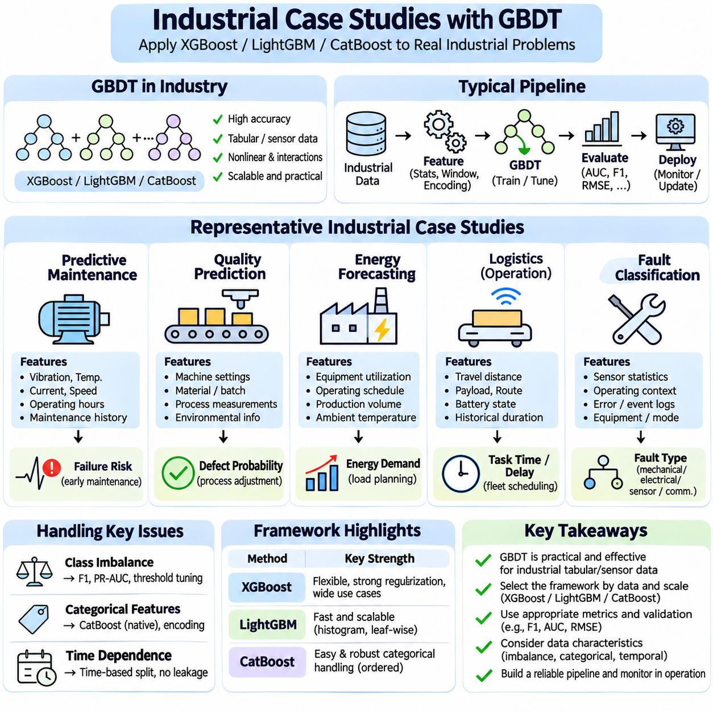{width="7.268055555555556in" height="7.268055555555556in"}

Industrial applications of Gradient Boosted Decision Trees (GBDT) demonstrate how supervised learning can improve operational reliability, manufacturing quality, and resource efficiency. Frameworks such as XGBoost, LightGBM, and CatBoost are particularly suitable for structured industrial datasets containing sensor statistics, equipment identifiers, production records, and maintenance histories. Their effectiveness depends on reliable data preparation and validation.

Predictive maintenance is a representative application in which GBDT estimates equipment failure risk before operational disruption occurs. Historical sensor measurements, operating hours, maintenance records, and fault events provide training information. The model learns relationships between operating conditions and failure outcomes, allowing maintenance teams to prioritize inspections and interventions according to estimated risk rather than fixed schedules alone.

Industrial sensor data commonly includes temperature, vibration, current, voltage, pressure, and rotational speed. Raw measurements can be transformed into statistical features such as moving averages, standard deviations, maximum values, and temporal trends. These features summarize equipment behavior over selected observation windows. Careful window design is essential because measurements recorded after a failure must not influence predictions intended to precede that failure.

Manufacturing quality prediction provides another important use case. GBDT models can estimate defect probability using machine settings, material properties, environmental conditions, and process measurements. For example, injection molding quality may depend on temperature profiles, pressure levels, cooling duration, and material batches. A trained model can identify combinations of conditions associated with elevated defect risk and support earlier process adjustments.

Quality datasets often contain substantial class imbalance because defective products represent a relatively small proportion of total production. Overall accuracy can therefore conceal poor defect detection performance. Precision, recall, F1-score, and precision-recall curves provide more informative evaluation. Decision thresholds should reflect the relative costs of false alarms, unnecessary inspections, missed defects, and downstream quality failures.

Energy consumption forecasting is another application where gradient boosting can support industrial efficiency. Equipment utilization, operating schedules, ambient temperature, production volume, and historical power measurements can serve as predictive features. GBDT models learn nonlinear relationships between operating conditions and energy demand. Forecasts can support load planning, peak demand management, and identification of unusual consumption patterns.

Industrial logistics systems can use GBDT to estimate task completion times, transportation delays, and equipment utilization. Features may include travel distance, payload, route congestion, battery state, and historical mission duration. In autonomous mobile robot operations, these predictions can assist fleet scheduling and charging decisions. However, predictive models should complement rather than replace safety-critical motion control and collision avoidance mechanisms.

Equipment fault classification illustrates the use of multiclass gradient boosting. Historical fault labels may distinguish mechanical wear, electrical abnormalities, sensor failures, and communication problems. Models combine diagnostic measurements and operational context to estimate fault probabilities. Reliable deployment requires consistent fault definitions and representative examples, since ambiguous labels or rare failure modes can significantly reduce classification quality.

CatBoost is especially useful when industrial datasets contain many categorical variables. Equipment model, production line, operator shift, material supplier, and operating mode may all influence outcomes. Native categorical processing reduces the need for extensive manual encoding. Nevertheless, categorical identifiers can create misleading correlations when training and validation data share equipment-specific information that will not generalize to new installations.

LightGBM is attractive for large-scale industrial datasets because histogram-based learning and leaf-wise tree growth can provide efficient training. High-volume production records or aggregated telemetry may contain millions of observations. Appropriate leaf constraints, sampling settings, and early stopping help control complexity. Computational advantages should be verified using representative workloads because dataset characteristics strongly influence actual performance.

XGBoost provides a flexible framework for industrial regression and classification problems requiring controlled regularization and systematic experimentation. Its tree constraints, sampling parameters, and configurable objectives support diverse operating conditions. For example, equipment health scores can be estimated from statistical sensor features and maintenance indicators. Model selection should prioritize stable validation performance over training accuracy.

A practical industrial implementation begins with defining the prediction target and operational decision. The target may represent failure within a future time horizon, defect occurrence, energy demand, or mission delay. Historical observations must be aligned with the information available at prediction time. Training and validation partitions should preserve temporal order or equipment grouping whenever necessary to prevent leakage and optimistic performance estimates.

Deployment requires more than selecting the most accurate model. Data pipelines must reproduce training-time preprocessing, handle missing sensor values, and maintain consistent feature definitions. Monitoring should detect changes in input distributions, prediction confidence, and operational outcomes. Periodic evaluation and controlled retraining help maintain reliability as equipment ages, production processes change, and new operating conditions emerge.

Industrial case studies demonstrate that GBDT provides practical value when predictions are connected to measurable operational decisions. Predictive maintenance, quality inspection, energy forecasting, fault diagnosis, and robotic logistics share requirements for trustworthy data, realistic validation, and efficient deployment. Successful applications combine model accuracy with domain expertise, monitoring, and clear operational responsibility.

그래디언트 부스팅 결정 트리(Gradient Boosted Decision Trees, GBDT)의 산업 응용(Industrial Application)은 지도 학습(Supervised Learning)이 운영 신뢰성(Operational Reliability), 제조 품질(Manufacturing Quality), 자원 효율성(Resource Efficiency)을 어떻게 개선할 수 있는지 보여준다. XGBoost, LightGBM, CatBoost와 같은 프레임워크(Framework)는 센서 통계량(Sensor Statistics), 장비 식별자(Equipment Identifier), 생산 기록(Production Record), 유지보수 이력(Maintenance History)을 포함하는 정형 산업 데이터셋(Structured Industrial Dataset)에 특히 적합하다. 이러한 모델의 효과는 신뢰할 수 있는 데이터 준비(Data Preparation)와 검증(Validation)에 달려 있다.

예지보전(Predictive Maintenance)은 운영 중단(Operational Disruption)이 발생하기 전에 GBDT가 장비 고장 위험(Equipment Failure Risk)을 추정하는 대표적인 응용 분야이다. 과거 센서 측정값(Historical Sensor Measurement), 운전 시간(Operating Hours), 유지보수 기록(Maintenance Record), 고장 사건(Fault Event)은 학습 정보(Training Information)를 제공한다. 모델은 운전 조건(Operating Condition)과 고장 결과(Failure Outcome) 사이의 관계를 학습하여 유지보수 담당자가 고정된 일정(Fixed Schedule)에만 의존하지 않고 추정된 위험(Estimated Risk)에 따라 점검(Inspection)과 정비 조치(Maintenance Intervention)의 우선순위를 결정할 수 있도록 한다.

산업용 센서 데이터(Industrial Sensor Data)에는 일반적으로 온도(Temperature), 진동(Vibration), 전류(Current), 전압(Voltage), 압력(Pressure), 회전 속도(Rotational Speed)가 포함된다. 원시 측정값(Raw Measurement)은 이동 평균(Moving Average), 표준편차(Standard Deviation), 최댓값(Maximum Value), 시간적 추세(Temporal Trend)와 같은 통계적 특징(Statistical Feature)으로 변환할 수 있다. 이러한 특징은 선택된 관측 구간(Observation Window)에서 장비 동작(Equipment Behavior)을 요약한다. 고장 이후에 기록된 측정값이 고장 이전의 예측에 영향을 주어서는 안 되므로 관측 구간 설계(Window Design)는 매우 중요하다.

제조 품질 예측(Manufacturing Quality Prediction)은 또 다른 중요한 활용 사례(Use Case)이다. GBDT 모델은 기계 설정값(Machine Setting), 재료 특성(Material Property), 환경 조건(Environmental Condition), 공정 측정값(Process Measurement)을 사용하여 불량 확률(Defect Probability)을 추정할 수 있다. 예를 들어 사출 성형 품질(Injection Molding Quality)은 온도 프로파일(Temperature Profile), 압력 수준(Pressure Level), 냉각 시간(Cooling Duration), 재료 배치(Material Batch)에 따라 달라질 수 있다. 학습된 모델은 높은 불량 위험(Defect Risk)과 관련된 조건의 조합을 식별하고 조기에 공정을 조정하도록 지원할 수 있다.

품질 데이터셋(Quality Dataset)은 불량 제품(Defective Product)이 전체 생산량에서 차지하는 비율이 상대적으로 작기 때문에 상당한 클래스 불균형(Class Imbalance)을 포함하는 경우가 많다. 따라서 전체 정확도(Overall Accuracy)는 낮은 불량 탐지 성능(Defect Detection Performance)을 숨길 수 있다. 정밀도(Precision), 재현율(Recall), F1 점수(F1-Score), 정밀도-재현율 곡선(Precision-Recall Curve)은 더 유용한 평가 정보를 제공한다. 의사결정 임계값(Decision Threshold)은 오경보(False Alarm), 불필요한 검사(Unnecessary Inspection), 불량 미탐지(Missed Defect), 후속 품질 실패(Downstream Quality Failure)의 상대적인 비용을 반영해야 한다.

에너지 소비 예측(Energy Consumption Forecasting)은 그래디언트 부스팅이 산업 효율성(Industrial Efficiency)을 지원할 수 있는 또 다른 응용 분야이다. 장비 가동률(Equipment Utilization), 운전 일정(Operating Schedule), 주변 온도(Ambient Temperature), 생산량(Production Volume), 과거 전력 측정값(Historical Power Measurement)을 예측 특징(Predictive Feature)으로 사용할 수 있다. GBDT 모델은 운전 조건과 에너지 수요(Energy Demand) 사이의 비선형 관계(Nonlinear Relationship)를 학습한다. 예측 결과는 부하 계획(Load Planning), 최대 수요 관리(Peak Demand Management), 비정상적인 에너지 소비 패턴(Unusual Consumption Pattern)의 식별을 지원할 수 있다.

산업 물류 시스템(Industrial Logistics System)은 GBDT를 활용하여 작업 완료 시간(Task Completion Time), 운송 지연(Transportation Delay), 장비 활용률(Equipment Utilization)을 추정할 수 있다. 특징에는 이동 거리(Travel Distance), 적재 중량(Payload), 경로 혼잡도(Route Congestion), 배터리 상태(Battery State), 과거 임무 수행 시간(Historical Mission Duration)이 포함될 수 있다. 자율이동로봇(Autonomous Mobile Robot, AMR) 운영에서 이러한 예측은 로봇군 일정 관리(Fleet Scheduling)와 충전 의사결정(Charging Decision)을 지원할 수 있다. 그러나 예측 모델은 안전 필수 이동 제어(Safety-Critical Motion Control)와 충돌 회피 메커니즘(Collision Avoidance Mechanism)을 대체하는 것이 아니라 보완해야 한다.

장비 고장 분류(Equipment Fault Classification)는 다중 클래스 그래디언트 부스팅(Multiclass Gradient Boosting)의 활용 사례를 보여준다. 과거 고장 레이블(Historical Fault Label)은 기계적 마모(Mechanical Wear), 전기적 이상(Electrical Abnormality), 센서 고장(Sensor Failure), 통신 문제(Communication Problem)를 구분할 수 있다. 모델은 진단 측정값(Diagnostic Measurement)과 운영 맥락(Operational Context)을 결합하여 고장 확률(Fault Probability)을 추정한다. 모호한 레이블(Ambiguous Label)이나 드문 고장 유형(Rare Failure Mode)은 분류 품질(Classification Quality)을 크게 저하시킬 수 있으므로 신뢰할 수 있는 배포(Reliable Deployment)를 위해서는 일관된 고장 정의(Consistent Fault Definition)와 대표성 있는 사례(Representative Example)가 필요하다.

CatBoost는 산업 데이터셋에 범주형 변수(Categorical Variable)가 많이 포함된 경우 특히 유용하다. 장비 모델(Equipment Model), 생산 라인(Production Line), 작업 교대조(Operator Shift), 재료 공급업체(Material Supplier), 운전 모드(Operating Mode)는 모두 결과에 영향을 미칠 수 있다. 기본 범주형 처리(Native Categorical Processing)는 광범위한 수동 인코딩(Manual Encoding)의 필요성을 줄인다. 그러나 학습 데이터와 검증 데이터(Validation Data)가 새로운 설치 환경(New Installation)으로 일반화되지 않는 장비별 정보(Equipment-Specific Information)를 공유하면 범주형 식별자(Categorical Identifier)가 잘못된 상관관계(Misleading Correlation)를 생성할 수 있다.

LightGBM은 히스토그램 기반 학습(Histogram-Based Learning)과 리프 중심 트리 성장(Leaf-Wise Tree Growth)을 통해 효율적인 학습을 제공할 수 있으므로 대규모 산업 데이터셋(Large-Scale Industrial Dataset)에 적합하다. 대량의 생산 기록(High-Volume Production Record)이나 집계된 원격 측정 데이터(Aggregated Telemetry)에는 수백만 개의 관측값(Observation)이 포함될 수 있다. 적절한 리프 제약 조건(Leaf Constraint), 표본 추출 설정(Sampling Setting), 조기 종료(Early Stopping)는 모델 복잡도(Model Complexity)를 제어하는 데 도움을 준다. 데이터셋 특성이 실제 성능에 큰 영향을 미치므로 계산상의 이점(Computational Advantage)은 대표성 있는 작업 부하(Representative Workload)를 사용하여 검증해야 한다.

XGBoost는 제어된 정규화(Controlled Regularization)와 체계적인 실험(Systematic Experimentation)이 필요한 산업 회귀(Industrial Regression) 및 분류 문제(Classification Problem)를 위한 유연한 프레임워크를 제공한다. 트리 제약 조건(Tree Constraint), 표본 추출 매개변수(Sampling Parameter), 설정 가능한 목적 함수(Configurable Objective)는 다양한 운전 조건(Operating Condition)을 지원한다. 예를 들어 장비 건전성 점수(Equipment Health Score)는 통계적 센서 특징(Statistical Sensor Feature)과 유지보수 지표(Maintenance Indicator)를 사용하여 추정할 수 있다. 모델 선택(Model Selection)에서는 학습 정확도(Training Accuracy)보다 안정적인 검증 성능(Stable Validation Performance)을 우선해야 한다.

실용적인 산업 구현(Practical Industrial Implementation)은 예측 목표(Prediction Target)와 운영 의사결정(Operational Decision)을 정의하는 것에서 시작한다. 목표는 미래의 특정 시간 범위(Future Time Horizon) 내 고장 발생, 불량 발생(Defect Occurrence), 에너지 수요(Energy Demand), 임무 지연(Mission Delay)을 나타낼 수 있다. 과거 관측값(Historical Observation)은 예측 시점(Prediction Time)에 실제로 사용할 수 있는 정보와 일치하도록 정렬해야 한다. 정보 누출(Information Leakage)과 지나치게 낙관적인 성능 추정(Optimistic Performance Estimate)을 방지하기 위해 필요한 경우 학습 및 검증 데이터 분할(Training and Validation Partition)에서 시간적 순서(Temporal Order)나 장비 그룹(Equipment Grouping)을 보존해야 한다.

배포(Deployment)에는 가장 정확한 모델을 선택하는 것 이상의 작업이 필요하다. 데이터 파이프라인(Data Pipeline)은 학습 시점의 전처리(Training-Time Preprocessing)를 재현하고, 누락된 센서값(Missing Sensor Value)을 처리하며, 일관된 특징 정의(Consistent Feature Definition)를 유지해야 한다. 모니터링(Monitoring)은 입력 분포(Input Distribution), 예측 신뢰도(Prediction Confidence), 운영 결과(Operational Outcome)의 변화를 탐지해야 한다. 장비 노후화(Equipment Aging), 생산 공정 변화(Production Process Change), 새로운 운전 조건(New Operating Condition)이 발생하더라도 신뢰성을 유지하려면 주기적인 평가(Periodic Evaluation)와 통제된 재학습(Controlled Retraining)이 필요하다.

산업 사례 연구(Industrial Case Study)는 예측이 측정 가능한 운영 의사결정(Measurable Operational Decision)과 연결될 때 GBDT가 실질적인 가치(Practical Value)를 제공한다는 점을 보여준다. 예지보전(Predictive Maintenance), 품질 검사(Quality Inspection), 에너지 예측(Energy Forecasting), 고장 진단(Fault Diagnosis), 로봇 물류(Robotic Logistics)는 신뢰할 수 있는 데이터(Trustworthy Data), 현실적인 검증(Realistic Validation), 효율적인 배포(Efficient Deployment)에 대한 공통 요구사항을 가진다. 성공적인 응용은 모델 정확도(Model Accuracy)를 도메인 전문성(Domain Expertise), 모니터링(Monitoring), 명확한 운영 책임(Clear Operational Responsibility)과 결합한다.
