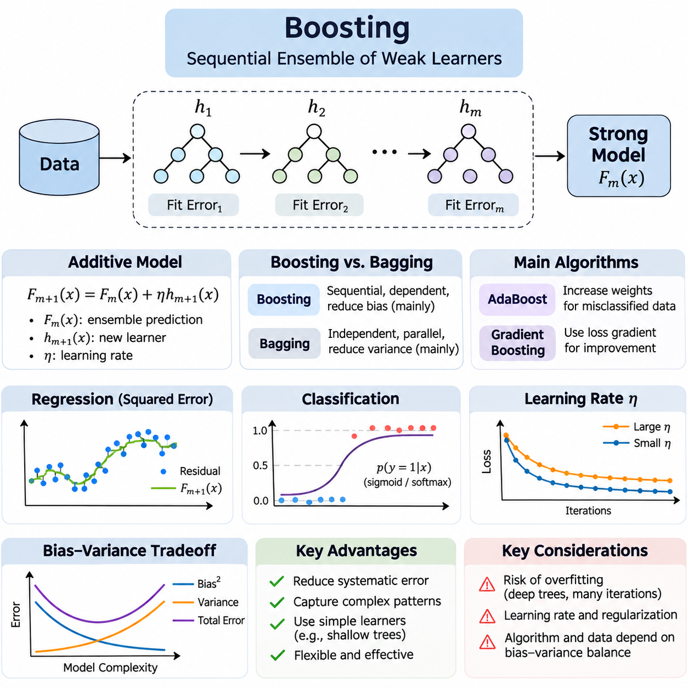
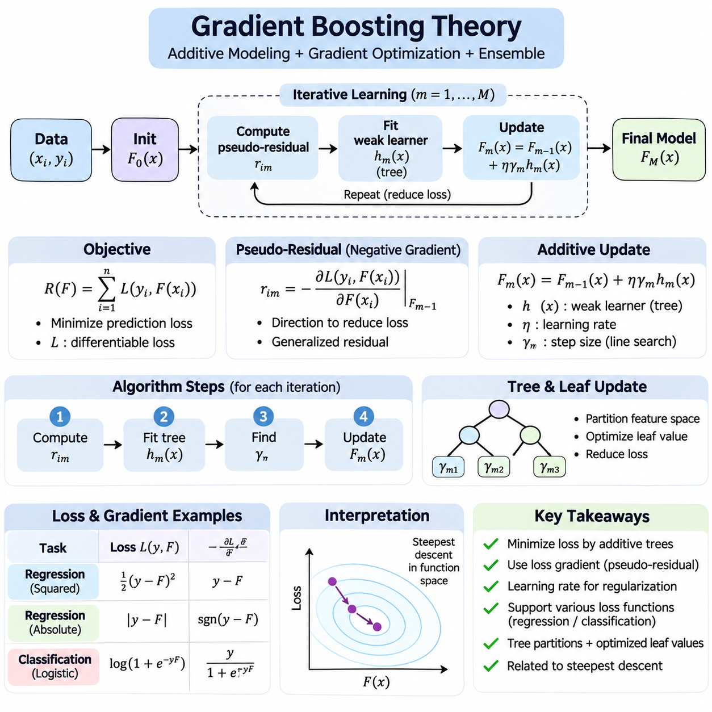
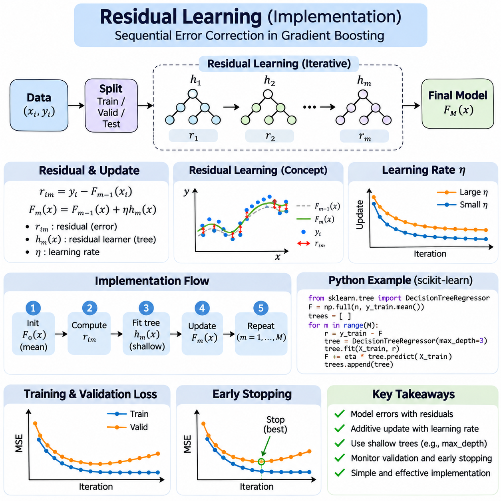
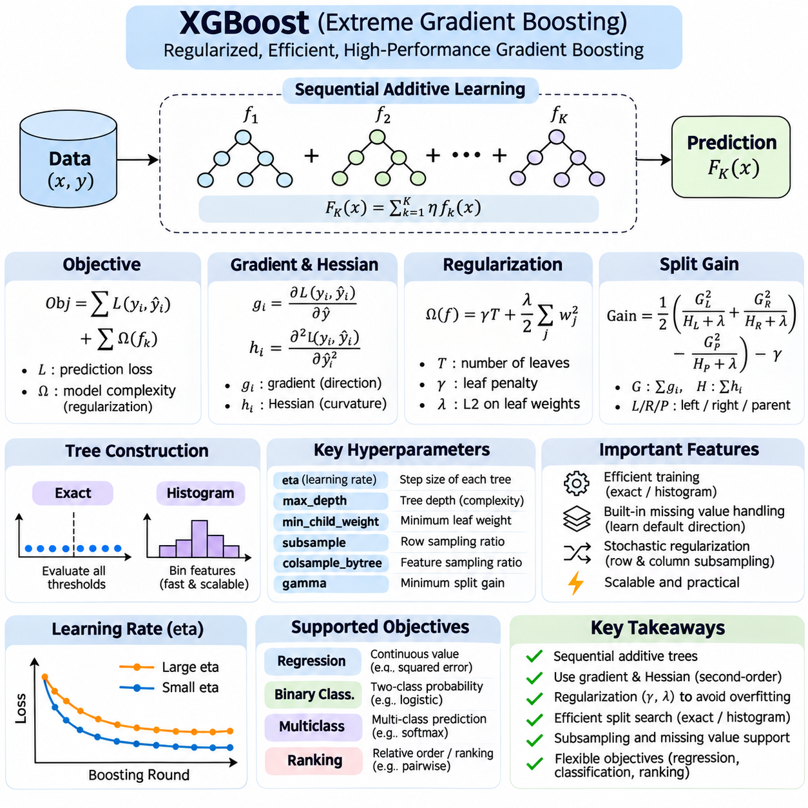
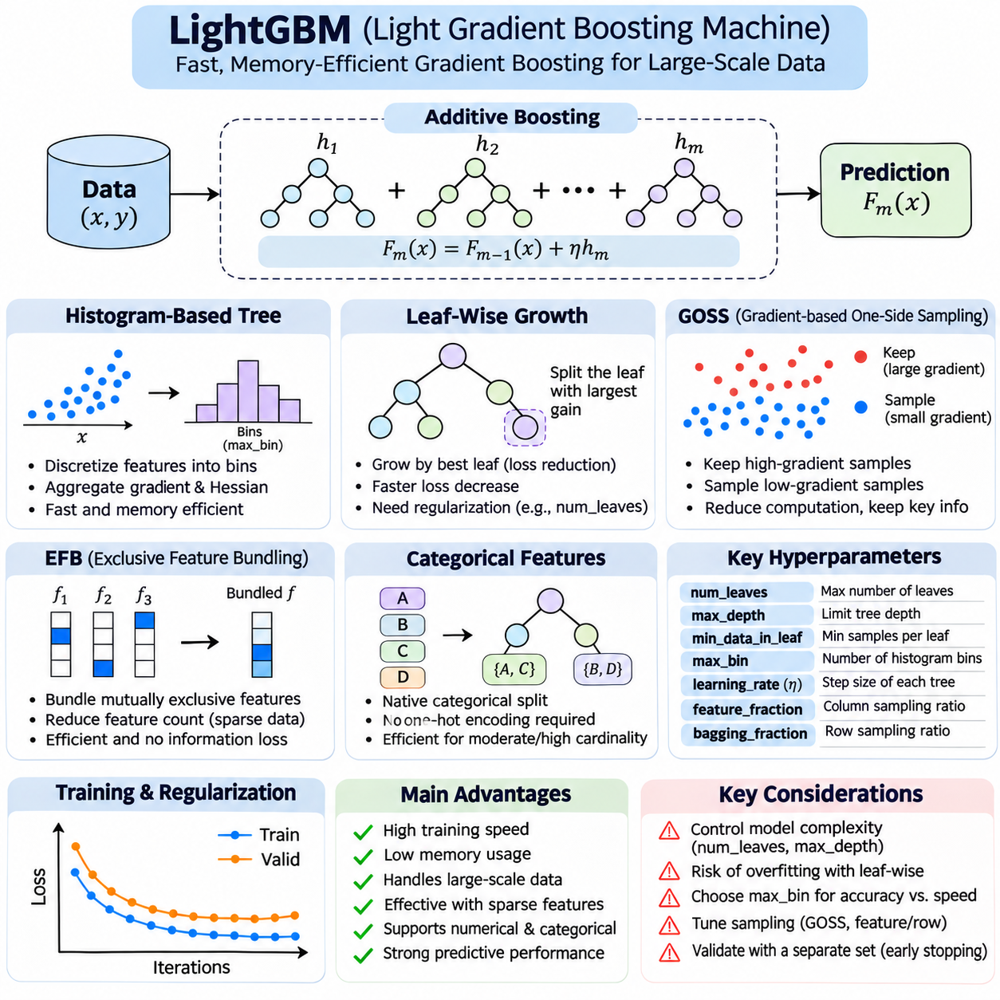
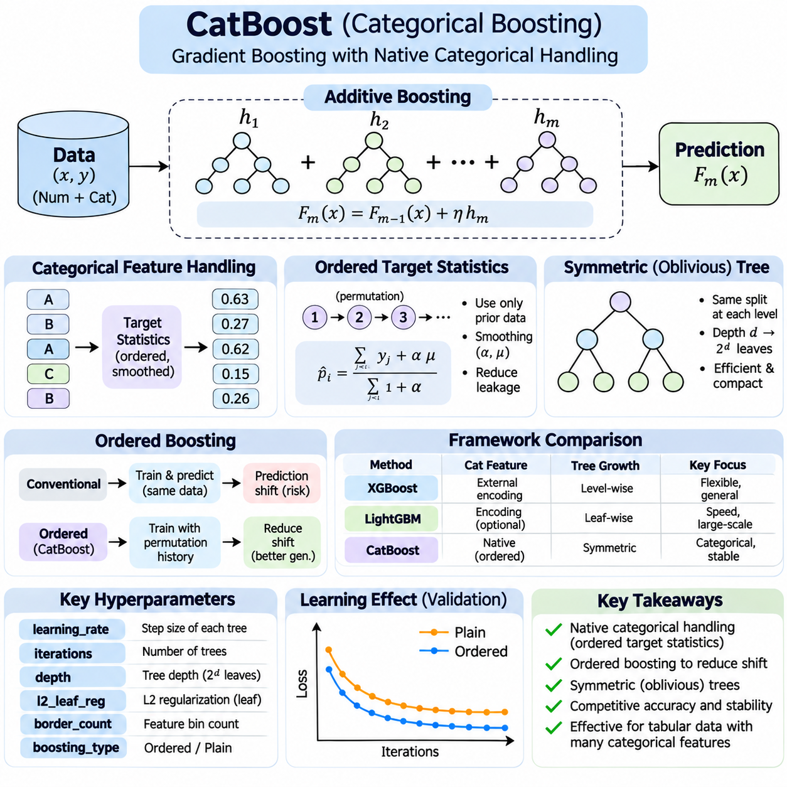
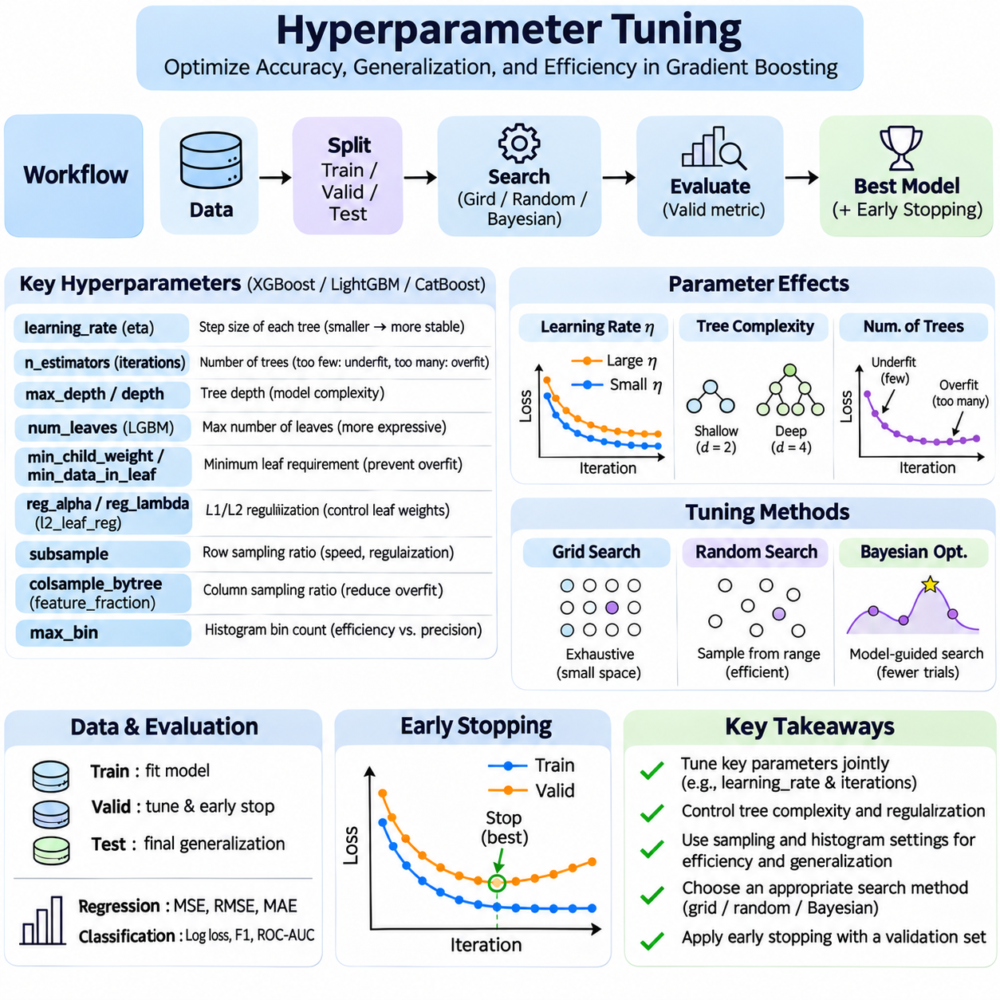
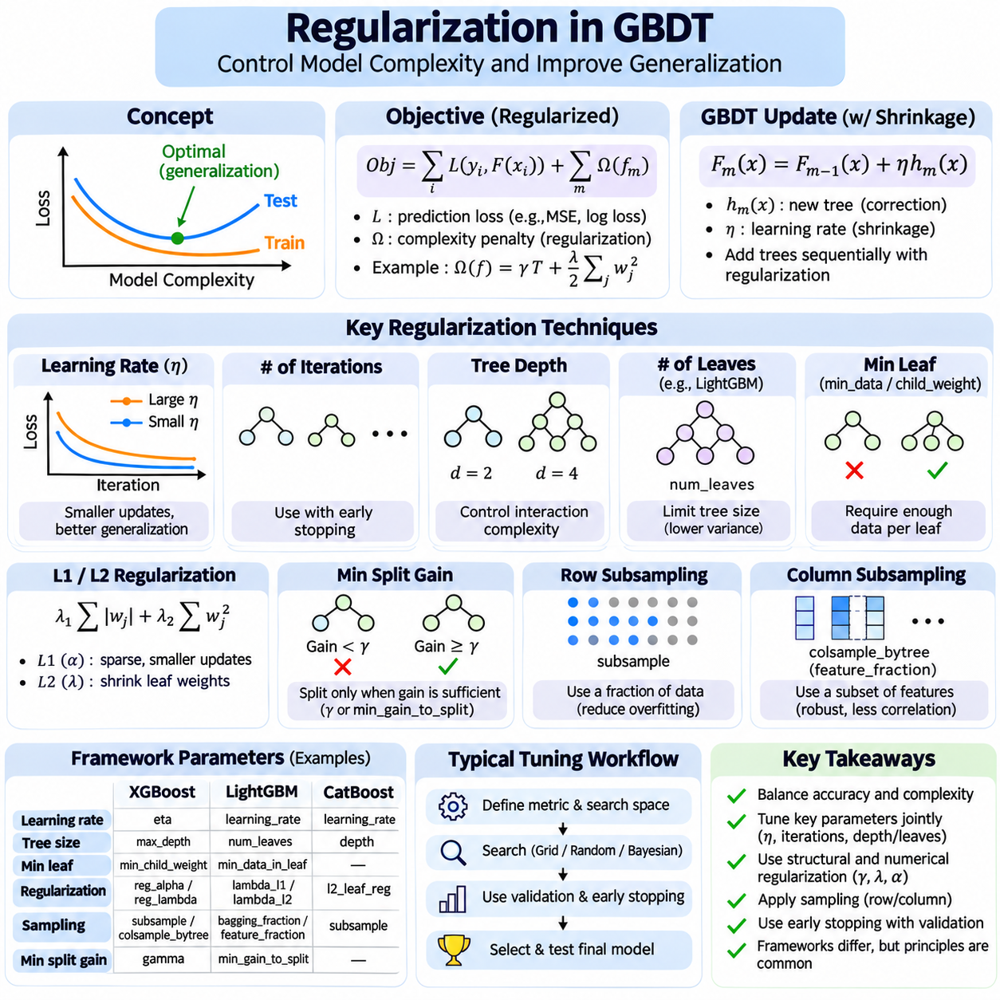
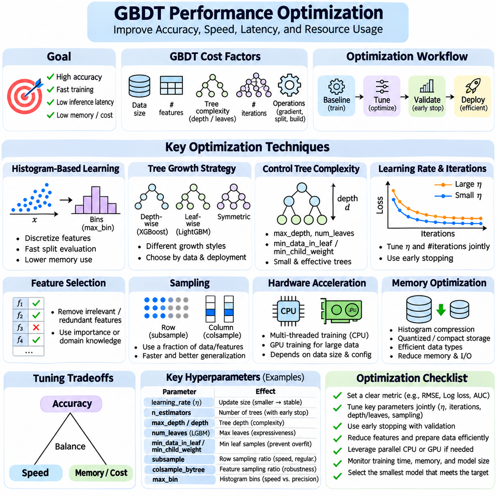
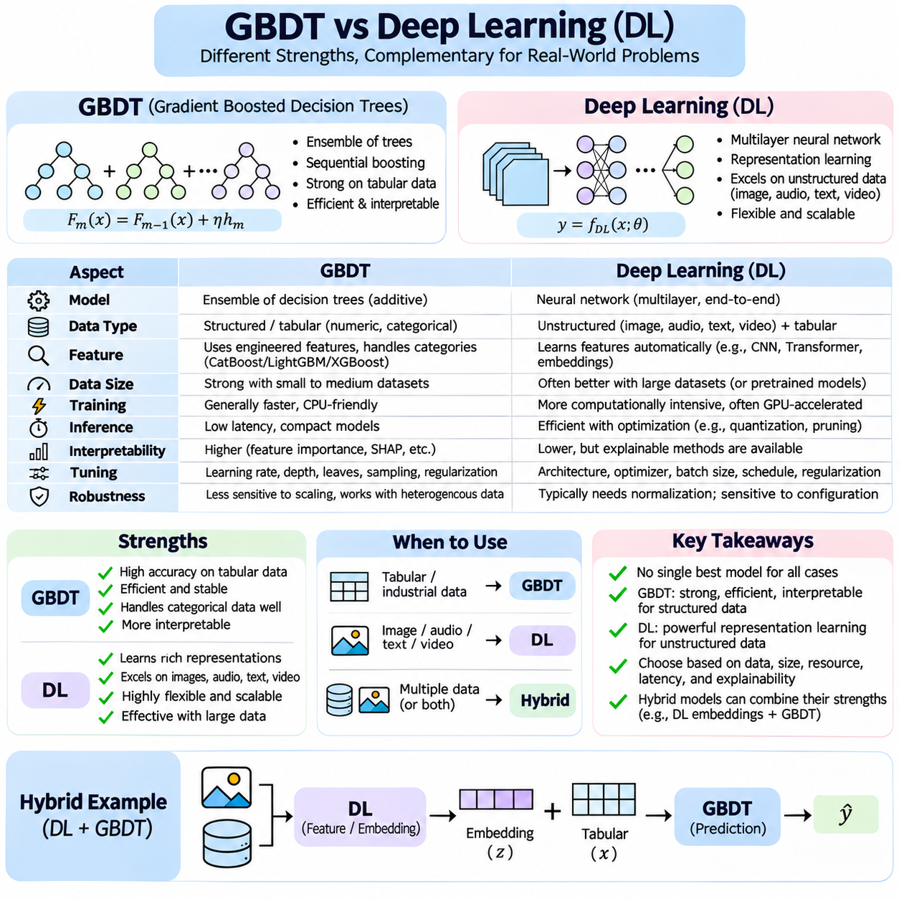

**Volume 08. Supervised Learning**

# 06. Gradient Boosting

## 06.00 Boosting Core Concept

{width="7.268055555555556in" height="7.268055555555556in"}

Boosting is an ensemble learning technique that combines multiple weak learners into a stronger predictive model through sequential training. Unlike methods that construct independent models, boosting trains each new learner to address limitations in the existing ensemble. This progressive improvement allows relatively simple models to capture complex relationships while reducing prediction errors across successive training stages.

The central principle of boosting is that a collection of moderately accurate learners can produce a highly accurate predictor when their contributions are coordinated. A weak learner is typically a simple model, such as a shallow decision tree, that captures limited patterns in the training data. Rather than requiring every learner to solve the entire prediction problem, boosting assigns each learner a specific corrective role within the evolving ensemble.

Boosting begins with an initial prediction model that provides a baseline estimate for the target variable. The algorithm evaluates this estimate against observed training labels and identifies the remaining prediction errors. A subsequent learner is trained to improve the current predictions, and its contribution is incorporated into the ensemble. Repeating this process gradually produces a model capable of representing increasingly complex relationships.

The sequential nature of boosting distinguishes it from bagging, another major ensemble learning strategy. Bagging trains multiple models independently, often using different bootstrap samples, and combines their predictions through averaging or voting. Boosting instead establishes dependencies between training stages because each learner responds to the performance of earlier learners. These different approaches influence model diversity, computational efficiency, and error reduction.

In a typical boosting system, decision trees serve as the base learners because they can represent nonlinear relationships and interactions between input features. Shallow trees are particularly useful because their restricted complexity encourages each learner to capture relatively simple patterns. When many such trees are combined sequentially, the resulting ensemble can approximate complicated decision boundaries without requiring individual trees to become excessively deep.

The mathematical structure of boosting can be understood as an additive model. If F_m(x) represents the ensemble prediction after m stages, the next prediction can be expressed as F\\_(m+1)(x) = F_m(x) + ηh\\_(m+1)(x). Here, h\\_(m+1)(x) is the newly trained learner, and η controls its contribution. This formulation illustrates how boosting progressively constructs a predictive function by adding corrective components.

The learning rate is an important mechanism for controlling the influence of each newly added learner. A smaller learning rate reduces the magnitude of individual updates, allowing the ensemble to improve through more gradual adjustments. This often requires additional boosting stages but can support better generalization when combined with suitable regularization. An excessively large learning rate may cause unstable improvements or overfitting.

Different boosting algorithms define corrective learning in different ways. AdaBoost emphasizes training examples that previous learners classified incorrectly by adjusting their relative importance. Gradient boosting instead uses the gradient of a differentiable loss function to determine the direction of improvement. Both approaches construct sequential ensembles, but their optimization mechanisms and mathematical interpretations are fundamentally different.

Gradient boosting extends the additive modeling principle by interpreting each training stage as an optimization step in function space. Instead of directly modifying a fixed vector of model parameters, the algorithm introduces a new function that approximates a useful direction for reducing prediction loss. This perspective connects boosting with gradient-based optimization while preserving the flexibility of decision trees as nonlinear predictive components.

For regression problems using squared error loss, gradient boosting can be interpreted as learning from residual errors. The initial model predicts a baseline value, often the mean of the training targets. The difference between each observed target and its current prediction represents a residual. A new regression tree learns patterns in these residuals, allowing the ensemble to correct systematic errors that remain after previous stages.

For classification problems, boosting must account for the relationship between model outputs and class probabilities. Gradient boosting commonly constructs additive scores that are transformed into probabilities through logistic or softmax functions. The training process minimizes an appropriate classification loss, such as cross-entropy. Consequently, corrective learners operate on loss gradients rather than simply fitting differences between predicted class labels and observed labels.

An important advantage of boosting is its ability to reduce systematic prediction errors by progressively increasing model expressiveness. Simple learners may initially exhibit substantial bias because they cannot represent complex patterns independently. Adding corrective learners allows the ensemble to capture previously unexplained relationships. However, the improvement is not unlimited, and excessive model complexity can eventually increase sensitivity to training noise.

The relationship between boosting and the bias-variance tradeoff requires careful interpretation. Boosting often reduces bias by combining many restricted learners, but its effect on variance depends on the algorithm, dataset, and regularization settings. Deep trees, excessive boosting iterations, and aggressive updates may increase overfitting. Therefore, successful boosting requires balancing predictive capacity against the risk of learning accidental patterns in training observations.

The number of boosting iterations determines how many learners contribute to the final ensemble. Too few iterations may leave important relationships unexplained, resulting in underfitting. Too many iterations may produce unnecessarily complex models, particularly when regularization is insufficient. Validation performance provides a practical criterion for selecting an appropriate stopping point, while early stopping can terminate training when further improvement becomes negligible.

Boosting is especially effective for structured tabular datasets containing numerical, categorical, and engineered features. Applications include financial risk assessment, customer behavior prediction, equipment fault detection, and industrial quality monitoring. Tree-based boosting can model nonlinear feature interactions without requiring extensive manual transformation, although preprocessing requirements vary across implementations and categorical encoding strategies.

The effectiveness of boosting also depends on data quality and the characteristics of prediction errors. Incorrect labels, extreme outliers, and unstable measurements can influence the corrective learners, sometimes causing the ensemble to focus on misleading patterns. Robust loss functions, careful feature validation, and appropriate regularization can reduce these risks. Boosting improves predictive performance through repeated correction, but it cannot automatically eliminate weaknesses in the underlying dataset.

Modern boosting frameworks demonstrate how the foundational concept can be extended into efficient machine learning systems. XGBoost introduces regularized objectives and optimized tree construction, LightGBM emphasizes computational efficiency through histogram-based and leaf-wise learning strategies, and CatBoost provides specialized mechanisms for handling categorical features. Despite their architectural differences, these frameworks preserve the principle of sequentially improving an additive ensemble.

The computational characteristics of boosting reflect its sequential dependency structure. Because each training stage depends on the current ensemble, boosting iterations generally cannot be trained independently in the same manner as bagged trees. Nevertheless, operations within individual stages can be parallelized, including feature evaluation and histogram construction. Efficient implementations exploit these opportunities to support large datasets and high-dimensional feature spaces.

Interpretability is another important consideration when applying boosting to practical systems. Although individual decision trees are relatively understandable, an ensemble containing hundreds of trees becomes difficult to inspect directly. Feature importance measures, partial dependence analysis, and SHAP-based explanations can help characterize model behavior. These techniques provide useful diagnostic information, although they do not automatically establish causal relationships between features and predictions.

In industrial applications, boosting can support predictive maintenance by combining sensor measurements, operational conditions, and historical equipment records. Each successive learner may capture error patterns associated with temperature, vibration, operating load, or environmental variation. The resulting ensemble can estimate failure probabilities or remaining performance indicators, provided that training labels are reliable and evaluation procedures reflect realistic deployment conditions.

The practical value of boosting comes from combining simple predictive components into a coordinated optimization process. Its success depends not merely on adding more learners but on controlling how each learner contributes to the evolving model. Learning rate selection, tree complexity, iteration count, loss function design, and validation strategy collectively determine whether sequential correction produces meaningful improvements that generalize beyond the training dataset.

Understanding boosting as progressive error correction provides the conceptual foundation for gradient boosting theory, residual learning, and advanced gradient-boosted decision tree frameworks. The essential idea is that predictive strength emerges from the structured accumulation of complementary improvements. This principle connects ensemble learning with numerical optimization and explains why boosting remains a powerful approach for supervised learning across research and industrial applications.

## 06.01 Gradient Boosting Theory

{width="7.268055555555556in" height="7.268055555555556in"}

Gradient boosting is a supervised learning method that constructs a powerful predictive model through the sequential addition of weak learners. Its theoretical foundation combines additive modeling, gradient-based optimization, and ensemble learning. Rather than optimizing all model components simultaneously, gradient boosting introduces new learners that progressively reduce a specified loss function, allowing complex predictive relationships to emerge from relatively simple models.

The fundamental objective of gradient boosting is to minimize the expected prediction loss over a training dataset. Given input observations x_i and corresponding targets y_i, the algorithm seeks a function F(x) that minimizes the empirical risk R(F) = ΣL(y_i, F(x_i)). Here, L represents a differentiable loss function measuring prediction errors. This formulation establishes gradient boosting as a general optimization framework rather than a technique restricted to regression.

The distinguishing characteristic of gradient boosting is its optimization in function space. Traditional gradient descent adjusts numerical parameters within a predefined model structure, whereas gradient boosting improves an entire prediction function by adding new functional components. Each learner approximates a direction that decreases the objective function, enabling the ensemble to evolve without requiring a fixed global parameterization of its final predictive structure.

The learning process begins by selecting an initial constant prediction that minimizes the training loss. For squared error regression, this initial estimate is typically the mean of the target values. For binary classification using logistic loss, the initialization can be expressed through the log-odds of the positive class frequency. This initial model provides a reference point from which successive learners construct increasingly accurate predictions.

At each boosting iteration, the algorithm evaluates the negative gradient of the loss function with respect to the current model predictions. These values are called pseudo-residuals because they generalize the conventional residuals used in regression. Mathematically, the pseudo-residual for observation i is r_im = -∂L(y_i, F(x_i))/∂F(x_i), evaluated at the current ensemble F\\_(m-1). They indicate directions for reducing prediction loss.

A new weak learner is trained to approximate the pseudo-residuals using the original input features. Decision trees are commonly selected because they can model nonlinear relationships and feature interactions while remaining computationally manageable. The learner does not directly predict the original target values. Instead, it estimates the correction required by the current ensemble, making each training stage dependent on the accumulated predictions of preceding stages.

After fitting the new learner, gradient boosting determines how strongly its predictions should influence the ensemble. A line search may identify a step size that minimizes the loss along the learner\'s direction. The model is then updated according to F_m(x) = F\\_(m-1)(x) + ηγ_m h_m(x), where η denotes the learning rate, γ_m represents the selected step size, and h_m(x) is the newly fitted learner.

The learning rate controls the magnitude of each update and acts as an important regularization mechanism. Smaller learning rates distribute the optimization process across more boosting iterations, potentially improving generalization by preventing individual learners from making excessively large corrections. However, reducing the learning rate also increases the number of learners required to reach comparable training performance, creating a tradeoff between computational cost and predictive stability.

For squared error regression, the negative gradient has a particularly intuitive interpretation. When the loss is defined as one-half of the squared difference between target and prediction, its negative gradient equals the ordinary residual y_i - F(x_i). Consequently, each new regression tree approximates the remaining prediction errors. This special case demonstrates how gradient boosting generalizes residual correction into a broader framework based on differentiable loss functions.

Different loss functions produce different optimization behaviors. Squared error emphasizes larger deviations, while absolute error provides greater resistance to extreme observations but requires appropriate handling of nondifferentiable points. Huber loss combines quadratic and linear behavior to balance sensitivity and robustness. For classification, logistic and multinomial cross-entropy losses guide the ensemble toward improved class probability estimates rather than minimizing numerical differences between class labels.

When decision trees serve as weak learners, the gradient boosting procedure can be interpreted through terminal regions. Each tree partitions the feature space into regions containing observations with related correction patterns. The algorithm may then calculate an optimal output value for each terminal region by minimizing the original loss. These region-specific adjustments improve the correspondence between the fitted tree structure and the objective being optimized.

The distinction between fitting gradients and optimizing terminal leaf values is important for understanding practical implementations. A regression tree may first approximate pseudo-residuals to determine useful partitions, while subsequent calculations refine the prediction assigned to each leaf. For some losses, these values have convenient analytical solutions. For others, numerical optimization or approximate second-order methods may be necessary to obtain effective updates.

Gradient boosting is closely related to steepest descent because each stage attempts to move the predictive function in a direction that reduces loss. However, the available update directions are constrained by the chosen weak learner family. A shallow decision tree cannot represent every possible negative gradient function exactly. Therefore, boosting performs an approximate functional optimization process whose effectiveness depends on the expressive capacity of its base learners.

The complexity of individual learners strongly influences the behavior of the resulting ensemble. Decision stumps, consisting of a single split, provide simple corrections and primarily capture additive feature effects. Deeper trees can represent interactions among several variables, allowing more complex corrections. Increasing tree depth improves representational flexibility but may also increase variance, computational requirements, and sensitivity to noise within the training dataset.

The number of boosting stages determines how extensively the ensemble explores corrective patterns. Early iterations often capture dominant relationships, while later iterations refine smaller prediction errors and more localized structures. Although additional stages generally improve training loss when updates are appropriately chosen, validation performance may eventually deteriorate. Early stopping provides a practical mechanism for limiting complexity based on predictive performance on unseen validation observations.

Stochastic gradient boosting introduces randomness by training individual learners on subsets of the available observations. This approach reduces the correlation between successive corrective models and can improve generalization under suitable conditions. Subsampling also decreases the computational workload of individual iterations. However, excessively small subsets may introduce unstable gradient estimates, making the sampling fraction an important parameter for controlling learning behavior.

Regularization in gradient boosting extends beyond learning rate reduction and early stopping. Tree depth constraints, minimum leaf sample requirements, feature subsampling, and penalties on leaf outputs can restrict model complexity. These mechanisms discourage the ensemble from constructing overly specialized corrections. Their combined effect determines how effectively the model balances training accuracy against robustness when encountering observations outside the training dataset.

Second-order optimization provides another important extension of classical gradient boosting. Instead of relying exclusively on first-order gradients, some implementations incorporate second derivatives of the loss function. These derivatives describe local curvature and support more informed estimates of beneficial prediction updates. Newton-style boosting methods exploit this information to improve optimization efficiency, particularly when the objective function has useful second-order structure.

The theoretical relationship between gradient boosting and regularized optimization helps explain the effectiveness of small incremental updates. By limiting the contribution of each learner, the algorithm follows a gradual trajectory through function space. This approach can prevent rapid adaptation to isolated training examples, although it does not guarantee immunity from overfitting. Generalization remains dependent on dataset properties, model complexity, optimization settings, and validation procedures.

Gradient boosting also has an important connection to statistical additive models. The final predictor is expressed as a sum of functions, each representing a learned correction. Unlike conventional additive models that often assign separate smooth functions to individual features, tree-based gradient boosting can capture interactions through multivariable partitions. This flexibility makes the approach suitable for structured datasets containing heterogeneous relationships and nonlinear dependencies.

From a computational perspective, gradient boosting combines sequential optimization with opportunities for parallel processing within each training stage. Tree construction, feature histogram generation, and split evaluation can often be accelerated through parallel algorithms. Nevertheless, later boosting stages depend on earlier ensemble predictions, limiting complete parallelization across iterations. This characteristic motivates specialized implementations designed to improve memory efficiency and training throughput.

The theoretical framework also clarifies why gradient boosting performs well across diverse supervised learning tasks. Regression, binary classification, multiclass classification, and ranking can be addressed by selecting suitable objectives and output transformations. The essential training mechanism remains consistent: calculate corrective information from the current loss, fit a weak learner, determine its contribution, and update the ensemble to improve predictive performance.

Understanding gradient boosting requires recognizing that its strength emerges from the interaction between functional optimization, weak learner design, and regularization. Each component contributes to the balance between flexibility and generalization. This theoretical foundation supports the study of residual learning, XGBoost, LightGBM, CatBoost, and modern gradient-boosted decision tree systems, where the same underlying principles are extended through specialized optimization and computational strategies.

## 06.02 Residual Learning

{width="7.268055555555556in" height="7.268055555555556in"}

Residual learning is a fundamental mechanism of gradient boosting that improves predictions by repeatedly modeling errors left by earlier learners. Instead of training every model to predict the original target independently, residual learning directs each new learner toward the remaining discrepancies. This sequential correction process transforms simple regression models into an increasingly expressive ensemble capable of capturing complex patterns.

The implementation begins with a supervised dataset containing input features and corresponding target values. Each observation is represented by a feature vector x_i and a target y_i. Before training, the dataset should be divided into training, validation, and test subsets. These partitions support model fitting, hyperparameter selection, and independent performance evaluation while reducing the risk of overly optimistic results.

An initial prediction function establishes the baseline from which residual learning proceeds. For regression with squared error loss, the initial model commonly predicts the mean of the training targets for every observation. This constant prediction minimizes the sum of squared errors among all possible constant estimates. Although simple, it provides a mathematically appropriate starting point for subsequent corrective learning.

Once the initial predictions are available, residuals are calculated by subtracting predicted values from observed targets. For observation i at iteration m, the residual is expressed as r_im = y_i - F\\_(m-1)(x_i). Positive residuals indicate that the current ensemble underestimates the target, while negative residuals indicate overestimation. Their magnitudes describe the remaining prediction discrepancies.

The next implementation stage trains a weak regression learner using the original input features and calculated residuals as temporary targets. A shallow decision tree is commonly used because it can identify nonlinear relationships without excessive complexity. The tree learns which feature combinations explain the remaining errors, producing corrective predictions that can be incorporated into the existing ensemble.

After fitting the residual learner, the ensemble prediction is updated by adding a scaled version of its output. The update follows F_m(x) = F\\_(m-1)(x) + ηh_m(x), where h_m(x) represents the residual prediction and η is the learning rate. This additive structure ensures that each learner contributes an incremental correction rather than replacing the predictions generated by earlier stages.

The learning rate determines how strongly each corrective learner influences the ensemble. A value below one reduces the magnitude of residual corrections and encourages gradual optimization. Smaller values often require more boosting iterations but may improve generalization when combined with suitable model complexity. Larger values accelerate training progress but can produce unstable corrections or increase overfitting.

A practical implementation can begin with a synthetic regression dataset containing nonlinear relationships between input variables and target values. For example, the target may depend on polynomial terms, interactions between features, and random measurement noise. Such a dataset makes it possible to observe how successive residual learners capture relationships that a constant baseline or individual shallow tree cannot represent adequately.

The implementation can maintain an array containing the current ensemble predictions for all training observations. Initially, this array is filled with the mean target value. At each iteration, residuals are computed, a new regression tree is fitted, and its scaled predictions are added to the array. The fitted tree is then stored so that the complete ensemble can later reproduce the same sequence of corrections.

A minimal Python implementation can use NumPy for numerical operations and DecisionTreeRegressor from scikit-learn as the weak learner. The training procedure initializes the baseline, creates a sequence of shallow trees, and updates predictions after each fitted model. This manual construction exposes the essential mechanics of residual learning without relying on a complete gradient boosting library.

The prediction procedure must reproduce the same additive structure used during training. For a new observation, the model first generates the stored baseline prediction and then evaluates every fitted residual tree in training order. Each tree output is multiplied by the learning rate and added to the accumulated prediction. The final result represents the combined contribution of all corrective learners.

Training performance can be monitored by calculating mean squared error after every boosting iteration. Initially, the error reflects the limitations of the constant baseline. As new trees are introduced, training error generally decreases because the ensemble captures additional residual structure. However, improvements on training observations do not necessarily indicate equivalent improvements on previously unseen data.

Validation monitoring is essential for determining whether residual learning produces meaningful generalization. After each iteration, the current ensemble can predict validation observations, and the corresponding validation loss can be recorded. A decreasing validation loss indicates improved predictive performance on held-out data. If validation loss begins increasing while training loss continues decreasing, the ensemble may be overfitting.

Early stopping provides a practical method for controlling excessive boosting iterations. The training procedure tracks the best validation score and terminates when additional learners fail to improve performance for a specified number of rounds. The best-performing iteration should be retained for final prediction. This approach reduces unnecessary computation and helps prevent the ensemble from fitting progressively smaller noise patterns.

Tree complexity is another important implementation parameter. Shallow trees provide relatively simple residual corrections, while deeper trees can model more complicated feature interactions. Increasing maximum depth may accelerate training error reduction but can also make the ensemble sensitive to local irregularities. Minimum leaf size and maximum leaf count provide additional mechanisms for restricting corrective model complexity.

Residual learning can be extended beyond ordinary squared error regression by replacing conventional residuals with negative loss gradients. For a general differentiable loss function, the correction target becomes the negative derivative of the loss with respect to the current prediction. These pseudo-residuals identify locally beneficial update directions, allowing the same sequential learning architecture to support classification and robust regression objectives.

For binary classification, residual learning operates on continuous prediction scores rather than directly correcting discrete class labels. With logistic loss, pseudo-residuals are related to the difference between observed binary targets and predicted probabilities. The ensemble updates its score function, and a logistic transformation converts the resulting scores into probabilities. This distinction is essential when adapting regression-based implementations to classification.

The implementation must also consider numerical stability and data quality. Extreme target values can dominate squared error residuals, while incorrect labels may encourage the ensemble to learn misleading corrections. Robust loss functions, outlier analysis, and appropriate feature preprocessing can reduce these problems. Consistent numerical precision and careful handling of missing values further improve implementation reliability.

Computational efficiency depends on the number of observations, feature dimensions, tree complexity, and boosting iterations. Each stage requires calculating current residuals and fitting another learner, creating a sequential dependency across iterations. Memory consumption also increases because fitted trees must be retained for prediction. Efficient tree construction and controlled ensemble size are therefore important for practical deployment.

Residual analysis provides useful insight into whether the ensemble has learned meaningful structure. After training, remaining errors can be examined against input features, predicted values, and relevant operating conditions. Persistent systematic patterns may indicate insufficient model capacity, missing features, or unsuitable loss functions. Random-looking residuals can be encouraging, although they do not independently establish model correctness or generalization.

A reliable implementation should compare the manually constructed residual learning ensemble against an established GradientBoostingRegressor implementation. Both models can be trained using comparable learning rates, tree depths, and iteration counts. Their predictions and evaluation metrics can then be examined to verify the conceptual implementation, while recognizing that library-specific optimization details may produce different numerical results.

Reproducibility requires controlling random seeds, preserving dataset partitions, and recording model configuration. The initial baseline, fitted learners, learning rate, and selected stopping iteration should be stored together as a complete predictive artifact. Testing the reconstructed model on previously unseen observations verifies that the implementation preserves its training behavior and produces consistent predictions after deployment.

In industrial applications, residual learning can improve predictions involving equipment degradation, energy consumption, process quality, and sensor-based estimation. Early learners may capture dominant operating relationships, while later learners correct systematic deviations associated with load, temperature, or environmental conditions. Reliable deployment nevertheless requires monitoring for data drift, changing operating regimes, and unexpected prediction errors.

Residual learning demonstrates how gradient boosting transforms iterative error correction into a systematic model construction procedure. Its implementation follows a consistent sequence of baseline initialization, residual calculation, weak learner fitting, scaled prediction updates, and performance evaluation. Understanding these operations provides a practical foundation for advanced gradient boosting frameworks and their applications in reliable supervised learning systems.

## 06.03 XGBoost

{width="7.268055555555556in" height="7.268055555555556in"}

XGBoost, or Extreme Gradient Boosting, is an advanced implementation of gradient-boosted decision trees designed to deliver high predictive accuracy and computational efficiency. It extends conventional gradient boosting through regularized optimization, efficient tree construction, and scalable training algorithms. XGBoost is particularly effective for structured tabular data, where nonlinear relationships and complex feature interactions frequently determine predictive performance.

The fundamental principle of XGBoost is sequential additive learning, in which each new decision tree improves predictions generated by the existing ensemble. Instead of constructing a single complex model, XGBoost combines numerous relatively simple trees into a unified predictor. Each tree contributes corrective values that reduce the objective function, allowing the ensemble to represent increasingly sophisticated relationships across successive boosting iterations.

XGBoost formulates learning as the minimization of an objective containing both prediction loss and model complexity penalties. The objective can be expressed as Obj = ΣL(y_i, ŷ_i) + ΣΩ(f_k), where L measures prediction error and Ω penalizes tree complexity. This regularized formulation discourages unnecessarily complicated trees and helps control overfitting while maintaining sufficient flexibility to model nonlinear patterns.

A central innovation of XGBoost is its use of second-order information during optimization. Conventional first-order gradient boosting primarily relies on gradients of the loss function, whereas XGBoost commonly incorporates both first and second derivatives. These quantities describe the direction and local curvature of the loss surface. Their combination enables efficient approximations of objective changes when evaluating candidate tree structures and leaf predictions.

During each boosting iteration, XGBoost calculates gradients and Hessians for training observations based on current ensemble predictions. The gradient indicates how prediction changes affect the loss, while the Hessian describes local curvature. These values are aggregated within candidate tree leaves to estimate optimal leaf weights and split improvements. This mechanism connects tree construction directly to the mathematical objective being minimized.

The regularization function in XGBoost commonly includes penalties on the number of leaves and the magnitude of leaf outputs. A typical expression is Ω(f) = γT + (λ/2)Σw_j², where T represents the number of leaves, γ penalizes additional leaves, and λ controls L2 regularization of leaf weights. These penalties encourage simpler tree structures and reduce the influence of excessively large corrective predictions.

Tree construction in XGBoost relies on evaluating candidate splits according to their estimated improvement in the regularized objective. The split gain is calculated using aggregated gradient and Hessian statistics from the parent and child regions. A split is accepted when its improvement justifies the additional complexity penalty. This criterion helps the algorithm construct trees that balance prediction accuracy with structural simplicity.

XGBoost supports several tree construction strategies, including exact and histogram-based split finding. Exact methods evaluate candidate thresholds more directly but can become expensive on large datasets. Histogram-based methods group feature values into discrete bins and evaluate splits using aggregated statistics. This approximation substantially reduces computational requirements and is widely used for efficient training on large structured datasets.

The learning rate, commonly represented by eta, controls the contribution of each newly constructed tree. Smaller learning rates reduce the magnitude of corrective updates and typically require more boosting rounds. This gradual optimization can improve generalization when combined with suitable regularization and validation procedures. However, excessively small learning rates increase training time without guaranteeing better predictive performance.

Tree depth is another important hyperparameter controlling model expressiveness. Shallow trees capture relatively simple relationships, while deeper trees represent more complex interactions among input variables. Excessive depth can increase overfitting and computational cost, especially when the dataset contains noise. Parameters such as max_depth and min_child_weight help restrict tree growth and improve the stability of learned corrections.

XGBoost also introduces stochastic regularization through row and column subsampling. Row subsampling selects a fraction of training observations for constructing individual trees, while column subsampling restricts the features considered during tree construction. These mechanisms introduce controlled randomness, reduce computational workload, and may improve generalization by preventing excessive dependence on particular observations or features.

Missing-value handling is an important practical capability of XGBoost. During tree construction, the algorithm can learn a default direction for observations whose splitting feature is missing. This allows many datasets containing incomplete numerical measurements to be processed without mandatory external imputation. Nevertheless, missingness patterns should still be examined because systematic missing values may reflect operational or data collection problems.

XGBoost supports multiple supervised learning objectives, including regression, binary classification, multiclass classification, and ranking. The selected objective determines the loss function, gradient calculations, and interpretation of model outputs. Regression objectives produce continuous predictions, while classification objectives can produce probabilities or class-related scores. Ranking objectives optimize relationships among ordered observations rather than treating each prediction independently.

For binary classification, XGBoost commonly uses logistic loss and constructs additive prediction scores that are transformed into probabilities. Each tree modifies the current score based on gradient and curvature information. The logistic transformation maps the accumulated score into the interval between zero and one. This approach allows nonlinear decision boundaries while maintaining a probabilistic interpretation of model outputs.

A practical XGBoost implementation typically begins with data preparation, feature selection, and the creation of training and validation partitions. The model is configured with an objective function, learning rate, tree complexity constraints, and boosting iteration limits. During training, evaluation metrics are monitored on held-out data. Early stopping can identify a suitable number of boosting rounds and reduce unnecessary model complexity.

The Python XGBoost library provides interfaces compatible with scikit-learn, including XGBRegressor and XGBClassifier. These interfaces support familiar operations such as fitting models, generating predictions, and evaluating performance. The lower-level training interface offers additional control over data structures, evaluation procedures, and training configuration. Both approaches implement the same underlying principle of regularized gradient-boosted tree learning.

Hyperparameter tuning is essential because XGBoost performance depends on interactions among learning rate, tree depth, sampling ratios, and regularization strength. Grid search, randomized search, and Bayesian optimization can explore alternative configurations. Cross-validation provides more reliable estimates of generalization than evaluating a single training partition. Careful experimental design is particularly important when observations contain temporal or group dependencies.

Early stopping is especially valuable when training ensembles with many boosting rounds. The procedure monitors a validation metric and identifies when additional trees no longer produce meaningful improvements. Depending on the interface and configuration, training may stop after a specified patience interval, while prediction can use the best recorded iteration. This reduces unnecessary computation and limits the tendency to fit progressively smaller training irregularities.

Feature importance analysis can help identify variables that influence XGBoost predictions. Common importance measures include split frequency, gain, and coverage, each describing a different aspect of feature contribution. SHAP-based explanations can provide more detailed information about individual predictions. However, correlated features and dataset characteristics may complicate interpretation, and feature importance should not be mistaken for causal influence.

XGBoost is widely applicable to industrial prediction problems involving equipment health, energy consumption, manufacturing quality, and operational risk. Sensor statistics, historical measurements, environmental conditions, and engineered indicators can be combined into structured feature vectors. The resulting ensemble can learn nonlinear interactions that are difficult to capture with simple linear models, provided that training data accurately represents relevant operating conditions.

Computational efficiency is a major reason for XGBoost\'s practical adoption. Histogram-based split evaluation, parallel processing, efficient data structures, and optimized memory access reduce training overhead. The framework also supports accelerator-based training in suitable environments. Nevertheless, performance depends on dataset size, feature characteristics, hardware resources, and selected algorithms, making benchmarking necessary for demanding deployment scenarios.

Model reliability requires more than high accuracy on a static benchmark. Data leakage, class imbalance, distribution shifts, and unstable feature definitions can produce misleading evaluation results. Robust deployment therefore requires appropriate validation strategies, calibration analysis when probabilities are important, and monitoring of changing input distributions. Retraining procedures should be established when operational conditions evolve beyond those represented in the original dataset.

XGBoost demonstrates how gradient boosting can be transformed into a scalable and strongly regularized machine learning framework. Its combination of additive tree learning, second-order optimization, complexity penalties, and efficient split evaluation provides a powerful foundation for structured-data prediction. Understanding these mechanisms supports effective implementation, systematic hyperparameter tuning, and reliable application of gradient-boosted models in research and industrial systems.

## 06.04 LightGBM

{width="7.268055555555556in" height="7.268055555555556in"}

LightGBM, or Light Gradient Boosting Machine, is an efficient gradient-boosted decision tree framework designed for large-scale supervised learning. It emphasizes high training speed, reduced memory consumption, and strong predictive performance on structured datasets. By combining histogram-based tree construction with specialized sampling and feature optimization techniques, LightGBM makes gradient boosting practical for datasets containing millions of observations and numerous input features.

The fundamental learning principle of LightGBM follows the additive boosting framework. Each new decision tree attempts to reduce prediction errors remaining in the current ensemble. The model is updated through F_m(x) = F\\_(m-1)(x) + ηh_m(x), where η represents the learning rate and h_m(x) denotes the newly trained tree. This sequential correction process allows relatively simple learners to represent complex nonlinear relationships and interactions.

A defining characteristic of LightGBM is its histogram-based decision tree algorithm. Continuous feature values are grouped into discrete bins before split evaluation, allowing the algorithm to operate on compact histogram statistics rather than repeatedly examining every individual value. This representation reduces memory requirements and accelerates split calculations, particularly when training on large datasets with many numerical features.

Histogram construction aggregates gradient and Hessian statistics for observations assigned to each feature bin. Candidate split points are evaluated using cumulative statistics derived from these histograms. Because the number of bins is generally much smaller than the number of unique feature values, split evaluation becomes computationally efficient. The max_bin parameter controls histogram resolution and influences the balance between computational cost and split precision.

LightGBM commonly uses leaf-wise tree growth rather than the level-wise strategy employed by many traditional boosting implementations. In leaf-wise growth, the algorithm selects the leaf offering the greatest estimated reduction in training loss and splits that leaf first. This approach can achieve rapid loss reduction with a limited number of leaves, although it may create unbalanced trees that require careful regularization.

The distinction between leaf-wise and level-wise growth affects both predictive capacity and overfitting risk. Level-wise algorithms expand nodes at similar depths, producing relatively balanced trees. Leaf-wise growth concentrates computational effort on regions where additional splits offer the greatest improvement. Although this can increase learning efficiency, unrestricted leaf-wise growth may produce highly specialized branches, particularly when training datasets are small or noisy.

The num_leaves parameter is one of the most important controls in LightGBM. It limits the maximum number of terminal leaves in each tree and therefore constrains model complexity. Larger values permit more detailed partitions and stronger feature interactions, while smaller values encourage simpler corrections. Appropriate selection should consider dataset size, feature dimensionality, noise characteristics, and validation performance.

LightGBM also provides max_depth and min_data_in_leaf parameters to control tree growth. Maximum depth limits the length of decision paths, while minimum leaf data requirements discourage splits supported by very few observations. These restrictions are particularly important for leaf-wise learning because the algorithm may otherwise create deep branches that fit isolated training patterns rather than relationships that generalize.

Gradient-based One-Side Sampling, commonly abbreviated GOSS, is a specialized sampling technique associated with LightGBM. It retains observations with large gradient magnitudes while randomly sampling a portion of observations with smaller gradients. The smaller-gradient observations receive appropriate weighting adjustments when estimating split gains. This approach aims to preserve informative gradient statistics while reducing the number of observations used during tree construction.

The intuition behind GOSS is that observations with large gradients often contribute more strongly to immediate optimization decisions. Examples already predicted accurately tend to produce smaller gradients under common losses, whereas difficult observations may generate larger gradients. By retaining high-gradient observations and sampling others, GOSS can reduce computation while maintaining useful information for identifying promising tree splits.

Exclusive Feature Bundling, or EFB, is another optimization technique introduced in LightGBM. It combines features that are rarely nonzero simultaneously into shared representations, reducing the effective number of features processed during training. This approach is especially useful for sparse datasets containing one-hot encoded variables or other mutually exclusive indicators. Efficient bundling can substantially reduce feature-processing overhead without discarding important information.

EFB relies on the observation that many sparse features occupy nonoverlapping regions of the dataset. When features are mutually exclusive, their values can be assigned distinct histogram ranges within a bundled feature. Features with limited conflicts may also be bundled using approximate strategies. The effectiveness of this technique depends on sparsity patterns and the degree of overlap among candidate features.

LightGBM supports numerical and categorical features through specialized split procedures. For categorical variables, the framework can evaluate category partitions without requiring every category to be converted into separate one-hot encoded columns. This capability can improve efficiency when categorical cardinality is moderate or high. However, correct category representation, appropriate regularization, and consistent preprocessing remain essential for reliable model behavior.

Missing-value handling is integrated into LightGBM\'s tree construction process. The algorithm can learn how observations with missing feature values should be directed during splitting. This reduces the need for mandatory imputation in many applications. Nevertheless, missing values may contain operational meaning, and their distribution should be examined to identify possible sensor failures, data collection inconsistencies, or systematic sampling biases.

LightGBM supports regression, binary classification, multiclass classification, and ranking objectives. Each objective defines an appropriate loss function and determines how gradients and Hessians are calculated. Regression produces continuous predictions, while classification models can generate probability estimates through suitable output transformations. Ranking objectives are useful when relative ordering is more important than predicting independent numerical targets.

Regularization in LightGBM combines learning rate control, tree complexity restrictions, and penalties on leaf outputs. Parameters such as lambda_l1 and lambda_l2 apply L1 and L2 regularization, while min_gain_to_split requires sufficient improvement before introducing additional partitions. Feature subsampling and row subsampling provide further mechanisms for controlling variance and computational cost. Their effectiveness depends on the selected training configuration.

The learning rate determines the contribution of each new tree to the accumulated ensemble. Smaller values generally produce gradual optimization and require more boosting iterations. Larger values can accelerate training but may increase instability or overfitting. The number of boosting rounds should therefore be selected together with the learning rate, preferably using validation monitoring and early stopping rather than relying exclusively on training loss.

A practical LightGBM implementation begins with preparing structured features and separating training, validation, and test datasets. The model is configured with an objective, evaluation metric, learning rate, number of leaves, and regularization parameters. Training proceeds by constructing sequential trees while monitoring validation performance. The final model should be evaluated on independent observations that were not used for hyperparameter selection.

The Python LightGBM library provides scikit-learn-compatible interfaces such as LGBMRegressor and LGBMClassifier. These interfaces support familiar model fitting, prediction, and evaluation procedures. A lower-level training interface offers additional control over dataset construction, evaluation callbacks, and boosting configuration. Both approaches use the same underlying histogram-based gradient boosting principles.

Hyperparameter optimization is particularly important because LightGBM\'s leaf-wise growth can produce highly expressive trees. The interaction among num_leaves, max_depth, min_data_in_leaf, learning_rate, and sampling parameters strongly influences performance. Randomized search, Bayesian optimization, and cross-validation can identify suitable configurations. Validation strategies must preserve temporal or group dependencies when these are present in the dataset.

LightGBM is especially useful in industrial applications involving equipment condition monitoring, predictive maintenance, energy forecasting, and manufacturing quality estimation. Structured sensor statistics, operational histories, and engineered features can be combined to predict equipment failures or process deviations. Its efficient training architecture is advantageous when large operational datasets must be analyzed repeatedly or models require periodic retraining.

Computational performance depends on dataset size, feature sparsity, histogram resolution, and available hardware resources. LightGBM supports parallel processing and distributed training, and suitable configurations can use accelerator-based computation. However, its speed advantage is not universal. Small datasets, categorical distributions, memory limitations, and hardware characteristics may influence whether LightGBM outperforms alternative gradient boosting frameworks.

Model interpretability can be supported through feature importance measures, partial dependence analysis, and SHAP-based explanations. These methods help identify influential variables and characterize prediction behavior. Nevertheless, correlated features and changing data distributions can complicate interpretation. Feature importance indicates statistical contribution within the trained model rather than establishing a causal relationship between an input variable and an observed outcome.

LightGBM demonstrates how algorithmic design can improve the scalability of gradient boosting without abandoning its fundamental learning principles. Histogram-based splitting, leaf-wise growth, GOSS, and EFB collectively address computational and statistical challenges associated with large structured datasets. Understanding these mechanisms provides a foundation for effective implementation, systematic tuning, and reliable deployment of efficient gradient-boosted decision tree models.

## 06.05 CatBoost

{width="7.268055555555556in" height="7.268055555555556in"}

CatBoost, or Categorical Boosting, is a gradient-boosted decision tree framework designed to achieve strong predictive performance while handling categorical features efficiently. It addresses limitations of conventional boosting methods through ordered target statistics, ordered boosting, and symmetric tree construction. These mechanisms help reduce target leakage, improve training stability, and simplify the development of supervised learning models for structured datasets.

The fundamental learning principle of CatBoost follows sequential additive modeling, where each new decision tree corrects errors remaining in the current ensemble. The prediction function is updated through F_m(x) = F\\_(m-1)(x) + ηh_m(x), where η represents the learning rate and h_m(x) denotes the newly trained tree. This iterative process enables the ensemble to capture nonlinear relationships and feature interactions that individual shallow trees cannot represent adequately.

A distinguishing characteristic of CatBoost is its native treatment of categorical variables. Conventional gradient boosting workflows often require categorical features to be converted into numerical representations before training. Common approaches include one-hot encoding and target encoding, but these methods can increase dimensionality or introduce information leakage. CatBoost integrates categorical feature transformation into its learning procedure, reducing the need for extensive manual preprocessing.

Categorical features frequently contain values such as product identifiers, equipment types, manufacturing locations, and operating modes. These variables represent discrete categories rather than meaningful numerical magnitudes. Assigning arbitrary integer values may introduce artificial ordering, while one-hot encoding can generate high-dimensional sparse representations. CatBoost addresses these challenges through statistically informed category representations that can preserve useful predictive relationships.

CatBoost uses target statistics to transform selected categorical values into numerical features. A category may be represented by a smoothed estimate derived from target observations associated with that category. However, directly computing target statistics from the complete training dataset can cause target leakage because an observation\'s own target influences its encoded value. Such leakage can produce misleading training performance and weaken generalization.

Ordered target statistics reduce this problem by constructing categorical representations using only observations appearing earlier in a randomized permutation. For each training observation, the encoded category value is calculated without directly using that observation\'s target. Prior values and smoothing parameters provide stable estimates when categories have limited observations. This procedure reduces prediction shift caused by conventional target encoding.

Ordered boosting extends the same principle to gradient estimation. In conventional gradient boosting, gradients are calculated using predictions from models trained on the same observations, which can introduce a form of prediction shift. CatBoost\'s ordered boosting approach uses permutation-based training histories to reduce this dependency. Although computationally demanding, the method can improve generalization, particularly on smaller datasets.

CatBoost provides both ordered and plain boosting modes, allowing different tradeoffs between computational efficiency and statistical behavior. Ordered boosting emphasizes reducing prediction shift, while plain boosting follows a more conventional training procedure. The appropriate choice depends on dataset characteristics, training configuration, and computational resources. Validation experiments are necessary because neither mode guarantees superior performance across every application.

Another defining feature of CatBoost is its use of symmetric decision trees, also called oblivious trees. In these trees, all nodes at the same depth apply the same splitting condition. Consequently, a tree of depth d has a regular structure with up to 2\^d terminal leaves. This symmetry supports efficient prediction and compact model representations while restricting the variety of tree structures available during training.

Symmetric trees differ from the leaf-wise growth strategy commonly associated with LightGBM. Rather than expanding individual leaves independently, CatBoost applies a shared split across each level of the tree. This design can improve inference efficiency and provide structural regularization. However, the restricted tree structure may require additional trees or different depth settings to represent relationships captured by more flexible tree-growing strategies.

CatBoost evaluates candidate splits using gradient-based optimization criteria. As in other gradient boosting frameworks, the objective combines prediction loss with mechanisms that control model complexity. The selected loss function determines how prediction errors are measured and how corrective updates are calculated. CatBoost supports regression, classification, and ranking tasks, with specialized objectives appropriate to each prediction problem.

The learning_rate parameter controls the contribution of each newly trained tree to the ensemble. Smaller learning rates encourage gradual optimization and generally require more boosting iterations. Larger learning rates can reduce training time but may increase overfitting or unstable updates. The iterations parameter determines the maximum number of trees, while validation monitoring and early stopping help identify an appropriate ensemble size.

Tree depth is an important hyperparameter because symmetric trees expand their leaf structure according to the selected depth. Increasing depth allows the model to represent more complex feature interactions but also increases computational requirements and overfitting risk. Moderate depths are often effective for structured datasets, although optimal values depend on sample size, categorical cardinality, noise, and the complexity of underlying relationships.

CatBoost includes regularization mechanisms that constrain tree predictions and improve generalization. The l2_leaf_reg parameter controls L2 regularization of leaf values, while random_strength introduces randomness into split scoring. Additional sampling and tree construction settings can influence model variance and computational cost. These parameters should be tuned together rather than independently because their effects interact with tree depth and learning rate.

Categorical feature combinations provide another important source of predictive information. CatBoost can construct combinations of categorical variables to represent interactions that individual features cannot express. For example, equipment type and operating mode may jointly influence failure probability. Combination complexity must be controlled because excessive categorical interactions can increase memory consumption and encourage overfitting.

CatBoost also supports numerical features without requiring all inputs to be categorical. Numerical variables are quantized into discrete bins that support efficient split evaluation. The model can therefore combine continuous sensor measurements, engineered statistical indicators, and categorical operating conditions within a unified framework. Appropriate feature definitions remain essential because the algorithm cannot compensate for fundamentally misleading or unavailable information.

Missing-value handling depends on feature type and representation. CatBoost provides mechanisms for processing missing numerical values, while missing categorical values generally require explicit representation as valid category tokens. Consistent preprocessing is important because training and inference must interpret missing values identically. Missingness patterns should also be analyzed when they reflect sensor failures, operational interruptions, or data collection limitations.

A practical CatBoost implementation begins by identifying categorical feature columns and preparing training, validation, and test partitions. The model is configured with a suitable loss function, evaluation metric, learning rate, depth, and iteration limit. Categorical columns are explicitly identified so that CatBoost can apply its internal transformation procedures. Validation data is used to monitor performance and guide model selection without contaminating the final test evaluation.

The Python CatBoost library provides CatBoostRegressor and CatBoostClassifier interfaces for common supervised learning tasks. These classes support model fitting, prediction, probability estimation, and evaluation. The Pool data structure can store features, targets, and categorical feature metadata together. This representation helps maintain consistent feature interpretation and simplifies workflows involving mixed numerical and categorical inputs.

Hyperparameter optimization should consider interactions among depth, iterations, learning_rate, l2_leaf_reg, and categorical processing settings. Cross-validation, randomized search, and Bayesian optimization can identify configurations with favorable generalization performance. For temporal or grouped observations, validation partitions must preserve the underlying dependency structure. Random splitting may otherwise produce optimistic results through information shared across related observations.

CatBoost provides feature importance measures and model explanation capabilities that support analysis of learned predictions. SHAP values can describe how individual features contribute to specific model outputs, while global importance measures summarize influential variables across a dataset. These explanations are useful for identifying operational patterns, but correlated features and observational biases can complicate interpretation. Predictive importance does not establish causality.

Industrial applications of CatBoost include equipment fault prediction, manufacturing quality assessment, maintenance prioritization, and operational risk estimation. These problems often combine continuous sensor measurements with categorical information such as machine identity, product type, and operating state. CatBoost can learn interactions among these heterogeneous features while reducing the preprocessing burden associated with categorical encoding.

Computational performance depends on dataset size, categorical cardinality, tree depth, boosting mode, and hardware configuration. CatBoost supports CPU and GPU training, although supported features and performance characteristics can differ between processing modes. Ordered boosting and categorical transformations may introduce additional computational overhead. Benchmarking against XGBoost and LightGBM is therefore important when selecting a framework for production deployment.

CatBoost demonstrates how specialized categorical processing and statistically motivated training procedures can strengthen gradient boosting. Ordered target statistics reduce target leakage, ordered boosting addresses prediction shift, and symmetric trees provide efficient structured inference. Understanding these mechanisms enables systematic implementation, informed hyperparameter tuning, and reliable application of gradient-boosted decision trees to complex supervised learning problems.

## 06.06 Hyperparameter Tuning [w/Code]

{width="7.268055555555556in" height="7.268055555555556in"}

Hyperparameter tuning is a critical process in gradient boosting that determines how effectively an ensemble balances predictive accuracy, computational efficiency, and generalization. Unlike model parameters learned directly from training data, hyperparameters control the learning procedure and tree construction. Their selection strongly influences whether gradient-boosted decision trees capture meaningful patterns or overfit noise in the training dataset.

Gradient boosting frameworks such as XGBoost, LightGBM, and CatBoost expose numerous hyperparameters governing optimization, model complexity, sampling, and regularization. Although their implementations differ, they share fundamental tuning principles. Effective optimization requires understanding how parameters interact rather than adjusting each value independently, because improvements in one configuration may depend on compensating changes elsewhere.

The learning rate is one of the most influential hyperparameters in gradient boosting. It determines how strongly each newly constructed tree contributes to the accumulated ensemble prediction. Smaller learning rates encourage gradual correction and often improve stability, but require more boosting iterations. Larger learning rates accelerate convergence while potentially increasing overfitting or causing unstable optimization behavior.

The number of boosting iterations determines how many corrective trees are added to the ensemble. Too few iterations may produce underfitting because the model cannot capture sufficient structure. Excessive iterations can increase computational cost and eventually fit training noise. Learning rate and iteration count should therefore be tuned jointly, with validation performance guiding the selection of an appropriate stopping point.

Tree complexity determines the interactions and nonlinear relationships that individual learners can represent. Parameters such as max_depth in XGBoost and depth in CatBoost control tree depth, while num_leaves in LightGBM directly restricts terminal leaf count. Greater complexity can reduce training error but may weaken generalization. Appropriate constraints depend on dataset size, feature interactions, and noise characteristics.

Minimum leaf requirements provide another important mechanism for controlling model complexity. XGBoost uses min_child_weight to restrict splits according to accumulated Hessian statistics, while LightGBM provides min_data_in_leaf to limit leaves containing too few observations. CatBoost relies on its symmetric tree structure and additional regularization settings. These controls help prevent overly specialized partitions that capture isolated training examples.

Regularization parameters influence the magnitude of corrective predictions and the complexity of fitted trees. XGBoost provides reg_alpha and reg_lambda for L1 and L2 penalties, while LightGBM offers lambda_l1 and lambda_l2. CatBoost uses l2_leaf_reg to penalize leaf values. Stronger regularization can improve robustness but may cause underfitting when excessive, making validation-based adjustment essential.

Sampling parameters introduce controlled randomness into gradient boosting. Row subsampling limits the observations used during tree construction, while column subsampling restricts candidate features. XGBoost provides subsample and colsample_bytree, and LightGBM offers corresponding sampling controls. These settings can reduce computation and overfitting, although aggressive sampling may discard information required for accurate predictions.

Histogram-related parameters influence the balance between split precision and computational efficiency. LightGBM uses max_bin to control feature discretization, while XGBoost provides histogram construction settings such as max_bin when histogram-based methods are selected. Smaller bin counts reduce memory and computation but may overlook useful split thresholds. Larger counts improve resolution at additional computational cost.

A reliable tuning workflow begins by defining the prediction objective and evaluation metric. Regression tasks may use mean squared error, root mean squared error, or mean absolute error, while classification tasks may use log loss, F1-score, or area under the ROC curve. The selected metric should reflect the practical cost of prediction errors rather than simply maximizing a convenient benchmark score.

Data partitioning is essential because hyperparameter optimization repeatedly evaluates candidate models. Training data is used for fitting, validation data guides configuration selection, and an independent test set estimates final generalization. Cross-validation can reduce dependence on a single partition. However, temporal, grouped, or correlated observations require specialized splitting strategies to avoid leakage between training and validation subsets.

Grid search evaluates combinations drawn from predefined parameter values. This approach is straightforward and reproducible but becomes expensive as the number of parameters increases. Randomized search samples configurations from specified distributions, often exploring broader parameter ranges with fewer evaluations. Logarithmic sampling is particularly useful for parameters whose effective values span several orders of magnitude.

Bayesian optimization provides a more adaptive approach by using previous evaluation results to guide the selection of new configurations. A surrogate model estimates relationships between hyperparameters and validation performance, while an acquisition strategy balances exploration and exploitation. This method can reduce expensive evaluations, although its effectiveness depends on the search space, optimization budget, and variability of measured results.

Early stopping is an important complement to hyperparameter search. During training, a validation metric is monitored and boosting stops when additional iterations fail to improve performance for a specified patience interval. The best-performing iteration can then be retained for prediction. This approach reduces unnecessary computation and allows the number of trees to adapt to each candidate configuration.

Hyperparameter interactions should guide the search strategy. A smaller learning rate often requires more boosting rounds, while deeper trees may require stronger regularization or larger minimum leaf sizes. Increasing the number of leaves in LightGBM can improve representation capacity but also increase overfitting risk. Searching these parameters jointly is generally more effective than optimizing them in complete isolation.

A practical optimization procedure can begin with conservative baseline settings and a limited search over learning rate, tree complexity, and iteration count. Once a stable configuration is identified, sampling and regularization parameters can be refined. This staged approach reduces the initial search space and helps identify influential parameters. However, final validation should account for interactions across the complete configuration.

Automated tuning libraries can coordinate repeated model training and evaluation. Scikit-learn provides GridSearchCV and RandomizedSearchCV, while optimization frameworks such as Optuna support adaptive search strategies. Each trial trains a model using a selected configuration and reports validation performance. Reproducible experiments require fixed random seeds, recorded parameter ranges, consistent data partitions, and preserved software configurations.

Computational budgets should be treated as explicit constraints during tuning. A configuration producing a small accuracy improvement may require substantially more training time, memory, or inference latency. For industrial systems, the preferred model may therefore be one that provides sufficient accuracy with predictable resource consumption. Multi-objective optimization can evaluate performance alongside computational and deployment requirements.

Class imbalance and asymmetric error costs can substantially change the optimal hyperparameter configuration. In fault detection, rare failures may be more important than frequent normal observations. Appropriate evaluation metrics, class weighting, and threshold selection should reflect this imbalance. Hyperparameter tuning must avoid selecting models solely through overall accuracy when minority-class performance determines operational usefulness.

The reliability of tuning results depends on the stability of validation measurements. Small datasets, noisy labels, and stochastic training procedures can produce substantial variation across trials. Repeated cross-validation or evaluation across multiple random seeds can help estimate uncertainty. Differences smaller than the observed evaluation variability should not automatically be interpreted as meaningful improvements.

Feature engineering and hyperparameter tuning are closely connected. New statistical features, categorical representations, or interaction variables may change the optimal tree depth, regularization strength, and sampling settings. Consequently, tuning results obtained before substantial feature changes may no longer remain optimal. Feature selection and model configuration should be evaluated together within a leakage-resistant experimental workflow.

Final model selection should consider accuracy, stability, interpretability, and operational constraints. After selecting hyperparameters using validation data, the model can be refitted according to a predefined procedure and evaluated once on the untouched test set. The complete configuration, feature definitions, preprocessing steps, and training metadata should be preserved to support reproducibility and reliable deployment.

Hyperparameter tuning transforms gradient boosting from a powerful default algorithm into a carefully controlled predictive system. Learning rate, tree complexity, regularization, sampling, and stopping criteria collectively determine model behavior. Systematic experimentation, leakage-resistant validation, and computationally aware optimization provide the foundation for selecting robust XGBoost, LightGBM, and CatBoost models across practical supervised learning applications.

## 06.07 Regularization in GBDT

{width="7.268055555555556in" height="7.268055555555556in"}

Regularization in Gradient Boosted Decision Trees (GBDT) refers to techniques that control model complexity and prevent the ensemble from fitting noise rather than meaningful patterns. Because boosting sequentially adds trees to correct prediction errors, an unrestricted model may gradually memorize training observations. Regularization balances predictive flexibility with generalization, ensuring that improvements on training data remain useful for unseen observations.

The need for regularization arises from the high expressive capacity of tree ensembles. Individual decision trees can partition feature space into increasingly specific regions, while boosting combines many such partitions into a complex prediction function. Although this flexibility captures nonlinear relationships and feature interactions, it can also amplify measurement noise, outliers, and accidental correlations. Effective regularization limits these undesirable effects.

The general objective of regularized GBDT combines prediction loss with penalties on model complexity. It can be expressed as Obj = ΣL(y_i, F(x_i)) + ΣΩ(f_m), where L measures prediction error and Ω represents complexity penalties applied to individual trees. The regularization term discourages unnecessarily complicated corrections while allowing the ensemble to learn relationships that provide sufficient predictive improvement.

Learning rate shrinkage is one of the most widely used regularization mechanisms in gradient boosting. Each new tree contributes a scaled correction according to F_m(x) = F\\_(m-1)(x) + ηh_m(x), where η is the learning rate. Smaller learning rates reduce the influence of individual trees and encourage gradual learning. This often improves generalization, although more boosting iterations are usually required to achieve comparable training accuracy.

The number of boosting iterations also influences model complexity. Adding too few trees may leave important patterns unexplained, producing underfitting. Adding excessive trees can progressively fit smaller residual fluctuations, including noise that does not generalize. Early stopping addresses this problem by monitoring validation performance and terminating training when additional trees no longer provide meaningful improvements.

Tree depth controls the complexity of interactions represented by individual learners. Shallow trees capture relatively simple relationships, whereas deeper trees can model higher-order interactions among multiple features. Excessive depth increases the risk of fitting isolated observations or unstable patterns. Restricting maximum depth therefore acts as structural regularization, particularly when datasets contain limited observations or substantial measurement noise.

Leaf-count constraints provide another mechanism for limiting tree complexity. XGBoost and LightGBM expose parameters that restrict tree growth, although their growth strategies differ. LightGBM\'s num_leaves directly controls the maximum number of terminal regions, while XGBoost commonly uses max_depth and related constraints. Smaller trees generally reduce variance but may introduce additional bias when the underlying relationships are highly complex.

Minimum leaf requirements discourage splits supported by insufficient training evidence. LightGBM uses min_data_in_leaf to restrict the number of observations assigned to a leaf, while XGBoost uses min_child_weight to impose a threshold on accumulated Hessian statistics. Increasing these thresholds can prevent overly specialized partitions. However, excessively restrictive values may suppress meaningful patterns associated with rare but important observations.

L1 and L2 regularization constrain the numerical values assigned to tree leaves. L1 penalties encourage smaller or potentially zero-valued corrections, while L2 penalties smoothly reduce the magnitude of leaf outputs. XGBoost supports these mechanisms through reg_alpha and reg_lambda, and LightGBM provides corresponding parameters. Their purpose is to reduce overly aggressive prediction updates and improve model stability.

XGBoost expresses tree complexity through a regularization function such as Ω(f) = γT + (λ/2)Σw_j², where T denotes the number of leaves and w_j represents leaf weights. The parameter γ penalizes additional leaves, while λ controls the magnitude of corrective predictions. This formulation integrates structural and numerical regularization directly into the optimization objective used during tree construction.

Minimum split gain provides an explicit mechanism for preventing weak improvements from increasing model complexity. XGBoost uses gamma, while LightGBM provides min_gain_to_split. These parameters require candidate splits to produce sufficient improvement before being accepted. Higher thresholds reduce unnecessary partitions and can improve generalization, but overly aggressive settings may prevent the model from learning subtle relationships.

Row subsampling introduces stochastic regularization by training individual trees using only a fraction of available observations. This reduces dependence on particular training examples and may limit the influence of noise or outliers. The subsample parameter in XGBoost controls this behavior, while LightGBM offers related sampling settings. Moderate subsampling can improve robustness, although very small samples may produce unstable gradient estimates.

Column subsampling restricts the features considered during tree construction. Parameters such as colsample_bytree in XGBoost and feature_fraction in LightGBM introduce randomness into feature selection. This can prevent the ensemble from repeatedly relying on a small group of dominant variables. Column sampling is particularly useful when many correlated features exist, but excessive restriction may exclude important predictive information.

CatBoost applies regularization through symmetric tree structures, leaf-value penalties, and controlled randomness during split selection. Its l2_leaf_reg parameter limits the magnitude of leaf predictions, while random_strength influences variability in split scoring. Tree depth also restricts interaction complexity. These mechanisms complement CatBoost\'s ordered training procedures, which primarily address prediction shift rather than serving as conventional complexity penalties.

Regularization must account for the relationship between bias and variance. Strong restrictions generally reduce model variance by limiting sensitivity to training observations, but they can increase bias by preventing the ensemble from representing complex relationships. Weak restrictions allow greater flexibility but may increase overfitting. Effective model selection seeks a balance that minimizes expected prediction error on unseen data.

The interaction among regularization parameters is important because their effects are not independent. A smaller learning rate may permit more boosting rounds, while deeper trees may require stronger leaf penalties or larger minimum leaf sizes. Aggressive row sampling may also require adjustments to tree complexity. Consequently, tuning one parameter without considering the others can produce misleading conclusions about its effectiveness.

Validation-based regularization provides an empirical method for selecting appropriate complexity. Training and validation losses should be monitored throughout boosting to identify divergence between memorization and generalization. Cross-validation can provide more reliable estimates when datasets are limited. Temporal or grouped data requires specialized validation strategies because random partitioning may introduce leakage and conceal overfitting.

Regularization is particularly important when training data contains outliers, noisy labels, or class imbalance. Large residuals may cause boosting to concentrate on difficult observations, including incorrectly labeled examples. Robust loss functions, suitable sample weights, and controlled tree complexity can reduce undesirable sensitivity. However, regularization alone cannot correct systematic labeling errors or compensate for fundamentally unrepresentative datasets.

In industrial applications, regularization helps maintain stable predictions across changing operating conditions. Equipment monitoring and manufacturing quality models often contain correlated sensor measurements, rare failure events, and environmental variability. Overly complex ensembles may learn patterns specific to individual machines or production periods. Appropriate regularization, combined with representative validation data, can improve reliability across operating environments.

Computational efficiency is also affected by regularization choices. Shallower trees, fewer leaves, and early stopping can reduce training time, memory consumption, and inference latency. However, extremely small learning rates may increase the number of required trees and offset these savings. Practical optimization should therefore evaluate prediction quality together with computational requirements rather than assuming stronger regularization always produces cheaper models.

A systematic regularization workflow begins with a baseline configuration and evaluates validation performance under controlled parameter changes. Learning rate, tree complexity, leaf constraints, and sampling ratios can then be adjusted while preserving reproducible experimental conditions. The selected configuration should be tested on an independent dataset, with all preprocessing steps and model settings recorded for deployment.

Regularization in GBDT is not a single technique but a coordinated framework for controlling how an ensemble learns. Shrinkage, tree constraints, leaf penalties, stochastic sampling, and early stopping influence different aspects of model complexity. Understanding their interactions enables the construction of gradient-boosted models that combine strong predictive performance with stability, efficiency, and reliable generalization.

## 06.08 Performance Optimization

{width="7.268055555555556in" height="7.268055555555556in"}

Performance optimization in Gradient Boosted Decision Trees (GBDT) focuses on improving predictive accuracy, training efficiency, inference latency, and resource utilization. Although gradient boosting is highly effective for structured data, large datasets and complex ensembles can create substantial computational demands. Optimization therefore requires balancing model quality with execution time, memory consumption, and deployment constraints rather than maximizing accuracy alone.

The computational cost of GBDT depends on dataset size, feature dimensionality, tree complexity, and the number of boosting iterations. Each iteration requires calculating prediction gradients, evaluating candidate splits, and constructing a new tree. As the ensemble grows, training time and model size increase. Understanding these operations helps identify whether performance limitations originate from data processing, split evaluation, tree construction, or prediction.

Histogram-based learning is a major optimization technique used by modern boosting frameworks. Continuous feature values are discretized into a limited number of bins, allowing split statistics to be accumulated efficiently. Instead of evaluating every unique feature value, the algorithm searches candidate boundaries between bins. This approach reduces memory requirements and computational complexity while generally preserving sufficient resolution for accurate learning.

The number of histogram bins influences the tradeoff between computational efficiency and split precision. Smaller bin counts accelerate histogram construction and reduce memory consumption, but may overlook informative thresholds. Larger bin counts provide finer numerical resolution at additional computational cost. Parameters such as max_bin in LightGBM and histogram-based XGBoost implementations should therefore be selected according to feature distributions and available resources.

Tree growth strategies strongly influence training and inference performance. XGBoost commonly supports depth-wise growth, LightGBM emphasizes leaf-wise expansion, and CatBoost typically constructs symmetric trees. Depth-wise growth provides regular tree structures, while leaf-wise growth concentrates computation on promising regions. Symmetric trees offer predictable inference paths. The most efficient strategy depends on dataset characteristics and deployment requirements.

Controlling tree complexity is an effective way to improve computational performance. Maximum depth, leaf count, and minimum leaf requirements determine how extensively feature space is partitioned. Smaller trees generally require less memory and fewer split evaluations, while larger trees capture more complex interactions. Performance optimization should identify the smallest tree structure that achieves acceptable validation accuracy rather than assuming deeper trees are always beneficial.

The learning rate and number of boosting iterations jointly determine optimization efficiency. A smaller learning rate often improves stability but requires additional trees, increasing training time and inference cost. A larger learning rate reduces the number of required iterations but may weaken generalization. Early stopping can identify a suitable ensemble size by monitoring validation performance and terminating training when further improvements become negligible.

Feature selection reduces computational requirements by eliminating irrelevant or redundant inputs. High-dimensional datasets increase the number of candidate splits and may contain correlated variables that provide little additional information. Statistical screening, permutation importance, and domain knowledge can identify useful features. However, feature removal must be validated because seemingly weak variables may contribute through interactions with other features.

Data preprocessing can substantially affect training throughput. Efficient numerical data types, compact categorical representations, and consistent missing-value handling reduce memory overhead. Converting unnecessarily high-precision numerical arrays into suitable lower-precision formats may improve resource utilization. Such transformations must preserve sufficient numerical accuracy and avoid changing the meaning of important measurements or categorical identifiers.

Row and column sampling can accelerate training by reducing the observations and features considered during tree construction. Subsampling also introduces randomness that may improve generalization. XGBoost and LightGBM provide configurable sampling mechanisms, although implementation details differ. Aggressive sampling can reduce computation but may increase prediction variance or exclude rare events, requiring careful validation.

Parallel processing improves GBDT training by distributing histogram construction and split evaluation across multiple CPU threads. Efficient implementations exploit data-level parallelism and optimized memory access patterns. However, increasing thread count does not guarantee proportional speedup because synchronization, memory bandwidth, and scheduling overhead can become limiting factors. Thread settings should be benchmarked on the target hardware.

GPU acceleration can improve training performance for sufficiently large datasets by processing histogram operations and related computations in parallel. XGBoost, LightGBM, and CatBoost provide GPU-capable training configurations, although supported features and execution behavior vary. GPU effectiveness depends on dataset dimensions, transfer overhead, memory capacity, and algorithm configuration. Small datasets may not benefit substantially from acceleration.

Memory optimization becomes particularly important when datasets contain millions of observations or thousands of features. Histogram compression, quantized feature storage, and efficient data structures reduce memory consumption. Training pipelines should avoid unnecessary dataset copies and intermediate representations. Monitoring peak memory usage is essential because excessive allocation can trigger swapping, slow execution, or training failure.

Categorical feature processing introduces additional performance considerations. CatBoost supports specialized categorical transformations, while LightGBM provides native categorical splitting mechanisms. High-cardinality variables may increase processing costs and create sparse statistical evidence. Category grouping, appropriate encoding strategies, and controlled interaction complexity can improve efficiency, provided that useful predictive distinctions are preserved.

Hyperparameter optimization can become a major computational expense because each candidate configuration requires model training and evaluation. Randomized search, Bayesian optimization, and pruning strategies can reduce unnecessary trials. Search spaces should prioritize parameters with substantial effects on accuracy or runtime. Resource-aware tuning can reject configurations that exceed memory, latency, or training-time constraints before completing expensive evaluations.

Inference optimization is essential when GBDT models operate in real-time applications. Prediction latency depends on the number of trees, tree depth, branching structure, and implementation efficiency. Smaller ensembles and shallower trees generally reduce evaluation cost. Batch prediction can improve throughput by processing multiple observations together, while single-sample latency remains important for time-sensitive control and monitoring systems.

Model compression and deployment optimization can further reduce operational requirements. Removing unnecessary features, limiting ensemble size, and selecting efficient prediction runtimes may improve memory usage and execution speed. Some deployment environments support specialized model representations or compiled inference implementations. Any transformation must be verified against the original model to ensure that numerical differences remain within acceptable limits.

Performance evaluation should distinguish training throughput, inference throughput, and prediction latency. Training throughput measures how quickly models process observations during learning, while inference throughput describes predictions completed per unit time. Latency measures the time required to produce individual predictions. These metrics respond differently to batching, parallelism, and hardware acceleration, so optimization targets must reflect the intended application.

Industrial deployment introduces additional constraints involving reliability, determinism, and hardware availability. Edge computing systems may operate with limited CPU resources, memory, and power budgets. Models used for equipment monitoring or autonomous systems must satisfy operational timing requirements without compromising prediction quality. Benchmarking should therefore use representative hardware, realistic input distributions, and expected concurrent workloads.

A systematic optimization workflow begins by profiling the complete pipeline to identify dominant computational costs. Data loading, preprocessing, model fitting, validation, and inference should be measured separately. Optimization changes should be introduced incrementally and evaluated against a stable baseline. Recording execution time, peak memory, model size, and predictive metrics enables objective comparison across configurations.

Performance optimization must also preserve reproducibility and statistical validity. Hardware acceleration, parallel execution, and stochastic sampling may introduce numerical or procedural variability. Consistent random seeds, documented software versions, and controlled evaluation conditions help distinguish genuine improvements from experimental noise. Accuracy comparisons should use identical validation partitions and evaluation metrics whenever possible.

GBDT performance optimization is a coordinated engineering process rather than a single algorithmic adjustment. Histogram learning, efficient tree growth, sampling, parallel processing, GPU acceleration, and inference optimization address different computational bottlenecks. Combining these techniques with careful validation enables XGBoost, LightGBM, and CatBoost models to deliver strong predictive performance within practical training and deployment constraints.

## 06.09 GBDT vs DL

{width="7.268055555555556in" height="7.268055555555556in"}

Gradient Boosted Decision Trees (GBDT) and Deep Learning (DL) represent two powerful approaches to supervised learning, but they differ fundamentally in architecture, optimization, and data representation. GBDT combines decision trees sequentially to correct prediction errors, while deep learning trains multilayer neural networks through gradient-based optimization. Understanding these differences is essential for selecting appropriate models across practical applications.

GBDT is particularly effective for structured tabular datasets containing numerical and categorical features. Decision trees naturally partition feature space using threshold-based rules, enabling models to capture nonlinear relationships without extensive feature scaling. Deep learning can also process tabular data, but its performance depends more strongly on architecture, feature representation, regularization, and training configuration.

Deep learning has a major advantage when working with unstructured information such as images, audio, text, and video. Convolutional networks, transformers, and related architectures learn hierarchical representations directly from raw or minimally processed inputs. GBDT generally requires meaningful numerical features extracted from such data before training. Consequently, representation learning is a central distinction between these approaches.

Dataset size strongly influences the relative effectiveness of GBDT and deep learning. On many small and medium-sized tabular datasets, gradient boosting provides competitive or superior accuracy with relatively limited tuning. Neural networks often benefit from larger datasets, although suitable architectures and pretrained representations can improve performance with fewer labeled examples. Neither approach is universally superior across all dataset sizes.

Feature engineering plays different roles in the two approaches. GBDT can learn nonlinear interactions among engineered features, but its performance still depends on the information represented by those inputs. Deep learning can discover intermediate representations through multiple trainable layers, reducing some manual feature engineering requirements. However, domain knowledge remains valuable for both methods, especially when measurements are incomplete or noisy.

Categorical variables illustrate another important difference. CatBoost provides specialized categorical encoding, while LightGBM and XGBoost support categorical processing through framework-specific mechanisms. Neural networks commonly represent categories using embeddings that are optimized jointly with prediction layers. Embeddings can capture distributed relationships, but their effectiveness depends on sufficient observations and appropriate training procedures.

Training efficiency often favors GBDT on conventional tabular problems. Histogram-based tree construction and optimized CPU implementations allow boosting frameworks to train effectively without extensive accelerator resources. Deep learning relies on repeated tensor operations and frequently benefits from GPU acceleration. However, actual training time depends on dataset dimensions, architecture, hardware, and optimization settings rather than algorithm family alone.

Inference requirements can also influence model selection. Compact GBDT ensembles may provide low-latency predictions on ordinary CPUs, making them attractive for industrial monitoring and embedded applications. Neural networks can achieve efficient inference through quantization, pruning, and optimized runtimes. The appropriate choice depends on model size, batch characteristics, memory availability, and strict timing constraints.

Interpretability is frequently considered an advantage of tree-based models. Feature importance, partial dependence analysis, and SHAP explanations can help identify influential variables and local prediction contributions. Deep learning models also support attribution and explanation techniques, but complex internal representations may be harder to interpret. Neither approach guarantees causal explanations or immunity from misleading correlations.

Robustness to preprocessing choices differs between the methods. Tree-based models are generally insensitive to monotonic transformations of numerical features and often tolerate heterogeneous feature scales. Neural networks usually benefit from normalization or standardization to support stable optimization. Both approaches require careful handling of missing values, distribution shifts, label noise, and information leakage during training and evaluation.

Hyperparameter optimization presents different challenges. GBDT tuning emphasizes learning rate, tree depth, leaf constraints, sampling, and regularization. Deep learning requires decisions about network architecture, optimizer, batch size, learning schedule, normalization, and regularization. Neural networks may involve larger and more computationally expensive search spaces, although automated optimization can improve efficiency for both approaches.

Industrial datasets often combine sensor statistics, equipment identifiers, operating conditions, and maintenance records. GBDT is well suited to these heterogeneous tabular inputs and can provide strong baseline models for fault prediction or quality assessment. Deep learning becomes particularly attractive when raw vibration signals, images, acoustic measurements, or long temporal sequences contain information that engineered summaries cannot preserve.

Hybrid architectures can combine the strengths of both approaches. A neural network may extract embeddings from images, waveforms, or sequential sensor measurements, while a GBDT model combines those embeddings with structured operational features. This arrangement separates representation learning from final prediction. However, feature extraction and downstream training must be organized carefully to prevent leakage and maintain reproducibility.

Model comparison requires consistent experimental conditions rather than assumptions about algorithm superiority. Training, validation, and test partitions should remain identical across approaches, with suitable preprocessing performed independently within each training partition. Accuracy, calibration, robustness, training cost, and inference latency should be evaluated together. Multiple random seeds can help distinguish genuine performance differences from experimental variability.

The practical choice between GBDT and deep learning depends on data modality, sample availability, computational resources, and deployment requirements. GBDT is often a strong first choice for conventional tabular prediction, while deep learning excels when complex representation learning is necessary. In demanding applications, combining both approaches may provide greater value than treating them as competing alternatives.

## 06.10 Industrial Case Studies [w/Code]

{width="7.268055555555556in" height="7.268055555555556in"}

Industrial applications of Gradient Boosted Decision Trees (GBDT) demonstrate how supervised learning can improve operational reliability, manufacturing quality, and resource efficiency. Frameworks such as XGBoost, LightGBM, and CatBoost are particularly suitable for structured industrial datasets containing sensor statistics, equipment identifiers, production records, and maintenance histories. Their effectiveness depends on reliable data preparation and validation.

Predictive maintenance is a representative application in which GBDT estimates equipment failure risk before operational disruption occurs. Historical sensor measurements, operating hours, maintenance records, and fault events provide training information. The model learns relationships between operating conditions and failure outcomes, allowing maintenance teams to prioritize inspections and interventions according to estimated risk rather than fixed schedules alone.

Industrial sensor data commonly includes temperature, vibration, current, voltage, pressure, and rotational speed. Raw measurements can be transformed into statistical features such as moving averages, standard deviations, maximum values, and temporal trends. These features summarize equipment behavior over selected observation windows. Careful window design is essential because measurements recorded after a failure must not influence predictions intended to precede that failure.

Manufacturing quality prediction provides another important use case. GBDT models can estimate defect probability using machine settings, material properties, environmental conditions, and process measurements. For example, injection molding quality may depend on temperature profiles, pressure levels, cooling duration, and material batches. A trained model can identify combinations of conditions associated with elevated defect risk and support earlier process adjustments.

Quality datasets often contain substantial class imbalance because defective products represent a relatively small proportion of total production. Overall accuracy can therefore conceal poor defect detection performance. Precision, recall, F1-score, and precision-recall curves provide more informative evaluation. Decision thresholds should reflect the relative costs of false alarms, unnecessary inspections, missed defects, and downstream quality failures.

Energy consumption forecasting is another application where gradient boosting can support industrial efficiency. Equipment utilization, operating schedules, ambient temperature, production volume, and historical power measurements can serve as predictive features. GBDT models learn nonlinear relationships between operating conditions and energy demand. Forecasts can support load planning, peak demand management, and identification of unusual consumption patterns.

Industrial logistics systems can use GBDT to estimate task completion times, transportation delays, and equipment utilization. Features may include travel distance, payload, route congestion, battery state, and historical mission duration. In autonomous mobile robot operations, these predictions can assist fleet scheduling and charging decisions. However, predictive models should complement rather than replace safety-critical motion control and collision avoidance mechanisms.

Equipment fault classification illustrates the use of multiclass gradient boosting. Historical fault labels may distinguish mechanical wear, electrical abnormalities, sensor failures, and communication problems. Models combine diagnostic measurements and operational context to estimate fault probabilities. Reliable deployment requires consistent fault definitions and representative examples, since ambiguous labels or rare failure modes can significantly reduce classification quality.

CatBoost is especially useful when industrial datasets contain many categorical variables. Equipment model, production line, operator shift, material supplier, and operating mode may all influence outcomes. Native categorical processing reduces the need for extensive manual encoding. Nevertheless, categorical identifiers can create misleading correlations when training and validation data share equipment-specific information that will not generalize to new installations.

LightGBM is attractive for large-scale industrial datasets because histogram-based learning and leaf-wise tree growth can provide efficient training. High-volume production records or aggregated telemetry may contain millions of observations. Appropriate leaf constraints, sampling settings, and early stopping help control complexity. Computational advantages should be verified using representative workloads because dataset characteristics strongly influence actual performance.

XGBoost provides a flexible framework for industrial regression and classification problems requiring controlled regularization and systematic experimentation. Its tree constraints, sampling parameters, and configurable objectives support diverse operating conditions. For example, equipment health scores can be estimated from statistical sensor features and maintenance indicators. Model selection should prioritize stable validation performance over training accuracy.

A practical industrial implementation begins with defining the prediction target and operational decision. The target may represent failure within a future time horizon, defect occurrence, energy demand, or mission delay. Historical observations must be aligned with the information available at prediction time. Training and validation partitions should preserve temporal order or equipment grouping whenever necessary to prevent leakage and optimistic performance estimates.

Deployment requires more than selecting the most accurate model. Data pipelines must reproduce training-time preprocessing, handle missing sensor values, and maintain consistent feature definitions. Monitoring should detect changes in input distributions, prediction confidence, and operational outcomes. Periodic evaluation and controlled retraining help maintain reliability as equipment ages, production processes change, and new operating conditions emerge.

Industrial case studies demonstrate that GBDT provides practical value when predictions are connected to measurable operational decisions. Predictive maintenance, quality inspection, energy forecasting, fault diagnosis, and robotic logistics share requirements for trustworthy data, realistic validation, and efficient deployment. Successful applications combine model accuracy with domain expertise, monitoring, and clear operational responsibility.
