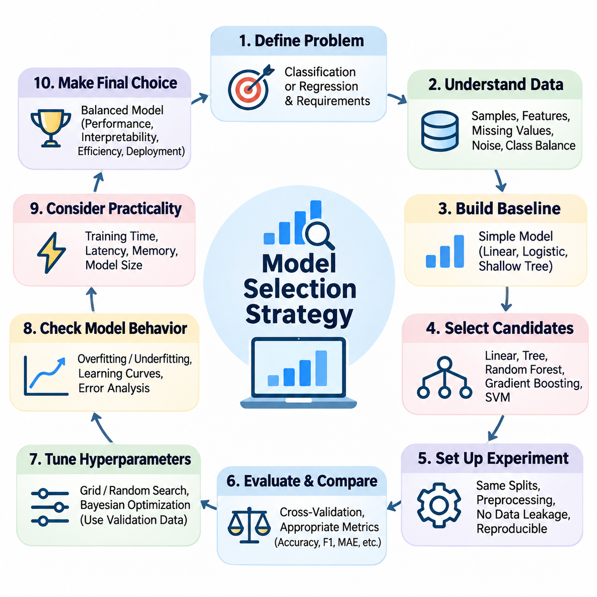
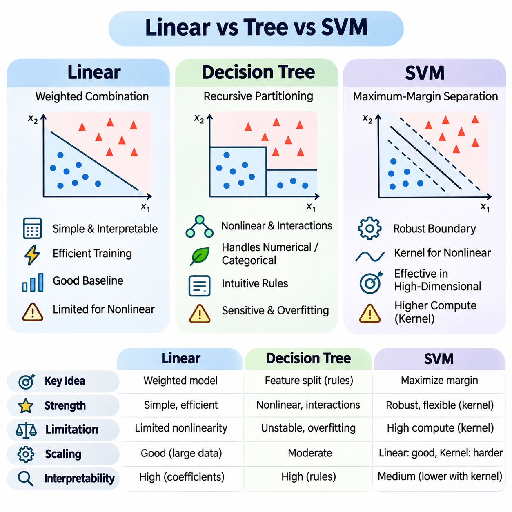
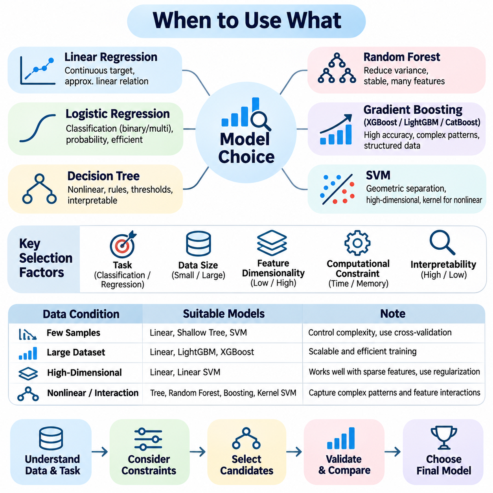
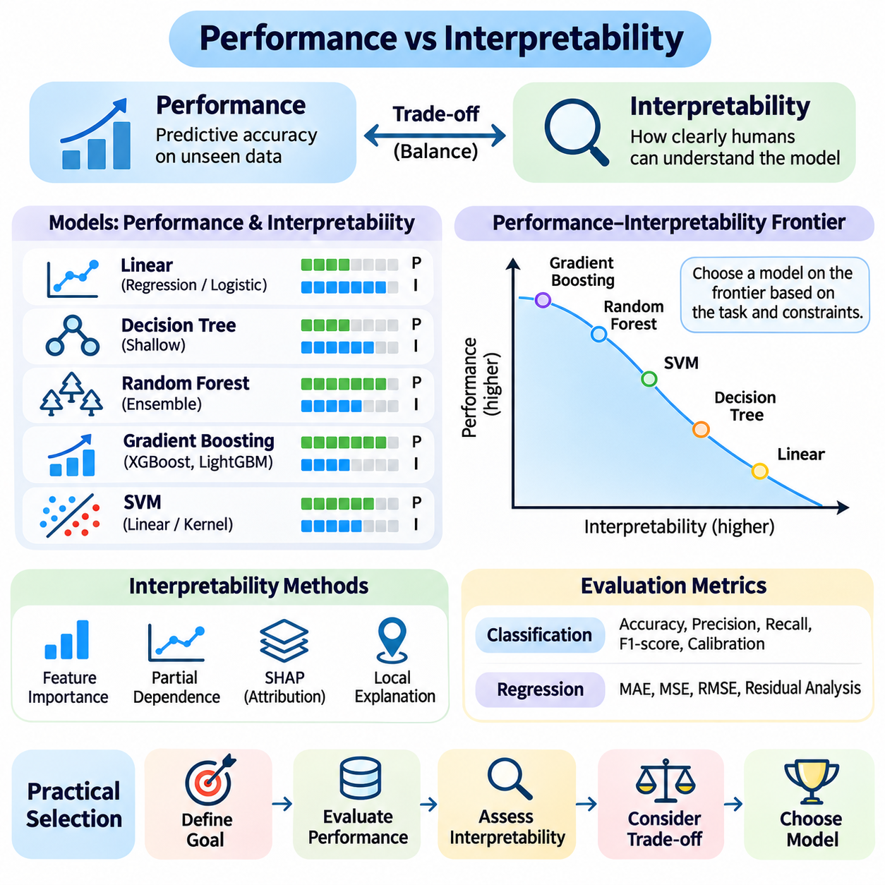
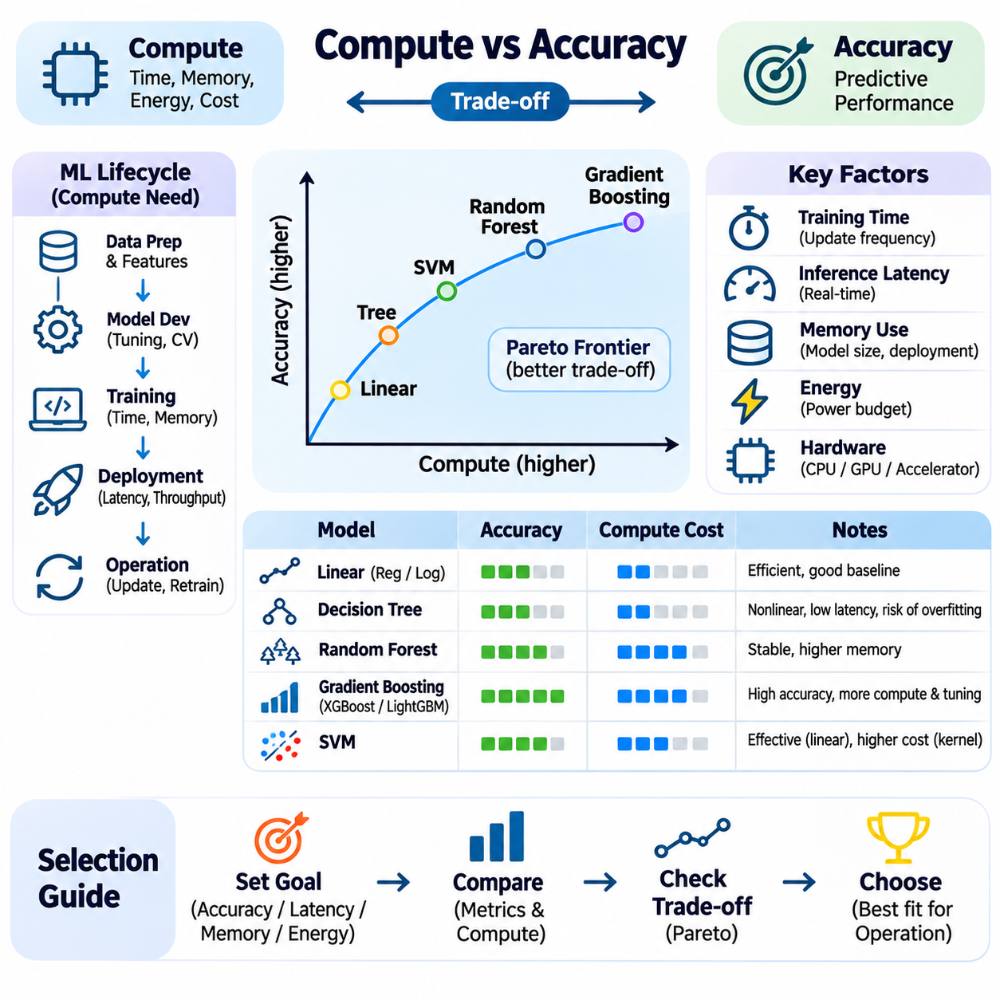
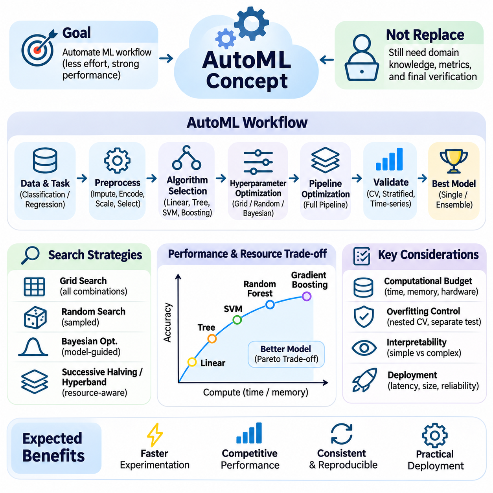
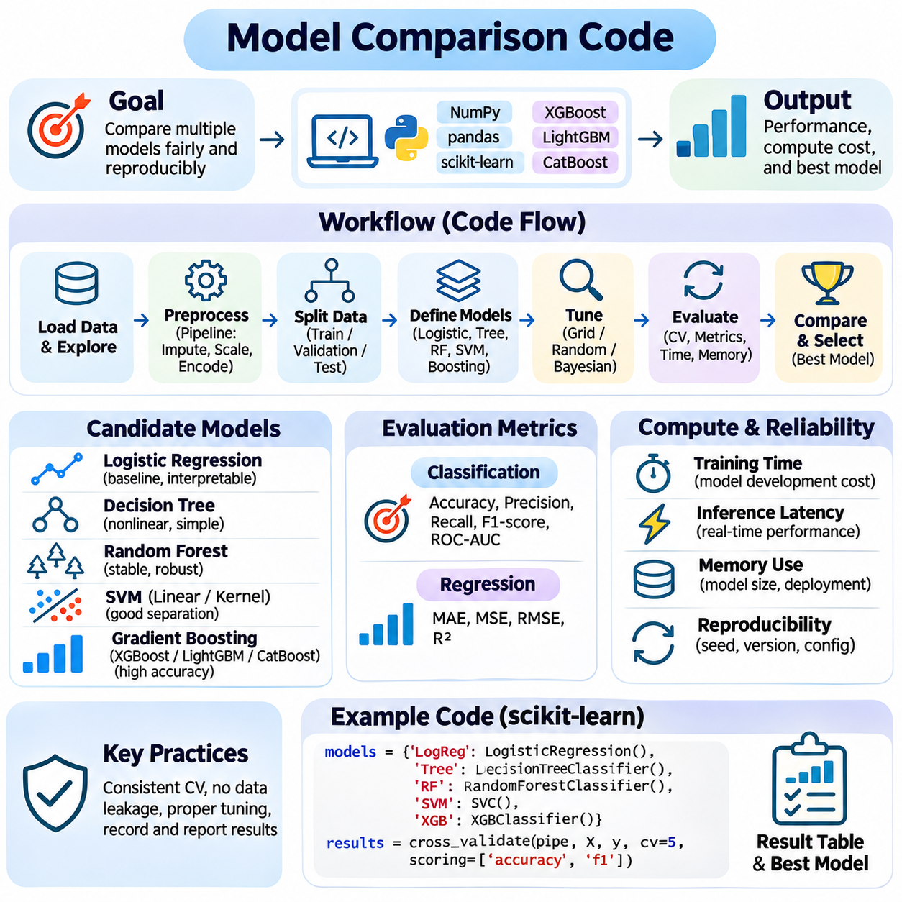

**Volume 08. Supervised Learning**

# 07. Model Comparison and Selection

## 07.00 Model Selection Strategy

{width="7.268055555555556in" height="7.268055555555556in"}

Model selection is a fundamental stage of supervised learning because different algorithms respond differently to data characteristics, computational constraints, and operational requirements. A successful strategy does not simply identify the algorithm with the highest accuracy. Instead, it determines which model provides the most appropriate balance among predictive performance, generalization, interpretability, efficiency, and deployment feasibility.

The selection process begins by defining the learning problem and its expected outcome. Classification tasks predict discrete categories, while regression tasks estimate continuous values. The distinction influences the available algorithms, loss functions, and evaluation metrics. Developers must also identify whether predictions require calibrated probabilities, interpretable decisions, or extremely low latency before selecting candidate models.

Understanding the dataset is equally important. The number of samples, feature dimensionality, variable types, missing values, noise, and class distribution can significantly affect algorithm behavior. Linear models often provide effective baselines for structured datasets, while tree-based methods can capture nonlinear relationships and feature interactions. Support Vector Machines may perform well in high-dimensional settings when their kernels and regularization are appropriately configured.

An effective strategy begins with a simple baseline rather than immediately adopting a complex architecture. Linear regression, logistic regression, or a shallow decision tree can establish an initial performance reference. This baseline helps determine whether additional complexity produces meaningful improvements. Without a reference model, developers may invest substantial computational resources in sophisticated algorithms without demonstrating measurable practical benefits.

Candidate selection should reflect the statistical properties of the problem. Linear models are appropriate when relationships can be represented approximately through weighted feature combinations. Decision trees accommodate nonlinear decision boundaries and heterogeneous features. Random forests improve stability through aggregation, while gradient boosting methods construct sequential ensembles that often achieve strong predictive performance on structured tabular datasets.

Support Vector Machines provide another important option when separating classes requires careful control of decision boundaries. Linear SVMs can be effective for high-dimensional feature spaces, while nonlinear kernels enable more flexible representations. However, kernel-based training may become computationally expensive as dataset size increases. Their suitability therefore depends on sample count, feature structure, memory availability, and acceptable training time.

A reliable comparison requires consistent experimental conditions. Candidate algorithms should use equivalent training, validation, and test partitions, with preprocessing performed correctly within each training procedure. Data leakage must be prevented by fitting transformations only on the appropriate training data. Random seeds, software versions, and experimental configurations should be recorded so that observed differences can be reproduced and investigated.

Cross-validation provides a systematic approach to estimating generalization performance. Instead of relying on one arbitrary training-validation split, the dataset is partitioned into multiple folds, and models are evaluated repeatedly. Stratified cross-validation helps preserve class proportions in classification problems. For time-dependent observations, chronological validation is preferable because random splitting may introduce unrealistic access to future information.

Evaluation metrics must correspond to the actual consequences of prediction errors. Accuracy may be sufficient for balanced classification problems, but precision, recall, F1-score, and area under the precision-recall curve can be more informative when classes are imbalanced. Regression tasks commonly use mean absolute error, mean squared error, or root mean squared error. The selected metric should reflect operational priorities rather than mathematical convenience alone.

Model selection also requires examining the relationship between training performance and validation performance. A model that performs exceptionally well on training examples but poorly on unseen observations may be overfitting. Conversely, consistently weak performance across both datasets may indicate underfitting. Learning curves, validation curves, and error analysis help determine whether improvements require additional data, better features, regularization, or greater model capacity.

Hyperparameter optimization should be integrated carefully into the selection procedure. Grid search explores predefined combinations, while randomized search samples configurations from specified distributions. Bayesian optimization can guide subsequent evaluations using information from previous trials. Regardless of the method, hyperparameters should be selected using validation evidence rather than repeatedly inspecting the final test set, which must remain reserved for independent assessment.

Computational efficiency introduces another dimension to model comparison. Training time, inference latency, memory consumption, model size, and energy requirements can determine whether an otherwise accurate algorithm is practical. A gradient boosting model may deliver excellent accuracy but require additional optimization for real-time inference. In resource-constrained environments, a smaller model with slightly lower accuracy may provide greater overall operational value.

Interpretability is particularly important when predictions influence consequential decisions or must be reviewed by human operators. Linear models offer coefficients that can support relatively direct interpretation, although correlated features and preprocessing may complicate their meaning. Decision trees provide explicit decision paths, while ensembles are generally more difficult to inspect. Feature importance and explanation techniques can improve transparency but do not automatically establish causal relationships.

A practical strategy can treat model selection as a multi-objective optimization problem. Predictive accuracy, computational cost, interpretability, robustness, and maintainability represent competing objectives rather than interchangeable measurements. Weighted scoring systems can summarize these priorities, but weights should reflect documented application requirements. Pareto analysis can also identify candidate models for which improving one objective would require sacrificing another.

Robustness testing evaluates whether candidate models remain dependable under realistic variations. Missing features, noisy measurements, distribution shifts, and unusual inputs can expose weaknesses that ordinary validation metrics overlook. Sensitivity analysis and evaluation across meaningful data subgroups provide additional evidence. A model that maintains stable performance under expected operating conditions may be preferable to one that achieves a marginally higher benchmark score.

The final selection should account for deployment and long-term maintenance. Model serialization, framework compatibility, prediction throughput, monitoring capabilities, and retraining requirements influence operational sustainability. Automated machine learning systems can accelerate candidate generation and hyperparameter exploration, but they do not eliminate the need for appropriate validation, leakage prevention, or domain-specific judgment. Automation supports the selection process rather than replacing responsible evaluation.

After comparing candidates, the selected configuration should be trained according to a documented final training procedure and evaluated once on an untouched test set. Its performance should be reported alongside relevant uncertainty, resource measurements, and known limitations. Model selection is ultimately an evidence-driven engineering decision that connects statistical learning with practical system requirements, ensuring that the chosen algorithm remains accurate, efficient, understandable, and reliable beyond the development environment.

## 07.01 Linear vs Tree vs SVM

{width="7.268055555555556in" height="7.268055555555556in"}

Linear models, decision trees, and Support Vector Machines represent three fundamental approaches to supervised learning. Although all three can solve classification problems, they differ substantially in mathematical assumptions, decision boundaries, computational requirements, and interpretability. Understanding these differences is essential for selecting an algorithm that matches the characteristics of a dataset and the operational objectives of an AI system.

Linear models assume that predictions can be expressed through weighted combinations of input features. In regression, the predicted value is calculated from feature coefficients and an intercept. In classification, logistic regression transforms a linear score into a probability, while linear classifiers establish decision boundaries using weighted feature combinations. Their relatively simple structure makes them computationally efficient and suitable for establishing reliable baselines.

The primary strength of linear models is their simplicity and interpretability. Model coefficients indicate how individual features contribute to predictions when other features remain fixed. Training is often efficient, especially for sparse or high-dimensional datasets. However, coefficient interpretation becomes difficult when features are strongly correlated, and linear decision boundaries may fail to represent complex relationships unless suitable feature transformations are introduced.

Decision trees follow a fundamentally different learning strategy by recursively partitioning the feature space. Each internal node evaluates a feature condition, and observations are directed toward branches according to the result. Classification trees assign class predictions at terminal nodes, while regression trees estimate numerical values. This hierarchical structure allows decision trees to represent nonlinear relationships without requiring explicit mathematical transformations.

One important advantage of decision trees is their ability to model feature interactions naturally. A decision involving one variable can depend on the outcome of a previous split involving another variable. Trees also handle numerical and categorical information, although categorical support depends on the implementation. Their decision paths are relatively intuitive, making shallow trees useful when human operators need understandable prediction rules.

However, individual decision trees are sensitive to variations in training data. Small changes in observations can produce different splitting structures, particularly when several features offer similar improvements. Deep trees may memorize training examples and generalize poorly. Techniques such as maximum-depth restrictions, minimum leaf sizes, and pruning help control model complexity, but excessive restrictions can introduce underfitting.

Support Vector Machines approach classification through the principle of maximum-margin separation. Rather than constructing recursive rules, an SVM searches for a decision boundary that maximizes the margin between classes under its optimization constraints. Training observations near or within the margin, known as support vectors, influence the resulting boundary. This geometric perspective distinguishes SVMs from both linear probabilistic classifiers and decision trees.

A linear SVM produces a linear decision boundary, but its optimization objective differs from logistic regression. Logistic regression typically minimizes logistic loss and provides probability estimates through its probabilistic formulation. A standard SVM minimizes a regularized margin-based objective, commonly involving hinge loss. Its decision scores do not directly represent calibrated probabilities, although additional calibration methods can provide probability estimates when necessary.

Kernel methods extend SVMs beyond linear separation by implicitly representing relationships in higher-dimensional feature spaces. The radial basis function kernel can construct flexible nonlinear decision boundaries, while polynomial kernels capture selected forms of feature interaction. This flexibility can improve performance on complex datasets, but kernel selection and parameter tuning strongly influence generalization and computational cost.

The geometry of decision boundaries provides a useful comparison among the three approaches. Linear classifiers divide feature space using hyperplanes, while standard axis-aligned decision trees construct regions through successive feature thresholds. Kernel SVMs can generate smooth and nonlinear boundaries depending on the selected kernel. None of these boundary structures is universally superior because effectiveness depends on the underlying data distribution.

Feature scaling introduces another important distinction. Linear models trained with regularization are often sensitive to differences in feature magnitude because coefficient penalties depend on scale. SVMs are particularly sensitive to scaling since margins and kernel distances are influenced by feature values. Standard decision trees generally do not require feature standardization because their splitting rules depend primarily on feature ordering and threshold comparisons.

Dataset size significantly affects computational suitability. Linear models can often scale effectively to large datasets using efficient optimization methods. Decision trees can also process substantial datasets, although training cost depends on the splitting algorithm, feature count, and tree depth. Kernel SVMs may require considerable memory and computation as sample counts increase, making linear SVMs or alternative algorithms preferable for very large datasets.

High-dimensional data creates different opportunities and challenges. Regularized linear models and linear SVMs often perform effectively when the number of features is large, particularly with sparse representations such as text vectors. Decision trees may struggle when useful information is distributed across many weak features. Nevertheless, carefully engineered features and appropriate regularization can substantially alter these relationships.

The treatment of noise and outliers also differs among these models. Ordinary least squares regression is sensitive to large residuals because errors are squared. Logistic regression and SVMs respond differently depending on their loss functions and regularization. Decision trees can isolate unusual observations through additional splits, potentially increasing overfitting. Robust preprocessing and representative validation remain necessary regardless of algorithm choice.

Hyperparameter selection influences each model family differently. Regularized linear models commonly require choosing penalty strength and sometimes the type of regularization. Decision trees require controlling depth, split criteria, and minimum sample requirements. SVMs require selecting the regularization parameter and, for nonlinear kernels, parameters such as kernel width. Fair comparison therefore requires appropriate tuning rather than relying exclusively on default settings.

Interpretability should be evaluated in relation to model complexity. Linear models provide a compact mathematical description, although coefficients are not automatically causal explanations. Shallow decision trees offer explicit decision paths that can be inspected directly. SVMs provide a geometric interpretation through margins and support vectors, but nonlinear kernel models are generally less transparent to nontechnical users.

For structured industrial datasets, the preferred algorithm depends on the available measurements and operational requirements. Linear models may suit approximately additive relationships and systems requiring fast, explainable predictions. Decision trees may be useful when operating conditions involve distinct thresholds and conditional rules. SVMs may be effective for moderate-sized datasets with carefully scaled features and complex class separation.

A practical comparison should train representative models using identical data partitions and appropriate preprocessing pipelines. Evaluation should include predictive metrics, cross-validation variability, training time, inference latency, and model size. For classification, accuracy alone may be insufficient when class distributions are imbalanced. Precision, recall, F1-score, and relevant probability calibration measures can provide a more complete assessment.

Ultimately, linear models, decision trees, and SVMs should be viewed as complementary learning strategies rather than competing algorithms with a universal ranking. Linear models emphasize compact functional relationships, decision trees emphasize hierarchical partitioning, and SVMs emphasize margin-based geometric separation. Selecting among them requires connecting their mathematical properties with data characteristics, validation evidence, computational constraints, and deployment requirements.

## 07.02 When to Use What

{width="7.268055555555556in" height="7.268055555555556in"}

Choosing the appropriate supervised learning algorithm depends on the nature of the problem, the structure of the dataset, and the constraints of the target application. No single model consistently outperforms all alternatives across every environment. Effective selection requires understanding how linear models, decision trees, ensemble methods, Support Vector Machines, and gradient boosting algorithms behave under different conditions.

Linear regression is generally suitable when the target variable is continuous and its relationship with input features can be approximated through an additive linear function. Applications include estimating energy consumption, production costs, and equipment operating parameters. Its simplicity supports efficient training and transparent interpretation, although nonlinear relationships may require feature transformations or more flexible algorithms.

Logistic regression is an effective starting point for classification problems involving binary outcomes or multiple categories. It is particularly useful when computational efficiency, coefficient interpretation, and probability estimation are important. Applications include equipment failure prediction, customer classification, and risk assessment. Regularization can improve generalization, while appropriate calibration should be verified when predicted probabilities guide decisions.

Decision trees are useful when data contains nonlinear relationships, conditional rules, and meaningful feature thresholds. Their hierarchical structure naturally represents interactions between variables without requiring explicit interaction terms. Applications include industrial fault diagnosis, quality inspection decisions, and operational rule extraction. Shallow trees are especially valuable when predictions must be explained through understandable decision paths.

Random forests are often appropriate when individual decision trees exhibit high variance or unstable predictions. By combining multiple trees trained with randomized data and feature selection, random forests generally improve predictive stability and reduce overfitting. They work effectively with many structured datasets and nonlinear feature interactions, although their larger memory footprint and reduced interpretability must be considered.

Gradient boosting methods are strong candidates for structured tabular datasets where predictive accuracy is a primary objective. Algorithms such as XGBoost, LightGBM, and CatBoost sequentially construct ensembles that correct weaknesses in previous predictions. They can model complex feature interactions and heterogeneous data, but performance depends on careful hyperparameter tuning, validation design, and control of model complexity.

XGBoost is particularly useful when robust regularization, flexible objective functions, and controlled tree construction are important. Its optimization framework supports classification and regression across diverse structured datasets. However, parameter choices such as tree depth, learning rate, and boosting rounds strongly influence performance. Its suitability should be established through validation rather than assuming that greater complexity guarantees better results.

LightGBM is often attractive for large tabular datasets because its histogram-based learning and leaf-wise tree growth can provide efficient training. It may offer advantages when sample counts and feature dimensions are substantial. Nevertheless, aggressive leaf-wise growth can overfit smaller datasets unless complexity is constrained. Training efficiency should therefore be evaluated together with generalization and inference requirements.

CatBoost is especially useful when datasets contain important categorical variables. Its categorical feature processing and ordered boosting techniques can reduce the need for extensive manual encoding and help control certain forms of target leakage. Applications include customer behavior prediction, equipment classification, and operational analytics. Its advantages depend on the actual feature distribution and should be compared against alternative preprocessing strategies.

Support Vector Machines are suitable for classification problems where geometric separation between classes provides a useful representation. Linear SVMs often perform well with high-dimensional sparse features, including text representations. Kernel SVMs can capture nonlinear boundaries in moderate-sized datasets. However, kernel training may become expensive for large sample counts, and feature scaling is usually essential for reliable performance.

When a dataset contains relatively few observations, model complexity must be controlled carefully. Regularized linear models, shallow decision trees, and appropriately tuned SVMs can provide reasonable starting points. Complex ensembles may still perform well, but their flexibility increases the need for reliable validation. Cross-validation, domain-informed feature engineering, and uncertainty analysis become particularly important when available training evidence is limited.

For large datasets, computational scalability becomes a major selection criterion. Linear models trained through efficient optimization can process extensive datasets with relatively modest resource requirements. Histogram-based gradient boosting can also scale effectively for many tabular problems. Random forests may require additional memory because multiple trees are stored. Kernel SVMs can become impractical when the number of training observations is extremely large.

High-dimensional datasets require attention to feature sparsity, redundancy, and regularization. Linear classifiers and linear SVMs are often effective when useful information is distributed across numerous sparse features. Tree-based models can struggle when individual features provide weak splitting signals. Feature selection, dimensionality reduction, and representation learning may improve performance, but transformations must be evaluated within leakage-free validation pipelines.

Class imbalance changes the criteria used to choose a model. When rare events represent important outcomes, overall accuracy may conceal poor minority-class detection. Logistic regression, SVMs, random forests, and boosting methods can incorporate class weighting or other imbalance-handling strategies. Precision, recall, F1-score, and precision-recall analysis should guide comparisons according to the operational consequences of false positives and false negatives.

Interpretability requirements can determine which model is most appropriate even when predictive differences are small. Linear models provide coefficients that support relatively direct explanations, while shallow decision trees expose explicit decision rules. Random forests and boosting models offer greater flexibility but usually require additional explanation techniques. Feature attribution methods can support analysis, although their outputs should not be interpreted automatically as causal evidence.

Real-time and edge AI applications require particular attention to inference latency, memory consumption, and energy efficiency. Compact linear models and shallow decision trees are often attractive when computational resources are limited. Small ensembles may also satisfy real-time requirements after optimization. Model selection should include measurements on the actual deployment hardware because training benchmarks do not necessarily predict embedded inference performance.

For industrial monitoring and robotics, data characteristics may change with environmental conditions, sensor aging, or operational behavior. A model that performs well on historical observations may degrade under distribution shift. Selection should therefore include robustness testing, representative operating scenarios, and monitoring requirements. Reliable performance across expected conditions may be more valuable than a small improvement in average validation accuracy.

A practical decision process begins with a simple baseline, followed by increasingly flexible candidate models when validation results justify additional complexity. Consistent preprocessing, appropriate cross-validation, and comparable hyperparameter optimization are necessary for fair evaluation. Training cost, inference speed, interpretability, robustness, and maintenance requirements should be considered alongside predictive metrics rather than treated as secondary concerns.

Ultimately, choosing when to use each supervised learning algorithm is an engineering decision informed by statistical evidence and application requirements. Linear models emphasize simplicity and efficiency, decision trees provide interpretable conditional structures, SVMs emphasize margin-based separation, and ensemble methods improve flexibility and predictive stability. The preferred model is the one that achieves dependable performance while satisfying the practical constraints of its intended environment.

## 07.03 Performance vs Interpretability

{width="7.268055555555556in" height="7.268055555555556in"}

Predictive performance and interpretability are two essential dimensions of supervised learning model evaluation. Performance describes how accurately a model predicts outcomes on unseen data, while interpretability concerns how clearly humans can understand the factors influencing those predictions. Although complex algorithms may achieve higher accuracy, their internal reasoning can become difficult to examine, creating important tradeoffs in practical AI systems.

The relationship between performance and interpretability is not always a direct conflict. A simple model can achieve excellent predictive accuracy when the underlying relationships are relatively straightforward. Conversely, a complex model may perform poorly if training data is insufficient or noisy. Model complexity should therefore be justified by measurable improvements rather than the assumption that sophisticated architectures automatically produce superior predictions.

Linear models are frequently considered highly interpretable because predictions arise from weighted combinations of input features. Regression coefficients describe how predicted outcomes change with individual features when other variables remain constant. Logistic regression similarly provides coefficients associated with changes in log-odds. However, correlated features, nonlinear transformations, and interaction terms can complicate interpretation even in relatively simple models.

Decision trees provide another form of interpretability through explicit conditional rules. Each prediction follows a sequence of feature comparisons from the root node to a terminal leaf. Human operators can inspect these paths to understand how a particular result was produced. However, interpretability decreases as trees become deeper, because numerous branches and interacting conditions make the overall decision structure increasingly difficult to understand.

Ensemble methods improve predictive performance by combining multiple learning models. Random forests aggregate predictions from many decision trees, reducing variance and improving stability. Gradient boosting constructs models sequentially to correct previous prediction errors. These methods often achieve strong results on structured datasets, but the combined decision process is substantially more difficult to interpret than an individual shallow tree.

Support Vector Machines illustrate how interpretability depends on mathematical representation. Linear SVMs produce decision boundaries defined by feature weights, allowing some examination of feature contributions. Kernel SVMs represent nonlinear separation through implicit transformations, making individual predictions less transparent. Although support vectors explain the geometric construction of the boundary, they do not necessarily provide intuitive explanations for nontechnical users.

Interpretability can be divided into global and local perspectives. Global interpretability describes how a model behaves across the overall input space, including which features influence predictions and how decision patterns are structured. Local interpretability focuses on explaining a specific prediction for an individual observation. A model may support useful local explanations without providing a simple global description of its complete behavior.

Intrinsic interpretability refers to models whose structures are understandable without additional explanation systems. Linear regression, logistic regression, and shallow decision trees are common examples. Post-hoc interpretability applies explanatory techniques after a model has been trained. Methods such as permutation importance, partial dependence analysis, and SHAP can provide insights into complex models, although their explanations depend on assumptions and analytical choices.

Feature importance is commonly used to identify variables that contribute strongly to model predictions. Tree-based algorithms may calculate importance from accumulated improvements in splitting criteria, while permutation importance measures performance changes when feature information is disrupted. However, correlated variables can distort importance estimates, and importance does not establish causality. Explanations must therefore be interpreted within the statistical context of the dataset.

Partial dependence plots describe how average model predictions vary as selected features change while other observed features are averaged over. These plots can reveal nonlinear relationships and interaction patterns, but they may evaluate unrealistic feature combinations when variables are strongly dependent. Individual conditional expectation analysis provides complementary information by examining how predictions change for individual observations rather than only reporting average effects.

SHAP explanations use concepts from cooperative game theory to attribute prediction differences to individual features relative to a reference expectation. They can support local explanations and aggregated global analysis. Nevertheless, attribution values depend on the background distribution and assumptions about feature dependence. A large SHAP value indicates model attribution under a particular explanation framework, not proof that a feature causally determines the outcome.

Performance evaluation should extend beyond a single accuracy measurement. Classification models may require precision, recall, F1-score, probability calibration, and threshold-dependent analysis. Regression models may be compared through absolute error, squared error, and residual distributions. Interpretability requirements should be evaluated alongside these metrics so that decision-makers understand whether improved predictive performance justifies reduced transparency.

A practical approach is to compare models along a performance-interpretability frontier. Simple models establish a transparent baseline, while increasingly flexible models are introduced when validation results demonstrate meaningful improvements. If a complex model provides only a marginal gain, the simpler alternative may be preferable. Conversely, substantial improvements in critical error rates may justify additional explanation mechanisms and operational safeguards.

Interpretability becomes particularly important in regulated or safety-sensitive environments. Financial decisions, medical support systems, industrial monitoring, and autonomous equipment may require explanations that support auditing, troubleshooting, and accountability. However, explanation alone does not guarantee fairness, reliability, or regulatory compliance. Models must also undergo appropriate validation, documentation, risk assessment, and monitoring throughout their operational lifecycle.

In industrial AI applications, interpretable models can help engineers connect predictions with physical processes. A linear model may reveal associations between temperature, vibration, and equipment degradation, while a decision tree may expose operational thresholds associated with failure conditions. More complex ensembles can improve predictive accuracy, but engineers must verify whether explanations remain consistent with known system behavior and measurement limitations.

For edge AI and robotic systems, interpretability can contribute to debugging and operational confidence. When a perception or diagnostic model produces an unexpected result, understandable decision factors may help identify sensor faults, distribution shifts, or inappropriate feature dependencies. However, real-time requirements also impose constraints on inference latency and computational resources, requiring explanation mechanisms to be evaluated for their operational cost.

Model transparency should also include documentation of training data, preprocessing procedures, validation methods, and known limitations. Even an intrinsically interpretable algorithm can become difficult to audit when its development process is poorly documented. Reproducible experiments, version tracking, and systematic error analysis provide essential context for understanding why a model behaves as observed and whether its predictions remain dependable.

Ultimately, performance and interpretability should be treated as complementary engineering objectives rather than mutually exclusive properties. The preferred balance depends on application risk, available data, user expertise, and the consequences of incorrect predictions. Effective model selection combines predictive evaluation with transparent reasoning, appropriate explanation methods, and operational validation to produce AI systems that are both capable and trustworthy.

## 07.04 Compute vs Accuracy

{width="7.268055555555556in" height="7.268055555555556in"}

Computational cost and predictive accuracy represent two closely connected objectives in supervised learning model selection. Increasing model complexity can improve the ability to capture difficult relationships, but it often requires additional processing time, memory, and energy. The central challenge is determining whether an improvement in prediction quality justifies the resources required for training, validation, deployment, and continuous operation.

Computational requirements should be evaluated across the entire machine learning lifecycle rather than training alone. Model development includes data preprocessing, feature engineering, hyperparameter optimization, cross-validation, and repeated experimentation. Deployment introduces inference latency, throughput, memory allocation, and power consumption. A model that trains efficiently may still become expensive when serving millions of predictions.

Linear models frequently provide favorable accuracy-to-compute ratios when relationships are approximately linear or suitable features have been engineered. Linear regression and logistic regression can be trained efficiently using established optimization techniques. Their compact parameter representations also support fast inference. However, improving accuracy on complex nonlinear problems may require additional features or alternative model families.

Decision trees offer a different computational profile because they partition feature space through recursive splitting. Training cost depends on sample count, feature dimensionality, splitting strategy, and maximum tree depth. Inference generally follows a limited sequence of comparisons, making compact trees attractive for low-latency applications. Deep trees may increase computational requirements while also introducing overfitting.

Random forests improve predictive stability by aggregating many decision trees, but this advantage comes with additional computational costs. Training multiple trees increases processing requirements, although individual trees can often be trained in parallel. Inference requires evaluating multiple decision paths and combining their predictions. Increasing the number of trees eventually produces diminishing accuracy improvements while continuing to increase resource consumption.

Gradient boosting algorithms frequently achieve strong accuracy on structured datasets by sequentially correcting prediction errors. XGBoost, LightGBM, and CatBoost provide different optimization strategies for efficient tree construction. Nevertheless, boosting iterations introduce computational overhead, and complex ensembles may require substantial memory. The optimal configuration balances learning rate, tree complexity, ensemble size, and validation performance.

Support Vector Machines illustrate how computational cost depends strongly on algorithm formulation. Linear SVMs can scale effectively to large, sparse datasets through specialized optimization methods. Kernel SVMs provide nonlinear decision boundaries but may require substantial computation and memory as training sample counts increase. Their inference cost also depends on the number of support vectors retained by the trained model.

Model accuracy should be examined as a function of computational investment rather than as an isolated score. A model requiring twice the training time may provide only a negligible improvement in validation accuracy. Such improvements may be worthwhile in high-value applications but unnecessary in routine prediction tasks. Comparing marginal accuracy gains against additional computational costs helps establish rational selection criteria.

Training time is particularly important when models must be updated frequently. Applications involving changing sensor conditions, customer behavior, or industrial processes may require periodic retraining. Algorithms with expensive optimization procedures can delay adaptation to new observations. Efficient models may therefore provide greater operational value by enabling more frequent updates and faster recovery from performance degradation.

Inference latency becomes critical in real-time applications where predictions must be delivered within strict deadlines. Autonomous robots, industrial controllers, and monitoring systems may require responses within milliseconds. Average latency alone is insufficient because occasional delays can disrupt operations. Evaluation should include worst-case or high-percentile latency under representative workloads and realistic hardware conditions.

Memory consumption affects both training feasibility and deployment flexibility. Large ensembles store numerous tree structures, while kernel methods may retain many support vectors. Linear models generally require compact parameter storage, although very high-dimensional feature spaces can still increase memory demands. Memory limitations become particularly important in embedded systems, mobile devices, and edge computing environments.

Hardware architecture also influences the relationship between computation and accuracy. CPUs are effective for many classical machine learning algorithms, particularly when datasets and models fit comfortably in memory. GPUs can accelerate suitable parallel workloads, but acceleration depends on implementation and data transfer overhead. Specialized accelerators may improve efficiency when supported operations match the model architecture.

Energy efficiency is increasingly important for systems operating continuously or under limited power budgets. A model with slightly higher accuracy may consume significantly more energy during repeated inference. Battery-powered robots and remote monitoring devices must balance prediction quality against operating duration. Energy per prediction and sustained power consumption provide useful measurements beyond conventional accuracy metrics.

Hyperparameter optimization introduces additional computational expenditure because many candidate configurations must be evaluated. Grid search can become expensive as the number of parameters increases, while randomized search explores selected combinations more efficiently. Bayesian optimization can reduce unnecessary trials by using previous results to guide exploration. The total search budget should be included when comparing development costs.

Accuracy improvements can also be pursued through data quality rather than model complexity. Better labels, representative training examples, improved preprocessing, and carefully designed features may produce substantial gains without increasing inference cost. In some cases, additional high-quality data improves generalization more effectively than larger models. This makes data-centric optimization an important alternative to computational scaling.

A useful comparison framework examines the Pareto frontier between accuracy and computational expense. A model is computationally dominated when another candidate achieves equal or better accuracy with lower resource requirements. Models on the Pareto frontier represent meaningful tradeoffs among competing objectives. Decision-makers can then select a configuration according to latency limits, hardware budgets, and application-specific accuracy requirements.

For edge AI and robotics, computational efficiency must be evaluated within the complete system architecture. Perception, localization, planning, communication, and control may compete for shared processing resources. A highly accurate prediction model can become unsuitable if it interferes with time-critical functions. Resource-aware scheduling, model simplification, and hardware-specific optimization can help maintain predictable system behavior.

Ultimately, compute-versus-accuracy analysis transforms model selection into a practical engineering optimization problem. The preferred model is not necessarily the most accurate or the least expensive, but the one that provides sufficient predictive quality within acceptable resource limits. Reliable decisions require measuring accuracy, training cost, inference latency, memory usage, energy consumption, and operational scalability under representative conditions.

## 07.05 AutoML Concept

{width="7.268055555555556in" height="7.268055555555556in"}

Automated Machine Learning, commonly known as AutoML, refers to techniques that automate important stages of the machine learning development process. Instead of requiring engineers to manually select every algorithm and hyperparameter, AutoML systems explore candidate configurations through systematic experimentation. Their primary objective is to identify models that achieve strong predictive performance while reducing repetitive development effort and improving experimental consistency.

Traditional machine learning workflows require substantial expertise in preprocessing, feature engineering, algorithm selection, and hyperparameter optimization. Developers repeatedly train models, inspect validation results, and adjust configurations. AutoML organizes these activities into an automated search process governed by predefined objectives and constraints. However, automation does not eliminate the need to understand the dataset, define meaningful evaluation metrics, or verify the final results.

An AutoML workflow typically begins with a dataset and a clearly defined prediction task. The system identifies whether the objective involves classification or regression and prepares candidate processing pipelines. Depending on its capabilities, it may examine missing values, numerical features, categorical variables, and class distributions. These observations guide the selection of preprocessing methods and compatible learning algorithms.

Automated preprocessing is an important component of many AutoML systems. Candidate pipelines may include missing-value imputation, categorical encoding, numerical scaling, and feature selection. Different algorithms require different transformations, so preprocessing choices must be evaluated together with model configurations. To prevent data leakage, transformations should be fitted only on training partitions within the appropriate validation procedure.

Algorithm selection allows AutoML to compare multiple model families under consistent experimental conditions. Candidate algorithms may include linear regression, logistic regression, decision trees, random forests, Support Vector Machines, and gradient boosting methods. Each model family offers different assumptions and computational characteristics. AutoML evaluates these alternatives using predefined metrics rather than assuming that one algorithm is universally superior.

Hyperparameter optimization is one of the central mechanisms of AutoML. Parameters such as regularization strength, tree depth, learning rate, and ensemble size can significantly affect model performance. Grid search evaluates predefined combinations, while randomized search samples configurations from selected distributions. More advanced approaches use information from previous evaluations to guide subsequent experiments toward promising regions.

Bayesian optimization provides a structured approach to efficient hyperparameter exploration. It constructs a surrogate model that estimates how candidate configurations may perform based on previously observed results. An acquisition strategy then balances exploration of uncertain regions with exploitation of promising configurations. This approach can reduce unnecessary evaluations, although its effectiveness depends on search-space design and the cost of individual experiments.

AutoML may also use resource-aware search strategies to reduce computational expenditure. Successive halving allocates limited resources to many candidates and progressively concentrates effort on better-performing configurations. Hyperband extends this principle by exploring different resource allocation schedules. These methods can accelerate model selection, but early performance estimates may not always predict final results, especially when learning behavior changes over time.

Pipeline optimization extends automation beyond individual algorithms. A complete pipeline may combine feature transformations, dimensionality reduction, model training, and prediction calibration. AutoML searches for compatible combinations rather than optimizing each component independently. This approach recognizes that preprocessing decisions and algorithm configurations interact, meaning that the best transformation for one model may be unsuitable for another.

Validation design remains essential because AutoML repeatedly evaluates many candidate configurations. Cross-validation can provide more reliable performance estimates than a single random split, particularly for smaller datasets. Stratified sampling helps preserve class proportions, while time-series applications require chronological evaluation. An untouched test set should remain separate from automated optimization to provide an independent estimate of final generalization performance.

Repeated experimentation introduces the risk of overfitting to validation data. Even when individual models are trained correctly, evaluating numerous configurations can favor candidates that perform unusually well because of random variation. Nested cross-validation or carefully separated evaluation stages can reduce selection bias. AutoML results should therefore be interpreted as estimates subject to statistical uncertainty rather than guaranteed future performance.

Many AutoML frameworks support ensemble construction after evaluating candidate models. Instead of selecting only one algorithm, the system may combine predictions from several complementary models. Averaging, voting, stacking, and weighted combinations can improve predictive stability when component errors differ. However, ensembles increase memory requirements, inference latency, and operational complexity, making deployment constraints important during automated selection.

Computational budgets strongly influence AutoML effectiveness. A search may be limited by execution time, memory capacity, processor availability, or the maximum number of trials. Larger budgets allow broader exploration but do not guarantee proportional accuracy improvements. Resource-aware AutoML should evaluate predictive quality alongside training cost and inference requirements, especially when models must operate on embedded or edge computing platforms.

Interpretability is another important consideration in automated model selection. AutoML may identify a complex ensemble that slightly outperforms a simple linear model, but the additional accuracy may not justify reduced transparency. Applications requiring understandable decisions can restrict the search space to interpretable algorithms or include explanation requirements in model evaluation. Automated selection should reflect operational priorities rather than optimize accuracy alone.

AutoML can be particularly useful for structured tabular datasets because many established algorithms and preprocessing techniques can be evaluated systematically. Industrial monitoring, equipment diagnostics, quality prediction, and operational analytics provide representative applications. Nevertheless, domain-specific constraints, sensor characteristics, and physical relationships must still be considered when interpreting automated results and determining whether selected features are meaningful.

Deployment introduces requirements that may not be captured by conventional AutoML benchmarks. A model must satisfy inference latency, memory consumption, software compatibility, and reliability constraints on the target hardware. Some systems incorporate deployment-aware optimization, while others require separate engineering validation. Model serialization, reproducibility, monitoring, and retraining procedures remain necessary regardless of how the model was selected.

AutoML should be understood as an engineering assistant rather than a replacement for machine learning expertise. It can accelerate experimentation, standardize comparisons, and reveal effective configurations that manual exploration might overlook. However, humans remain responsible for defining the problem, preventing leakage, assessing fairness, interpreting errors, and validating operational suitability. Automated optimization cannot compensate for fundamentally unsuitable data or poorly defined objectives.

Ultimately, AutoML transforms model selection into a systematic and partially automated optimization process. Its value lies in combining algorithm exploration, hyperparameter tuning, preprocessing, and validation within a reproducible framework. The most successful applications balance automation with domain knowledge, computational constraints, interpretability, and independent evaluation, producing models that are not only accurate but also practical, reliable, and maintainable.

## 07.06 Model Comparison Code [w/Code]

{width="7.268055555555556in" height="7.268055555555556in"}

Model comparison code provides a reproducible framework for evaluating supervised learning algorithms under consistent experimental conditions. Rather than relying on isolated accuracy scores, a comparison program trains multiple candidate models using identical data partitions and evaluation procedures. This approach helps identify meaningful differences in predictive performance, computational cost, interpretability, and suitability for practical deployment.

A typical implementation uses Python libraries such as NumPy, pandas, scikit-learn, and specialized gradient boosting packages. NumPy supports numerical operations, while pandas organizes structured datasets into tabular representations. Scikit-learn provides preprocessing utilities, model implementations, pipelines, and evaluation metrics. Additional libraries such as XGBoost, LightGBM, and CatBoost extend the comparison to advanced ensemble algorithms.

The comparison process begins by loading a dataset and identifying the target variable and input features. Numerical and categorical columns should be examined separately because they may require different preprocessing operations. Missing values, duplicate records, inconsistent data types, and unexpected feature distributions should be investigated before training. These checks reduce the risk of comparing algorithms using unreliable or improperly prepared information.

Data splitting establishes a common experimental foundation for all candidate models. A training partition supports parameter estimation, while validation procedures guide model selection and hyperparameter tuning. A separate test partition remains untouched until final evaluation. For classification, stratified splitting can preserve class proportions, while grouped or chronological splitting may be necessary when observations are related or time-dependent.

Preprocessing should be implemented through reusable pipelines rather than applied independently to the complete dataset. Numerical features may require missing-value imputation and standardization, while categorical variables may require encoding. A ColumnTransformer can apply different transformations to selected feature groups. Integrating these operations into a Pipeline ensures that preprocessing parameters are learned only from the appropriate training partitions.

Candidate models should represent different algorithm families to reveal meaningful performance tradeoffs. A classification comparison may include logistic regression, decision trees, random forests, linear SVMs, and gradient boosting classifiers. Regression experiments can substitute corresponding regression estimators. Including a simple baseline, such as a dummy predictor, helps determine whether more sophisticated algorithms provide genuine predictive value.

A model registry can organize candidate estimators using a Python dictionary that maps descriptive names to model objects. This structure allows the same evaluation loop to process every algorithm without duplicating training logic. Each candidate should be instantiated with a controlled random state when supported. Configuration details, library versions, and preprocessing choices should be recorded to make experimental results reproducible.

The evaluation loop fits each candidate pipeline on the training data and generates predictions through a consistent validation procedure. Cross-validation is often preferable to a single split because it measures performance across multiple partitions. Scikit-learn functions such as cross_validate can collect several metrics simultaneously. Mean scores and variability across folds provide a more informative comparison than one isolated performance estimate.

Classification evaluation should reflect the consequences of prediction errors. Accuracy measures the proportion of correct predictions, but it can be misleading when classes are imbalanced. Precision, recall, F1-score, and confusion matrices reveal different aspects of classification behavior. ROC-AUC and average precision can provide additional ranking information when appropriate prediction scores are available and the evaluation setting supports them.

Regression evaluation requires metrics suited to continuous targets. Mean absolute error measures the average magnitude of prediction errors, while mean squared error penalizes larger deviations more strongly. Root mean squared error expresses squared-error performance in the original target units. The coefficient of determination, R-squared, describes improvement relative to a constant-mean baseline, although its interpretation depends on the evaluation dataset.

Computational measurements should accompany predictive metrics. Training duration can be recorded using a high-resolution timer, while inference latency can be estimated by timing repeated prediction calls. Memory usage may require additional profiling utilities. Measurements should use consistent hardware, batch sizes, and software settings. Timing results are approximate because operating system scheduling and background workloads can introduce variability.

Hyperparameter tuning should be performed within the training and validation process rather than using the final test set. GridSearchCV and RandomizedSearchCV provide structured approaches for evaluating candidate configurations. Search spaces may include regularization strength, tree depth, minimum leaf size, learning rate, and ensemble size. Fair comparison requires considering differences in tuning budgets and computational resources across algorithms.

Nested cross-validation provides a more rigorous approach when unbiased model-selection performance estimates are important. The inner loop selects hyperparameters, while the outer loop evaluates the complete selection procedure on held-out folds. This separation reduces optimistic bias caused by repeated validation-based decisions. However, nested evaluation can be computationally expensive, especially when comparing several model families with extensive search spaces.

Results should be stored in a structured table containing model names, validation metrics, score variability, training time, and inference measurements. A pandas DataFrame can organize these records and sort candidates according to a primary evaluation criterion. Secondary metrics should remain visible because the highest-scoring model may violate latency, memory, or interpretability requirements. Consistent reporting also simplifies later experiments.

Model comparison code should include explicit safeguards against data leakage. Feature selection, scaling, imputation, and target-dependent transformations must be fitted within training folds rather than before cross-validation. Related samples should not be distributed across training and validation partitions when doing so reveals information about held-out observations. Leakage can create impressive but misleading scores that fail under real deployment conditions.

Reproducibility requires controlling random seeds and documenting experimental configurations. Randomness can influence data splitting, ensemble construction, and optimization procedures. Repeating experiments with several seeds may reveal whether observed differences are stable. Dependency versions, hardware information, dataset identifiers, and evaluation settings should be preserved so that future researchers can reconstruct the comparison under equivalent conditions.

Final model selection should combine statistical evidence with operational requirements. Small differences in mean cross-validation scores may not be meaningful when fold-to-fold variability is substantial. Confidence intervals or appropriately designed paired comparisons can help assess uncertainty. A simpler model may be preferable when it delivers comparable accuracy with lower inference cost, clearer explanations, or more predictable behavior.

After selecting the preferred configuration, the complete pipeline should be refitted using the available development data and evaluated once on the untouched test set. The final report should include predictive metrics, error analysis, computational measurements, and known limitations. The trained pipeline can then be serialized for deployment, provided compatibility and security requirements are addressed. Monitoring remains necessary because real-world data may change.

Ultimately, model comparison code transforms algorithm selection into a transparent and repeatable engineering process. Its purpose is not merely to identify the highest numerical score, but to establish trustworthy evidence about how alternative models behave under comparable conditions. By combining consistent preprocessing, leakage-free validation, computational profiling, and careful reporting, developers can select supervised learning systems that satisfy both statistical and operational objectives.
