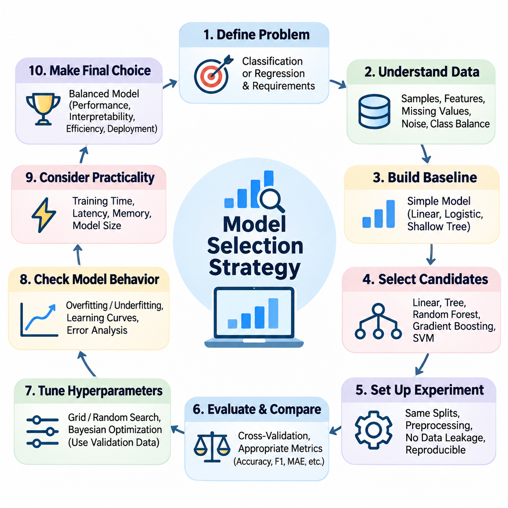
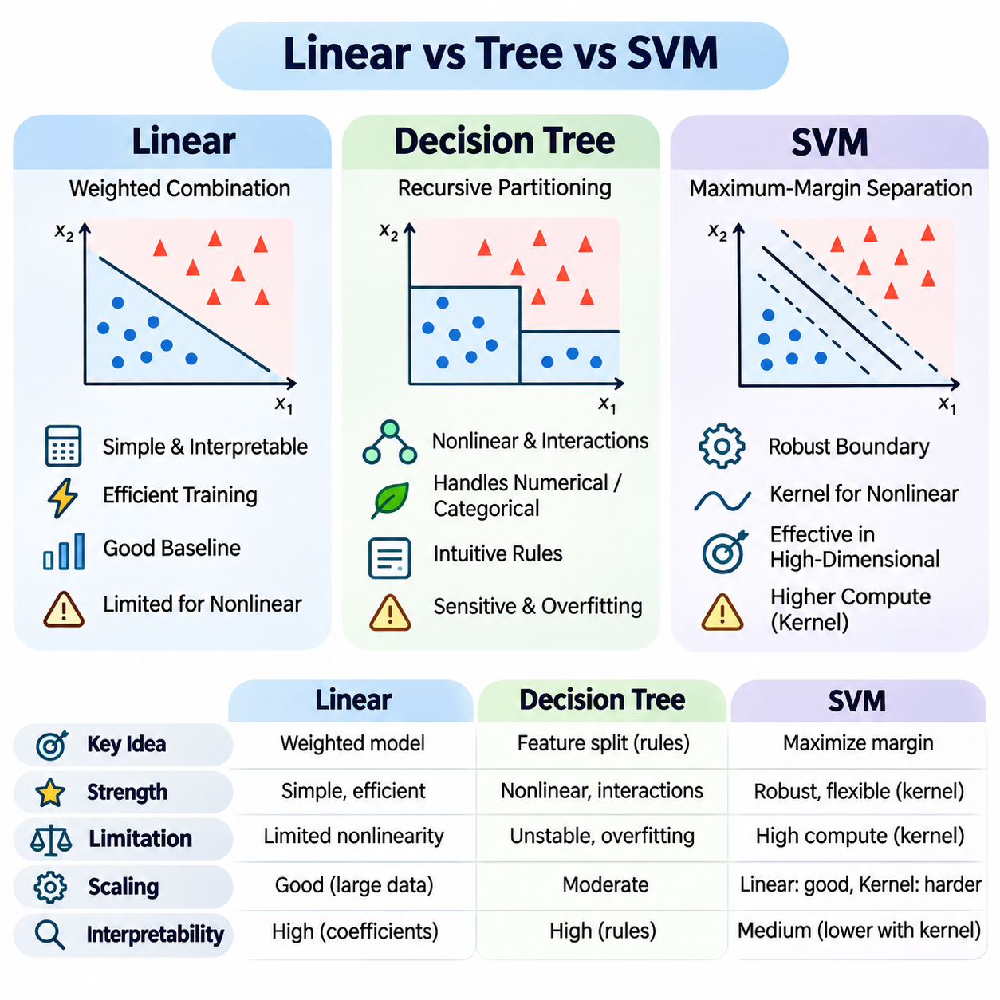
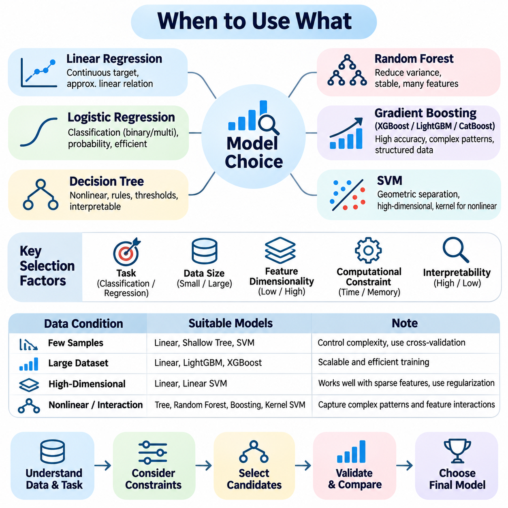
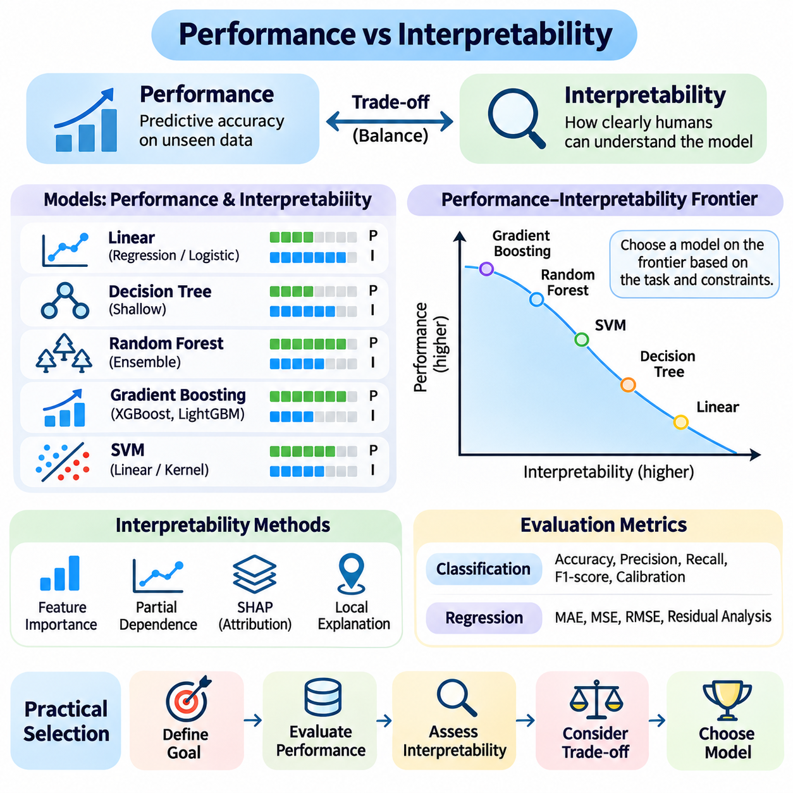
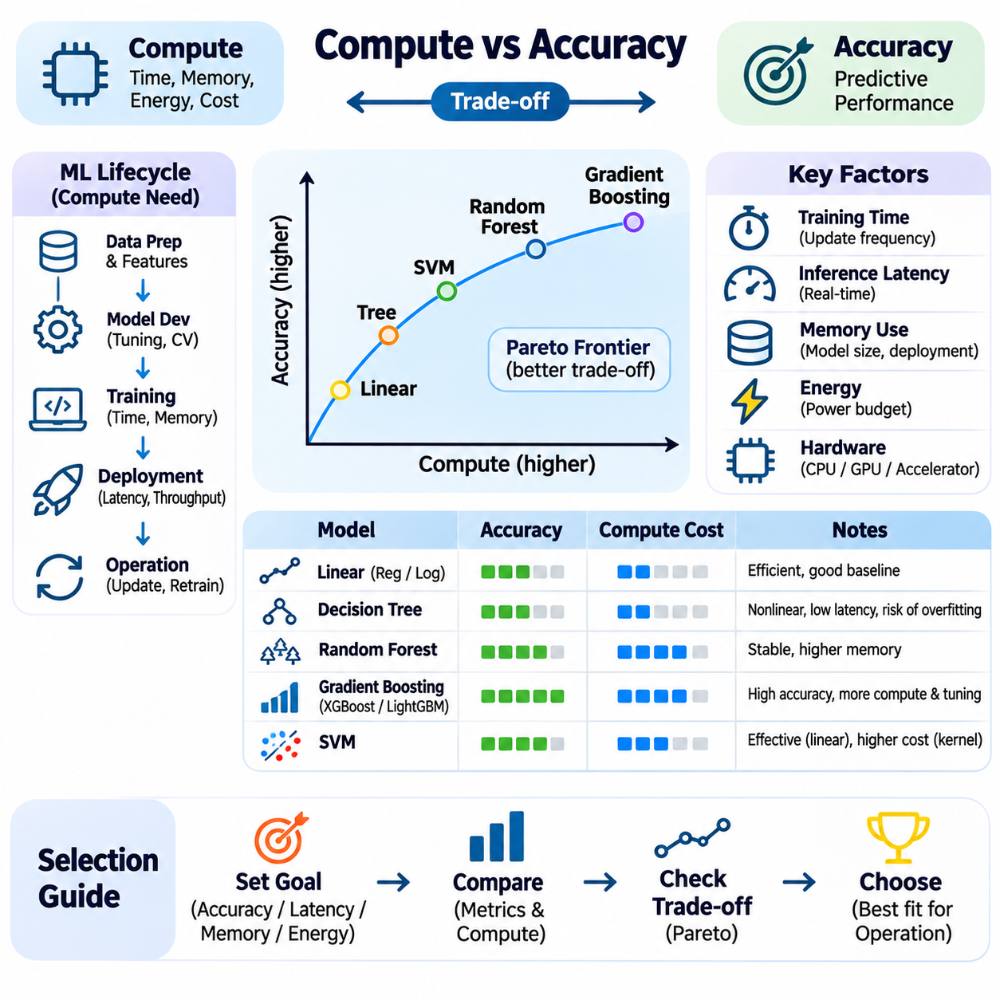
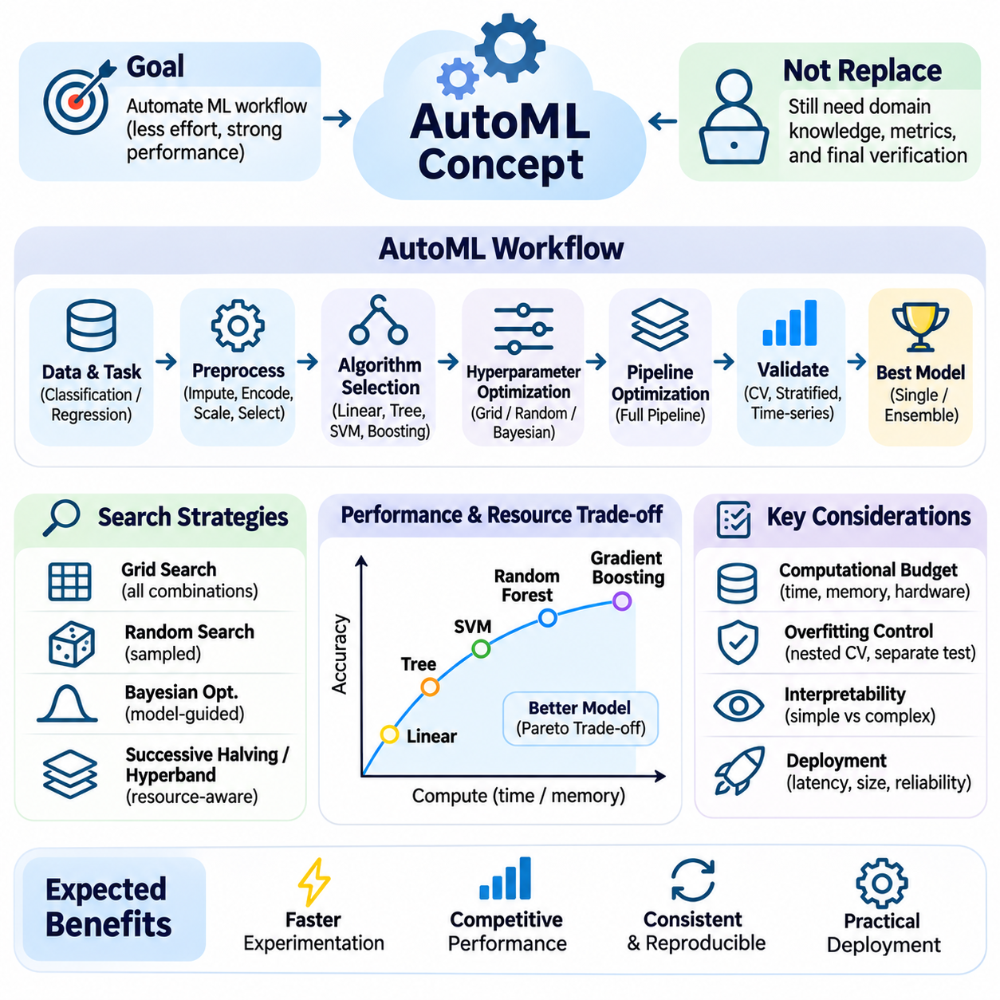
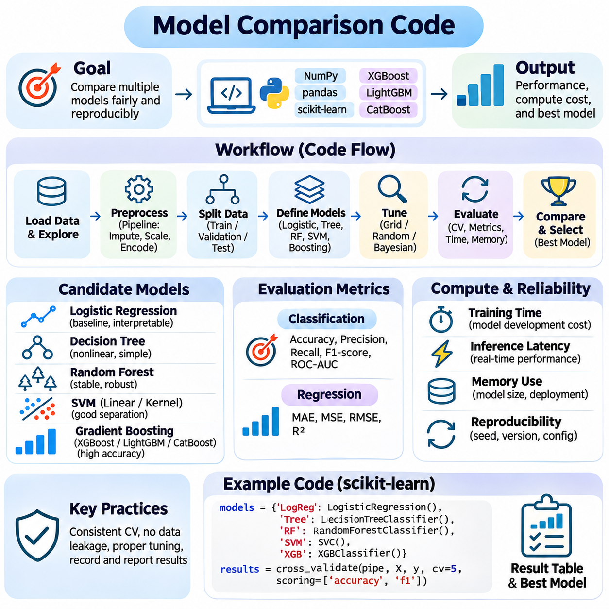

# 07. Model Comparison and Selection

## 07.00 Model Selection Strategy

{width="7.268055555555556in" height="7.268055555555556in"}

모델 선택(Model Selection)은 지도학습(Supervised Learning)의 핵심 단계로, 서로 다른 알고리즘(Algorithm)은 데이터 특성(Data Characteristics), 계산 제약(Computational Constraints), 운영 요구사항(Operational Requirements)에 따라 서로 다른 성능을 나타낸다. 성공적인 모델 선택 전략(Model Selection Strategy)은 단순히 가장 높은 정확도(Accuracy)를 달성하는 알고리즘을 찾는 것이 아니다. 대신 예측 성능(Predictive Performance), 일반화(Generalization), 해석 가능성(Interpretability), 효율성(Efficiency), 배포 가능성(Deployment Feasibility) 사이에서 가장 적절한 균형을 제공하는 모델을 결정하는 과정이다.

모델 선택 과정은 학습 문제(Learning Problem)와 예상 결과(Expected Outcome)를 명확하게 정의하는 것에서 시작한다. 분류(Classification)는 이산적인 범주(Discrete Categories)를 예측하고, 회귀(Regression)는 연속적인 값(Continuous Values)을 추정한다. 이러한 차이는 사용 가능한 알고리즘, 손실 함수(Loss Functions), 평가 지표(Evaluation Metrics)에 영향을 준다. 개발자는 후보 모델을 선정하기 전에 예측 결과에 보정된 확률(Calibrated Probabilities), 해석 가능한 의사결정(Interpretable Decisions), 또는 매우 짧은 지연시간(Low Latency)이 필요한지도 확인해야 한다.

데이터셋(Dataset)의 특성을 이해하는 것 역시 중요하다. 표본 수(Number of Samples), 특징 차원(Feature Dimensionality), 변수 유형(Variable Types), 결측값(Missing Values), 잡음(Noise), 클래스 분포(Class Distribution)는 알고리즘의 동작에 상당한 영향을 미칠 수 있다. 선형 모델(Linear Models)은 구조화된 데이터(Structured Data)에 효과적인 기준 모델(Baseline Model)을 제공하는 경우가 많으며, 트리 기반 방법(Tree-Based Methods)은 비선형 관계(Nonlinear Relationships)와 특징 간 상호작용(Feature Interactions)을 포착할 수 있다. 서포트 벡터 머신(Support Vector Machines)은 커널(Kernel)과 정규화(Regularization)를 적절하게 설정하면 고차원 환경(High-Dimensional Settings)에서 우수한 성능을 보일 수 있다.

효과적인 모델 선택 전략은 처음부터 복잡한 구조(Complex Architecture)를 도입하기보다 단순한 기준 모델(Baseline Model)에서 출발한다. 선형 회귀(Linear Regression), 로지스틱 회귀(Logistic Regression), 또는 얕은 결정 트리(Shallow Decision Tree)는 초기 성능 기준(Initial Performance Reference)을 설정할 수 있다. 이러한 기준 모델은 복잡성을 추가했을 때 의미 있는 성능 향상이 발생하는지 판단하는 데 도움을 준다. 기준 모델이 없다면 개발자는 실제적인 개선 효과를 입증하지 못한 채 정교한 알고리즘에 상당한 계산 자원(Computational Resources)을 투입할 수 있다.

후보 모델(Candidate Models)은 문제의 통계적 특성(Statistical Properties)을 반영하여 선정해야 한다. 선형 모델은 관계를 특징의 가중 조합(Weighted Feature Combinations)으로 근사할 수 있을 때 적합하다. 결정 트리(Decision Trees)는 비선형 결정 경계(Nonlinear Decision Boundaries)와 이질적인 특징(Heterogeneous Features)을 처리할 수 있다. 랜덤 포레스트(Random Forests)는 집계(Aggregation)를 통해 안정성을 높이며, 그래디언트 부스팅(Gradient Boosting)은 순차적인 앙상블(Sequential Ensembles)을 구성하여 구조화된 테이블 데이터(Tabular Data)에서 높은 예측 성능을 달성하는 경우가 많다.

서포트 벡터 머신(Support Vector Machines)은 클래스를 분리할 때 결정 경계(Decision Boundaries)를 정밀하게 제어해야 하는 경우 중요한 선택지가 된다. 선형 서포트 벡터 머신(Linear SVM)은 고차원 특징 공간(High-Dimensional Feature Spaces)에서 효과적일 수 있으며, 비선형 커널(Nonlinear Kernels)은 더욱 유연한 표현(Representations)을 가능하게 한다. 그러나 커널 기반 학습(Kernel-Based Training)은 데이터셋 크기가 증가함에 따라 계산 비용이 커질 수 있다. 따라서 적합성은 표본 수, 특징 구조, 메모리 가용성(Memory Availability), 허용 가능한 학습 시간(Training Time)에 따라 달라진다.

신뢰할 수 있는 모델 비교(Model Comparison)를 위해서는 일관된 실험 조건(Experimental Conditions)이 필요하다. 후보 알고리즘은 동일한 학습(Training), 검증(Validation), 테스트(Test) 데이터 분할을 사용해야 하며, 전처리(Preprocessing)는 각 학습 절차 내부에서 올바르게 수행되어야 한다. 데이터 누출(Data Leakage)을 방지하기 위해 변환 과정(Transformations)은 해당 학습 데이터에만 적합(Fitting)되어야 한다. 또한 난수 시드(Random Seeds), 소프트웨어 버전(Software Versions), 실험 설정(Experimental Configurations)을 기록하여 관찰된 성능 차이를 재현하고 분석할 수 있도록 해야 한다.

교차 검증(Cross-Validation)은 일반화 성능(Generalization Performance)을 체계적으로 추정하는 방법을 제공한다. 하나의 임의적인 학습-검증 분할(Training-Validation Split)에 의존하는 대신 데이터셋을 여러 폴드(Folds)로 나누고 모델을 반복적으로 평가한다. 계층화 교차 검증(Stratified Cross-Validation)은 분류 문제에서 클래스 비율(Class Proportions)을 유지하는 데 도움을 준다. 시간 의존적 관측값(Time-Dependent Observations)의 경우 무작위 분할(Random Splitting)이 미래 정보(Future Information)에 비현실적으로 접근하는 문제를 일으킬 수 있으므로 시간 순서 기반 검증(Chronological Validation)이 더 적절하다.

평가 지표(Evaluation Metrics)는 예측 오류(Prediction Errors)가 실제로 초래하는 결과와 일치해야 한다. 정확도(Accuracy)는 균형 잡힌 분류 문제(Balanced Classification Problems)에 충분할 수 있지만, 클래스 불균형(Class Imbalance)이 존재하면 정밀도(Precision), 재현율(Recall), F1 점수(F1-Score), 정밀도-재현율 곡선 아래 면적(Area Under the Precision-Recall Curve)이 더욱 유용할 수 있다. 회귀 문제에서는 평균 절대 오차(Mean Absolute Error), 평균 제곱 오차(Mean Squared Error), 평균 제곱근 오차(Root Mean Squared Error)를 일반적으로 사용한다. 선택한 지표는 단순한 수학적 편의성보다 운영상의 우선순위(Operational Priorities)를 반영해야 한다.

모델 선택에서는 학습 성능(Training Performance)과 검증 성능(Validation Performance)의 관계도 분석해야 한다. 학습 데이터에서는 매우 우수하지만 새로운 관측값(Unseen Observations)에서는 성능이 낮은 모델은 과적합(Overfitting)되었을 가능성이 있다. 반대로 두 데이터셋 모두에서 지속적으로 낮은 성능을 보인다면 과소적합(Underfitting)을 의미할 수 있다. 학습 곡선(Learning Curves), 검증 곡선(Validation Curves), 오류 분석(Error Analysis)은 추가 데이터, 개선된 특징, 정규화, 또는 더 높은 모델 용량(Model Capacity)이 필요한지 판단하는 데 도움을 준다.

하이퍼파라미터 최적화(Hyperparameter Optimization)는 모델 선택 절차에 신중하게 통합되어야 한다. 격자 탐색(Grid Search)은 미리 정의된 조합을 탐색하고, 무작위 탐색(Randomized Search)은 지정된 분포에서 설정을 추출한다. 베이지안 최적화(Bayesian Optimization)는 이전 평가에서 얻은 정보를 활용하여 후속 탐색을 안내할 수 있다. 어떤 방법을 사용하더라도 하이퍼파라미터는 최종 테스트 데이터(Final Test Set)를 반복적으로 확인하는 대신 검증 결과(Validation Evidence)를 기반으로 선택해야 하며, 테스트 데이터는 독립적인 평가(Independent Assessment)를 위해 보존되어야 한다.

계산 효율성(Computational Efficiency)은 모델 비교에 또 다른 차원을 추가한다. 학습 시간(Training Time), 추론 지연시간(Inference Latency), 메모리 사용량(Memory Consumption), 모델 크기(Model Size), 에너지 요구량(Energy Requirements)은 높은 정확도를 가진 알고리즘의 실제 적용 가능성을 결정할 수 있다. 그래디언트 부스팅 모델은 우수한 정확도를 제공하더라도 실시간 추론(Real-Time Inference)을 위해 추가적인 최적화가 필요할 수 있다. 자원이 제한된 환경(Resource-Constrained Environments)에서는 정확도가 약간 낮더라도 더 작은 모델이 전체적인 운영 가치(Operational Value)를 높일 수 있다.

해석 가능성(Interpretability)은 예측 결과가 중요한 의사결정(Consequential Decisions)에 영향을 주거나 사람의 검토(Human Review)가 필요한 경우 특히 중요하다. 선형 모델은 비교적 직접적인 해석을 지원하는 계수(Coefficients)를 제공하지만, 상관관계가 있는 특징(Correlated Features)과 전처리 과정이 해석을 복잡하게 만들 수 있다. 결정 트리는 명시적인 결정 경로(Decision Paths)를 제공하는 반면, 앙상블(Ensembles)은 일반적으로 내부 구조를 이해하기 어렵다. 특징 중요도(Feature Importance)와 설명 기법(Explanation Techniques)은 투명성(Transparency)을 향상할 수 있지만 인과관계(Causal Relationships)를 자동으로 입증하지는 않는다.

실용적인 모델 선택 전략은 모델 선택을 다목적 최적화 문제(Multi-Objective Optimization Problem)로 다룰 수 있다. 예측 정확도(Predictive Accuracy), 계산 비용(Computational Cost), 해석 가능성, 강건성(Robustness), 유지보수성(Maintainability)은 서로 대체 가능한 측정값이 아니라 경쟁하는 목표(Competing Objectives)를 나타낸다. 가중 점수 시스템(Weighted Scoring Systems)은 이러한 우선순위를 종합할 수 있지만, 가중치(Weights)는 문서화된 응용 요구사항(Application Requirements)을 반영해야 한다. 파레토 분석(Pareto Analysis)은 하나의 목표를 개선하려면 다른 목표를 희생해야 하는 후보 모델을 식별하는 데에도 활용할 수 있다.

강건성 테스트(Robustness Testing)는 현실적인 변화가 발생했을 때 후보 모델이 얼마나 신뢰할 수 있는지 평가한다. 특징 누락(Missing Features), 잡음이 포함된 측정값(Noisy Measurements), 분포 이동(Distribution Shifts), 비정상적인 입력(Unusual Inputs)은 일반적인 검증 지표에서 드러나지 않는 약점을 노출할 수 있다. 민감도 분석(Sensitivity Analysis)과 의미 있는 데이터 하위 집단(Data Subgroups)에 대한 평가는 추가적인 근거를 제공한다. 예상 운영 조건(Expected Operating Conditions)에서 안정적인 성능을 유지하는 모델은 벤치마크 점수(Benchmark Score)가 약간 더 높은 모델보다 적합할 수 있다.

최종 모델 선택에서는 배포(Deployment)와 장기 유지보수(Long-Term Maintenance)도 고려해야 한다. 모델 직렬화(Model Serialization), 프레임워크 호환성(Framework Compatibility), 예측 처리량(Prediction Throughput), 모니터링 기능(Monitoring Capabilities), 재학습 요구사항(Retraining Requirements)은 운영 지속 가능성(Operational Sustainability)에 영향을 준다. 자동화된 기계학습(Automated Machine Learning, AutoML)은 후보 모델 생성과 하이퍼파라미터 탐색을 가속할 수 있지만, 적절한 검증, 데이터 누출 방지, 도메인별 판단(Domain-Specific Judgment)의 필요성을 없애지는 못한다. 자동화는 책임 있는 평가를 대체하는 것이 아니라 모델 선택 과정을 지원한다.

후보 모델을 비교한 후에는 선택된 설정(Selected Configuration)에 따라 문서화된 최종 학습 절차(Final Training Procedure)를 수행하고, 사용하지 않은 테스트 데이터(Untouched Test Set)에서 한 번 평가해야 한다. 성능 결과는 관련 불확실성(Uncertainty), 자원 측정값(Resource Measurements), 알려진 한계(Known Limitations)와 함께 보고해야 한다. 궁극적으로 모델 선택은 통계적 학습(Statistical Learning)과 실제 시스템 요구사항(Practical System Requirements)을 연결하는 근거 기반 공학적 의사결정(Evidence-Driven Engineering Decision)이며, 선택된 알고리즘이 개발 환경을 넘어 정확하고 효율적이며 이해 가능하고 신뢰할 수 있도록 보장하는 과정이다.

## 07.01 Linear vs Tree vs SVM

{width="7.268055555555556in" height="7.268055555555556in"}

선형 모델(Linear Models), 결정 트리(Decision Trees), 서포트 벡터 머신(Support Vector Machines)은 지도학습(Supervised Learning)을 구성하는 세 가지 기본적인 접근 방식이다. 세 가지 모두 분류 문제(Classification Problems)를 해결할 수 있지만, 수학적 가정(Mathematical Assumptions), 결정 경계(Decision Boundaries), 계산 요구사항(Computational Requirements), 해석 가능성(Interpretability)에서 상당한 차이를 보인다. 이러한 차이를 이해하는 것은 데이터셋(Dataset)의 특성과 인공지능 시스템(AI System)의 운영 목표(Operational Objectives)에 적합한 알고리즘(Algorithm)을 선택하는 데 필수적이다.

선형 모델(Linear Models)은 입력 특징(Input Features)의 가중 조합(Weighted Combinations)을 통해 예측값을 표현할 수 있다고 가정한다. 회귀(Regression)에서는 특징 계수(Feature Coefficients)와 절편(Intercept)을 이용하여 예측값을 계산한다. 분류(Classification)에서는 로지스틱 회귀(Logistic Regression)가 선형 점수(Linear Score)를 확률(Probability)로 변환하고, 선형 분류기(Linear Classifiers)는 가중 특징 조합을 이용하여 결정 경계를 설정한다. 비교적 단순한 구조 덕분에 계산 효율성(Computational Efficiency)이 높고 신뢰할 수 있는 기준 모델(Baseline Models)을 구축하는 데 적합하다.

선형 모델의 주요 강점은 단순성(Simplicity)과 해석 가능성(Interpretability)이다. 모델 계수(Model Coefficients)는 다른 특징이 고정되어 있을 때 개별 특징이 예측 결과에 어떻게 기여하는지 나타낸다. 특히 희소 데이터셋(Sparse Datasets)이나 고차원 데이터셋(High-Dimensional Datasets)에서 학습이 효율적인 경우가 많다. 그러나 특징 사이에 강한 상관관계(Strong Correlation)가 존재하면 계수 해석이 어려워지며, 적절한 특징 변환(Feature Transformations)을 도입하지 않으면 선형 결정 경계(Linear Decision Boundaries)가 복잡한 관계를 표현하지 못할 수 있다.

결정 트리(Decision Trees)는 특징 공간(Feature Space)을 재귀적으로 분할(Recursive Partitioning)하는 방식으로 근본적으로 다른 학습 전략을 따른다. 각 내부 노드(Internal Node)는 특징 조건(Feature Condition)을 평가하며, 관측값(Observations)은 그 결과에 따라 서로 다른 가지(Branches)로 이동한다. 분류 트리(Classification Trees)는 말단 노드(Terminal Nodes)에서 클래스 예측(Class Predictions)을 수행하고, 회귀 트리(Regression Trees)는 수치값(Numerical Values)을 추정한다. 이러한 계층적 구조(Hierarchical Structure)는 명시적인 수학적 변환 없이도 비선형 관계(Nonlinear Relationships)를 표현할 수 있도록 한다.

결정 트리의 중요한 장점 중 하나는 특징 간 상호작용(Feature Interactions)을 자연스럽게 모델링할 수 있다는 것이다. 특정 변수(Variable)에 관한 의사결정은 이전 분할에서 사용된 다른 변수의 결과에 따라 달라질 수 있다. 결정 트리는 수치형 정보(Numerical Information)와 범주형 정보(Categorical Information)를 처리할 수 있지만, 범주형 특징에 대한 지원은 구현 방식(Implementation)에 따라 달라진다. 또한 결정 경로(Decision Paths)가 비교적 직관적이므로 사람이 이해할 수 있는 예측 규칙(Prediction Rules)이 필요한 경우 얕은 트리(Shallow Trees)가 유용하다.

그러나 개별 결정 트리(Individual Decision Trees)는 학습 데이터(Training Data)의 변화에 민감하다. 특히 여러 특징이 비슷한 수준의 분할 개선 효과(Splitting Improvements)를 제공할 때 관측값의 작은 변화만으로도 서로 다른 분할 구조(Splitting Structures)가 생성될 수 있다. 깊은 트리(Deep Trees)는 학습 사례(Training Examples)를 암기하여 일반화 성능(Generalization Performance)이 저하될 수 있다. 최대 깊이 제한(Maximum-Depth Restrictions), 최소 리프 크기(Minimum Leaf Sizes), 가지치기(Pruning)는 모델 복잡도(Model Complexity)를 제어하지만, 지나친 제한은 과소적합(Underfitting)을 유발할 수 있다.

서포트 벡터 머신(Support Vector Machines)은 최대 마진 분리(Maximum-Margin Separation) 원리를 통해 분류 문제에 접근한다. 재귀적인 규칙을 구성하는 대신, 서포트 벡터 머신(SVM)은 최적화 제약조건(Optimization Constraints) 아래에서 클래스 사이의 마진(Margin)을 최대화하는 결정 경계(Decision Boundary)를 탐색한다. 마진 근처 또는 내부에 위치하는 학습 관측값(Training Observations)인 서포트 벡터(Support Vectors)는 최종 결정 경계에 영향을 준다. 이러한 기하학적 관점(Geometric Perspective)은 SVM을 선형 확률 분류기(Linear Probabilistic Classifiers) 및 결정 트리와 구별한다.

선형 서포트 벡터 머신(Linear SVM)은 선형 결정 경계(Linear Decision Boundary)를 생성하지만, 최적화 목적함수(Optimization Objective)는 로지스틱 회귀(Logistic Regression)와 다르다. 로지스틱 회귀는 일반적으로 로지스틱 손실(Logistic Loss)을 최소화하고 확률적 정식화(Probabilistic Formulation)를 통해 확률 추정값(Probability Estimates)을 제공한다. 반면 표준 SVM은 일반적으로 힌지 손실(Hinge Loss)을 포함하는 정규화된 마진 기반 목적함수(Regularized Margin-Based Objective)를 최소화한다. SVM의 결정 점수(Decision Scores)는 보정된 확률(Calibrated Probabilities)을 직접 나타내지 않지만, 필요한 경우 추가적인 확률 보정 방법(Probability Calibration Methods)을 적용할 수 있다.

커널 방법(Kernel Methods)은 고차원 특징 공간(Higher-Dimensional Feature Spaces)의 관계를 암묵적으로 표현하여 SVM의 적용 범위를 선형 분리(Linear Separation) 이상으로 확장한다. 방사 기저 함수 커널(Radial Basis Function Kernel)은 유연한 비선형 결정 경계(Nonlinear Decision Boundaries)를 구성할 수 있으며, 다항식 커널(Polynomial Kernels)은 특정 형태의 특징 간 상호작용을 포착한다. 이러한 유연성은 복잡한 데이터셋에서 성능을 향상할 수 있지만, 커널 선택(Kernel Selection)과 매개변수 조정(Parameter Tuning)은 일반화 성능과 계산 비용에 큰 영향을 미친다.

결정 경계의 기하학적 구조(Geometry of Decision Boundaries)는 세 가지 접근 방식을 비교하는 유용한 기준을 제공한다. 선형 분류기(Linear Classifiers)는 초평면(Hyperplanes)을 이용하여 특징 공간을 분할하고, 일반적인 축 정렬 결정 트리(Axis-Aligned Decision Trees)는 연속적인 특징 임계값(Feature Thresholds)을 통해 영역을 구성한다. 커널 SVM(Kernel SVMs)은 선택한 커널에 따라 매끄러운 비선형 결정 경계(Smooth Nonlinear Decision Boundaries)를 생성할 수 있다. 이러한 결정 경계 구조 중 어느 것도 보편적으로 우월하지 않으며, 효과는 기본 데이터 분포(Underlying Data Distribution)에 따라 달라진다.

특징 스케일링(Feature Scaling)은 세 가지 모델을 구별하는 또 다른 중요한 요소이다. 정규화(Regularization)를 적용한 선형 모델은 계수 페널티(Coefficient Penalties)가 특징의 크기에 영향을 받기 때문에 특징 규모(Feature Magnitude)의 차이에 민감한 경우가 많다. SVM은 마진과 커널 거리(Kernel Distances)가 특징값의 영향을 받으므로 스케일링에 특히 민감하다. 반면 일반적인 결정 트리는 분할 규칙(Splitting Rules)이 주로 특징의 순서(Feature Ordering)와 임계값 비교(Threshold Comparisons)에 의존하기 때문에 특징 표준화(Feature Standardization)가 일반적으로 필요하지 않다.

데이터셋 크기(Dataset Size)는 계산 적합성(Computational Suitability)에 상당한 영향을 미친다. 선형 모델은 효율적인 최적화 방법(Optimization Methods)을 사용하여 대규모 데이터셋(Large Datasets)까지 효과적으로 확장할 수 있다. 결정 트리 역시 상당한 규모의 데이터셋을 처리할 수 있지만, 학습 비용(Training Cost)은 분할 알고리즘(Splitting Algorithm), 특징 수(Feature Count), 트리 깊이(Tree Depth)에 따라 달라진다. 커널 SVM은 표본 수가 증가함에 따라 많은 메모리와 계산 자원을 요구할 수 있으므로, 매우 큰 데이터셋에서는 선형 SVM이나 다른 알고리즘이 더 적합할 수 있다.

고차원 데이터(High-Dimensional Data)는 모델마다 서로 다른 기회와 과제를 제공한다. 정규화된 선형 모델(Regularized Linear Models)과 선형 SVM(Linear SVMs)은 특징 수가 많은 환경에서 효과적으로 동작하는 경우가 많으며, 특히 텍스트 벡터(Text Vectors)와 같은 희소 표현(Sparse Representations)에 적합하다. 결정 트리는 유용한 정보가 다수의 약한 특징(Weak Features)에 분산되어 있을 때 어려움을 겪을 수 있다. 그러나 신중하게 설계된 특징(Engineered Features)과 적절한 정규화는 이러한 관계를 상당히 변화시킬 수 있다.

잡음(Noise)과 이상치(Outliers)를 처리하는 방식 역시 모델마다 다르다. 일반 최소제곱 회귀(Ordinary Least Squares Regression)는 오차를 제곱하기 때문에 큰 잔차(Large Residuals)에 민감하다. 로지스틱 회귀와 SVM은 손실 함수(Loss Functions)와 정규화 설정에 따라 잡음과 이상치에 다르게 반응한다. 결정 트리는 추가적인 분할을 통해 비정상적인 관측값(Unusual Observations)을 분리할 수 있지만, 이 과정에서 과적합(Overfitting)이 증가할 수 있다. 따라서 알고리즘 선택과 관계없이 강건한 전처리(Robust Preprocessing)와 대표성 있는 검증(Representative Validation)이 필요하다.

하이퍼파라미터 선택(Hyperparameter Selection)은 각 모델 계열(Model Family)에 서로 다른 영향을 미친다. 정규화된 선형 모델은 일반적으로 페널티 강도(Penalty Strength)와 경우에 따라 정규화 유형(Regularization Type)을 선택해야 한다. 결정 트리는 깊이(Depth), 분할 기준(Split Criteria), 최소 표본 요구사항(Minimum Sample Requirements)을 제어해야 한다. SVM은 정규화 매개변수(Regularization Parameter)를 선택해야 하며, 비선형 커널을 사용하는 경우 커널 폭(Kernel Width)과 같은 매개변수도 설정해야 한다. 따라서 공정한 비교(Fair Comparison)를 위해서는 기본 설정(Default Settings)에만 의존하지 않고 적절한 조정(Tuning)을 수행해야 한다.

해석 가능성(Interpretability)은 모델 복잡도(Model Complexity)와 연관하여 평가해야 한다. 선형 모델은 간결한 수학적 표현(Compact Mathematical Description)을 제공하지만, 계수(Coefficients)가 자동으로 인과적 설명(Causal Explanations)이 되는 것은 아니다. 얕은 결정 트리(Shallow Decision Trees)는 직접 검토할 수 있는 명시적인 결정 경로(Explicit Decision Paths)를 제공한다. SVM은 마진(Margins)과 서포트 벡터(Support Vectors)를 통해 기하학적 해석(Geometric Interpretation)을 제공하지만, 비선형 커널 모델(Nonlinear Kernel Models)은 일반적으로 비전문가가 이해하기 어렵다.

구조화된 산업 데이터셋(Structured Industrial Datasets)에서 적합한 알고리즘은 사용 가능한 측정값(Available Measurements)과 운영 요구사항(Operational Requirements)에 따라 달라진다. 선형 모델은 대략적인 가산 관계(Additive Relationships)를 가지며 빠르고 설명 가능한 예측(Explainable Predictions)이 필요한 시스템에 적합할 수 있다. 결정 트리는 운영 조건(Operating Conditions)에 명확한 임계값(Thresholds)과 조건부 규칙(Conditional Rules)이 존재할 때 유용하다. SVM은 특징 스케일링이 적절하게 수행되고 복잡한 클래스 분리(Complex Class Separation)가 필요한 중간 규모 데이터셋(Moderate-Sized Datasets)에서 효과적일 수 있다.

실용적인 모델 비교(Practical Model Comparison)를 위해서는 동일한 데이터 분할(Data Partitions)과 적절한 전처리 파이프라인(Preprocessing Pipelines)을 사용하여 대표적인 모델을 학습해야 한다. 평가에는 예측 지표(Predictive Metrics), 교차 검증 변동성(Cross-Validation Variability), 학습 시간(Training Time), 추론 지연시간(Inference Latency), 모델 크기(Model Size)가 포함되어야 한다. 분류 문제에서 클래스 분포(Class Distributions)가 불균형하면 정확도(Accuracy)만으로는 충분하지 않을 수 있다. 정밀도(Precision), 재현율(Recall), F1 점수(F1-Score), 관련 확률 보정 지표(Probability Calibration Measures)를 활용하면 더욱 종합적인 평가가 가능하다.

궁극적으로 선형 모델(Linear Models), 결정 트리(Decision Trees), 서포트 벡터 머신(Support Vector Machines)은 보편적인 순위(Universal Ranking)를 가진 경쟁 알고리즘이라기보다 상호보완적인 학습 전략(Complementary Learning Strategies)으로 이해해야 한다. 선형 모델은 간결한 함수적 관계(Compact Functional Relationships)를 강조하고, 결정 트리는 계층적 분할(Hierarchical Partitioning)을 강조하며, SVM은 마진 기반 기하학적 분리(Margin-Based Geometric Separation)를 강조한다. 이들 중 적절한 모델을 선택하려면 수학적 특성(Mathematical Properties)을 데이터 특성(Data Characteristics), 검증 근거(Validation Evidence), 계산 제약(Computational Constraints), 배포 요구사항(Deployment Requirements)과 연결하여 종합적으로 판단해야 한다.

## 07.02 When to Use What

{width="7.268055555555556in" height="7.268055555555556in"}

적절한 지도학습 알고리즘(Supervised Learning Algorithm)을 선택하는 것은 문제의 특성(Problem Characteristics), 데이터셋의 구조(Dataset Structure), 목표 응용 분야(Target Application)의 제약조건(Constraints)에 따라 달라진다. 모든 환경에서 일관되게 다른 대안보다 우수한 성능을 보이는 단일 모델은 존재하지 않는다. 효과적인 모델 선택(Model Selection)을 위해서는 선형 모델(Linear Models), 결정 트리(Decision Trees), 앙상블 방법(Ensemble Methods), 서포트 벡터 머신(Support Vector Machines), 그래디언트 부스팅 알고리즘(Gradient Boosting Algorithms)이 서로 다른 조건에서 어떻게 동작하는지 이해해야 한다.

선형 회귀(Linear Regression)는 일반적으로 목표 변수(Target Variable)가 연속형(Continuous)이고 입력 특징(Input Features)과의 관계를 가산적 선형 함수(Additive Linear Function)로 근사할 수 있을 때 적합하다. 적용 사례로는 에너지 소비량(Energy Consumption), 생산 비용(Production Costs), 장비 운영 매개변수(Equipment Operating Parameters)의 추정이 있다. 단순한 구조는 효율적인 학습(Efficient Training)과 투명한 해석(Transparent Interpretation)을 지원하지만, 비선형 관계(Nonlinear Relationships)를 처리하려면 특징 변환(Feature Transformations)이나 더욱 유연한 알고리즘이 필요할 수 있다.

로지스틱 회귀(Logistic Regression)는 이진 결과(Binary Outcomes) 또는 다중 범주(Multiple Categories)를 포함하는 분류 문제(Classification Problems)의 효과적인 출발점이다. 특히 계산 효율성(Computational Efficiency), 계수 해석(Coefficient Interpretation), 확률 추정(Probability Estimation)이 중요한 경우 유용하다. 적용 사례에는 장비 고장 예측(Equipment Failure Prediction), 고객 분류(Customer Classification), 위험 평가(Risk Assessment)가 포함된다. 정규화(Regularization)는 일반화 성능(Generalization)을 향상할 수 있으며, 예측 확률(Predicted Probabilities)이 의사결정에 사용되는 경우 적절한 확률 보정(Probability Calibration)을 검증해야 한다.

결정 트리(Decision Trees)는 데이터에 비선형 관계(Nonlinear Relationships), 조건부 규칙(Conditional Rules), 의미 있는 특징 임계값(Feature Thresholds)이 포함된 경우 유용하다. 계층적 구조(Hierarchical Structure)는 명시적인 상호작용 항(Interaction Terms)을 추가하지 않고도 변수 간 상호작용(Variable Interactions)을 자연스럽게 표현한다. 적용 사례에는 산업 고장 진단(Industrial Fault Diagnosis), 품질 검사 의사결정(Quality Inspection Decisions), 운영 규칙 추출(Operational Rule Extraction)이 포함된다. 얕은 트리(Shallow Trees)는 이해하기 쉬운 결정 경로(Decision Paths)를 통해 예측 결과를 설명해야 하는 경우 특히 가치가 있다.

랜덤 포레스트(Random Forests)는 개별 결정 트리(Individual Decision Trees)가 높은 분산(High Variance)이나 불안정한 예측(Unstable Predictions)을 보일 때 적합한 경우가 많다. 무작위 데이터 선택(Randomized Data Selection)과 특징 선택(Feature Selection)을 통해 학습된 여러 트리를 결합함으로써 랜덤 포레스트는 일반적으로 예측 안정성(Predictive Stability)을 향상하고 과적합(Overfitting)을 줄인다. 다양한 구조화된 데이터셋(Structured Datasets)과 비선형 특징 상호작용(Nonlinear Feature Interactions)에 효과적으로 작동하지만, 더 큰 메모리 사용량(Memory Footprint)과 낮아진 해석 가능성(Interpretability)을 고려해야 한다.

그래디언트 부스팅 방법(Gradient Boosting Methods)은 예측 정확도(Predictive Accuracy)가 주요 목표인 구조화된 테이블 데이터셋(Structured Tabular Datasets)에서 강력한 후보가 된다. XGBoost, LightGBM, CatBoost와 같은 알고리즘은 이전 예측의 약점을 보완하는 앙상블(Ensembles)을 순차적으로 구성한다. 이러한 방법은 복잡한 특징 상호작용(Complex Feature Interactions)과 이질적인 데이터(Heterogeneous Data)를 모델링할 수 있지만, 성능은 신중한 하이퍼파라미터 조정(Hyperparameter Tuning), 검증 설계(Validation Design), 모델 복잡도 제어(Model Complexity Control)에 따라 달라진다.

XGBoost는 강력한 정규화(Robust Regularization), 유연한 목적함수(Flexible Objective Functions), 제어 가능한 트리 구성(Controlled Tree Construction)이 중요한 경우 특히 유용하다. 최적화 프레임워크(Optimization Framework)는 다양한 구조화된 데이터셋에서 분류(Classification)와 회귀(Regression)를 지원한다. 그러나 트리 깊이(Tree Depth), 학습률(Learning Rate), 부스팅 반복 횟수(Boosting Rounds)와 같은 매개변수 선택은 성능에 큰 영향을 미친다. 따라서 복잡성이 증가하면 반드시 더 좋은 결과가 나온다고 가정하기보다 검증(Validation)을 통해 적합성을 확인해야 한다.

LightGBM은 히스토그램 기반 학습(Histogram-Based Learning)과 리프 우선 트리 성장(Leaf-Wise Tree Growth)을 통해 효율적인 학습을 제공할 수 있으므로 대규모 테이블 데이터셋(Large Tabular Datasets)에 매력적인 선택지가 된다. 표본 수(Sample Counts)와 특징 차원(Feature Dimensions)이 상당히 큰 경우 장점을 제공할 수 있다. 그러나 공격적인 리프 우선 성장(Aggressive Leaf-Wise Growth)은 복잡도를 제한하지 않으면 작은 데이터셋에서 과적합을 유발할 수 있다. 따라서 학습 효율성(Training Efficiency)은 일반화 성능(Generalization) 및 추론 요구사항(Inference Requirements)과 함께 평가해야 한다.

CatBoost는 데이터셋에 중요한 범주형 변수(Categorical Variables)가 포함된 경우 특히 유용하다. 범주형 특징 처리(Categorical Feature Processing)와 순서 기반 부스팅 기법(Ordered Boosting Techniques)은 광범위한 수동 인코딩(Manual Encoding)의 필요성을 줄이고 특정 형태의 목표값 누출(Target Leakage)을 제어하는 데 도움을 줄 수 있다. 적용 사례에는 고객 행동 예측(Customer Behavior Prediction), 장비 분류(Equipment Classification), 운영 분석(Operational Analytics)이 포함된다. 이러한 장점은 실제 특징 분포(Feature Distribution)에 따라 달라지므로 대체 전처리 전략(Alternative Preprocessing Strategies)과 비교해야 한다.

서포트 벡터 머신(Support Vector Machines)은 클래스 간 기하학적 분리(Geometric Separation)가 유용한 표현(Representation)을 제공하는 분류 문제에 적합하다. 선형 SVM(Linear SVMs)은 텍스트 표현(Text Representations)을 포함한 고차원 희소 특징(High-Dimensional Sparse Features)에서 우수한 성능을 보이는 경우가 많다. 커널 SVM(Kernel SVMs)은 중간 규모 데이터셋(Moderate-Sized Datasets)에서 비선형 결정 경계(Nonlinear Decision Boundaries)를 포착할 수 있다. 그러나 표본 수가 많으면 커널 학습(Kernel Training)의 계산 비용이 증가할 수 있으며, 안정적인 성능을 위해 특징 스케일링(Feature Scaling)이 일반적으로 필수적이다.

데이터셋에 비교적 적은 관측값(Observations)이 포함된 경우 모델 복잡도(Model Complexity)를 신중하게 제어해야 한다. 정규화된 선형 모델(Regularized Linear Models), 얕은 결정 트리(Shallow Decision Trees), 적절하게 조정된 SVM은 합리적인 출발점을 제공할 수 있다. 복잡한 앙상블(Complex Ensembles)도 좋은 성능을 보일 수 있지만, 높은 유연성(Flexibility)으로 인해 신뢰할 수 있는 검증(Reliable Validation)의 필요성이 커진다. 사용 가능한 학습 근거(Training Evidence)가 제한적일 때는 교차 검증(Cross-Validation), 도메인 지식 기반 특징 공학(Domain-Informed Feature Engineering), 불확실성 분석(Uncertainty Analysis)이 특히 중요해진다.

대규모 데이터셋(Large Datasets)에서는 계산 확장성(Computational Scalability)이 주요 모델 선택 기준(Model Selection Criterion)이 된다. 효율적인 최적화(Efficient Optimization)를 통해 학습된 선형 모델은 비교적 적은 자원 요구량(Resource Requirements)으로 방대한 데이터셋을 처리할 수 있다. 히스토그램 기반 그래디언트 부스팅(Histogram-Based Gradient Boosting) 역시 다양한 테이블 데이터 문제에서 효과적으로 확장할 수 있다. 랜덤 포레스트는 여러 트리를 저장하기 때문에 추가 메모리가 필요할 수 있다. 커널 SVM은 학습 관측값 수가 매우 많아지면 실용성이 떨어질 수 있다.

고차원 데이터셋(High-Dimensional Datasets)은 특징 희소성(Feature Sparsity), 중복성(Redundancy), 정규화(Regularization)에 주의를 기울여야 한다. 선형 분류기(Linear Classifiers)와 선형 SVM은 유용한 정보가 수많은 희소 특징(Sparse Features)에 분산되어 있을 때 효과적인 경우가 많다. 트리 기반 모델(Tree-Based Models)은 개별 특징이 약한 분할 신호(Weak Splitting Signals)를 제공할 때 어려움을 겪을 수 있다. 특징 선택(Feature Selection), 차원 축소(Dimensionality Reduction), 표현 학습(Representation Learning)은 성능을 개선할 수 있지만, 변환 과정은 데이터 누출이 없는 검증 파이프라인(Leakage-Free Validation Pipelines) 내에서 평가해야 한다.

클래스 불균형(Class Imbalance)은 모델 선택에 사용되는 기준을 변화시킨다. 희귀 사건(Rare Events)이 중요한 결과를 나타내는 경우 전체 정확도(Overall Accuracy)는 소수 클래스 탐지(Minority-Class Detection)의 낮은 성능을 감출 수 있다. 로지스틱 회귀, SVM, 랜덤 포레스트, 부스팅 방법은 클래스 가중치(Class Weighting) 또는 다른 불균형 처리 전략(Imbalance-Handling Strategies)을 적용할 수 있다. 정밀도(Precision), 재현율(Recall), F1 점수(F1-Score), 정밀도-재현율 분석(Precision-Recall Analysis)은 거짓 양성(False Positives)과 거짓 음성(False Negatives)이 초래하는 운영상의 결과에 따라 모델 비교를 안내해야 한다.

해석 가능성 요구사항(Interpretability Requirements)은 예측 성능 차이가 작더라도 가장 적합한 모델을 결정할 수 있다. 선형 모델은 비교적 직접적인 설명을 지원하는 계수(Coefficients)를 제공하고, 얕은 결정 트리는 명시적인 결정 규칙(Explicit Decision Rules)을 보여준다. 랜덤 포레스트와 부스팅 모델은 더 높은 유연성을 제공하지만 일반적으로 추가적인 설명 기법(Explanation Techniques)이 필요하다. 특징 기여도 분석 방법(Feature Attribution Methods)은 분석을 지원할 수 있지만, 그 결과를 자동으로 인과적 근거(Causal Evidence)로 해석해서는 안 된다.

실시간 및 엣지 인공지능 응용(Real-Time and Edge AI Applications)에서는 추론 지연시간(Inference Latency), 메모리 소비량(Memory Consumption), 에너지 효율성(Energy Efficiency)에 특별한 주의가 필요하다. 소형 선형 모델(Compact Linear Models)과 얕은 결정 트리는 계산 자원(Computational Resources)이 제한된 경우 매력적인 선택지가 된다. 작은 앙상블(Small Ensembles)도 최적화(Optimization) 이후 실시간 요구사항(Real-Time Requirements)을 충족할 수 있다. 학습 벤치마크(Training Benchmarks)가 임베디드 추론 성능(Embedded Inference Performance)을 반드시 예측하는 것은 아니므로 실제 배포 하드웨어(Deployment Hardware)에서 측정해야 한다.

산업 모니터링(Industrial Monitoring)과 로보틱스(Robotics)에서는 환경 조건(Environmental Conditions), 센서 노후화(Sensor Aging), 운영 동작(Operational Behavior)에 따라 데이터 특성이 변화할 수 있다. 과거 관측값(Historical Observations)에서 우수한 성능을 보인 모델도 분포 이동(Distribution Shift)이 발생하면 성능이 저하될 수 있다. 따라서 모델 선택에는 강건성 테스트(Robustness Testing), 대표적인 운영 시나리오(Representative Operating Scenarios), 모니터링 요구사항(Monitoring Requirements)이 포함되어야 한다. 예상 조건에서 안정적인 성능을 유지하는 것이 평균 검증 정확도(Average Validation Accuracy)의 작은 향상보다 더 가치 있을 수 있다.

실용적인 의사결정 과정(Practical Decision Process)은 단순한 기준 모델(Baseline Model)에서 시작하고, 검증 결과(Validation Results)가 추가적인 복잡성을 정당화할 때 점차 유연한 후보 모델(Candidate Models)로 확장한다. 공정한 평가(Fair Evaluation)를 위해서는 일관된 전처리(Consistent Preprocessing), 적절한 교차 검증(Appropriate Cross-Validation), 비교 가능한 하이퍼파라미터 최적화(Comparable Hyperparameter Optimization)가 필요하다. 학습 비용(Training Cost), 추론 속도(Inference Speed), 해석 가능성, 강건성(Robustness), 유지보수 요구사항(Maintenance Requirements)은 예측 지표(Predictive Metrics)와 함께 고려해야 하며 부차적인 요소로 취급해서는 안 된다.

궁극적으로 각 지도학습 알고리즘을 언제 사용해야 하는지 결정하는 것은 통계적 근거(Statistical Evidence)와 응용 요구사항(Application Requirements)을 기반으로 하는 공학적 의사결정(Engineering Decision)이다. 선형 모델은 단순성(Simplicity)과 효율성(Efficiency)을 강조하고, 결정 트리는 해석 가능한 조건부 구조(Interpretable Conditional Structures)를 제공하며, SVM은 마진 기반 분리(Margin-Based Separation)를 강조하고, 앙상블 방법은 유연성(Flexibility)과 예측 안정성(Predictive Stability)을 향상한다. 가장 적합한 모델은 목표 환경(Intended Environment)의 실제 제약조건을 충족하면서 신뢰할 수 있는 성능(Dependable Performance)을 달성하는 모델이다.

## 07.03 Performance vs Interpretability

{width="7.268055555555556in" height="7.268055555555556in"}

예측 성능(Predictive Performance)과 해석 가능성(Interpretability)은 지도학습 모델 평가(Supervised Learning Model Evaluation)의 두 가지 핵심 차원이다. 성능은 모델이 새로운 데이터(Unseen Data)에 대해 결과를 얼마나 정확하게 예측하는지를 나타내며, 해석 가능성은 사람이 예측에 영향을 미치는 요인을 얼마나 명확하게 이해할 수 있는지를 의미한다. 복잡한 알고리즘(Complex Algorithms)은 더 높은 정확도(Accuracy)를 달성할 수 있지만, 내부 추론 과정(Internal Reasoning)을 분석하기 어려워질 수 있으므로 실제 인공지능 시스템(AI Systems)에서는 중요한 절충 관계(Tradeoffs)가 발생한다.

성능과 해석 가능성의 관계가 항상 직접적인 상충 관계(Direct Conflict)를 의미하는 것은 아니다. 기본적인 관계(Underlying Relationships)가 비교적 단순하다면 간단한 모델(Simple Model)도 매우 우수한 예측 정확도(Predictive Accuracy)를 달성할 수 있다. 반대로 학습 데이터(Training Data)가 부족하거나 잡음(Noise)이 많으면 복잡한 모델(Complex Model)의 성능이 낮아질 수 있다. 따라서 정교한 구조(Sophisticated Architectures)가 자동으로 더 우수한 예측을 생성한다는 가정보다는 측정 가능한 개선(Measurable Improvements)을 통해 모델 복잡도(Model Complexity)의 필요성을 입증해야 한다.

선형 모델(Linear Models)은 입력 특징(Input Features)의 가중 조합(Weighted Combinations)으로 예측값을 생성하기 때문에 일반적으로 해석 가능성이 높은 모델로 간주된다. 회귀 계수(Regression Coefficients)는 다른 변수가 일정하게 유지될 때 개별 특징의 변화에 따라 예측 결과가 어떻게 달라지는지를 설명한다. 로지스틱 회귀(Logistic Regression) 역시 로그 오즈(Log-Odds)의 변화와 관련된 계수를 제공한다. 그러나 특징 간 상관관계(Correlated Features), 비선형 변환(Nonlinear Transformations), 상호작용 항(Interaction Terms)은 비교적 단순한 모델에서도 해석을 복잡하게 만들 수 있다.

결정 트리(Decision Trees)는 명시적인 조건부 규칙(Explicit Conditional Rules)을 통해 또 다른 형태의 해석 가능성을 제공한다. 각 예측은 루트 노드(Root Node)에서 말단 리프(Terminal Leaf)까지 이어지는 일련의 특징 비교(Feature Comparisons)를 따른다. 운영자(Human Operators)는 이러한 결정 경로(Decision Paths)를 검토하여 특정 결과가 어떻게 생성되었는지 이해할 수 있다. 그러나 트리의 깊이(Tree Depth)가 증가하면 수많은 가지(Branches)와 상호작용하는 조건(Interacting Conditions)으로 인해 전체 의사결정 구조(Decision Structure)를 이해하기가 점점 어려워진다.

앙상블 방법(Ensemble Methods)은 여러 학습 모델(Learning Models)을 결합하여 예측 성능을 향상한다. 랜덤 포레스트(Random Forests)는 다수의 결정 트리에서 생성된 예측을 집계(Aggregation)하여 분산(Variance)을 줄이고 안정성(Stability)을 향상한다. 그래디언트 부스팅(Gradient Boosting)은 이전 예측 오류(Prediction Errors)를 보완하기 위해 모델을 순차적으로 구성한다. 이러한 방법은 구조화된 데이터셋(Structured Datasets)에서 우수한 결과를 달성하는 경우가 많지만, 결합된 의사결정 과정(Combined Decision Process)은 개별적인 얕은 결정 트리(Shallow Decision Tree)보다 해석하기 훨씬 어렵다.

서포트 벡터 머신(Support Vector Machines)은 해석 가능성이 수학적 표현(Mathematical Representation)에 따라 달라진다는 점을 보여준다. 선형 SVM(Linear SVMs)은 특징 가중치(Feature Weights)로 정의되는 결정 경계(Decision Boundaries)를 생성하므로 특징 기여도(Feature Contributions)를 어느 정도 분석할 수 있다. 커널 SVM(Kernel SVMs)은 암묵적인 변환(Implicit Transformations)을 통해 비선형 분리(Nonlinear Separation)를 표현하므로 개별 예측의 투명성(Transparency)이 낮아진다. 서포트 벡터(Support Vectors)는 결정 경계의 기하학적 구성(Geometric Construction)을 설명하지만, 비전문가(Nontechnical Users)에게 반드시 직관적인 설명을 제공하는 것은 아니다.

해석 가능성(Interpretability)은 전역적 관점(Global Perspective)과 국소적 관점(Local Perspective)으로 구분할 수 있다. 전역 해석 가능성(Global Interpretability)은 전체 입력 공간(Input Space)에서 모델이 어떻게 동작하는지를 설명하며, 어떤 특징이 예측에 영향을 미치고 의사결정 패턴(Decision Patterns)이 어떻게 구성되는지를 포함한다. 국소 해석 가능성(Local Interpretability)은 개별 관측값(Individual Observation)에 대한 특정 예측(Specific Prediction)을 설명하는 데 집중한다. 모델은 전체 동작에 대한 단순한 전역 설명을 제공하지 못하더라도 유용한 국소 설명(Local Explanations)을 지원할 수 있다.

내재적 해석 가능성(Intrinsic Interpretability)은 추가적인 설명 시스템(Explanation Systems) 없이도 구조를 이해할 수 있는 모델의 특성을 의미한다. 선형 회귀(Linear Regression), 로지스틱 회귀(Logistic Regression), 얕은 결정 트리(Shallow Decision Trees)가 대표적인 사례이다. 사후 해석 가능성(Post-Hoc Interpretability)은 모델 학습 이후 설명 기법(Explanatory Techniques)을 적용하는 방식이다. 순열 중요도(Permutation Importance), 부분 의존성 분석(Partial Dependence Analysis), SHAP과 같은 방법은 복잡한 모델에 대한 통찰(Insights)을 제공할 수 있지만, 설명 결과는 특정 가정(Assumptions)과 분석적 선택(Analytical Choices)에 영향을 받는다.

특징 중요도(Feature Importance)는 모델 예측에 크게 기여하는 변수를 식별하는 데 일반적으로 사용된다. 트리 기반 알고리즘(Tree-Based Algorithms)은 분할 기준(Splitting Criteria)의 누적 개선량(Accumulated Improvements)을 통해 중요도를 계산할 수 있으며, 순열 중요도(Permutation Importance)는 특징 정보(Feature Information)를 교란했을 때 발생하는 성능 변화(Performance Changes)를 측정한다. 그러나 상관관계가 있는 변수(Correlated Variables)는 중요도 추정값(Importance Estimates)을 왜곡할 수 있으며, 중요도가 인과관계(Causality)를 입증하는 것은 아니다. 따라서 설명 결과는 데이터셋의 통계적 맥락(Statistical Context)에서 해석해야 한다.

부분 의존성 그래프(Partial Dependence Plots)는 선택한 특징이 변화할 때 다른 관측 특징의 영향을 평균화하여 모델의 평균 예측값(Average Model Predictions)이 어떻게 달라지는지를 설명한다. 이러한 그래프는 비선형 관계(Nonlinear Relationships)와 상호작용 패턴(Interaction Patterns)을 드러낼 수 있지만, 변수 사이의 의존성(Feature Dependence)이 강하면 현실적으로 발생하기 어려운 특징 조합(Unrealistic Feature Combinations)을 평가할 수 있다. 개별 조건부 기댓값 분석(Individual Conditional Expectation Analysis)은 평균 효과(Average Effects)만 보고하는 대신 개별 관측값의 예측 변화를 분석하여 보완적인 정보를 제공한다.

SHAP 설명(SHAP Explanations)은 협력 게임 이론(Cooperative Game Theory)의 개념을 활용하여 기준 기댓값(Reference Expectation) 대비 예측값의 차이를 개별 특징에 귀속(Attribution)시킨다. 이를 통해 국소 설명(Local Explanations)과 집계된 전역 분석(Aggregated Global Analysis)을 지원할 수 있다. 그러나 기여도 값(Attribution Values)은 배경 분포(Background Distribution)와 특징 간 의존성(Feature Dependence)에 관한 가정에 따라 달라진다. 큰 SHAP 값은 특정 설명 체계(Explanation Framework)에서 모델이 해당 특징에 부여한 기여도를 의미할 뿐, 그 특징이 결과를 인과적으로 결정한다는 증거는 아니다.

성능 평가(Performance Evaluation)는 단일 정확도 측정(Single Accuracy Measurement)을 넘어 확장되어야 한다. 분류 모델(Classification Models)에는 정밀도(Precision), 재현율(Recall), F1 점수(F1-Score), 확률 보정(Probability Calibration), 임계값 의존 분석(Threshold-Dependent Analysis)이 필요할 수 있다. 회귀 모델(Regression Models)은 절대 오차(Absolute Error), 제곱 오차(Squared Error), 잔차 분포(Residual Distributions)를 통해 비교할 수 있다. 해석 가능성 요구사항(Interpretability Requirements)은 이러한 지표와 함께 평가하여 예측 성능 향상이 투명성 감소(Reduced Transparency)를 정당화하는지 의사결정자가 이해할 수 있도록 해야 한다.

실용적인 접근 방식은 성능-해석 가능성 프런티어(Performance-Interpretability Frontier)를 기준으로 모델을 비교하는 것이다. 단순한 모델(Simple Models)은 투명한 기준선(Transparent Baseline)을 제공하며, 검증 결과(Validation Results)가 의미 있는 개선을 입증할 때 점차 유연한 모델(Flexible Models)을 도입한다. 복잡한 모델이 미미한 성능 향상(Marginal Gain)만 제공한다면 더 단순한 대안이 바람직할 수 있다. 반대로 중요한 오류율(Critical Error Rates)이 크게 개선된다면 추가적인 설명 메커니즘(Explanation Mechanisms)과 운영 안전장치(Operational Safeguards)를 도입하여 복잡한 모델의 사용을 정당화할 수 있다.

해석 가능성(Interpretability)은 규제 환경(Regulated Environments)이나 안전 민감 환경(Safety-Sensitive Environments)에서 특히 중요해진다. 금융 의사결정(Financial Decisions), 의료 지원 시스템(Medical Support Systems), 산업 모니터링(Industrial Monitoring), 자율 장비(Autonomous Equipment)는 감사(Auditing), 문제 해결(Troubleshooting), 책임성(Accountability)을 지원하는 설명을 요구할 수 있다. 그러나 설명 자체가 공정성(Fairness), 신뢰성(Reliability), 규제 준수(Regulatory Compliance)를 보장하지는 않는다. 모델은 운영 수명주기(Operational Lifecycle) 전반에 걸쳐 적절한 검증(Validation), 문서화(Documentation), 위험 평가(Risk Assessment), 모니터링(Monitoring)을 수행해야 한다.

산업 인공지능 응용(Industrial AI Applications)에서 해석 가능한 모델(Interpretable Models)은 엔지니어가 예측 결과를 물리적 공정(Physical Processes)과 연결하는 데 도움을 줄 수 있다. 선형 모델은 온도(Temperature), 진동(Vibration), 장비 열화(Equipment Degradation) 사이의 연관성(Associations)을 보여줄 수 있으며, 결정 트리는 고장 조건(Failure Conditions)과 관련된 운영 임계값(Operational Thresholds)을 드러낼 수 있다. 복잡한 앙상블(Complex Ensembles)은 예측 정확도를 향상할 수 있지만, 엔지니어는 설명 결과가 알려진 시스템 동작(Known System Behavior) 및 측정 한계(Measurement Limitations)와 일치하는지 검증해야 한다.

엣지 인공지능(Edge AI)과 로봇 시스템(Robotic Systems)에서 해석 가능성은 디버깅(Debugging)과 운영 신뢰(Operational Confidence)에 기여할 수 있다. 인지 모델(Perception Model)이나 진단 모델(Diagnostic Model)이 예상하지 못한 결과를 생성할 때 이해 가능한 의사결정 요인(Understandable Decision Factors)은 센서 결함(Sensor Faults), 분포 이동(Distribution Shifts), 부적절한 특징 의존성(Inappropriate Feature Dependencies)을 식별하는 데 도움을 줄 수 있다. 그러나 실시간 요구사항(Real-Time Requirements)은 추론 지연시간(Inference Latency)과 계산 자원(Computational Resources)에 제약을 부과하므로 설명 메커니즘의 운영 비용(Operational Cost)도 평가해야 한다.

모델 투명성(Model Transparency)에는 학습 데이터(Training Data), 전처리 절차(Preprocessing Procedures), 검증 방법(Validation Methods), 알려진 한계(Known Limitations)에 대한 문서화도 포함되어야 한다. 내재적으로 해석 가능한 알고리즘(Intrinsically Interpretable Algorithm)이라도 개발 과정(Development Process)이 제대로 문서화되지 않으면 감사(Audit)가 어려워질 수 있다. 재현 가능한 실험(Reproducible Experiments), 버전 추적(Version Tracking), 체계적인 오류 분석(Systematic Error Analysis)은 모델이 관찰된 방식으로 동작하는 이유와 예측이 지속적으로 신뢰할 수 있는지를 이해하는 데 필수적인 맥락을 제공한다.

궁극적으로 성능(Performance)과 해석 가능성(Interpretability)은 상호 배타적인 속성(Mutually Exclusive Properties)이 아니라 상호보완적인 공학적 목표(Complementary Engineering Objectives)로 다루어야 한다. 적절한 균형은 응용 위험(Application Risk), 사용 가능한 데이터(Available Data), 사용자 전문성(User Expertise), 잘못된 예측의 결과(Consequences of Incorrect Predictions)에 따라 달라진다. 효과적인 모델 선택(Model Selection)은 예측 평가(Predictive Evaluation), 투명한 추론(Transparent Reasoning), 적절한 설명 방법(Explanation Methods), 운영 검증(Operational Validation)을 결합하여 높은 성능과 신뢰성을 모두 갖춘 인공지능 시스템(AI Systems)을 구축하는 과정이다.

## 07.04 Compute vs Accuracy

{width="7.268055555555556in" height="7.268055555555556in"}

계산 비용(Computational Cost)과 예측 정확도(Predictive Accuracy)는 지도학습 모델 선택(Supervised Learning Model Selection)에서 밀접하게 연결된 두 가지 목표이다. 모델 복잡도(Model Complexity)를 높이면 어려운 관계를 포착하는 능력이 향상될 수 있지만, 일반적으로 추가적인 처리 시간(Processing Time), 메모리(Memory), 에너지(Energy)가 필요하다. 핵심 과제는 예측 품질(Prediction Quality)의 향상이 학습(Training), 검증(Validation), 배포(Deployment), 지속적인 운영(Continuous Operation)에 필요한 자원을 정당화할 수 있는지 판단하는 것이다.

계산 요구사항(Computational Requirements)은 학습 과정만이 아니라 전체 기계학습 수명주기(Machine Learning Lifecycle)에 걸쳐 평가해야 한다. 모델 개발(Model Development)에는 데이터 전처리(Data Preprocessing), 특징 공학(Feature Engineering), 하이퍼파라미터 최적화(Hyperparameter Optimization), 교차 검증(Cross-Validation), 반복적인 실험(Repeated Experimentation)이 포함된다. 배포 단계에서는 추론 지연시간(Inference Latency), 처리량(Throughput), 메모리 할당(Memory Allocation), 전력 소비(Power Consumption)가 추가된다. 효율적으로 학습된 모델이라도 수백만 건의 예측을 처리하는 과정에서는 높은 운영 비용이 발생할 수 있다.

선형 모델(Linear Models)은 관계가 대략 선형적이거나 적절한 특징(Features)이 설계된 경우 정확도 대비 계산 효율(Accuracy-to-Compute Ratio)이 우수한 경우가 많다. 선형 회귀(Linear Regression)와 로지스틱 회귀(Logistic Regression)는 확립된 최적화 기법(Optimization Techniques)을 사용하여 효율적으로 학습할 수 있다. 간결한 매개변수 표현(Compact Parameter Representations)은 빠른 추론(Fast Inference)도 지원한다. 그러나 복잡한 비선형 문제(Complex Nonlinear Problems)에서 정확도를 향상하려면 추가적인 특징이나 다른 모델 계열(Model Families)이 필요할 수 있다.

결정 트리(Decision Trees)는 재귀적 분할(Recursive Splitting)을 통해 특징 공간(Feature Space)을 나누기 때문에 다른 계산 특성(Computational Profile)을 가진다. 학습 비용(Training Cost)은 표본 수(Sample Count), 특징 차원(Feature Dimensionality), 분할 전략(Splitting Strategy), 최대 트리 깊이(Maximum Tree Depth)에 따라 달라진다. 추론(Inference)은 일반적으로 제한된 횟수의 비교 연산(Comparisons)을 수행하므로 소형 트리(Compact Trees)는 낮은 지연시간(Low Latency)이 필요한 응용에 적합하다. 깊은 트리(Deep Trees)는 계산 요구량을 증가시키면서 과적합(Overfitting)을 유발할 수도 있다.

랜덤 포레스트(Random Forests)는 여러 결정 트리의 예측을 집계(Aggregation)하여 예측 안정성(Predictive Stability)을 향상하지만, 이러한 장점에는 추가적인 계산 비용(Computational Costs)이 따른다. 여러 트리를 학습하면 처리 요구량(Processing Requirements)이 증가하지만, 개별 트리는 병렬 학습(Parallel Training)이 가능한 경우가 많다. 추론 과정에서는 여러 결정 경로(Decision Paths)를 평가하고 예측 결과를 결합해야 한다. 트리 수(Number of Trees)를 계속 증가시키면 정확도 향상은 점차 감소하는 반면 자원 소비(Resource Consumption)는 지속적으로 증가한다.

그래디언트 부스팅 알고리즘(Gradient Boosting Algorithms)은 예측 오류(Prediction Errors)를 순차적으로 보완함으로써 구조화된 데이터셋(Structured Datasets)에서 높은 정확도를 달성하는 경우가 많다. XGBoost, LightGBM, CatBoost는 효율적인 트리 구성(Tree Construction)을 위해 서로 다른 최적화 전략(Optimization Strategies)을 제공한다. 그러나 부스팅 반복(Boosting Iterations)은 추가적인 계산 부담(Computational Overhead)을 발생시키며, 복잡한 앙상블(Complex Ensembles)은 상당한 메모리를 요구할 수 있다. 최적의 설정은 학습률(Learning Rate), 트리 복잡도(Tree Complexity), 앙상블 크기(Ensemble Size), 검증 성능(Validation Performance) 사이의 균형을 고려해야 한다.

서포트 벡터 머신(Support Vector Machines)은 계산 비용이 알고리즘의 정식화 방식(Algorithm Formulation)에 크게 의존한다는 점을 보여준다. 선형 SVM(Linear SVMs)은 특화된 최적화 방법(Specialized Optimization Methods)을 통해 대규모 희소 데이터셋(Large Sparse Datasets)으로 효과적으로 확장할 수 있다. 커널 SVM(Kernel SVMs)은 비선형 결정 경계(Nonlinear Decision Boundaries)를 제공하지만, 학습 표본 수(Training Sample Counts)가 증가하면 상당한 계산량과 메모리가 필요할 수 있다. 또한 추론 비용(Inference Cost)은 학습된 모델에 유지되는 서포트 벡터(Support Vectors)의 수에 영향을 받는다.

모델 정확도(Model Accuracy)는 독립적인 점수(Isolated Score)가 아니라 계산 투자(Computational Investment)에 따른 함수로 분석해야 한다. 학습 시간이 두 배 필요한 모델이 검증 정확도(Validation Accuracy)를 아주 조금만 향상할 수도 있다. 이러한 개선은 높은 가치를 가진 응용(High-Value Applications)에서는 의미가 있을 수 있지만, 일반적인 예측 작업(Routine Prediction Tasks)에서는 불필요할 수 있다. 추가 계산 비용에 대한 한계 정확도 향상(Marginal Accuracy Gains)을 비교하면 합리적인 모델 선택 기준(Rational Selection Criteria)을 수립하는 데 도움이 된다.

학습 시간(Training Time)은 모델을 자주 업데이트해야 하는 경우 특히 중요하다. 변화하는 센서 조건(Sensor Conditions), 고객 행동(Customer Behavior), 산업 공정(Industrial Processes)을 다루는 응용에서는 주기적인 재학습(Periodic Retraining)이 필요할 수 있다. 계산 비용이 높은 최적화 절차(Optimization Procedures)를 사용하는 알고리즘은 새로운 관측값(New Observations)에 대한 적응을 지연시킬 수 있다. 따라서 효율적인 모델은 더 빈번한 업데이트(Frequent Updates)와 성능 저하(Performance Degradation) 이후 빠른 복구(Faster Recovery)를 가능하게 하여 더 높은 운영 가치(Operational Value)를 제공할 수 있다.

추론 지연시간(Inference Latency)은 엄격한 시간 제한(Strict Deadlines) 내에 예측 결과를 제공해야 하는 실시간 응용(Real-Time Applications)에서 매우 중요하다. 자율 로봇(Autonomous Robots), 산업 제어기(Industrial Controllers), 모니터링 시스템(Monitoring Systems)은 밀리초(Milliseconds) 단위의 응답을 요구할 수 있다. 평균 지연시간(Average Latency)만으로는 충분하지 않으며, 간헐적인 지연(Occasional Delays)도 운영을 방해할 수 있다. 따라서 대표적인 작업 부하(Representative Workloads)와 실제 하드웨어 조건(Realistic Hardware Conditions)에서 최악 지연시간(Worst-Case Latency) 또는 높은 백분위 지연시간(High-Percentile Latency)을 평가해야 한다.

메모리 소비량(Memory Consumption)은 학습 가능성(Training Feasibility)과 배포 유연성(Deployment Flexibility)에 모두 영향을 준다. 대규모 앙상블(Large Ensembles)은 수많은 트리 구조(Tree Structures)를 저장하며, 커널 방법(Kernel Methods)은 다수의 서포트 벡터(Support Vectors)를 유지할 수 있다. 선형 모델은 일반적으로 간결한 매개변수 저장(Compact Parameter Storage)이 가능하지만, 매우 높은 차원의 특징 공간(High-Dimensional Feature Spaces)에서는 메모리 요구량이 증가할 수 있다. 메모리 제약(Memory Limitations)은 임베디드 시스템(Embedded Systems), 모바일 장치(Mobile Devices), 엣지 컴퓨팅 환경(Edge Computing Environments)에서 특히 중요하다.

하드웨어 아키텍처(Hardware Architecture) 역시 계산량과 정확도의 관계에 영향을 준다. 중앙처리장치(Central Processing Units, CPUs)는 특히 데이터셋과 모델이 메모리에 충분히 저장될 수 있는 경우 다양한 전통적 기계학습 알고리즘(Classical Machine Learning Algorithms)에 효과적이다. 그래픽처리장치(Graphics Processing Units, GPUs)는 적절한 병렬 작업 부하(Parallel Workloads)를 가속할 수 있지만, 가속 효과는 구현 방식(Implementation)과 데이터 전송 부담(Data Transfer Overhead)에 따라 달라진다. 특수 목적 가속기(Specialized Accelerators)는 지원하는 연산(Operations)이 모델 구조(Model Architecture)와 일치할 때 효율성을 향상할 수 있다.

에너지 효율성(Energy Efficiency)은 지속적으로 작동하거나 제한된 전력 예산(Power Budgets)에서 운영되는 시스템에서 점점 중요해지고 있다. 정확도가 약간 높은 모델이라도 반복적인 추론(Repeated Inference) 과정에서 훨씬 많은 에너지를 소비할 수 있다. 배터리 구동 로봇(Battery-Powered Robots)과 원격 모니터링 장치(Remote Monitoring Devices)는 예측 품질(Prediction Quality)과 운영 지속시간(Operating Duration) 사이의 균형을 고려해야 한다. 예측당 에너지(Energy per Prediction)와 지속 전력 소비(Sustained Power Consumption)는 기존 정확도 지표(Accuracy Metrics)를 보완하는 유용한 측정값이다.

하이퍼파라미터 최적화(Hyperparameter Optimization)는 많은 후보 설정(Candidate Configurations)을 평가해야 하므로 추가적인 계산 비용(Computational Expenditure)을 발생시킨다. 격자 탐색(Grid Search)은 매개변수 수가 증가할수록 비용이 커질 수 있으며, 무작위 탐색(Randomized Search)은 선택된 조합을 더욱 효율적으로 탐색한다. 베이지안 최적화(Bayesian Optimization)는 이전 결과(Previous Results)를 활용하여 탐색 방향을 결정함으로써 불필요한 시도(Unnecessary Trials)를 줄일 수 있다. 모델 개발 비용(Development Costs)을 비교할 때는 전체 탐색 예산(Total Search Budget)을 포함해야 한다.

정확도 향상(Accuracy Improvements)은 모델 복잡도(Model Complexity)를 높이는 대신 데이터 품질(Data Quality)을 개선하여 달성할 수도 있다. 더 정확한 레이블(Better Labels), 대표성 있는 학습 사례(Representative Training Examples), 개선된 전처리(Improved Preprocessing), 신중하게 설계된 특징(Carefully Designed Features)은 추론 비용(Inference Cost)을 증가시키지 않으면서 상당한 성능 향상을 제공할 수 있다. 일부 경우에는 추가적인 고품질 데이터(High-Quality Data)가 더 큰 모델보다 일반화 성능(Generalization)을 효과적으로 개선한다. 따라서 데이터 중심 최적화(Data-Centric Optimization)는 계산 규모 확장(Computational Scaling)을 대체할 수 있는 중요한 접근 방식이다.

유용한 비교 프레임워크(Comparison Framework)는 정확도(Accuracy)와 계산 비용(Computational Expense) 사이의 파레토 프런티어(Pareto Frontier)를 분석하는 것이다. 다른 후보 모델이 동일하거나 더 높은 정확도를 더 적은 자원으로 달성한다면 해당 모델은 계산 측면에서 지배당하는 모델(Computationally Dominated Model)이 된다. 파레토 프런티어에 위치한 모델은 경쟁하는 목표(Competing Objectives) 사이에서 의미 있는 절충 관계(Tradeoffs)를 나타낸다. 의사결정자는 지연시간 제한(Latency Limits), 하드웨어 예산(Hardware Budgets), 응용별 정확도 요구사항(Application-Specific Accuracy Requirements)에 따라 적절한 설정을 선택할 수 있다.

엣지 인공지능(Edge AI)과 로보틱스(Robotics)에서는 전체 시스템 아키텍처(System Architecture) 내에서 계산 효율성(Computational Efficiency)을 평가해야 한다. 인지(Perception), 위치 추정(Localization), 경로 계획(Planning), 통신(Communication), 제어(Control)는 공유 처리 자원(Shared Processing Resources)을 두고 경쟁할 수 있다. 높은 정확도를 가진 예측 모델이라도 시간 임계 기능(Time-Critical Functions)을 방해한다면 적합하지 않을 수 있다. 자원 인식 스케줄링(Resource-Aware Scheduling), 모델 단순화(Model Simplification), 하드웨어별 최적화(Hardware-Specific Optimization)는 예측 가능한 시스템 동작(Predictable System Behavior)을 유지하는 데 도움을 줄 수 있다.

궁극적으로 계산량 대비 정확도 분석(Compute-versus-Accuracy Analysis)은 모델 선택(Model Selection)을 실용적인 공학적 최적화 문제(Engineering Optimization Problem)로 전환한다. 가장 적합한 모델은 반드시 가장 정확하거나 비용이 가장 낮은 모델이 아니라, 허용 가능한 자원 한계(Resource Limits) 내에서 충분한 예측 품질(Predictive Quality)을 제공하는 모델이다. 신뢰할 수 있는 의사결정(Reliable Decisions)을 위해서는 대표적인 조건(Representative Conditions)에서 정확도, 학습 비용(Training Cost), 추론 지연시간(Inference Latency), 메모리 사용량(Memory Usage), 에너지 소비(Energy Consumption), 운영 확장성(Operational Scalability)을 측정해야 한다.

## 07.05 AutoML Concept

{width="7.268055555555556in" height="7.268055555555556in"}

자동화된 기계학습(Automated Machine Learning)은 일반적으로 AutoML이라고 하며, 기계학습 개발 과정(Machine Learning Development Process)의 중요한 단계를 자동화하는 기술을 의미한다. 엔지니어가 모든 알고리즘(Algorithm)과 하이퍼파라미터(Hyperparameter)를 수동으로 선택하는 대신, AutoML 시스템은 체계적인 실험(Systematic Experimentation)을 통해 후보 설정(Candidate Configurations)을 탐색한다. 주요 목표는 반복적인 개발 작업(Development Effort)을 줄이고 실험의 일관성(Experimental Consistency)을 향상하면서 우수한 예측 성능(Predictive Performance)을 달성하는 모델을 식별하는 것이다.

전통적인 기계학습 작업 흐름(Traditional Machine Learning Workflows)은 전처리(Preprocessing), 특징 공학(Feature Engineering), 알고리즘 선택(Algorithm Selection), 하이퍼파라미터 최적화(Hyperparameter Optimization)에 상당한 전문 지식을 요구한다. 개발자는 반복적으로 모델을 학습하고 검증 결과(Validation Results)를 분석하며 설정을 조정한다. AutoML은 이러한 활동을 사전에 정의된 목표(Objectives)와 제약조건(Constraints)에 따라 수행되는 자동화된 탐색 과정(Automated Search Process)으로 구성한다. 그러나 자동화가 데이터셋(Dataset)을 이해하고 의미 있는 평가 지표(Evaluation Metrics)를 정의하며 최종 결과를 검증해야 할 필요성까지 제거하는 것은 아니다.

AutoML 작업 흐름(AutoML Workflow)은 일반적으로 데이터셋(Dataset)과 명확하게 정의된 예측 작업(Prediction Task)에서 시작한다. 시스템은 목표가 분류(Classification)인지 회귀(Regression)인지 식별하고 후보 처리 파이프라인(Candidate Processing Pipelines)을 준비한다. 시스템의 기능에 따라 결측값(Missing Values), 수치형 특징(Numerical Features), 범주형 변수(Categorical Variables), 클래스 분포(Class Distributions)를 분석할 수 있다. 이러한 관찰 결과는 전처리 방법(Preprocessing Methods)과 호환 가능한 학습 알고리즘(Learning Algorithms)의 선택을 안내한다.

자동 전처리(Automated Preprocessing)는 많은 AutoML 시스템의 중요한 구성요소이다. 후보 파이프라인(Candidate Pipelines)에는 결측값 대체(Missing-Value Imputation), 범주형 인코딩(Categorical Encoding), 수치형 스케일링(Numerical Scaling), 특징 선택(Feature Selection)이 포함될 수 있다. 알고리즘마다 필요한 변환(Transformations)이 다르므로 전처리 선택은 모델 설정(Model Configurations)과 함께 평가해야 한다. 데이터 누출(Data Leakage)을 방지하기 위해 변환 과정은 적절한 검증 절차(Validation Procedure) 내에서 학습 데이터 분할(Training Partitions)에 대해서만 적합(Fitting)되어야 한다.

알고리즘 선택(Algorithm Selection)을 통해 AutoML은 일관된 실험 조건(Consistent Experimental Conditions)에서 여러 모델 계열(Model Families)을 비교할 수 있다. 후보 알고리즘에는 선형 회귀(Linear Regression), 로지스틱 회귀(Logistic Regression), 결정 트리(Decision Trees), 랜덤 포레스트(Random Forests), 서포트 벡터 머신(Support Vector Machines), 그래디언트 부스팅 방법(Gradient Boosting Methods)이 포함될 수 있다. 각 모델 계열은 서로 다른 가정(Assumptions)과 계산 특성(Computational Characteristics)을 가진다. AutoML은 특정 알고리즘이 보편적으로 우수하다고 가정하는 대신 사전에 정의된 지표(Predefined Metrics)를 사용하여 대안들을 평가한다.

하이퍼파라미터 최적화(Hyperparameter Optimization)는 AutoML의 핵심 메커니즘 중 하나이다. 정규화 강도(Regularization Strength), 트리 깊이(Tree Depth), 학습률(Learning Rate), 앙상블 크기(Ensemble Size)와 같은 매개변수는 모델 성능(Model Performance)에 상당한 영향을 미칠 수 있다. 격자 탐색(Grid Search)은 사전에 정의된 조합(Predefined Combinations)을 평가하고, 무작위 탐색(Randomized Search)은 선택된 분포(Selected Distributions)에서 설정을 표본 추출(Sampling)한다. 더욱 발전된 접근 방식은 이전 평가 결과(Previous Evaluations)의 정보를 활용하여 후속 실험(Subsequent Experiments)을 유망한 탐색 영역(Promising Regions)으로 유도한다.

베이지안 최적화(Bayesian Optimization)는 효율적인 하이퍼파라미터 탐색(Hyperparameter Exploration)을 위한 체계적인 접근 방식을 제공한다. 이전에 관찰된 결과(Previously Observed Results)를 기반으로 후보 설정의 성능을 추정하는 대리 모델(Surrogate Model)을 구성한다. 이후 획득 전략(Acquisition Strategy)은 불확실한 영역(Uncertain Regions)의 탐색(Exploration)과 유망한 설정(Promising Configurations)의 활용(Exploitation) 사이에서 균형을 유지한다. 이러한 접근 방식은 불필요한 평가(Unnecessary Evaluations)를 줄일 수 있지만, 효과는 탐색 공간 설계(Search-Space Design)와 개별 실험 비용(Individual Experiment Cost)에 따라 달라진다.

AutoML은 계산 비용(Computational Expenditure)을 줄이기 위해 자원 인식 탐색 전략(Resource-Aware Search Strategies)을 사용할 수도 있다. 순차적 절반 제거(Successive Halving)는 많은 후보에 제한된 자원(Limited Resources)을 할당한 후 성능이 우수한 설정에 점진적으로 자원을 집중한다. 하이퍼밴드(Hyperband)는 서로 다른 자원 할당 일정(Resource Allocation Schedules)을 탐색하여 이러한 원리를 확장한다. 이러한 방법은 모델 선택(Model Selection)을 가속할 수 있지만, 특히 시간에 따라 학습 동작(Learning Behavior)이 변화하는 경우 초기 성능 추정(Early Performance Estimates)이 최종 결과를 항상 정확하게 예측하는 것은 아니다.

파이프라인 최적화(Pipeline Optimization)는 자동화 범위를 개별 알고리즘을 넘어 확장한다. 완전한 파이프라인(Complete Pipeline)은 특징 변환(Feature Transformations), 차원 축소(Dimensionality Reduction), 모델 학습(Model Training), 예측 확률 보정(Prediction Calibration)을 결합할 수 있다. AutoML은 각 구성요소(Component)를 독립적으로 최적화하는 대신 호환 가능한 조합(Compatible Combinations)을 탐색한다. 이러한 접근 방식은 전처리 결정(Preprocessing Decisions)과 알고리즘 설정(Algorithm Configurations)이 서로 상호작용하며, 한 모델에 가장 적합한 변환이 다른 모델에는 적합하지 않을 수 있다는 점을 반영한다.

검증 설계(Validation Design)는 AutoML이 수많은 후보 설정(Candidate Configurations)을 반복적으로 평가하기 때문에 여전히 필수적이다. 교차 검증(Cross-Validation)은 특히 작은 데이터셋(Smaller Datasets)에서 단일 무작위 분할(Single Random Split)보다 신뢰할 수 있는 성능 추정(Performance Estimates)을 제공할 수 있다. 계층화 표본 추출(Stratified Sampling)은 클래스 비율(Class Proportions)을 유지하는 데 도움이 되며, 시계열 응용(Time-Series Applications)에는 시간 순서를 고려한 평가(Chronological Evaluation)가 필요하다. 최종 일반화 성능(Final Generalization Performance)을 독립적으로 추정하기 위해 사용하지 않은 테스트 세트(Untouched Test Set)는 자동 최적화(Automated Optimization) 과정과 분리하여 유지해야 한다.

반복적인 실험(Repeated Experimentation)은 검증 데이터(Validation Data)에 대한 과적합(Overfitting) 위험을 발생시킨다. 개별 모델이 올바르게 학습되더라도 수많은 설정을 평가하면 무작위 변동(Random Variation)으로 인해 우연히 높은 성능을 보이는 후보가 선택될 수 있다. 중첩 교차 검증(Nested Cross-Validation)이나 신중하게 분리된 평가 단계(Carefully Separated Evaluation Stages)는 선택 편향(Selection Bias)을 줄일 수 있다. 따라서 AutoML 결과는 미래 성능(Future Performance)을 보장하는 값이 아니라 통계적 불확실성(Statistical Uncertainty)이 존재하는 추정값으로 해석해야 한다.

많은 AutoML 프레임워크(AutoML Frameworks)는 후보 모델을 평가한 이후 앙상블 구성(Ensemble Construction)을 지원한다. 시스템은 단일 알고리즘만 선택하는 대신 상호보완적인 여러 모델(Complementary Models)의 예측을 결합할 수 있다. 평균화(Averaging), 투표(Voting), 스태킹(Stacking), 가중 결합(Weighted Combinations)은 구성 모델의 오류(Component Errors)가 서로 다를 때 예측 안정성(Predictive Stability)을 향상할 수 있다. 그러나 앙상블은 메모리 요구량(Memory Requirements), 추론 지연시간(Inference Latency), 운영 복잡도(Operational Complexity)를 증가시키므로 자동 모델 선택 과정에서 배포 제약조건(Deployment Constraints)을 고려해야 한다.

계산 예산(Computational Budgets)은 AutoML의 효과에 큰 영향을 미친다. 탐색 과정(Search Process)은 실행 시간(Execution Time), 메모리 용량(Memory Capacity), 프로세서 가용성(Processor Availability), 최대 실험 횟수(Maximum Number of Trials)에 의해 제한될 수 있다. 더 큰 예산은 광범위한 탐색(Broader Exploration)을 가능하게 하지만, 정확도 향상(Accuracy Improvements)이 그에 비례하여 증가한다고 보장하지는 않는다. 자원 인식 AutoML(Resource-Aware AutoML)은 특히 임베디드 또는 엣지 컴퓨팅 플랫폼(Embedded or Edge Computing Platforms)에서 모델을 운영해야 하는 경우 예측 품질(Predictive Quality)을 학습 비용(Training Cost) 및 추론 요구사항(Inference Requirements)과 함께 평가해야 한다.

해석 가능성(Interpretability)은 자동화된 모델 선택(Automated Model Selection)에서 또 다른 중요한 고려사항이다. AutoML은 단순한 선형 모델(Simple Linear Model)보다 약간 우수한 성능을 보이는 복잡한 앙상블(Complex Ensemble)을 식별할 수 있지만, 추가적인 정확도 향상(Accuracy Improvement)이 투명성 감소(Reduced Transparency)를 정당화하지 못할 수 있다. 이해 가능한 의사결정(Understandable Decisions)이 필요한 응용에서는 탐색 공간(Search Space)을 해석 가능한 알고리즘(Interpretable Algorithms)으로 제한하거나 모델 평가(Model Evaluation)에 설명 요구사항(Explanation Requirements)을 포함할 수 있다. 자동화된 선택은 정확도만 최적화하는 대신 운영 우선순위(Operational Priorities)를 반영해야 한다.

AutoML은 다양한 기존 알고리즘(Established Algorithms)과 전처리 기법(Preprocessing Techniques)을 체계적으로 평가할 수 있으므로 구조화된 테이블 데이터셋(Structured Tabular Datasets)에서 특히 유용할 수 있다. 산업 모니터링(Industrial Monitoring), 장비 진단(Equipment Diagnostics), 품질 예측(Quality Prediction), 운영 분석(Operational Analytics)이 대표적인 적용 사례이다. 그러나 자동화된 결과를 해석하고 선택된 특징(Selected Features)이 의미 있는지 판단할 때는 도메인별 제약조건(Domain-Specific Constraints), 센서 특성(Sensor Characteristics), 물리적 관계(Physical Relationships)를 여전히 고려해야 한다.

배포(Deployment) 단계에서는 기존 AutoML 벤치마크(Conventional AutoML Benchmarks)에 반영되지 않을 수 있는 요구사항이 추가된다. 모델은 목표 하드웨어(Target Hardware)에서 추론 지연시간(Inference Latency), 메모리 소비량(Memory Consumption), 소프트웨어 호환성(Software Compatibility), 신뢰성 제약조건(Reliability Constraints)을 충족해야 한다. 일부 시스템은 배포 인식 최적화(Deployment-Aware Optimization)를 포함하지만, 다른 시스템에서는 별도의 공학적 검증(Engineering Validation)이 필요하다. 모델 직렬화(Model Serialization), 재현성(Reproducibility), 모니터링(Monitoring), 재학습 절차(Retraining Procedures)는 모델 선택 방식과 관계없이 필요하다.

AutoML은 기계학습 전문성(Machine Learning Expertise)을 대체하는 기술이 아니라 공학적 보조 도구(Engineering Assistant)로 이해해야 한다. AutoML은 실험(Experimentation)을 가속하고 비교 과정을 표준화하며, 수동 탐색(Manual Exploration)에서 놓칠 수 있는 효과적인 설정(Effective Configurations)을 발견할 수 있다. 그러나 문제 정의(Problem Definition), 데이터 누출 방지(Leakage Prevention), 공정성 평가(Fairness Assessment), 오류 해석(Error Interpretation), 운영 적합성 검증(Operational Suitability Validation)은 여전히 사람의 책임이다. 자동화된 최적화(Automated Optimization)는 근본적으로 부적절한 데이터(Unsuitable Data)나 잘못 정의된 목표(Poorly Defined Objectives)를 보완할 수 없다.

궁극적으로 AutoML은 모델 선택(Model Selection)을 체계적이고 부분적으로 자동화된 최적화 과정(Systematic and Partially Automated Optimization Process)으로 전환한다. 핵심 가치는 알고리즘 탐색(Algorithm Exploration), 하이퍼파라미터 조정(Hyperparameter Tuning), 전처리(Preprocessing), 검증(Validation)을 재현 가능한 프레임워크(Reproducible Framework) 내에서 결합하는 데 있다. 가장 성공적인 응용은 자동화(Automation)와 도메인 지식(Domain Knowledge), 계산 제약조건(Computational Constraints), 해석 가능성(Interpretability), 독립적인 평가(Independent Evaluation) 사이에서 균형을 유지하여 정확할 뿐만 아니라 실용적이고(Practical), 신뢰할 수 있으며(Reliable), 유지보수가 가능한(Maintainable) 모델을 생성한다.

## 07.06 Model Comparison Code [w/Code]

{width="7.268055555555556in" height="7.268055555555556in"}

모델 비교 코드(Model Comparison Code)는 일관된 실험 조건(Consistent Experimental Conditions)에서 지도학습 알고리즘(Supervised Learning Algorithms)을 평가하기 위한 재현 가능한 프레임워크(Reproducible Framework)를 제공한다. 개별적인 정확도 점수(Isolated Accuracy Scores)에 의존하는 대신, 비교 프로그램(Comparison Program)은 동일한 데이터 분할(Data Partitions)과 평가 절차(Evaluation Procedures)를 사용하여 여러 후보 모델(Candidate Models)을 학습한다. 이러한 접근 방식은 예측 성능(Predictive Performance), 계산 비용(Computational Cost), 해석 가능성(Interpretability), 실제 배포 적합성(Practical Deployment Suitability)에서 나타나는 의미 있는 차이를 식별하는 데 도움이 된다.

일반적인 구현(Implementation)에서는 NumPy, pandas, scikit-learn과 같은 파이썬 라이브러리(Python Libraries)와 전문적인 그래디언트 부스팅 패키지(Gradient Boosting Packages)를 사용한다. NumPy는 수치 연산(Numerical Operations)을 지원하며, pandas는 구조화된 데이터셋(Structured Datasets)을 테이블 형태(Tabular Representations)로 구성한다. scikit-learn은 전처리 유틸리티(Preprocessing Utilities), 모델 구현(Model Implementations), 파이프라인(Pipelines), 평가 지표(Evaluation Metrics)를 제공한다. XGBoost, LightGBM, CatBoost와 같은 추가 라이브러리는 고급 앙상블 알고리즘(Advanced Ensemble Algorithms)까지 비교 범위를 확장한다.

모델 비교 과정(Model Comparison Process)은 데이터셋(Dataset)을 불러오고 목표 변수(Target Variable)와 입력 특징(Input Features)을 식별하는 것에서 시작한다. 수치형 열(Numerical Columns)과 범주형 열(Categorical Columns)은 서로 다른 전처리 연산(Preprocessing Operations)이 필요할 수 있으므로 별도로 분석해야 한다. 학습 전에 결측값(Missing Values), 중복 레코드(Duplicate Records), 일관되지 않은 데이터 유형(Inconsistent Data Types), 예상하지 못한 특징 분포(Unexpected Feature Distributions)를 조사해야 한다. 이러한 검사는 신뢰할 수 없거나 부적절하게 준비된 정보를 사용하여 알고리즘을 비교할 위험을 줄인다.

데이터 분할(Data Splitting)은 모든 후보 모델을 위한 공통 실험 기반(Common Experimental Foundation)을 마련한다. 학습 데이터 분할(Training Partition)은 매개변수 추정(Parameter Estimation)을 지원하며, 검증 절차(Validation Procedures)는 모델 선택(Model Selection)과 하이퍼파라미터 조정(Hyperparameter Tuning)을 안내한다. 별도의 테스트 데이터 분할(Test Partition)은 최종 평가(Final Evaluation)까지 사용하지 않고 유지한다. 분류(Classification)에서는 계층화 분할(Stratified Splitting)을 통해 클래스 비율(Class Proportions)을 유지할 수 있으며, 관측값이 서로 연관되어 있거나 시간 의존적(Time-Dependent)인 경우에는 그룹 기반 분할(Grouped Splitting) 또는 시간 순서 기반 분할(Chronological Splitting)이 필요할 수 있다.

전처리(Preprocessing)는 전체 데이터셋에 독립적으로 적용하는 대신 재사용 가능한 파이프라인(Reusable Pipelines)을 통해 구현해야 한다. 수치형 특징(Numerical Features)에는 결측값 대체(Missing-Value Imputation)와 표준화(Standardization)가 필요할 수 있으며, 범주형 변수(Categorical Variables)에는 인코딩(Encoding)이 필요할 수 있다. 열 변환기(ColumnTransformer)는 선택된 특징 그룹(Feature Groups)에 서로 다른 변환(Transformations)을 적용할 수 있다. 이러한 연산을 파이프라인(Pipeline)에 통합하면 전처리 매개변수(Preprocessing Parameters)가 적절한 학습 데이터 분할(Training Partitions)에서만 학습되도록 보장할 수 있다.

후보 모델(Candidate Models)은 의미 있는 성능 절충 관계(Performance Tradeoffs)를 파악할 수 있도록 서로 다른 알고리즘 계열(Algorithm Families)을 대표해야 한다. 분류 모델 비교(Classification Comparison)에는 로지스틱 회귀(Logistic Regression), 결정 트리(Decision Trees), 랜덤 포레스트(Random Forests), 선형 SVM(Linear SVMs), 그래디언트 부스팅 분류기(Gradient Boosting Classifiers)가 포함될 수 있다. 회귀 실험(Regression Experiments)에서는 이에 대응하는 회귀 추정기(Regression Estimators)를 사용할 수 있다. 더미 예측기(Dummy Predictor)와 같은 단순한 기준 모델(Simple Baseline)을 포함하면 더욱 정교한 알고리즘이 실제로 예측 가치(Predictive Value)를 제공하는지 판단하는 데 도움이 된다.

모델 레지스트리(Model Registry)는 설명적인 이름(Descriptive Names)을 모델 객체(Model Objects)에 연결하는 파이썬 딕셔너리(Python Dictionary)를 사용하여 후보 추정기(Candidate Estimators)를 구성할 수 있다. 이러한 구조를 사용하면 학습 논리(Training Logic)를 중복하지 않고 동일한 평가 반복문(Evaluation Loop)으로 모든 알고리즘을 처리할 수 있다. 각 후보 모델은 지원되는 경우 제어된 난수 상태(Random State)를 사용하여 생성해야 한다. 실험 결과의 재현성(Reproducibility)을 확보하기 위해 설정 세부사항(Configuration Details), 라이브러리 버전(Library Versions), 전처리 선택(Preprocessing Choices)을 기록해야 한다.

평가 반복문(Evaluation Loop)은 각 후보 파이프라인(Candidate Pipeline)을 학습 데이터에 적합(Fitting)시키고 일관된 검증 절차(Validation Procedure)를 통해 예측값(Predictions)을 생성한다. 교차 검증(Cross-Validation)은 여러 데이터 분할(Multiple Partitions)에서 성능을 측정하므로 단일 분할(Single Split)보다 선호되는 경우가 많다. scikit-learn의 cross_validate와 같은 함수는 여러 평가 지표(Evaluation Metrics)를 동시에 수집할 수 있다. 폴드(Folds) 간 평균 점수(Mean Scores)와 변동성(Variability)은 단일 성능 추정값(Isolated Performance Estimate)보다 더 유용한 비교 정보를 제공한다.

분류 평가(Classification Evaluation)는 예측 오류(Prediction Errors)가 초래하는 결과를 반영해야 한다. 정확도(Accuracy)는 올바른 예측의 비율을 측정하지만, 클래스 불균형(Class Imbalance)이 존재하면 오해를 유발할 수 있다. 정밀도(Precision), 재현율(Recall), F1 점수(F1-Score), 혼동 행렬(Confusion Matrices)은 분류 동작(Classification Behavior)의 서로 다른 측면을 보여준다. ROC 곡선 아래 면적(ROC-AUC)과 평균 정밀도(Average Precision)는 적절한 예측 점수(Prediction Scores)를 사용할 수 있고 평가 환경(Evaluation Setting)이 이를 지원하는 경우 추가적인 순위 평가 정보(Ranking Information)를 제공할 수 있다.

회귀 평가(Regression Evaluation)에는 연속형 목표값(Continuous Targets)에 적합한 지표가 필요하다. 평균 절대 오차(Mean Absolute Error)는 예측 오차(Prediction Errors)의 평균적인 크기를 측정하며, 평균 제곱 오차(Mean Squared Error)는 큰 편차(Larger Deviations)에 더 높은 불이익을 부여한다. 평균 제곱근 오차(Root Mean Squared Error)는 제곱 오차 기반 성능(Squared-Error Performance)을 원래 목표 변수의 단위(Original Target Units)로 표현한다. 결정계수(Coefficient of Determination, R-squared)는 상수 평균 기준 모델(Constant-Mean Baseline) 대비 개선 정도를 나타내지만, 해석은 평가 데이터셋(Evaluation Dataset)에 따라 달라진다.

계산 측정값(Computational Measurements)은 예측 지표(Predictive Metrics)와 함께 기록해야 한다. 학습 소요시간(Training Duration)은 고해상도 타이머(High-Resolution Timer)를 사용하여 측정할 수 있으며, 추론 지연시간(Inference Latency)은 반복적인 예측 호출(Repeated Prediction Calls)의 실행 시간을 측정하여 추정할 수 있다. 메모리 사용량(Memory Usage)은 추가적인 프로파일링 유틸리티(Profiling Utilities)가 필요할 수 있다. 측정에는 일관된 하드웨어(Hardware), 배치 크기(Batch Sizes), 소프트웨어 설정(Software Settings)을 사용해야 한다. 운영체제 스케줄링(Operating System Scheduling)과 백그라운드 작업 부하(Background Workloads)가 변동성을 유발할 수 있으므로 시간 측정 결과(Timing Results)는 근사값으로 취급해야 한다.

하이퍼파라미터 조정(Hyperparameter Tuning)은 최종 테스트 세트(Final Test Set)를 사용하는 대신 학습 및 검증 과정(Training and Validation Process) 내에서 수행해야 한다. GridSearchCV와 RandomizedSearchCV는 후보 설정(Candidate Configurations)을 평가하기 위한 체계적인 접근 방식을 제공한다. 탐색 공간(Search Spaces)에는 정규화 강도(Regularization Strength), 트리 깊이(Tree Depth), 최소 리프 크기(Minimum Leaf Size), 학습률(Learning Rate), 앙상블 크기(Ensemble Size)가 포함될 수 있다. 공정한 비교(Fair Comparison)를 위해서는 알고리즘 간 조정 예산(Tuning Budgets)과 계산 자원(Computational Resources)의 차이를 고려해야 한다.

중첩 교차 검증(Nested Cross-Validation)은 편향되지 않은 모델 선택 성능 추정(Unbiased Model-Selection Performance Estimates)이 중요한 경우 더욱 엄격한 접근 방식을 제공한다. 내부 반복문(Inner Loop)은 하이퍼파라미터(Hyperparameters)를 선택하고, 외부 반복문(Outer Loop)은 별도로 유지된 폴드(Held-Out Folds)에서 전체 선택 절차(Complete Selection Procedure)를 평가한다. 이러한 분리는 반복적인 검증 기반 의사결정(Validation-Based Decisions)으로 인해 발생하는 낙관적 편향(Optimistic Bias)을 줄인다. 그러나 중첩 평가(Nested Evaluation)는 특히 광범위한 탐색 공간(Extensive Search Spaces)을 가진 여러 모델 계열을 비교할 때 계산 비용이 높아질 수 있다.

결과는 모델 이름(Model Names), 검증 지표(Validation Metrics), 점수 변동성(Score Variability), 학습 시간(Training Time), 추론 측정값(Inference Measurements)을 포함하는 구조화된 테이블(Structured Table)에 저장해야 한다. pandas 데이터프레임(DataFrame)은 이러한 기록을 구성하고 주요 평가 기준(Primary Evaluation Criterion)에 따라 후보 모델을 정렬할 수 있다. 가장 높은 점수를 얻은 모델이 지연시간(Latency), 메모리(Memory), 해석 가능성(Interpretability) 요구사항을 위반할 수 있으므로 보조 지표(Secondary Metrics)도 함께 표시해야 한다. 일관된 결과 보고(Consistent Reporting)는 이후 실험도 간소화한다.

모델 비교 코드(Model Comparison Code)에는 데이터 누출(Data Leakage)을 방지하기 위한 명시적인 보호장치(Explicit Safeguards)가 포함되어야 한다. 특징 선택(Feature Selection), 스케일링(Scaling), 결측값 대체(Imputation), 목표값 의존 변환(Target-Dependent Transformations)은 교차 검증(Cross-Validation) 이전이 아니라 학습 폴드(Training Folds) 내부에서 적합(Fitting)되어야 한다. 관련된 표본(Related Samples)이 검증용 관측값(Held-Out Observations)에 관한 정보를 노출하는 경우에는 해당 표본을 학습 및 검증 데이터 분할(Training and Validation Partitions)에 나누어 배치해서는 안 된다. 데이터 누출은 인상적이지만 오해를 유발하는 점수를 생성할 수 있으며, 실제 배포 환경(Real Deployment Conditions)에서는 성능 저하로 이어질 수 있다.

재현성(Reproducibility)을 확보하려면 난수 시드(Random Seeds)를 제어하고 실험 설정(Experimental Configurations)을 문서화해야 한다. 무작위성(Randomness)은 데이터 분할(Data Splitting), 앙상블 구성(Ensemble Construction), 최적화 절차(Optimization Procedures)에 영향을 미칠 수 있다. 여러 시드(Seeds)를 사용하여 실험을 반복하면 관찰된 차이(Observed Differences)가 안정적인지 확인할 수 있다. 향후 연구자가 동등한 조건(Equivalent Conditions)에서 비교 실험을 재구성할 수 있도록 의존성 버전(Dependency Versions), 하드웨어 정보(Hardware Information), 데이터셋 식별자(Dataset Identifiers), 평가 설정(Evaluation Settings)을 보존해야 한다.

최종 모델 선택(Final Model Selection)은 통계적 근거(Statistical Evidence)와 운영 요구사항(Operational Requirements)을 결합해야 한다. 폴드 간 변동성(Fold-to-Fold Variability)이 상당히 큰 경우 평균 교차 검증 점수(Mean Cross-Validation Scores)의 작은 차이는 의미가 없을 수 있다. 신뢰구간(Confidence Intervals)이나 적절하게 설계된 대응 비교(Paired Comparisons)는 불확실성(Uncertainty)을 평가하는 데 도움이 된다. 더 단순한 모델(Simple Model)이 비슷한 정확도(Comparable Accuracy)를 제공하면서 추론 비용(Inference Cost)이 낮고, 설명이 명확하며(Clearer Explanations), 동작이 더욱 예측 가능하다면(More Predictable Behavior) 해당 모델이 더 적합할 수 있다.

선호하는 설정(Preferred Configuration)을 선택한 이후에는 사용 가능한 개발 데이터(Available Development Data)를 사용하여 전체 파이프라인(Complete Pipeline)을 다시 적합(Refitting)시키고, 사용하지 않은 테스트 세트(Untouched Test Set)에서 한 번만 평가해야 한다. 최종 보고서(Final Report)에는 예측 지표(Predictive Metrics), 오류 분석(Error Analysis), 계산 측정값(Computational Measurements), 알려진 한계(Known Limitations)를 포함해야 한다. 호환성 요구사항(Compatibility Requirements)과 보안 요구사항(Security Requirements)이 충족된다면 학습된 파이프라인(Trained Pipeline)을 배포용으로 직렬화(Serialization)할 수 있다. 실제 환경의 데이터(Real-World Data)는 변화할 수 있으므로 지속적인 모니터링(Monitoring)이 필요하다.

궁극적으로 모델 비교 코드(Model Comparison Code)는 알고리즘 선택(Algorithm Selection)을 투명하고 반복 가능한 공학적 과정(Transparent and Repeatable Engineering Process)으로 전환한다. 목적은 단순히 가장 높은 수치 점수(Highest Numerical Score)를 찾는 것이 아니라, 비교 가능한 조건(Comparable Conditions)에서 대체 모델(Alternative Models)이 어떻게 동작하는지에 대한 신뢰할 수 있는 근거(Trustworthy Evidence)를 확보하는 것이다. 일관된 전처리(Consistent Preprocessing), 데이터 누출이 없는 검증(Leakage-Free Validation), 계산 성능 프로파일링(Computational Profiling), 신중한 결과 보고(Careful Reporting)를 결합하면 개발자는 통계적 목표(Statistical Objectives)와 운영 목표(Operational Objectives)를 모두 충족하는 지도학습 시스템(Supervised Learning Systems)을 선택할 수 있다.
