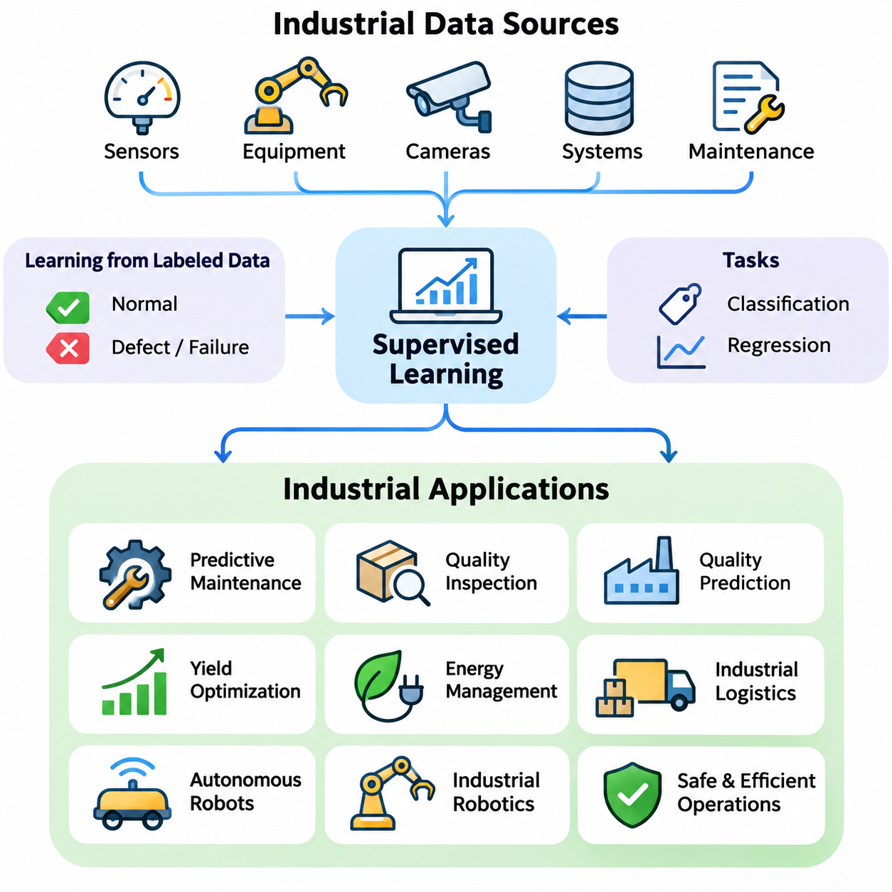
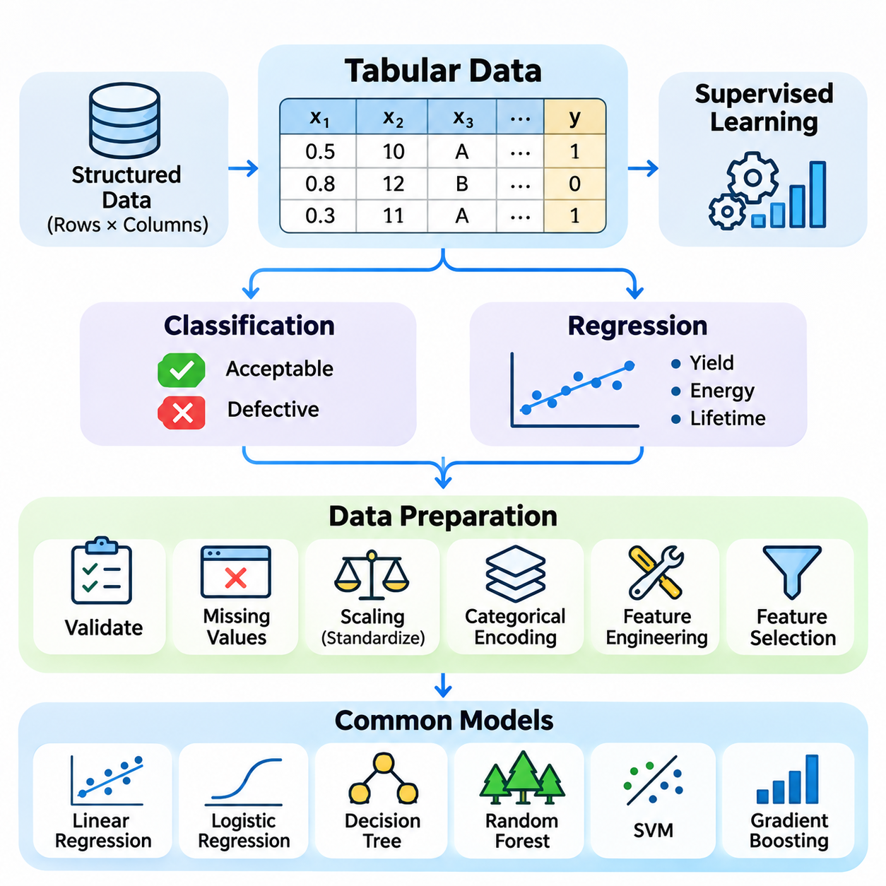
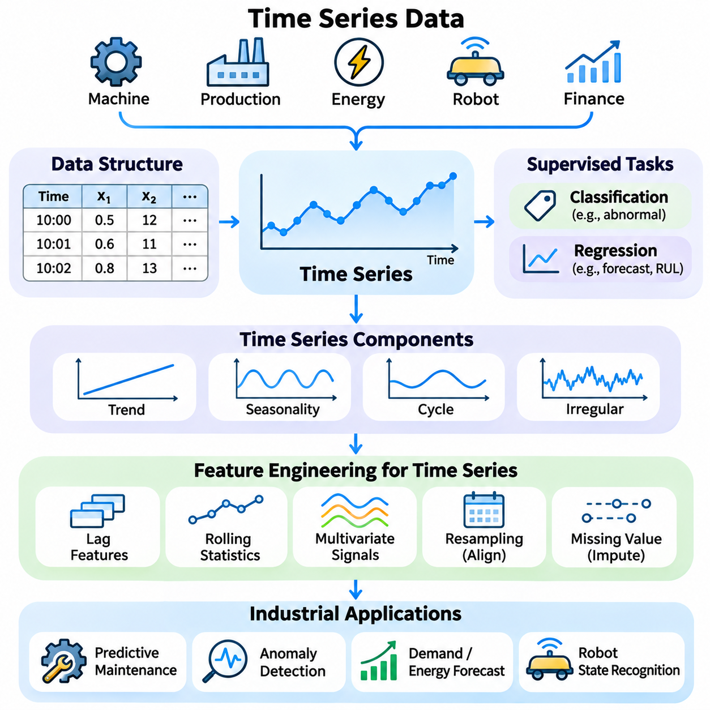
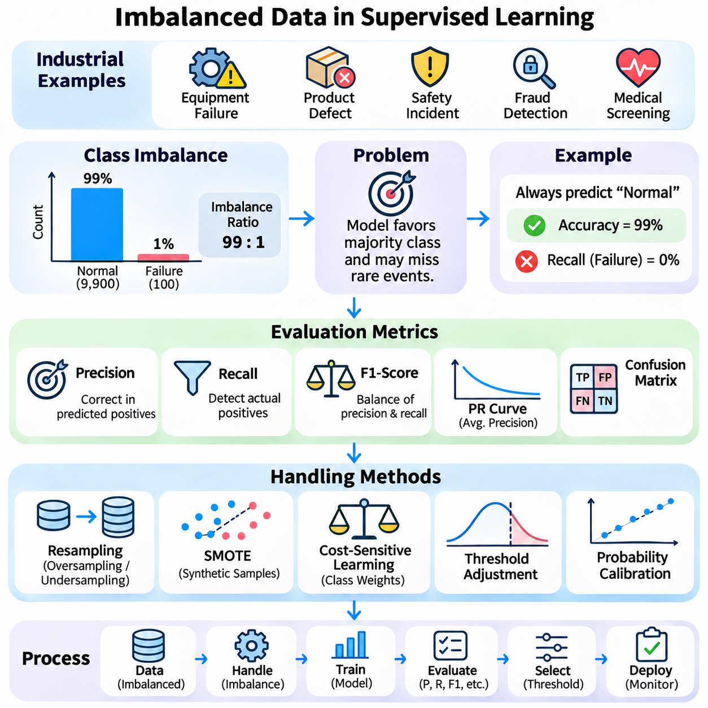
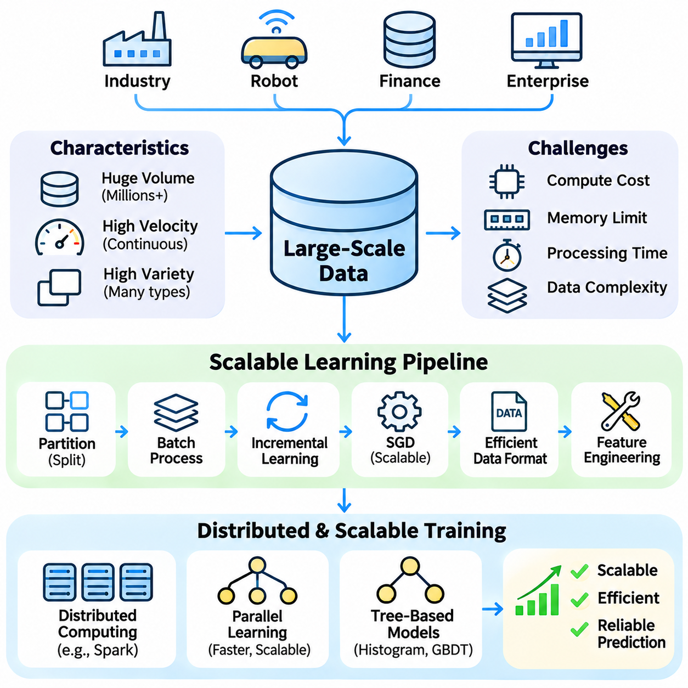
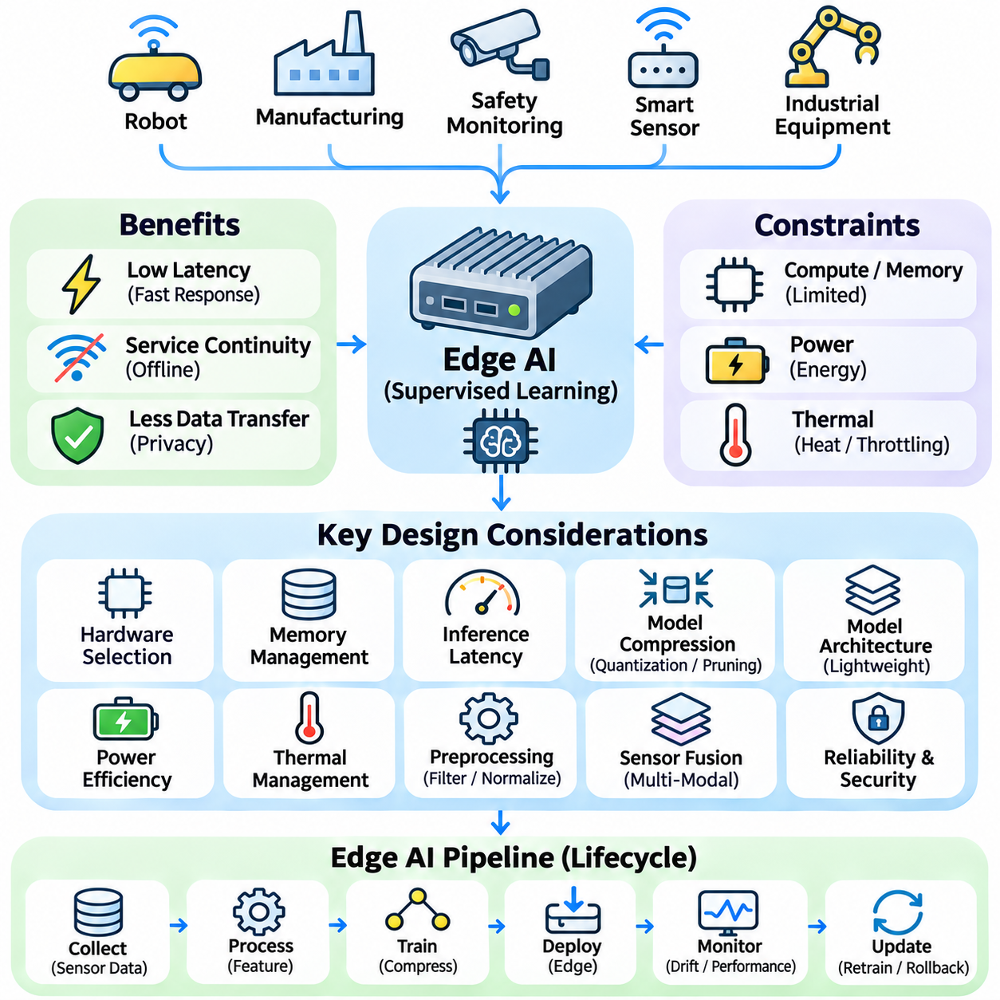
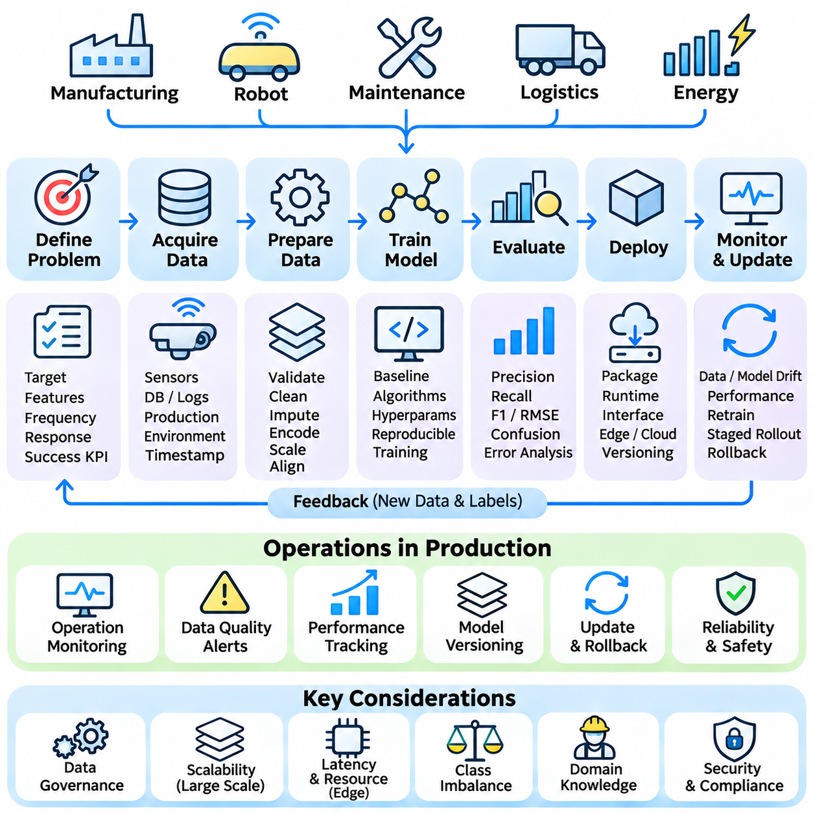

**Volume 08. Supervised Learning**


# 08. Supervised Learning in Real World

## 08.00 Industrial Applications

{width="7.268055555555556in" height="7.268055555555556in"}

Supervised learning has become an essential component of modern industrial systems because it enables organizations to transform historical observations into predictive intelligence. By learning relationships between input variables and known outcomes, supervised models can classify operating conditions, estimate continuous quantities, and support automated decisions. These capabilities improve productivity, consistency, and operational visibility across manufacturing, logistics, energy, and infrastructure.

Industrial environments generate substantial amounts of structured and unstructured data through sensors, controllers, production equipment, cameras, and enterprise information systems. Temperature measurements, vibration signals, motor currents, inspection images, and maintenance records provide valuable information about equipment behavior. Supervised learning converts these observations into models capable of recognizing patterns associated with quality, performance, degradation, and operational risk.

Unlike controlled laboratory experiments, industrial applications operate under changing physical conditions, production requirements, and economic constraints. Equipment ages, raw materials vary, environmental conditions fluctuate, and operators modify operating procedures. Consequently, successful supervised learning requires more than selecting an accurate algorithm. It demands careful problem formulation, reliable data collection, meaningful labels, robust validation, and integration with existing operational processes.

One of the most established industrial applications is predictive maintenance, where supervised models estimate equipment failures or remaining useful life from historical operating data. Sensors measure vibration, temperature, acoustic emissions, pressure, and electrical characteristics. When these measurements are associated with maintenance outcomes or verified failure events, classification and regression models can learn relationships that support earlier detection of abnormal equipment behavior.

Predictive maintenance systems frequently distinguish between normal operation, developing faults, and critical failure conditions. Logistic regression, support vector machines, random forests, and gradient boosting models can classify equipment states using engineered features. Regression models may estimate remaining useful life or future degradation indicators. Their effectiveness depends on representative failure examples, appropriate observation windows, and reliable maintenance records.

Industrial quality inspection represents another important application of supervised learning. Manufacturing organizations must identify defective products while maintaining high production throughput and consistent quality standards. Models can analyze dimensional measurements, surface characteristics, production parameters, and inspection images to predict whether manufactured components satisfy specified requirements. Automated classification reduces repetitive inspection work and helps identify recurring manufacturing problems.

Quality prediction can also occur before final inspection by analyzing process parameters associated with manufacturing outcomes. Injection molding temperature, machining speed, welding current, material composition, and environmental conditions may influence product quality. Supervised regression models estimate dimensions, strength, or other measurable properties, while classification models predict defect categories. These predictions support process adjustments before substantial quantities of defective products accumulate.

Production yield optimization uses supervised learning to identify relationships between operating conditions and manufacturing efficiency. Historical production records contain information about machine settings, material batches, cycle times, environmental conditions, and accepted products. Regression models estimate expected yield, while classification models identify operating conditions associated with excessive rejection rates. Engineers can use these predictions to investigate influential variables and improve process consistency.

Energy management provides another practical application because industrial facilities consume electricity, fuel, compressed air, and thermal energy under variable operating conditions. Supervised regression models estimate energy consumption from production schedules, equipment utilization, ambient temperature, and historical demand. Accurate forecasting supports capacity planning, peak-demand management, and operational efficiency. Predictions can also reveal unexpected consumption patterns that warrant engineering investigation.

Industrial logistics systems apply supervised learning to demand forecasting, delivery-time estimation, inventory planning, and operational risk prediction. Historical shipment records, order volumes, transportation conditions, and warehouse activity provide training examples. Regression models estimate delivery durations or expected demand, while classification models identify delayed shipments and potential fulfillment problems. These predictions help organizations allocate resources and anticipate operational disruptions.

Autonomous mobile robots and automated material-handling systems also benefit from supervised learning. Classification models recognize obstacles, floor conditions, operational states, and equipment abnormalities using camera images and sensor measurements. Regression models estimate quantities such as travel time, battery consumption, or traction-related performance. These predictions contribute to perception and operational planning, although safe autonomous navigation also requires localization, control, and appropriate safety mechanisms.

In industrial robotics, supervised learning can support object recognition, grasp suitability estimation, assembly inspection, and equipment condition monitoring. Training examples may include labeled images, force measurements, joint positions, and verified task outcomes. Models learn relationships between observable conditions and successful or unsuccessful operations. Their deployment requires careful consideration of sensor calibration, timing constraints, environmental variation, and the consequences of incorrect predictions.

Industrial applications commonly rely on tabular datasets because many operational records originate from databases, manufacturing execution systems, and supervisory control systems. Each observation may represent a product, machine cycle, maintenance event, or production interval. Features describe measurable conditions, while labels represent known outcomes. Linear models and tree-based algorithms often provide effective starting points because they can process structured variables with relatively modest computational requirements.

Decision trees and random forests are particularly useful when industrial relationships involve nonlinear interactions between operating variables. A manufacturing defect may depend on combinations of temperature, pressure, material properties, and machine settings rather than a single measurement. Tree-based models can represent such interactions without requiring explicit mathematical equations. Their feature importance estimates may also help engineers identify variables deserving further investigation.

Gradient boosting methods, including XGBoost, LightGBM, and CatBoost, are widely applicable to industrial tabular prediction problems. These algorithms construct ensembles of decision trees that progressively improve predictive performance. They can capture nonlinear relationships and complex feature interactions while supporting regularization and computational optimization. Nevertheless, model selection should depend on validation results, operational constraints, interpretability, and maintenance requirements rather than popularity alone.

Support vector machines remain relevant in industrial applications involving carefully engineered features and moderate-sized datasets. Their maximum-margin principle supports classification when operating conditions exhibit distinguishable patterns. Kernel methods can represent nonlinear decision boundaries, making them useful for certain fault classification and quality recognition problems. However, computational cost, feature scaling, and model complexity must be evaluated before deployment on large industrial datasets.

The quality of industrial labels often determines the practical value of supervised learning. Maintenance records may contain incomplete fault descriptions, inspection decisions may differ between operators, and production databases may include inconsistent timestamps. These problems introduce uncertainty into training targets. Establishing clear labeling standards, verifying critical events, and maintaining traceability between measurements and outcomes are therefore essential activities during dataset preparation.

Class imbalance is especially important because serious industrial failures are often rare compared with normal operating conditions. A model trained primarily on healthy equipment may achieve high overall accuracy while failing to recognize critical faults. Appropriate evaluation requires attention to precision, recall, false alarm rates, and the consequences of missed detections. Class weighting, suitable sampling methods, and threshold selection can improve performance when applied without contaminating evaluation data.

Time-dependent industrial observations introduce additional challenges because measurements collected from the same equipment are often strongly correlated. Randomly dividing records into training and testing datasets can produce overly optimistic results when adjacent observations share operating conditions. Chronological validation, equipment-level separation, and production-batch grouping provide more realistic assessments. These strategies help determine whether models can generalize to future operations and previously unseen equipment.

Industrial supervised learning must also account for data leakage, which occurs when training features contain information unavailable at the intended prediction time. A maintenance model may accidentally use measurements recorded after a failure, or a quality model may incorporate inspection results obtained after production. Such features can create misleadingly high validation scores. Every input variable should therefore be checked against the actual timing and information boundaries of deployment.

Model interpretability is particularly valuable when predictions influence production decisions, maintenance schedules, or safety-related operations. Engineers frequently need to understand which measurements contributed to a prediction and whether the resulting behavior is physically plausible. Linear coefficients, decision-tree rules, feature importance, and explanation methods can provide useful insights. However, statistical associations and model explanations should not automatically be interpreted as proof of physical causation.

Deployment introduces constraints that are rarely visible during offline model development. Industrial systems may require deterministic response times, limited memory consumption, continuous operation, and compatibility with programmable logic controllers or edge computers. A highly accurate model may be unsuitable if inference takes too long or requires unavailable computing resources. Practical evaluation must therefore consider latency, throughput, resource consumption, reliability, and integration complexity.

Edge AI deployment places prediction capabilities close to industrial equipment, reducing dependence on continuous cloud connectivity. Local inference can support rapid defect detection, equipment monitoring, and robotic perception. However, embedded processors and industrial computers have finite computational and thermal capacity. Model compression, efficient feature extraction, quantization, and hardware-aware optimization can improve deployment feasibility when their effects on prediction accuracy are carefully validated.

Industrial model performance may deteriorate when operating conditions change after deployment. New materials, equipment replacements, sensor drift, seasonal variation, and modified production procedures can alter the statistical relationships learned during training. This phenomenon is commonly described as data drift or concept drift, depending on the nature of the change. Continuous monitoring helps identify when incoming observations or prediction outcomes differ from the conditions represented in the original dataset.

A sustainable industrial learning system requires a feedback process connecting predictions with verified operational outcomes. Maintenance technicians can confirm detected faults, quality inspectors can validate defect classifications, and production engineers can record corrective actions. These observations create additional labeled examples for future model improvement. Retraining should follow controlled validation and release procedures so that newly introduced models do not unexpectedly degrade established operational performance.

Economic evaluation is equally important because predictive accuracy alone does not establish industrial value. False alarms may trigger unnecessary inspections, while missed failures can cause expensive downtime or safety hazards. Quality prediction errors may increase scrap, rework, or customer complaints. Organizations should evaluate models using application-specific costs, expected benefits, and operational risk. The most valuable model is often the one that produces reliable decisions within acceptable economic and engineering constraints.

Successful industrial supervised learning ultimately combines statistical modeling with domain expertise, dependable data infrastructure, and disciplined system engineering. Algorithms provide mechanisms for discovering predictive relationships, but industrial value emerges only when those relationships support trustworthy operational decisions. By integrating data quality, model selection, realistic validation, deployment constraints, and continuous monitoring, organizations can transform supervised learning from an experimental technique into a sustainable industrial capability.

지도학습(Supervised Learning)은 과거 관측 데이터(Historical Observation Data)를 예측 지능(Predictive Intelligence)으로 변환할 수 있도록 지원하기 때문에 현대 산업 시스템(Industrial Systems)의 핵심 구성 요소로 자리 잡았다. 지도학습 모델(Supervised Learning Model)은 입력 변수(Input Variables)와 알려진 결과(Known Outcomes) 사이의 관계를 학습하여 운영 상태를 분류하고, 연속적인 수치를 추정하며, 자동화된 의사결정(Automated Decision-Making)을 지원한다. 이러한 기능은 제조업(Manufacturing), 물류(Logistics), 에너지(Energy), 기반 시설(Infrastructure) 전반에서 생산성(Productivity), 일관성(Consistency), 운영 가시성(Operational Visibility)을 향상시킨다.

산업 환경(Industrial Environments)에서는 센서(Sensors), 제어기(Controllers), 생산 설비(Production Equipment), 카메라(Cameras), 기업 정보 시스템(Enterprise Information Systems)을 통해 방대한 양의 정형 데이터(Structured Data)와 비정형 데이터(Unstructured Data)가 생성된다. 온도 측정값(Temperature Measurements), 진동 신호(Vibration Signals), 모터 전류(Motor Currents), 검사 이미지(Inspection Images), 유지보수 기록(Maintenance Records)은 설비 동작을 이해하는 데 중요한 정보를 제공한다. 지도학습은 이러한 관측 데이터를 품질(Quality), 성능(Performance), 열화(Degradation), 운영 위험(Operational Risk)과 관련된 패턴을 인식하는 예측 모델(Predictive Models)로 변환한다.

통제된 실험실 환경(Controlled Laboratory Environments)과 달리 실제 산업 응용(Industrial Applications)은 변화하는 물리적 조건(Physical Conditions), 생산 요구사항(Production Requirements), 경제적 제약(Economic Constraints) 속에서 운영된다. 설비는 노후화되고, 원자재 특성은 달라지며, 환경 조건은 변동하고, 작업자는 운영 절차를 변경한다. 따라서 성공적인 지도학습은 정확한 알고리즘(Algorithm)을 선택하는 것만으로 달성되지 않는다. 문제 정의(Problem Formulation), 신뢰할 수 있는 데이터 수집(Data Collection), 의미 있는 레이블(Labels), 견고한 검증(Robust Validation), 기존 운영 프로세스(Operational Processes)와의 통합이 함께 요구된다.

가장 대표적인 산업 응용 중 하나는 예지보전(Predictive Maintenance)으로, 지도학습 모델을 활용하여 과거 운영 데이터(Historical Operational Data)로부터 설비 고장(Equipment Failures)이나 잔여 유효 수명(Remaining Useful Life)을 추정한다. 센서는 진동(Vibration), 온도(Temperature), 음향 방출(Acoustic Emissions), 압력(Pressure), 전기적 특성(Electrical Characteristics)을 측정한다. 이러한 측정값이 유지보수 결과(Maintenance Outcomes) 또는 검증된 고장 사건(Verified Failure Events)과 연결되면, 분류 모델(Classification Models)과 회귀 모델(Regression Models)은 비정상적인 설비 동작을 조기에 탐지할 수 있는 관계를 학습한다.

예지보전 시스템(Predictive Maintenance Systems)은 일반적으로 정상 작동(Normal Operation), 진행 중인 결함(Developing Faults), 심각한 고장 상태(Critical Failure Conditions)를 구분한다. 로지스틱 회귀(Logistic Regression), 서포트 벡터 머신(Support Vector Machines), 랜덤 포레스트(Random Forests), 그래디언트 부스팅(Gradient Boosting) 모델은 특징 공학(Feature Engineering)을 통해 추출된 변수를 사용하여 설비 상태를 분류할 수 있다. 회귀 모델은 잔여 유효 수명(Remaining Useful Life)이나 미래 열화 지표(Future Degradation Indicators)를 추정할 수 있으며, 그 효과는 대표성 있는 고장 사례, 적절한 관측 구간(Observation Windows), 신뢰할 수 있는 유지보수 기록에 크게 의존한다.

산업 품질 검사(Industrial Quality Inspection)는 지도학습의 또 다른 중요한 응용 분야이다. 제조 기업은 높은 생산 처리량(Production Throughput)과 일관된 품질 기준(Quality Standards)을 유지하면서 결함 제품(Defective Products)을 식별해야 한다. 모델은 치수 측정값(Dimensional Measurements), 표면 특성(Surface Characteristics), 생산 매개변수(Production Parameters), 검사 이미지를 분석하여 제조된 부품이 지정된 요구사항을 충족하는지 예측할 수 있다. 자동화된 분류(Automated Classification)는 반복적인 검사 작업을 줄이고 반복적으로 발생하는 제조 문제를 식별하는 데 도움을 준다.

품질 예측(Quality Prediction)은 제조 결과와 관련된 공정 매개변수(Process Parameters)를 분석하여 최종 검사 이전에도 수행할 수 있다. 사출 성형 온도(Injection Molding Temperature), 가공 속도(Machining Speed), 용접 전류(Welding Current), 재료 조성(Material Composition), 환경 조건(Environmental Conditions)은 제품 품질에 영향을 미칠 수 있다. 지도 회귀 모델(Supervised Regression Models)은 치수, 강도 또는 기타 측정 가능한 물성을 추정하고, 분류 모델은 결함 유형(Defect Categories)을 예측한다. 이러한 예측은 대량의 불량품이 발생하기 전에 공정을 조정하도록 지원한다.

생산 수율 최적화(Production Yield Optimization)는 지도학습을 활용하여 운영 조건(Operating Conditions)과 제조 효율(Manufacturing Efficiency) 사이의 관계를 식별한다. 과거 생산 기록에는 기계 설정값(Machine Settings), 원자재 배치(Material Batches), 사이클 시간(Cycle Times), 환경 조건, 합격 제품(Accepted Products)에 관한 정보가 포함된다. 회귀 모델은 예상 수율(Expected Yield)을 추정하고, 분류 모델은 과도한 불량률(Rejection Rates)과 관련된 운영 조건을 식별한다. 엔지니어는 이러한 예측을 활용하여 영향력이 큰 변수를 조사하고 공정 일관성(Process Consistency)을 개선할 수 있다.

에너지 관리(Energy Management) 역시 중요한 실제 응용 분야이다. 산업 시설은 다양한 운영 조건에서 전기(Electricity), 연료(Fuel), 압축 공기(Compressed Air), 열에너지(Thermal Energy)를 소비하기 때문이다. 지도 회귀 모델은 생산 일정(Production Schedules), 설비 가동률(Equipment Utilization), 주변 온도(Ambient Temperature), 과거 수요(Historical Demand)를 바탕으로 에너지 소비량(Energy Consumption)을 추정한다. 정확한 예측은 설비 용량 계획(Capacity Planning), 최대 수요 관리(Peak-Demand Management), 운영 효율(Operational Efficiency)을 지원하며, 엔지니어링 조사가 필요한 비정상적인 소비 패턴을 발견하는 데에도 활용된다.

산업 물류 시스템(Industrial Logistics Systems)은 수요 예측(Demand Forecasting), 배송 시간 추정(Delivery-Time Estimation), 재고 계획(Inventory Planning), 운영 위험 예측(Operational Risk Prediction)에 지도학습을 적용한다. 과거 운송 기록(Shipment Records), 주문량(Order Volumes), 운송 조건(Transportation Conditions), 창고 활동(Warehouse Activity)은 학습 사례(Training Examples)를 제공한다. 회귀 모델은 배송 소요 시간이나 예상 수요를 추정하고, 분류 모델은 배송 지연(Delayed Shipments)과 잠재적인 주문 이행 문제(Fulfillment Problems)를 식별한다. 이러한 예측은 자원 배분(Resource Allocation)과 운영 중단(Operational Disruptions)에 대한 사전 대응을 지원한다.

자율이동로봇(Autonomous Mobile Robots)과 자동화된 자재 취급 시스템(Automated Material-Handling Systems)도 지도학습의 이점을 활용할 수 있다. 분류 모델은 카메라 이미지와 센서 측정값을 사용하여 장애물(Obstacles), 바닥 상태(Floor Conditions), 운영 상태(Operational States), 설비 이상(Equipment Abnormalities)을 인식한다. 회귀 모델은 이동 시간(Travel Time), 배터리 소비량(Battery Consumption), 접지력 관련 성능(Traction-Related Performance)과 같은 수치를 추정한다. 이러한 예측은 인지(Perception)와 운영 계획(Operational Planning)에 기여하지만, 안전한 자율주행(Safe Autonomous Navigation)을 위해서는 위치 추정(Localization), 제어(Control), 적절한 안전 메커니즘(Safety Mechanisms)도 필요하다.

산업용 로봇(Industrial Robotics)에서 지도학습은 객체 인식(Object Recognition), 파지 적합성 추정(Grasp Suitability Estimation), 조립 검사(Assembly Inspection), 설비 상태 감시(Equipment Condition Monitoring)를 지원할 수 있다. 학습 사례에는 레이블이 지정된 이미지(Labeled Images), 힘 측정값(Force Measurements), 관절 위치(Joint Positions), 검증된 작업 결과(Verified Task Outcomes)가 포함될 수 있다. 모델은 관측 가능한 조건과 작업 성공 또는 실패 사이의 관계를 학습한다. 실제 배포(Deployment)에서는 센서 보정(Sensor Calibration), 시간 제약(Timing Constraints), 환경 변화(Environmental Variation), 잘못된 예측의 결과를 신중하게 고려해야 한다.

산업 응용에서는 많은 운영 기록이 데이터베이스(Databases), 제조실행시스템(Manufacturing Execution Systems), 감시 제어 시스템(Supervisory Control Systems)에서 생성되므로 표 형식 데이터셋(Tabular Datasets)을 일반적으로 사용한다. 각 관측값(Observation)은 제품, 기계 사이클(Machine Cycle), 유지보수 사건(Maintenance Event), 생산 구간(Production Interval)을 나타낼 수 있다. 특징(Features)은 측정 가능한 조건을 설명하고, 레이블(Labels)은 알려진 결과를 나타낸다. 선형 모델(Linear Models)과 트리 기반 알고리즘(Tree-Based Algorithms)은 비교적 적은 계산 자원(Computational Resources)으로 정형 변수를 처리할 수 있어 효과적인 출발점이 된다.

의사결정나무(Decision Trees)와 랜덤 포레스트(Random Forests)는 산업 변수 사이에 비선형 상호작용(Nonlinear Interactions)이 존재할 때 특히 유용하다. 제조 결함(Manufacturing Defect)은 단일 측정값이 아니라 온도, 압력, 재료 특성(Material Properties), 기계 설정값의 조합에 의해 발생할 수 있다. 트리 기반 모델은 명시적인 수학 방정식(Mathematical Equations)을 요구하지 않고 이러한 상호작용을 표현할 수 있다. 또한 특징 중요도(Feature Importance) 추정값은 엔지니어가 추가 조사가 필요한 변수를 식별하는 데 도움을 줄 수 있다.

XGBoost, LightGBM, CatBoost를 포함한 그래디언트 부스팅 기법(Gradient Boosting Methods)은 산업용 표 형식 데이터 예측 문제(Industrial Tabular Prediction Problems)에 폭넓게 적용할 수 있다. 이러한 알고리즘은 예측 성능을 점진적으로 개선하는 의사결정나무 앙상블(Decision Tree Ensembles)을 구성한다. 비선형 관계와 복잡한 특징 상호작용(Feature Interactions)을 포착하면서 정규화(Regularization)와 계산 최적화(Computational Optimization)를 지원한다. 그러나 모델 선택(Model Selection)은 알고리즘의 인기도보다 검증 결과(Validation Results), 운영 제약(Operational Constraints), 해석 가능성(Interpretability), 유지관리 요구사항(Maintenance Requirements)에 따라 결정해야 한다.

서포트 벡터 머신(Support Vector Machines)은 정교하게 설계된 특징(Engineered Features)과 중간 규모 데이터셋(Moderate-Sized Datasets)을 사용하는 산업 응용에서 여전히 유용하다. 최대 마진 원리(Maximum-Margin Principle)는 운영 조건 사이에 구별 가능한 패턴이 존재할 때 분류를 지원한다. 커널 기법(Kernel Methods)은 비선형 결정 경계(Nonlinear Decision Boundaries)를 표현할 수 있으므로 특정 결함 분류(Fault Classification)와 품질 인식(Quality Recognition) 문제에 적합하다. 다만 대규모 산업 데이터셋에 배포하기 전에는 계산 비용(Computational Cost), 특징 스케일링(Feature Scaling), 모델 복잡도(Model Complexity)를 평가해야 한다.

산업용 레이블(Industrial Labels)의 품질은 지도학습의 실질적인 가치를 결정하는 경우가 많다. 유지보수 기록에는 불완전한 결함 설명(Incomplete Fault Descriptions)이 포함될 수 있고, 검사 판단은 작업자마다 다를 수 있으며, 생산 데이터베이스에는 일관되지 않은 타임스탬프(Inconsistent Timestamps)가 존재할 수 있다. 이러한 문제는 학습 목표값(Training Targets)에 불확실성(Uncertainty)을 도입한다. 따라서 명확한 레이블링 기준(Labeling Standards)을 수립하고, 중요한 사건을 검증하며, 측정값과 결과 사이의 추적 가능성(Traceability)을 유지하는 것은 데이터셋 준비(Dataset Preparation)의 필수 활동이다.

클래스 불균형(Class Imbalance)은 심각한 산업 고장이 정상 운영 조건에 비해 드물게 발생하기 때문에 특히 중요하다. 정상 설비 데이터 중심으로 학습한 모델은 전체 정확도(Overall Accuracy)가 높더라도 중요한 결함을 인식하지 못할 수 있다. 적절한 평가(Evaluation)를 위해서는 정밀도(Precision), 재현율(Recall), 오경보율(False Alarm Rates), 미탐지(Missed Detections)의 결과를 고려해야 한다. 클래스 가중치(Class Weighting), 적절한 샘플링 기법(Sampling Methods), 임계값 선택(Threshold Selection)은 평가 데이터(Evaluation Data)를 오염시키지 않는 조건에서 성능을 개선할 수 있다.

시간 의존적인 산업 관측값(Time-Dependent Industrial Observations)은 동일 설비에서 수집된 측정값들이 강한 상관관계(Strong Correlation)를 갖는 경우가 많아 추가적인 문제를 발생시킨다. 인접한 관측값들이 동일한 운영 조건을 공유하는 상황에서 데이터를 무작위로 학습 및 시험 데이터셋(Training and Testing Datasets)으로 분할하면 지나치게 낙관적인 결과가 나타날 수 있다. 시간 순서 기반 검증(Chronological Validation), 설비 단위 분리(Equipment-Level Separation), 생산 배치 그룹화(Production-Batch Grouping)는 보다 현실적인 평가를 제공한다. 이러한 전략은 모델이 미래 운영 상황과 학습 과정에서 관측하지 않은 설비로 일반화(Generalization)될 수 있는지 판단하는 데 도움을 준다.

산업 지도학습은 학습 특징(Training Features)에 실제 예측 시점에 사용할 수 없는 정보가 포함되는 데이터 누출(Data Leakage)도 고려해야 한다. 유지보수 모델이 고장 이후 기록된 측정값을 실수로 사용하거나, 품질 모델이 생산 완료 후 얻어진 검사 결과를 포함할 수 있다. 이러한 특징은 검증 점수(Validation Scores)를 실제보다 높게 만들 수 있다. 따라서 모든 입력 변수(Input Variables)는 실제 배포 환경의 예측 시점(Prediction Time)과 정보 이용 가능 범위(Information Boundaries)를 기준으로 확인해야 한다.

모델 해석 가능성(Model Interpretability)은 예측이 생산 의사결정(Production Decisions), 유지보수 일정(Maintenance Schedules), 안전 관련 운영(Safety-Related Operations)에 영향을 미칠 때 특히 중요하다. 엔지니어는 어떤 측정값이 예측에 기여했는지, 결과가 물리적으로 타당한지 이해해야 하는 경우가 많다. 선형 계수(Linear Coefficients), 의사결정나무 규칙(Decision-Tree Rules), 특징 중요도(Feature Importance), 설명 기법(Explanation Methods)은 유용한 통찰을 제공할 수 있다. 그러나 통계적 연관성(Statistical Associations)과 모델 설명(Model Explanations)을 물리적 인과관계(Physical Causation)의 증거로 자동 해석해서는 안 된다.

모델 배포(Model Deployment)는 오프라인 모델 개발(Offline Model Development) 과정에서 드러나지 않는 제약을 발생시킨다. 산업 시스템은 결정적인 응답 시간(Deterministic Response Times), 제한된 메모리 사용량(Limited Memory Consumption), 연속 운영(Continuous Operation), 프로그래머블 로직 컨트롤러(Programmable Logic Controllers) 또는 엣지 컴퓨터(Edge Computers)와의 호환성을 요구할 수 있다. 정확도가 높은 모델이라도 추론 시간(Inference Time)이 지나치게 길거나 사용할 수 없는 계산 자원을 요구한다면 적합하지 않을 수 있다. 따라서 실제 평가는 지연 시간(Latency), 처리량(Throughput), 자원 소비(Resource Consumption), 신뢰성(Reliability), 통합 복잡도(Integration Complexity)를 고려해야 한다.

엣지 인공지능(Edge AI) 배포는 예측 기능을 산업 설비 가까이에 배치하여 지속적인 클라우드 연결(Cloud Connectivity)에 대한 의존성을 줄인다. 로컬 추론(Local Inference)은 빠른 결함 탐지(Defect Detection), 설비 모니터링(Equipment Monitoring), 로봇 인지(Robotic Perception)를 지원할 수 있다. 그러나 임베디드 프로세서(Embedded Processors)와 산업용 컴퓨터(Industrial Computers)는 계산 능력과 열적 용량(Thermal Capacity)에 한계가 있다. 모델 압축(Model Compression), 효율적인 특징 추출(Feature Extraction), 양자화(Quantization), 하드웨어 인지 최적화(Hardware-Aware Optimization)는 예측 정확도에 미치는 영향을 신중하게 검증할 때 배포 가능성을 높일 수 있다.

산업 모델의 성능은 배포 이후 운영 조건이 변화하면서 저하될 수 있다. 새로운 재료(New Materials), 설비 교체(Equipment Replacements), 센서 드리프트(Sensor Drift), 계절적 변화(Seasonal Variation), 수정된 생산 절차(Modified Production Procedures)는 학습 과정에서 형성된 통계적 관계(Statistical Relationships)를 변화시킬 수 있다. 이러한 현상은 변화의 특성에 따라 데이터 드리프트(Data Drift) 또는 개념 드리프트(Concept Drift)로 설명된다. 지속적인 모니터링(Continuous Monitoring)은 입력 관측값이나 예측 결과가 원래 데이터셋의 조건과 달라지는 시점을 식별하는 데 도움을 준다.

지속 가능한 산업 학습 시스템(Sustainable Industrial Learning System)은 예측과 검증된 운영 결과(Verified Operational Outcomes)를 연결하는 피드백 프로세스(Feedback Process)를 필요로 한다. 유지보수 기술자는 탐지된 결함을 확인하고, 품질 검사자는 결함 분류 결과를 검증하며, 생산 엔지니어는 시정 조치(Corrective Actions)를 기록할 수 있다. 이러한 관측값은 향후 모델 개선을 위한 추가 레이블 데이터(Labeled Data)를 생성한다. 재학습(Retraining)은 새로 도입된 모델이 기존 운영 성능을 예상치 못하게 저하시키지 않도록 통제된 검증 및 릴리스 절차(Controlled Validation and Release Procedures)를 따라야 한다.

경제성 평가(Economic Evaluation) 역시 중요하다. 예측 정확도(Predictive Accuracy)만으로 산업적 가치(Industrial Value)가 확립되는 것은 아니기 때문이다. 오경보(False Alarms)는 불필요한 검사를 유발할 수 있으며, 고장 미탐지(Missed Failures)는 막대한 가동 중단 비용(Downtime Costs)이나 안전 위험(Safety Hazards)을 초래할 수 있다. 품질 예측 오류(Quality Prediction Errors)는 폐기물(Scrap), 재작업(Rework), 고객 불만(Customer Complaints)을 증가시킬 수 있다. 조직은 응용 분야별 비용(Application-Specific Costs), 기대 편익(Expected Benefits), 운영 위험(Operational Risk)을 기준으로 모델을 평가해야 한다. 가장 가치 있는 모델은 허용 가능한 경제적·공학적 제약(Economic and Engineering Constraints) 안에서 신뢰할 수 있는 의사결정을 제공하는 모델인 경우가 많다.

성공적인 산업 지도학습(Industrial Supervised Learning)은 궁극적으로 통계적 모델링(Statistical Modeling), 도메인 전문지식(Domain Expertise), 신뢰할 수 있는 데이터 인프라(Data Infrastructure), 체계적인 시스템 엔지니어링(System Engineering)을 결합한다. 알고리즘은 예측 관계(Predictive Relationships)를 발견하는 메커니즘을 제공하지만, 산업적 가치는 이러한 관계가 신뢰할 수 있는 운영 의사결정(Operational Decisions)을 지원할 때 실현된다. 데이터 품질(Data Quality), 모델 선택(Model Selection), 현실적인 검증(Realistic Validation), 배포 제약(Deployment Constraints), 지속적인 모니터링(Continuous Monitoring)을 통합함으로써 조직은 지도학습을 실험적 기술(Experimental Technique)에서 지속 가능한 산업 역량(Sustainable Industrial Capability)으로 발전시킬 수 있다.

## 08.01 Tabular Data

{width="7.268055555555556in" height="7.268055555555556in"}

Tabular data represents one of the most common and practical forms of information used in supervised learning. It organizes observations into rows and variables into columns, creating a structured representation suitable for statistical analysis and predictive modeling. Each row typically describes an individual sample, transaction, event, or measurement, while each column contains a specific attribute. This organization makes tabular data particularly valuable for industrial and business applications.

In supervised learning, a tabular dataset contains input features and corresponding target values. Features describe observable characteristics, while targets represent outcomes that the model must predict. For example, a manufacturing dataset may include temperature, pressure, production speed, and material properties as features, with product quality as the target. The learning algorithm estimates relationships between these variables and uses them to generate predictions for previously unseen observations.

Tabular datasets support both classification and regression problems. Classification predicts discrete categories such as defective versus acceptable products, customer churn, or equipment failure states. Regression estimates continuous quantities such as energy consumption, production yield, delivery time, or equipment lifetime. Although these tasks share similar data structures, they require different objective functions, evaluation metrics, and prediction interpretations.

A major advantage of tabular data is its compatibility with traditional machine learning algorithms. Linear regression, logistic regression, decision trees, random forests, support vector machines, and gradient boosting methods can operate directly on appropriately prepared structured features. These algorithms often provide competitive performance without requiring the extensive computational resources associated with large deep neural networks, particularly when datasets contain meaningful engineered variables.

Real-world tabular datasets rarely arrive in a form suitable for immediate model training. Missing values, inconsistent measurement units, duplicate records, incorrect data types, and unexpected categorical values can reduce predictive reliability. Data preparation therefore involves examining distributions, validating feature definitions, identifying anomalies, and correcting inconsistencies. The objective is to establish a trustworthy representation of the underlying operational process before learning begins.

Missing values are especially common in industrial databases and enterprise information systems. Sensor communication failures, incomplete transactions, manual entry errors, and unavailable measurements can create gaps in otherwise structured records. Missing data may be handled through deletion, statistical imputation, or model-based estimation. However, the appropriate strategy depends on why values are missing and whether their absence contains useful predictive information.

Numerical features often differ substantially in scale and distribution. Temperature may range across hundreds of units, while vibration amplitudes or chemical concentrations may occupy much smaller numerical ranges. Standardization transforms features using their mean and standard deviation, while normalization can map values into predefined ranges. Scaling is particularly important for distance-based algorithms, support vector machines, and regularized linear models, although tree-based methods are generally less sensitive to feature magnitude.

Categorical variables describe discrete attributes such as machine type, production line, material grade, geographic region, or customer segment. Since many learning algorithms require numerical inputs, categorical values must be represented appropriately. One-hot encoding creates indicator variables for categories, while ordinal encoding assigns numerical values when meaningful ordering exists. Target encoding can also be useful, but it requires careful validation to prevent information leakage.

Feature engineering transforms raw tabular variables into representations that better capture meaningful relationships. Engineers may calculate ratios, differences, interaction terms, rolling statistics, or physically meaningful indicators. For example, motor current and rotational speed can contribute to estimates of operating load, while temperature differences may indicate thermal inefficiency. Effective feature engineering combines statistical reasoning with domain knowledge to improve predictive performance and interpretability.

Feature selection determines which variables should be included in the learning process. Redundant, irrelevant, or unstable features can increase model complexity and reduce generalization. Correlation analysis, statistical tests, regularization, permutation importance, and model-based selection methods can help identify useful predictors. Nevertheless, feature selection must be performed within the training procedure to avoid allowing information from validation or test datasets to influence model development.

Linear models provide an interpretable baseline for many tabular prediction tasks. Linear regression estimates continuous targets through weighted combinations of input variables, while logistic regression models classification probabilities. Their coefficients can reveal directional relationships between features and predictions, subject to assumptions about scaling, dependence, and model specification. Regularization techniques such as Ridge, Lasso, and Elastic Net help control complexity when datasets contain numerous correlated variables.

Decision trees represent tabular relationships through hierarchical rules that divide observations according to feature values. Their structure can capture nonlinear effects and interactions without requiring explicit polynomial transformations. Random forests improve stability by combining predictions from multiple trees trained on varied samples and feature subsets. These methods are useful when relationships are complex, although deep trees and excessively flexible ensembles may still overfit limited or noisy datasets.

Gradient boosting algorithms are particularly effective for many structured prediction problems. XGBoost, LightGBM, and CatBoost construct ensembles that progressively reduce prediction errors through sequential learning. They can represent nonlinear interactions, accommodate heterogeneous feature distributions, and provide strong predictive accuracy on numerous tabular benchmarks. Their practical effectiveness depends on suitable hyperparameters, representative training data, and careful validation rather than algorithm selection alone.

Dataset splitting is essential for estimating how well a tabular model will perform on unseen observations. Training data supports parameter estimation, validation data guides model selection, and test data provides an independent final assessment. Random splitting may be appropriate for independent observations, but grouped or chronological splitting is necessary when records share customers, machines, production batches, or temporal dependencies. Incorrect splitting can produce misleadingly optimistic performance estimates.

Data leakage occurs when a model receives information that would not be available at the intended prediction time. Leakage may arise from post-event measurements, duplicated observations, target-derived variables, or preprocessing performed before dataset separation. For example, a maintenance model should not use repair outcomes to predict failures that occurred earlier. Preventing leakage requires examining feature provenance, prediction timing, and every transformation applied during model development.

Evaluation metrics must correspond to the prediction objective and operational consequences. Classification models may be assessed using accuracy, precision, recall, F1-score, and area under the receiver operating characteristic curve. Regression models commonly use mean absolute error, mean squared error, root mean squared error, and coefficient of determination. No single metric captures every operational requirement, particularly when prediction errors have unequal economic or safety consequences.

Class imbalance frequently affects tabular datasets involving fraud, equipment failures, rare defects, and unusual operational events. When positive cases are uncommon, a classifier may achieve high accuracy by predicting the majority class while missing important events. Class weighting, resampling, threshold adjustment, and precision-recall analysis can address this challenge. Evaluation should use representative data distributions and emphasize the practical consequences of false positives and false negatives.

Interpretability remains an important reason for using tabular machine learning in industrial systems. Feature coefficients, tree rules, permutation importance, partial dependence analysis, and SHAP explanations can help reveal how input variables influence predictions. These methods support engineering review, debugging, and communication with operational stakeholders. However, explanations describe model behavior and statistical relationships rather than automatically establishing causal mechanisms.

Large tabular datasets introduce challenges involving memory usage, training speed, data storage, and distributed processing. Efficient data types, columnar storage formats, batch processing, and optimized learning libraries can reduce computational requirements. Some gradient boosting implementations support histogram-based training and parallel execution. Nevertheless, scaling strategies must preserve data consistency, reproducibility, and the validity of training and evaluation procedures.

Tabular data is frequently combined with temporal information in industrial applications. Individual records may contain timestamps, machine identifiers, operating conditions, and measured outcomes. Historical measurements can be transformed into lag features, moving averages, and trend indicators for supervised prediction. Such transformations require strict chronological consistency because future observations must never influence features intended to represent earlier prediction times.

Deployment of tabular models requires consistent preprocessing between training and inference environments. Missing-value handling, category mappings, feature scaling, and feature ordering must remain identical across both stages. A production pipeline should validate incoming records, reject incompatible schemas, and monitor unexpected values. Versioned preprocessing components and model artifacts improve reproducibility while reducing the risk of silent prediction errors.

Operational monitoring becomes necessary when the statistical properties of tabular data change over time. New equipment, modified manufacturing processes, changing customer behavior, and sensor calibration differences can alter feature distributions and predictive relationships. Monitoring systems can track missing-value rates, category frequencies, feature drift, prediction distributions, and observed performance. These measurements help determine when investigation, recalibration, or retraining is required.

The practical strength of tabular supervised learning comes from combining structured information with appropriate algorithms and disciplined engineering practices. Reliable feature definitions, leakage-free validation, meaningful evaluation metrics, and consistent deployment procedures are often more important than marginal improvements in algorithm complexity. When these principles are applied systematically, tabular models provide efficient, interpretable, and scalable predictive capabilities for real-world industrial systems.

표 형식 데이터(Tabular Data)는 지도학습(Supervised Learning)에서 가장 일반적이고 실용적으로 활용되는 정보 형태 중 하나이다. 표 형식 데이터는 관측값(Observations)을 행(Rows)으로, 변수(Variables)를 열(Columns)로 구성하여 통계 분석(Statistical Analysis)과 예측 모델링(Predictive Modeling)에 적합한 구조화된 표현(Structured Representation)을 제공한다. 각 행은 일반적으로 개별 샘플(Sample), 거래(Transaction), 사건(Event), 측정값(Measurement)을 나타내며, 각 열은 특정 속성(Attribute)을 포함한다. 이러한 구조는 표 형식 데이터를 산업 및 비즈니스 응용(Industrial and Business Applications)에서 특히 유용하게 만든다.

지도학습에서 표 형식 데이터셋(Tabular Dataset)은 입력 특징(Input Features)과 이에 대응하는 목표값(Target Values)으로 구성된다. 특징(Features)은 관측 가능한 특성을 설명하고, 목표값(Targets)은 모델이 예측해야 하는 결과를 나타낸다. 예를 들어 제조 데이터셋(Manufacturing Dataset)에서는 온도(Temperature), 압력(Pressure), 생산 속도(Production Speed), 재료 특성(Material Properties)이 입력 특징이 되고, 제품 품질(Product Quality)이 목표값이 될 수 있다. 학습 알고리즘(Learning Algorithm)은 이러한 변수 사이의 관계를 추정하고 이전에 관측하지 않은 데이터에 대한 예측을 생성한다.

표 형식 데이터셋은 분류(Classification)와 회귀(Regression) 문제를 모두 지원한다. 분류는 불량품과 양품(Defective versus Acceptable Products), 고객 이탈(Customer Churn), 설비 고장 상태(Equipment Failure States)와 같은 이산 범주(Discrete Categories)를 예측한다. 회귀는 에너지 소비량(Energy Consumption), 생산 수율(Production Yield), 배송 시간(Delivery Time), 설비 수명(Equipment Lifetime)과 같은 연속적인 수치(Continuous Quantities)를 추정한다. 두 작업은 유사한 데이터 구조를 사용하지만 서로 다른 목적 함수(Objective Functions), 평가 지표(Evaluation Metrics), 예측 해석(Prediction Interpretations)이 필요하다.

표 형식 데이터의 주요 장점은 전통적인 머신러닝 알고리즘(Traditional Machine Learning Algorithms)과의 높은 호환성(Compatibility)이다. 선형 회귀(Linear Regression), 로지스틱 회귀(Logistic Regression), 의사결정나무(Decision Trees), 랜덤 포레스트(Random Forests), 서포트 벡터 머신(Support Vector Machines), 그래디언트 부스팅(Gradient Boosting)은 적절하게 준비된 정형 특징(Structured Features)을 직접 처리할 수 있다. 특히 의미 있는 특징 공학 변수(Engineered Variables)가 포함된 데이터셋에서는 대규모 심층 신경망(Large Deep Neural Networks)에 필요한 방대한 계산 자원 없이도 경쟁력 있는 성능을 제공하는 경우가 많다.

실제 표 형식 데이터셋(Real-World Tabular Datasets)은 즉시 모델 학습(Model Training)에 사용할 수 있는 형태로 제공되는 경우가 드물다. 결측값(Missing Values), 일관되지 않은 측정 단위(Inconsistent Measurement Units), 중복 레코드(Duplicate Records), 잘못된 데이터 유형(Incorrect Data Types), 예상하지 못한 범주형 값(Unexpected Categorical Values)은 예측 신뢰성(Predictive Reliability)을 저하시킬 수 있다. 따라서 데이터 준비(Data Preparation)에는 분포(Distributions) 분석, 특징 정의(Feature Definitions) 검증, 이상값(Anomalies) 식별, 불일치 수정이 포함된다. 목표는 학습을 시작하기 전에 실제 운영 프로세스(Operational Process)를 신뢰할 수 있게 표현하는 것이다.

결측값(Missing Values)은 산업 데이터베이스(Industrial Databases)와 기업 정보 시스템(Enterprise Information Systems)에서 특히 흔하게 발생한다. 센서 통신 장애(Sensor Communication Failures), 불완전한 거래(Incomplete Transactions), 수동 입력 오류(Manual Entry Errors), 측정값 부재(Unavailable Measurements)는 정형 데이터 기록에 공백을 발생시킬 수 있다. 결측 데이터(Missing Data)는 삭제(Deletion), 통계적 대치(Statistical Imputation), 모델 기반 추정(Model-Based Estimation)을 통해 처리할 수 있다. 그러나 적절한 전략은 값이 누락된 원인과 누락 자체가 유용한 예측 정보(Predictive Information)를 포함하는지에 따라 달라진다.

수치형 특징(Numerical Features)은 크기(Scale)와 분포(Distribution)가 크게 다른 경우가 많다. 온도는 수백 단위의 범위를 가질 수 있지만, 진동 진폭(Vibration Amplitudes)이나 화학 물질 농도(Chemical Concentrations)는 훨씬 작은 수치 범위를 가질 수 있다. 표준화(Standardization)는 평균(Mean)과 표준편차(Standard Deviation)를 사용하여 특징을 변환하고, 정규화(Normalization)는 값을 미리 정의된 범위(Predefined Ranges)로 변환할 수 있다. 특징 스케일링(Feature Scaling)은 거리 기반 알고리즘(Distance-Based Algorithms), 서포트 벡터 머신, 정규화된 선형 모델(Regularized Linear Models)에서 특히 중요하지만, 트리 기반 기법(Tree-Based Methods)은 일반적으로 특징 크기에 덜 민감하다.

범주형 변수(Categorical Variables)는 기계 유형(Machine Type), 생산 라인(Production Line), 재료 등급(Material Grade), 지리적 지역(Geographic Region), 고객 세그먼트(Customer Segment)와 같은 이산 속성(Discrete Attributes)을 나타낸다. 많은 학습 알고리즘은 수치형 입력(Numerical Inputs)을 요구하므로 범주형 값(Categorical Values)을 적절하게 표현해야 한다. 원-핫 인코딩(One-Hot Encoding)은 범주별 지시 변수(Indicator Variables)를 생성하며, 순서형 인코딩(Ordinal Encoding)은 의미 있는 순서가 존재할 때 수치값을 할당한다. 타깃 인코딩(Target Encoding)도 유용할 수 있지만 정보 누출(Information Leakage)을 방지하기 위해 신중한 검증이 필요하다.

특징 공학(Feature Engineering)은 원시 표 형식 변수(Raw Tabular Variables)를 의미 있는 관계를 더 잘 포착할 수 있는 표현으로 변환한다. 엔지니어는 비율(Ratios), 차이(Differences), 상호작용 항(Interaction Terms), 이동 통계량(Rolling Statistics), 물리적으로 의미 있는 지표(Physically Meaningful Indicators)를 계산할 수 있다. 예를 들어 모터 전류(Motor Current)와 회전 속도(Rotational Speed)는 작동 부하(Operating Load)를 추정하는 데 활용될 수 있으며, 온도 차이(Temperature Differences)는 열효율 저하(Thermal Inefficiency)를 나타낼 수 있다. 효과적인 특징 공학은 통계적 추론(Statistical Reasoning)과 도메인 지식(Domain Knowledge)을 결합하여 예측 성능과 해석 가능성(Interpretability)을 향상시킨다.

특징 선택(Feature Selection)은 학습 과정(Learning Process)에 포함할 변수를 결정한다. 중복되거나(Redundant), 관련성이 낮거나(Irrelevant), 불안정한(Unstable) 특징은 모델 복잡도(Model Complexity)를 증가시키고 일반화 성능(Generalization Performance)을 저하시킬 수 있다. 상관관계 분석(Correlation Analysis), 통계적 검정(Statistical Tests), 정규화(Regularization), 순열 중요도(Permutation Importance), 모델 기반 선택(Model-Based Selection)은 유용한 예측 변수(Predictors)를 식별하는 데 도움을 준다. 그러나 검증 데이터셋(Validation Dataset)이나 시험 데이터셋(Test Dataset)의 정보가 모델 개발에 영향을 미치지 않도록 특징 선택은 학습 절차 내부에서 수행해야 한다.

선형 모델(Linear Models)은 다양한 표 형식 예측 작업(Tabular Prediction Tasks)에서 해석 가능한 기준 모델(Interpretable Baseline)을 제공한다. 선형 회귀(Linear Regression)는 입력 변수의 가중 결합(Weighted Combinations)을 통해 연속적인 목표값을 추정하고, 로지스틱 회귀(Logistic Regression)는 분류 확률(Classification Probabilities)을 모델링한다. 모델 계수(Model Coefficients)는 스케일링(Scaling), 변수 간 의존성(Dependence), 모델 명세(Model Specification)에 관한 가정을 고려할 때 특징과 예측 사이의 방향성 관계(Directional Relationships)를 보여줄 수 있다. 릿지(Ridge), 라쏘(Lasso), 엘라스틱넷(Elastic Net)과 같은 정규화 기법(Regularization Techniques)은 상관관계가 높은 변수가 많은 데이터셋에서 복잡도를 제어하는 데 도움을 준다.

의사결정나무(Decision Trees)는 특징값(Feature Values)에 따라 관측값을 분할하는 계층적 규칙(Hierarchical Rules)을 통해 표 형식 데이터의 관계를 표현한다. 이러한 구조는 명시적인 다항식 변환(Polynomial Transformations) 없이도 비선형 효과(Nonlinear Effects)와 상호작용(Interactions)을 포착할 수 있다. 랜덤 포레스트(Random Forests)는 다양한 샘플과 특징 부분집합(Feature Subsets)으로 학습된 여러 트리의 예측을 결합하여 안정성을 향상시킨다. 이러한 방법은 복잡한 관계를 처리하는 데 유용하지만, 지나치게 깊은 트리(Deep Trees)나 과도하게 유연한 앙상블(Ensembles)은 제한적이거나 잡음이 많은 데이터셋에서 과적합(Overfitting)을 일으킬 수 있다.

그래디언트 부스팅 알고리즘(Gradient Boosting Algorithms)은 많은 정형 예측 문제(Structured Prediction Problems)에서 특히 효과적이다. XGBoost, LightGBM, CatBoost는 순차 학습(Sequential Learning)을 통해 예측 오차(Prediction Errors)를 점진적으로 감소시키는 앙상블(Ensembles)을 구성한다. 이러한 알고리즘은 비선형 상호작용(Nonlinear Interactions)을 표현하고, 이질적인 특징 분포(Heterogeneous Feature Distributions)를 처리하며, 다양한 표 형식 데이터 벤치마크(Tabular Benchmarks)에서 높은 예측 정확도(Predictive Accuracy)를 제공한다. 실제 효과는 알고리즘 선택 자체보다 적절한 하이퍼파라미터(Hyperparameters), 대표성 있는 학습 데이터(Representative Training Data), 신중한 검증에 의존한다.

데이터셋 분할(Dataset Splitting)은 표 형식 모델이 관측하지 않은 데이터(Unseen Observations)에서 얼마나 잘 작동하는지 추정하는 데 필수적이다. 학습 데이터(Training Data)는 매개변수 추정(Parameter Estimation)을 지원하고, 검증 데이터(Validation Data)는 모델 선택(Model Selection)을 안내하며, 시험 데이터(Test Data)는 독립적인 최종 평가(Independent Final Assessment)를 제공한다. 독립적인 관측값에는 무작위 분할(Random Splitting)이 적절할 수 있지만, 고객(Customers), 기계(Machines), 생산 배치(Production Batches), 시간적 의존성(Temporal Dependencies)을 공유하는 기록에는 그룹 기반 분할(Grouped Splitting)이나 시간 순서 기반 분할(Chronological Splitting)이 필요하다. 잘못된 분할은 지나치게 낙관적인 성능 추정(Performance Estimates)을 초래할 수 있다.

데이터 누출(Data Leakage)은 모델이 실제 예측 시점(Intended Prediction Time)에 사용할 수 없는 정보를 입력받을 때 발생한다. 누출은 사건 이후 측정값(Post-Event Measurements), 중복 관측값(Duplicated Observations), 목표값에서 파생된 변수(Target-Derived Variables), 데이터셋 분리 이전에 수행된 전처리(Preprocessing)에서 발생할 수 있다. 예를 들어 유지보수 모델(Maintenance Model)은 이전에 발생한 고장을 예측하기 위해 수리 결과(Repair Outcomes)를 사용해서는 안 된다. 누출을 방지하려면 특징 출처(Feature Provenance), 예측 시점(Prediction Timing), 모델 개발 과정에서 적용되는 모든 변환(Transformations)을 검토해야 한다.

평가 지표(Evaluation Metrics)는 예측 목표(Prediction Objective)와 운영상 결과(Operational Consequences)에 부합해야 한다. 분류 모델(Classification Models)은 정확도(Accuracy), 정밀도(Precision), 재현율(Recall), F1 점수(F1-Score), 수신자 조작 특성 곡선 아래 면적(Area Under the Receiver Operating Characteristic Curve)을 사용하여 평가할 수 있다. 회귀 모델(Regression Models)은 일반적으로 평균 절대 오차(Mean Absolute Error), 평균 제곱 오차(Mean Squared Error), 평균 제곱근 오차(Root Mean Squared Error), 결정계수(Coefficient of Determination)를 사용한다. 특히 예측 오류(Prediction Errors)가 서로 다른 경제적 또는 안전상 결과를 초래하는 경우 단일 지표만으로 모든 운영 요구사항을 설명할 수는 없다.

클래스 불균형(Class Imbalance)은 사기 탐지(Fraud Detection), 설비 고장(Equipment Failures), 희귀 결함(Rare Defects), 비정상 운영 사건(Unusual Operational Events)과 관련된 표 형식 데이터셋에서 자주 발생한다. 양성 사례(Positive Cases)가 드물면 분류기(Classifier)는 중요한 사건을 놓치면서도 다수 클래스(Majority Class)를 예측하여 높은 정확도를 달성할 수 있다. 클래스 가중치(Class Weighting), 재표본추출(Resampling), 임계값 조정(Threshold Adjustment), 정밀도-재현율 분석(Precision-Recall Analysis)은 이러한 문제를 해결하는 데 도움을 준다. 평가는 대표성 있는 데이터 분포(Representative Data Distributions)를 사용하고 거짓 양성(False Positives)과 거짓 음성(False Negatives)의 실제 영향을 강조해야 한다.

해석 가능성(Interpretability)은 산업 시스템에서 표 형식 머신러닝(Tabular Machine Learning)을 사용하는 중요한 이유 중 하나이다. 특징 계수(Feature Coefficients), 트리 규칙(Tree Rules), 순열 중요도(Permutation Importance), 부분 의존성 분석(Partial Dependence Analysis), SHAP 설명(SHAP Explanations)은 입력 변수가 예측에 어떤 영향을 미치는지 이해하는 데 도움을 준다. 이러한 방법은 엔지니어링 검토(Engineering Review), 디버깅(Debugging), 운영 이해관계자(Operational Stakeholders)와의 의사소통을 지원한다. 그러나 설명은 모델 동작(Model Behavior)과 통계적 관계(Statistical Relationships)를 나타내며, 인과 메커니즘(Causal Mechanisms)을 자동으로 입증하는 것은 아니다.

대규모 표 형식 데이터셋(Large Tabular Datasets)은 메모리 사용량(Memory Usage), 학습 속도(Training Speed), 데이터 저장(Data Storage), 분산 처리(Distributed Processing)와 관련된 문제를 발생시킨다. 효율적인 데이터 유형(Efficient Data Types), 열 기반 저장 형식(Columnar Storage Formats), 배치 처리(Batch Processing), 최적화된 학습 라이브러리(Optimized Learning Libraries)는 계산 요구량(Computational Requirements)을 줄일 수 있다. 일부 그래디언트 부스팅 구현(Gradient Boosting Implementations)은 히스토그램 기반 학습(Histogram-Based Training)과 병렬 실행(Parallel Execution)을 지원한다. 그러나 확장 전략(Scaling Strategies)은 데이터 일관성(Data Consistency), 재현성(Reproducibility), 학습 및 평가 절차의 타당성(Validity)을 유지해야 한다.

표 형식 데이터는 산업 응용에서 시간 정보(Temporal Information)와 결합되는 경우가 많다. 개별 기록에는 타임스탬프(Timestamps), 기계 식별자(Machine Identifiers), 운영 조건(Operating Conditions), 측정 결과(Measured Outcomes)가 포함될 수 있다. 과거 측정값(Historical Measurements)은 지도 예측(Supervised Prediction)을 위한 지연 특징(Lag Features), 이동 평균(Moving Averages), 추세 지표(Trend Indicators)로 변환할 수 있다. 이러한 변환은 미래 관측값(Future Observations)이 과거 예측 시점을 나타내는 특징에 영향을 미쳐서는 안 되므로 엄격한 시간적 일관성(Chronological Consistency)을 요구한다.

표 형식 모델(Tabular Models)의 배포(Deployment)에는 학습 환경(Training Environment)과 추론 환경(Inference Environment) 사이의 일관된 전처리(Consistent Preprocessing)가 필요하다. 결측값 처리(Missing-Value Handling), 범주 매핑(Category Mappings), 특징 스케일링(Feature Scaling), 특징 순서(Feature Ordering)는 두 단계에서 동일하게 유지되어야 한다. 운영 파이프라인(Production Pipeline)은 입력 레코드(Incoming Records)를 검증하고, 호환되지 않는 스키마(Incompatible Schemas)를 거부하며, 예상하지 못한 값(Unexpected Values)을 모니터링해야 한다. 버전이 관리되는 전처리 구성 요소(Versioned Preprocessing Components)와 모델 산출물(Model Artifacts)은 재현성을 향상시키고 감지되지 않는 예측 오류(Silent Prediction Errors)의 위험을 줄인다.

표 형식 데이터의 통계적 특성(Statistical Properties)이 시간에 따라 변화할 때 운영 모니터링(Operational Monitoring)이 필요하다. 새로운 설비(New Equipment), 변경된 제조 공정(Modified Manufacturing Processes), 변화하는 고객 행동(Changing Customer Behavior), 센서 보정 차이(Sensor Calibration Differences)는 특징 분포(Feature Distributions)와 예측 관계(Predictive Relationships)를 변화시킬 수 있다. 모니터링 시스템(Monitoring Systems)은 결측값 비율(Missing-Value Rates), 범주 빈도(Category Frequencies), 특징 드리프트(Feature Drift), 예측 분포(Prediction Distributions), 관측된 성능(Observed Performance)을 추적할 수 있다. 이러한 측정값은 조사(Investigation), 재보정(Recalibration), 재학습(Retraining)이 필요한 시점을 판단하는 데 도움을 준다.

표 형식 지도학습(Tabular Supervised Learning)의 실질적인 강점은 정형 정보(Structured Information)를 적절한 알고리즘(Algorithms) 및 체계적인 엔지니어링 실무(Disciplined Engineering Practices)와 결합하는 데 있다. 신뢰할 수 있는 특징 정의(Reliable Feature Definitions), 데이터 누출이 없는 검증(Leakage-Free Validation), 의미 있는 평가 지표(Meaningful Evaluation Metrics), 일관된 배포 절차(Consistent Deployment Procedures)는 알고리즘 복잡도를 조금 개선하는 것보다 더 중요한 경우가 많다. 이러한 원칙을 체계적으로 적용하면 표 형식 모델은 실제 산업 시스템(Real-World Industrial Systems)에 효율적이고(Efficient), 해석 가능하며(Interpretable), 확장 가능한(Scalable) 예측 기능(Predictive Capabilities)을 제공할 수 있다.

## 08.02 Time Series

{width="7.268055555555556in" height="7.268055555555556in"}

Time series data represents observations collected in chronological order, where the timing and sequence of measurements contain essential predictive information. Unlike ordinary tabular datasets, time series observations are often statistically dependent on earlier values. Industrial sensors, financial markets, energy systems, and autonomous robots continuously generate such data. Supervised learning uses historical patterns to predict future values, classify operating states, and identify emerging abnormalities.

A time series dataset typically contains timestamps, measured variables, and contextual information describing the observed system. Examples include motor temperature recorded every second, electricity consumption measured hourly, and production output summarized daily. The sampling frequency determines the temporal resolution available for analysis. Reliable timestamps, consistent measurement intervals, and clear definitions of observation periods are essential for constructing meaningful predictive models.

Temporal dependence distinguishes time series learning from conventional independent-sample prediction. A machine\'s current temperature may depend on its previous temperature, operating load, and environmental conditions. Similarly, energy consumption may reflect recent demand and recurring production schedules. Supervised models must capture these dependencies through historical features or architectures designed for sequential inputs. Ignoring temporal relationships can reduce accuracy and produce misleading validation results.

Time series often contain trends, seasonal patterns, cycles, and irregular fluctuations. A trend represents a persistent increase or decrease, while seasonality describes recurring changes associated with predictable intervals. Cycles may occur without fixed periods, and random fluctuations introduce additional uncertainty. Understanding these components helps engineers select useful features, appropriate forecasting horizons, and evaluation methods that reflect the underlying system dynamics.

Supervised time series forecasting transforms historical observations into input-output training examples. A model receives measurements from a defined historical window and predicts a future value or sequence of values. For example, the previous sixty minutes of vibration and temperature measurements may be used to estimate equipment conditions ten minutes ahead. The prediction horizon determines how far into the future the model must generalize from available information.

Lag features provide a practical method for converting sequential observations into tabular inputs. A lag feature represents a variable measured at an earlier time, such as temperature one minute ago or pressure five minutes ago. Multiple lags allow a model to examine recent operating history without requiring a specialized sequence architecture. Linear regression, random forests, and gradient boosting models can then learn temporal relationships from these engineered features.

Rolling statistics summarize historical behavior over predefined observation windows. Moving averages capture local trends, while rolling standard deviations describe variability. Minimum, maximum, and rate-of-change features can reveal abrupt transitions or gradual degradation. In industrial monitoring, rolling vibration energy or temperature variation may provide stronger predictive signals than individual measurements. All calculations must use only observations available before the prediction time.

Time series datasets may contain multiple synchronized variables, producing multivariate time series. Industrial equipment commonly generates temperature, vibration, current, voltage, pressure, and rotational speed measurements simultaneously. Relationships between these signals can reveal operating conditions that individual sensors cannot explain. Multivariate supervised learning combines historical measurements across variables to predict future system behavior, equipment states, or performance indicators.

Sampling irregularities create practical challenges because industrial sensors may operate at different frequencies or experience communication interruptions. One sensor may report every millisecond while another updates once per second. Resampling, interpolation, and aggregation can align measurements to a common timeline. However, these operations must respect the intended prediction time and avoid introducing future information into historical features.

Missing observations require careful treatment because gaps may reflect sensor failures, communication delays, maintenance periods, or genuine changes in equipment operation. Forward filling can preserve the most recent known value, while interpolation may estimate missing measurements when appropriate. Long gaps may require explicit missingness indicators or exclusion from training. The selected method should reflect the physical meaning of the signals and the duration of missing intervals.

Time series classification assigns labels to individual timestamps, observation windows, or complete sequences. Applications include detecting abnormal machine behavior, identifying operating modes, recognizing human activities, and classifying robotic motion patterns. Features may describe signal amplitude, frequency content, statistical variation, or temporal transitions. The labeling strategy must define whether the target represents the current condition, a future event, or an entire sequence.

Predictive maintenance frequently uses time series classification and regression to anticipate equipment deterioration. Historical sensor signals are associated with verified faults, maintenance events, or degradation measurements. Classification models estimate the probability of failure within a specified future interval, while regression models predict remaining useful life or future condition indicators. Reliable predictions require representative operating histories and careful handling of incomplete or censored failure observations.

Traditional supervised algorithms remain highly effective for many time series applications when meaningful temporal features are available. Linear models provide interpretable baselines, while random forests and gradient boosting capture nonlinear interactions among lagged variables. Support vector machines can classify operating conditions using engineered signal characteristics. These approaches are often computationally efficient and suitable for industrial environments with limited training data.

Deep learning provides alternative methods for modeling complex sequential dependencies. Recurrent neural networks, long short-term memory networks, temporal convolutional networks, and Transformer-based architectures can process sequences with different mechanisms for representing temporal relationships. These models may capture patterns that are difficult to express through manual feature engineering. However, their advantages depend on dataset size, signal complexity, computational resources, and evaluation conditions.

Forecasting strategies differ according to the number of future observations required. One-step forecasting predicts the next value, while multi-step forecasting estimates several future values. Recursive forecasting repeatedly uses earlier predictions as inputs, potentially accumulating errors. Direct forecasting trains models for specific future horizons, while multi-output approaches predict several horizons together. The appropriate strategy depends on prediction accuracy, operational latency, and planning requirements.

Chronological data splitting is essential for realistic time series evaluation. Training observations should precede validation observations, which should generally precede the final test period. Random splitting can leak information when neighboring measurements share temporal patterns or overlapping windows. Walk-forward validation repeatedly trains on earlier data and evaluates later intervals, providing a practical assessment of performance under changing operational conditions.

Time series leakage can occur through improperly calculated rolling features, future-dependent normalization, overlapping windows, or labels derived from unavailable outcomes. For example, a model predicting tomorrow\'s equipment condition must not use measurements recorded tomorrow. Preprocessing parameters should be estimated from training data, and feature generation must preserve chronological boundaries. Preventing leakage is necessary for obtaining trustworthy estimates of deployment performance.

Forecasting performance is commonly measured using mean absolute error, root mean squared error, and related regression metrics. Classification applications may require precision, recall, F1-score, and event detection delay. Error analysis should consider different operating regimes, seasonal conditions, and forecasting horizons. A model that performs well on average may still fail during rare but operationally important transitions.

Concept drift presents a significant challenge because temporal relationships may change as equipment ages, production schedules evolve, or environmental conditions shift. A model trained under earlier operating conditions may gradually lose predictive accuracy. Monitoring feature distributions, residual errors, and prediction reliability helps detect deterioration. Retraining and recalibration should follow controlled procedures that preserve historical evaluation records and deployment traceability.

Real-time time series inference requires careful management of data acquisition, buffering, feature computation, and prediction latency. Edge devices may continuously collect sensor measurements and maintain rolling observation windows. Predictions must be generated within operational deadlines while respecting memory and computational constraints. Efficient implementations often combine lightweight feature extraction with supervised models that can execute reliably on industrial processors.

Autonomous robots provide an important example of multivariate temporal learning. Wheel encoder measurements, inertial signals, motor currents, battery voltage, and environmental observations form synchronized sequences. Supervised models can estimate terrain-related operating conditions, energy consumption, motion anomalies, or component degradation. These predictions support perception and maintenance functions, while safety-critical control still requires appropriate estimation, verification, and protective mechanisms.

Successful time series supervised learning depends on preserving the relationship between measurements and their temporal context. Reliable timestamps, causal feature construction, representative training periods, chronological validation, and continuous monitoring are fundamental requirements. By combining these principles with suitable regression, classification, and sequence modeling techniques, organizations can transform historical sensor streams into actionable predictions for industrial and autonomous systems.

시계열 데이터(Time Series Data)는 시간 순서(Chronological Order)에 따라 수집된 관측값(Observations)을 나타내며, 측정 시점(Timing)과 순서(Sequence) 자체가 중요한 예측 정보(Predictive Information)를 포함한다. 일반적인 표 형식 데이터셋(Tabular Datasets)과 달리 시계열 관측값은 이전 값(Earlier Values)에 통계적으로 의존하는 경우가 많다. 산업용 센서(Industrial Sensors), 금융 시장(Financial Markets), 에너지 시스템(Energy Systems), 자율주행 로봇(Autonomous Robots)은 이러한 데이터를 지속적으로 생성한다. 지도학습(Supervised Learning)은 과거 패턴(Historical Patterns)을 활용하여 미래 값을 예측하고, 운영 상태를 분류하며, 새롭게 발생하는 이상 징후(Emerging Abnormalities)를 식별한다.

시계열 데이터셋(Time Series Dataset)은 일반적으로 타임스탬프(Timestamps), 측정 변수(Measured Variables), 관측 대상 시스템을 설명하는 상황 정보(Contextual Information)로 구성된다. 예를 들어 매초 기록되는 모터 온도(Motor Temperature), 매시간 측정되는 전력 소비량(Electricity Consumption), 매일 집계되는 생산량(Production Output)이 있다. 샘플링 주파수(Sampling Frequency)는 분석에 사용할 수 있는 시간 해상도(Temporal Resolution)를 결정한다. 신뢰할 수 있는 타임스탬프, 일관된 측정 간격(Measurement Intervals), 명확하게 정의된 관측 기간(Observation Periods)은 의미 있는 예측 모델(Predictive Models)을 구축하기 위한 필수 조건이다.

시간적 의존성(Temporal Dependence)은 시계열 학습(Time Series Learning)을 일반적인 독립 표본 예측(Independent-Sample Prediction)과 구별하는 핵심 특성이다. 기계의 현재 온도(Current Temperature)는 이전 온도(Previous Temperature), 작동 부하(Operating Load), 환경 조건(Environmental Conditions)에 영향을 받을 수 있다. 마찬가지로 에너지 소비량(Energy Consumption)은 최근 수요(Recent Demand)와 반복적인 생산 일정(Recurring Production Schedules)을 반영할 수 있다. 지도학습 모델은 과거 특징(Historical Features)이나 순차 입력(Sequential Inputs)을 처리하도록 설계된 구조를 통해 이러한 의존성을 포착해야 한다. 시간적 관계를 무시하면 정확도가 저하되고 잘못된 검증 결과(Misleading Validation Results)가 발생할 수 있다.

시계열 데이터에는 추세(Trends), 계절성 패턴(Seasonal Patterns), 주기(Cycles), 불규칙한 변동(Irregular Fluctuations)이 포함되는 경우가 많다. 추세는 지속적인 증가 또는 감소를 나타내며, 계절성(Seasonality)은 예측 가능한 시간 간격에 따라 반복되는 변화를 설명한다. 주기는 고정된 기간 없이 발생할 수도 있으며, 무작위 변동(Random Fluctuations)은 추가적인 불확실성(Uncertainty)을 발생시킨다. 이러한 구성 요소를 이해하면 엔지니어는 기본 시스템 동역학(Underlying System Dynamics)을 반영하는 유용한 특징(Features), 적절한 예측 시계(Prediction Horizons), 평가 방법(Evaluation Methods)을 선택할 수 있다.

지도학습 기반 시계열 예측(Supervised Time Series Forecasting)은 과거 관측값(Historical Observations)을 입력-출력 학습 사례(Input-Output Training Examples)로 변환한다. 모델은 정의된 과거 관측 구간(Historical Window)의 측정값을 입력받아 미래 값(Future Value) 또는 미래 값의 시퀀스(Sequence of Values)를 예측한다. 예를 들어 이전 60분 동안의 진동(Vibration)과 온도(Temperature) 측정값을 사용하여 10분 후의 설비 상태(Equipment Conditions)를 추정할 수 있다. 예측 시계(Prediction Horizon)는 모델이 현재 이용 가능한 정보로부터 얼마나 먼 미래까지 일반화(Generalization)해야 하는지를 결정한다.

지연 특징(Lag Features)은 순차 관측값(Sequential Observations)을 표 형식 입력(Tabular Inputs)으로 변환하는 실용적인 방법을 제공한다. 지연 특징은 1분 전의 온도나 5분 전의 압력처럼 이전 시점에 측정된 변수를 나타낸다. 여러 지연 특징(Multiple Lags)을 사용하면 특수한 시퀀스 구조(Specialized Sequence Architecture) 없이도 최근 운영 이력(Recent Operating History)을 분석할 수 있다. 이후 선형 회귀(Linear Regression), 랜덤 포레스트(Random Forests), 그래디언트 부스팅(Gradient Boosting) 모델은 이러한 특징 공학 변수(Engineered Features)로부터 시간적 관계(Temporal Relationships)를 학습할 수 있다.

이동 통계량(Rolling Statistics)은 미리 정의된 관측 구간(Observation Windows)에 걸친 과거 동작(Historical Behavior)을 요약한다. 이동 평균(Moving Averages)은 국소적인 추세(Local Trends)를 포착하고, 이동 표준편차(Rolling Standard Deviations)는 변동성(Variability)을 설명한다. 최솟값(Minimum), 최댓값(Maximum), 변화율(Rate-of-Change) 특징은 급격한 상태 전이(Abrupt Transitions)나 점진적인 열화(Gradual Degradation)를 나타낼 수 있다. 산업 모니터링(Industrial Monitoring)에서는 이동 진동 에너지(Rolling Vibration Energy)나 온도 변동(Temperature Variation)이 개별 측정값보다 강력한 예측 신호(Predictive Signals)를 제공할 수 있다. 모든 계산은 반드시 예측 시점 이전에 이용 가능한 관측값만 사용해야 한다.

시계열 데이터셋은 여러 동기화된 변수(Synchronized Variables)를 포함할 수 있으며, 이를 다변량 시계열(Multivariate Time Series)이라고 한다. 산업 설비는 일반적으로 온도(Temperature), 진동(Vibration), 전류(Current), 전압(Voltage), 압력(Pressure), 회전 속도(Rotational Speed)를 동시에 측정한다. 이러한 신호 사이의 관계는 개별 센서만으로 설명할 수 없는 운영 조건(Operating Conditions)을 드러낼 수 있다. 다변량 지도학습(Multivariate Supervised Learning)은 여러 변수의 과거 측정값을 결합하여 미래 시스템 동작(Future System Behavior), 설비 상태(Equipment States), 성능 지표(Performance Indicators)를 예측한다.

샘플링 불규칙성(Sampling Irregularities)은 산업용 센서가 서로 다른 주파수(Frequencies)로 동작하거나 통신 중단(Communication Interruptions)을 경험할 수 있기 때문에 실제적인 문제를 발생시킨다. 하나의 센서는 밀리초(Millisecond)마다 데이터를 보고하는 반면, 다른 센서는 1초마다 갱신할 수 있다. 재표본화(Resampling), 보간(Interpolation), 집계(Aggregation)는 측정값을 공통 시간축(Common Timeline)에 정렬하는 데 사용된다. 그러나 이러한 연산은 의도된 예측 시점(Intended Prediction Time)을 준수해야 하며, 미래 정보(Future Information)가 과거 특징(Historical Features)에 포함되지 않도록 해야 한다.

누락된 관측값(Missing Observations)은 센서 고장(Sensor Failures), 통신 지연(Communication Delays), 유지보수 기간(Maintenance Periods), 실제 설비 운영 변화(Genuine Changes in Equipment Operation)를 반영할 수 있으므로 신중하게 처리해야 한다. 전방 채우기(Forward Filling)는 가장 최근에 알려진 값을 유지할 수 있으며, 보간(Interpolation)은 적절한 경우 누락된 측정값을 추정할 수 있다. 긴 결측 구간(Long Gaps)은 명시적인 결측 지시 변수(Missingness Indicators)를 추가하거나 학습에서 제외해야 할 수도 있다. 선택한 방법은 신호의 물리적 의미(Physical Meaning)와 누락 구간의 지속 시간(Duration)을 반영해야 한다.

시계열 분류(Time Series Classification)는 개별 타임스탬프(Individual Timestamps), 관측 구간(Observation Windows), 전체 시퀀스(Complete Sequences)에 레이블(Labels)을 할당한다. 응용 사례에는 비정상적인 기계 동작(Abnormal Machine Behavior) 탐지, 운영 모드(Operating Modes) 식별, 인간 활동 인식(Human Activity Recognition), 로봇 동작 패턴(Robotic Motion Patterns) 분류가 포함된다. 특징은 신호 진폭(Signal Amplitude), 주파수 성분(Frequency Content), 통계적 변동(Statistical Variation), 시간적 전이(Temporal Transitions)를 설명할 수 있다. 레이블링 전략(Labeling Strategy)은 목표값(Target)이 현재 상태(Current Condition), 미래 사건(Future Event), 전체 시퀀스 중 무엇을 나타내는지 명확하게 정의해야 한다.

예지보전(Predictive Maintenance)은 설비 열화(Equipment Deterioration)를 사전에 예측하기 위해 시계열 분류(Time Series Classification)와 회귀(Regression)를 자주 활용한다. 과거 센서 신호(Historical Sensor Signals)는 검증된 결함(Verified Faults), 유지보수 사건(Maintenance Events), 열화 측정값(Degradation Measurements)과 연결된다. 분류 모델(Classification Models)은 지정된 미래 구간(Future Interval) 내 고장 발생 확률(Failure Probability)을 추정하고, 회귀 모델(Regression Models)은 잔여 유효 수명(Remaining Useful Life)이나 미래 상태 지표(Future Condition Indicators)를 예측한다. 신뢰할 수 있는 예측을 위해서는 대표성 있는 운영 이력(Representative Operating Histories)과 불완전하거나 중도절단된 고장 관측값(Censored Failure Observations)에 대한 신중한 처리가 필요하다.

전통적인 지도학습 알고리즘(Traditional Supervised Algorithms)은 의미 있는 시간적 특징(Temporal Features)을 사용할 수 있을 때 다양한 시계열 응용에서 여전히 높은 효과를 발휘한다. 선형 모델(Linear Models)은 해석 가능한 기준 모델(Interpretable Baselines)을 제공하며, 랜덤 포레스트(Random Forests)와 그래디언트 부스팅(Gradient Boosting)은 지연 변수(Lagged Variables) 사이의 비선형 상호작용(Nonlinear Interactions)을 포착한다. 서포트 벡터 머신(Support Vector Machines)은 특징 공학으로 추출된 신호 특성(Engineered Signal Characteristics)을 활용하여 운영 조건을 분류할 수 있다. 이러한 접근법은 계산 효율성(Computational Efficiency)이 높고 학습 데이터(Training Data)가 제한적인 산업 환경에 적합한 경우가 많다.

딥러닝(Deep Learning)은 복잡한 순차 의존성(Sequential Dependencies)을 모델링하기 위한 대안적인 방법을 제공한다. 순환 신경망(Recurrent Neural Networks), 장단기 기억 네트워크(Long Short-Term Memory Networks), 시간 합성곱 신경망(Temporal Convolutional Networks), 트랜스포머 기반 구조(Transformer-Based Architectures)는 서로 다른 메커니즘을 사용하여 시퀀스를 처리하고 시간적 관계를 표현한다. 이러한 모델은 수작업 특징 공학(Manual Feature Engineering)으로 표현하기 어려운 패턴을 포착할 수 있다. 그러나 장점은 데이터셋 크기(Dataset Size), 신호 복잡도(Signal Complexity), 계산 자원(Computational Resources), 평가 조건(Evaluation Conditions)에 따라 달라진다.

예측 전략(Forecasting Strategies)은 필요한 미래 관측값(Future Observations)의 개수에 따라 달라진다. 단일 단계 예측(One-Step Forecasting)은 다음 값을 예측하고, 다단계 예측(Multi-Step Forecasting)은 여러 미래 값을 추정한다. 재귀적 예측(Recursive Forecasting)은 이전 예측값을 반복적으로 입력에 사용하므로 오차가 누적될 수 있다. 직접 예측(Direct Forecasting)은 특정 미래 예측 시계(Future Horizons)를 위한 모델을 학습하고, 다중 출력 접근법(Multi-Output Approaches)은 여러 예측 시계를 함께 예측한다. 적절한 전략은 예측 정확도(Prediction Accuracy), 운영 지연 시간(Operational Latency), 계획 요구사항(Planning Requirements)에 따라 결정된다.

시간 순서 기반 데이터 분할(Chronological Data Splitting)은 현실적인 시계열 평가(Time Series Evaluation)에 필수적이다. 학습 관측값(Training Observations)은 검증 관측값(Validation Observations)보다 앞서야 하며, 검증 관측값은 일반적으로 최종 시험 기간(Final Test Period)보다 앞서야 한다. 인접한 측정값들이 시간적 패턴(Temporal Patterns)이나 중첩 구간(Overlapping Windows)을 공유하는 경우 무작위 분할(Random Splitting)은 정보 누출(Information Leakage)을 발생시킬 수 있다. 전진형 검증(Walk-Forward Validation)은 이전 데이터로 반복적으로 학습하고 이후 구간에서 평가함으로써 변화하는 운영 조건(Changing Operational Conditions)에서의 성능을 실용적으로 평가한다.

시계열 데이터 누출(Time Series Leakage)은 잘못 계산된 이동 특징(Rolling Features), 미래 정보에 의존하는 정규화(Future-Dependent Normalization), 중첩 구간(Overlapping Windows), 예측 시점에 이용할 수 없는 결과로부터 생성된 레이블(Labels) 때문에 발생할 수 있다. 예를 들어 내일의 설비 상태(Tomorrow\'s Equipment Condition)를 예측하는 모델은 내일 기록될 측정값을 사용해서는 안 된다. 전처리 매개변수(Preprocessing Parameters)는 학습 데이터(Training Data)에서 추정해야 하며, 특징 생성(Feature Generation)은 시간적 경계(Chronological Boundaries)를 유지해야 한다. 누출 방지는 배포 성능(Deployment Performance)에 대한 신뢰할 수 있는 추정치를 얻기 위한 필수 조건이다.

예측 성능(Forecasting Performance)은 일반적으로 평균 절대 오차(Mean Absolute Error), 평균 제곱근 오차(Root Mean Squared Error), 관련 회귀 지표(Regression Metrics)를 사용하여 측정한다. 분류 응용(Classification Applications)에서는 정밀도(Precision), 재현율(Recall), F1 점수(F1-Score), 사건 탐지 지연(Event Detection Delay)이 필요할 수 있다. 오차 분석(Error Analysis)은 서로 다른 운영 영역(Operating Regimes), 계절적 조건(Seasonal Conditions), 예측 시계(Forecasting Horizons)를 고려해야 한다. 평균적으로 우수한 성능을 보이는 모델이라도 드물지만 운영상 중요한 상태 전이(Operationally Important Transitions)에서는 실패할 수 있다.

개념 드리프트(Concept Drift)는 설비 노후화(Equipment Aging), 생산 일정 변화(Production Schedule Changes), 환경 조건 변화(Environmental Condition Shifts)에 따라 시간적 관계(Temporal Relationships)가 달라질 수 있기 때문에 중요한 문제이다. 이전 운영 조건(Earlier Operating Conditions)에서 학습한 모델은 예측 정확도(Predictive Accuracy)가 점진적으로 저하될 수 있다. 특징 분포(Feature Distributions), 잔차 오차(Residual Errors), 예측 신뢰성(Prediction Reliability)을 모니터링하면 성능 저하를 탐지하는 데 도움이 된다. 재학습(Retraining)과 재보정(Recalibration)은 과거 평가 기록(Historical Evaluation Records)과 배포 추적 가능성(Deployment Traceability)을 유지하는 통제된 절차에 따라 수행해야 한다.

실시간 시계열 추론(Real-Time Time Series Inference)은 데이터 수집(Data Acquisition), 버퍼링(Buffering), 특징 계산(Feature Computation), 예측 지연 시간(Prediction Latency)을 신중하게 관리해야 한다. 엣지 장치(Edge Devices)는 센서 측정값을 지속적으로 수집하고 이동 관측 구간(Rolling Observation Windows)을 유지할 수 있다. 예측은 메모리 및 계산 제약(Memory and Computational Constraints)을 준수하면서 운영 마감 시간(Operational Deadlines) 내에 생성되어야 한다. 효율적인 구현(Efficient Implementations)은 경량 특징 추출(Lightweight Feature Extraction)과 산업용 프로세서(Industrial Processors)에서 안정적으로 실행할 수 있는 지도학습 모델을 결합하는 경우가 많다.

자율주행 로봇(Autonomous Robots)은 다변량 시간 학습(Multivariate Temporal Learning)의 중요한 사례를 제공한다. 휠 엔코더 측정값(Wheel Encoder Measurements), 관성 신호(Inertial Signals), 모터 전류(Motor Currents), 배터리 전압(Battery Voltage), 환경 관측값(Environmental Observations)은 동기화된 시퀀스(Synchronized Sequences)를 구성한다. 지도학습 모델은 지형 관련 운영 조건(Terrain-Related Operating Conditions), 에너지 소비량(Energy Consumption), 동작 이상(Motion Anomalies), 구성 요소 열화(Component Degradation)를 추정할 수 있다. 이러한 예측은 인지(Perception)와 유지보수(Maintenance) 기능을 지원하지만, 안전 필수 제어(Safety-Critical Control)에는 여전히 적절한 상태 추정(Estimation), 검증(Verification), 보호 메커니즘(Protective Mechanisms)이 필요하다.

성공적인 시계열 지도학습(Time Series Supervised Learning)은 측정값과 시간적 맥락(Temporal Context) 사이의 관계를 유지하는 데 달려 있다. 신뢰할 수 있는 타임스탬프(Reliable Timestamps), 인과적 특징 구성(Causal Feature Construction), 대표성 있는 학습 기간(Representative Training Periods), 시간 순서 기반 검증(Chronological Validation), 지속적인 모니터링(Continuous Monitoring)은 기본적인 요구사항이다. 이러한 원칙을 적절한 회귀(Regression), 분류(Classification), 시퀀스 모델링(Sequence Modeling) 기법과 결합하면 조직은 과거 센서 데이터 스트림(Historical Sensor Streams)을 산업 시스템(Industrial Systems)과 자율 시스템(Autonomous Systems)을 위한 실행 가능한 예측(Actionable Predictions)으로 변환할 수 있다.

## 08.03 Imbalanced Data

{width="7.268055555555556in" height="7.268055555555556in"}

Imbalanced data is a common challenge in supervised learning when the number of observations differs substantially between target classes. In many industrial applications, normal operating conditions dominate datasets, while equipment failures, manufacturing defects, and safety incidents occur infrequently. This unequal distribution can cause learning algorithms to favor majority classes and overlook rare but important events, even when overall prediction accuracy appears satisfactory.

Class imbalance becomes particularly problematic when minority observations represent outcomes with significant operational consequences. A predictive maintenance system may encounter thousands of healthy equipment records but only a small number of confirmed failures. Similarly, fraud detection and medical screening systems often operate with rare positive cases. The central challenge is not simply unequal class frequencies but the difficulty of learning reliable decision boundaries from limited minority examples.

The imbalance ratio provides a basic description of class distribution by comparing majority and minority sample counts. A dataset containing 9,900 normal observations and 100 failure observations has an imbalance ratio of 99 to 1. However, this ratio alone does not determine learning difficulty. Feature overlap, label quality, minority diversity, sample size, and the consequences of prediction errors also influence whether a classifier can recognize rare events effectively.

Accuracy becomes misleading when a classifier can achieve a high score by predicting the majority class almost exclusively. In a dataset containing 99 percent normal observations, a model that always predicts normal achieves 99 percent accuracy while detecting no failures. This demonstrates why imbalanced classification requires metrics that distinguish between different error types. Evaluation must reflect the operational importance of identifying minority events rather than merely maximizing correct predictions.

Precision measures the proportion of predicted positive cases that are actually positive, while recall measures the proportion of actual positive cases successfully detected. High precision reduces unnecessary alarms, whereas high recall reduces missed events. In industrial monitoring, increasing recall may detect more equipment failures but also generate additional false alarms. The appropriate balance depends on maintenance costs, inspection capacity, safety requirements, and the consequences of undetected failures.

The F1-score combines precision and recall through their harmonic mean, providing a useful summary when both measures matter. However, a single F1-score cannot fully represent every operational requirement. Precision-recall curves show how these metrics change across decision thresholds, while average precision summarizes ranking performance. Such measures are often more informative than accuracy when the positive class is rare and operationally significant.

Confusion matrices provide a direct interpretation of classification outcomes through true positives, true negatives, false positives, and false negatives. For an industrial fault detector, a false positive may trigger unnecessary maintenance, while a false negative may allow equipment damage to progress. These errors have different economic and safety implications. Evaluating their frequencies helps engineers select models according to operational consequences rather than abstract statistical performance alone.

Resampling methods address class imbalance by modifying the distribution of training examples. Random oversampling duplicates minority observations, increasing their representation during learning. Random undersampling removes selected majority observations to reduce dominance. Oversampling preserves the available majority information but may increase overfitting, while undersampling reduces training size and may discard useful operating patterns. Their effectiveness depends on dataset characteristics and model behavior.

Synthetic Minority Over-sampling Technique, commonly known as SMOTE, generates artificial minority examples by interpolating between nearby minority observations. This can help classifiers learn broader minority regions instead of repeatedly encountering identical samples. However, synthetic examples may become unrealistic when features represent discrete operating modes, constrained physical relationships, or mixed categorical variables. Generated samples should therefore be evaluated for plausibility and potential overlap with majority observations.

Cost-sensitive learning provides an alternative to changing the training distribution. Instead of modifying sample counts, it assigns greater penalties to mistakes involving important classes. Weighted logistic regression, support vector machines, and tree-based algorithms can incorporate class weights during optimization. This approach allows models to emphasize rare failures while retaining the original training observations. Appropriate weights should reflect validation performance and operational costs rather than arbitrary assumptions.

Decision threshold adjustment is another important technique because probabilistic classifiers do not necessarily require a fixed threshold of 0.5. Lowering the positive-class threshold generally increases sensitivity but may also increase false alarms. Engineers can select thresholds using validation data, precision-recall analysis, and estimated error costs. Threshold selection should remain separate from final test evaluation to prevent optimistic performance estimates.

Probability calibration becomes important when classification scores are used to estimate operational risk. A model trained with aggressive resampling or class weighting may produce scores that do not directly represent real-world event probabilities. Calibration methods can improve agreement between predicted probabilities and observed frequencies. Calibration must use representative validation data, particularly when deployment prevalence differs from the distribution used during model training.

Data leakage presents a serious risk when resampling is performed before dividing observations into training and evaluation datasets. Duplicated or synthetic examples may then appear across both partitions, producing misleadingly high performance. The correct procedure separates training, validation, and test data before applying sampling operations. Within cross-validation, resampling must occur independently inside each training fold, leaving validation observations untouched.

Imbalanced datasets frequently contain additional complications such as noisy labels, overlapping feature distributions, and insufficient minority diversity. A few failure examples may represent only one operating condition or equipment type. Increasing their numerical frequency does not create genuinely new information about other failure mechanisms. Improving data collection, verifying labels, and obtaining representative minority examples may therefore be more valuable than applying increasingly sophisticated sampling algorithms.

Ensemble learning can improve imbalanced classification by combining models trained on different samples or emphasizing difficult observations. Balanced random forests use modified sampling strategies, while boosting methods progressively focus on prediction errors. Gradient boosting frameworks also support class weighting and customized objectives. Nevertheless, ensemble complexity does not guarantee minority detection, and performance must be verified using realistic evaluation distributions.

Industrial time series introduce additional challenges because minority events often occur in correlated sequences rather than independent observations. A single equipment failure may generate hundreds of adjacent abnormal measurements. Random splitting can place nearly identical observations into training and testing sets, exaggerating generalization performance. Chronological splitting, equipment-level grouping, and event-based evaluation provide more realistic assessments of whether models detect previously unseen failures.

Event-level evaluation is especially valuable when the objective is detecting rare operational incidents. A model may correctly classify many abnormal timestamps while identifying only one actual failure event. Conversely, a few early warnings may provide substantial operational value even when timestamp-level recall is modest. Metrics such as event detection rate, false alarms per operating hour, and detection lead time can better reflect practical monitoring performance.

Anomaly detection may complement supervised classification when confirmed minority labels are extremely limited. Models can learn patterns associated with normal operation and identify observations that deviate from those patterns. However, anomalies are not necessarily failures, and unusual conditions may represent legitimate operating changes. Combining anomaly detection with verified labels and engineering knowledge can improve rare-event monitoring without assuming that every deviation indicates a fault.

The appropriate imbalance strategy depends on dataset size, class overlap, model architecture, and deployment objectives. Simple class weighting may be sufficient for some logistic regression or gradient boosting problems, while other datasets benefit from carefully controlled resampling. Comparing multiple strategies under identical validation conditions helps identify genuine improvements. More complex methods should be adopted only when they demonstrate measurable benefits over reliable baseline models.

Deployment requires monitoring both prediction quality and changes in class prevalence. Failure frequencies may change after maintenance improvements, equipment replacements, or operational modifications. Such changes can alter precision and the practical meaning of predicted probabilities, even when underlying model discrimination remains similar. Monitoring event rates, false alarms, missed detections, and calibration helps maintain reliable performance under evolving industrial conditions.

Human review and feedback are particularly important when rare-event predictions trigger costly or safety-related actions. Maintenance engineers can verify suspected faults, quality inspectors can confirm defects, and operators can document unusual conditions. These verified outcomes provide additional labeled examples and support future model improvement. Feedback processes should distinguish confirmed events from uncertain cases to avoid reinforcing incorrect predictions during retraining.

Imbalanced supervised learning ultimately requires aligning statistical methods with the consequences of real-world decisions. Resampling, class weighting, threshold adjustment, calibration, and ensemble methods provide useful mechanisms, but none replaces representative data and realistic validation. By emphasizing minority detection, operational costs, temporal integrity, and continuous monitoring, organizations can develop classifiers that recognize rare events reliably while maintaining acceptable false alarm rates.

불균형 데이터(Imbalanced Data)는 목표 클래스(Target Classes) 사이의 관측값(Observations) 수가 크게 차이 날 때 지도학습(Supervised Learning)에서 흔히 발생하는 문제이다. 많은 산업 응용(Industrial Applications)에서는 정상 운영 조건(Normal Operating Conditions)이 데이터셋(Datasets)의 대부분을 차지하는 반면, 설비 고장(Equipment Failures), 제조 결함(Manufacturing Defects), 안전 사고(Safety Incidents)는 드물게 발생한다. 이러한 불균등한 분포(Unequal Distribution)는 전체 예측 정확도(Overall Prediction Accuracy)가 만족스러워 보이더라도 학습 알고리즘(Learning Algorithms)이 다수 클래스(Majority Classes)를 선호하고 드물지만 중요한 사건을 놓치게 만들 수 있다.

클래스 불균형(Class Imbalance)은 소수 클래스 관측값(Minority Observations)이 운영상 중대한 결과(Significant Operational Consequences)를 나타낼 때 특히 문제가 된다. 예지보전 시스템(Predictive Maintenance System)은 수천 건의 정상 설비 기록(Healthy Equipment Records)을 확보할 수 있지만, 확인된 고장(Confirmed Failures)은 소수에 불과할 수 있다. 마찬가지로 사기 탐지(Fraud Detection)와 의료 선별 검사(Medical Screening) 시스템에서도 양성 사례(Positive Cases)는 드물게 발생한다. 핵심 문제는 단순히 클래스 빈도(Class Frequencies)가 불균등하다는 것이 아니라, 제한된 소수 클래스 사례(Minority Examples)로부터 신뢰할 수 있는 결정 경계(Decision Boundaries)를 학습하기 어렵다는 점이다.

불균형 비율(Imbalance Ratio)은 다수 클래스(Majority Class)와 소수 클래스(Minority Class)의 샘플 수(Sample Counts)를 비교하여 클래스 분포(Class Distribution)를 기본적으로 설명한다. 정상 관측값 9,900개와 고장 관측값 100개로 구성된 데이터셋의 불균형 비율은 99대 1이다. 그러나 이 비율만으로 학습 난이도(Learning Difficulty)가 결정되지는 않는다. 특징 중첩(Feature Overlap), 레이블 품질(Label Quality), 소수 클래스 다양성(Minority Diversity), 샘플 크기(Sample Size), 예측 오류의 결과(Consequences of Prediction Errors)도 분류기(Classifier)가 희귀 사건(Rare Events)을 효과적으로 인식할 수 있는지에 영향을 미친다.

정확도(Accuracy)는 분류기(Classifier)가 거의 모든 관측값을 다수 클래스(Majority Class)로 예측하여 높은 점수를 얻을 수 있을 때 오해를 일으킬 수 있다. 정상 관측값이 99%인 데이터셋에서 항상 정상이라고 예측하는 모델은 고장을 전혀 탐지하지 못하면서도 99%의 정확도를 달성한다. 이는 불균형 분류(Imbalanced Classification)에서 서로 다른 오류 유형(Error Types)을 구분하는 평가 지표(Evaluation Metrics)가 필요한 이유를 보여준다. 평가는 단순히 올바른 예측(Correct Predictions)의 수를 최대화하는 것이 아니라 소수 클래스 사건(Minority Events)을 식별하는 운영상 중요성(Operational Importance)을 반영해야 한다.

정밀도(Precision)는 양성으로 예측한 사례(Predicted Positive Cases) 중 실제 양성(Actual Positives)의 비율을 측정하고, 재현율(Recall)은 실제 양성 사례 중 성공적으로 탐지한 비율을 측정한다. 높은 정밀도는 불필요한 경보(Unnecessary Alarms)를 줄이고, 높은 재현율은 미탐지 사건(Missed Events)을 줄인다. 산업 모니터링(Industrial Monitoring)에서 재현율을 높이면 더 많은 설비 고장(Equipment Failures)을 탐지할 수 있지만 오경보(False Alarms)도 증가할 수 있다. 적절한 균형은 유지보수 비용(Maintenance Costs), 검사 역량(Inspection Capacity), 안전 요구사항(Safety Requirements), 미탐지 고장(Undetected Failures)의 결과에 따라 달라진다.

F1 점수(F1-Score)는 정밀도(Precision)와 재현율(Recall)을 조화 평균(Harmonic Mean)으로 결합하여 두 지표가 모두 중요할 때 유용한 요약값을 제공한다. 그러나 단일 F1 점수만으로 모든 운영 요구사항(Operational Requirements)을 완전히 표현할 수는 없다. 정밀도-재현율 곡선(Precision-Recall Curves)은 결정 임계값(Decision Thresholds)에 따라 이러한 지표가 어떻게 변화하는지 보여주며, 평균 정밀도(Average Precision)는 순위 성능(Ranking Performance)을 요약한다. 이러한 지표는 양성 클래스(Positive Class)가 드물고 운영상 중요한 경우 정확도보다 더 많은 정보를 제공하는 경우가 많다.

혼동 행렬(Confusion Matrices)은 참 양성(True Positives), 참 음성(True Negatives), 거짓 양성(False Positives), 거짓 음성(False Negatives)을 통해 분류 결과(Classification Outcomes)를 직접적으로 해석할 수 있게 한다. 산업용 결함 탐지기(Industrial Fault Detector)에서 거짓 양성은 불필요한 유지보수(Unnecessary Maintenance)를 유발할 수 있으며, 거짓 음성은 설비 손상(Equipment Damage)이 진행되도록 방치할 수 있다. 이러한 오류는 서로 다른 경제적·안전상 영향(Economic and Safety Implications)을 갖는다. 오류 발생 빈도(Error Frequencies)를 평가하면 엔지니어가 추상적인 통계 성능(Abstract Statistical Performance)이 아니라 실제 운영 결과(Operational Consequences)를 기준으로 모델을 선택할 수 있다.

재표본추출 기법(Resampling Methods)은 학습 사례(Training Examples)의 분포를 변경하여 클래스 불균형(Class Imbalance)을 해결한다. 무작위 오버샘플링(Random Oversampling)은 소수 클래스 관측값(Minority Observations)을 복제하여 학습 과정에서 해당 클래스의 비중을 높인다. 무작위 언더샘플링(Random Undersampling)은 선택된 다수 클래스 관측값(Majority Observations)을 제거하여 지배적인 비중을 줄인다. 오버샘플링은 사용 가능한 다수 클래스 정보를 보존하지만 과적합(Overfitting)을 증가시킬 수 있으며, 언더샘플링은 학습 데이터 크기(Training Size)를 줄이는 대신 유용한 운영 패턴(Operating Patterns)을 제거할 수 있다. 효과는 데이터셋 특성(Dataset Characteristics)과 모델 동작(Model Behavior)에 따라 달라진다.

합성 소수 클래스 오버샘플링 기법(Synthetic Minority Over-sampling Technique, SMOTE)은 가까운 소수 클래스 관측값 사이를 보간(Interpolation)하여 인공적인 소수 클래스 사례(Artificial Minority Examples)를 생성한다. 이는 분류기가 동일한 샘플을 반복적으로 학습하는 대신 더 넓은 소수 클래스 영역(Minority Regions)을 학습하도록 지원할 수 있다. 그러나 특징이 이산적인 운영 모드(Discrete Operating Modes), 제약된 물리적 관계(Constrained Physical Relationships), 혼합 범주형 변수(Mixed Categorical Variables)를 나타내는 경우 합성 사례(Synthetic Examples)가 비현실적일 수 있다. 따라서 생성된 샘플의 타당성(Plausibility)과 다수 클래스 관측값과의 잠재적 중첩(Potential Overlap)을 평가해야 한다.

비용 민감 학습(Cost-Sensitive Learning)은 학습 데이터 분포(Training Distribution)를 변경하는 대신 사용할 수 있는 대안이다. 샘플 수(Sample Counts)를 수정하는 대신 중요한 클래스와 관련된 오류에 더 큰 페널티(Penalties)를 부여한다. 가중 로지스틱 회귀(Weighted Logistic Regression), 서포트 벡터 머신(Support Vector Machines), 트리 기반 알고리즘(Tree-Based Algorithms)은 최적화(Optimization) 과정에서 클래스 가중치(Class Weights)를 반영할 수 있다. 이러한 접근법은 원래의 학습 관측값(Training Observations)을 유지하면서 희귀 고장(Rare Failures)에 대한 모델의 학습 비중을 높인다. 적절한 가중치는 임의적인 가정(Arbitrary Assumptions)이 아니라 검증 성능(Validation Performance)과 운영 비용(Operational Costs)을 반영해야 한다.

결정 임계값 조정(Decision Threshold Adjustment)도 중요한 기법이다. 확률적 분류기(Probabilistic Classifiers)가 반드시 0.5의 고정 임계값(Fixed Threshold)을 사용해야 하는 것은 아니기 때문이다. 양성 클래스 임계값(Positive-Class Threshold)을 낮추면 일반적으로 민감도(Sensitivity)가 증가하지만 오경보(False Alarms)도 증가할 수 있다. 엔지니어는 검증 데이터(Validation Data), 정밀도-재현율 분석(Precision-Recall Analysis), 추정 오류 비용(Estimated Error Costs)을 사용하여 임계값을 선택할 수 있다. 낙관적인 성능 추정(Optimistic Performance Estimates)을 방지하기 위해 임계값 선택은 최종 시험 평가(Final Test Evaluation)와 분리해야 한다.

확률 보정(Probability Calibration)은 분류 점수(Classification Scores)를 운영 위험(Operational Risk) 추정에 사용할 때 중요해진다. 적극적인 재표본추출(Aggressive Resampling)이나 클래스 가중치(Class Weighting)를 적용하여 학습한 모델은 실제 사건 발생 확률(Real-World Event Probabilities)을 직접 나타내지 않는 점수를 생성할 수 있다. 보정 기법(Calibration Methods)은 예측 확률(Predicted Probabilities)과 관측 빈도(Observed Frequencies) 사이의 일치도를 향상시킬 수 있다. 특히 배포 환경의 발생 비율(Deployment Prevalence)이 모델 학습에 사용된 분포와 다른 경우, 보정에는 대표성 있는 검증 데이터(Representative Validation Data)를 사용해야 한다.

데이터 누출(Data Leakage)은 관측값을 학습 및 평가 데이터셋(Training and Evaluation Datasets)으로 분할하기 전에 재표본추출(Resampling)을 수행할 때 심각한 위험을 발생시킨다. 복제되거나 합성된 사례(Duplicated or Synthetic Examples)가 두 데이터 분할 영역(Partitions)에 모두 포함되면 성능이 실제보다 높게 나타날 수 있다. 올바른 절차는 샘플링 연산(Sampling Operations)을 적용하기 전에 학습 데이터(Training Data), 검증 데이터(Validation Data), 시험 데이터(Test Data)를 분리하는 것이다. 교차 검증(Cross-Validation)에서는 각 학습 폴드(Training Fold) 내부에서 독립적으로 재표본추출을 수행하고 검증 관측값(Validation Observations)은 변경하지 않아야 한다.

불균형 데이터셋(Imbalanced Datasets)은 잡음이 포함된 레이블(Noisy Labels), 중첩된 특징 분포(Overlapping Feature Distributions), 부족한 소수 클래스 다양성(Insufficient Minority Diversity)과 같은 추가적인 문제를 포함하는 경우가 많다. 소수의 고장 사례(Failure Examples)는 하나의 운영 조건(Operating Condition)이나 설비 유형(Equipment Type)만을 나타낼 수 있다. 이러한 사례의 수치적 빈도를 높이더라도 다른 고장 메커니즘(Failure Mechanisms)에 대한 새로운 정보가 실제로 생성되는 것은 아니다. 따라서 데이터 수집(Data Collection)을 개선하고, 레이블을 검증하며, 대표성 있는 소수 클래스 사례(Representative Minority Examples)를 확보하는 것이 점점 복잡한 샘플링 알고리즘(Sampling Algorithms)을 적용하는 것보다 더 가치 있을 수 있다.

앙상블 학습(Ensemble Learning)은 서로 다른 샘플로 학습한 모델을 결합하거나 분류하기 어려운 관측값(Difficult Observations)에 더 집중함으로써 불균형 분류(Imbalanced Classification)를 개선할 수 있다. 균형 랜덤 포레스트(Balanced Random Forests)는 수정된 샘플링 전략(Modified Sampling Strategies)을 사용하며, 부스팅 기법(Boosting Methods)은 예측 오류(Prediction Errors)에 점진적으로 집중한다. 그래디언트 부스팅 프레임워크(Gradient Boosting Frameworks)는 클래스 가중치(Class Weighting)와 사용자 정의 목적 함수(Customized Objectives)도 지원한다. 그러나 앙상블 복잡도(Ensemble Complexity)가 소수 클래스 탐지(Minority Detection)를 보장하는 것은 아니며, 현실적인 평가 분포(Realistic Evaluation Distributions)를 사용하여 성능을 검증해야 한다.

산업 시계열(Industrial Time Series)은 소수 클래스 사건(Minority Events)이 독립적인 관측값이 아니라 상관관계가 있는 시퀀스(Correlated Sequences)로 발생하는 경우가 많아 추가적인 문제를 일으킨다. 하나의 설비 고장(Equipment Failure)은 수백 개의 인접한 비정상 측정값(Abnormal Measurements)을 생성할 수 있다. 무작위 분할(Random Splitting)은 거의 동일한 관측값을 학습 데이터와 시험 데이터에 동시에 포함시켜 일반화 성능(Generalization Performance)을 과대평가할 수 있다. 시간 순서 기반 분할(Chronological Splitting), 설비 단위 그룹화(Equipment-Level Grouping), 사건 기반 평가(Event-Based Evaluation)는 이전에 관측하지 않은 고장을 모델이 탐지할 수 있는지 보다 현실적으로 평가한다.

사건 수준 평가(Event-Level Evaluation)는 희귀 운영 사건(Rare Operational Incidents)을 탐지하는 것이 목표일 때 특히 중요하다. 모델은 많은 비정상 타임스탬프(Abnormal Timestamps)를 올바르게 분류하면서도 실제 고장 사건(Actual Failure Events)은 하나만 식별할 수 있다. 반대로 소수의 조기 경고(Early Warnings)는 타임스탬프 수준 재현율(Timestamp-Level Recall)이 높지 않더라도 상당한 운영 가치를 제공할 수 있다. 사건 탐지율(Event Detection Rate), 운영 시간당 오경보(False Alarms per Operating Hour), 탐지 선행 시간(Detection Lead Time)과 같은 지표는 실제 모니터링 성능(Practical Monitoring Performance)을 더 잘 반영할 수 있다.

이상 탐지(Anomaly Detection)는 확인된 소수 클래스 레이블(Confirmed Minority Labels)이 극히 제한적인 경우 지도 분류(Supervised Classification)를 보완할 수 있다. 모델은 정상 운영(Normal Operation)과 관련된 패턴을 학습하고 이러한 패턴에서 벗어나는 관측값을 식별할 수 있다. 그러나 이상값(Anomalies)이 반드시 고장(Failures)을 의미하는 것은 아니며, 비정상적인 조건(Unusual Conditions)이 합법적이고 정상적인 운영 변화(Legitimate Operating Changes)를 나타낼 수도 있다. 이상 탐지를 검증된 레이블(Verified Labels) 및 엔지니어링 지식(Engineering Knowledge)과 결합하면 모든 편차(Deviations)를 결함으로 가정하지 않으면서 희귀 사건 모니터링(Rare-Event Monitoring)을 개선할 수 있다.

적절한 불균형 처리 전략(Imbalance Strategy)은 데이터셋 크기(Dataset Size), 클래스 중첩(Class Overlap), 모델 구조(Model Architecture), 배포 목표(Deployment Objectives)에 따라 달라진다. 일부 로지스틱 회귀(Logistic Regression)나 그래디언트 부스팅(Gradient Boosting) 문제에서는 단순한 클래스 가중치(Class Weighting)만으로 충분할 수 있지만, 다른 데이터셋은 신중하게 통제된 재표본추출(Resampling)을 통해 이점을 얻을 수 있다. 동일한 검증 조건(Identical Validation Conditions)에서 여러 전략을 비교하면 실제 개선 효과(Genuine Improvements)를 식별하는 데 도움이 된다. 더 복잡한 방법은 신뢰할 수 있는 기준 모델(Baseline Models)보다 측정 가능한 이점(Measurable Benefits)을 입증할 때만 채택해야 한다.

모델 배포(Deployment)에서는 예측 품질(Prediction Quality)과 클래스 발생 비율(Class Prevalence)의 변화를 모두 모니터링해야 한다. 유지보수 개선(Maintenance Improvements), 설비 교체(Equipment Replacements), 운영 방식 변경(Operational Modifications) 이후 고장 발생 빈도(Failure Frequencies)가 달라질 수 있다. 이러한 변화는 기본적인 모델 판별 능력(Model Discrimination)이 유사하게 유지되더라도 정밀도(Precision)와 예측 확률(Predicted Probabilities)의 실제 의미를 변화시킬 수 있다. 사건 발생률(Event Rates), 오경보(False Alarms), 미탐지(Missed Detections), 확률 보정(Calibration)을 모니터링하면 변화하는 산업 조건(Evolving Industrial Conditions)에서도 신뢰할 수 있는 성능을 유지하는 데 도움이 된다.

인간 검토(Human Review)와 피드백(Feedback)은 희귀 사건 예측(Rare-Event Predictions)이 비용이 크거나 안전과 관련된 조치(Costly or Safety-Related Actions)를 유발할 때 특히 중요하다. 유지보수 엔지니어(Maintenance Engineers)는 의심되는 결함(Suspected Faults)을 검증하고, 품질 검사자(Quality Inspectors)는 결함(Defects)을 확인하며, 운영자(Operators)는 비정상적인 조건(Unusual Conditions)을 기록할 수 있다. 이러한 검증된 결과(Verified Outcomes)는 추가 레이블 사례(Additional Labeled Examples)를 제공하고 향후 모델 개선(Model Improvement)을 지원한다. 피드백 프로세스(Feedback Processes)는 재학습(Retraining) 과정에서 잘못된 예측을 강화하지 않도록 확인된 사건(Confirmed Events)과 불확실한 사례(Uncertain Cases)를 구분해야 한다.

불균형 지도학습(Imbalanced Supervised Learning)은 궁극적으로 통계적 방법(Statistical Methods)을 실제 의사결정(Real-World Decisions)의 결과와 일치시키는 것을 요구한다. 재표본추출(Resampling), 클래스 가중치(Class Weighting), 임계값 조정(Threshold Adjustment), 확률 보정(Calibration), 앙상블 기법(Ensemble Methods)은 유용한 메커니즘을 제공하지만, 어느 것도 대표성 있는 데이터(Representative Data)와 현실적인 검증(Realistic Validation)을 대체할 수 없다. 소수 클래스 탐지(Minority Detection), 운영 비용(Operational Costs), 시간적 무결성(Temporal Integrity), 지속적인 모니터링(Continuous Monitoring)을 강조함으로써 조직은 허용 가능한 오경보율(False Alarm Rates)을 유지하면서 희귀 사건을 신뢰성 있게 인식하는 분류기(Classifiers)를 개발할 수 있다.

## 08.04 Large Scale Data

{width="7.268055555555556in" height="7.268055555555556in"}

Large-scale data has become a defining characteristic of modern supervised learning as industrial systems, digital platforms, and connected devices continuously generate enormous volumes of observations. Manufacturing equipment, autonomous robots, financial transactions, and enterprise applications produce datasets that may contain millions or billions of records. Learning from these datasets requires methods that preserve predictive quality while managing computational complexity, memory consumption, and processing time.

The challenges of large-scale supervised learning extend beyond the number of observations. Datasets may contain thousands of features, heterogeneous data types, incomplete records, and measurements collected across geographically distributed systems. Data volume, velocity, and variety influence how information is stored, processed, and analyzed. Effective learning systems must coordinate data engineering, statistical modeling, and computational infrastructure to transform these resources into reliable predictions.

Traditional machine learning workflows often assume that complete datasets can fit into a computer\'s main memory. This assumption becomes impractical when data exceeds available RAM or when multiple training experiments must run simultaneously. Loading entire datasets may cause memory exhaustion, excessive disk swapping, or unacceptable processing delays. Scalable learning therefore requires efficient storage formats, incremental processing, and algorithms designed to operate under limited memory conditions.

Data partitioning divides large datasets into smaller segments that can be processed independently or sequentially. Partitions may be organized by time, geographic region, equipment identifier, or storage location. Proper partitioning improves data access and enables parallel computation. However, partition boundaries must preserve relevant relationships and prevent leakage between training and evaluation datasets, particularly when observations share temporal or operational dependencies.

Batch processing provides a practical mechanism for handling datasets that cannot be loaded entirely into memory. Instead of processing every observation simultaneously, the system reads manageable groups of records and performs transformations or model updates. Batch size influences memory requirements, computational efficiency, and training stability. Selecting an appropriate batch size requires balancing hardware capacity, data access overhead, and the statistical behavior of the learning algorithm.

Incremental learning allows models to update their parameters as new observations become available. Algorithms supporting partial fitting can process successive data batches without retraining from the beginning. This approach is useful for continuously expanding industrial datasets and streaming applications. However, incremental updates must account for changing data distributions, model stability, and the risk of forgetting patterns represented by earlier observations.

Stochastic gradient descent provides a scalable optimization method for many linear and differentiable supervised models. Rather than calculating gradients over the complete dataset, it estimates updates using individual observations or mini-batches. This reduces memory requirements and supports efficient training on large collections of examples. Learning rate schedules, regularization, and convergence monitoring remain important because noisy gradient estimates can affect training stability.

Efficient data representation substantially influences large-scale learning performance. Columnar formats such as Parquet can improve analytical access, while compressed storage reduces disk requirements. Appropriate numerical precision and categorical encodings can lower memory consumption without necessarily reducing predictive usefulness. Data engineers must evaluate the tradeoffs between compression, decoding overhead, storage cost, and computational efficiency when designing scalable pipelines.

Feature engineering becomes more challenging when transformations must be applied consistently across millions of observations. Aggregations, normalization, categorical encoding, and missing-value handling may require distributed computation or streaming statistics. Transformation parameters should be estimated from training data and reused during validation and deployment. Versioned preprocessing pipelines help maintain reproducibility while preventing inconsistencies between different processing environments.

Distributed computing enables large datasets to be processed across multiple machines or computational workers. Data-parallel systems divide observations among workers, allowing independent processing before combining intermediate results. Frameworks such as Apache Spark and distributed machine learning libraries support scalable transformations and selected training algorithms. Their effectiveness depends on communication overhead, workload distribution, storage performance, and fault tolerance.

Parallel learning can reduce training time, but additional computing resources do not guarantee proportional speed improvements. Communication between workers, synchronization barriers, disk access, and uneven task distribution may become bottlenecks. Some algorithms parallelize naturally, while others require frequent coordination. Scalability analysis should therefore consider total execution time, resource utilization, and the relationship between computational gains and infrastructure costs.

Tree-based models require particular attention when operating on large datasets. Conventional decision-tree construction may involve expensive sorting and repeated feature evaluations. Histogram-based methods reduce computation by grouping continuous feature values into discrete bins. Modern gradient boosting implementations use optimized data structures, parallel processing, and memory-efficient algorithms to improve training speed while maintaining competitive predictive accuracy.

Large-scale classification frequently involves highly imbalanced datasets where rare events are hidden among enormous numbers of normal observations. Fraud detection, equipment failure prediction, and industrial defect monitoring illustrate this challenge. Sampling strategies and class weighting can reduce computational demands while emphasizing important outcomes. Nevertheless, validation datasets must preserve realistic event frequencies to ensure that performance estimates remain operationally meaningful.

High-dimensional datasets introduce additional computational and statistical difficulties. Thousands of features may increase memory consumption, training time, and the risk of overfitting. Feature selection, regularization, sparse representations, and dimensionality reduction can improve efficiency. However, reducing dimensionality must preserve information relevant to the prediction objective, and transformations should be learned without accessing held-out evaluation data.

Data quality becomes increasingly important as dataset size grows because even small error rates can affect large numbers of records. Duplicate observations, inconsistent labels, corrupted measurements, and schema changes may introduce systematic bias. Automated validation procedures can detect missing fields, unexpected ranges, incompatible data types, and distribution changes. Large-scale learning requires continuous data quality monitoring rather than assuming that more observations automatically produce better models.

Training and evaluation procedures must remain statistically valid at scale. Random splitting may be inappropriate when records share customers, machines, production batches, or chronological relationships. Grouped and time-aware validation strategies help prevent overly optimistic results. Large datasets also make it possible to create representative evaluation subsets, but these subsets must retain important rare events and operational conditions.

Hyperparameter optimization becomes expensive when each model training run consumes substantial computational resources. Exhaustive grid search may be impractical for large datasets or complex ensembles. Random search, Bayesian optimization, successive halving, and early stopping can reduce unnecessary computation. Efficient experimentation also requires recording configurations, random seeds, dataset versions, and evaluation results so that comparisons remain reproducible.

Hardware architecture strongly influences large-scale supervised learning efficiency. CPUs provide flexible processing for structured data, while GPUs accelerate suitable numerical operations and parallel workloads. Memory bandwidth, storage throughput, network communication, and accelerator capacity may limit performance more than raw processing power. Hardware selection should therefore reflect algorithm characteristics, dataset structure, and the balance between training speed and operational cost.

Cloud computing offers elastic resources for large-scale training, allowing organizations to allocate processing capacity according to workload requirements. On-premises infrastructure provides greater control over data location, hardware configuration, and operational policies. Hybrid architectures combine local data processing with remote computational resources. The appropriate deployment strategy depends on data governance, security requirements, communication costs, and the frequency of model updates.

Large-scale model deployment introduces challenges beyond training efficiency. Prediction services may need to process thousands of requests per second while maintaining consistent latency and availability. Batch inference can efficiently process large collections of records, whereas online inference supports immediate decisions. Production architectures must account for model loading, feature retrieval, resource allocation, failure recovery, and monitoring under changing workloads.

Monitoring large-scale supervised systems requires tracking both computational and statistical performance. Infrastructure metrics include processing latency, memory utilization, throughput, and failure rates. Model metrics include prediction quality, calibration, feature drift, and changes in target distributions. Combining these measurements helps engineers distinguish infrastructure failures from deteriorating model behavior and determine when optimization or retraining is necessary.

Large-scale supervised learning ultimately depends on integrating efficient algorithms, reliable data infrastructure, and disciplined operational practices. Distributed processing, incremental learning, optimized storage, and hardware acceleration make enormous datasets computationally manageable, but scalability alone does not guarantee trustworthy predictions. Sustainable systems must preserve data quality, statistical validity, reproducibility, and operational reliability as data volumes and application requirements continue to grow.

대규모 데이터(Large-Scale Data)는 산업 시스템(Industrial Systems), 디지털 플랫폼(Digital Platforms), 연결된 장치(Connected Devices)가 방대한 양의 관측값(Observations)을 지속적으로 생성함에 따라 현대 지도학습(Supervised Learning)의 핵심적인 특징으로 자리 잡았다. 제조 설비(Manufacturing Equipment), 자율주행 로봇(Autonomous Robots), 금융 거래(Financial Transactions), 기업용 애플리케이션(Enterprise Applications)은 수백만 또는 수십억 개의 레코드(Records)를 포함하는 데이터셋(Datasets)을 생성한다. 이러한 데이터셋을 학습하려면 계산 복잡도(Computational Complexity), 메모리 소비량(Memory Consumption), 처리 시간(Processing Time)을 관리하면서 예측 품질(Predictive Quality)을 유지할 수 있는 방법이 필요하다.

대규모 지도학습(Large-Scale Supervised Learning)의 어려움은 단순히 관측값의 수에만 국한되지 않는다. 데이터셋에는 수천 개의 특징(Features), 이질적인 데이터 유형(Heterogeneous Data Types), 불완전한 레코드(Incomplete Records), 지리적으로 분산된 시스템(Geographically Distributed Systems)에서 수집한 측정값이 포함될 수 있다. 데이터의 규모(Volume), 속도(Velocity), 다양성(Variety)은 정보의 저장, 처리, 분석 방식에 영향을 미친다. 효과적인 학습 시스템(Learning Systems)은 이러한 자원을 신뢰할 수 있는 예측(Reliable Predictions)으로 변환하기 위해 데이터 엔지니어링(Data Engineering), 통계적 모델링(Statistical Modeling), 계산 인프라(Computational Infrastructure)를 통합적으로 조정해야 한다.

전통적인 머신러닝 작업 흐름(Traditional Machine Learning Workflows)은 전체 데이터셋이 컴퓨터의 주기억장치(Main Memory)에 저장될 수 있다고 가정하는 경우가 많다. 그러나 데이터가 사용 가능한 RAM을 초과하거나 여러 학습 실험(Training Experiments)을 동시에 실행해야 하는 경우 이러한 가정은 비현실적이 된다. 전체 데이터셋을 한 번에 불러오면 메모리 고갈(Memory Exhaustion), 과도한 디스크 스와핑(Disk Swapping), 허용하기 어려운 처리 지연(Processing Delays)이 발생할 수 있다. 따라서 확장 가능한 학습(Scalable Learning)에는 효율적인 저장 형식(Efficient Storage Formats), 점진적 처리(Incremental Processing), 제한된 메모리 환경(Limited Memory Conditions)에서 작동하도록 설계된 알고리즘이 필요하다.

데이터 분할(Data Partitioning)은 대규모 데이터셋을 독립적으로 또는 순차적으로 처리할 수 있는 작은 구간(Segments)으로 나눈다. 분할 영역(Partitions)은 시간(Time), 지리적 지역(Geographic Region), 설비 식별자(Equipment Identifier), 저장 위치(Storage Location)를 기준으로 구성할 수 있다. 적절한 분할은 데이터 접근(Data Access)을 개선하고 병렬 계산(Parallel Computation)을 가능하게 한다. 그러나 분할 경계(Partition Boundaries)는 관련된 관계(Relationships)를 유지하고 학습 데이터셋(Training Datasets)과 평가 데이터셋(Evaluation Datasets) 사이의 정보 누출(Data Leakage)을 방지해야 하며, 특히 관측값이 시간적 또는 운영상 의존성(Temporal or Operational Dependencies)을 공유하는 경우 더욱 중요하다.

배치 처리(Batch Processing)는 전체 데이터를 메모리에 한 번에 적재할 수 없는 데이터셋을 처리하기 위한 실용적인 방법을 제공한다. 모든 관측값을 동시에 처리하는 대신 시스템은 관리 가능한 크기의 레코드 묶음(Batches of Records)을 읽고 변환(Transformations)이나 모델 갱신(Model Updates)을 수행한다. 배치 크기(Batch Size)는 메모리 요구량(Memory Requirements), 계산 효율성(Computational Efficiency), 학습 안정성(Training Stability)에 영향을 미친다. 적절한 배치 크기를 선택하려면 하드웨어 용량(Hardware Capacity), 데이터 접근 오버헤드(Data Access Overhead), 학습 알고리즘의 통계적 동작(Statistical Behavior) 사이의 균형을 고려해야 한다.

점진적 학습(Incremental Learning)은 새로운 관측값이 확보될 때 모델의 매개변수(Parameters)를 갱신할 수 있도록 한다. 부분 적합(Partial Fitting)을 지원하는 알고리즘은 처음부터 다시 학습하지 않고 연속적인 데이터 배치(Data Batches)를 처리할 수 있다. 이러한 접근법은 지속적으로 확장되는 산업 데이터셋(Industrial Datasets)과 스트리밍 응용(Streaming Applications)에 유용하다. 그러나 점진적 갱신(Incremental Updates)은 변화하는 데이터 분포(Changing Data Distributions), 모델 안정성(Model Stability), 이전 관측값에 포함된 패턴을 잊어버릴 위험(Risk of Forgetting)을 고려해야 한다.

확률적 경사하강법(Stochastic Gradient Descent)은 다양한 선형 모델(Linear Models)과 미분 가능한 지도학습 모델(Differentiable Supervised Models)을 위한 확장 가능한 최적화 방법(Scalable Optimization Method)을 제공한다. 전체 데이터셋에 대한 기울기(Gradients)를 계산하는 대신 개별 관측값(Individual Observations)이나 미니배치(Mini-Batches)를 사용하여 매개변수 갱신을 추정한다. 이를 통해 메모리 요구량을 줄이고 대규모 학습 사례(Large Collections of Examples)에 대한 효율적인 학습을 지원한다. 그러나 잡음이 포함된 기울기 추정(Noisy Gradient Estimates)은 학습 안정성에 영향을 줄 수 있으므로 학습률 스케줄(Learning Rate Schedules), 정규화(Regularization), 수렴 모니터링(Convergence Monitoring)이 여전히 중요하다.

효율적인 데이터 표현(Efficient Data Representation)은 대규모 학습 성능(Large-Scale Learning Performance)에 상당한 영향을 미친다. Parquet과 같은 열 기반 저장 형식(Columnar Formats)은 분석적 데이터 접근(Analytical Access)을 개선할 수 있으며, 압축 저장(Compressed Storage)은 디스크 요구량(Disk Requirements)을 줄인다. 적절한 수치 정밀도(Numerical Precision)와 범주형 인코딩(Categorical Encodings)은 예측에 필요한 유용성(Predictive Usefulness)을 반드시 감소시키지 않으면서 메모리 소비량을 줄일 수 있다. 데이터 엔지니어는 확장 가능한 파이프라인(Scalable Pipelines)을 설계할 때 압축(Compression), 디코딩 오버헤드(Decoding Overhead), 저장 비용(Storage Cost), 계산 효율성 사이의 절충 관계(Tradeoffs)를 평가해야 한다.

특징 공학(Feature Engineering)은 수백만 개의 관측값에 동일한 변환(Transformations)을 일관되게 적용해야 할 때 더욱 어려워진다. 집계(Aggregations), 정규화(Normalization), 범주형 인코딩(Categorical Encoding), 결측값 처리(Missing-Value Handling)에는 분산 계산(Distributed Computation)이나 스트리밍 통계(Streaming Statistics)가 필요할 수 있다. 변환 매개변수(Transformation Parameters)는 학습 데이터(Training Data)에서 추정하고 검증(Validation) 및 배포(Deployment) 과정에서 재사용해야 한다. 버전 관리된 전처리 파이프라인(Versioned Preprocessing Pipelines)은 서로 다른 처리 환경(Processing Environments) 사이의 불일치를 방지하면서 재현성(Reproducibility)을 유지하는 데 도움을 준다.

분산 컴퓨팅(Distributed Computing)은 여러 컴퓨터 또는 계산 작업자(Computational Workers)에 걸쳐 대규모 데이터셋을 처리할 수 있도록 한다. 데이터 병렬 시스템(Data-Parallel Systems)은 관측값을 작업자들에게 분배하여 중간 결과(Intermediate Results)를 결합하기 전에 독립적으로 처리할 수 있게 한다. 아파치 스파크(Apache Spark)와 분산 머신러닝 라이브러리(Distributed Machine Learning Libraries) 같은 프레임워크(Frameworks)는 확장 가능한 변환(Scalable Transformations)과 일부 학습 알고리즘을 지원한다. 효과는 통신 오버헤드(Communication Overhead), 작업 부하 분산(Workload Distribution), 저장 성능(Storage Performance), 장애 허용성(Fault Tolerance)에 따라 달라진다.

병렬 학습(Parallel Learning)은 학습 시간(Training Time)을 줄일 수 있지만 계산 자원(Computing Resources)을 추가한다고 해서 반드시 비례적인 속도 향상(Proportional Speed Improvements)이 보장되는 것은 아니다. 작업자 사이의 통신(Communication Between Workers), 동기화 장벽(Synchronization Barriers), 디스크 접근(Disk Access), 불균등한 작업 분배(Uneven Task Distribution)가 병목 현상(Bottlenecks)을 일으킬 수 있다. 일부 알고리즘은 자연스럽게 병렬화(Parallelization)되지만, 다른 알고리즘은 빈번한 조정(Coordination)을 필요로 한다. 따라서 확장성 분석(Scalability Analysis)은 전체 실행 시간(Total Execution Time), 자원 활용률(Resource Utilization), 계산 성능 향상(Computational Gains)과 인프라 비용(Infrastructure Costs) 사이의 관계를 고려해야 한다.

트리 기반 모델(Tree-Based Models)은 대규모 데이터셋을 처리할 때 특별한 주의가 필요하다. 전통적인 의사결정나무 구성(Conventional Decision-Tree Construction)은 비용이 높은 정렬(Sorting)과 반복적인 특징 평가(Feature Evaluations)를 포함할 수 있다. 히스토그램 기반 방법(Histogram-Based Methods)은 연속적인 특징값(Continuous Feature Values)을 이산 구간(Discrete Bins)으로 그룹화하여 계산량을 줄인다. 현대적인 그래디언트 부스팅 구현(Gradient Boosting Implementations)은 최적화된 데이터 구조(Optimized Data Structures), 병렬 처리(Parallel Processing), 메모리 효율적인 알고리즘(Memory-Efficient Algorithms)을 사용하여 경쟁력 있는 예측 정확도(Predictive Accuracy)를 유지하면서 학습 속도를 개선한다.

대규모 분류(Large-Scale Classification)에는 방대한 정상 관측값(Normal Observations) 사이에 희귀 사건(Rare Events)이 숨겨진 심각한 불균형 데이터셋(Imbalanced Datasets)이 자주 포함된다. 사기 탐지(Fraud Detection), 설비 고장 예측(Equipment Failure Prediction), 산업 결함 모니터링(Industrial Defect Monitoring)이 이러한 문제의 대표적인 사례이다. 샘플링 전략(Sampling Strategies)과 클래스 가중치(Class Weighting)는 중요한 결과에 집중하면서 계산 요구량을 줄일 수 있다. 그러나 검증 데이터셋(Validation Datasets)은 성능 추정(Performance Estimates)이 운영상 의미를 유지하도록 현실적인 사건 발생 빈도(Realistic Event Frequencies)를 보존해야 한다.

고차원 데이터셋(High-Dimensional Datasets)은 추가적인 계산 및 통계적 어려움(Computational and Statistical Difficulties)을 발생시킨다. 수천 개의 특징은 메모리 소비량(Memory Consumption), 학습 시간(Training Time), 과적합 위험(Risk of Overfitting)을 증가시킬 수 있다. 특징 선택(Feature Selection), 정규화(Regularization), 희소 표현(Sparse Representations), 차원 축소(Dimensionality Reduction)는 효율성을 개선할 수 있다. 그러나 차원 축소는 예측 목표(Prediction Objective)와 관련된 정보를 보존해야 하며, 변환은 평가용으로 분리된 데이터(Held-Out Evaluation Data)에 접근하지 않고 학습해야 한다.

데이터셋 크기가 증가할수록 데이터 품질(Data Quality)은 더욱 중요해진다. 작은 오류율(Error Rates)이라도 매우 많은 레코드에 영향을 미칠 수 있기 때문이다. 중복 관측값(Duplicate Observations), 일관되지 않은 레이블(Inconsistent Labels), 손상된 측정값(Corrupted Measurements), 스키마 변경(Schema Changes)은 체계적 편향(Systematic Bias)을 유발할 수 있다. 자동화된 검증 절차(Automated Validation Procedures)는 누락된 필드(Missing Fields), 예상하지 못한 값의 범위(Unexpected Ranges), 호환되지 않는 데이터 유형(Incompatible Data Types), 분포 변화(Distribution Changes)를 탐지할 수 있다. 대규모 학습에서는 관측값이 많아질수록 모델이 자동으로 개선된다고 가정하는 대신 지속적인 데이터 품질 모니터링(Continuous Data Quality Monitoring)이 필요하다.

학습 및 평가 절차(Training and Evaluation Procedures)는 대규모 환경에서도 통계적 타당성(Statistical Validity)을 유지해야 한다. 레코드가 고객(Customers), 기계(Machines), 생산 배치(Production Batches), 시간적 관계(Chronological Relationships)를 공유하는 경우 무작위 분할(Random Splitting)은 적절하지 않을 수 있다. 그룹 기반 검증(Grouped Validation)과 시간 인식 검증(Time-Aware Validation)은 지나치게 낙관적인 결과(Overly Optimistic Results)를 방지하는 데 도움을 준다. 대규모 데이터셋에서는 대표성 있는 평가 부분집합(Representative Evaluation Subsets)을 생성할 수도 있지만, 이러한 부분집합은 중요한 희귀 사건(Rare Events)과 운영 조건(Operational Conditions)을 유지해야 한다.

하이퍼파라미터 최적화(Hyperparameter Optimization)는 각 모델 학습 실행(Model Training Run)이 상당한 계산 자원(Computational Resources)을 소비할 때 비용이 높아진다. 대규모 데이터셋이나 복잡한 앙상블(Complex Ensembles)에서는 모든 조합을 탐색하는 격자 탐색(Exhaustive Grid Search)이 비현실적일 수 있다. 무작위 탐색(Random Search), 베이지안 최적화(Bayesian Optimization), 순차적 절반 제거(Successive Halving), 조기 종료(Early Stopping)는 불필요한 계산을 줄일 수 있다. 효율적인 실험(Experimentation)을 위해서는 설정(Configurations), 난수 시드(Random Seeds), 데이터셋 버전(Dataset Versions), 평가 결과(Evaluation Results)를 기록하여 비교의 재현성(Reproducibility)을 유지해야 한다.

하드웨어 아키텍처(Hardware Architecture)는 대규모 지도학습의 효율성에 큰 영향을 미친다. 중앙처리장치(Central Processing Units, CPUs)는 정형 데이터(Structured Data)에 대한 유연한 처리를 제공하며, 그래픽처리장치(Graphics Processing Units, GPUs)는 적합한 수치 연산(Numerical Operations)과 병렬 작업 부하(Parallel Workloads)를 가속한다. 메모리 대역폭(Memory Bandwidth), 저장장치 처리량(Storage Throughput), 네트워크 통신(Network Communication), 가속기 용량(Accelerator Capacity)은 원시 연산 성능(Raw Processing Power)보다 더 큰 성능 제약 요인이 될 수 있다. 따라서 하드웨어 선택(Hardware Selection)은 알고리즘 특성(Algorithm Characteristics), 데이터셋 구조(Dataset Structure), 학습 속도와 운영 비용 사이의 균형을 반영해야 한다.

클라우드 컴퓨팅(Cloud Computing)은 대규모 학습을 위한 탄력적인 자원(Elastic Resources)을 제공하여 조직이 작업 부하 요구사항(Workload Requirements)에 따라 처리 용량(Processing Capacity)을 할당할 수 있도록 한다. 온프레미스 인프라(On-Premises Infrastructure)는 데이터 위치(Data Location), 하드웨어 구성(Hardware Configuration), 운영 정책(Operational Policies)에 대한 더 높은 통제력을 제공한다. 하이브리드 아키텍처(Hybrid Architectures)는 로컬 데이터 처리(Local Data Processing)와 원격 계산 자원(Remote Computational Resources)을 결합한다. 적절한 배포 전략(Deployment Strategy)은 데이터 거버넌스(Data Governance), 보안 요구사항(Security Requirements), 통신 비용(Communication Costs), 모델 갱신 빈도(Frequency of Model Updates)에 따라 달라진다.

대규모 모델 배포(Large-Scale Model Deployment)는 학습 효율성을 넘어서는 추가적인 문제를 발생시킨다. 예측 서비스(Prediction Services)는 일관된 지연 시간(Consistent Latency)과 가용성(Availability)을 유지하면서 초당 수천 건의 요청(Requests)을 처리해야 할 수 있다. 배치 추론(Batch Inference)은 대량의 레코드를 효율적으로 처리할 수 있으며, 온라인 추론(Online Inference)은 즉각적인 의사결정(Immediate Decisions)을 지원한다. 운영 아키텍처(Production Architectures)는 변화하는 작업 부하(Changing Workloads)에서 모델 적재(Model Loading), 특징 검색(Feature Retrieval), 자원 할당(Resource Allocation), 장애 복구(Failure Recovery), 모니터링(Monitoring)을 고려해야 한다.

대규모 지도학습 시스템(Large-Scale Supervised Systems)의 모니터링에는 계산 성능(Computational Performance)과 통계적 성능(Statistical Performance)을 모두 추적하는 작업이 필요하다. 인프라 지표(Infrastructure Metrics)에는 처리 지연 시간(Processing Latency), 메모리 활용률(Memory Utilization), 처리량(Throughput), 장애율(Failure Rates)이 포함된다. 모델 지표(Model Metrics)에는 예측 품질(Prediction Quality), 확률 보정(Calibration), 특징 드리프트(Feature Drift), 목표값 분포 변화(Changes in Target Distributions)가 포함된다. 이러한 측정값을 결합하면 엔지니어가 인프라 장애(Infrastructure Failures)와 모델 동작 저하(Deteriorating Model Behavior)를 구분하고 최적화(Optimization) 또는 재학습(Retraining)이 필요한 시점을 결정하는 데 도움이 된다.

대규모 지도학습(Large-Scale Supervised Learning)은 궁극적으로 효율적인 알고리즘(Efficient Algorithms), 신뢰할 수 있는 데이터 인프라(Reliable Data Infrastructure), 체계적인 운영 실무(Disciplined Operational Practices)의 통합에 달려 있다. 분산 처리(Distributed Processing), 점진적 학습(Incremental Learning), 최적화된 저장 방식(Optimized Storage), 하드웨어 가속(Hardware Acceleration)은 방대한 데이터셋을 계산적으로 관리할 수 있게 하지만, 확장성(Scalability) 자체가 신뢰할 수 있는 예측(Trustworthy Predictions)을 보장하지는 않는다. 지속 가능한 시스템(Sustainable Systems)은 데이터 규모(Data Volumes)와 응용 요구사항(Application Requirements)이 계속 증가하더라도 데이터 품질(Data Quality), 통계적 타당성(Statistical Validity), 재현성(Reproducibility), 운영 신뢰성(Operational Reliability)을 유지해야 한다.

## 08.05 Edge AI Considerations

{width="7.268055555555556in" height="7.268055555555556in"}

Edge AI brings supervised learning models closer to the physical environments where data is generated and decisions must be made. Instead of transmitting every observation to remote cloud servers, edge devices perform inference locally using embedded processors, industrial computers, or specialized accelerators. This approach is particularly valuable for autonomous robots, manufacturing equipment, smart sensors, and safety monitoring systems that require responsive and reliable predictions.

The primary motivation for Edge AI is reducing dependence on remote computing infrastructure while improving operational responsiveness. Network communication introduces latency, bandwidth consumption, and potential interruptions that may be unacceptable for time-sensitive applications. Local inference can provide predictable response times and maintain selected functions during connectivity failures. However, edge deployment also introduces constraints involving processing capacity, memory, energy consumption, and thermal management.

Hardware selection strongly influences the feasibility of supervised learning at the edge. Microcontrollers, embedded CPUs, GPUs, and neural processing units provide different combinations of computational capability and power efficiency. Lightweight classification models may execute on microcontrollers, while image recognition and complex sensor fusion may require embedded accelerators. The appropriate platform depends on model architecture, input resolution, inference frequency, and available power.

Memory limitations are especially important because edge devices must store model parameters, intermediate activations, preprocessing buffers, and application software within restricted resources. A model that operates efficiently on a workstation may exceed the memory capacity of an embedded system. Engineers must evaluate peak memory usage rather than considering model file size alone. Memory fragmentation, concurrent processes, and operating system requirements can further reduce available capacity.

Inference latency determines whether a deployed model can meet the timing requirements of its application. A robotic perception system may need predictions within milliseconds, while industrial quality inspection may tolerate longer processing intervals. Average latency alone is insufficient because occasional delays can disrupt time-sensitive operations. Engineers should measure worst-case or high-percentile latency under representative workloads and include preprocessing, inference, and postprocessing costs.

Model compression reduces computational and memory requirements while attempting to preserve predictive performance. Quantization represents weights and activations using lower numerical precision, such as INT8 instead of FP32. Pruning removes selected parameters or structures, while knowledge distillation trains a smaller model using guidance from a larger model. Each technique requires validation because reduced precision or capacity may affect rare-event detection and prediction stability.

Quantization is particularly useful when target hardware provides efficient integer arithmetic or dedicated acceleration. Post-training quantization converts an existing trained model, while quantization-aware training incorporates numerical constraints during learning. Calibration datasets should represent actual deployment conditions, including unusual operating states. Engineers must verify that quantized models preserve acceptable accuracy, numerical stability, and confidence behavior across relevant input distributions.

Model architecture selection should reflect edge hardware characteristics rather than relying exclusively on benchmark accuracy. Linear models, compact decision trees, and optimized gradient boosting can be effective for structured sensor data. Lightweight convolutional networks may support visual inspection, while compact temporal models can analyze sequential measurements. A simpler model with predictable execution and stable performance may be preferable to a larger architecture offering marginal accuracy improvements.

Power consumption directly affects battery-operated robots, mobile equipment, and remote monitoring devices. Continuous inference competes with sensing, communication, actuation, and other computational workloads for limited energy resources. Dynamic frequency scaling, efficient accelerators, and adaptive inference scheduling can reduce consumption. Energy evaluation should consider complete application behavior rather than measuring isolated model execution under ideal laboratory conditions.

Thermal constraints can limit sustained Edge AI performance even when sufficient computational capability is available. Embedded processors may reduce operating frequency when temperatures exceed safe limits, increasing inference latency. Industrial enclosures, outdoor environments, and restricted airflow can intensify thermal challenges. Engineers should evaluate sustained workloads across expected ambient temperatures and consider cooling design, enclosure characteristics, and thermal throttling behavior.

Sensor preprocessing is a critical component of edge inference pipelines. Raw camera images, vibration measurements, motor currents, and inertial signals often require filtering, normalization, synchronization, or feature extraction before entering a model. These operations consume memory and processing time and must remain consistent with training procedures. Differences between offline preprocessing and deployed implementations can introduce prediction errors even when the trained model remains unchanged.

Real-time sensor fusion requires careful coordination when multiple input streams operate at different frequencies. Cameras, inertial sensors, wheel encoders, and environmental sensors may produce observations with different timestamps and communication delays. Synchronization and buffering policies determine which measurements are combined for each prediction. Poor temporal alignment can reduce supervised model accuracy and create inconsistent interpretations of the physical environment.

Edge deployment often benefits from separating computational tasks according to their timing and resource requirements. Time-critical perception and monitoring functions may execute locally, while computationally expensive analysis and model training occur on nearby servers or cloud infrastructure. This division reduces communication dependence without requiring every operation to run on constrained devices. Clear interface definitions and predictable fallback behavior are essential for reliable distributed operation.

Network connectivity remains important for fleet monitoring, model distribution, data collection, and remote diagnostics. However, communication bandwidth may fluctuate or become unavailable in factories, warehouses, outdoor environments, and mobile robotic applications. Edge systems should define which functions remain operational without connectivity and which require external services. Local buffering and delayed synchronization can preserve important observations during temporary network interruptions.

Reliability becomes especially important when supervised predictions influence physical equipment or operational decisions. Models may encounter corrupted sensor measurements, unexpected input ranges, hardware faults, or unfamiliar environmental conditions. Input validation, confidence monitoring, fault detection, and conservative fallback procedures can reduce operational risk. Safety-critical functions should not depend exclusively on statistical predictions without independent safeguards and appropriate system verification.

Distribution shift can degrade edge model performance when deployment conditions differ from training environments. Changes in lighting, vibration characteristics, sensor calibration, equipment wear, and environmental temperature may alter input distributions. Monitoring feature statistics and prediction behavior helps identify potential degradation. Retraining should use representative operational data and controlled evaluation procedures before updated models are deployed.

Model updates require version control, compatibility verification, and reliable installation procedures. An updated model may change memory requirements, execution latency, numerical behavior, or expected input features. Deployment systems should validate model artifacts and support rollback when updates fail or performance deteriorates. For distributed robotic fleets, staged deployment can reduce the risk of introducing the same defect across every device simultaneously.

Security and privacy considerations influence how Edge AI systems collect, process, and transmit data. Local inference can reduce the need to transfer sensitive observations to remote services, but it does not eliminate security risks. Device authentication, encrypted communication, secure boot, and protected model storage help reduce unauthorized access or modification. Data retention and logging policies should reflect operational requirements and applicable governance obligations.

Hardware and software compatibility must be considered throughout the model development lifecycle. Training frameworks may produce models that require conversion into formats supported by embedded inference runtimes. Operator compatibility, numerical precision, accelerator drivers, and runtime versions can affect execution. Testing should use the actual deployment hardware because workstation benchmarks may not accurately represent embedded performance or supported functionality.

Edge AI evaluation must combine predictive metrics with system-level measurements. Accuracy, precision, recall, and regression error describe model quality, while latency, throughput, memory consumption, energy usage, and thermal stability describe operational feasibility. Evaluations should include representative sensor inputs, concurrent workloads, and realistic environmental conditions. A model is suitable for deployment only when both predictive and engineering requirements are satisfied.

Autonomous mobile robots illustrate the practical integration of Edge AI and supervised learning. Local models can classify terrain conditions, estimate energy consumption, recognize equipment anomalies, and interpret sensor observations. These predictions may support navigation, maintenance, and operational planning, while deterministic control and independent safety mechanisms handle critical constraints. Effective integration requires coordinated timing, reliable data exchange, and clearly defined responsibilities between software components.

Successful Edge AI deployment requires treating supervised learning as part of a complete embedded system rather than as an isolated predictive algorithm. Model accuracy must be balanced against computational capacity, memory, latency, power, thermal behavior, security, and maintainability. Through hardware-aware optimization, realistic validation, robust monitoring, and controlled updates, Edge AI can deliver dependable predictive intelligence directly within industrial and autonomous environments.

엣지 인공지능(Edge AI)은 지도학습 모델(Supervised Learning Models)을 데이터가 생성되고 의사결정이 이루어져야 하는 물리적 환경(Physical Environments)에 더 가깝게 배치하는 기술이다. 모든 관측값(Observations)을 원격 클라우드 서버(Remote Cloud Servers)로 전송하는 대신, 엣지 장치(Edge Devices)는 임베디드 프로세서(Embedded Processors), 산업용 컴퓨터(Industrial Computers), 특수 목적 가속기(Specialized Accelerators)를 사용하여 로컬 추론(Local Inference)을 수행한다. 이러한 접근법은 빠르고 신뢰할 수 있는 예측이 필요한 자율주행 로봇(Autonomous Robots), 제조 설비(Manufacturing Equipment), 스마트 센서(Smart Sensors), 안전 모니터링 시스템(Safety Monitoring Systems)에서 특히 유용하다.

엣지 인공지능(Edge AI)의 주요 목적은 원격 컴퓨팅 인프라(Remote Computing Infrastructure)에 대한 의존성을 줄이면서 운영 응답성(Operational Responsiveness)을 향상시키는 것이다. 네트워크 통신(Network Communication)은 지연 시간(Latency), 대역폭 소비(Bandwidth Consumption), 잠재적인 통신 중단(Potential Interruptions)을 발생시키며, 이는 시간에 민감한 응용(Time-Sensitive Applications)에서 허용되지 않을 수 있다. 로컬 추론(Local Inference)은 예측 가능한 응답 시간(Predictable Response Times)을 제공하고 연결 장애(Connectivity Failures)가 발생하더라도 일부 기능을 유지할 수 있다. 그러나 엣지 배포(Edge Deployment)는 처리 용량(Processing Capacity), 메모리(Memory), 에너지 소비(Energy Consumption), 열 관리(Thermal Management)와 관련된 제약도 발생시킨다.

하드웨어 선택(Hardware Selection)은 엣지 환경에서 지도학습(Supervised Learning)의 구현 가능성(Feasibility)에 큰 영향을 미친다. 마이크로컨트롤러(Microcontrollers), 임베디드 중앙처리장치(Embedded CPUs), 그래픽처리장치(GPUs), 신경망 처리장치(Neural Processing Units)는 서로 다른 계산 능력(Computational Capability)과 전력 효율성(Power Efficiency)을 제공한다. 경량 분류 모델(Lightweight Classification Models)은 마이크로컨트롤러에서 실행할 수 있지만, 영상 인식(Image Recognition)과 복잡한 센서 융합(Complex Sensor Fusion)은 임베디드 가속기(Embedded Accelerators)가 필요할 수 있다. 적절한 플랫폼은 모델 구조(Model Architecture), 입력 해상도(Input Resolution), 추론 빈도(Inference Frequency), 사용 가능한 전력(Available Power)에 따라 결정된다.

메모리 제약(Memory Limitations)은 엣지 장치가 제한된 자원 내에서 모델 매개변수(Model Parameters), 중간 활성화값(Intermediate Activations), 전처리 버퍼(Preprocessing Buffers), 응용 소프트웨어(Application Software)를 저장해야 하므로 특히 중요하다. 워크스테이션(Workstation)에서 효율적으로 작동하는 모델도 임베디드 시스템(Embedded System)의 메모리 용량(Memory Capacity)을 초과할 수 있다. 엔지니어는 모델 파일 크기(Model File Size)만 고려하는 것이 아니라 최대 메모리 사용량(Peak Memory Usage)을 평가해야 한다. 메모리 단편화(Memory Fragmentation), 동시 실행 프로세스(Concurrent Processes), 운영체제 요구사항(Operating System Requirements)은 사용 가능한 메모리 용량을 추가로 감소시킬 수 있다.

추론 지연 시간(Inference Latency)은 배포된 모델이 응용 시스템의 시간 요구사항(Timing Requirements)을 충족할 수 있는지를 결정한다. 로봇 인지 시스템(Robotic Perception System)은 밀리초(Milliseconds) 이내에 예측 결과가 필요할 수 있지만, 산업 품질 검사(Industrial Quality Inspection)는 더 긴 처리 간격(Processing Intervals)을 허용할 수 있다. 간헐적인 지연(Occasional Delays)이 시간에 민감한 작업을 방해할 수 있으므로 평균 지연 시간(Average Latency)만으로는 충분하지 않다. 엔지니어는 대표성 있는 작업 부하(Representative Workloads)에서 최악의 경우 지연 시간(Worst-Case Latency)이나 상위 백분위 지연 시간(High-Percentile Latency)을 측정하고, 전처리(Preprocessing), 추론(Inference), 후처리(Postprocessing) 비용을 포함해야 한다.

모델 압축(Model Compression)은 예측 성능(Predictive Performance)을 유지하면서 계산 및 메모리 요구량(Computational and Memory Requirements)을 줄이는 기술이다. 양자화(Quantization)는 FP32 대신 INT8과 같은 낮은 수치 정밀도(Lower Numerical Precision)를 사용하여 가중치(Weights)와 활성화값(Activations)을 표현한다. 가지치기(Pruning)는 선택된 매개변수(Parameters)나 구조(Structures)를 제거하며, 지식 증류(Knowledge Distillation)는 더 큰 모델(Larger Model)의 지도를 활용하여 작은 모델(Smaller Model)을 학습한다. 각 기법은 정밀도나 모델 용량(Model Capacity)의 감소가 희귀 사건 탐지(Rare-Event Detection)와 예측 안정성(Prediction Stability)에 영향을 줄 수 있으므로 검증이 필요하다.

양자화(Quantization)는 대상 하드웨어(Target Hardware)가 효율적인 정수 연산(Integer Arithmetic)이나 전용 가속(Dedicated Acceleration)을 제공할 때 특히 유용하다. 학습 후 양자화(Post-Training Quantization)는 기존 학습 모델(Trained Model)을 변환하고, 양자화 인식 학습(Quantization-Aware Training)은 학습 과정에서 수치적 제약(Numerical Constraints)을 반영한다. 보정 데이터셋(Calibration Datasets)은 비정상적인 운영 상태(Unusual Operating States)를 포함하여 실제 배포 조건(Actual Deployment Conditions)을 대표해야 한다. 엔지니어는 양자화된 모델(Quantized Models)이 관련 입력 분포(Input Distributions) 전반에서 허용 가능한 정확도(Accuracy), 수치적 안정성(Numerical Stability), 신뢰도 동작(Confidence Behavior)을 유지하는지 검증해야 한다.

모델 구조 선택(Model Architecture Selection)은 벤치마크 정확도(Benchmark Accuracy)에만 의존하지 않고 엣지 하드웨어 특성(Edge Hardware Characteristics)을 반영해야 한다. 선형 모델(Linear Models), 소형 의사결정나무(Compact Decision Trees), 최적화된 그래디언트 부스팅(Optimized Gradient Boosting)은 정형 센서 데이터(Structured Sensor Data)에 효과적일 수 있다. 경량 합성곱 신경망(Lightweight Convolutional Networks)은 시각 검사(Visual Inspection)를 지원할 수 있으며, 소형 시간 모델(Compact Temporal Models)은 순차 측정값(Sequential Measurements)을 분석할 수 있다. 예측 가능한 실행(Predictable Execution)과 안정적인 성능(Stable Performance)을 제공하는 단순한 모델이 정확도를 조금 더 높이는 대규모 구조보다 적합할 수 있다.

전력 소비(Power Consumption)는 배터리 구동 로봇(Battery-Operated Robots), 이동형 장비(Mobile Equipment), 원격 모니터링 장치(Remote Monitoring Devices)에 직접적인 영향을 미친다. 연속 추론(Continuous Inference)은 센싱(Sensing), 통신(Communication), 구동(Actuation), 기타 계산 작업(Computational Workloads)과 제한된 에너지 자원(Energy Resources)을 공유한다. 동적 주파수 조절(Dynamic Frequency Scaling), 효율적인 가속기(Efficient Accelerators), 적응형 추론 스케줄링(Adaptive Inference Scheduling)은 소비 전력을 줄일 수 있다. 에너지 평가(Energy Evaluation)는 이상적인 실험실 조건(Ideal Laboratory Conditions)에서 분리된 모델 실행만 측정하는 것이 아니라 전체 응용 동작(Complete Application Behavior)을 고려해야 한다.

열 제약(Thermal Constraints)은 충분한 계산 능력(Computational Capability)이 확보되어 있더라도 지속적인 엣지 인공지능 성능(Sustained Edge AI Performance)을 제한할 수 있다. 임베디드 프로세서(Embedded Processors)는 온도가 안전 한계(Safe Limits)를 초과하면 작동 주파수(Operating Frequency)를 낮추어 추론 지연 시간(Inference Latency)을 증가시킬 수 있다. 산업용 인클로저(Industrial Enclosures), 실외 환경(Outdoor Environments), 제한된 공기 흐름(Restricted Airflow)은 열 문제(Thermal Challenges)를 심화시킬 수 있다. 엔지니어는 예상되는 주변 온도(Expected Ambient Temperatures)에서 지속 작업 부하(Sustained Workloads)를 평가하고 냉각 설계(Cooling Design), 외함 특성(Enclosure Characteristics), 열 스로틀링 동작(Thermal Throttling Behavior)을 고려해야 한다.

센서 전처리(Sensor Preprocessing)는 엣지 추론 파이프라인(Edge Inference Pipelines)의 핵심 구성 요소이다. 원시 카메라 영상(Raw Camera Images), 진동 측정값(Vibration Measurements), 모터 전류(Motor Currents), 관성 신호(Inertial Signals)는 모델에 입력되기 전에 필터링(Filtering), 정규화(Normalization), 동기화(Synchronization), 특징 추출(Feature Extraction)이 필요한 경우가 많다. 이러한 연산은 메모리와 처리 시간을 소비하며 학습 절차(Training Procedures)와 일관성을 유지해야 한다. 오프라인 전처리(Offline Preprocessing)와 배포된 구현(Deployed Implementations) 사이의 차이는 학습된 모델이 변경되지 않더라도 예측 오류(Prediction Errors)를 발생시킬 수 있다.

실시간 센서 융합(Real-Time Sensor Fusion)은 여러 입력 스트림(Input Streams)이 서로 다른 주파수(Frequencies)로 동작할 때 신중한 조정이 필요하다. 카메라(Cameras), 관성 센서(Inertial Sensors), 휠 엔코더(Wheel Encoders), 환경 센서(Environmental Sensors)는 서로 다른 타임스탬프(Timestamps)와 통신 지연(Communication Delays)을 가진 관측값을 생성할 수 있다. 동기화 및 버퍼링 정책(Synchronization and Buffering Policies)은 각 예측에 어떤 측정값을 결합할지 결정한다. 부정확한 시간 정렬(Poor Temporal Alignment)은 지도학습 모델의 정확도를 저하시키고 물리적 환경(Physical Environment)에 대한 일관되지 않은 해석(Inconsistent Interpretations)을 초래할 수 있다.

엣지 배포(Edge Deployment)는 계산 작업(Computational Tasks)을 시간 요구사항(Timing Requirements)과 자원 요구사항(Resource Requirements)에 따라 분리할 때 이점을 얻는 경우가 많다. 시간에 민감한 인지 및 모니터링 기능(Time-Critical Perception and Monitoring Functions)은 로컬에서 실행하고, 계산 비용이 높은 분석(Computationally Expensive Analysis)과 모델 학습(Model Training)은 인근 서버(Nearby Servers)나 클라우드 인프라(Cloud Infrastructure)에서 수행할 수 있다. 이러한 분리는 제약된 장치(Constrained Devices)에서 모든 작업을 실행하지 않으면서 통신 의존성(Communication Dependence)을 줄인다. 명확한 인터페이스 정의(Interface Definitions)와 예측 가능한 대체 동작(Predictable Fallback Behavior)은 신뢰할 수 있는 분산 운영(Distributed Operation)에 필수적이다.

네트워크 연결(Network Connectivity)은 로봇 편대 모니터링(Fleet Monitoring), 모델 배포(Model Distribution), 데이터 수집(Data Collection), 원격 진단(Remote Diagnostics)에 여전히 중요하다. 그러나 공장(Factories), 창고(Warehouses), 실외 환경(Outdoor Environments), 이동형 로봇 응용(Mobile Robotic Applications)에서는 통신 대역폭(Communication Bandwidth)이 변동하거나 연결이 끊어질 수 있다. 엣지 시스템(Edge Systems)은 연결 없이도 유지되는 기능과 외부 서비스(External Services)가 필요한 기능을 명확하게 정의해야 한다. 로컬 버퍼링(Local Buffering)과 지연 동기화(Delayed Synchronization)는 일시적인 네트워크 중단(Temporary Network Interruptions) 중에도 중요한 관측값을 보존할 수 있다.

신뢰성(Reliability)은 지도학습 예측(Supervised Predictions)이 물리적 설비(Physical Equipment)나 운영 의사결정(Operational Decisions)에 영향을 미칠 때 특히 중요하다. 모델은 손상된 센서 측정값(Corrupted Sensor Measurements), 예상하지 못한 입력 범위(Unexpected Input Ranges), 하드웨어 고장(Hardware Faults), 익숙하지 않은 환경 조건(Unfamiliar Environmental Conditions)을 경험할 수 있다. 입력 검증(Input Validation), 신뢰도 모니터링(Confidence Monitoring), 결함 탐지(Fault Detection), 보수적인 대체 절차(Conservative Fallback Procedures)는 운영 위험(Operational Risk)을 줄일 수 있다. 안전 필수 기능(Safety-Critical Functions)은 독립적인 안전장치(Independent Safeguards)와 적절한 시스템 검증(System Verification) 없이 통계적 예측(Statistical Predictions)에만 의존해서는 안 된다.

분포 변화(Distribution Shift)는 배포 조건(Deployment Conditions)이 학습 환경(Training Environments)과 다를 때 엣지 모델 성능(Edge Model Performance)을 저하시킬 수 있다. 조명(Lighting), 진동 특성(Vibration Characteristics), 센서 보정(Sensor Calibration), 설비 마모(Equipment Wear), 환경 온도(Environmental Temperature)의 변화는 입력 분포(Input Distributions)를 변경할 수 있다. 특징 통계량(Feature Statistics)과 예측 동작(Prediction Behavior)을 모니터링하면 잠재적인 성능 저하(Potential Degradation)를 식별하는 데 도움이 된다. 재학습(Retraining)은 업데이트된 모델(Updated Models)을 배포하기 전에 대표성 있는 운영 데이터(Representative Operational Data)와 통제된 평가 절차(Controlled Evaluation Procedures)를 사용하여 수행해야 한다.

모델 업데이트(Model Updates)에는 버전 관리(Version Control), 호환성 검증(Compatibility Verification), 신뢰할 수 있는 설치 절차(Reliable Installation Procedures)가 필요하다. 업데이트된 모델은 메모리 요구량(Memory Requirements), 실행 지연 시간(Execution Latency), 수치적 동작(Numerical Behavior), 예상 입력 특징(Expected Input Features)을 변경할 수 있다. 배포 시스템(Deployment Systems)은 모델 산출물(Model Artifacts)을 검증하고 업데이트가 실패하거나 성능이 저하될 경우 롤백(Rollback)을 지원해야 한다. 분산 로봇 편대(Distributed Robotic Fleets)에서는 단계적 배포(Staged Deployment)를 통해 동일한 결함이 모든 장치에 동시에 도입될 위험을 줄일 수 있다.

보안 및 개인정보 보호 고려사항(Security and Privacy Considerations)은 엣지 인공지능 시스템(Edge AI Systems)이 데이터를 수집, 처리, 전송하는 방식에 영향을 미친다. 로컬 추론(Local Inference)은 민감한 관측값(Sensitive Observations)을 원격 서비스(Remote Services)로 전송할 필요성을 줄일 수 있지만 보안 위험(Security Risks)을 완전히 제거하지는 못한다. 장치 인증(Device Authentication), 암호화 통신(Encrypted Communication), 보안 부팅(Secure Boot), 보호된 모델 저장소(Protected Model Storage)는 무단 접근(Unauthorized Access)이나 변조(Unauthorized Modification)를 줄이는 데 도움이 된다. 데이터 보존(Data Retention)과 로깅 정책(Logging Policies)은 운영 요구사항(Operational Requirements)과 적용 가능한 거버넌스 의무(Governance Obligations)를 반영해야 한다.

하드웨어 및 소프트웨어 호환성(Hardware and Software Compatibility)은 모델 개발 생명주기(Model Development Lifecycle) 전반에 걸쳐 고려해야 한다. 학습 프레임워크(Training Frameworks)는 임베디드 추론 런타임(Embedded Inference Runtimes)이 지원하는 형식으로 변환해야 하는 모델을 생성할 수 있다. 연산자 호환성(Operator Compatibility), 수치 정밀도(Numerical Precision), 가속기 드라이버(Accelerator Drivers), 런타임 버전(Runtime Versions)은 실행에 영향을 미칠 수 있다. 워크스테이션 벤치마크(Workstation Benchmarks)는 임베디드 성능(Embedded Performance)이나 지원 기능(Supported Functionality)을 정확하게 반영하지 못할 수 있으므로 실제 배포 하드웨어(Actual Deployment Hardware)를 사용하여 시험해야 한다.

엣지 인공지능 평가(Edge AI Evaluation)는 예측 지표(Predictive Metrics)와 시스템 수준 측정값(System-Level Measurements)을 결합해야 한다. 정확도(Accuracy), 정밀도(Precision), 재현율(Recall), 회귀 오차(Regression Error)는 모델 품질(Model Quality)을 설명하며, 지연 시간(Latency), 처리량(Throughput), 메모리 소비량(Memory Consumption), 에너지 사용량(Energy Usage), 열 안정성(Thermal Stability)은 운영 구현 가능성(Operational Feasibility)을 설명한다. 평가는 대표성 있는 센서 입력(Representative Sensor Inputs), 동시 작업 부하(Concurrent Workloads), 현실적인 환경 조건(Realistic Environmental Conditions)을 포함해야 한다. 모델은 예측 요구사항(Predictive Requirements)과 엔지니어링 요구사항(Engineering Requirements)을 모두 충족할 때만 배포에 적합하다.

자율이동로봇(Autonomous Mobile Robots)은 엣지 인공지능(Edge AI)과 지도학습(Supervised Learning)의 실제 통합 사례를 보여준다. 로컬 모델(Local Models)은 지형 조건(Terrain Conditions)을 분류하고, 에너지 소비량(Energy Consumption)을 추정하며, 설비 이상(Equipment Anomalies)을 인식하고, 센서 관측값(Sensor Observations)을 해석할 수 있다. 이러한 예측은 내비게이션(Navigation), 유지보수(Maintenance), 운영 계획(Operational Planning)을 지원하며, 결정론적 제어(Deterministic Control)와 독립적인 안전 메커니즘(Independent Safety Mechanisms)은 핵심 제약사항(Critical Constraints)을 처리한다. 효과적인 통합에는 조정된 타이밍(Coordinated Timing), 신뢰할 수 있는 데이터 교환(Reliable Data Exchange), 소프트웨어 구성 요소(Software Components) 사이의 명확하게 정의된 책임이 필요하다.

성공적인 엣지 인공지능 배포(Edge AI Deployment)를 위해서는 지도학습(Supervised Learning)을 독립적인 예측 알고리즘(Isolated Predictive Algorithm)이 아니라 완전한 임베디드 시스템(Complete Embedded System)의 일부로 다루어야 한다. 모델 정확도(Model Accuracy)는 계산 용량(Computational Capacity), 메모리(Memory), 지연 시간(Latency), 전력(Power), 열적 동작(Thermal Behavior), 보안(Security), 유지보수성(Maintainability)과 균형을 이루어야 한다. 하드웨어 인식 최적화(Hardware-Aware Optimization), 현실적인 검증(Realistic Validation), 강건한 모니터링(Robust Monitoring), 통제된 업데이트(Controlled Updates)를 통해 엣지 인공지능은 산업 및 자율 시스템 환경(Industrial and Autonomous Environments)에서 직접 신뢰할 수 있는 예측 지능(Dependable Predictive Intelligence)을 제공할 수 있다.

## 08.06 Real World Pipeline [w/Code]

{width="7.268055555555556in" height="7.268055555555556in"}

A real-world supervised learning pipeline connects data acquisition, preparation, model training, evaluation, deployment, and monitoring into a coordinated operational process. Unlike isolated experiments, production pipelines must handle changing inputs, imperfect measurements, and system failures. Industrial applications require repeatable procedures that transform raw observations into reliable predictions while maintaining traceability, computational efficiency, and consistency between development and deployment environments.

Pipeline design begins with defining the operational problem and the prediction objective. Engineers must identify the target variable, available input features, prediction frequency, and required response time. For example, a manufacturing system may predict product defects before final inspection, while an autonomous robot may estimate battery consumption during operation. Clear requirements establish measurable success criteria and prevent unnecessary model complexity.

Data acquisition integrates observations from sensors, databases, production systems, and operational logs. Industrial datasets may combine equipment temperatures, motor currents, vibration signals, maintenance records, and environmental conditions. Each source must provide reliable timestamps, consistent identifiers, and documented measurement units. Data collection procedures should also record source availability and communication failures to support subsequent quality analysis.

Raw data validation identifies missing values, duplicate records, incorrect types, inconsistent units, and measurements outside expected ranges. Automated checks can detect corrupted sensor readings and unexpected schema changes before they influence training. Validation rules should distinguish physically impossible observations from unusual but legitimate operating conditions. Rejecting every extreme measurement may remove valuable examples of rare equipment failures.

Data preprocessing converts validated observations into representations suitable for supervised learning algorithms. Typical operations include missing-value imputation, categorical encoding, numerical scaling, and temporal alignment. Preprocessing parameters must be estimated from training data and reused consistently during validation and inference. Implementing these transformations as versioned pipeline components reduces information leakage and prevents differences between offline experiments and production execution.

Feature engineering combines raw measurements with domain knowledge to construct meaningful predictors. Industrial examples include temperature differences, current-to-speed ratios, rolling vibration statistics, and operating-hour indicators. Time-dependent features must use only information available at the intended prediction time. Feature definitions should remain documented and reproducible because seemingly minor changes can alter model behavior across different operating environments.

Target construction requires particular attention when labels originate from delayed inspections, maintenance events, or human assessments. A defect label may become available only after production, while a failure label may be confirmed during later maintenance. Engineers must distinguish event occurrence time from label availability time. Incorrect alignment between features and targets can introduce leakage and produce misleadingly strong validation performance.

Dataset partitioning separates training, validation, and test observations according to the structure of the operational data. Random splitting may work for independent samples, but industrial records often contain repeated measurements from the same equipment or production batch. Group-based and chronological splitting prevent closely related observations from appearing across evaluation boundaries. Test data should remain untouched until final model assessment.

Model development should begin with simple, interpretable baselines before introducing more complex architectures. Logistic regression, linear regression, decision trees, and random forests provide useful reference performance. Gradient boosting and neural networks may improve accuracy when relationships are nonlinear or input structures are complex. Model selection should consider training cost, inference latency, interpretability, and maintenance requirements alongside predictive metrics.

Training procedures must preserve reproducibility through controlled random seeds, documented hyperparameters, fixed dataset versions, and recorded software dependencies. Automated experiments can compare model configurations under consistent conditions. Early stopping and regularization help reduce overfitting, while appropriate sampling strategies address class imbalance. Every experiment should produce identifiable model artifacts and evaluation records that support later review.

Evaluation must reflect the actual operational consequences of prediction errors. Classification pipelines may use precision, recall, F1-score, and confusion matrices, while regression systems may evaluate absolute and squared errors. Rare failures often require event-level detection metrics and false alarm analysis. Performance should also be examined across equipment types, environmental conditions, and operating regimes rather than relying exclusively on aggregate scores.

Error analysis investigates why models fail and whether observed mistakes reveal data quality problems, insufficient features, or distribution differences. Engineers can inspect false positives, false negatives, and unusually large regression residuals. Comparing errors across operating conditions helps identify systematic weaknesses. This process may lead to improved labeling, additional measurements, revised feature definitions, or more representative training datasets.

Model selection should incorporate deployment constraints before finalizing an architecture. An industrial edge computer may have limited memory, processing capacity, and power availability. A model with slightly lower accuracy may be preferable if it provides predictable inference latency and greater operational reliability. Benchmarking should measure complete preprocessing and inference pipelines on representative hardware rather than evaluating model execution alone.

Deployment packages the trained model together with preprocessing logic, feature definitions, configuration files, and runtime dependencies. Model serialization formats and inference frameworks must be compatible with the target environment. Input schema validation prevents unexpected fields or missing features from silently corrupting predictions. Version identifiers should link deployed artifacts to their training datasets, evaluation results, and approved configurations.

Production inference may operate through batch processing, online services, or continuous edge execution. Batch pipelines generate predictions for groups of records, while online systems respond to individual requests. Streaming applications maintain observation buffers and update features as new sensor measurements arrive. Each architecture must define acceptable latency, throughput, error handling, and fallback behavior according to operational requirements.

System integration connects predictions to business processes, robotic applications, or industrial control software. A defect classifier may trigger additional inspection, while a maintenance predictor may generate service recommendations. Interfaces should define prediction formats, confidence values, timestamps, and validity conditions. Safety-critical actions require independent safeguards and verified control logic rather than relying exclusively on statistical model outputs.

Monitoring begins immediately after deployment because operational data may differ from development datasets. Systems should track input validity, missing-value rates, feature distributions, prediction frequencies, and inference latency. When ground-truth outcomes become available, predictive performance can also be evaluated. Monitoring should distinguish data pipeline failures from genuine changes in model accuracy to support appropriate corrective actions.

Data drift and concept drift require different forms of investigation. Data drift describes changes in input distributions, while concept drift concerns changes in relationships between inputs and targets. New equipment, sensor recalibration, modified production processes, and environmental variation can produce either condition. Drift indicators should trigger investigation rather than automatically forcing retraining, since not every distribution change reduces predictive performance.

Model updating follows a controlled lifecycle involving new data collection, label verification, retraining, validation, and deployment approval. Candidate models should be compared against the currently deployed version using consistent evaluation procedures. Shadow testing or staged rollout can reveal integration problems before full replacement. Rollback mechanisms allow systems to restore an earlier model if an update introduces unacceptable errors or operational instability.

Security and governance are essential components of production pipelines. Access controls protect training data, model artifacts, and deployment configurations from unauthorized modification. Audit logs record model versions, data sources, deployment events, and significant operational decisions. Data retention policies and reproducibility requirements should reflect applicable organizational and regulatory obligations, particularly when predictions influence safety or financial outcomes.

A practical industrial pipeline may begin with synchronized sensor collection, followed by validation, feature extraction, supervised prediction, and operational feedback. Confirmed outcomes are stored for future evaluation and retraining. This feedback loop connects real-world performance to continuous model improvement. Reliable implementation requires clear ownership of data quality, model development, deployment operations, and incident response responsibilities.

The effectiveness of a real-world supervised learning pipeline depends on the reliability of its complete lifecycle rather than model accuracy alone. Consistent preprocessing, leakage-free evaluation, reproducible training, hardware-aware deployment, and continuous monitoring transform experimental models into dependable operational systems. By integrating engineering discipline with statistical learning, organizations can sustain predictive performance as industrial processes, data distributions, and application requirements evolve.

실제 환경의 지도학습 파이프라인(Real-World Supervised Learning Pipeline)은 데이터 수집(Data Acquisition), 데이터 준비(Data Preparation), 모델 학습(Model Training), 평가(Evaluation), 배포(Deployment), 모니터링(Monitoring)을 조정된 운영 프로세스(Coordinated Operational Process)로 연결한다. 독립적인 실험(Isolated Experiments)과 달리 운영 파이프라인(Production Pipelines)은 변화하는 입력(Changing Inputs), 불완전한 측정값(Imperfect Measurements), 시스템 장애(System Failures)를 처리해야 한다. 산업 응용(Industrial Applications)에서는 원시 관측값(Raw Observations)을 신뢰할 수 있는 예측(Reliable Predictions)으로 변환하면서 추적 가능성(Traceability), 계산 효율성(Computational Efficiency), 개발 환경(Development Environment)과 배포 환경(Deployment Environment) 사이의 일관성을 유지하는 반복 가능한 절차(Repeatable Procedures)가 필요하다.

파이프라인 설계(Pipeline Design)는 운영 문제(Operational Problem)와 예측 목표(Prediction Objective)를 정의하는 것에서 시작한다. 엔지니어는 목표 변수(Target Variable), 사용 가능한 입력 특징(Input Features), 예측 빈도(Prediction Frequency), 요구 응답 시간(Required Response Time)을 식별해야 한다. 예를 들어 제조 시스템(Manufacturing System)은 최종 검사(Final Inspection) 전에 제품 결함(Product Defects)을 예측할 수 있으며, 자율주행 로봇(Autonomous Robot)은 운행 중 배터리 소비량(Battery Consumption)을 추정할 수 있다. 명확한 요구사항(Clear Requirements)은 측정 가능한 성공 기준(Measurable Success Criteria)을 수립하고 불필요한 모델 복잡도(Model Complexity)를 방지한다.

데이터 수집(Data Acquisition)은 센서(Sensors), 데이터베이스(Databases), 생산 시스템(Production Systems), 운영 로그(Operational Logs)에서 생성되는 관측값을 통합한다. 산업 데이터셋(Industrial Datasets)은 설비 온도(Equipment Temperatures), 모터 전류(Motor Currents), 진동 신호(Vibration Signals), 유지보수 기록(Maintenance Records), 환경 조건(Environmental Conditions)을 결합할 수 있다. 각 데이터 소스(Data Source)는 신뢰할 수 있는 타임스탬프(Timestamps), 일관된 식별자(Consistent Identifiers), 문서화된 측정 단위(Documented Measurement Units)를 제공해야 한다. 데이터 수집 절차(Data Collection Procedures)는 이후 품질 분석(Quality Analysis)을 지원할 수 있도록 데이터 소스의 가용성(Source Availability)과 통신 장애(Communication Failures)도 기록해야 한다.

원시 데이터 검증(Raw Data Validation)은 결측값(Missing Values), 중복 레코드(Duplicate Records), 잘못된 데이터 유형(Incorrect Types), 일관되지 않은 단위(Inconsistent Units), 예상 범위를 벗어난 측정값(Measurements Outside Expected Ranges)을 식별한다. 자동화된 검사(Automated Checks)는 손상된 센서 측정값(Corrupted Sensor Readings)과 예상하지 못한 스키마 변경(Unexpected Schema Changes)이 학습에 영향을 미치기 전에 탐지할 수 있다. 검증 규칙(Validation Rules)은 물리적으로 불가능한 관측값(Physically Impossible Observations)과 드물지만 실제로 발생할 수 있는 운영 조건(Unusual but Legitimate Operating Conditions)을 구분해야 한다. 모든 극단적인 측정값(Extreme Measurements)을 제거하면 희귀 설비 고장(Rare Equipment Failures)에 관한 중요한 사례가 사라질 수 있다.

데이터 전처리(Data Preprocessing)는 검증된 관측값(Validated Observations)을 지도학습 알고리즘(Supervised Learning Algorithms)에 적합한 표현(Representations)으로 변환한다. 일반적인 작업에는 결측값 대치(Missing-Value Imputation), 범주형 인코딩(Categorical Encoding), 수치 스케일링(Numerical Scaling), 시간 정렬(Temporal Alignment)이 포함된다. 전처리 매개변수(Preprocessing Parameters)는 학습 데이터(Training Data)에서 추정하고 검증(Validation)과 추론(Inference) 과정에서 일관되게 재사용해야 한다. 이러한 변환을 버전 관리된 파이프라인 구성 요소(Versioned Pipeline Components)로 구현하면 정보 누출(Information Leakage)을 줄이고 오프라인 실험(Offline Experiments)과 운영 실행(Production Execution) 사이의 차이를 방지할 수 있다.

특징 공학(Feature Engineering)은 원시 측정값(Raw Measurements)과 도메인 지식(Domain Knowledge)을 결합하여 의미 있는 예측 변수(Predictors)를 구성한다. 산업 응용 사례에는 온도 차이(Temperature Differences), 전류 대비 속도 비율(Current-to-Speed Ratios), 이동 진동 통계량(Rolling Vibration Statistics), 누적 운영 시간 지표(Operating-Hour Indicators)가 포함된다. 시간 의존적 특징(Time-Dependent Features)은 의도된 예측 시점(Intended Prediction Time)에 이용할 수 있는 정보만 사용해야 한다. 특징 정의(Feature Definitions)는 사소해 보이는 변경도 서로 다른 운영 환경(Operating Environments)에서 모델 동작(Model Behavior)을 변화시킬 수 있으므로 문서화되고 재현 가능해야 한다.

목표값 구성(Target Construction)은 레이블(Labels)이 지연된 검사(Delayed Inspections), 유지보수 사건(Maintenance Events), 사람의 평가(Human Assessments)에서 생성되는 경우 특별한 주의가 필요하다. 결함 레이블(Defect Label)은 생산 이후에만 확보될 수 있으며, 고장 레이블(Failure Label)은 이후 유지보수 과정에서 확인될 수 있다. 엔지니어는 사건 발생 시점(Event Occurrence Time)과 레이블 확보 시점(Label Availability Time)을 구분해야 한다. 특징(Features)과 목표값(Targets) 사이의 잘못된 시간 정렬(Incorrect Alignment)은 정보 누출(Leakage)을 발생시키고 실제보다 지나치게 우수한 검증 성능(Misleadingly Strong Validation Performance)을 초래할 수 있다.

데이터셋 분할(Dataset Partitioning)은 운영 데이터(Operational Data)의 구조에 따라 학습 관측값(Training Observations), 검증 관측값(Validation Observations), 시험 관측값(Test Observations)을 분리한다. 무작위 분할(Random Splitting)은 독립적인 샘플(Independent Samples)에 적합할 수 있지만, 산업 데이터 기록(Industrial Records)은 동일한 설비(Equipment)나 생산 배치(Production Batch)에서 반복적으로 측정된 값을 포함하는 경우가 많다. 그룹 기반 분할(Group-Based Splitting)과 시간 순서 기반 분할(Chronological Splitting)은 밀접하게 관련된 관측값이 평가 경계(Evaluation Boundaries)를 넘어 중복 포함되는 것을 방지한다. 시험 데이터(Test Data)는 최종 모델 평가(Final Model Assessment) 전까지 사용하지 않아야 한다.

모델 개발(Model Development)은 더 복잡한 구조(Complex Architectures)를 도입하기 전에 단순하고 해석 가능한 기준 모델(Interpretable Baselines)에서 시작해야 한다. 로지스틱 회귀(Logistic Regression), 선형 회귀(Linear Regression), 의사결정나무(Decision Trees), 랜덤 포레스트(Random Forests)는 유용한 기준 성능(Reference Performance)을 제공한다. 그래디언트 부스팅(Gradient Boosting)과 신경망(Neural Networks)은 관계가 비선형(Nonlinear)이거나 입력 구조(Input Structures)가 복잡할 때 정확도를 개선할 수 있다. 모델 선택(Model Selection)은 예측 지표(Predictive Metrics)뿐 아니라 학습 비용(Training Cost), 추론 지연 시간(Inference Latency), 해석 가능성(Interpretability), 유지보수 요구사항(Maintenance Requirements)을 함께 고려해야 한다.

학습 절차(Training Procedures)는 통제된 난수 시드(Controlled Random Seeds), 문서화된 하이퍼파라미터(Documented Hyperparameters), 고정된 데이터셋 버전(Fixed Dataset Versions), 기록된 소프트웨어 의존성(Recorded Software Dependencies)을 통해 재현성(Reproducibility)을 유지해야 한다. 자동화된 실험(Automated Experiments)은 일관된 조건에서 모델 설정(Model Configurations)을 비교할 수 있다. 조기 종료(Early Stopping)와 정규화(Regularization)는 과적합(Overfitting)을 줄이는 데 도움이 되며, 적절한 샘플링 전략(Sampling Strategies)은 클래스 불균형(Class Imbalance)을 해결한다. 모든 실험은 이후 검토를 지원할 수 있도록 식별 가능한 모델 산출물(Model Artifacts)과 평가 기록(Evaluation Records)을 생성해야 한다.

평가(Evaluation)는 예측 오류(Prediction Errors)가 실제 운영에 미치는 영향(Operational Consequences)을 반영해야 한다. 분류 파이프라인(Classification Pipelines)은 정밀도(Precision), 재현율(Recall), F1 점수(F1-Score), 혼동 행렬(Confusion Matrices)을 사용할 수 있으며, 회귀 시스템(Regression Systems)은 절대 오차(Absolute Errors)와 제곱 오차(Squared Errors)를 평가할 수 있다. 희귀 고장(Rare Failures)은 사건 수준 탐지 지표(Event-Level Detection Metrics)와 오경보 분석(False Alarm Analysis)이 필요한 경우가 많다. 성능은 전체 집계 점수(Aggregate Scores)에만 의존하지 않고 설비 유형(Equipment Types), 환경 조건(Environmental Conditions), 운영 영역(Operating Regimes)에 걸쳐 검토해야 한다.

오류 분석(Error Analysis)은 모델이 실패하는 이유와 관측된 오류(Observed Mistakes)가 데이터 품질 문제(Data Quality Problems), 부족한 특징(Insufficient Features), 분포 차이(Distribution Differences)를 나타내는지 조사한다. 엔지니어는 거짓 양성(False Positives), 거짓 음성(False Negatives), 비정상적으로 큰 회귀 잔차(Regression Residuals)를 검토할 수 있다. 운영 조건별 오류를 비교하면 체계적인 약점(Systematic Weaknesses)을 식별하는 데 도움이 된다. 이러한 과정은 레이블링 개선(Improved Labeling), 추가 측정(Additional Measurements), 특징 정의 수정(Revised Feature Definitions), 대표성 있는 학습 데이터셋(More Representative Training Datasets)의 확보로 이어질 수 있다.

모델 선택(Model Selection)은 최종 구조(Architecture)를 확정하기 전에 배포 제약사항(Deployment Constraints)을 반영해야 한다. 산업용 엣지 컴퓨터(Industrial Edge Computer)는 메모리(Memory), 처리 용량(Processing Capacity), 사용 가능한 전력(Power Availability)이 제한될 수 있다. 정확도가 약간 낮더라도 예측 가능한 추론 지연 시간(Predictable Inference Latency)과 높은 운영 신뢰성(Operational Reliability)을 제공하는 모델이 더 적합할 수 있다. 벤치마킹(Benchmarking)은 모델 실행(Model Execution)만 평가하는 것이 아니라 대표성 있는 하드웨어(Representative Hardware)에서 전체 전처리 및 추론 파이프라인(Complete Preprocessing and Inference Pipelines)을 측정해야 한다.

배포(Deployment)는 학습된 모델(Trained Model)을 전처리 로직(Preprocessing Logic), 특징 정의(Feature Definitions), 설정 파일(Configuration Files), 런타임 의존성(Runtime Dependencies)과 함께 패키징(Packaging)하는 과정이다. 모델 직렬화 형식(Model Serialization Formats)과 추론 프레임워크(Inference Frameworks)는 대상 환경(Target Environment)과 호환되어야 한다. 입력 스키마 검증(Input Schema Validation)은 예상하지 못한 필드(Unexpected Fields)나 누락된 특징(Missing Features)이 감지되지 않은 상태에서 예측을 손상시키는 것을 방지한다. 버전 식별자(Version Identifiers)는 배포된 산출물(Deployed Artifacts)을 학습 데이터셋(Training Datasets), 평가 결과(Evaluation Results), 승인된 설정(Approved Configurations)과 연결해야 한다.

운영 추론(Production Inference)은 배치 처리(Batch Processing), 온라인 서비스(Online Services), 연속적인 엣지 실행(Continuous Edge Execution)을 통해 수행될 수 있다. 배치 파이프라인(Batch Pipelines)은 여러 레코드 묶음에 대한 예측을 생성하고, 온라인 시스템(Online Systems)은 개별 요청(Individual Requests)에 응답한다. 스트리밍 응용(Streaming Applications)은 관측 버퍼(Observation Buffers)를 유지하고 새로운 센서 측정값(Sensor Measurements)이 도착할 때 특징을 갱신한다. 각 아키텍처(Architecture)는 운영 요구사항(Operational Requirements)에 따라 허용 가능한 지연 시간(Acceptable Latency), 처리량(Throughput), 오류 처리(Error Handling), 대체 동작(Fallback Behavior)을 정의해야 한다.

시스템 통합(System Integration)은 예측 결과(Predictions)를 비즈니스 프로세스(Business Processes), 로봇 응용(Robotic Applications), 산업 제어 소프트웨어(Industrial Control Software)에 연결한다. 결함 분류기(Defect Classifier)는 추가 검사(Additional Inspection)를 실행하도록 할 수 있으며, 유지보수 예측 모델(Maintenance Predictor)은 정비 권고(Service Recommendations)를 생성할 수 있다. 인터페이스(Interfaces)는 예측 형식(Prediction Formats), 신뢰도 값(Confidence Values), 타임스탬프(Timestamps), 유효 조건(Validity Conditions)을 정의해야 한다. 안전 필수 동작(Safety-Critical Actions)은 통계적 모델 출력(Statistical Model Outputs)에만 의존하지 않고 독립적인 안전장치(Independent Safeguards)와 검증된 제어 로직(Verified Control Logic)을 필요로 한다.

운영 데이터(Operational Data)는 개발 데이터셋(Development Datasets)과 다를 수 있으므로 모니터링(Monitoring)은 배포 직후부터 시작해야 한다. 시스템은 입력 유효성(Input Validity), 결측값 비율(Missing-Value Rates), 특징 분포(Feature Distributions), 예측 빈도(Prediction Frequencies), 추론 지연 시간(Inference Latency)을 추적해야 한다. 실제 정답 결과(Ground-Truth Outcomes)를 확보하면 예측 성능(Predictive Performance)도 평가할 수 있다. 모니터링은 적절한 시정 조치(Corrective Actions)를 지원하기 위해 데이터 파이프라인 장애(Data Pipeline Failures)와 실제 모델 정확도 변화(Genuine Changes in Model Accuracy)를 구분해야 한다.

데이터 드리프트(Data Drift)와 개념 드리프트(Concept Drift)는 서로 다른 형태의 조사가 필요하다. 데이터 드리프트는 입력 분포(Input Distributions)의 변화를 설명하고, 개념 드리프트는 입력(Inputs)과 목표값(Targets) 사이의 관계 변화를 의미한다. 새로운 설비(New Equipment), 센서 재보정(Sensor Recalibration), 변경된 생산 공정(Modified Production Processes), 환경 변화(Environmental Variation)는 두 현상 중 하나 또는 모두를 발생시킬 수 있다. 모든 분포 변화(Distribution Changes)가 예측 성능(Predictive Performance)을 저하시키는 것은 아니므로 드리프트 지표(Drift Indicators)는 자동으로 재학습(Retraining)을 강제하기보다 조사를 시작하도록 해야 한다.

모델 업데이트(Model Updating)는 새로운 데이터 수집(New Data Collection), 레이블 검증(Label Verification), 재학습(Retraining), 검증(Validation), 배포 승인(Deployment Approval)을 포함하는 통제된 생명주기(Controlled Lifecycle)를 따른다. 후보 모델(Candidate Models)은 일관된 평가 절차(Consistent Evaluation Procedures)를 사용하여 현재 배포된 버전(Currently Deployed Version)과 비교해야 한다. 섀도 테스트(Shadow Testing)나 단계적 배포(Staged Rollout)는 전체 교체(Full Replacement) 전에 통합 문제(Integration Problems)를 발견하는 데 도움이 된다. 롤백 메커니즘(Rollback Mechanisms)은 업데이트로 인해 허용할 수 없는 오류(Unacceptable Errors)나 운영 불안정성(Operational Instability)이 발생한 경우 이전 모델을 복원할 수 있도록 한다.

보안(Security)과 거버넌스(Governance)는 운영 파이프라인(Production Pipelines)의 필수 구성 요소이다. 접근 제어(Access Controls)는 학습 데이터(Training Data), 모델 산출물(Model Artifacts), 배포 설정(Deployment Configurations)을 무단 변경(Unauthorized Modification)으로부터 보호한다. 감사 로그(Audit Logs)는 모델 버전(Model Versions), 데이터 소스(Data Sources), 배포 사건(Deployment Events), 중요한 운영 의사결정(Significant Operational Decisions)을 기록한다. 데이터 보존 정책(Data Retention Policies)과 재현성 요구사항(Reproducibility Requirements)은 특히 예측이 안전(Safety)이나 재무적 결과(Financial Outcomes)에 영향을 미치는 경우 적용 가능한 조직 및 규제 의무(Organizational and Regulatory Obligations)를 반영해야 한다.

실용적인 산업 파이프라인(Practical Industrial Pipeline)은 동기화된 센서 데이터 수집(Synchronized Sensor Collection)에서 시작하여 검증(Validation), 특징 추출(Feature Extraction), 지도학습 기반 예측(Supervised Prediction), 운영 피드백(Operational Feedback)으로 이어질 수 있다. 확인된 결과(Confirmed Outcomes)는 향후 평가(Future Evaluation)와 재학습(Retraining)을 위해 저장된다. 이러한 피드백 루프(Feedback Loop)는 실제 운영 성능(Real-World Performance)을 지속적인 모델 개선(Continuous Model Improvement)과 연결한다. 신뢰할 수 있는 구현(Reliable Implementation)을 위해서는 데이터 품질(Data Quality), 모델 개발(Model Development), 배포 운영(Deployment Operations), 사고 대응(Incident Response)에 대한 명확한 책임 주체(Clear Ownership)가 필요하다.

실제 환경의 지도학습 파이프라인(Real-World Supervised Learning Pipeline)의 효과는 모델 정확도(Model Accuracy)만이 아니라 전체 생명주기(Complete Lifecycle)의 신뢰성(Reliability)에 달려 있다. 일관된 전처리(Consistent Preprocessing), 정보 누출이 없는 평가(Leakage-Free Evaluation), 재현 가능한 학습(Reproducible Training), 하드웨어 인식 배포(Hardware-Aware Deployment), 지속적인 모니터링(Continuous Monitoring)은 실험 모델(Experimental Models)을 신뢰할 수 있는 운영 시스템(Dependable Operational Systems)으로 전환한다. 엔지니어링 규율(Engineering Discipline)과 통계적 학습(Statistical Learning)을 통합함으로써 조직은 산업 공정(Industrial Processes), 데이터 분포(Data Distributions), 응용 요구사항(Application Requirements)이 변화하더라도 예측 성능(Predictive Performance)을 지속적으로 유지할 수 있다.
