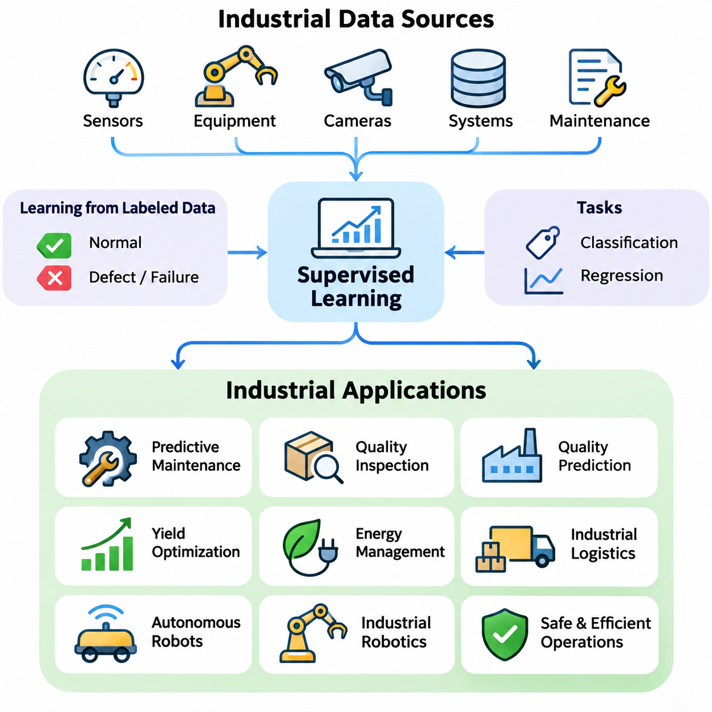
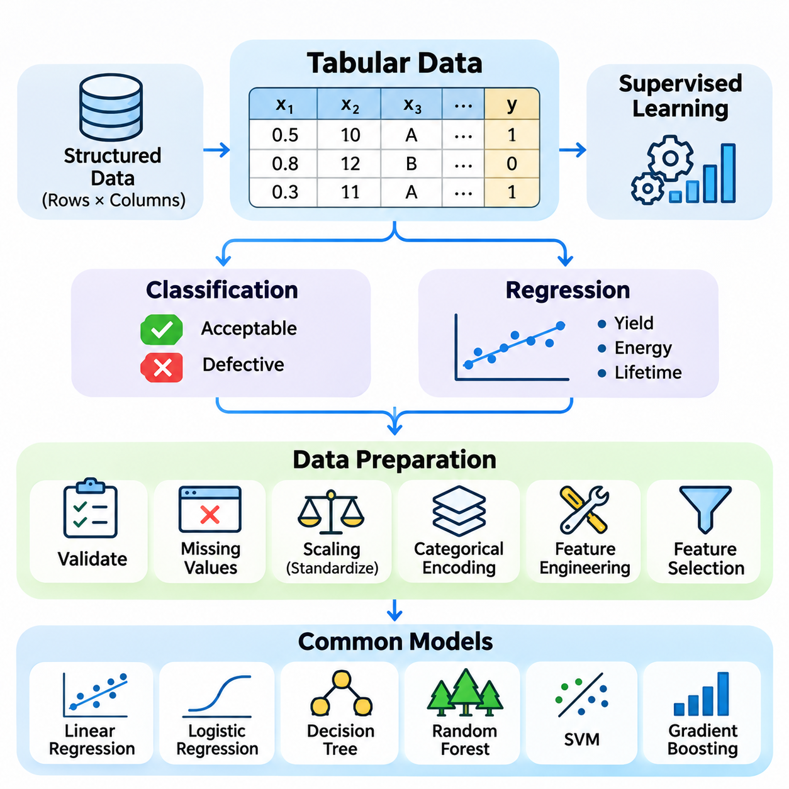
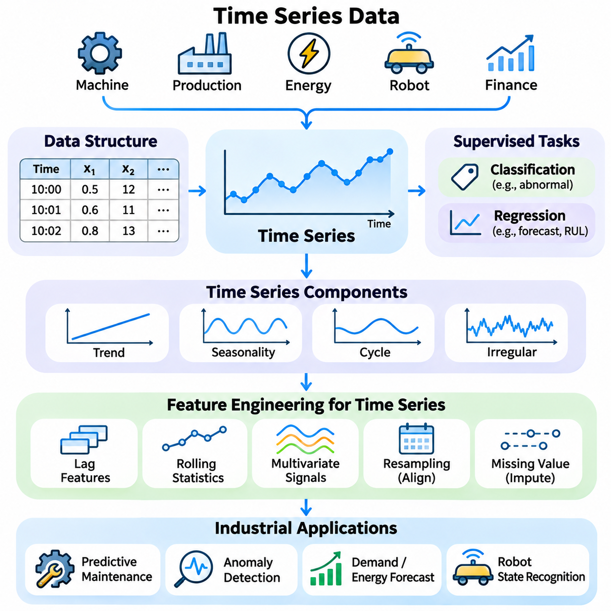
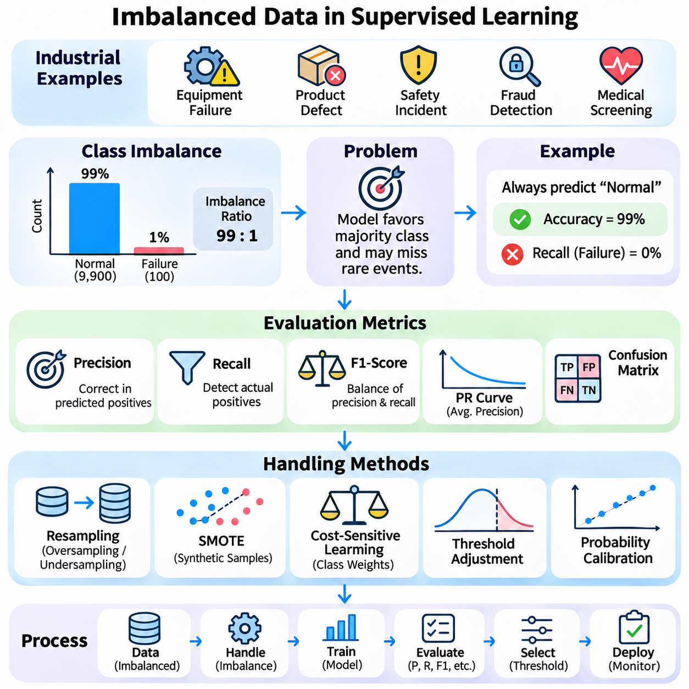
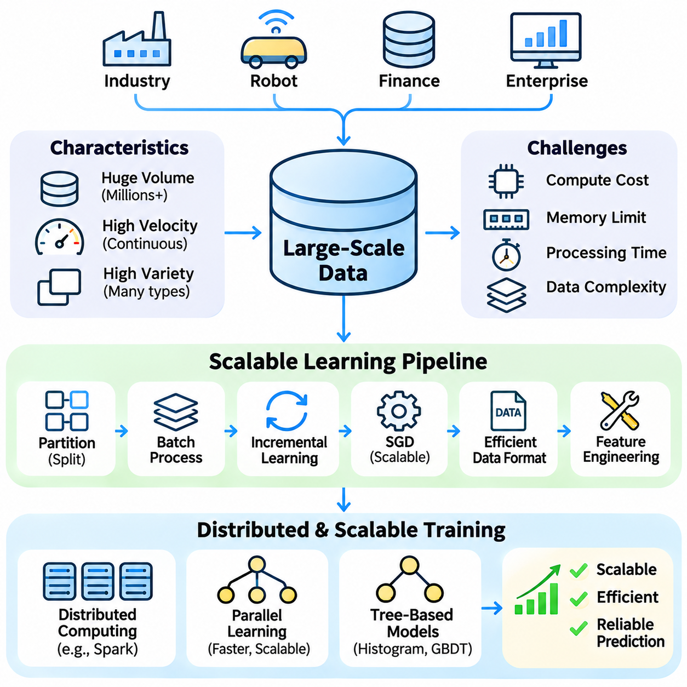
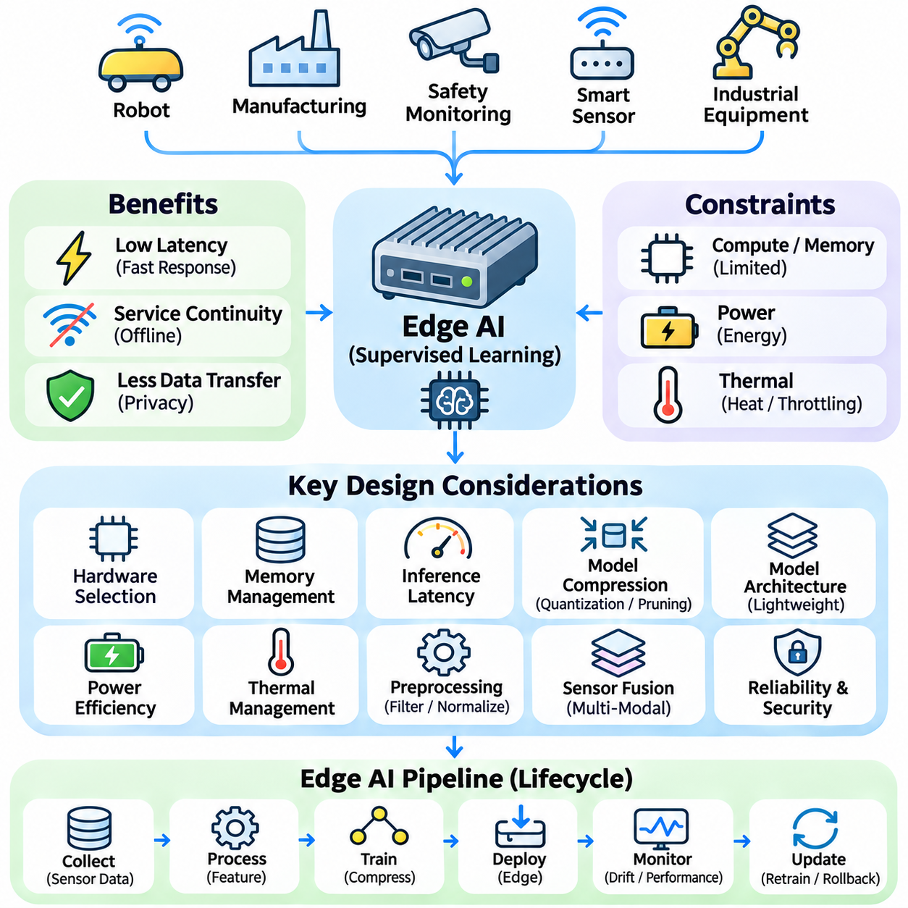
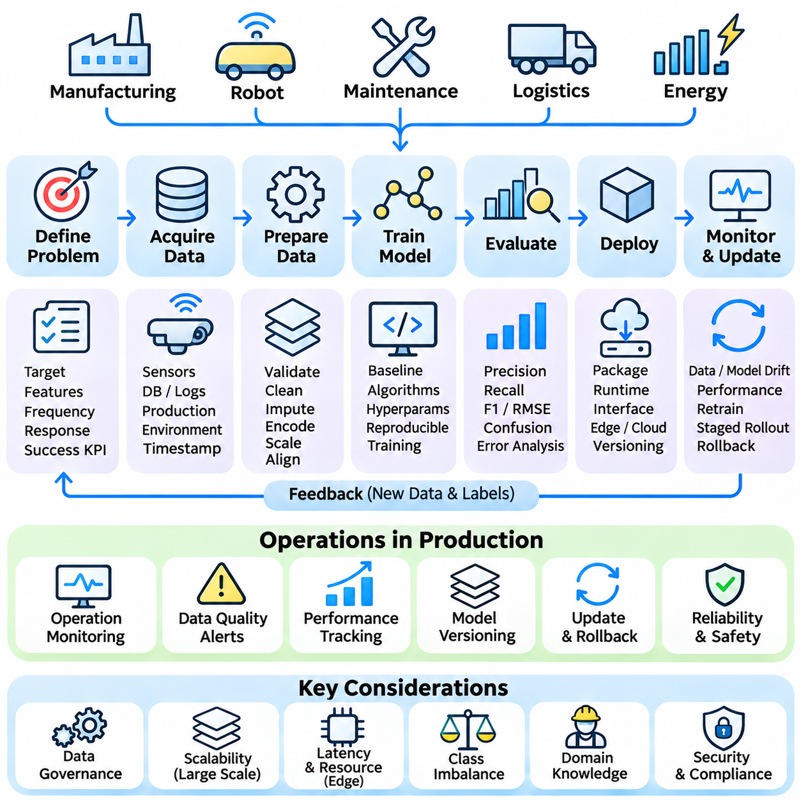

**Volume 08. Supervised Learning**

# 08. Supervised Learning in Real World

## 08.00 Industrial Applications

{width="7.268055555555556in" height="7.268055555555556in"}

Supervised learning has become an essential component of modern industrial systems because it enables organizations to transform historical observations into predictive intelligence. By learning relationships between input variables and known outcomes, supervised models can classify operating conditions, estimate continuous quantities, and support automated decisions. These capabilities improve productivity, consistency, and operational visibility across manufacturing, logistics, energy, and infrastructure.

Industrial environments generate substantial amounts of structured and unstructured data through sensors, controllers, production equipment, cameras, and enterprise information systems. Temperature measurements, vibration signals, motor currents, inspection images, and maintenance records provide valuable information about equipment behavior. Supervised learning converts these observations into models capable of recognizing patterns associated with quality, performance, degradation, and operational risk.

Unlike controlled laboratory experiments, industrial applications operate under changing physical conditions, production requirements, and economic constraints. Equipment ages, raw materials vary, environmental conditions fluctuate, and operators modify operating procedures. Consequently, successful supervised learning requires more than selecting an accurate algorithm. It demands careful problem formulation, reliable data collection, meaningful labels, robust validation, and integration with existing operational processes.

One of the most established industrial applications is predictive maintenance, where supervised models estimate equipment failures or remaining useful life from historical operating data. Sensors measure vibration, temperature, acoustic emissions, pressure, and electrical characteristics. When these measurements are associated with maintenance outcomes or verified failure events, classification and regression models can learn relationships that support earlier detection of abnormal equipment behavior.

Predictive maintenance systems frequently distinguish between normal operation, developing faults, and critical failure conditions. Logistic regression, support vector machines, random forests, and gradient boosting models can classify equipment states using engineered features. Regression models may estimate remaining useful life or future degradation indicators. Their effectiveness depends on representative failure examples, appropriate observation windows, and reliable maintenance records.

Industrial quality inspection represents another important application of supervised learning. Manufacturing organizations must identify defective products while maintaining high production throughput and consistent quality standards. Models can analyze dimensional measurements, surface characteristics, production parameters, and inspection images to predict whether manufactured components satisfy specified requirements. Automated classification reduces repetitive inspection work and helps identify recurring manufacturing problems.

Quality prediction can also occur before final inspection by analyzing process parameters associated with manufacturing outcomes. Injection molding temperature, machining speed, welding current, material composition, and environmental conditions may influence product quality. Supervised regression models estimate dimensions, strength, or other measurable properties, while classification models predict defect categories. These predictions support process adjustments before substantial quantities of defective products accumulate.

Production yield optimization uses supervised learning to identify relationships between operating conditions and manufacturing efficiency. Historical production records contain information about machine settings, material batches, cycle times, environmental conditions, and accepted products. Regression models estimate expected yield, while classification models identify operating conditions associated with excessive rejection rates. Engineers can use these predictions to investigate influential variables and improve process consistency.

Energy management provides another practical application because industrial facilities consume electricity, fuel, compressed air, and thermal energy under variable operating conditions. Supervised regression models estimate energy consumption from production schedules, equipment utilization, ambient temperature, and historical demand. Accurate forecasting supports capacity planning, peak-demand management, and operational efficiency. Predictions can also reveal unexpected consumption patterns that warrant engineering investigation.

Industrial logistics systems apply supervised learning to demand forecasting, delivery-time estimation, inventory planning, and operational risk prediction. Historical shipment records, order volumes, transportation conditions, and warehouse activity provide training examples. Regression models estimate delivery durations or expected demand, while classification models identify delayed shipments and potential fulfillment problems. These predictions help organizations allocate resources and anticipate operational disruptions.

Autonomous mobile robots and automated material-handling systems also benefit from supervised learning. Classification models recognize obstacles, floor conditions, operational states, and equipment abnormalities using camera images and sensor measurements. Regression models estimate quantities such as travel time, battery consumption, or traction-related performance. These predictions contribute to perception and operational planning, although safe autonomous navigation also requires localization, control, and appropriate safety mechanisms.

In industrial robotics, supervised learning can support object recognition, grasp suitability estimation, assembly inspection, and equipment condition monitoring. Training examples may include labeled images, force measurements, joint positions, and verified task outcomes. Models learn relationships between observable conditions and successful or unsuccessful operations. Their deployment requires careful consideration of sensor calibration, timing constraints, environmental variation, and the consequences of incorrect predictions.

Industrial applications commonly rely on tabular datasets because many operational records originate from databases, manufacturing execution systems, and supervisory control systems. Each observation may represent a product, machine cycle, maintenance event, or production interval. Features describe measurable conditions, while labels represent known outcomes. Linear models and tree-based algorithms often provide effective starting points because they can process structured variables with relatively modest computational requirements.

Decision trees and random forests are particularly useful when industrial relationships involve nonlinear interactions between operating variables. A manufacturing defect may depend on combinations of temperature, pressure, material properties, and machine settings rather than a single measurement. Tree-based models can represent such interactions without requiring explicit mathematical equations. Their feature importance estimates may also help engineers identify variables deserving further investigation.

Gradient boosting methods, including XGBoost, LightGBM, and CatBoost, are widely applicable to industrial tabular prediction problems. These algorithms construct ensembles of decision trees that progressively improve predictive performance. They can capture nonlinear relationships and complex feature interactions while supporting regularization and computational optimization. Nevertheless, model selection should depend on validation results, operational constraints, interpretability, and maintenance requirements rather than popularity alone.

Support vector machines remain relevant in industrial applications involving carefully engineered features and moderate-sized datasets. Their maximum-margin principle supports classification when operating conditions exhibit distinguishable patterns. Kernel methods can represent nonlinear decision boundaries, making them useful for certain fault classification and quality recognition problems. However, computational cost, feature scaling, and model complexity must be evaluated before deployment on large industrial datasets.

The quality of industrial labels often determines the practical value of supervised learning. Maintenance records may contain incomplete fault descriptions, inspection decisions may differ between operators, and production databases may include inconsistent timestamps. These problems introduce uncertainty into training targets. Establishing clear labeling standards, verifying critical events, and maintaining traceability between measurements and outcomes are therefore essential activities during dataset preparation.

Class imbalance is especially important because serious industrial failures are often rare compared with normal operating conditions. A model trained primarily on healthy equipment may achieve high overall accuracy while failing to recognize critical faults. Appropriate evaluation requires attention to precision, recall, false alarm rates, and the consequences of missed detections. Class weighting, suitable sampling methods, and threshold selection can improve performance when applied without contaminating evaluation data.

Time-dependent industrial observations introduce additional challenges because measurements collected from the same equipment are often strongly correlated. Randomly dividing records into training and testing datasets can produce overly optimistic results when adjacent observations share operating conditions. Chronological validation, equipment-level separation, and production-batch grouping provide more realistic assessments. These strategies help determine whether models can generalize to future operations and previously unseen equipment.

Industrial supervised learning must also account for data leakage, which occurs when training features contain information unavailable at the intended prediction time. A maintenance model may accidentally use measurements recorded after a failure, or a quality model may incorporate inspection results obtained after production. Such features can create misleadingly high validation scores. Every input variable should therefore be checked against the actual timing and information boundaries of deployment.

Model interpretability is particularly valuable when predictions influence production decisions, maintenance schedules, or safety-related operations. Engineers frequently need to understand which measurements contributed to a prediction and whether the resulting behavior is physically plausible. Linear coefficients, decision-tree rules, feature importance, and explanation methods can provide useful insights. However, statistical associations and model explanations should not automatically be interpreted as proof of physical causation.

Deployment introduces constraints that are rarely visible during offline model development. Industrial systems may require deterministic response times, limited memory consumption, continuous operation, and compatibility with programmable logic controllers or edge computers. A highly accurate model may be unsuitable if inference takes too long or requires unavailable computing resources. Practical evaluation must therefore consider latency, throughput, resource consumption, reliability, and integration complexity.

Edge AI deployment places prediction capabilities close to industrial equipment, reducing dependence on continuous cloud connectivity. Local inference can support rapid defect detection, equipment monitoring, and robotic perception. However, embedded processors and industrial computers have finite computational and thermal capacity. Model compression, efficient feature extraction, quantization, and hardware-aware optimization can improve deployment feasibility when their effects on prediction accuracy are carefully validated.

Industrial model performance may deteriorate when operating conditions change after deployment. New materials, equipment replacements, sensor drift, seasonal variation, and modified production procedures can alter the statistical relationships learned during training. This phenomenon is commonly described as data drift or concept drift, depending on the nature of the change. Continuous monitoring helps identify when incoming observations or prediction outcomes differ from the conditions represented in the original dataset.

A sustainable industrial learning system requires a feedback process connecting predictions with verified operational outcomes. Maintenance technicians can confirm detected faults, quality inspectors can validate defect classifications, and production engineers can record corrective actions. These observations create additional labeled examples for future model improvement. Retraining should follow controlled validation and release procedures so that newly introduced models do not unexpectedly degrade established operational performance.

Economic evaluation is equally important because predictive accuracy alone does not establish industrial value. False alarms may trigger unnecessary inspections, while missed failures can cause expensive downtime or safety hazards. Quality prediction errors may increase scrap, rework, or customer complaints. Organizations should evaluate models using application-specific costs, expected benefits, and operational risk. The most valuable model is often the one that produces reliable decisions within acceptable economic and engineering constraints.

Successful industrial supervised learning ultimately combines statistical modeling with domain expertise, dependable data infrastructure, and disciplined system engineering. Algorithms provide mechanisms for discovering predictive relationships, but industrial value emerges only when those relationships support trustworthy operational decisions. By integrating data quality, model selection, realistic validation, deployment constraints, and continuous monitoring, organizations can transform supervised learning from an experimental technique into a sustainable industrial capability.

## 08.01 Tabular Data

{width="7.268055555555556in" height="7.268055555555556in"}

Tabular data represents one of the most common and practical forms of information used in supervised learning. It organizes observations into rows and variables into columns, creating a structured representation suitable for statistical analysis and predictive modeling. Each row typically describes an individual sample, transaction, event, or measurement, while each column contains a specific attribute. This organization makes tabular data particularly valuable for industrial and business applications.

In supervised learning, a tabular dataset contains input features and corresponding target values. Features describe observable characteristics, while targets represent outcomes that the model must predict. For example, a manufacturing dataset may include temperature, pressure, production speed, and material properties as features, with product quality as the target. The learning algorithm estimates relationships between these variables and uses them to generate predictions for previously unseen observations.

Tabular datasets support both classification and regression problems. Classification predicts discrete categories such as defective versus acceptable products, customer churn, or equipment failure states. Regression estimates continuous quantities such as energy consumption, production yield, delivery time, or equipment lifetime. Although these tasks share similar data structures, they require different objective functions, evaluation metrics, and prediction interpretations.

A major advantage of tabular data is its compatibility with traditional machine learning algorithms. Linear regression, logistic regression, decision trees, random forests, support vector machines, and gradient boosting methods can operate directly on appropriately prepared structured features. These algorithms often provide competitive performance without requiring the extensive computational resources associated with large deep neural networks, particularly when datasets contain meaningful engineered variables.

Real-world tabular datasets rarely arrive in a form suitable for immediate model training. Missing values, inconsistent measurement units, duplicate records, incorrect data types, and unexpected categorical values can reduce predictive reliability. Data preparation therefore involves examining distributions, validating feature definitions, identifying anomalies, and correcting inconsistencies. The objective is to establish a trustworthy representation of the underlying operational process before learning begins.

Missing values are especially common in industrial databases and enterprise information systems. Sensor communication failures, incomplete transactions, manual entry errors, and unavailable measurements can create gaps in otherwise structured records. Missing data may be handled through deletion, statistical imputation, or model-based estimation. However, the appropriate strategy depends on why values are missing and whether their absence contains useful predictive information.

Numerical features often differ substantially in scale and distribution. Temperature may range across hundreds of units, while vibration amplitudes or chemical concentrations may occupy much smaller numerical ranges. Standardization transforms features using their mean and standard deviation, while normalization can map values into predefined ranges. Scaling is particularly important for distance-based algorithms, support vector machines, and regularized linear models, although tree-based methods are generally less sensitive to feature magnitude.

Categorical variables describe discrete attributes such as machine type, production line, material grade, geographic region, or customer segment. Since many learning algorithms require numerical inputs, categorical values must be represented appropriately. One-hot encoding creates indicator variables for categories, while ordinal encoding assigns numerical values when meaningful ordering exists. Target encoding can also be useful, but it requires careful validation to prevent information leakage.

Feature engineering transforms raw tabular variables into representations that better capture meaningful relationships. Engineers may calculate ratios, differences, interaction terms, rolling statistics, or physically meaningful indicators. For example, motor current and rotational speed can contribute to estimates of operating load, while temperature differences may indicate thermal inefficiency. Effective feature engineering combines statistical reasoning with domain knowledge to improve predictive performance and interpretability.

Feature selection determines which variables should be included in the learning process. Redundant, irrelevant, or unstable features can increase model complexity and reduce generalization. Correlation analysis, statistical tests, regularization, permutation importance, and model-based selection methods can help identify useful predictors. Nevertheless, feature selection must be performed within the training procedure to avoid allowing information from validation or test datasets to influence model development.

Linear models provide an interpretable baseline for many tabular prediction tasks. Linear regression estimates continuous targets through weighted combinations of input variables, while logistic regression models classification probabilities. Their coefficients can reveal directional relationships between features and predictions, subject to assumptions about scaling, dependence, and model specification. Regularization techniques such as Ridge, Lasso, and Elastic Net help control complexity when datasets contain numerous correlated variables.

Decision trees represent tabular relationships through hierarchical rules that divide observations according to feature values. Their structure can capture nonlinear effects and interactions without requiring explicit polynomial transformations. Random forests improve stability by combining predictions from multiple trees trained on varied samples and feature subsets. These methods are useful when relationships are complex, although deep trees and excessively flexible ensembles may still overfit limited or noisy datasets.

Gradient boosting algorithms are particularly effective for many structured prediction problems. XGBoost, LightGBM, and CatBoost construct ensembles that progressively reduce prediction errors through sequential learning. They can represent nonlinear interactions, accommodate heterogeneous feature distributions, and provide strong predictive accuracy on numerous tabular benchmarks. Their practical effectiveness depends on suitable hyperparameters, representative training data, and careful validation rather than algorithm selection alone.

Dataset splitting is essential for estimating how well a tabular model will perform on unseen observations. Training data supports parameter estimation, validation data guides model selection, and test data provides an independent final assessment. Random splitting may be appropriate for independent observations, but grouped or chronological splitting is necessary when records share customers, machines, production batches, or temporal dependencies. Incorrect splitting can produce misleadingly optimistic performance estimates.

Data leakage occurs when a model receives information that would not be available at the intended prediction time. Leakage may arise from post-event measurements, duplicated observations, target-derived variables, or preprocessing performed before dataset separation. For example, a maintenance model should not use repair outcomes to predict failures that occurred earlier. Preventing leakage requires examining feature provenance, prediction timing, and every transformation applied during model development.

Evaluation metrics must correspond to the prediction objective and operational consequences. Classification models may be assessed using accuracy, precision, recall, F1-score, and area under the receiver operating characteristic curve. Regression models commonly use mean absolute error, mean squared error, root mean squared error, and coefficient of determination. No single metric captures every operational requirement, particularly when prediction errors have unequal economic or safety consequences.

Class imbalance frequently affects tabular datasets involving fraud, equipment failures, rare defects, and unusual operational events. When positive cases are uncommon, a classifier may achieve high accuracy by predicting the majority class while missing important events. Class weighting, resampling, threshold adjustment, and precision-recall analysis can address this challenge. Evaluation should use representative data distributions and emphasize the practical consequences of false positives and false negatives.

Interpretability remains an important reason for using tabular machine learning in industrial systems. Feature coefficients, tree rules, permutation importance, partial dependence analysis, and SHAP explanations can help reveal how input variables influence predictions. These methods support engineering review, debugging, and communication with operational stakeholders. However, explanations describe model behavior and statistical relationships rather than automatically establishing causal mechanisms.

Large tabular datasets introduce challenges involving memory usage, training speed, data storage, and distributed processing. Efficient data types, columnar storage formats, batch processing, and optimized learning libraries can reduce computational requirements. Some gradient boosting implementations support histogram-based training and parallel execution. Nevertheless, scaling strategies must preserve data consistency, reproducibility, and the validity of training and evaluation procedures.

Tabular data is frequently combined with temporal information in industrial applications. Individual records may contain timestamps, machine identifiers, operating conditions, and measured outcomes. Historical measurements can be transformed into lag features, moving averages, and trend indicators for supervised prediction. Such transformations require strict chronological consistency because future observations must never influence features intended to represent earlier prediction times.

Deployment of tabular models requires consistent preprocessing between training and inference environments. Missing-value handling, category mappings, feature scaling, and feature ordering must remain identical across both stages. A production pipeline should validate incoming records, reject incompatible schemas, and monitor unexpected values. Versioned preprocessing components and model artifacts improve reproducibility while reducing the risk of silent prediction errors.

Operational monitoring becomes necessary when the statistical properties of tabular data change over time. New equipment, modified manufacturing processes, changing customer behavior, and sensor calibration differences can alter feature distributions and predictive relationships. Monitoring systems can track missing-value rates, category frequencies, feature drift, prediction distributions, and observed performance. These measurements help determine when investigation, recalibration, or retraining is required.

The practical strength of tabular supervised learning comes from combining structured information with appropriate algorithms and disciplined engineering practices. Reliable feature definitions, leakage-free validation, meaningful evaluation metrics, and consistent deployment procedures are often more important than marginal improvements in algorithm complexity. When these principles are applied systematically, tabular models provide efficient, interpretable, and scalable predictive capabilities for real-world industrial systems.

## 08.02 Time Series

{width="7.268055555555556in" height="7.268055555555556in"}

Time series data represents observations collected in chronological order, where the timing and sequence of measurements contain essential predictive information. Unlike ordinary tabular datasets, time series observations are often statistically dependent on earlier values. Industrial sensors, financial markets, energy systems, and autonomous robots continuously generate such data. Supervised learning uses historical patterns to predict future values, classify operating states, and identify emerging abnormalities.

A time series dataset typically contains timestamps, measured variables, and contextual information describing the observed system. Examples include motor temperature recorded every second, electricity consumption measured hourly, and production output summarized daily. The sampling frequency determines the temporal resolution available for analysis. Reliable timestamps, consistent measurement intervals, and clear definitions of observation periods are essential for constructing meaningful predictive models.

Temporal dependence distinguishes time series learning from conventional independent-sample prediction. A machine\'s current temperature may depend on its previous temperature, operating load, and environmental conditions. Similarly, energy consumption may reflect recent demand and recurring production schedules. Supervised models must capture these dependencies through historical features or architectures designed for sequential inputs. Ignoring temporal relationships can reduce accuracy and produce misleading validation results.

Time series often contain trends, seasonal patterns, cycles, and irregular fluctuations. A trend represents a persistent increase or decrease, while seasonality describes recurring changes associated with predictable intervals. Cycles may occur without fixed periods, and random fluctuations introduce additional uncertainty. Understanding these components helps engineers select useful features, appropriate forecasting horizons, and evaluation methods that reflect the underlying system dynamics.

Supervised time series forecasting transforms historical observations into input-output training examples. A model receives measurements from a defined historical window and predicts a future value or sequence of values. For example, the previous sixty minutes of vibration and temperature measurements may be used to estimate equipment conditions ten minutes ahead. The prediction horizon determines how far into the future the model must generalize from available information.

Lag features provide a practical method for converting sequential observations into tabular inputs. A lag feature represents a variable measured at an earlier time, such as temperature one minute ago or pressure five minutes ago. Multiple lags allow a model to examine recent operating history without requiring a specialized sequence architecture. Linear regression, random forests, and gradient boosting models can then learn temporal relationships from these engineered features.

Rolling statistics summarize historical behavior over predefined observation windows. Moving averages capture local trends, while rolling standard deviations describe variability. Minimum, maximum, and rate-of-change features can reveal abrupt transitions or gradual degradation. In industrial monitoring, rolling vibration energy or temperature variation may provide stronger predictive signals than individual measurements. All calculations must use only observations available before the prediction time.

Time series datasets may contain multiple synchronized variables, producing multivariate time series. Industrial equipment commonly generates temperature, vibration, current, voltage, pressure, and rotational speed measurements simultaneously. Relationships between these signals can reveal operating conditions that individual sensors cannot explain. Multivariate supervised learning combines historical measurements across variables to predict future system behavior, equipment states, or performance indicators.

Sampling irregularities create practical challenges because industrial sensors may operate at different frequencies or experience communication interruptions. One sensor may report every millisecond while another updates once per second. Resampling, interpolation, and aggregation can align measurements to a common timeline. However, these operations must respect the intended prediction time and avoid introducing future information into historical features.

Missing observations require careful treatment because gaps may reflect sensor failures, communication delays, maintenance periods, or genuine changes in equipment operation. Forward filling can preserve the most recent known value, while interpolation may estimate missing measurements when appropriate. Long gaps may require explicit missingness indicators or exclusion from training. The selected method should reflect the physical meaning of the signals and the duration of missing intervals.

Time series classification assigns labels to individual timestamps, observation windows, or complete sequences. Applications include detecting abnormal machine behavior, identifying operating modes, recognizing human activities, and classifying robotic motion patterns. Features may describe signal amplitude, frequency content, statistical variation, or temporal transitions. The labeling strategy must define whether the target represents the current condition, a future event, or an entire sequence.

Predictive maintenance frequently uses time series classification and regression to anticipate equipment deterioration. Historical sensor signals are associated with verified faults, maintenance events, or degradation measurements. Classification models estimate the probability of failure within a specified future interval, while regression models predict remaining useful life or future condition indicators. Reliable predictions require representative operating histories and careful handling of incomplete or censored failure observations.

Traditional supervised algorithms remain highly effective for many time series applications when meaningful temporal features are available. Linear models provide interpretable baselines, while random forests and gradient boosting capture nonlinear interactions among lagged variables. Support vector machines can classify operating conditions using engineered signal characteristics. These approaches are often computationally efficient and suitable for industrial environments with limited training data.

Deep learning provides alternative methods for modeling complex sequential dependencies. Recurrent neural networks, long short-term memory networks, temporal convolutional networks, and Transformer-based architectures can process sequences with different mechanisms for representing temporal relationships. These models may capture patterns that are difficult to express through manual feature engineering. However, their advantages depend on dataset size, signal complexity, computational resources, and evaluation conditions.

Forecasting strategies differ according to the number of future observations required. One-step forecasting predicts the next value, while multi-step forecasting estimates several future values. Recursive forecasting repeatedly uses earlier predictions as inputs, potentially accumulating errors. Direct forecasting trains models for specific future horizons, while multi-output approaches predict several horizons together. The appropriate strategy depends on prediction accuracy, operational latency, and planning requirements.

Chronological data splitting is essential for realistic time series evaluation. Training observations should precede validation observations, which should generally precede the final test period. Random splitting can leak information when neighboring measurements share temporal patterns or overlapping windows. Walk-forward validation repeatedly trains on earlier data and evaluates later intervals, providing a practical assessment of performance under changing operational conditions.

Time series leakage can occur through improperly calculated rolling features, future-dependent normalization, overlapping windows, or labels derived from unavailable outcomes. For example, a model predicting tomorrow\'s equipment condition must not use measurements recorded tomorrow. Preprocessing parameters should be estimated from training data, and feature generation must preserve chronological boundaries. Preventing leakage is necessary for obtaining trustworthy estimates of deployment performance.

Forecasting performance is commonly measured using mean absolute error, root mean squared error, and related regression metrics. Classification applications may require precision, recall, F1-score, and event detection delay. Error analysis should consider different operating regimes, seasonal conditions, and forecasting horizons. A model that performs well on average may still fail during rare but operationally important transitions.

Concept drift presents a significant challenge because temporal relationships may change as equipment ages, production schedules evolve, or environmental conditions shift. A model trained under earlier operating conditions may gradually lose predictive accuracy. Monitoring feature distributions, residual errors, and prediction reliability helps detect deterioration. Retraining and recalibration should follow controlled procedures that preserve historical evaluation records and deployment traceability.

Real-time time series inference requires careful management of data acquisition, buffering, feature computation, and prediction latency. Edge devices may continuously collect sensor measurements and maintain rolling observation windows. Predictions must be generated within operational deadlines while respecting memory and computational constraints. Efficient implementations often combine lightweight feature extraction with supervised models that can execute reliably on industrial processors.

Autonomous robots provide an important example of multivariate temporal learning. Wheel encoder measurements, inertial signals, motor currents, battery voltage, and environmental observations form synchronized sequences. Supervised models can estimate terrain-related operating conditions, energy consumption, motion anomalies, or component degradation. These predictions support perception and maintenance functions, while safety-critical control still requires appropriate estimation, verification, and protective mechanisms.

Successful time series supervised learning depends on preserving the relationship between measurements and their temporal context. Reliable timestamps, causal feature construction, representative training periods, chronological validation, and continuous monitoring are fundamental requirements. By combining these principles with suitable regression, classification, and sequence modeling techniques, organizations can transform historical sensor streams into actionable predictions for industrial and autonomous systems.

## 08.03 Imbalanced Data

{width="7.268055555555556in" height="7.268055555555556in"}

Imbalanced data is a common challenge in supervised learning when the number of observations differs substantially between target classes. In many industrial applications, normal operating conditions dominate datasets, while equipment failures, manufacturing defects, and safety incidents occur infrequently. This unequal distribution can cause learning algorithms to favor majority classes and overlook rare but important events, even when overall prediction accuracy appears satisfactory.

Class imbalance becomes particularly problematic when minority observations represent outcomes with significant operational consequences. A predictive maintenance system may encounter thousands of healthy equipment records but only a small number of confirmed failures. Similarly, fraud detection and medical screening systems often operate with rare positive cases. The central challenge is not simply unequal class frequencies but the difficulty of learning reliable decision boundaries from limited minority examples.

The imbalance ratio provides a basic description of class distribution by comparing majority and minority sample counts. A dataset containing 9,900 normal observations and 100 failure observations has an imbalance ratio of 99 to 1. However, this ratio alone does not determine learning difficulty. Feature overlap, label quality, minority diversity, sample size, and the consequences of prediction errors also influence whether a classifier can recognize rare events effectively.

Accuracy becomes misleading when a classifier can achieve a high score by predicting the majority class almost exclusively. In a dataset containing 99 percent normal observations, a model that always predicts normal achieves 99 percent accuracy while detecting no failures. This demonstrates why imbalanced classification requires metrics that distinguish between different error types. Evaluation must reflect the operational importance of identifying minority events rather than merely maximizing correct predictions.

Precision measures the proportion of predicted positive cases that are actually positive, while recall measures the proportion of actual positive cases successfully detected. High precision reduces unnecessary alarms, whereas high recall reduces missed events. In industrial monitoring, increasing recall may detect more equipment failures but also generate additional false alarms. The appropriate balance depends on maintenance costs, inspection capacity, safety requirements, and the consequences of undetected failures.

The F1-score combines precision and recall through their harmonic mean, providing a useful summary when both measures matter. However, a single F1-score cannot fully represent every operational requirement. Precision-recall curves show how these metrics change across decision thresholds, while average precision summarizes ranking performance. Such measures are often more informative than accuracy when the positive class is rare and operationally significant.

Confusion matrices provide a direct interpretation of classification outcomes through true positives, true negatives, false positives, and false negatives. For an industrial fault detector, a false positive may trigger unnecessary maintenance, while a false negative may allow equipment damage to progress. These errors have different economic and safety implications. Evaluating their frequencies helps engineers select models according to operational consequences rather than abstract statistical performance alone.

Resampling methods address class imbalance by modifying the distribution of training examples. Random oversampling duplicates minority observations, increasing their representation during learning. Random undersampling removes selected majority observations to reduce dominance. Oversampling preserves the available majority information but may increase overfitting, while undersampling reduces training size and may discard useful operating patterns. Their effectiveness depends on dataset characteristics and model behavior.

Synthetic Minority Over-sampling Technique, commonly known as SMOTE, generates artificial minority examples by interpolating between nearby minority observations. This can help classifiers learn broader minority regions instead of repeatedly encountering identical samples. However, synthetic examples may become unrealistic when features represent discrete operating modes, constrained physical relationships, or mixed categorical variables. Generated samples should therefore be evaluated for plausibility and potential overlap with majority observations.

Cost-sensitive learning provides an alternative to changing the training distribution. Instead of modifying sample counts, it assigns greater penalties to mistakes involving important classes. Weighted logistic regression, support vector machines, and tree-based algorithms can incorporate class weights during optimization. This approach allows models to emphasize rare failures while retaining the original training observations. Appropriate weights should reflect validation performance and operational costs rather than arbitrary assumptions.

Decision threshold adjustment is another important technique because probabilistic classifiers do not necessarily require a fixed threshold of 0.5. Lowering the positive-class threshold generally increases sensitivity but may also increase false alarms. Engineers can select thresholds using validation data, precision-recall analysis, and estimated error costs. Threshold selection should remain separate from final test evaluation to prevent optimistic performance estimates.

Probability calibration becomes important when classification scores are used to estimate operational risk. A model trained with aggressive resampling or class weighting may produce scores that do not directly represent real-world event probabilities. Calibration methods can improve agreement between predicted probabilities and observed frequencies. Calibration must use representative validation data, particularly when deployment prevalence differs from the distribution used during model training.

Data leakage presents a serious risk when resampling is performed before dividing observations into training and evaluation datasets. Duplicated or synthetic examples may then appear across both partitions, producing misleadingly high performance. The correct procedure separates training, validation, and test data before applying sampling operations. Within cross-validation, resampling must occur independently inside each training fold, leaving validation observations untouched.

Imbalanced datasets frequently contain additional complications such as noisy labels, overlapping feature distributions, and insufficient minority diversity. A few failure examples may represent only one operating condition or equipment type. Increasing their numerical frequency does not create genuinely new information about other failure mechanisms. Improving data collection, verifying labels, and obtaining representative minority examples may therefore be more valuable than applying increasingly sophisticated sampling algorithms.

Ensemble learning can improve imbalanced classification by combining models trained on different samples or emphasizing difficult observations. Balanced random forests use modified sampling strategies, while boosting methods progressively focus on prediction errors. Gradient boosting frameworks also support class weighting and customized objectives. Nevertheless, ensemble complexity does not guarantee minority detection, and performance must be verified using realistic evaluation distributions.

Industrial time series introduce additional challenges because minority events often occur in correlated sequences rather than independent observations. A single equipment failure may generate hundreds of adjacent abnormal measurements. Random splitting can place nearly identical observations into training and testing sets, exaggerating generalization performance. Chronological splitting, equipment-level grouping, and event-based evaluation provide more realistic assessments of whether models detect previously unseen failures.

Event-level evaluation is especially valuable when the objective is detecting rare operational incidents. A model may correctly classify many abnormal timestamps while identifying only one actual failure event. Conversely, a few early warnings may provide substantial operational value even when timestamp-level recall is modest. Metrics such as event detection rate, false alarms per operating hour, and detection lead time can better reflect practical monitoring performance.

Anomaly detection may complement supervised classification when confirmed minority labels are extremely limited. Models can learn patterns associated with normal operation and identify observations that deviate from those patterns. However, anomalies are not necessarily failures, and unusual conditions may represent legitimate operating changes. Combining anomaly detection with verified labels and engineering knowledge can improve rare-event monitoring without assuming that every deviation indicates a fault.

The appropriate imbalance strategy depends on dataset size, class overlap, model architecture, and deployment objectives. Simple class weighting may be sufficient for some logistic regression or gradient boosting problems, while other datasets benefit from carefully controlled resampling. Comparing multiple strategies under identical validation conditions helps identify genuine improvements. More complex methods should be adopted only when they demonstrate measurable benefits over reliable baseline models.

Deployment requires monitoring both prediction quality and changes in class prevalence. Failure frequencies may change after maintenance improvements, equipment replacements, or operational modifications. Such changes can alter precision and the practical meaning of predicted probabilities, even when underlying model discrimination remains similar. Monitoring event rates, false alarms, missed detections, and calibration helps maintain reliable performance under evolving industrial conditions.

Human review and feedback are particularly important when rare-event predictions trigger costly or safety-related actions. Maintenance engineers can verify suspected faults, quality inspectors can confirm defects, and operators can document unusual conditions. These verified outcomes provide additional labeled examples and support future model improvement. Feedback processes should distinguish confirmed events from uncertain cases to avoid reinforcing incorrect predictions during retraining.

Imbalanced supervised learning ultimately requires aligning statistical methods with the consequences of real-world decisions. Resampling, class weighting, threshold adjustment, calibration, and ensemble methods provide useful mechanisms, but none replaces representative data and realistic validation. By emphasizing minority detection, operational costs, temporal integrity, and continuous monitoring, organizations can develop classifiers that recognize rare events reliably while maintaining acceptable false alarm rates.

## 08.04 Large Scale Data

{width="7.268055555555556in" height="7.268055555555556in"}

Large-scale data has become a defining characteristic of modern supervised learning as industrial systems, digital platforms, and connected devices continuously generate enormous volumes of observations. Manufacturing equipment, autonomous robots, financial transactions, and enterprise applications produce datasets that may contain millions or billions of records. Learning from these datasets requires methods that preserve predictive quality while managing computational complexity, memory consumption, and processing time.

The challenges of large-scale supervised learning extend beyond the number of observations. Datasets may contain thousands of features, heterogeneous data types, incomplete records, and measurements collected across geographically distributed systems. Data volume, velocity, and variety influence how information is stored, processed, and analyzed. Effective learning systems must coordinate data engineering, statistical modeling, and computational infrastructure to transform these resources into reliable predictions.

Traditional machine learning workflows often assume that complete datasets can fit into a computer\'s main memory. This assumption becomes impractical when data exceeds available RAM or when multiple training experiments must run simultaneously. Loading entire datasets may cause memory exhaustion, excessive disk swapping, or unacceptable processing delays. Scalable learning therefore requires efficient storage formats, incremental processing, and algorithms designed to operate under limited memory conditions.

Data partitioning divides large datasets into smaller segments that can be processed independently or sequentially. Partitions may be organized by time, geographic region, equipment identifier, or storage location. Proper partitioning improves data access and enables parallel computation. However, partition boundaries must preserve relevant relationships and prevent leakage between training and evaluation datasets, particularly when observations share temporal or operational dependencies.

Batch processing provides a practical mechanism for handling datasets that cannot be loaded entirely into memory. Instead of processing every observation simultaneously, the system reads manageable groups of records and performs transformations or model updates. Batch size influences memory requirements, computational efficiency, and training stability. Selecting an appropriate batch size requires balancing hardware capacity, data access overhead, and the statistical behavior of the learning algorithm.

Incremental learning allows models to update their parameters as new observations become available. Algorithms supporting partial fitting can process successive data batches without retraining from the beginning. This approach is useful for continuously expanding industrial datasets and streaming applications. However, incremental updates must account for changing data distributions, model stability, and the risk of forgetting patterns represented by earlier observations.

Stochastic gradient descent provides a scalable optimization method for many linear and differentiable supervised models. Rather than calculating gradients over the complete dataset, it estimates updates using individual observations or mini-batches. This reduces memory requirements and supports efficient training on large collections of examples. Learning rate schedules, regularization, and convergence monitoring remain important because noisy gradient estimates can affect training stability.

Efficient data representation substantially influences large-scale learning performance. Columnar formats such as Parquet can improve analytical access, while compressed storage reduces disk requirements. Appropriate numerical precision and categorical encodings can lower memory consumption without necessarily reducing predictive usefulness. Data engineers must evaluate the tradeoffs between compression, decoding overhead, storage cost, and computational efficiency when designing scalable pipelines.

Feature engineering becomes more challenging when transformations must be applied consistently across millions of observations. Aggregations, normalization, categorical encoding, and missing-value handling may require distributed computation or streaming statistics. Transformation parameters should be estimated from training data and reused during validation and deployment. Versioned preprocessing pipelines help maintain reproducibility while preventing inconsistencies between different processing environments.

Distributed computing enables large datasets to be processed across multiple machines or computational workers. Data-parallel systems divide observations among workers, allowing independent processing before combining intermediate results. Frameworks such as Apache Spark and distributed machine learning libraries support scalable transformations and selected training algorithms. Their effectiveness depends on communication overhead, workload distribution, storage performance, and fault tolerance.

Parallel learning can reduce training time, but additional computing resources do not guarantee proportional speed improvements. Communication between workers, synchronization barriers, disk access, and uneven task distribution may become bottlenecks. Some algorithms parallelize naturally, while others require frequent coordination. Scalability analysis should therefore consider total execution time, resource utilization, and the relationship between computational gains and infrastructure costs.

Tree-based models require particular attention when operating on large datasets. Conventional decision-tree construction may involve expensive sorting and repeated feature evaluations. Histogram-based methods reduce computation by grouping continuous feature values into discrete bins. Modern gradient boosting implementations use optimized data structures, parallel processing, and memory-efficient algorithms to improve training speed while maintaining competitive predictive accuracy.

Large-scale classification frequently involves highly imbalanced datasets where rare events are hidden among enormous numbers of normal observations. Fraud detection, equipment failure prediction, and industrial defect monitoring illustrate this challenge. Sampling strategies and class weighting can reduce computational demands while emphasizing important outcomes. Nevertheless, validation datasets must preserve realistic event frequencies to ensure that performance estimates remain operationally meaningful.

High-dimensional datasets introduce additional computational and statistical difficulties. Thousands of features may increase memory consumption, training time, and the risk of overfitting. Feature selection, regularization, sparse representations, and dimensionality reduction can improve efficiency. However, reducing dimensionality must preserve information relevant to the prediction objective, and transformations should be learned without accessing held-out evaluation data.

Data quality becomes increasingly important as dataset size grows because even small error rates can affect large numbers of records. Duplicate observations, inconsistent labels, corrupted measurements, and schema changes may introduce systematic bias. Automated validation procedures can detect missing fields, unexpected ranges, incompatible data types, and distribution changes. Large-scale learning requires continuous data quality monitoring rather than assuming that more observations automatically produce better models.

Training and evaluation procedures must remain statistically valid at scale. Random splitting may be inappropriate when records share customers, machines, production batches, or chronological relationships. Grouped and time-aware validation strategies help prevent overly optimistic results. Large datasets also make it possible to create representative evaluation subsets, but these subsets must retain important rare events and operational conditions.

Hyperparameter optimization becomes expensive when each model training run consumes substantial computational resources. Exhaustive grid search may be impractical for large datasets or complex ensembles. Random search, Bayesian optimization, successive halving, and early stopping can reduce unnecessary computation. Efficient experimentation also requires recording configurations, random seeds, dataset versions, and evaluation results so that comparisons remain reproducible.

Hardware architecture strongly influences large-scale supervised learning efficiency. CPUs provide flexible processing for structured data, while GPUs accelerate suitable numerical operations and parallel workloads. Memory bandwidth, storage throughput, network communication, and accelerator capacity may limit performance more than raw processing power. Hardware selection should therefore reflect algorithm characteristics, dataset structure, and the balance between training speed and operational cost.

Cloud computing offers elastic resources for large-scale training, allowing organizations to allocate processing capacity according to workload requirements. On-premises infrastructure provides greater control over data location, hardware configuration, and operational policies. Hybrid architectures combine local data processing with remote computational resources. The appropriate deployment strategy depends on data governance, security requirements, communication costs, and the frequency of model updates.

Large-scale model deployment introduces challenges beyond training efficiency. Prediction services may need to process thousands of requests per second while maintaining consistent latency and availability. Batch inference can efficiently process large collections of records, whereas online inference supports immediate decisions. Production architectures must account for model loading, feature retrieval, resource allocation, failure recovery, and monitoring under changing workloads.

Monitoring large-scale supervised systems requires tracking both computational and statistical performance. Infrastructure metrics include processing latency, memory utilization, throughput, and failure rates. Model metrics include prediction quality, calibration, feature drift, and changes in target distributions. Combining these measurements helps engineers distinguish infrastructure failures from deteriorating model behavior and determine when optimization or retraining is necessary.

Large-scale supervised learning ultimately depends on integrating efficient algorithms, reliable data infrastructure, and disciplined operational practices. Distributed processing, incremental learning, optimized storage, and hardware acceleration make enormous datasets computationally manageable, but scalability alone does not guarantee trustworthy predictions. Sustainable systems must preserve data quality, statistical validity, reproducibility, and operational reliability as data volumes and application requirements continue to grow.

## 08.05 Edge AI Considerations

{width="7.268055555555556in" height="7.268055555555556in"}

Edge AI brings supervised learning models closer to the physical environments where data is generated and decisions must be made. Instead of transmitting every observation to remote cloud servers, edge devices perform inference locally using embedded processors, industrial computers, or specialized accelerators. This approach is particularly valuable for autonomous robots, manufacturing equipment, smart sensors, and safety monitoring systems that require responsive and reliable predictions.

The primary motivation for Edge AI is reducing dependence on remote computing infrastructure while improving operational responsiveness. Network communication introduces latency, bandwidth consumption, and potential interruptions that may be unacceptable for time-sensitive applications. Local inference can provide predictable response times and maintain selected functions during connectivity failures. However, edge deployment also introduces constraints involving processing capacity, memory, energy consumption, and thermal management.

Hardware selection strongly influences the feasibility of supervised learning at the edge. Microcontrollers, embedded CPUs, GPUs, and neural processing units provide different combinations of computational capability and power efficiency. Lightweight classification models may execute on microcontrollers, while image recognition and complex sensor fusion may require embedded accelerators. The appropriate platform depends on model architecture, input resolution, inference frequency, and available power.

Memory limitations are especially important because edge devices must store model parameters, intermediate activations, preprocessing buffers, and application software within restricted resources. A model that operates efficiently on a workstation may exceed the memory capacity of an embedded system. Engineers must evaluate peak memory usage rather than considering model file size alone. Memory fragmentation, concurrent processes, and operating system requirements can further reduce available capacity.

Inference latency determines whether a deployed model can meet the timing requirements of its application. A robotic perception system may need predictions within milliseconds, while industrial quality inspection may tolerate longer processing intervals. Average latency alone is insufficient because occasional delays can disrupt time-sensitive operations. Engineers should measure worst-case or high-percentile latency under representative workloads and include preprocessing, inference, and postprocessing costs.

Model compression reduces computational and memory requirements while attempting to preserve predictive performance. Quantization represents weights and activations using lower numerical precision, such as INT8 instead of FP32. Pruning removes selected parameters or structures, while knowledge distillation trains a smaller model using guidance from a larger model. Each technique requires validation because reduced precision or capacity may affect rare-event detection and prediction stability.

Quantization is particularly useful when target hardware provides efficient integer arithmetic or dedicated acceleration. Post-training quantization converts an existing trained model, while quantization-aware training incorporates numerical constraints during learning. Calibration datasets should represent actual deployment conditions, including unusual operating states. Engineers must verify that quantized models preserve acceptable accuracy, numerical stability, and confidence behavior across relevant input distributions.

Model architecture selection should reflect edge hardware characteristics rather than relying exclusively on benchmark accuracy. Linear models, compact decision trees, and optimized gradient boosting can be effective for structured sensor data. Lightweight convolutional networks may support visual inspection, while compact temporal models can analyze sequential measurements. A simpler model with predictable execution and stable performance may be preferable to a larger architecture offering marginal accuracy improvements.

Power consumption directly affects battery-operated robots, mobile equipment, and remote monitoring devices. Continuous inference competes with sensing, communication, actuation, and other computational workloads for limited energy resources. Dynamic frequency scaling, efficient accelerators, and adaptive inference scheduling can reduce consumption. Energy evaluation should consider complete application behavior rather than measuring isolated model execution under ideal laboratory conditions.

Thermal constraints can limit sustained Edge AI performance even when sufficient computational capability is available. Embedded processors may reduce operating frequency when temperatures exceed safe limits, increasing inference latency. Industrial enclosures, outdoor environments, and restricted airflow can intensify thermal challenges. Engineers should evaluate sustained workloads across expected ambient temperatures and consider cooling design, enclosure characteristics, and thermal throttling behavior.

Sensor preprocessing is a critical component of edge inference pipelines. Raw camera images, vibration measurements, motor currents, and inertial signals often require filtering, normalization, synchronization, or feature extraction before entering a model. These operations consume memory and processing time and must remain consistent with training procedures. Differences between offline preprocessing and deployed implementations can introduce prediction errors even when the trained model remains unchanged.

Real-time sensor fusion requires careful coordination when multiple input streams operate at different frequencies. Cameras, inertial sensors, wheel encoders, and environmental sensors may produce observations with different timestamps and communication delays. Synchronization and buffering policies determine which measurements are combined for each prediction. Poor temporal alignment can reduce supervised model accuracy and create inconsistent interpretations of the physical environment.

Edge deployment often benefits from separating computational tasks according to their timing and resource requirements. Time-critical perception and monitoring functions may execute locally, while computationally expensive analysis and model training occur on nearby servers or cloud infrastructure. This division reduces communication dependence without requiring every operation to run on constrained devices. Clear interface definitions and predictable fallback behavior are essential for reliable distributed operation.

Network connectivity remains important for fleet monitoring, model distribution, data collection, and remote diagnostics. However, communication bandwidth may fluctuate or become unavailable in factories, warehouses, outdoor environments, and mobile robotic applications. Edge systems should define which functions remain operational without connectivity and which require external services. Local buffering and delayed synchronization can preserve important observations during temporary network interruptions.

Reliability becomes especially important when supervised predictions influence physical equipment or operational decisions. Models may encounter corrupted sensor measurements, unexpected input ranges, hardware faults, or unfamiliar environmental conditions. Input validation, confidence monitoring, fault detection, and conservative fallback procedures can reduce operational risk. Safety-critical functions should not depend exclusively on statistical predictions without independent safeguards and appropriate system verification.

Distribution shift can degrade edge model performance when deployment conditions differ from training environments. Changes in lighting, vibration characteristics, sensor calibration, equipment wear, and environmental temperature may alter input distributions. Monitoring feature statistics and prediction behavior helps identify potential degradation. Retraining should use representative operational data and controlled evaluation procedures before updated models are deployed.

Model updates require version control, compatibility verification, and reliable installation procedures. An updated model may change memory requirements, execution latency, numerical behavior, or expected input features. Deployment systems should validate model artifacts and support rollback when updates fail or performance deteriorates. For distributed robotic fleets, staged deployment can reduce the risk of introducing the same defect across every device simultaneously.

Security and privacy considerations influence how Edge AI systems collect, process, and transmit data. Local inference can reduce the need to transfer sensitive observations to remote services, but it does not eliminate security risks. Device authentication, encrypted communication, secure boot, and protected model storage help reduce unauthorized access or modification. Data retention and logging policies should reflect operational requirements and applicable governance obligations.

Hardware and software compatibility must be considered throughout the model development lifecycle. Training frameworks may produce models that require conversion into formats supported by embedded inference runtimes. Operator compatibility, numerical precision, accelerator drivers, and runtime versions can affect execution. Testing should use the actual deployment hardware because workstation benchmarks may not accurately represent embedded performance or supported functionality.

Edge AI evaluation must combine predictive metrics with system-level measurements. Accuracy, precision, recall, and regression error describe model quality, while latency, throughput, memory consumption, energy usage, and thermal stability describe operational feasibility. Evaluations should include representative sensor inputs, concurrent workloads, and realistic environmental conditions. A model is suitable for deployment only when both predictive and engineering requirements are satisfied.

Autonomous mobile robots illustrate the practical integration of Edge AI and supervised learning. Local models can classify terrain conditions, estimate energy consumption, recognize equipment anomalies, and interpret sensor observations. These predictions may support navigation, maintenance, and operational planning, while deterministic control and independent safety mechanisms handle critical constraints. Effective integration requires coordinated timing, reliable data exchange, and clearly defined responsibilities between software components.

Successful Edge AI deployment requires treating supervised learning as part of a complete embedded system rather than as an isolated predictive algorithm. Model accuracy must be balanced against computational capacity, memory, latency, power, thermal behavior, security, and maintainability. Through hardware-aware optimization, realistic validation, robust monitoring, and controlled updates, Edge AI can deliver dependable predictive intelligence directly within industrial and autonomous environments.

## 08.06 Real World Pipeline [w/Code]

{width="7.268055555555556in" height="7.268055555555556in"}

A real-world supervised learning pipeline connects data acquisition, preparation, model training, evaluation, deployment, and monitoring into a coordinated operational process. Unlike isolated experiments, production pipelines must handle changing inputs, imperfect measurements, and system failures. Industrial applications require repeatable procedures that transform raw observations into reliable predictions while maintaining traceability, computational efficiency, and consistency between development and deployment environments.

Pipeline design begins with defining the operational problem and the prediction objective. Engineers must identify the target variable, available input features, prediction frequency, and required response time. For example, a manufacturing system may predict product defects before final inspection, while an autonomous robot may estimate battery consumption during operation. Clear requirements establish measurable success criteria and prevent unnecessary model complexity.

Data acquisition integrates observations from sensors, databases, production systems, and operational logs. Industrial datasets may combine equipment temperatures, motor currents, vibration signals, maintenance records, and environmental conditions. Each source must provide reliable timestamps, consistent identifiers, and documented measurement units. Data collection procedures should also record source availability and communication failures to support subsequent quality analysis.

Raw data validation identifies missing values, duplicate records, incorrect types, inconsistent units, and measurements outside expected ranges. Automated checks can detect corrupted sensor readings and unexpected schema changes before they influence training. Validation rules should distinguish physically impossible observations from unusual but legitimate operating conditions. Rejecting every extreme measurement may remove valuable examples of rare equipment failures.

Data preprocessing converts validated observations into representations suitable for supervised learning algorithms. Typical operations include missing-value imputation, categorical encoding, numerical scaling, and temporal alignment. Preprocessing parameters must be estimated from training data and reused consistently during validation and inference. Implementing these transformations as versioned pipeline components reduces information leakage and prevents differences between offline experiments and production execution.

Feature engineering combines raw measurements with domain knowledge to construct meaningful predictors. Industrial examples include temperature differences, current-to-speed ratios, rolling vibration statistics, and operating-hour indicators. Time-dependent features must use only information available at the intended prediction time. Feature definitions should remain documented and reproducible because seemingly minor changes can alter model behavior across different operating environments.

Target construction requires particular attention when labels originate from delayed inspections, maintenance events, or human assessments. A defect label may become available only after production, while a failure label may be confirmed during later maintenance. Engineers must distinguish event occurrence time from label availability time. Incorrect alignment between features and targets can introduce leakage and produce misleadingly strong validation performance.

Dataset partitioning separates training, validation, and test observations according to the structure of the operational data. Random splitting may work for independent samples, but industrial records often contain repeated measurements from the same equipment or production batch. Group-based and chronological splitting prevent closely related observations from appearing across evaluation boundaries. Test data should remain untouched until final model assessment.

Model development should begin with simple, interpretable baselines before introducing more complex architectures. Logistic regression, linear regression, decision trees, and random forests provide useful reference performance. Gradient boosting and neural networks may improve accuracy when relationships are nonlinear or input structures are complex. Model selection should consider training cost, inference latency, interpretability, and maintenance requirements alongside predictive metrics.

Training procedures must preserve reproducibility through controlled random seeds, documented hyperparameters, fixed dataset versions, and recorded software dependencies. Automated experiments can compare model configurations under consistent conditions. Early stopping and regularization help reduce overfitting, while appropriate sampling strategies address class imbalance. Every experiment should produce identifiable model artifacts and evaluation records that support later review.

Evaluation must reflect the actual operational consequences of prediction errors. Classification pipelines may use precision, recall, F1-score, and confusion matrices, while regression systems may evaluate absolute and squared errors. Rare failures often require event-level detection metrics and false alarm analysis. Performance should also be examined across equipment types, environmental conditions, and operating regimes rather than relying exclusively on aggregate scores.

Error analysis investigates why models fail and whether observed mistakes reveal data quality problems, insufficient features, or distribution differences. Engineers can inspect false positives, false negatives, and unusually large regression residuals. Comparing errors across operating conditions helps identify systematic weaknesses. This process may lead to improved labeling, additional measurements, revised feature definitions, or more representative training datasets.

Model selection should incorporate deployment constraints before finalizing an architecture. An industrial edge computer may have limited memory, processing capacity, and power availability. A model with slightly lower accuracy may be preferable if it provides predictable inference latency and greater operational reliability. Benchmarking should measure complete preprocessing and inference pipelines on representative hardware rather than evaluating model execution alone.

Deployment packages the trained model together with preprocessing logic, feature definitions, configuration files, and runtime dependencies. Model serialization formats and inference frameworks must be compatible with the target environment. Input schema validation prevents unexpected fields or missing features from silently corrupting predictions. Version identifiers should link deployed artifacts to their training datasets, evaluation results, and approved configurations.

Production inference may operate through batch processing, online services, or continuous edge execution. Batch pipelines generate predictions for groups of records, while online systems respond to individual requests. Streaming applications maintain observation buffers and update features as new sensor measurements arrive. Each architecture must define acceptable latency, throughput, error handling, and fallback behavior according to operational requirements.

System integration connects predictions to business processes, robotic applications, or industrial control software. A defect classifier may trigger additional inspection, while a maintenance predictor may generate service recommendations. Interfaces should define prediction formats, confidence values, timestamps, and validity conditions. Safety-critical actions require independent safeguards and verified control logic rather than relying exclusively on statistical model outputs.

Monitoring begins immediately after deployment because operational data may differ from development datasets. Systems should track input validity, missing-value rates, feature distributions, prediction frequencies, and inference latency. When ground-truth outcomes become available, predictive performance can also be evaluated. Monitoring should distinguish data pipeline failures from genuine changes in model accuracy to support appropriate corrective actions.

Data drift and concept drift require different forms of investigation. Data drift describes changes in input distributions, while concept drift concerns changes in relationships between inputs and targets. New equipment, sensor recalibration, modified production processes, and environmental variation can produce either condition. Drift indicators should trigger investigation rather than automatically forcing retraining, since not every distribution change reduces predictive performance.

Model updating follows a controlled lifecycle involving new data collection, label verification, retraining, validation, and deployment approval. Candidate models should be compared against the currently deployed version using consistent evaluation procedures. Shadow testing or staged rollout can reveal integration problems before full replacement. Rollback mechanisms allow systems to restore an earlier model if an update introduces unacceptable errors or operational instability.

Security and governance are essential components of production pipelines. Access controls protect training data, model artifacts, and deployment configurations from unauthorized modification. Audit logs record model versions, data sources, deployment events, and significant operational decisions. Data retention policies and reproducibility requirements should reflect applicable organizational and regulatory obligations, particularly when predictions influence safety or financial outcomes.

A practical industrial pipeline may begin with synchronized sensor collection, followed by validation, feature extraction, supervised prediction, and operational feedback. Confirmed outcomes are stored for future evaluation and retraining. This feedback loop connects real-world performance to continuous model improvement. Reliable implementation requires clear ownership of data quality, model development, deployment operations, and incident response responsibilities.

The effectiveness of a real-world supervised learning pipeline depends on the reliability of its complete lifecycle rather than model accuracy alone. Consistent preprocessing, leakage-free evaluation, reproducible training, hardware-aware deployment, and continuous monitoring transform experimental models into dependable operational systems. By integrating engineering discipline with statistical learning, organizations can sustain predictive performance as industrial processes, data distributions, and application requirements evolve.
