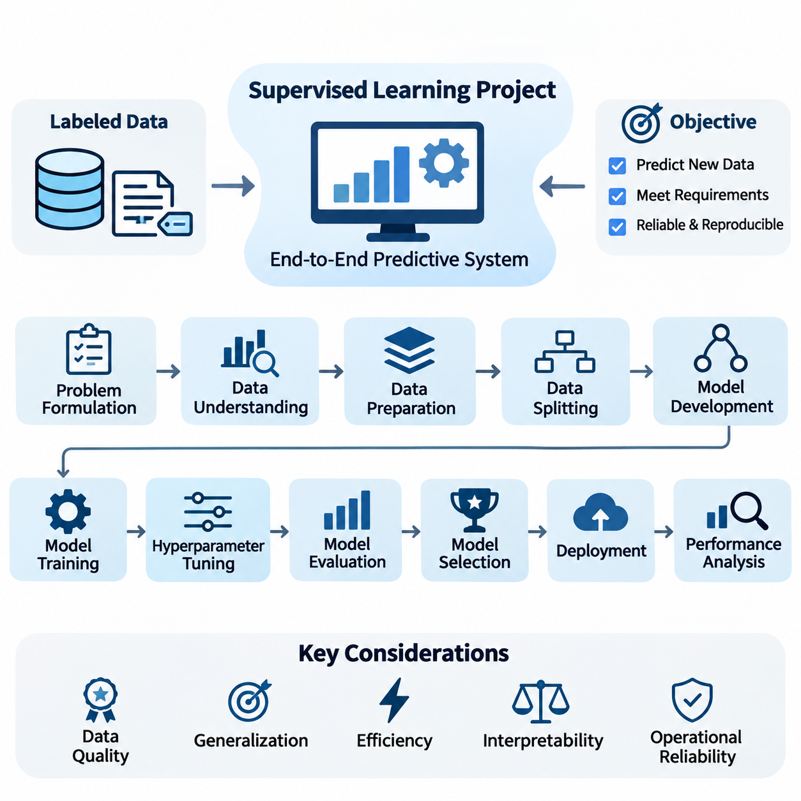
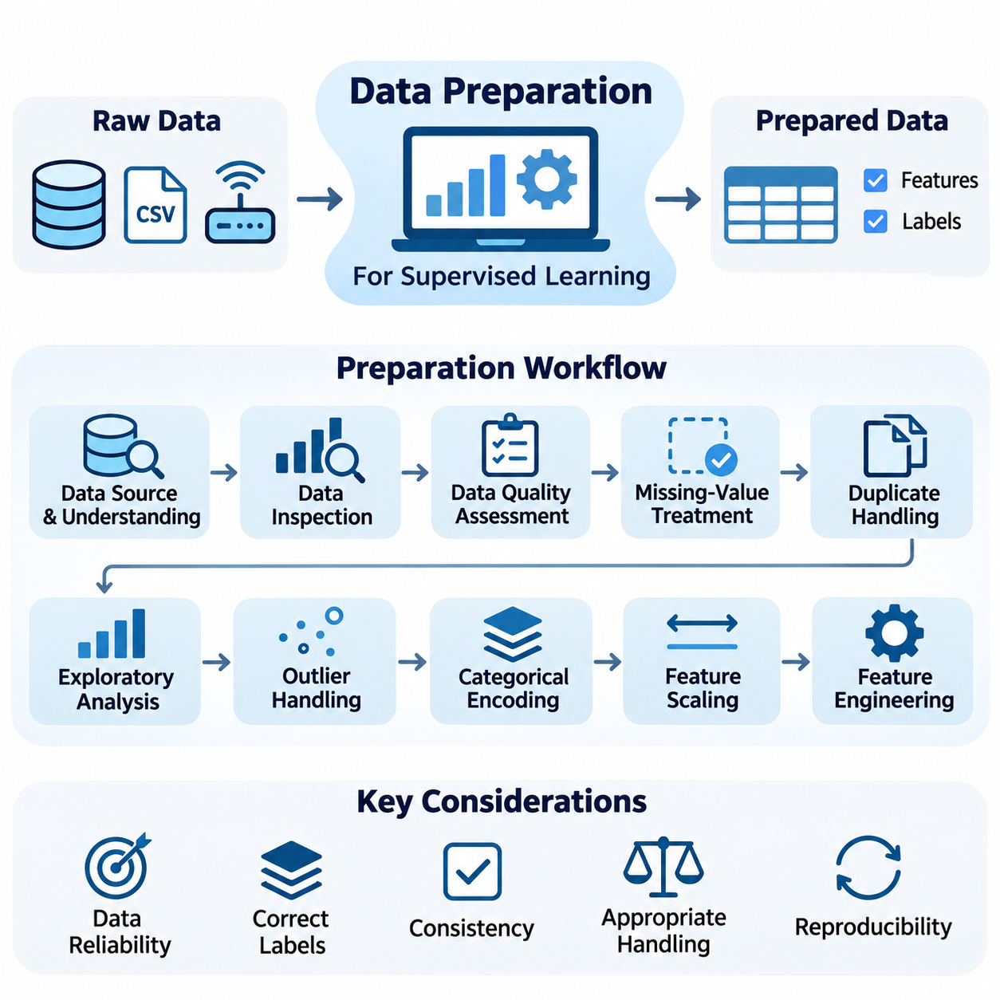
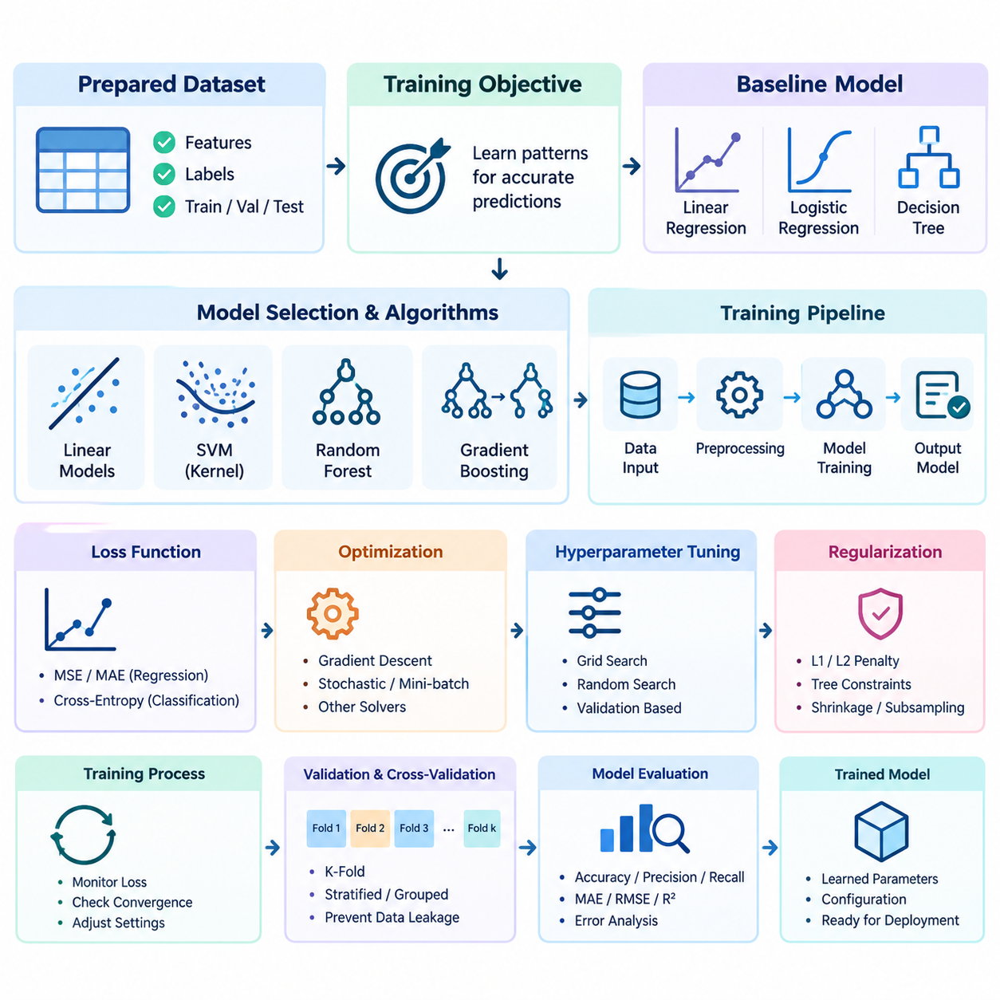
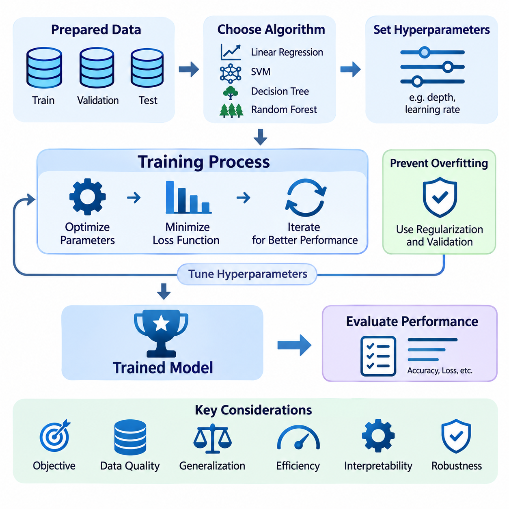
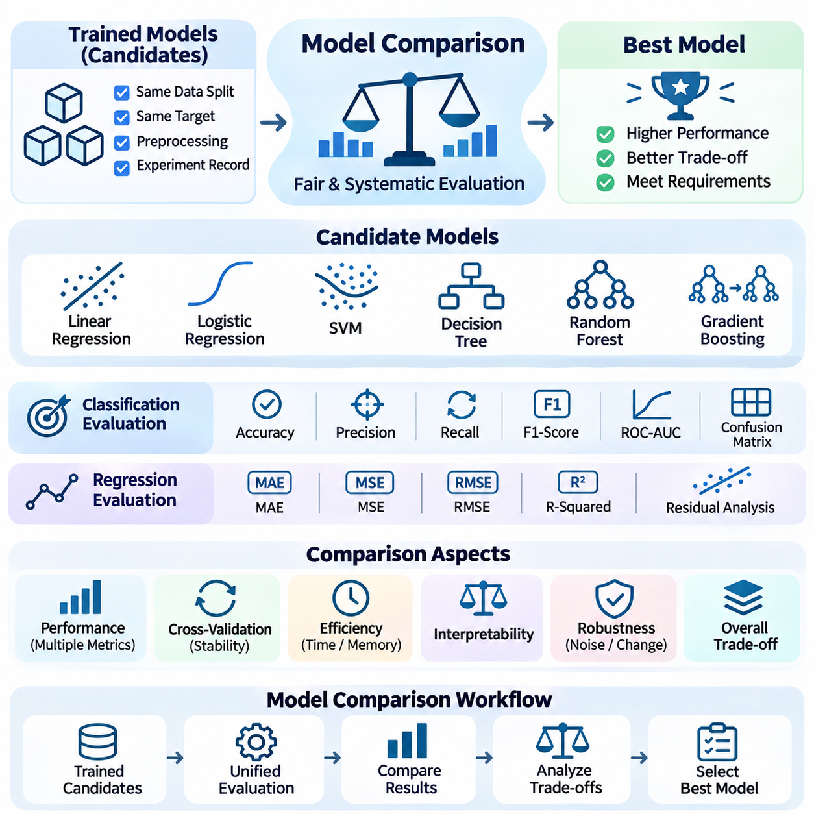
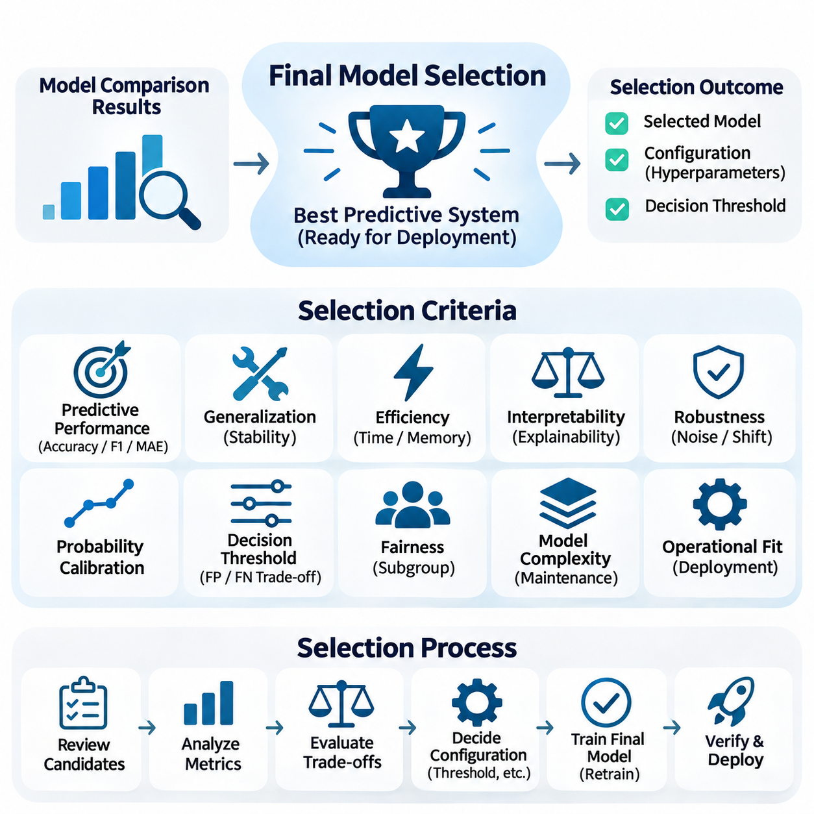
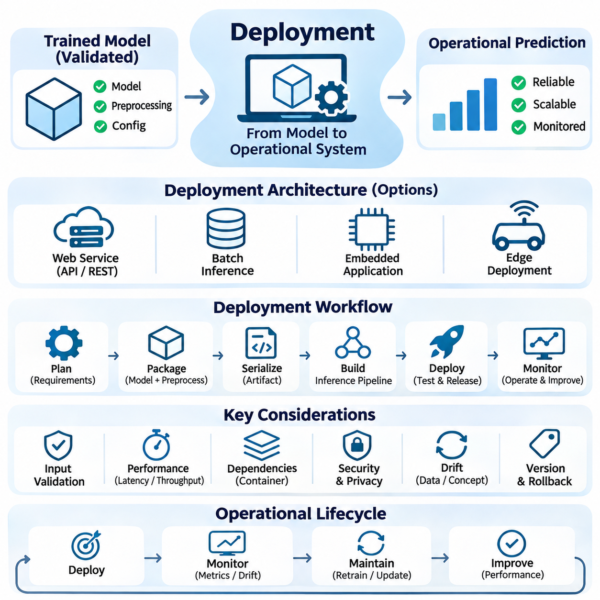
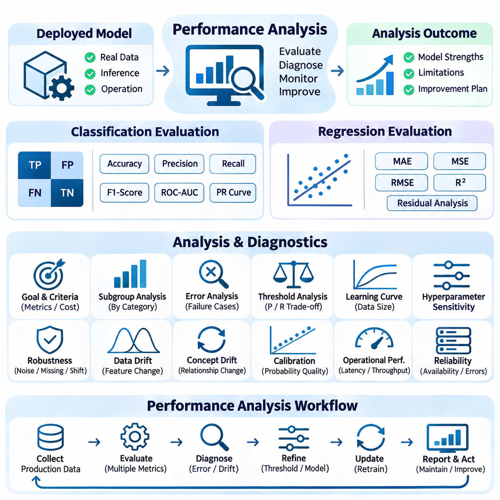

**Volume 08. Supervised Learning**

# 09. End to End Supervised Project

## 09.00 Project Overview

{width="7.268055555555556in" height="7.268055555555556in"}

An end-to-end supervised learning project demonstrates how machine learning concepts are transformed into a complete, practical, and reproducible system. Rather than studying algorithms independently, the project integrates data preparation, model training, evaluation, selection, deployment, and performance analysis. Its central objective is to develop a predictive solution that performs reliably on previously unseen data while satisfying clearly defined application requirements.

Supervised learning relies on labeled examples in which each input is associated with a known target. During training, an algorithm identifies statistical relationships between input features and expected outputs. These relationships are represented by a predictive model that can estimate targets for new observations. A complete project must therefore consider not only predictive accuracy but also data quality, generalization, computational efficiency, interpretability, and operational reliability.

The project begins with problem formulation, which establishes the purpose and boundaries of the predictive task. A classification problem assigns observations to discrete categories, whereas a regression problem estimates continuous numerical values. The distinction determines suitable algorithms, loss functions, and evaluation metrics. Clearly defining the target variable, available features, prediction conditions, and expected outcomes prevents unnecessary complexity during subsequent development.

A practical example may involve predicting equipment failures from industrial sensor measurements, classifying customer transactions, or estimating product quality from manufacturing parameters. Each application contains observable features and corresponding labels that represent historical outcomes. Although their operational requirements differ, these problems share a common supervised learning workflow. The project methodology can therefore be adapted to different domains without changing its fundamental principles.

The first major development activity is understanding the dataset and its relationship to the intended prediction task. Dataset inspection reveals feature types, target distributions, missing values, duplicated records, inconsistent measurements, and potentially unreliable labels. Exploratory data analysis also helps identify unusual observations and relationships among variables. These investigations establish whether the available information is sufficient to support meaningful predictive modeling.

Data preparation transforms raw observations into a consistent representation suitable for machine learning algorithms. Typical operations include handling missing values, encoding categorical variables, scaling numerical features, and constructing informative derived features. These transformations must be designed carefully because preprocessing decisions can substantially influence model behavior. A reproducible preprocessing pipeline ensures that training and inference data undergo compatible transformations.

Separating data into training, validation, and testing subsets is essential for obtaining trustworthy performance estimates. Training data supports parameter learning, validation data guides model selection and hyperparameter adjustment, and test data provides an independent final assessment. Random splitting is appropriate for some datasets, while chronological or group-based splitting may be necessary when observations contain temporal dependencies or shared entities.

Data leakage represents a particularly important risk in supervised learning projects. Leakage occurs when information unavailable during actual prediction improperly influences model development. Examples include calculating preprocessing statistics using test observations or introducing features derived from future outcomes. Such errors can produce misleadingly high evaluation scores. Preventing leakage requires explicit separation of datasets and careful examination of feature availability throughout the pipeline.

Model development should begin with a simple baseline that establishes a reference level of predictive performance. For classification, logistic regression or a basic decision tree may provide an interpretable starting point. For regression, linear regression can serve a similar purpose. Baselines help determine whether additional model complexity produces meaningful improvements and provide diagnostic evidence when more sophisticated algorithms behave unexpectedly.

The project subsequently investigates alternative supervised learning algorithms with different mathematical assumptions and computational characteristics. Support vector machines construct separating boundaries based on margins, while decision trees represent predictions through hierarchical feature conditions. Random forests combine multiple trees to improve stability, and gradient boosting methods iteratively correct prediction errors. Comparing these approaches illustrates how model structure influences performance across different datasets.

Model training involves estimating parameters that minimize an appropriate objective function. The optimization process may use analytical solutions, gradient-based methods, or algorithm-specific procedures. Training behavior depends on data representation, model complexity, regularization, and hyperparameter configuration. Monitoring training and validation performance helps identify convergence problems, insufficient learning capacity, and excessive adaptation to the training observations.

Hyperparameter tuning improves model configuration without directly modifying learned parameters. Examples include regularization strength, maximum tree depth, kernel parameters, learning rate, and ensemble size. Grid search, randomized search, and other systematic optimization strategies can explore candidate configurations. Cross-validation provides additional evidence about performance stability, although the search process must remain computationally practical and preserve an untouched final test set.

Model evaluation requires metrics that reflect the actual prediction objective. Classification tasks may use accuracy, precision, recall, F1-score, and receiver operating characteristic analysis. Regression tasks commonly employ mean absolute error, mean squared error, and root mean squared error. No single metric is universally sufficient. The appropriate evaluation strategy depends on error consequences, target distributions, class imbalance, and the operational context in which predictions will be used.

Class imbalance deserves special consideration because overall accuracy can conceal poor performance on minority categories. In equipment failure prediction, for example, failures may occur much less frequently than normal operating conditions. A model that predicts normal operation almost exclusively could achieve high accuracy while missing important failures. Precision, recall, confusion matrices, and precision-recall analysis provide more informative evidence for such applications.

Model comparison must extend beyond numerical scores obtained from a single experiment. Differences in training duration, inference latency, memory requirements, robustness, and interpretability may influence practical suitability. A complex ensemble might deliver the highest predictive accuracy but require substantially greater computational resources. A simpler model may therefore be preferable when deployment constraints, maintenance requirements, or explainability are important.

Final model selection combines experimental evidence with application-specific requirements. The selected model should demonstrate consistent generalization, acceptable computational demands, and manageable operational complexity. Its preprocessing configuration, learned parameters, feature definitions, and hyperparameters must be preserved together. Recording dataset versions, software dependencies, random seeds, and evaluation procedures makes the selected solution easier to reproduce, audit, and maintain.

Deployment transforms the selected model into a usable predictive component. Depending on the application, inference may operate through a web service, scheduled batch process, industrial computer, or edge device. Deployment requires consistent input validation, preprocessing, prediction execution, and output interpretation. The resulting system must also address practical concerns such as response time, resource consumption, software compatibility, error handling, and integration with existing applications.

A deployed model operates under conditions that may differ from those represented in its training dataset. Changes in sensor characteristics, customer behavior, environmental conditions, or manufacturing processes can alter input distributions and prediction quality. Performance monitoring should therefore examine prediction statistics, feature distributions, latency, and newly available ground-truth labels. Detecting data drift and performance degradation supports timely investigation and controlled model updates.

Performance analysis provides the final connection between experimental results and operational effectiveness. Quantitative evaluation should be complemented by error analysis that identifies systematic weaknesses across feature ranges, categories, or operating conditions. Comparing predictions with actual outcomes helps reveal whether failures originate from insufficient data, inappropriate model assumptions, preprocessing limitations, or changing environments. These findings guide subsequent improvements.

Reproducibility and traceability are fundamental properties of a complete supervised learning workflow. Each experiment should document its data sources, preprocessing transformations, algorithm configuration, evaluation methodology, and resulting artifacts. Version-controlled code and consistent experiment records enable meaningful comparisons between model revisions. These practices also support collaboration, debugging, deployment verification, and long-term maintenance of machine learning systems.

The overall project follows a connected sequence from problem definition and data preparation to training, comparison, final selection, deployment, and performance analysis. Each stage produces evidence that informs the next, while later findings may require revisiting earlier decisions. This iterative structure reflects the practical nature of machine learning engineering. Successful development depends on managing the entire system rather than optimizing an isolated algorithm.

By completing the project, readers gain a unified understanding of how supervised learning techniques operate within a real development lifecycle. The experience connects mathematical models with data engineering, experimental design, software implementation, and operational evaluation. More importantly, it establishes a reusable methodology for building predictive systems that are measurable, reproducible, maintainable, and suitable for practical applications across diverse industries.

## 09.01 Data Preparation [w/Code]

{width="7.268055555555556in" height="7.268055555555556in"}

Data preparation is the foundation of an end-to-end supervised learning project because model quality depends heavily on the reliability of its training data. Even sophisticated algorithms cannot consistently compensate for incorrect labels, inconsistent measurements, or poorly constructed features. A systematic preparation process transforms raw observations into structured datasets that support reliable training, meaningful evaluation, and reproducible deployment.

The preparation workflow begins by identifying data sources and understanding how observations were collected. Data may originate from relational databases, CSV files, industrial sensors, business applications, or experimental measurements. Each source introduces assumptions about sampling frequency, measurement precision, and data completeness. Documenting these characteristics helps determine whether the collected information accurately represents the intended prediction environment.

A supervised dataset contains input features and corresponding target labels. Features describe observable properties of individual samples, while labels represent the outcomes that a model must learn to predict. Classification labels identify discrete categories, whereas regression targets contain continuous numerical values. Before preprocessing begins, developers must verify that each feature corresponds to the correct target and that the target definition remains consistent across observations.

Initial data inspection examines dataset dimensions, feature names, variable types, and target distributions. Numerical features may represent measurements, counts, or calculated quantities, while categorical features describe discrete states or groups. Inspecting summary statistics and representative records helps reveal unexpected values, inconsistent formats, and potential collection errors. This preliminary examination establishes the baseline understanding required for subsequent transformations.

Data quality assessment focuses on missing values, duplicated observations, invalid measurements, and inconsistent labels. Missing values may result from sensor failures, incomplete transactions, or unavailable information. Duplicated records can distort statistical distributions and unintentionally increase the influence of repeated observations. Invalid values may indicate measurement errors or formatting problems. Each issue requires investigation before an appropriate correction strategy can be selected.

Missing-value treatment depends on feature meaning and the underlying mechanism of missingness. Numerical variables may be imputed using training-set means, medians, or model-based estimates. Categorical variables may use the most frequent category or an explicit unknown category. Removing incomplete records is sometimes appropriate, but excessive deletion can introduce sampling bias. Missingness indicators may also provide useful predictive information when absence itself has operational significance.

Duplicate detection requires more than identifying identical rows. Multiple records may represent legitimate repeated measurements, while nearly identical observations may originate from accidental duplication. In time-series datasets, consecutive measurements can naturally share similar values. Removing records without understanding their origin may destroy meaningful information. Duplicate handling should therefore distinguish collection errors from valid repetitions and preserve the integrity of the underlying process.

Exploratory data analysis investigates the statistical structure of the available observations. Measures such as mean, median, standard deviation, minimum, maximum, and quantiles describe numerical distributions. Frequency counts summarize categorical variables, while correlation analysis reveals linear relationships among numerical features. These investigations can identify unusual patterns, redundant variables, and potential relationships with the target before model training begins.

Outliers require careful interpretation because unusual observations are not necessarily incorrect. Extreme sensor measurements may indicate equipment malfunction, but they may also represent rare operating conditions that the model must recognize. Possible treatments include verification, correction, clipping, transformation, or retention. Decisions should reflect domain knowledge and prediction objectives rather than automatically removing values that differ from the majority of observations.

Categorical encoding converts nonnumerical information into representations that machine learning algorithms can process. One-hot encoding creates separate binary indicators for categories, while ordinal encoding assigns numerical values to ordered states. The choice depends on whether categories possess meaningful ordering and whether the algorithm interprets numerical distances. Encoding mappings must be learned from training data and consistently applied to validation, testing, and future inference samples.

Feature scaling adjusts numerical variables so that differences in measurement units do not improperly dominate learning. Standardization transforms features using their mean and standard deviation, while min-max scaling maps values into a specified interval. Distance-based algorithms and regularized linear models are often sensitive to feature magnitude. Tree-based methods generally require less scaling, although consistent preprocessing may simplify comparisons across multiple algorithms.

Feature engineering constructs informative variables from existing observations. Examples include ratios, differences, rolling statistics, interaction terms, and domain-specific indicators. In industrial applications, temperature gradients, vibration statistics, or accumulated operating hours may provide more useful information than isolated raw measurements. Engineered features must remain available at prediction time and should be evaluated for both predictive usefulness and computational cost.

Feature selection reduces unnecessary inputs while preserving relevant predictive information. Redundant, irrelevant, or unstable variables can increase computational requirements and sometimes reduce generalization performance. Selection approaches include statistical filtering, model-based importance estimation, and recursive feature elimination. The selection procedure must be performed within the training process to prevent information from validation or test data influencing feature decisions.

Data splitting establishes independent subsets for model development and final assessment. Training observations support parameter estimation, validation observations guide model configuration, and test observations estimate performance on unseen data. Common split proportions include 70:15:15 or 80:10:10, although suitable ratios depend on dataset size and application requirements. The essential principle is preserving independent evaluation rather than enforcing a universal numerical proportion.

The splitting strategy must reflect relationships among observations. Stratified sampling helps preserve class proportions in classification tasks, particularly when minority categories are uncommon. Time-dependent datasets require chronological separation to prevent future observations from influencing earlier predictions. Group-based splitting keeps related observations from the same machine, patient, or customer within appropriate partitions, reducing overly optimistic estimates caused by shared information.

Data leakage occurs when information unavailable during real-world prediction influences model development or evaluation. Computing scaling statistics from the entire dataset before splitting is a common example. Target-derived variables and future measurements can introduce more serious leakage. To prevent these problems, preprocessing estimators should be fitted only on training observations, while validation and test datasets should receive transformations learned from the corresponding training partition.

Class imbalance introduces additional preparation challenges when some target categories occur much less frequently than others. Techniques such as class weighting, random oversampling, undersampling, and synthetic minority generation may improve minority-class learning. However, resampling must occur only within the training data, and preferably within each training fold during cross-validation. Validation and test distributions should remain representative of the intended evaluation conditions.

A preprocessing pipeline combines multiple transformations into a consistent sequence. Numerical columns may undergo imputation and scaling, while categorical columns receive missing-value treatment and encoding. Pipeline-based implementations in frameworks such as scikit-learn help ensure that transformations are fitted correctly and reused consistently. This structure also simplifies cross-validation, hyperparameter tuning, model comparison, and eventual deployment.

Reproducibility requires recording dataset versions, transformation parameters, random seeds, feature definitions, and software dependencies. Data preparation scripts should produce consistent outputs when executed under equivalent conditions. Maintaining clear separation between raw data and processed artifacts helps preserve traceability. Validation checks can confirm expected feature dimensions, permitted value ranges, missing-value policies, and compatibility between training and inference inputs.

The final prepared dataset should satisfy explicit quality and consistency requirements before model training begins. Input features must be correctly aligned with targets, preprocessing transformations must avoid leakage, and evaluation partitions must remain independent. Class distributions, feature dimensions, and remaining data limitations should be documented. These checks establish confidence that subsequent model comparisons reflect algorithm behavior rather than preventable data preparation errors.

Data preparation is not merely a preliminary cleaning activity but an integral part of the supervised learning system. Decisions about feature representation, sampling, missing values, and dataset separation directly influence predictive accuracy, robustness, interpretability, and operational reliability. A carefully designed preparation workflow creates the foundation for efficient model training, fair algorithm comparison, trustworthy performance evaluation, and consistent deployment in real-world environments.

## 09.02 Model Training [w/Code]

{width="7.268055555555556in" height="7.268055555555556in"}

{width="7.268055555555556in" height="7.268055555555556in"}

Model training is the central process through which a supervised learning algorithm transforms prepared data into a predictive model. During training, the algorithm identifies relationships between input features and target labels by adjusting internal parameters or constructing decision structures. The objective is not simply to reproduce known observations but to learn patterns that generalize to unseen examples under realistic operating conditions.

The training stage begins with a validated dataset and a clearly defined prediction objective. Input features must have consistent dimensions, appropriate numerical representations, and correctly aligned target values. The training subset is used to estimate model parameters, while validation data supports configuration decisions. Test data remains isolated until final evaluation to preserve an unbiased estimate of generalization performance.

A baseline model provides an essential reference before more sophisticated algorithms are introduced. Linear regression offers a simple starting point for continuous prediction, while logistic regression is suitable for classification tasks. Decision trees provide another interpretable alternative capable of representing nonlinear relationships. Baseline results establish whether additional complexity produces meaningful improvements in predictive performance.

Model selection during training depends on the statistical characteristics of the dataset and the operational requirements of the application. Linear models offer computational efficiency and interpretability, while support vector machines can represent complex decision boundaries through kernel functions. Random forests improve stability through ensemble learning, and gradient boosting methods progressively correct prediction errors using sequentially constructed models.

Each algorithm learns through a specific optimization mechanism. Linear models estimate coefficients by minimizing prediction errors, while logistic regression commonly minimizes cross-entropy loss. Support vector machines optimize margin-based objectives, and decision trees select feature splits according to impurity reduction. Gradient boosting constructs successive learners that approximate corrections to the current model, often using gradients of a differentiable loss function.

The loss function defines how differences between predictions and target values are measured during learning. Regression tasks frequently use mean squared error or mean absolute error, while classification tasks commonly employ cross-entropy or related objectives. Selecting an appropriate loss function influences the model\'s sensitivity to large errors, minority classes, and uncertain predictions. The objective should reflect the statistical properties and practical consequences of prediction mistakes.

Optimization algorithms determine how model parameters are updated to reduce the selected loss. Gradient descent adjusts parameters in directions that decrease the objective, while stochastic and mini-batch variants use subsets of training observations. Other algorithms employ specialized solvers or iterative construction procedures. Convergence behavior depends on learning rates, feature scaling, numerical stability, initialization, and the geometry of the optimization problem.

Hyperparameters control aspects of model behavior that are not directly learned from training observations. Examples include regularization strength, maximum tree depth, number of estimators, kernel parameters, and learning rate. These settings influence model capacity, computational cost, and generalization. Initial configurations should provide reasonable reference points before systematic tuning explores alternative combinations using validation results.

Regularization limits excessive model complexity and reduces the risk of overfitting. Linear models may use L1 or L2 penalties to constrain coefficients, while tree-based algorithms restrict depth, leaf size, or splitting behavior. Gradient boosting can employ shrinkage, subsampling, and structural constraints. Appropriate regularization helps models capture meaningful patterns without becoming overly sensitive to noise or accidental relationships in the training data.

Overfitting occurs when a model learns training-specific details that do not generalize to new observations. It is often indicated by strong training performance combined with substantially weaker validation performance. Underfitting occurs when model capacity or training effectiveness is insufficient to capture relevant relationships. Comparing training and validation errors helps distinguish these conditions and guides adjustments to model complexity, features, and optimization settings.

Cross-validation provides a more stable estimate of model performance than relying on a single validation split. In k-fold cross-validation, the training dataset is divided into multiple subsets, with each subset serving as validation data during one iteration. Performance estimates are aggregated across folds to assess consistency. Stratified or group-aware strategies should be used when class distributions or dependencies among observations require special treatment.

Training experiments must preserve strict separation between fitting procedures and evaluation information. Feature scaling, imputation, feature selection, and resampling should be learned within each training partition rather than from the complete dataset. Pipeline-based implementations help enforce this separation automatically. Preventing data leakage ensures that validation results reflect genuine predictive capability rather than information inadvertently introduced during preparation.

Class imbalance can influence model training by encouraging algorithms to favor frequently occurring categories. Class weights, adjusted decision objectives, and training-only resampling methods may improve sensitivity to minority classes. However, these interventions can change precision, recall, and probability calibration. Their effectiveness should be assessed using metrics that reflect the operational consequences of different classification errors.

Training efficiency becomes important when datasets contain many observations or candidate models require repeated optimization. Computational demands depend on algorithm complexity, feature dimensions, dataset size, and hyperparameter search strategy. Parallel processing can accelerate some ensemble methods, while GPU acceleration benefits selected implementations. Efficient experimentation balances computational resources against the need for reliable performance estimates.

Reproducible training requires explicit control over random seeds, data partitions, preprocessing configurations, software versions, and algorithm settings. Experiment records should preserve hyperparameters, evaluation scores, training duration, and relevant execution conditions. Some numerical operations remain nondeterministic across hardware or software environments. Nevertheless, systematic experiment tracking substantially improves the ability to compare results and investigate unexpected behavior.

Training diagnostics provide information beyond a final performance score. Learning curves reveal how predictive quality changes with increasing training data, while validation curves show sensitivity to selected hyperparameters. For iterative algorithms, monitoring loss trajectories can identify unstable optimization or insufficient convergence. Feature importance and coefficient analysis may also reveal whether learned relationships are plausible and consistent with domain expectations.

Model training should produce more than a collection of fitted estimators. Each candidate model must be associated with its preprocessing pipeline, training configuration, validation results, and computational characteristics. Consistent experiment organization enables fair comparisons among linear models, support vector machines, decision trees, random forests, and gradient boosting approaches. This evidence becomes the foundation for subsequent model comparison and final selection.

A successful training stage produces candidate models that have learned meaningful relationships while maintaining acceptable generalization behavior. Training accuracy alone is insufficient to establish model quality, because operational performance depends on robustness, stability, and computational feasibility. Validation results and diagnostic evidence must therefore guide decisions about additional training, hyperparameter refinement, or changes to the underlying feature representation.

Model training is an iterative engineering activity rather than a single algorithm execution. Results may reveal weaknesses in feature construction, data quality, model assumptions, or optimization settings that require revisiting earlier development stages. By combining controlled experimentation, appropriate loss functions, regularization, cross-validation, and reproducible implementation, the training process establishes a reliable foundation for model comparison, deployment, and long-term performance analysis.

## 09.03 Model Comparison [w/Code]

{width="7.268055555555556in" height="7.268055555555556in"}

Model comparison is a critical stage in an end-to-end supervised learning project because different algorithms exhibit distinct strengths, limitations, and computational characteristics. A model that performs well on one dataset may behave differently under another feature distribution or operating condition. Systematic comparison identifies which candidate provides the most appropriate balance of predictive performance, generalization, interpretability, and operational efficiency.

The comparison process begins with a collection of trained candidate models developed under consistent experimental conditions. These candidates may include linear regression, logistic regression, support vector machines, decision trees, random forests, and gradient boosting algorithms. Each model should use compatible training and validation partitions, clearly documented preprocessing procedures, and evaluation metrics appropriate to the prediction objective.

Fair comparison requires controlling experimental variables that could otherwise distort the results. Models should be evaluated using identical validation observations and equivalent target definitions. Preprocessing may differ when algorithms require distinct feature representations, but each transformation must be fitted exclusively on training data. Consistent random seeds, cross-validation strategies, and experiment records improve the reliability of comparisons.

A baseline model establishes the reference against which more sophisticated approaches are evaluated. For classification, logistic regression or a simple decision tree may provide an interpretable benchmark. For regression, ordinary least squares can serve a similar purpose. Complex models should demonstrate measurable improvements over these references, particularly when their additional computational requirements and maintenance costs are substantial.

Classification model comparison typically examines accuracy, precision, recall, F1-score, and area under the receiver operating characteristic curve. Accuracy measures the proportion of correct predictions, while precision and recall describe different aspects of positive-class detection. F1-score combines precision and recall through their harmonic mean. ROC-AUC evaluates ranking performance across classification thresholds, although its interpretation depends on the task and class structure.

When datasets contain substantial class imbalance, overall accuracy may provide misleading conclusions. A model can achieve high accuracy by favoring the majority class while failing to identify rare but important events. Precision-recall curves and average precision are often informative in these situations. Confusion matrices also reveal the distribution of false positives and false negatives, allowing comparisons to reflect the consequences of different prediction errors.

Regression models require evaluation criteria suited to continuous targets. Mean absolute error measures the average magnitude of prediction deviations, while mean squared error emphasizes larger mistakes through squared penalties. Root mean squared error expresses the resulting error in the original target units. The coefficient of determination, commonly represented as R-squared, describes predictive performance relative to a constant-mean baseline under standard evaluation conditions.

No single evaluation metric fully describes model quality. A classifier may achieve strong recall but generate excessive false alarms, while another may provide high precision at the cost of missed detections. Similarly, regression models with comparable average errors may behave differently on extreme observations. Model comparison should therefore combine complementary metrics and interpret them according to application requirements.

Cross-validation improves comparison reliability by evaluating candidates across multiple training and validation partitions. In k-fold cross-validation, each candidate is trained repeatedly while different folds serve as validation subsets. Aggregating performance across folds provides estimates of average behavior and variability. Stratified, grouped, or chronological validation strategies should be selected according to the statistical dependencies present in the dataset.

Performance variability is important because a model with the highest average score may also exhibit unstable behavior across validation folds. Standard deviations, confidence intervals, or repeated evaluation results can help characterize uncertainty. Small numerical differences should not automatically be interpreted as meaningful improvements. Comparisons become more credible when they consider sample size, evaluation variance, and the practical significance of observed differences.

Computational efficiency represents another major comparison dimension. Training duration, inference latency, memory consumption, and model size influence deployment feasibility. Linear models often require relatively modest resources, while kernel-based support vector machines can become expensive on large datasets. Random forests and gradient boosting models introduce additional computational demands that depend on ensemble size, tree complexity, and implementation details.

Interpretability determines how easily users and engineers can understand model behavior. Linear models provide coefficients that describe feature contributions under their mathematical assumptions, while decision trees expose explicit branching conditions. Ensemble models may require feature importance analysis or explanation techniques to interpret predictions. The appropriate level of interpretability depends on operational risk, regulatory expectations, and the need to diagnose model failures.

Robustness evaluation investigates how models respond to changes in input conditions. Missing values, measurement noise, distribution shifts, and unusual observations may influence algorithms differently. A model with excellent validation accuracy may perform poorly when sensor characteristics or operating environments change. Testing plausible perturbations and representative operating scenarios helps identify candidates that maintain acceptable behavior beyond ideal experimental conditions.

Hyperparameter tuning must be considered when interpreting model comparison results. Algorithms evaluated with substantially different tuning budgets may not receive equivalent opportunities to demonstrate their capabilities. A consistent search budget or clearly documented tuning strategy improves fairness. Hyperparameter selection should rely on training and validation procedures, while the independent test dataset remains untouched until final model assessment.

Statistical testing can support comparisons when performance differences are small or uncertain. Paired evaluation procedures account for the fact that competing models are often tested on the same observations. Bootstrap confidence intervals and appropriate statistical tests can help estimate uncertainty in performance differences. However, statistical significance should be interpreted alongside effect size, operational importance, and assumptions underlying the evaluation method.

Model comparison also benefits from examining errors rather than relying exclusively on aggregate scores. Error analysis can identify particular feature ranges, categories, or operating conditions where candidates behave differently. For example, one classifier may recognize common categories reliably but struggle with rare cases, while another may provide more balanced predictions. Such patterns reveal strengths and weaknesses that summary metrics may conceal.

A practical comparison framework records model identifiers, preprocessing configurations, hyperparameters, evaluation scores, training times, and inference characteristics. Consistent experiment tracking allows results to be reproduced and reviewed. Automated evaluation scripts reduce manual inconsistencies and make repeated comparisons more efficient. The resulting evidence supports transparent decisions about which models should proceed to final selection.

The comparison stage should produce a defensible shortlist rather than selecting a winner from a single numerical ranking. Candidate models must be judged according to predictive quality, uncertainty, resource requirements, interpretability, and robustness. Trade-offs should be documented explicitly because improvements in one dimension may introduce disadvantages in another. This approach prevents the selection process from becoming overly dependent on a narrow benchmark.

Model comparison connects experimental machine learning with practical engineering decisions. By evaluating candidates under controlled conditions and interpreting multiple dimensions of performance, developers can distinguish genuine improvements from accidental variations. The resulting analysis establishes a reliable foundation for final model selection, ensuring that deployment decisions reflect both statistical evidence and the requirements of the intended application.

## 09.04 Final Model Selection [w/Code]

{width="7.268055555555556in" height="7.268055555555556in"}

Final model selection transforms experimental comparison results into a justified engineering decision. The objective is not simply to choose the algorithm with the highest validation score, but to identify a predictive system that satisfies accuracy, reliability, efficiency, and deployment requirements. This decision connects statistical evidence with practical constraints and establishes the model configuration that will proceed toward operational implementation.

The selection process begins by reviewing the shortlisted candidates produced during model comparison. Each candidate should have documented preprocessing procedures, hyperparameter configurations, validation metrics, and computational characteristics. Consistent experimental records allow developers to distinguish genuine performance improvements from differences caused by data partitions, random initialization, or evaluation procedures.

Predictive performance remains an essential selection criterion, but its interpretation depends on the application. Classification systems may prioritize precision, recall, F1-score, or probability-based metrics, while regression systems may emphasize absolute or squared prediction errors. The selected metric should reflect the practical consequences of incorrect predictions rather than merely provide a convenient numerical ranking.

Operational requirements often determine which performance trade-offs are acceptable. In equipment failure prediction, missing a critical failure may be more costly than generating an additional inspection alert. In other applications, excessive false alarms may disrupt operations or increase expenses. Final selection should therefore consider error costs, decision thresholds, and the relative importance of different prediction outcomes.

Generalization performance must be examined before selecting a final model. A candidate with excellent training accuracy but inconsistent validation results may be overfitted to particular observations. Cross-validation averages, performance variability, and learning curves provide evidence about stability across data partitions. Models that maintain consistent performance under different validation conditions are often preferable to those achieving isolated peak scores.

The reliability of performance estimates depends on preserving independent evaluation data. Hyperparameter tuning and candidate selection should rely on training and validation results without repeatedly consulting the test dataset. After the model configuration is finalized, the independent test set can provide an unbiased estimate of performance under the assumed sampling conditions. Repeated test-driven revisions would compromise this independence.

Computational efficiency introduces additional selection constraints. Training duration, inference latency, memory consumption, and model size determine whether a candidate can operate within available infrastructure. A complex ensemble may provide modest accuracy improvements while requiring substantially greater resources. When latency or memory is limited, a simpler model may offer a more practical balance between predictive quality and operational feasibility.

Interpretability becomes important when predictions influence consequential decisions or require technical investigation. Linear models provide coefficients that can be examined under their assumptions, while decision trees expose explicit decision rules. Ensemble methods may require additional explanation techniques. Final selection should establish whether the available level of interpretability is sufficient for debugging, auditing, and communication with stakeholders.

Robustness assessment examines whether candidate models remain dependable when operating conditions change. Measurement noise, missing features, unusual observations, and moderate distribution shifts may affect algorithms differently. A model with slightly lower average validation accuracy may be preferable if it maintains stable behavior under realistic perturbations. Robustness evidence should therefore complement conventional predictive metrics.

Probability calibration is another consideration for classification systems that produce confidence estimates. A well-calibrated model assigns probabilities that approximately correspond to observed outcome frequencies. Calibration curves and proper scoring rules can reveal whether predicted probabilities are excessively confident or insufficiently informative. When decisions depend on risk thresholds, probability quality may be as important as classification accuracy.

Decision thresholds should be selected according to operational objectives rather than automatically accepting default values. Adjusting a classification threshold changes the balance between false positives and false negatives. Threshold optimization must use validation data and should account for class prevalence, error costs, and operational capacity. The selected threshold becomes part of the final predictive configuration and must be preserved during deployment.

Fairness and subgroup performance may also influence final selection when predictions affect different populations or operating categories. Aggregate metrics can conceal systematic weaknesses in particular groups, environments, or equipment types. Evaluating relevant subgroups helps determine whether a model performs consistently across intended use conditions. Such analysis should use sufficiently representative data and acknowledge uncertainty when subgroup sample sizes are small.

Model complexity affects long-term maintenance as well as immediate performance. Highly complex systems may require additional dependencies, specialized hardware, or more demanding monitoring procedures. Simpler models are often easier to debug, reproduce, and update. The selection decision should therefore consider expected maintenance effort, software compatibility, deployment stability, and the availability of technical expertise.

A structured decision framework can combine predictive quality, robustness, interpretability, and resource requirements. Some criteria represent mandatory constraints, such as maximum inference latency or minimum acceptable recall. Others involve preferences that can be evaluated through weighted scores or documented trade-offs. Explicit criteria reduce arbitrary decisions and make the final recommendation easier to explain and reproduce.

Once a candidate is selected, its final training procedure must be established. A common approach is to retrain the chosen configuration using the combined training and validation data, provided that model selection is complete and the test set remains untouched. All preprocessing transformations must be refitted within this final training dataset. The resulting model should preserve the selected hyperparameters and any validated decision thresholds.

The final model artifact includes more than learned algorithm parameters. It should contain or reference the preprocessing pipeline, feature definitions, category mappings, model configuration, and relevant software dependencies. Version identifiers and reproducible training records allow the artifact to be traced to its source data and experimental results. These elements help prevent inconsistencies between development and production inference.

Final verification checks whether the selected artifact behaves as expected under representative inputs. Input dimensions, missing-value handling, output formats, numerical stability, and prediction latency should be examined. The finalized model can then be evaluated once on the independent test dataset to estimate generalization performance. If serious deficiencies emerge, further development should be documented and a new untouched evaluation set may be required.

Selection documentation should explain why the chosen model is preferable to competing candidates. The record should summarize relevant performance evidence, computational requirements, operational constraints, and known limitations. It should also identify assumptions about input distributions and expected deployment conditions. Transparent documentation supports technical review, future maintenance, and informed decisions when model updates become necessary.

Final model selection marks the transition from experimental development to deployment preparation. The chosen system must demonstrate acceptable predictive performance while remaining compatible with practical operating constraints. By combining independent evaluation, robustness analysis, computational assessment, and reproducible artifact management, the selection process establishes a defensible foundation for reliable supervised learning deployment.

## 09.05 Deployment [w/Code]

{width="7.268055555555556in" height="7.268055555555556in"}

Deployment is the process of transforming a validated supervised learning model into an operational system that produces predictions from real-world inputs. A successful deployment requires more than transferring trained parameters into production. It must preserve preprocessing consistency, satisfy performance constraints, handle unexpected inputs, and support continuous monitoring. The objective is to deliver reliable predictions within the intended operating environment.

Deployment planning begins by defining how the model will interact with existing software and infrastructure. Predictions may be generated through a web service, batch processing pipeline, embedded application, or edge computing device. Each architecture introduces different requirements for latency, throughput, connectivity, and resource allocation. The deployment approach should reflect the application workflow and the availability of computational resources.

The trained model must be packaged together with the preprocessing operations required for inference. Feature scaling, categorical encoding, missing-value handling, and feature ordering must remain consistent with the training pipeline. Differences between training and production transformations can introduce systematic prediction errors. Packaging preprocessing and model inference into a unified pipeline reduces the risk of inconsistent feature representations.

Model serialization converts trained estimators and associated configurations into reusable artifacts. Common approaches include framework-specific formats, standardized model representations, and structured parameter storage. The selected format should support the intended runtime environment and preserve numerical behavior. Serialization mechanisms must also be evaluated for compatibility, security, portability, and long-term maintenance requirements.

The inference pipeline defines how incoming observations are transformed into predictions. Input data passes through validation, preprocessing, feature construction, model execution, and output formatting. Each stage should have clearly defined interfaces and expected data types. A reliable pipeline rejects malformed inputs, handles supported missing values, and produces predictable outputs that downstream applications can interpret consistently.

Application programming interfaces provide a common mechanism for exposing predictive models to external systems. A REST-based service may accept structured requests and return predicted labels, numerical values, or class probabilities. API contracts should specify required features, accepted formats, response schemas, and error conditions. Stable interfaces allow applications to use the model without depending on its internal algorithmic implementation.

Batch inference is appropriate when predictions can be generated periodically rather than immediately. Large collections of observations may be processed through scheduled jobs or data engineering pipelines. This approach can improve resource utilization and simplify integration with reporting systems. However, batch processing introduces delays between data acquisition and prediction availability, making it unsuitable for applications requiring immediate responses.

Real-time inference is necessary when predictions directly influence time-sensitive decisions. Examples include equipment monitoring, transaction screening, and automated quality inspection. Such systems must satisfy latency constraints while maintaining reliable throughput under variable workloads. Performance testing should measure not only average inference time but also high-percentile latency, resource consumption, and behavior during peak demand.

Edge deployment places predictive models near the source of incoming data, reducing dependence on remote connectivity. Industrial controllers, mobile robots, and embedded computers may execute models locally to support rapid decisions. Hardware limitations can constrain memory usage, processing capacity, and power consumption. Model compression, quantization, or alternative architectures may be considered when they preserve acceptable predictive quality.

Production environments require explicit management of software dependencies and runtime configurations. Libraries, model frameworks, operating systems, and hardware acceleration interfaces should remain compatible with the validated implementation. Containerization can improve portability by packaging application dependencies into reproducible execution environments. Nevertheless, deployment testing remains necessary because hardware and infrastructure differences can affect behavior.

Input validation protects the prediction service from malformed, incomplete, or unexpected observations. Validation rules may examine feature dimensions, numerical ranges, categorical values, data types, and missing fields. Invalid requests should generate informative errors rather than silently producing unreliable predictions. When uncertain inputs are expected, the system should apply documented handling rules that remain consistent with the model\'s training assumptions.

Deployment verification compares predictions generated in the production environment with reference outputs obtained during development. Representative test cases should include normal observations, boundary conditions, missing values, and unusual feature combinations. Numerical differences may arise from library versions or hardware execution paths. Acceptance criteria should define allowable deviations and identify failures that prevent production release.

Monitoring is essential because deployment conditions may differ from those represented in historical training data. Data drift occurs when input distributions change, while concept drift involves changes in relationships between features and target outcomes. Monitoring systems can track feature distributions, prediction frequencies, confidence estimates, and operational errors. Actual predictive performance should be measured when reliable ground-truth labels become available.

Operational monitoring must also examine service availability and computational behavior. Request rates, inference latency, memory consumption, processor utilization, and error frequencies provide evidence about system health. Alerts should distinguish infrastructure failures from changes in predictive behavior. Effective observability enables engineers to investigate problems before they cause widespread operational disruption or unacceptable prediction quality.

Security and privacy requirements influence how models and data are deployed. Access controls should restrict unauthorized inference requests, while encrypted communication protects sensitive information during transmission. Model artifacts and software dependencies should originate from trusted sources. Logging policies must avoid unnecessary exposure of confidential data, and retention practices should comply with applicable organizational and regulatory requirements.

Deployment strategies should minimize the consequences of introducing a new predictive model. Shadow deployment evaluates a candidate using production inputs without allowing its predictions to influence operational decisions. Canary deployment initially exposes a limited portion of traffic to the new model. These approaches provide opportunities to detect unexpected behavior before broader adoption, although their suitability depends on the application\'s architecture and risk profile.

Version management supports controlled updates and recovery from deployment failures. Each production release should identify the model artifact, preprocessing configuration, decision thresholds, software dependencies, and relevant evaluation results. Maintaining previous validated versions enables rollback when performance deteriorates or compatibility problems emerge. Traceable releases also simplify auditing, incident investigation, and reproducibility.

Model maintenance continues after the initial release. Changes in operating conditions, equipment characteristics, user behavior, or data collection procedures may reduce predictive effectiveness over time. Retraining can incorporate newly collected labeled observations, but updated models must undergo validation before replacing existing versions. Automated pipelines can assist with retraining and testing, while approval controls prevent unverified changes from reaching production.

A successful deployment integrates predictive accuracy with dependable software engineering and operational management. The model must deliver consistent outputs, respect resource constraints, recover appropriately from failures, and remain observable throughout its lifecycle. By combining reproducible packaging, validated inference pipelines, secure interfaces, monitoring, and controlled updates, deployment transforms experimental supervised learning into a maintainable production capability.

## 09.06 Performance Analysis

{width="7.268055555555556in" height="7.268055555555556in"}

Performance analysis evaluates how effectively a deployed supervised learning model satisfies its predictive and operational objectives. Unlike initial model comparison, which focuses on selecting candidates under controlled conditions, performance analysis examines behavior across evaluation datasets and practical operating environments. Its purpose is to identify strengths, weaknesses, reliability limitations, and opportunities for improvement throughout the model lifecycle.

The analysis begins by establishing measurable performance objectives that reflect the intended application. Classification tasks may require minimum recall, precision, or F1-score, while regression tasks may specify acceptable prediction error ranges. Operational requirements can include inference latency, throughput, memory consumption, and service availability. Clear acceptance criteria allow performance results to be interpreted against practical expectations.

Independent test evaluation provides an essential reference for estimating generalization performance. The test dataset should remain separate from model training, hyperparameter optimization, and final selection decisions. Predictions generated from this dataset are compared with ground-truth labels using predefined metrics. Because test results are estimates rather than guarantees, their interpretation should consider sample size, representativeness, and uncertainty.

Classification performance analysis commonly uses confusion matrices to examine correct predictions and different error categories. True positives and true negatives represent correct decisions, while false positives and false negatives identify distinct failure types. Precision, recall, specificity, and F1-score summarize different aspects of classification behavior. Their relative importance depends on the operational consequences of missed detections and false alarms.

Threshold analysis examines how classification decisions change when probability cutoffs are adjusted. Lower thresholds may increase recall while also producing more false positives, whereas higher thresholds often improve precision at the expense of sensitivity. Precision-recall curves and receiver operating characteristic curves reveal these trade-offs across possible thresholds. Threshold selection should reflect operational costs and be performed without tuning on the final test set.

Regression performance analysis focuses on the magnitude and distribution of prediction errors. Mean absolute error provides an interpretable measure of average deviation, while root mean squared error places greater emphasis on large mistakes. Residual analysis investigates whether errors vary systematically with predicted values, target magnitude, or specific features. Such patterns may reveal missing relationships, unsuitable assumptions, or insufficient model capacity.

Aggregate metrics can conceal important weaknesses within particular data subsets. Performance should therefore be examined across relevant categories, feature ranges, operating environments, and equipment conditions. A model may perform well on common observations while producing unreliable predictions for rare events. Subgroup analysis helps identify these limitations, although conclusions must account for small sample sizes and uneven data coverage.

Statistical uncertainty is important when comparing observed performance with acceptance criteria. Confidence intervals, bootstrap estimates, and repeated evaluations can characterize variation in measured results. Small differences between models or deployment periods may arise from sampling noise rather than meaningful changes. Performance reports should distinguish observed numerical differences from conclusions supported by sufficient statistical evidence.

Learning curves provide insight into whether additional training data could improve predictive quality. By comparing training and validation performance across increasing dataset sizes, developers can identify patterns associated with overfitting, underfitting, or diminishing returns. Validation curves examine sensitivity to model complexity and hyperparameters. These diagnostics help determine whether future improvements should focus on data collection or model refinement.

Error analysis investigates individual prediction failures to understand their underlying causes. Misclassifications may result from ambiguous features, mislabeled observations, class overlap, or distribution shifts. Regression errors may be concentrated around extreme values or unusual operating conditions. Reviewing representative failure cases can reveal systematic weaknesses that aggregate evaluation metrics cannot adequately describe.

Robustness analysis measures how model performance changes under plausible disturbances. Measurement noise, missing inputs, outliers, and moderate feature shifts may expose sensitivity that is not visible during standard testing. Controlled perturbation experiments help quantify degradation under defined conditions. Robustness requirements should be linked to realistic operating scenarios rather than arbitrary modifications that have little practical relevance.

Production performance analysis extends beyond predictive metrics to include system-level efficiency. Inference latency, request throughput, processor utilization, memory usage, and energy consumption influence operational feasibility. Average response time alone may conceal delays during peak workloads. High-percentile latency and resource saturation measurements help determine whether the deployed system can meet service requirements consistently.

Data drift analysis examines changes in the statistical distributions of incoming features. Shifts may result from seasonal variation, equipment replacement, sensor recalibration, or changes in user behavior. Statistical tests and distribution-distance measures can identify potential differences between reference and production data. However, detecting drift does not automatically establish that predictive accuracy has deteriorated.

Concept drift occurs when the relationship between input features and target outcomes changes over time. A model trained on historical relationships may become less accurate even when feature distributions appear relatively stable. Detecting concept drift generally requires reliable outcome labels or suitable indirect evidence. Monitoring should distinguish changes in data characteristics from confirmed changes in predictive performance.

Prediction confidence and probability calibration provide additional evidence about classification reliability. A model may produce accurate labels while assigning poorly calibrated probabilities to its decisions. Reliability diagrams, Brier scores, and log loss can assess probabilistic quality. Calibration is especially important when downstream decisions use predicted probabilities to estimate risk, prioritize inspections, or allocate resources.

Operational reliability analysis examines whether the prediction service remains available and behaves correctly under abnormal conditions. Missing fields, malformed requests, network interruptions, and resource exhaustion can disrupt inference. Monitoring error rates, recovery behavior, and service availability helps identify infrastructure weaknesses. Predictive accuracy has limited practical value when the surrounding system cannot deliver results dependably.

Performance degradation should trigger structured investigation rather than automatic model replacement. Engineers should first determine whether the problem originates from data quality, preprocessing changes, infrastructure failures, or genuine changes in learned relationships. Corrective actions may involve restoring input consistency, adjusting operational thresholds, collecting additional labels, or retraining the model. Each intervention requires validation before release.

Performance reporting should connect technical measurements with application-level outcomes. A model that improves classification accuracy may still provide limited value if false alarms increase operational workload or inference delays interrupt processes. Reports should document evaluation conditions, relevant metrics, uncertainty, known limitations, and observed changes over time. This evidence supports transparent decisions about maintenance and future development.

Continuous performance analysis completes the end-to-end supervised learning workflow by connecting deployment observations with subsequent improvement cycles. Evaluation results inform data preparation, model training, comparison, and future selection decisions. Through systematic error analysis, robustness testing, drift monitoring, and operational measurement, developers can maintain predictive systems that remain reliable, efficient, and aligned with evolving application requirements.
