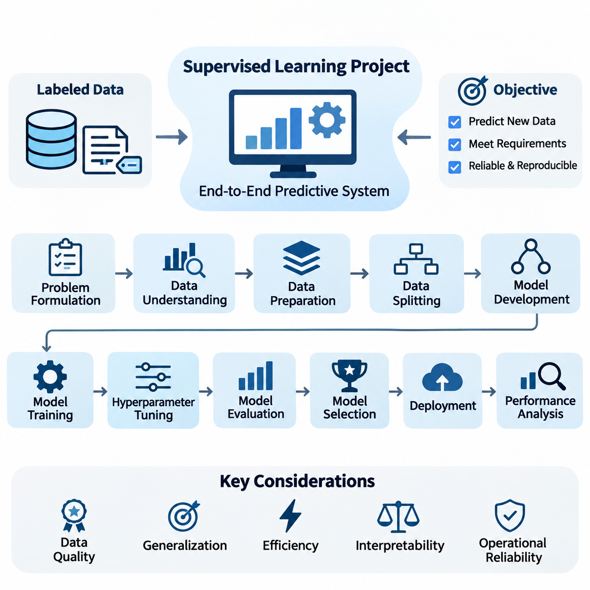
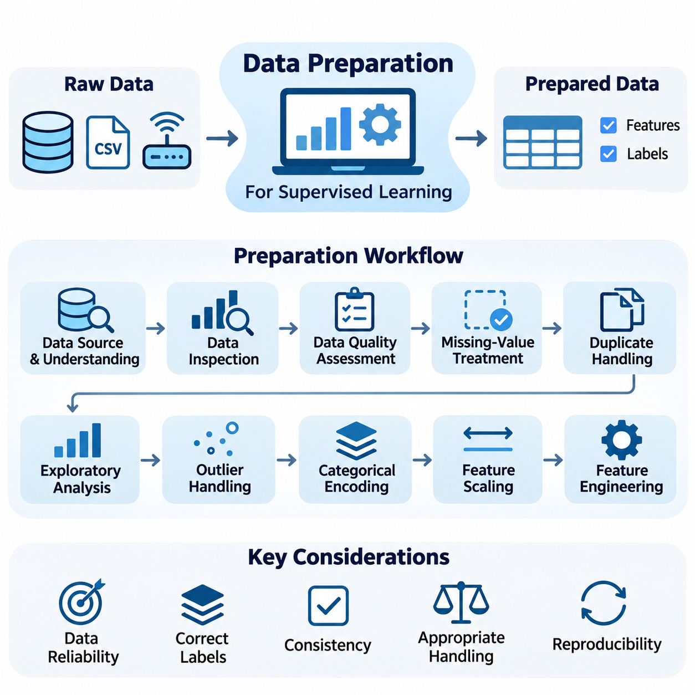
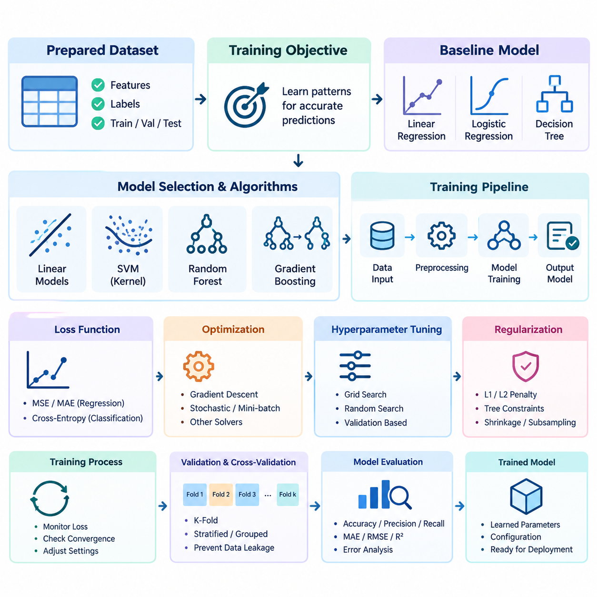
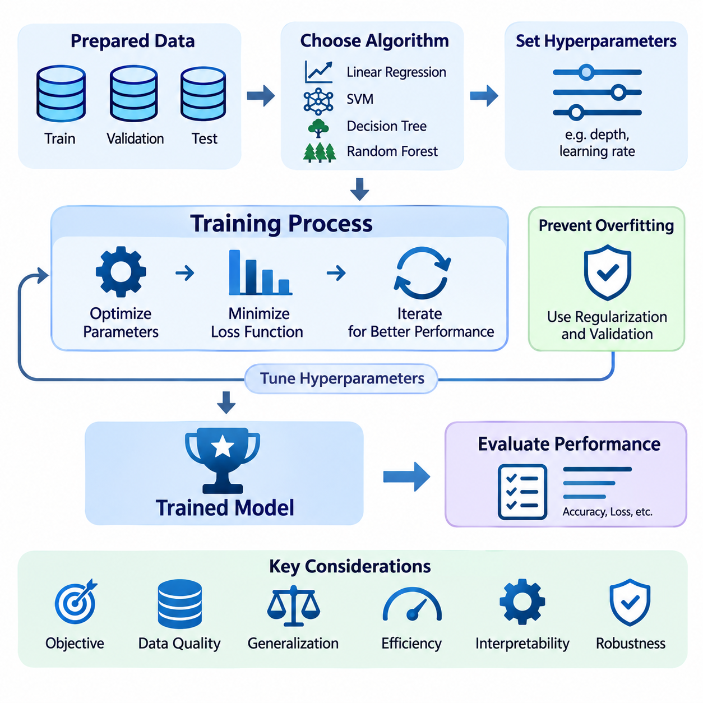
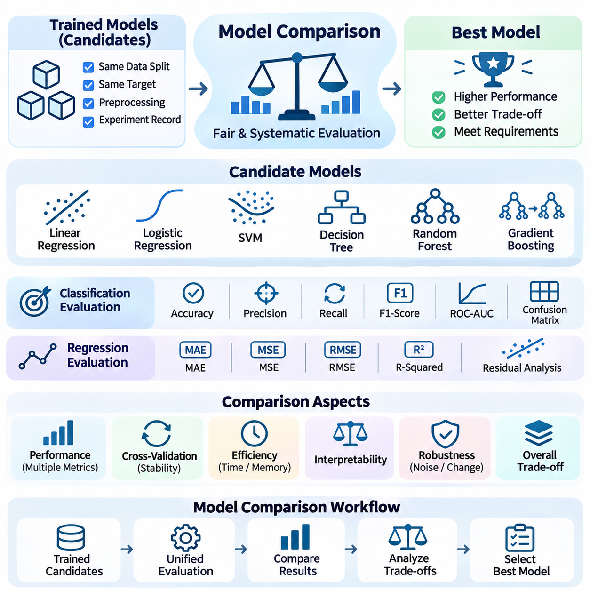
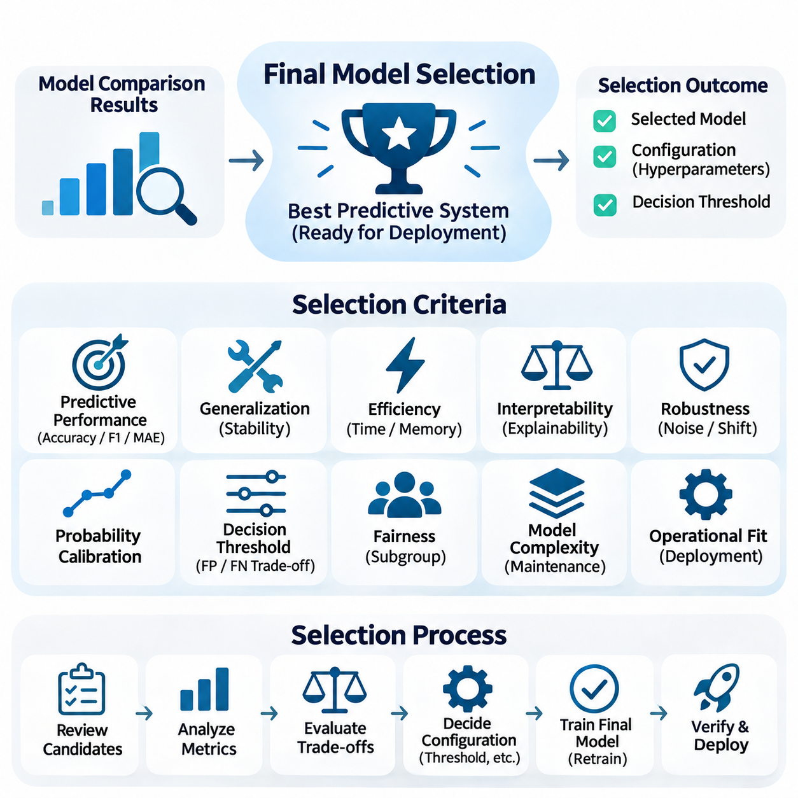
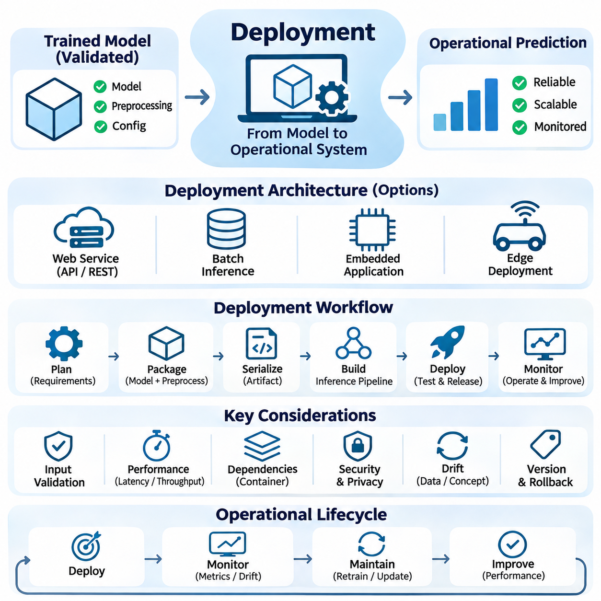
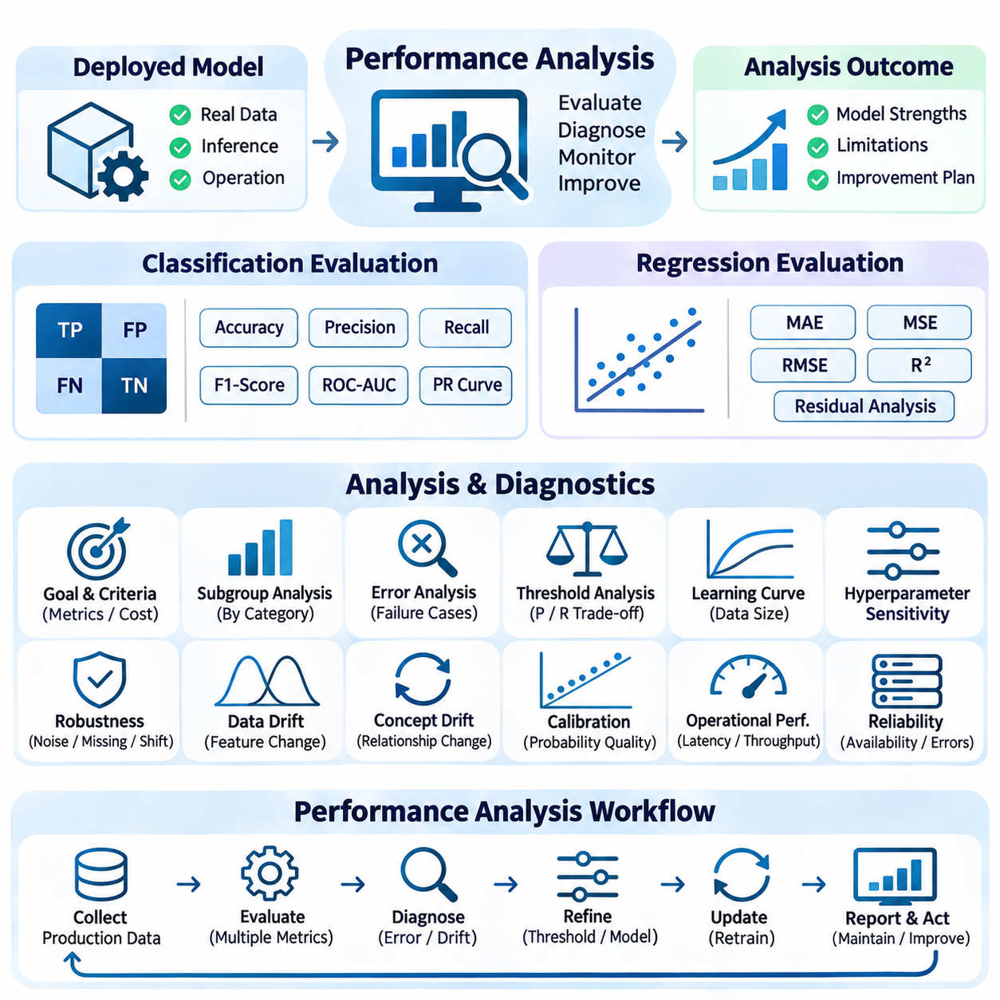

# 09. End to End Supervised Project

## 09.00 Project Overview

{width="7.268055555555556in" height="7.268055555555556in"}

종단 간 지도학습 프로젝트(End-to-End Supervised Learning Project)는 머신러닝(Machine Learning)의 개념을 완전하고 실용적이며 재현 가능한 시스템(Reproducible System)으로 전환하는 과정을 보여준다. 이 프로젝트는 개별 알고리즘(Algorithm)을 독립적으로 학습하는 대신 데이터 준비(Data Preparation), 모델 학습(Model Training), 평가(Evaluation), 선택(Selection), 배포(Deployment), 성능 분석(Performance Analysis)을 통합한다. 핵심 목표는 명확하게 정의된 응용 요구사항을 충족하면서 이전에 관찰하지 못한 데이터(Unseen Data)에 대해서도 신뢰성 있게 작동하는 예측 솔루션(Predictive Solution)을 개발하는 것이다.

지도학습(Supervised Learning)은 각 입력(Input)이 알려진 목표값(Target)과 연결된 레이블 데이터(Labeled Data)를 기반으로 한다. 학습 과정에서 알고리즘은 입력 특징(Input Features)과 기대 출력(Expected Outputs) 사이의 통계적 관계(Statistical Relationships)를 식별한다. 이러한 관계는 새로운 관측값에 대한 목표값을 추정할 수 있는 예측 모델(Predictive Model)로 표현된다. 따라서 완전한 프로젝트에서는 예측 정확도(Predictive Accuracy)뿐 아니라 데이터 품질(Data Quality), 일반화(Generalization), 계산 효율성(Computational Efficiency), 해석 가능성(Interpretability), 운영 신뢰성(Operational Reliability)까지 고려해야 한다.

프로젝트는 예측 작업의 목적과 범위를 설정하는 문제 정의(Problem Formulation)에서 시작한다. 분류 문제(Classification Problem)는 관측값을 이산적인 범주(Discrete Categories)에 할당하며, 회귀 문제(Regression Problem)는 연속적인 수치(Continuous Numerical Values)를 추정한다. 이러한 구분에 따라 적합한 알고리즘, 손실 함수(Loss Functions), 평가 지표(Evaluation Metrics)가 결정된다. 목표 변수(Target Variable), 사용 가능한 특징(Available Features), 예측 조건(Prediction Conditions), 기대 결과(Expected Outcomes)를 명확하게 정의하면 이후 개발 과정에서 불필요한 복잡성을 방지할 수 있다.

실용적인 사례로는 산업용 센서 측정값(Industrial Sensor Measurements)을 활용한 장비 고장 예측(Equipment Failure Prediction), 고객 거래 분류(Customer Transaction Classification), 제조 매개변수(Manufacturing Parameters)를 이용한 제품 품질 추정(Product Quality Estimation) 등이 있다. 각 응용 분야에는 관측 가능한 특징(Observable Features)과 과거 결과를 나타내는 레이블(Labels)이 존재한다. 운영 요구사항은 서로 다르지만 이러한 문제들은 공통적인 지도학습 작업 흐름(Supervised Learning Workflow)을 공유한다. 따라서 프로젝트 방법론(Project Methodology)은 기본 원칙을 변경하지 않고 다양한 분야에 적용할 수 있다.

첫 번째 주요 개발 활동은 데이터셋(Dataset)과 예측 작업 사이의 관계를 이해하는 것이다. 데이터셋 검사(Dataset Inspection)를 통해 특징 유형(Feature Types), 목표값 분포(Target Distributions), 결측값(Missing Values), 중복 레코드(Duplicated Records), 일관되지 않은 측정값(Inconsistent Measurements), 신뢰성이 낮은 레이블(Unreliable Labels)을 확인한다. 탐색적 데이터 분석(Exploratory Data Analysis)은 이상 관측값(Unusual Observations)과 변수 간 관계(Relationships Among Variables)를 식별하는 데에도 도움이 된다. 이러한 조사는 사용 가능한 정보가 의미 있는 예측 모델링(Predictive Modeling)을 지원하기에 충분한지 판단하는 기초가 된다.

데이터 준비(Data Preparation)는 원시 관측값(Raw Observations)을 머신러닝 알고리즘에 적합한 일관된 표현(Consistent Representation)으로 변환한다. 일반적인 작업에는 결측값 처리(Missing Value Handling), 범주형 변수 인코딩(Categorical Variable Encoding), 수치형 특징 스케일링(Numerical Feature Scaling), 유용한 파생 특징(Derived Features) 생성 등이 포함된다. 전처리(Preprocessing) 결정은 모델 동작(Model Behavior)에 상당한 영향을 줄 수 있으므로 신중하게 설계해야 한다. 재현 가능한 전처리 파이프라인(Reproducible Preprocessing Pipeline)은 학습 데이터(Training Data)와 추론 데이터(Inference Data)에 호환되는 변환 과정이 적용되도록 보장한다.

신뢰할 수 있는 성능 추정(Performance Estimation)을 위해서는 데이터를 학습(Training), 검증(Validation), 테스트(Testing) 부분집합으로 분리하는 것이 필수적이다. 학습 데이터는 매개변수 학습(Parameter Learning)에 사용되고, 검증 데이터는 모델 선택(Model Selection)과 하이퍼파라미터 조정(Hyperparameter Tuning)을 지원하며, 테스트 데이터는 독립적인 최종 평가(Final Assessment)에 사용된다. 일부 데이터셋에서는 무작위 분할(Random Splitting)이 적절하지만, 시간적 의존성(Temporal Dependencies)이나 공통 개체(Shared Entities)가 존재하는 경우에는 시간순 분할(Chronological Splitting) 또는 그룹 기반 분할(Group-Based Splitting)이 필요할 수 있다.

데이터 누출(Data Leakage)은 지도학습 프로젝트에서 특히 중요한 위험 요소이다. 데이터 누출은 실제 예측 시점에 사용할 수 없는 정보가 모델 개발 과정에 부적절하게 영향을 미칠 때 발생한다. 대표적인 사례로는 테스트 관측값(Test Observations)을 사용하여 전처리 통계량(Preprocessing Statistics)을 계산하거나 미래 결과(Future Outcomes)에서 파생된 특징을 도입하는 경우가 있다. 이러한 오류는 실제보다 과도하게 높은 평가 점수(Evaluation Scores)를 만들어낼 수 있다. 데이터 누출을 방지하려면 데이터셋을 명확하게 분리하고 전체 파이프라인에서 특징의 사용 가능 시점(Feature Availability)을 신중하게 검토해야 한다.

모델 개발(Model Development)은 예측 성능의 기준 수준을 설정하는 단순한 기준 모델(Baseline Model)에서 시작해야 한다. 분류 문제에서는 로지스틱 회귀(Logistic Regression) 또는 기본 의사결정나무(Decision Tree)가 해석 가능한 출발점이 될 수 있다. 회귀 문제에서는 선형 회귀(Linear Regression)가 유사한 역할을 수행한다. 기준 모델은 추가적인 모델 복잡성(Model Complexity)이 의미 있는 개선을 제공하는지 판단하는 데 도움이 되며, 더 정교한 알고리즘에서 예상하지 못한 동작이 나타날 때 진단 근거(Diagnostic Evidence)를 제공한다.

이후 프로젝트에서는 서로 다른 수학적 가정(Mathematical Assumptions)과 계산 특성(Computational Characteristics)을 가진 지도학습 알고리즘을 조사한다. 서포트 벡터 머신(Support Vector Machine)은 마진(Margin)을 기반으로 분리 경계(Separating Boundary)를 구성하며, 의사결정나무(Decision Tree)는 계층적인 특징 조건(Hierarchical Feature Conditions)을 통해 예측을 표현한다. 랜덤 포레스트(Random Forest)는 여러 트리를 결합하여 안정성을 높이고, 그래디언트 부스팅(Gradient Boosting)은 예측 오차(Prediction Errors)를 반복적으로 보정한다. 이러한 접근법의 비교는 모델 구조(Model Structure)가 데이터셋에 따라 성능에 어떤 영향을 미치는지 보여준다.

모델 학습(Model Training)은 적절한 목적 함수(Objective Function)를 최소화하는 매개변수(Parameters)를 추정하는 과정이다. 최적화 과정(Optimization Process)에서는 해석적 해법(Analytical Solutions), 경사 기반 방법(Gradient-Based Methods), 알고리즘별 최적화 절차(Algorithm-Specific Procedures)를 사용할 수 있다. 학습 동작(Training Behavior)은 데이터 표현(Data Representation), 모델 복잡성(Model Complexity), 정규화(Regularization), 하이퍼파라미터 구성(Hyperparameter Configuration)에 따라 달라진다. 학습 성능과 검증 성능을 지속적으로 관찰하면 수렴 문제(Convergence Problems), 학습 용량 부족(Insufficient Learning Capacity), 학습 관측값에 대한 과도한 적응(Overfitting)을 식별할 수 있다.

하이퍼파라미터 튜닝(Hyperparameter Tuning)은 학습된 매개변수를 직접 수정하지 않고 모델 구성을 개선하는 과정이다. 대표적인 하이퍼파라미터에는 정규화 강도(Regularization Strength), 최대 트리 깊이(Maximum Tree Depth), 커널 매개변수(Kernel Parameters), 학습률(Learning Rate), 앙상블 크기(Ensemble Size)가 있다. 격자 탐색(Grid Search), 무작위 탐색(Randomized Search), 기타 체계적인 최적화 전략(Systematic Optimization Strategies)을 통해 후보 구성을 탐색할 수 있다. 교차 검증(Cross-Validation)은 성능 안정성(Performance Stability)에 대한 추가적인 근거를 제공하지만, 탐색 과정에서는 계산 비용을 현실적인 수준으로 유지하고 최종 테스트 데이터셋을 독립적으로 보존해야 한다.

모델 평가(Model Evaluation)에는 실제 예측 목표를 반영하는 평가 지표(Evaluation Metrics)가 필요하다. 분류 작업에서는 정확도(Accuracy), 정밀도(Precision), 재현율(Recall), F1 점수(F1-Score), 수신자 조작 특성 분석(Receiver Operating Characteristic Analysis)을 사용할 수 있다. 회귀 작업에서는 평균 절대 오차(Mean Absolute Error), 평균 제곱 오차(Mean Squared Error), 평균 제곱근 오차(Root Mean Squared Error)가 일반적으로 사용된다. 모든 상황에 적합한 단일 지표는 존재하지 않는다. 적절한 평가 전략은 오류의 영향(Error Consequences), 목표값 분포(Target Distributions), 클래스 불균형(Class Imbalance), 실제 운영 환경(Operational Context)에 따라 결정된다.

클래스 불균형(Class Imbalance)은 전체 정확도(Overall Accuracy)가 소수 클래스(Minority Class)의 낮은 성능을 감출 수 있으므로 특별한 주의가 필요하다. 예를 들어 장비 고장 예측에서는 정상 작동 조건(Normal Operating Conditions)에 비해 고장이 훨씬 드물게 발생할 수 있다. 거의 모든 상황을 정상으로 예측하는 모델은 높은 정확도를 달성하면서도 중요한 고장을 놓칠 수 있다. 이러한 응용 분야에서는 정밀도(Precision), 재현율(Recall), 혼동 행렬(Confusion Matrix), 정밀도-재현율 분석(Precision-Recall Analysis)이 더욱 유용한 평가 근거를 제공한다.

모델 비교(Model Comparison)는 단일 실험에서 얻은 수치 점수(Numerical Scores)를 넘어 다양한 요소를 고려해야 한다. 학습 시간(Training Duration), 추론 지연시간(Inference Latency), 메모리 요구량(Memory Requirements), 강건성(Robustness), 해석 가능성(Interpretability)의 차이는 실제 적용 적합성(Practical Suitability)에 영향을 미친다. 복잡한 앙상블 모델(Ensemble Model)은 가장 높은 예측 정확도를 제공할 수 있지만 훨씬 많은 계산 자원을 요구할 수 있다. 따라서 배포 제약(Deployment Constraints), 유지보수 요구사항(Maintenance Requirements), 설명 가능성(Explainability)이 중요한 경우에는 단순한 모델이 더 적합할 수 있다.

최종 모델 선택(Final Model Selection)은 실험적 근거(Experimental Evidence)와 응용 분야별 요구사항(Application-Specific Requirements)을 결합하여 수행한다. 선택된 모델은 일관된 일반화 성능(Generalization Performance), 허용 가능한 계산 요구량(Computational Requirements), 관리 가능한 운영 복잡성(Operational Complexity)을 보여야 한다. 전처리 구성(Preprocessing Configuration), 학습된 매개변수(Learned Parameters), 특징 정의(Feature Definitions), 하이퍼파라미터(Hyperparameters)는 함께 보존해야 한다. 데이터셋 버전(Dataset Versions), 소프트웨어 의존성(Software Dependencies), 난수 시드(Random Seeds), 평가 절차(Evaluation Procedures)를 기록하면 선택된 솔루션을 재현하고 감사하며 유지보수하기가 쉬워진다.

배포(Deployment)는 선택된 모델을 실제로 사용할 수 있는 예측 구성요소(Predictive Component)로 전환하는 과정이다. 응용 분야에 따라 추론(Inference)은 웹 서비스(Web Service), 예약된 일괄 처리(Scheduled Batch Process), 산업용 컴퓨터(Industrial Computer), 엣지 장치(Edge Device)를 통해 실행될 수 있다. 배포 과정에서는 일관된 입력 검증(Input Validation), 전처리(Preprocessing), 예측 실행(Prediction Execution), 출력 해석(Output Interpretation)이 필요하다. 또한 응답 시간(Response Time), 자원 소비(Resource Consumption), 소프트웨어 호환성(Software Compatibility), 오류 처리(Error Handling), 기존 응용 프로그램과의 통합(Integration)도 고려해야 한다.

배포된 모델(Deployed Model)은 학습 데이터셋에 표현된 조건과 다른 환경에서 작동할 수 있다. 센서 특성(Sensor Characteristics), 고객 행동(Customer Behavior), 환경 조건(Environmental Conditions), 제조 공정(Manufacturing Processes)의 변화는 입력 분포(Input Distributions)와 예측 품질(Prediction Quality)을 변화시킬 수 있다. 따라서 성능 모니터링(Performance Monitoring)에서는 예측 통계(Prediction Statistics), 특징 분포(Feature Distributions), 지연시간(Latency), 새롭게 확보된 실제 정답 레이블(Ground-Truth Labels)을 조사해야 한다. 데이터 드리프트(Data Drift)와 성능 저하(Performance Degradation)를 탐지하면 적시에 문제를 조사하고 통제된 모델 업데이트(Controlled Model Updates)를 수행할 수 있다.

성능 분석(Performance Analysis)은 실험 결과(Experimental Results)와 운영 효과(Operational Effectiveness)를 연결하는 최종 단계이다. 정량적 평가(Quantitative Evaluation)는 특징 범위(Feature Ranges), 범주(Categories), 운영 조건(Operating Conditions)에 따른 체계적인 약점을 식별하는 오류 분석(Error Analysis)과 함께 수행해야 한다. 예측 결과(Predictions)와 실제 결과(Actual Outcomes)를 비교하면 실패 원인이 데이터 부족(Insufficient Data), 부적절한 모델 가정(Inappropriate Model Assumptions), 전처리 한계(Preprocessing Limitations), 환경 변화(Changing Environments) 중 어디에서 발생하는지 파악할 수 있다. 이러한 분석 결과는 후속 개선 활동의 방향을 제시한다.

재현성(Reproducibility)과 추적 가능성(Traceability)은 완전한 지도학습 작업 흐름의 핵심 속성이다. 각 실험에서는 데이터 출처(Data Sources), 전처리 변환(Preprocessing Transformations), 알고리즘 구성(Algorithm Configuration), 평가 방법론(Evaluation Methodology), 결과 산출물(Resulting Artifacts)을 문서화해야 한다. 버전 관리 코드(Version-Controlled Code)와 일관된 실험 기록(Experiment Records)은 모델 개정 버전(Model Revisions) 사이의 의미 있는 비교를 가능하게 한다. 이러한 실천 방법은 협업(Collaboration), 디버깅(Debugging), 배포 검증(Deployment Verification), 머신러닝 시스템의 장기 유지보수(Long-Term Maintenance)도 지원한다.

전체 프로젝트는 문제 정의(Problem Definition)와 데이터 준비(Data Preparation)에서 시작하여 학습(Training), 비교(Comparison), 최종 선택(Final Selection), 배포(Deployment), 성능 분석(Performance Analysis)으로 이어지는 연결된 절차를 따른다. 각 단계는 다음 단계의 의사결정에 필요한 근거를 제공하며, 후속 단계에서 발견된 문제로 인해 이전 결정을 다시 검토해야 할 수도 있다. 이러한 반복적 구조(Iterative Structure)는 머신러닝 엔지니어링(Machine Learning Engineering)의 실질적인 특성을 반영한다. 성공적인 개발을 위해서는 개별 알고리즘만 최적화하는 것이 아니라 전체 시스템을 관리해야 한다.

이 프로젝트를 완료하면 독자는 지도학습 기법(Supervised Learning Techniques)이 실제 개발 수명주기(Development Lifecycle)에서 어떻게 작동하는지 통합적으로 이해할 수 있다. 이러한 경험은 수학적 모델(Mathematical Models)을 데이터 엔지니어링(Data Engineering), 실험 설계(Experimental Design), 소프트웨어 구현(Software Implementation), 운영 평가(Operational Evaluation)와 연결한다. 더욱 중요한 점은 다양한 산업 분야에서 측정 가능하고(Measurable), 재현 가능하며(Reproducible), 유지보수가 용이하고(Maintainable), 실제 응용에 적합한 예측 시스템(Predictive Systems)을 구축하기 위한 재사용 가능한 방법론(Reusable Methodology)을 확립한다는 것이다.

## 09.01 Data Preparation [w/Code]

{width="7.268055555555556in" height="7.268055555555556in"}

데이터 준비(Data Preparation)는 모델 품질(Model Quality)이 학습 데이터(Training Data)의 신뢰성에 크게 의존하기 때문에 종단 간 지도학습 프로젝트(End-to-End Supervised Learning Project)의 기초가 된다. 아무리 정교한 알고리즘(Algorithm)이라도 잘못된 레이블(Incorrect Labels), 일관되지 않은 측정값(Inconsistent Measurements), 부적절하게 구성된 특징(Poorly Constructed Features)을 지속적으로 보완할 수는 없다. 체계적인 데이터 준비 과정은 원시 관측값(Raw Observations)을 신뢰할 수 있는 학습, 의미 있는 평가, 재현 가능한 배포를 지원하는 구조화된 데이터셋(Structured Datasets)으로 변환한다.

데이터 준비 작업 흐름(Data Preparation Workflow)은 데이터 출처(Data Sources)를 식별하고 관측값이 어떻게 수집되었는지 이해하는 것에서 시작한다. 데이터는 관계형 데이터베이스(Relational Databases), CSV 파일(CSV Files), 산업용 센서(Industrial Sensors), 비즈니스 응용 프로그램(Business Applications), 실험 측정값(Experimental Measurements) 등에서 생성될 수 있다. 각 데이터 출처에는 샘플링 주파수(Sampling Frequency), 측정 정밀도(Measurement Precision), 데이터 완전성(Data Completeness)에 관한 가정이 포함된다. 이러한 특성을 문서화하면 수집된 정보가 실제 예측 환경(Prediction Environment)을 정확하게 대표하는지 판단하는 데 도움이 된다.

지도학습 데이터셋(Supervised Dataset)은 입력 특징(Input Features)과 이에 대응하는 목표 레이블(Target Labels)로 구성된다. 특징은 개별 샘플(Samples)의 관측 가능한 속성을 설명하며, 레이블은 모델이 예측하도록 학습해야 하는 결과를 나타낸다. 분류 레이블(Classification Labels)은 이산적인 범주(Discrete Categories)를 식별하고, 회귀 목표값(Regression Targets)은 연속적인 수치(Continuous Numerical Values)를 포함한다. 전처리(Preprocessing)를 시작하기 전에 각 특징이 올바른 목표값과 연결되어 있는지, 목표값 정의(Target Definition)가 모든 관측값에서 일관되게 유지되는지 확인해야 한다.

초기 데이터 검사(Initial Data Inspection)에서는 데이터셋 크기(Dataset Dimensions), 특징 이름(Feature Names), 변수 유형(Variable Types), 목표값 분포(Target Distributions)를 조사한다. 수치형 특징(Numerical Features)은 측정값, 개수, 계산된 수량을 나타낼 수 있으며, 범주형 특징(Categorical Features)은 이산적인 상태나 그룹을 설명한다. 요약 통계(Summary Statistics)와 대표 레코드(Representative Records)를 확인하면 예상하지 못한 값, 일관되지 않은 형식, 잠재적인 수집 오류(Collection Errors)를 발견할 수 있다. 이러한 예비 조사는 이후 변환 작업에 필요한 기본적인 이해를 확립한다.

데이터 품질 평가(Data Quality Assessment)는 결측값(Missing Values), 중복 관측값(Duplicated Observations), 유효하지 않은 측정값(Invalid Measurements), 일관되지 않은 레이블(Inconsistent Labels)에 초점을 맞춘다. 결측값은 센서 고장(Sensor Failures), 불완전한 거래(Incomplete Transactions), 정보 부재(Unavailable Information) 등으로 발생할 수 있다. 중복 레코드(Duplicated Records)는 통계적 분포(Statistical Distributions)를 왜곡하고 반복된 관측값의 영향력을 의도하지 않게 증가시킬 수 있다. 유효하지 않은 값은 측정 오류(Measurement Errors)나 형식 문제(Formatting Problems)를 나타낼 수 있다. 각 문제에 적절한 수정 전략(Correction Strategy)을 선택하기 전에 원인을 조사해야 한다.

결측값 처리(Missing-Value Treatment)는 특징의 의미와 결측 발생 메커니즘(Missingness Mechanism)에 따라 달라진다. 수치형 변수(Numerical Variables)는 학습 데이터의 평균(Mean), 중앙값(Median), 모델 기반 추정값(Model-Based Estimates)을 이용하여 대체할 수 있다. 범주형 변수(Categorical Variables)는 최빈 범주(Most Frequent Category) 또는 명시적인 미확인 범주(Unknown Category)를 사용할 수 있다. 불완전한 레코드(Incomplete Records)를 제거하는 것이 적절한 경우도 있지만, 과도한 삭제는 표본 편향(Sampling Bias)을 유발할 수 있다. 정보의 부재 자체가 운영상 의미를 가지는 경우에는 결측 여부 표시 변수(Missingness Indicators)도 유용한 예측 정보를 제공할 수 있다.

중복 탐지(Duplicate Detection)는 단순히 동일한 행(Identical Rows)을 식별하는 것 이상의 분석이 필요하다. 여러 레코드가 정상적인 반복 측정(Repeated Measurements)을 나타낼 수 있으며, 거의 동일한 관측값이 우발적인 중복(Accidental Duplication)으로 생성되었을 수도 있다. 시계열 데이터셋(Time-Series Datasets)에서는 연속적인 측정값이 자연스럽게 유사한 값을 가질 수 있다. 데이터의 발생 원인을 이해하지 않고 레코드를 제거하면 의미 있는 정보가 손실될 수 있다. 따라서 중복 처리(Duplicate Handling)는 수집 오류와 정상적인 반복을 구분하고 원래 프로세스의 무결성(Integrity)을 유지해야 한다.

탐색적 데이터 분석(Exploratory Data Analysis)은 사용 가능한 관측값의 통계적 구조(Statistical Structure)를 조사한다. 평균(Mean), 중앙값(Median), 표준편차(Standard Deviation), 최솟값(Minimum), 최댓값(Maximum), 분위수(Quantiles)와 같은 측정값은 수치 분포(Numerical Distributions)를 설명한다. 빈도수(Frequency Counts)는 범주형 변수를 요약하며, 상관관계 분석(Correlation Analysis)은 수치형 특징 사이의 선형 관계(Linear Relationships)를 보여준다. 이러한 조사를 통해 모델 학습 전에 비정상적인 패턴(Unusual Patterns), 중복 정보가 포함된 변수(Redundant Variables), 목표값과의 잠재적인 관계(Potential Relationships)를 식별할 수 있다.

이상치(Outliers)는 일반적이지 않은 관측값이 반드시 잘못된 값은 아니므로 신중하게 해석해야 한다. 극단적인 센서 측정값(Extreme Sensor Measurements)은 장비 오작동(Equipment Malfunction)을 나타낼 수 있지만, 모델이 인식해야 하는 드문 운영 조건(Rare Operating Conditions)을 나타낼 수도 있다. 가능한 처리 방법에는 검증(Verification), 수정(Correction), 값 제한(Clipping), 변환(Transformation), 유지(Retention)가 포함된다. 이상치 처리 결정은 다수의 관측값과 다르다는 이유만으로 자동 제거하기보다 도메인 지식(Domain Knowledge)과 예측 목표(Prediction Objectives)를 반영해야 한다.

범주형 인코딩(Categorical Encoding)은 비수치형 정보(Nonnumerical Information)를 머신러닝 알고리즘이 처리할 수 있는 표현으로 변환한다. 원-핫 인코딩(One-Hot Encoding)은 각 범주에 대해 별도의 이진 표시 변수(Binary Indicators)를 생성하며, 순서형 인코딩(Ordinal Encoding)은 순서가 있는 상태에 수치값을 할당한다. 인코딩 방법의 선택은 범주에 의미 있는 순서가 존재하는지, 알고리즘이 수치적 거리(Numerical Distances)를 어떻게 해석하는지에 따라 달라진다. 인코딩 매핑(Encoding Mappings)은 학습 데이터에서 학습하고 검증, 테스트, 향후 추론 샘플에 일관되게 적용해야 한다.

특징 스케일링(Feature Scaling)은 측정 단위(Measurement Units)의 차이가 학습 과정에 부적절하게 지배적인 영향을 미치지 않도록 수치형 변수를 조정한다. 표준화(Standardization)는 특징의 평균과 표준편차를 이용하여 값을 변환하며, 최소-최대 스케일링(Min-Max Scaling)은 값을 지정된 구간(Specified Interval)으로 변환한다. 거리 기반 알고리즘(Distance-Based Algorithms)과 정규화된 선형 모델(Regularized Linear Models)은 특징의 크기에 민감한 경우가 많다. 트리 기반 방법(Tree-Based Methods)은 일반적으로 스케일링의 필요성이 낮지만, 일관된 전처리는 여러 알고리즘 사이의 비교를 단순화할 수 있다.

특징 공학(Feature Engineering)은 기존 관측값에서 유용한 변수를 생성하는 과정이다. 대표적인 사례로는 비율(Ratios), 차이(Differences), 이동 통계량(Rolling Statistics), 상호작용 항(Interaction Terms), 도메인별 지표(Domain-Specific Indicators)가 있다. 산업 응용 분야에서는 온도 기울기(Temperature Gradients), 진동 통계량(Vibration Statistics), 누적 작동 시간(Accumulated Operating Hours)이 개별 원시 측정값보다 더 유용한 정보를 제공할 수 있다. 생성된 특징은 실제 예측 시점에도 사용할 수 있어야 하며, 예측 유용성(Predictive Usefulness)과 계산 비용(Computational Cost)을 함께 평가해야 한다.

특징 선택(Feature Selection)은 관련된 예측 정보를 유지하면서 불필요한 입력을 줄이는 과정이다. 중복되거나 관련성이 낮거나 불안정한 변수(Redundant, Irrelevant, or Unstable Variables)는 계산 요구량(Computational Requirements)을 증가시키고 일반화 성능(Generalization Performance)을 저하시킬 수 있다. 특징 선택 방법에는 통계적 필터링(Statistical Filtering), 모델 기반 중요도 추정(Model-Based Importance Estimation), 재귀적 특징 제거(Recursive Feature Elimination)가 포함된다. 검증 데이터나 테스트 데이터의 정보가 특징 선택 결정에 영향을 미치지 않도록 선택 절차는 학습 과정 내부에서 수행해야 한다.

데이터 분할(Data Splitting)은 모델 개발과 최종 평가를 위한 독립적인 부분집합(Independent Subsets)을 구성한다. 학습 관측값(Training Observations)은 매개변수 추정(Parameter Estimation)을 지원하고, 검증 관측값(Validation Observations)은 모델 구성(Model Configuration)을 결정하며, 테스트 관측값(Test Observations)은 미관측 데이터(Unseen Data)에 대한 성능을 추정한다. 일반적인 분할 비율(Split Proportions)에는 70:15:15 또는 80:10:10이 있지만, 적절한 비율은 데이터셋 크기(Dataset Size)와 응용 요구사항(Application Requirements)에 따라 달라진다. 핵심 원칙은 보편적인 수치 비율을 강제하는 것이 아니라 독립적인 평가(Independent Evaluation)를 유지하는 것이다.

데이터 분할 전략(Splitting Strategy)은 관측값 사이의 관계를 반영해야 한다. 계층화 표본추출(Stratified Sampling)은 특히 소수 범주(Minority Categories)가 드문 분류 작업에서 클래스 비율(Class Proportions)을 유지하는 데 도움이 된다. 시간 의존적 데이터셋(Time-Dependent Datasets)은 미래 관측값이 이전 시점의 예측에 영향을 미치지 않도록 시간순 분리(Chronological Separation)가 필요하다. 그룹 기반 분할(Group-Based Splitting)은 동일한 기계, 환자, 고객에 속한 관련 관측값을 적절한 분할 영역에 함께 유지하여 공유 정보(Shared Information)로 인해 지나치게 낙관적인 성능 추정이 발생하는 것을 줄인다.

데이터 누출(Data Leakage)은 실제 예측 환경에서 사용할 수 없는 정보가 모델 개발이나 평가에 영향을 미칠 때 발생한다. 데이터 분할 전에 전체 데이터셋을 사용하여 스케일링 통계량(Scaling Statistics)을 계산하는 것이 대표적인 사례이다. 목표값에서 파생된 변수(Target-Derived Variables)와 미래 측정값(Future Measurements)은 더욱 심각한 누출을 발생시킬 수 있다. 이러한 문제를 방지하려면 전처리 추정기(Preprocessing Estimators)를 학습 관측값에 대해서만 적합(Fitting)하고, 검증 및 테스트 데이터셋에는 해당 학습 분할에서 얻은 변환(Transformations)을 적용해야 한다.

클래스 불균형(Class Imbalance)은 일부 목표 범주(Target Categories)의 발생 빈도가 다른 범주보다 훨씬 낮을 때 추가적인 데이터 준비 문제를 발생시킨다. 클래스 가중치(Class Weighting), 무작위 오버샘플링(Random Oversampling), 언더샘플링(Undersampling), 합성 소수 클래스 생성(Synthetic Minority Generation) 등의 기법은 소수 클래스 학습(Minority-Class Learning)을 개선할 수 있다. 그러나 재표본추출(Resampling)은 학습 데이터 내부에서만 수행해야 하며, 교차 검증(Cross-Validation)에서는 각 학습 폴드(Training Fold) 내부에서 수행하는 것이 바람직하다. 검증 및 테스트 분포는 의도한 평가 조건(Evaluation Conditions)을 대표하도록 유지해야 한다.

전처리 파이프라인(Preprocessing Pipeline)은 여러 변환 작업을 일관된 순서로 결합한다. 수치형 열(Numerical Columns)에는 결측값 대체(Imputation)와 스케일링(Scaling)을 적용할 수 있으며, 범주형 열(Categorical Columns)에는 결측값 처리(Missing-Value Treatment)와 인코딩(Encoding)을 적용할 수 있다. 사이킷런(scikit-learn)과 같은 프레임워크(Frameworks)의 파이프라인 기반 구현(Pipeline-Based Implementation)은 변환 과정이 올바르게 학습되고 일관되게 재사용되도록 지원한다. 이러한 구조는 교차 검증, 하이퍼파라미터 튜닝, 모델 비교, 최종 배포 과정도 단순화한다.

재현성(Reproducibility)을 확보하려면 데이터셋 버전(Dataset Versions), 변환 매개변수(Transformation Parameters), 난수 시드(Random Seeds), 특징 정의(Feature Definitions), 소프트웨어 의존성(Software Dependencies)을 기록해야 한다. 데이터 준비 스크립트(Data Preparation Scripts)는 동일한 조건에서 실행할 때 일관된 출력을 생성해야 한다. 원시 데이터(Raw Data)와 처리된 산출물(Processed Artifacts)을 명확하게 분리하면 추적 가능성(Traceability)을 유지하는 데 도움이 된다. 검증 검사(Validation Checks)를 통해 예상 특징 차원(Expected Feature Dimensions), 허용 값 범위(Permitted Value Ranges), 결측값 처리 정책(Missing-Value Policies), 학습 및 추론 입력 사이의 호환성(Compatibility)을 확인할 수 있다.

최종 준비된 데이터셋(Final Prepared Dataset)은 모델 학습을 시작하기 전에 명시적인 품질 및 일관성 요구사항(Quality and Consistency Requirements)을 충족해야 한다. 입력 특징(Input Features)은 목표값(Targets)과 올바르게 정렬되어야 하고, 전처리 변환(Preprocessing Transformations)은 데이터 누출을 방지해야 하며, 평가용 데이터 분할(Evaluation Partitions)은 독립성을 유지해야 한다. 클래스 분포(Class Distributions), 특징 차원(Feature Dimensions), 남아 있는 데이터 한계(Data Limitations)를 문서화해야 한다. 이러한 검사는 이후 모델 비교 결과가 예방 가능한 데이터 준비 오류가 아니라 실제 알고리즘 동작(Algorithm Behavior)을 반영한다는 신뢰를 확립한다.

데이터 준비(Data Preparation)는 단순한 사전 정제 작업(Preliminary Cleaning Activity)이 아니라 지도학습 시스템(Supervised Learning System)의 필수적인 구성요소이다. 특징 표현(Feature Representation), 표본추출(Sampling), 결측값(Missing Values), 데이터셋 분리(Dataset Separation)에 관한 결정은 예측 정확도(Predictive Accuracy), 강건성(Robustness), 해석 가능성(Interpretability), 운영 신뢰성(Operational Reliability)에 직접적인 영향을 미친다. 신중하게 설계된 데이터 준비 작업 흐름은 효율적인 모델 학습(Efficient Model Training), 공정한 알고리즘 비교(Fair Algorithm Comparison), 신뢰할 수 있는 성능 평가(Trustworthy Performance Evaluation), 실제 환경에서의 일관된 배포(Consistent Deployment)를 위한 기반을 형성한다.

## 09.02 Model Training [w/Code]

{width="7.268055555555556in" height="7.268055555555556in"}

{width="7.268055555555556in" height="7.268055555555556in"}

모델 학습(Model Training)은 지도학습 알고리즘(Supervised Learning Algorithm)이 준비된 데이터를 예측 모델(Predictive Model)로 변환하는 핵심 과정이다. 학습 과정에서 알고리즘은 내부 매개변수(Internal Parameters)를 조정하거나 의사결정 구조(Decision Structures)를 구성하여 입력 특징(Input Features)과 목표 레이블(Target Labels) 사이의 관계를 식별한다. 학습의 목적은 알려진 관측값을 단순히 재현하는 것이 아니라, 실제 운영 조건(Realistic Operating Conditions)에서 이전에 관찰하지 못한 데이터(Unseen Examples)에도 일반화(Generalization)할 수 있는 패턴을 학습하는 것이다.

학습 단계(Training Stage)는 검증된 데이터셋(Validated Dataset)과 명확하게 정의된 예측 목표(Prediction Objective)에서 시작한다. 입력 특징은 일관된 차원(Consistent Dimensions), 적절한 수치 표현(Numerical Representations), 정확하게 정렬된 목표값(Target Values)을 가져야 한다. 학습 부분집합(Training Subset)은 모델 매개변수(Model Parameters)를 추정하는 데 사용되며, 검증 데이터(Validation Data)는 모델 구성(Configuration)에 관한 의사결정을 지원한다. 테스트 데이터(Test Data)는 일반화 성능(Generalization Performance)에 대한 편향되지 않은 추정(Unbiased Estimate)을 유지하기 위해 최종 평가까지 분리된 상태로 보존한다.

기준 모델(Baseline Model)은 더욱 정교한 알고리즘을 도입하기 전에 필수적인 비교 기준(Reference)을 제공한다. 선형 회귀(Linear Regression)는 연속값 예측(Continuous Prediction)을 위한 간단한 출발점이며, 로지스틱 회귀(Logistic Regression)는 분류 작업(Classification Tasks)에 적합하다. 의사결정나무(Decision Tree)는 비선형 관계(Nonlinear Relationships)를 표현할 수 있는 또 다른 해석 가능한 대안이다. 기준 모델의 결과는 추가적인 복잡성(Additional Complexity)이 예측 성능(Predictive Performance)에 의미 있는 개선을 제공하는지 판단하는 기준이 된다.

학습 과정에서 모델 선택(Model Selection)은 데이터셋의 통계적 특성(Statistical Characteristics)과 응용 분야의 운영 요구사항(Operational Requirements)에 따라 달라진다. 선형 모델(Linear Models)은 계산 효율성(Computational Efficiency)과 해석 가능성(Interpretability)을 제공하며, 서포트 벡터 머신(Support Vector Machines)은 커널 함수(Kernel Functions)를 통해 복잡한 결정 경계(Decision Boundaries)를 표현할 수 있다. 랜덤 포레스트(Random Forests)는 앙상블 학습(Ensemble Learning)을 통해 안정성을 향상시키며, 그래디언트 부스팅(Gradient Boosting)은 순차적으로 구성된 모델을 이용하여 예측 오차(Prediction Errors)를 점진적으로 보정한다.

각 알고리즘은 고유한 최적화 메커니즘(Optimization Mechanism)을 통해 학습한다. 선형 모델(Linear Models)은 예측 오차를 최소화하여 계수(Coefficients)를 추정하며, 로지스틱 회귀(Logistic Regression)는 일반적으로 교차 엔트로피 손실(Cross-Entropy Loss)을 최소화한다. 서포트 벡터 머신(Support Vector Machines)은 마진 기반 목적 함수(Margin-Based Objectives)를 최적화하고, 의사결정나무(Decision Trees)는 불순도 감소(Impurity Reduction)를 기준으로 특징 분할(Feature Splits)을 선택한다. 그래디언트 부스팅(Gradient Boosting)은 일반적으로 미분 가능한 손실 함수(Differentiable Loss Function)의 기울기(Gradients)를 이용하여 현재 모델의 오차를 보정하는 후속 학습기(Successive Learners)를 구성한다.

손실 함수(Loss Function)는 학습 과정에서 예측값(Predictions)과 목표값(Target Values) 사이의 차이를 측정하는 방법을 정의한다. 회귀 작업(Regression Tasks)에서는 평균 제곱 오차(Mean Squared Error) 또는 평균 절대 오차(Mean Absolute Error)를 자주 사용하며, 분류 작업(Classification Tasks)에서는 교차 엔트로피(Cross-Entropy) 또는 관련 목적 함수(Related Objectives)를 일반적으로 사용한다. 적절한 손실 함수의 선택은 큰 오차(Large Errors), 소수 클래스(Minority Classes), 불확실한 예측(Uncertain Predictions)에 대한 모델의 민감도(Sensitivity)에 영향을 미친다. 목적 함수는 예측 오류의 통계적 특성(Statistical Properties)과 실제적인 영향(Practical Consequences)을 반영해야 한다.

최적화 알고리즘(Optimization Algorithms)은 선택된 손실을 줄이기 위해 모델 매개변수를 어떻게 갱신할지 결정한다. 경사하강법(Gradient Descent)은 목적 함수(Objective Function)를 감소시키는 방향으로 매개변수를 조정하며, 확률적 경사하강법(Stochastic Gradient Descent)과 미니배치 경사하강법(Mini-Batch Gradient Descent)은 학습 관측값의 부분집합(Subsets)을 사용한다. 다른 알고리즘은 특수한 해법(Specialized Solvers)이나 반복적인 구성 절차(Iterative Construction Procedures)를 사용한다. 수렴 동작(Convergence Behavior)은 학습률(Learning Rates), 특징 스케일링(Feature Scaling), 수치적 안정성(Numerical Stability), 초기화(Initialization), 최적화 문제의 기하학적 구조(Geometry of the Optimization Problem)에 따라 달라진다.

하이퍼파라미터(Hyperparameters)는 학습 관측값으로부터 직접 학습되지 않는 모델 동작의 여러 측면을 제어한다. 대표적인 사례로는 정규화 강도(Regularization Strength), 최대 트리 깊이(Maximum Tree Depth), 추정기 수(Number of Estimators), 커널 매개변수(Kernel Parameters), 학습률(Learning Rate)이 있다. 이러한 설정은 모델 용량(Model Capacity), 계산 비용(Computational Cost), 일반화(Generalization)에 영향을 미친다. 초기 구성(Initial Configurations)은 합리적인 비교 기준을 제공해야 하며, 이후 체계적인 튜닝(Systematic Tuning)을 통해 검증 결과(Validation Results)를 바탕으로 다양한 조합을 탐색할 수 있다.

정규화(Regularization)는 과도한 모델 복잡성(Excessive Model Complexity)을 제한하고 과적합(Overfitting)의 위험을 줄인다. 선형 모델(Linear Models)은 계수(Coefficients)를 제한하기 위해 L1 또는 L2 페널티(Penalties)를 사용할 수 있으며, 트리 기반 알고리즘(Tree-Based Algorithms)은 깊이(Depth), 리프 크기(Leaf Size), 분할 동작(Splitting Behavior)을 제한한다. 그래디언트 부스팅(Gradient Boosting)은 축소 기법(Shrinkage), 부분 표본추출(Subsampling), 구조적 제약(Structural Constraints)을 활용할 수 있다. 적절한 정규화는 학습 데이터의 잡음(Noise)이나 우연한 관계(Accidental Relationships)에 지나치게 민감해지지 않으면서 의미 있는 패턴을 포착하도록 돕는다.

과적합(Overfitting)은 모델이 새로운 관측값으로 일반화되지 않는 학습 데이터 고유의 세부사항(Training-Specific Details)을 학습할 때 발생한다. 일반적으로 학습 성능(Training Performance)은 높지만 검증 성능(Validation Performance)이 상당히 낮은 현상으로 나타난다. 과소적합(Underfitting)은 모델 용량(Model Capacity)이나 학습 효과(Training Effectiveness)가 관련된 관계를 충분히 포착하지 못할 때 발생한다. 학습 오차(Training Error)와 검증 오차(Validation Error)를 비교하면 이러한 상태를 구분하고 모델 복잡성, 특징, 최적화 설정을 조정하는 방향을 결정할 수 있다.

교차 검증(Cross-Validation)은 단일 검증 분할(Single Validation Split)에 의존하는 것보다 안정적인 모델 성능 추정(Performance Estimation)을 제공한다. K-겹 교차 검증(K-Fold Cross-Validation)에서는 학습 데이터셋을 여러 부분집합으로 나누고, 각 부분집합이 한 번씩 검증 데이터(Validation Data)로 사용되도록 반복한다. 각 폴드(Fold)의 성능 추정값을 집계하여 일관성을 평가한다. 클래스 분포(Class Distributions)나 관측값 사이의 의존성(Dependencies Among Observations)에 특별한 처리가 필요한 경우에는 계층화 교차 검증(Stratified Cross-Validation) 또는 그룹 인식 전략(Group-Aware Strategies)을 사용해야 한다.

학습 실험(Training Experiments)에서는 적합 절차(Fitting Procedures)와 평가 정보(Evaluation Information) 사이의 엄격한 분리를 유지해야 한다. 특징 스케일링(Feature Scaling), 결측값 대체(Imputation), 특징 선택(Feature Selection), 재표본추출(Resampling)은 전체 데이터셋이 아니라 각 학습 분할(Training Partition) 내부에서 학습되어야 한다. 파이프라인 기반 구현(Pipeline-Based Implementations)은 이러한 분리를 자동으로 적용하는 데 도움이 된다. 데이터 누출(Data Leakage)을 방지하면 검증 결과가 데이터 준비 과정에서 의도하지 않게 유입된 정보가 아니라 실제 예측 능력(Genuine Predictive Capability)을 반영하도록 보장할 수 있다.

클래스 불균형(Class Imbalance)은 알고리즘이 자주 발생하는 범주(Frequently Occurring Categories)를 선호하도록 만들어 모델 학습에 영향을 줄 수 있다. 클래스 가중치(Class Weights), 조정된 결정 목적 함수(Adjusted Decision Objectives), 학습 데이터에만 적용되는 재표본추출 방법(Training-Only Resampling Methods)은 소수 클래스(Minority Classes)에 대한 민감도를 개선할 수 있다. 그러나 이러한 개입은 정밀도(Precision), 재현율(Recall), 확률 보정(Probability Calibration)을 변화시킬 수 있다. 따라서 효과는 서로 다른 분류 오류(Classification Errors)가 운영에 미치는 영향을 반영하는 평가 지표(Evaluation Metrics)를 사용하여 검증해야 한다.

학습 효율성(Training Efficiency)은 데이터셋에 많은 관측값이 포함되어 있거나 후보 모델(Candidate Models)에 반복적인 최적화가 필요한 경우 중요해진다. 계산 요구량(Computational Demands)은 알고리즘 복잡성(Algorithm Complexity), 특징 차원(Feature Dimensions), 데이터셋 크기(Dataset Size), 하이퍼파라미터 탐색 전략(Hyperparameter Search Strategy)에 따라 달라진다. 병렬 처리(Parallel Processing)는 일부 앙상블 방법(Ensemble Methods)을 가속할 수 있으며, GPU 가속(GPU Acceleration)은 이를 지원하는 특정 구현에서 유용하다. 효율적인 실험(Efficient Experimentation)은 계산 자원(Computational Resources)과 신뢰할 수 있는 성능 추정의 필요성 사이에서 균형을 유지한다.

재현 가능한 학습(Reproducible Training)을 위해서는 난수 시드(Random Seeds), 데이터 분할(Data Partitions), 전처리 구성(Preprocessing Configurations), 소프트웨어 버전(Software Versions), 알고리즘 설정(Algorithm Settings)을 명시적으로 관리해야 한다. 실험 기록(Experiment Records)에는 하이퍼파라미터(Hyperparameters), 평가 점수(Evaluation Scores), 학습 시간(Training Duration), 관련 실행 조건(Execution Conditions)을 보존해야 한다. 일부 수치 연산(Numerical Operations)은 하드웨어나 소프트웨어 환경에 따라 비결정적(Non-Deterministic)일 수 있다. 그럼에도 체계적인 실험 추적(Experiment Tracking)은 결과 비교와 예상하지 못한 동작의 원인 분석 능력을 크게 향상시킨다.

학습 진단(Training Diagnostics)은 최종 성능 점수(Final Performance Score) 이상의 정보를 제공한다. 학습 곡선(Learning Curves)은 학습 데이터가 증가함에 따라 예측 품질(Predictive Quality)이 어떻게 변화하는지 보여주며, 검증 곡선(Validation Curves)은 선택된 하이퍼파라미터에 대한 민감도(Sensitivity)를 나타낸다. 반복 학습 알고리즘(Iterative Algorithms)에서는 손실 변화 추이(Loss Trajectories)를 관찰하여 불안정한 최적화(Unstable Optimization)나 불충분한 수렴(Insufficient Convergence)을 식별할 수 있다. 특징 중요도(Feature Importance)와 계수 분석(Coefficient Analysis)은 학습된 관계가 타당하고 도메인 기대사항(Domain Expectations)과 일치하는지 판단하는 데 도움이 된다.

모델 학습(Model Training)은 단순히 학습이 완료된 추정기(Fitted Estimators)의 집합을 생성하는 것에 그쳐서는 안 된다. 각 후보 모델(Candidate Model)은 전처리 파이프라인(Preprocessing Pipeline), 학습 구성(Training Configuration), 검증 결과(Validation Results), 계산 특성(Computational Characteristics)과 연결되어야 한다. 일관된 실험 구성(Consistent Experiment Organization)은 선형 모델(Linear Models), 서포트 벡터 머신(Support Vector Machines), 의사결정나무(Decision Trees), 랜덤 포레스트(Random Forests), 그래디언트 부스팅(Gradient Boosting) 접근법 사이의 공정한 비교를 가능하게 한다. 이러한 근거는 이후 모델 비교(Model Comparison)와 최종 선택(Final Selection)의 기초가 된다.

성공적인 학습 단계(Successful Training Stage)는 의미 있는 관계를 학습하면서 허용 가능한 일반화 동작(Generalization Behavior)을 유지하는 후보 모델을 생성한다. 학습 정확도(Training Accuracy)만으로는 모델 품질(Model Quality)을 입증하기에 충분하지 않다. 실제 운영 성능(Operational Performance)은 강건성(Robustness), 안정성(Stability), 계산 실현 가능성(Computational Feasibility)에 따라 달라지기 때문이다. 따라서 검증 결과(Validation Results)와 진단 근거(Diagnostic Evidence)를 바탕으로 추가 학습(Additional Training), 하이퍼파라미터 개선(Hyperparameter Refinement), 기본 특징 표현(Feature Representation)의 변경 여부를 결정해야 한다.

모델 학습(Model Training)은 알고리즘을 한 번 실행하는 작업이 아니라 반복적인 엔지니어링 활동(Iterative Engineering Activity)이다. 학습 결과는 특징 구성(Feature Construction), 데이터 품질(Data Quality), 모델 가정(Model Assumptions), 최적화 설정(Optimization Settings)의 약점을 드러내어 이전 개발 단계를 다시 검토하도록 만들 수 있다. 통제된 실험(Controlled Experimentation), 적절한 손실 함수(Appropriate Loss Functions), 정규화(Regularization), 교차 검증(Cross-Validation), 재현 가능한 구현(Reproducible Implementation)을 결합함으로써 학습 과정은 모델 비교(Model Comparison), 배포(Deployment), 장기 성능 분석(Long-Term Performance Analysis)을 위한 신뢰할 수 있는 기반을 확립한다.

## 09.03 Model Comparison [w/Code]

{width="7.268055555555556in" height="7.268055555555556in"}

모델 비교(Model Comparison)는 서로 다른 알고리즘(Algorithms)이 고유한 강점(Strengths), 한계(Limitations), 계산 특성(Computational Characteristics)을 나타내기 때문에 종단 간 지도학습 프로젝트(End-to-End Supervised Learning Project)에서 중요한 단계이다. 특정 데이터셋(Dataset)에서 우수한 성능을 보이는 모델도 다른 특징 분포(Feature Distribution)나 운영 조건(Operating Conditions)에서는 다르게 작동할 수 있다. 체계적인 비교(Systematic Comparison)는 예측 성능(Predictive Performance), 일반화(Generalization), 해석 가능성(Interpretability), 운영 효율성(Operational Efficiency) 사이에서 가장 적절한 균형을 제공하는 후보 모델(Candidate Model)을 식별한다.

비교 과정(Comparison Process)은 일관된 실험 조건(Consistent Experimental Conditions)에서 개발된 학습 완료 후보 모델(Trained Candidate Models)의 집합으로 시작한다. 이러한 후보에는 선형 회귀(Linear Regression), 로지스틱 회귀(Logistic Regression), 서포트 벡터 머신(Support Vector Machines), 의사결정나무(Decision Trees), 랜덤 포레스트(Random Forests), 그래디언트 부스팅(Gradient Boosting) 알고리즘이 포함될 수 있다. 각 모델은 호환 가능한 학습 및 검증 데이터 분할(Training and Validation Partitions), 명확하게 문서화된 전처리 절차(Preprocessing Procedures), 예측 목표에 적합한 평가 지표(Evaluation Metrics)를 사용해야 한다.

공정한 비교(Fair Comparison)를 위해서는 결과를 왜곡할 수 있는 실험 변수(Experimental Variables)를 통제해야 한다. 모델은 동일한 검증 관측값(Validation Observations)과 동등한 목표값 정의(Target Definitions)를 사용하여 평가해야 한다. 알고리즘마다 서로 다른 특징 표현(Feature Representations)이 필요하면 전처리(Preprocessing) 방식이 달라질 수 있지만, 각 변환(Transformation)은 반드시 학습 데이터(Training Data)에서만 적합(Fitting)되어야 한다. 일관된 난수 시드(Random Seeds), 교차 검증 전략(Cross-Validation Strategies), 실험 기록(Experiment Records)은 비교의 신뢰성을 향상시킨다.

기준 모델(Baseline Model)은 더욱 정교한 접근법을 평가하기 위한 비교 기준(Reference)을 설정한다. 분류(Classification)에서는 로지스틱 회귀(Logistic Regression) 또는 단순한 의사결정나무(Decision Tree)가 해석 가능한 벤치마크(Benchmark)를 제공할 수 있다. 회귀(Regression)에서는 일반 최소제곱법(Ordinary Least Squares)이 유사한 역할을 수행할 수 있다. 복잡한 모델(Complex Models)은 특히 추가적인 계산 요구량(Computational Requirements)과 유지보수 비용(Maintenance Costs)이 상당한 경우 이러한 기준 모델보다 측정 가능한 성능 개선(Measurable Improvements)을 입증해야 한다.

분류 모델 비교(Classification Model Comparison)에서는 일반적으로 정확도(Accuracy), 정밀도(Precision), 재현율(Recall), F1 점수(F1-Score), 수신자 조작 특성 곡선 아래 면적(Area Under the Receiver Operating Characteristic Curve)을 검토한다. 정확도는 전체 예측 중 올바른 예측의 비율을 측정하며, 정밀도와 재현율은 양성 클래스 탐지(Positive-Class Detection)의 서로 다른 측면을 설명한다. F1 점수는 정밀도와 재현율을 조화평균(Harmonic Mean)으로 결합한다. ROC-AUC는 다양한 분류 임계값(Classification Thresholds)에서 순위 판별 성능(Ranking Performance)을 평가하지만, 해석은 작업 특성과 클래스 구조(Class Structure)에 따라 달라진다.

데이터셋에 상당한 클래스 불균형(Class Imbalance)이 존재하는 경우 전체 정확도(Overall Accuracy)는 잘못된 결론을 유도할 수 있다. 모델은 다수 클래스(Majority Class)를 선호하면서 드물지만 중요한 사건(Rare but Important Events)을 식별하지 못하더라도 높은 정확도를 달성할 수 있다. 이러한 상황에서는 정밀도-재현율 곡선(Precision-Recall Curves)과 평균 정밀도(Average Precision)가 유용한 정보를 제공하는 경우가 많다. 혼동 행렬(Confusion Matrices)은 거짓 양성(False Positives)과 거짓 음성(False Negatives)의 분포도 보여주므로 서로 다른 예측 오류의 영향을 반영한 비교가 가능하다.

회귀 모델(Regression Models)에는 연속형 목표값(Continuous Targets)에 적합한 평가 기준(Evaluation Criteria)이 필요하다. 평균 절대 오차(Mean Absolute Error)는 예측 편차(Prediction Deviations)의 평균적인 크기를 측정하며, 평균 제곱 오차(Mean Squared Error)는 제곱 페널티(Squared Penalties)를 통해 큰 오류에 더 높은 가중치를 부여한다. 평균 제곱근 오차(Root Mean Squared Error)는 계산된 오차를 원래 목표값의 단위(Original Target Units)로 표현한다. 일반적으로 R 제곱(R-Squared)으로 표시되는 결정계수(Coefficient of Determination)는 표준적인 평가 조건에서 상수 평균 기준 모델(Constant-Mean Baseline)과 비교한 예측 성능을 설명한다.

단일 평가 지표(Evaluation Metric)만으로는 모델 품질(Model Quality)을 완전하게 설명할 수 없다. 분류기(Classifier)는 높은 재현율(Recall)을 달성하면서도 과도한 오경보(False Alarms)를 발생시킬 수 있으며, 다른 분류기는 높은 정밀도(Precision)를 제공하는 대신 탐지 누락(Missed Detections)이 증가할 수 있다. 마찬가지로 평균 오차(Average Errors)가 비슷한 회귀 모델도 극단적인 관측값(Extreme Observations)에 대해서는 다르게 작동할 수 있다. 따라서 모델 비교는 상호 보완적인 평가 지표(Complementary Metrics)를 결합하고 응용 요구사항(Application Requirements)에 따라 해석해야 한다.

교차 검증(Cross-Validation)은 여러 학습 및 검증 데이터 분할(Training and Validation Partitions)에서 후보 모델을 평가하여 비교의 신뢰성을 향상시킨다. K-겹 교차 검증(K-Fold Cross-Validation)에서는 서로 다른 폴드(Folds)를 검증 부분집합(Validation Subsets)으로 사용하면서 각 후보 모델을 반복적으로 학습한다. 폴드별 성능(Performance)을 집계하면 평균적인 동작(Average Behavior)과 변동성(Variability)을 추정할 수 있다. 데이터셋에 존재하는 통계적 의존성(Statistical Dependencies)에 따라 계층화 검증(Stratified Validation), 그룹 기반 검증(Grouped Validation), 시간순 검증(Chronological Validation) 전략을 선택해야 한다.

성능 변동성(Performance Variability)은 평균 점수(Average Score)가 가장 높은 모델도 검증 폴드(Validation Folds) 사이에서 불안정한 동작(Unstable Behavior)을 보일 수 있기 때문에 중요하다. 표준편차(Standard Deviations), 신뢰구간(Confidence Intervals), 반복 평가 결과(Repeated Evaluation Results)는 불확실성(Uncertainty)을 파악하는 데 도움이 된다. 작은 수치적 차이(Numerical Differences)를 자동으로 의미 있는 개선으로 해석해서는 안 된다. 표본 크기(Sample Size), 평가 분산(Evaluation Variance), 관찰된 차이의 실질적 중요성(Practical Significance)을 고려할 때 비교 결과의 신뢰성이 높아진다.

계산 효율성(Computational Efficiency)은 모델 비교의 또 다른 주요 평가 차원이다. 학습 시간(Training Duration), 추론 지연시간(Inference Latency), 메모리 사용량(Memory Consumption), 모델 크기(Model Size)는 배포 가능성(Deployment Feasibility)에 영향을 미친다. 선형 모델(Linear Models)은 일반적으로 비교적 적은 자원을 요구하지만, 커널 기반 서포트 벡터 머신(Kernel-Based Support Vector Machines)은 대규모 데이터셋에서 계산 비용이 높아질 수 있다. 랜덤 포레스트(Random Forests)와 그래디언트 부스팅(Gradient Boosting)은 앙상블 크기(Ensemble Size), 트리 복잡성(Tree Complexity), 구현 세부사항(Implementation Details)에 따라 추가적인 계산 요구량이 발생한다.

해석 가능성(Interpretability)은 사용자와 엔지니어가 모델 동작(Model Behavior)을 얼마나 쉽게 이해할 수 있는지를 결정한다. 선형 모델(Linear Models)은 수학적 가정(Mathematical Assumptions) 아래에서 특징의 기여도(Feature Contributions)를 설명하는 계수(Coefficients)를 제공하며, 의사결정나무(Decision Trees)는 명시적인 분기 조건(Branching Conditions)을 보여준다. 앙상블 모델(Ensemble Models)은 예측을 해석하기 위해 특징 중요도 분석(Feature Importance Analysis)이나 설명 기법(Explanation Techniques)이 필요할 수 있다. 적절한 해석 가능성 수준은 운영 위험(Operational Risk), 규제 요구사항(Regulatory Expectations), 모델 실패(Model Failures)를 진단해야 하는 필요성에 따라 달라진다.

강건성 평가(Robustness Evaluation)는 입력 조건(Input Conditions)의 변화에 모델이 어떻게 반응하는지 조사한다. 결측값(Missing Values), 측정 잡음(Measurement Noise), 분포 변화(Distribution Shifts), 비정상적인 관측값(Unusual Observations)은 알고리즘마다 서로 다른 영향을 미칠 수 있다. 검증 정확도(Validation Accuracy)가 우수한 모델도 센서 특성(Sensor Characteristics)이나 운영 환경(Operating Environments)이 변화하면 성능이 크게 저하될 수 있다. 현실적으로 발생 가능한 입력 교란(Plausible Perturbations)과 대표적인 운영 시나리오(Representative Operating Scenarios)를 시험하면 이상적인 실험 조건을 벗어나도 허용 가능한 동작을 유지하는 후보 모델을 식별할 수 있다.

하이퍼파라미터 튜닝(Hyperparameter Tuning)은 모델 비교 결과를 해석할 때 반드시 고려해야 한다. 서로 크게 다른 튜닝 예산(Tuning Budgets)으로 평가된 알고리즘은 각자의 성능을 입증할 동등한 기회(Equivalent Opportunities)를 제공받지 못할 수 있다. 일관된 탐색 예산(Search Budget)이나 명확하게 문서화된 튜닝 전략(Tuning Strategy)은 공정성을 향상시킨다. 하이퍼파라미터 선택(Hyperparameter Selection)은 학습 및 검증 절차(Training and Validation Procedures)에 근거해야 하며, 독립적인 테스트 데이터셋(Independent Test Dataset)은 최종 모델 평가(Final Model Assessment)까지 사용하지 않은 상태로 유지해야 한다.

통계적 검정(Statistical Testing)은 성능 차이(Performance Differences)가 작거나 불확실할 때 비교를 지원할 수 있다. 대응 평가 절차(Paired Evaluation Procedures)는 경쟁 모델들이 동일한 관측값에서 평가되는 경우가 많다는 사실을 고려한다. 부트스트랩 신뢰구간(Bootstrap Confidence Intervals)과 적절한 통계적 검정(Statistical Tests)은 성능 차이에 포함된 불확실성을 추정하는 데 도움이 된다. 그러나 통계적 유의성(Statistical Significance)은 효과 크기(Effect Size), 운영상 중요성(Operational Importance), 평가 방법의 기본 가정(Underlying Assumptions)과 함께 해석해야 한다.

모델 비교(Model Comparison)는 집계 점수(Aggregate Scores)에만 의존하지 않고 오류(Error)를 조사할 때 더욱 유용해진다. 오류 분석(Error Analysis)은 후보 모델들이 서로 다르게 작동하는 특정 특징 범위(Feature Ranges), 범주(Categories), 운영 조건(Operating Conditions)을 식별할 수 있다. 예를 들어 한 분류기(Classifier)는 일반적인 범주(Common Categories)를 안정적으로 인식하지만 드문 사례(Rare Cases)에서는 어려움을 겪을 수 있으며, 다른 분류기는 더 균형 잡힌 예측(Balanced Predictions)을 제공할 수 있다. 이러한 패턴은 요약 지표(Summary Metrics)에 드러나지 않는 강점과 약점을 보여준다.

실용적인 비교 프레임워크(Practical Comparison Framework)는 모델 식별자(Model Identifiers), 전처리 구성(Preprocessing Configurations), 하이퍼파라미터(Hyperparameters), 평가 점수(Evaluation Scores), 학습 시간(Training Times), 추론 특성(Inference Characteristics)을 기록한다. 일관된 실험 추적(Experiment Tracking)은 결과를 재현하고 검토할 수 있도록 한다. 자동화된 평가 스크립트(Automated Evaluation Scripts)는 수작업에서 발생하는 불일치(Manual Inconsistencies)를 줄이고 반복적인 비교의 효율성을 높인다. 이렇게 확보된 근거는 어떤 모델을 최종 선택 단계(Final Selection)로 진행할지 투명하게 결정하도록 지원한다.

비교 단계(Comparison Stage)는 단일 수치 순위(Numerical Ranking)에서 승자를 선택하는 대신 타당한 근거를 갖춘 최종 후보군(Defensible Shortlist)을 도출해야 한다. 후보 모델(Candidate Models)은 예측 품질(Predictive Quality), 불확실성(Uncertainty), 자원 요구사항(Resource Requirements), 해석 가능성(Interpretability), 강건성(Robustness)을 기준으로 평가해야 한다. 한 평가 차원의 개선이 다른 차원의 불이익으로 이어질 수 있으므로 상충관계(Trade-Offs)를 명시적으로 문서화해야 한다. 이러한 접근법은 모델 선택 과정이 제한적인 벤치마크(Narrow Benchmark)에 지나치게 의존하는 것을 방지한다.

모델 비교(Model Comparison)는 실험적 머신러닝(Experimental Machine Learning)과 실제 엔지니어링 의사결정(Practical Engineering Decisions)을 연결한다. 통제된 조건(Controlled Conditions)에서 후보 모델을 평가하고 여러 성능 차원(Performance Dimensions)을 종합적으로 해석하면 개발자는 실제적인 개선(Genuine Improvements)과 우연한 변동(Accidental Variations)을 구분할 수 있다. 이러한 분석 결과는 최종 모델 선택(Final Model Selection)을 위한 신뢰할 수 있는 기반을 확립하며, 배포 결정(Deployment Decisions)이 통계적 근거(Statistical Evidence)와 실제 응용 분야의 요구사항(Intended Application Requirements)을 모두 반영하도록 한다.

## 09.04 Final Model Selection [w/Code]

{width="7.268055555555556in" height="7.268055555555556in"}

최종 모델 선택(Final Model Selection)은 실험적 비교 결과(Experimental Comparison Results)를 타당한 근거를 갖춘 엔지니어링 의사결정(Engineering Decision)으로 전환하는 과정이다. 목표는 단순히 가장 높은 검증 점수(Validation Score)를 기록한 알고리즘을 선택하는 것이 아니라 정확도(Accuracy), 신뢰성(Reliability), 효율성(Efficiency), 배포 요구사항(Deployment Requirements)을 충족하는 예측 시스템(Predictive System)을 식별하는 것이다. 이러한 결정은 통계적 근거(Statistical Evidence)와 실제적인 제약 조건(Practical Constraints)을 연결하고 운영 구현(Operational Implementation)으로 진행할 모델 구성(Model Configuration)을 확정한다.

선택 과정(Selection Process)은 모델 비교(Model Comparison) 단계에서 도출된 최종 후보 모델(Shortlisted Candidates)을 검토하는 것으로 시작한다. 각 후보 모델에는 전처리 절차(Preprocessing Procedures), 하이퍼파라미터 구성(Hyperparameter Configurations), 검증 지표(Validation Metrics), 계산 특성(Computational Characteristics)이 문서화되어 있어야 한다. 일관된 실험 기록(Experimental Records)을 통해 개발자는 실제적인 성능 개선(Genuine Performance Improvements)과 데이터 분할(Data Partitions), 무작위 초기화(Random Initialization), 평가 절차(Evaluation Procedures)의 차이에서 발생한 결과를 구분할 수 있다.

예측 성능(Predictive Performance)은 여전히 필수적인 선택 기준(Selection Criterion)이지만, 그 해석은 응용 분야(Application)에 따라 달라진다. 분류 시스템(Classification Systems)은 정밀도(Precision), 재현율(Recall), F1 점수(F1-Score), 확률 기반 지표(Probability-Based Metrics)를 우선할 수 있으며, 회귀 시스템(Regression Systems)은 절대 예측 오차(Absolute Prediction Errors) 또는 제곱 예측 오차(Squared Prediction Errors)를 중요하게 고려할 수 있다. 선택된 평가 지표(Evaluation Metric)는 단순히 편리한 수치 순위(Numerical Ranking)를 제공하는 것이 아니라 잘못된 예측이 초래하는 실제적인 결과(Practical Consequences)를 반영해야 한다.

운영 요구사항(Operational Requirements)은 어떤 성능 상충관계(Performance Trade-Offs)를 허용할 수 있는지 결정하는 경우가 많다. 장비 고장 예측(Equipment Failure Prediction)에서는 중요한 고장을 놓치는 것이 추가적인 점검 경고(Inspection Alert)를 발생시키는 것보다 더 큰 비용을 초래할 수 있다. 반면 다른 응용 분야에서는 과도한 오경보(False Alarms)가 운영을 방해하거나 비용을 증가시킬 수 있다. 따라서 최종 선택에서는 오류 비용(Error Costs), 결정 임계값(Decision Thresholds), 서로 다른 예측 결과(Prediction Outcomes)의 상대적 중요성(Relative Importance)을 고려해야 한다.

최종 모델을 선택하기 전에 일반화 성능(Generalization Performance)을 검토해야 한다. 학습 정확도(Training Accuracy)는 매우 높지만 검증 결과(Validation Results)가 일관되지 않은 후보 모델은 특정 관측값에 과적합(Overfitting)되었을 수 있다. 교차 검증 평균(Cross-Validation Averages), 성능 변동성(Performance Variability), 학습 곡선(Learning Curves)은 데이터 분할에 따른 안정성(Stability)을 판단하는 근거를 제공한다. 서로 다른 검증 조건(Validation Conditions)에서도 일관된 성능을 유지하는 모델은 특정 실험에서만 최고 점수(Peak Scores)를 기록한 모델보다 선호되는 경우가 많다.

성능 추정(Performance Estimates)의 신뢰성은 독립적인 평가 데이터(Independent Evaluation Data)를 유지하는 데 달려 있다. 하이퍼파라미터 튜닝(Hyperparameter Tuning)과 후보 모델 선택(Candidate Selection)은 테스트 데이터셋(Test Dataset)을 반복적으로 참조하지 않고 학습 및 검증 결과(Training and Validation Results)를 기반으로 수행해야 한다. 모델 구성(Model Configuration)이 확정된 후에는 독립적인 테스트 집합(Independent Test Set)을 통해 가정된 표본추출 조건(Assumed Sampling Conditions)에서의 성능을 편향 없이 추정할 수 있다. 테스트 결과를 반복적으로 참조하여 모델을 수정하면 이러한 독립성이 훼손된다.

계산 효율성(Computational Efficiency)은 추가적인 모델 선택 제약 조건(Selection Constraints)을 제공한다. 학습 시간(Training Duration), 추론 지연시간(Inference Latency), 메모리 사용량(Memory Consumption), 모델 크기(Model Size)는 후보 모델이 사용 가능한 인프라(Available Infrastructure)에서 작동할 수 있는지를 결정한다. 복잡한 앙상블 모델(Complex Ensemble)은 정확도를 소폭 개선하면서도 훨씬 많은 자원을 요구할 수 있다. 지연시간이나 메모리에 제약이 있는 경우에는 단순한 모델이 예측 품질(Predictive Quality)과 운영 실현 가능성(Operational Feasibility) 사이에서 더 실용적인 균형을 제공할 수 있다.

해석 가능성(Interpretability)은 예측이 중요한 의사결정(Consequential Decisions)에 영향을 미치거나 기술적인 조사(Technical Investigation)가 필요한 경우 중요해진다. 선형 모델(Linear Models)은 수학적 가정(Mathematical Assumptions) 아래에서 검토할 수 있는 계수(Coefficients)를 제공하며, 의사결정나무(Decision Trees)는 명시적인 결정 규칙(Decision Rules)을 보여준다. 앙상블 방법(Ensemble Methods)은 추가적인 설명 기법(Explanation Techniques)이 필요할 수 있다. 최종 선택에서는 디버깅(Debugging), 감사(Auditing), 이해관계자(Stakeholders)와의 의사소통에 필요한 해석 가능성 수준이 충분한지 판단해야 한다.

강건성 평가(Robustness Assessment)는 운영 조건(Operating Conditions)이 변화할 때 후보 모델이 신뢰할 수 있는 동작을 유지하는지 조사한다. 측정 잡음(Measurement Noise), 특징 누락(Missing Features), 비정상적인 관측값(Unusual Observations), 중간 수준의 분포 변화(Moderate Distribution Shifts)는 알고리즘마다 서로 다른 영향을 미칠 수 있다. 평균 검증 정확도(Average Validation Accuracy)가 약간 낮더라도 현실적인 입력 교란(Realistic Perturbations)에서 안정적인 동작을 유지하는 모델이 더 적합할 수 있다. 따라서 강건성에 관한 근거(Robustness Evidence)는 일반적인 예측 지표(Conventional Predictive Metrics)를 보완해야 한다.

확률 보정(Probability Calibration)은 신뢰도 추정값(Confidence Estimates)을 출력하는 분류 시스템(Classification Systems)에서 고려해야 할 또 다른 요소이다. 적절하게 보정된 모델(Well-Calibrated Model)은 예측 확률(Predicted Probabilities)이 관찰된 결과 빈도(Observed Outcome Frequencies)와 대체로 일치하도록 확률을 할당한다. 보정 곡선(Calibration Curves)과 적절한 점수 규칙(Proper Scoring Rules)은 예측 확률이 지나치게 확신적(Excessively Confident)이거나 충분한 정보를 제공하지 못하는지 확인할 수 있다. 의사결정이 위험 임계값(Risk Thresholds)에 의존하는 경우에는 확률 품질(Probability Quality)이 분류 정확도(Classification Accuracy)만큼 중요할 수 있다.

결정 임계값(Decision Thresholds)은 기본값(Default Values)을 자동으로 수용하기보다 운영 목표(Operational Objectives)에 따라 선택해야 한다. 분류 임계값(Classification Threshold)을 조정하면 거짓 양성(False Positives)과 거짓 음성(False Negatives) 사이의 균형이 달라진다. 임계값 최적화(Threshold Optimization)는 검증 데이터(Validation Data)를 사용해야 하며, 클래스 유병률(Class Prevalence), 오류 비용(Error Costs), 운영 처리 용량(Operational Capacity)을 고려해야 한다. 선택된 임계값은 최종 예측 구성(Final Predictive Configuration)의 일부가 되며 배포 과정에서도 유지되어야 한다.

공정성(Fairness)과 하위 그룹 성능(Subgroup Performance)은 예측이 서로 다른 인구 집단(Populations)이나 운영 범주(Operating Categories)에 영향을 미치는 경우 최종 선택에 영향을 줄 수 있다. 집계 지표(Aggregate Metrics)는 특정 그룹(Groups), 환경(Environments), 장비 유형(Equipment Types)에서 발생하는 체계적인 약점(Systematic Weaknesses)을 감출 수 있다. 관련 하위 그룹을 평가하면 모델이 의도한 사용 조건(Intended Use Conditions) 전반에서 일관되게 작동하는지 판단하는 데 도움이 된다. 이러한 분석에서는 충분히 대표성 있는 데이터(Representative Data)를 사용해야 하며, 하위 그룹의 표본 크기(Subgroup Sample Sizes)가 작을 경우 불확실성(Uncertainty)을 인정해야 한다.

모델 복잡성(Model Complexity)은 즉각적인 성능뿐 아니라 장기적인 유지보수(Long-Term Maintenance)에도 영향을 미친다. 매우 복잡한 시스템(Highly Complex Systems)은 추가적인 의존성(Dependencies), 특수 하드웨어(Specialized Hardware), 더욱 까다로운 모니터링 절차(Monitoring Procedures)를 요구할 수 있다. 단순한 모델(Simple Models)은 일반적으로 디버깅(Debugging), 재현(Reproduction), 업데이트(Updates)가 더 쉽다. 따라서 선택 과정에서는 예상 유지보수 노력(Expected Maintenance Effort), 소프트웨어 호환성(Software Compatibility), 배포 안정성(Deployment Stability), 기술 전문성(Technical Expertise)의 확보 가능성을 고려해야 한다.

구조화된 의사결정 프레임워크(Structured Decision Framework)는 예측 품질(Predictive Quality), 강건성(Robustness), 해석 가능성(Interpretability), 자원 요구사항(Resource Requirements)을 결합할 수 있다. 일부 기준은 최대 추론 지연시간(Maximum Inference Latency)이나 최소 허용 재현율(Minimum Acceptable Recall)과 같은 필수 제약 조건(Mandatory Constraints)에 해당한다. 다른 기준은 가중 점수(Weighted Scores) 또는 문서화된 상충관계(Documented Trade-Offs)를 통해 평가할 수 있는 선호 조건(Preferences)에 해당한다. 명시적인 기준(Explicit Criteria)은 임의적인 결정(Arbitrary Decisions)을 줄이고 최종 권고안(Final Recommendation)을 설명하고 재현하기 쉽게 만든다.

후보 모델이 선택되면 최종 학습 절차(Final Training Procedure)를 확립해야 한다. 일반적인 접근법은 모델 선택이 완료되고 테스트 집합(Test Set)이 사용되지 않은 상태로 유지된다는 전제 아래, 선택된 구성(Selected Configuration)을 학습 데이터와 검증 데이터를 결합한 데이터셋(Combined Training and Validation Data)으로 재학습(Retraining)하는 것이다. 모든 전처리 변환(Preprocessing Transformations)은 이 최종 학습 데이터셋(Final Training Dataset) 내부에서 다시 적합(Refitting)되어야 한다. 결과 모델은 선택된 하이퍼파라미터(Hyperparameters)와 검증된 결정 임계값(Validated Decision Thresholds)을 유지해야 한다.

최종 모델 산출물(Final Model Artifact)은 학습된 알고리즘 매개변수(Learned Algorithm Parameters) 이상의 정보를 포함한다. 여기에는 전처리 파이프라인(Preprocessing Pipeline), 특징 정의(Feature Definitions), 범주 매핑(Category Mappings), 모델 구성(Model Configuration), 관련 소프트웨어 의존성(Software Dependencies)이 포함되거나 참조되어야 한다. 버전 식별자(Version Identifiers)와 재현 가능한 학습 기록(Reproducible Training Records)을 통해 산출물을 원본 데이터(Source Data)와 실험 결과(Experimental Results)까지 추적할 수 있다. 이러한 요소는 개발 환경(Development Environment)과 운영 추론(Production Inference) 사이의 불일치를 방지하는 데 도움이 된다.

최종 검증(Final Verification)은 선택된 산출물이 대표적인 입력(Representative Inputs)에 대해 예상대로 작동하는지 확인한다. 입력 차원(Input Dimensions), 결측값 처리(Missing-Value Handling), 출력 형식(Output Formats), 수치적 안정성(Numerical Stability), 예측 지연시간(Prediction Latency)을 검사해야 한다. 이후 확정된 모델(Finalized Model)을 독립적인 테스트 데이터셋(Independent Test Dataset)에서 한 번 평가하여 일반화 성능(Generalization Performance)을 추정할 수 있다. 심각한 결함(Serious Deficiencies)이 발견되면 추가 개발 과정을 문서화해야 하며, 새로운 미사용 평가 집합(New Untouched Evaluation Set)이 필요할 수 있다.

선택 문서(Selection Documentation)에는 선택된 모델이 경쟁 후보 모델(Competing Candidates)보다 적합한 이유를 설명해야 한다. 기록에는 관련 성능 근거(Performance Evidence), 계산 요구사항(Computational Requirements), 운영 제약 조건(Operational Constraints), 알려진 한계(Known Limitations)를 요약해야 한다. 또한 입력 분포(Input Distributions)와 예상 배포 조건(Expected Deployment Conditions)에 관한 가정(Assumptions)을 명시해야 한다. 투명한 문서화(Transparent Documentation)는 기술 검토(Technical Review), 향후 유지보수(Future Maintenance), 모델 업데이트(Model Updates)가 필요한 경우 정보에 기반한 의사결정(Informed Decisions)을 지원한다.

최종 모델 선택(Final Model Selection)은 실험적 개발(Experimental Development)에서 배포 준비(Deployment Preparation)로 전환되는 시점을 의미한다. 선택된 시스템은 실제 운영 제약 조건(Practical Operating Constraints)과 호환되면서 허용 가능한 예측 성능(Acceptable Predictive Performance)을 입증해야 한다. 독립적인 평가(Independent Evaluation), 강건성 분석(Robustness Analysis), 계산 자원 평가(Computational Assessment), 재현 가능한 산출물 관리(Reproducible Artifact Management)를 결합함으로써 최종 선택 과정은 신뢰할 수 있는 지도학습 배포(Reliable Supervised Learning Deployment)를 위한 타당하고 검증 가능한 기반을 확립한다.

## 09.05 Deployment [w/Code]

{width="7.268055555555556in" height="7.268055555555556in"}

배포(Deployment)는 검증된 지도학습 모델(Validated Supervised Learning Model)을 실제 입력 데이터(Real-World Inputs)로부터 예측을 생성하는 운영 시스템(Operational System)으로 전환하는 과정이다. 성공적인 배포는 학습된 매개변수(Trained Parameters)를 운영 환경(Production Environment)으로 이전하는 것 이상의 작업을 요구한다. 전처리 일관성(Preprocessing Consistency)을 유지하고, 성능 제약 조건(Performance Constraints)을 충족하며, 예상하지 못한 입력을 처리하고, 지속적인 모니터링(Continuous Monitoring)을 지원해야 한다. 목표는 의도한 운영 환경(Intended Operating Environment)에서 신뢰할 수 있는 예측(Reliable Predictions)을 제공하는 것이다.

배포 계획(Deployment Planning)은 모델이 기존 소프트웨어(Existing Software) 및 인프라(Infrastructure)와 어떻게 상호작용할지 정의하는 것에서 시작한다. 예측은 웹 서비스(Web Service), 배치 처리 파이프라인(Batch Processing Pipeline), 임베디드 애플리케이션(Embedded Application), 엣지 컴퓨팅 장치(Edge Computing Device)를 통해 생성될 수 있다. 각 아키텍처(Architecture)는 지연시간(Latency), 처리량(Throughput), 연결성(Connectivity), 자원 할당(Resource Allocation)에 대해 서로 다른 요구사항을 가진다. 배포 접근법(Deployment Approach)은 응용 프로그램의 작업 흐름(Application Workflow)과 사용 가능한 계산 자원(Computational Resources)을 반영해야 한다.

학습된 모델(Trained Model)은 추론(Inference)에 필요한 전처리 작업(Preprocessing Operations)과 함께 패키징(Packaging)되어야 한다. 특징 스케일링(Feature Scaling), 범주형 인코딩(Categorical Encoding), 결측값 처리(Missing-Value Handling), 특징 순서(Feature Ordering)는 학습 파이프라인(Training Pipeline)과 일관되게 유지되어야 한다. 학습 환경과 운영 환경 사이의 변환 차이(Transformation Differences)는 체계적인 예측 오류(Systematic Prediction Errors)를 발생시킬 수 있다. 전처리와 모델 추론을 통합 파이프라인(Unified Pipeline)으로 구성하면 특징 표현(Feature Representations)의 불일치 위험을 줄일 수 있다.

모델 직렬화(Model Serialization)는 학습된 추정기(Trained Estimators)와 관련 구성 정보(Associated Configurations)를 재사용 가능한 산출물(Reusable Artifacts)로 변환한다. 일반적인 접근법에는 프레임워크별 형식(Framework-Specific Formats), 표준화된 모델 표현(Standardized Model Representations), 구조화된 매개변수 저장(Structured Parameter Storage)이 포함된다. 선택된 형식은 목표 실행 환경(Intended Runtime Environment)을 지원하고 수치적 동작(Numerical Behavior)을 유지해야 한다. 직렬화 메커니즘(Serialization Mechanisms)은 호환성(Compatibility), 보안(Security), 이식성(Portability), 장기 유지보수 요구사항(Long-Term Maintenance Requirements)을 기준으로 평가해야 한다.

추론 파이프라인(Inference Pipeline)은 입력되는 관측값(Incoming Observations)이 예측으로 변환되는 과정을 정의한다. 입력 데이터(Input Data)는 검증(Validation), 전처리(Preprocessing), 특징 구성(Feature Construction), 모델 실행(Model Execution), 출력 형식화(Output Formatting) 단계를 거친다. 각 단계에는 명확하게 정의된 인터페이스(Interfaces)와 예상 데이터 유형(Expected Data Types)이 있어야 한다. 신뢰할 수 있는 파이프라인은 잘못된 형식의 입력(Malformed Inputs)을 거부하고, 지원되는 결측값(Missing Values)을 처리하며, 후속 애플리케이션(Downstream Applications)이 일관되게 해석할 수 있는 예측 가능한 출력(Predictable Outputs)을 생성한다.

응용 프로그래밍 인터페이스(Application Programming Interfaces, APIs)는 예측 모델(Predictive Models)을 외부 시스템(External Systems)에 제공하는 일반적인 방법이다. REST 기반 서비스(REST-Based Service)는 구조화된 요청(Structured Requests)을 수신하고 예측 레이블(Predicted Labels), 수치값(Numerical Values), 클래스 확률(Class Probabilities)을 반환할 수 있다. API 계약(API Contracts)에는 필수 특징(Required Features), 허용되는 형식(Accepted Formats), 응답 스키마(Response Schemas), 오류 조건(Error Conditions)을 명시해야 한다. 안정적인 인터페이스(Stable Interfaces)를 사용하면 애플리케이션이 모델 내부의 알고리즘 구현(Algorithmic Implementation)에 의존하지 않고 모델을 활용할 수 있다.

배치 추론(Batch Inference)은 예측을 즉시 생성할 필요 없이 주기적으로 수행할 수 있는 경우에 적합하다. 대량의 관측값(Large Collections of Observations)은 예약된 작업(Scheduled Jobs)이나 데이터 엔지니어링 파이프라인(Data Engineering Pipelines)을 통해 처리할 수 있다. 이러한 접근법은 자원 활용률(Resource Utilization)을 개선하고 보고 시스템(Reporting Systems)과의 통합을 단순화할 수 있다. 그러나 배치 처리는 데이터 수집(Data Acquisition)과 예측 결과 제공(Prediction Availability) 사이에 지연을 발생시키므로 즉각적인 응답이 필요한 응용 분야에는 적합하지 않다.

실시간 추론(Real-Time Inference)은 예측이 시간에 민감한 의사결정(Time-Sensitive Decisions)에 직접 영향을 미치는 경우 필요하다. 대표적인 사례에는 장비 모니터링(Equipment Monitoring), 거래 심사(Transaction Screening), 자동 품질 검사(Automated Quality Inspection)가 포함된다. 이러한 시스템은 변동하는 작업 부하(Variable Workloads)에서도 안정적인 처리량(Reliable Throughput)을 유지하면서 지연시간 제약 조건(Latency Constraints)을 충족해야 한다. 성능 시험(Performance Testing)에서는 평균 추론 시간(Average Inference Time)뿐 아니라 상위 백분위 지연시간(High-Percentile Latency), 자원 소비(Resource Consumption), 최대 수요(Peak Demand) 상황에서의 동작도 측정해야 한다.

엣지 배포(Edge Deployment)는 예측 모델(Predictive Models)을 입력 데이터의 발생 위치 가까이에 배치하여 원격 연결(Remote Connectivity)에 대한 의존성을 줄인다. 산업용 제어기(Industrial Controllers), 이동형 로봇(Mobile Robots), 임베디드 컴퓨터(Embedded Computers)는 빠른 의사결정(Rapid Decisions)을 지원하기 위해 모델을 로컬에서 실행할 수 있다. 하드웨어 제약 조건(Hardware Limitations)은 메모리 사용량(Memory Usage), 처리 용량(Processing Capacity), 전력 소비(Power Consumption)를 제한할 수 있다. 허용 가능한 예측 품질(Acceptable Predictive Quality)을 유지할 수 있다면 모델 압축(Model Compression), 양자화(Quantization), 대체 아키텍처(Alternative Architectures)를 고려할 수 있다.

운영 환경(Production Environments)에서는 소프트웨어 의존성(Software Dependencies)과 실행 구성(Runtime Configurations)을 명시적으로 관리해야 한다. 라이브러리(Libraries), 모델 프레임워크(Model Frameworks), 운영체제(Operating Systems), 하드웨어 가속 인터페이스(Hardware Acceleration Interfaces)는 검증된 구현(Validated Implementation)과 호환성을 유지해야 한다. 컨테이너화(Containerization)는 애플리케이션 의존성(Application Dependencies)을 재현 가능한 실행 환경(Reproducible Execution Environments)으로 패키징하여 이식성(Portability)을 향상시킬 수 있다. 그러나 하드웨어와 인프라의 차이가 동작에 영향을 미칠 수 있으므로 배포 시험(Deployment Testing)은 여전히 필요하다.

입력 검증(Input Validation)은 잘못된 형식(Malformed), 불완전한(Incomplete), 예상하지 못한(Unexpected) 관측값으로부터 예측 서비스(Prediction Service)를 보호한다. 검증 규칙(Validation Rules)은 특징 차원(Feature Dimensions), 수치 범위(Numerical Ranges), 범주형 값(Categorical Values), 데이터 유형(Data Types), 누락된 필드(Missing Fields)를 검사할 수 있다. 유효하지 않은 요청(Invalid Requests)은 신뢰할 수 없는 예측을 조용히 생성하는 대신 명확한 오류 정보(Informative Errors)를 반환해야 한다. 불확실한 입력(Uncertain Inputs)이 예상되는 경우 시스템은 모델의 학습 가정(Training Assumptions)과 일치하는 문서화된 처리 규칙(Documented Handling Rules)을 적용해야 한다.

배포 검증(Deployment Verification)은 운영 환경(Production Environment)에서 생성된 예측과 개발 단계에서 확보한 기준 출력(Reference Outputs)을 비교한다. 대표적인 시험 사례(Representative Test Cases)에는 정상 관측값(Normal Observations), 경계 조건(Boundary Conditions), 결측값(Missing Values), 비정상적인 특징 조합(Unusual Feature Combinations)이 포함되어야 한다. 라이브러리 버전(Library Versions)이나 하드웨어 실행 경로(Hardware Execution Paths)의 차이로 수치적 편차(Numerical Differences)가 발생할 수 있다. 인수 기준(Acceptance Criteria)은 허용 가능한 편차(Allowable Deviations)와 운영 배포를 차단해야 하는 실패 조건(Failure Conditions)을 정의해야 한다.

모니터링(Monitoring)은 배포 조건(Deployment Conditions)이 과거 학습 데이터(Historical Training Data)에 반영된 조건과 다를 수 있기 때문에 필수적이다. 데이터 드리프트(Data Drift)는 입력 분포(Input Distributions)가 변화할 때 발생하며, 개념 드리프트(Concept Drift)는 특징(Features)과 목표 결과(Target Outcomes) 사이의 관계가 변화하는 현상을 의미한다. 모니터링 시스템(Monitoring Systems)은 특징 분포(Feature Distributions), 예측 빈도(Prediction Frequencies), 신뢰도 추정값(Confidence Estimates), 운영 오류(Operational Errors)를 추적할 수 있다. 신뢰할 수 있는 실제 정답 레이블(Ground-Truth Labels)이 확보되면 실제 예측 성능(Actual Predictive Performance)을 측정해야 한다.

운영 모니터링(Operational Monitoring)은 서비스 가용성(Service Availability)과 계산 동작(Computational Behavior)도 검사해야 한다. 요청률(Request Rates), 추론 지연시간(Inference Latency), 메모리 사용량(Memory Consumption), 프로세서 활용률(Processor Utilization), 오류 발생 빈도(Error Frequencies)는 시스템 상태(System Health)에 관한 근거를 제공한다. 경고(Alerts)는 인프라 장애(Infrastructure Failures)와 예측 동작(Predictive Behavior)의 변화를 구분해야 한다. 효과적인 관측 가능성(Observability)은 문제가 광범위한 운영 중단(Operational Disruption)이나 허용할 수 없는 예측 품질 저하(Unacceptable Prediction Quality)를 초래하기 전에 엔지니어가 원인을 조사할 수 있도록 한다.

보안(Security)과 개인정보 보호(Privacy) 요구사항은 모델과 데이터의 배포 방식에 영향을 미친다. 접근 제어(Access Controls)는 승인되지 않은 추론 요청(Unauthorized Inference Requests)을 제한해야 하며, 암호화된 통신(Encrypted Communication)은 전송 중인 민감한 정보(Sensitive Information)를 보호한다. 모델 산출물(Model Artifacts)과 소프트웨어 의존성(Software Dependencies)은 신뢰할 수 있는 출처(Trusted Sources)에서 확보해야 한다. 로깅 정책(Logging Policies)은 기밀 데이터(Confidential Data)의 불필요한 노출을 방지해야 하며, 보존 정책(Retention Practices)은 적용 가능한 조직 및 규제 요구사항(Organizational and Regulatory Requirements)을 준수해야 한다.

배포 전략(Deployment Strategies)은 새로운 예측 모델(Predictive Model)을 도입할 때 발생할 수 있는 영향을 최소화해야 한다. 섀도 배포(Shadow Deployment)는 운영 입력(Production Inputs)을 사용하여 후보 모델을 평가하되, 예측 결과가 실제 운영 의사결정(Operational Decisions)에 영향을 미치지 않도록 한다. 카나리 배포(Canary Deployment)는 초기에는 제한된 비율의 트래픽(Limited Portion of Traffic)만 새로운 모델에 전달한다. 이러한 접근법은 더 넓은 범위로 적용하기 전에 예상하지 못한 동작(Unexpected Behavior)을 탐지할 기회를 제공하지만, 적합성은 응용 아키텍처(Application Architecture)와 위험 특성(Risk Profile)에 따라 달라진다.

버전 관리(Version Management)는 통제된 업데이트(Controlled Updates)와 배포 실패(Deployment Failures)로부터의 복구를 지원한다. 각 운영 릴리스(Production Release)에는 모델 산출물(Model Artifact), 전처리 구성(Preprocessing Configuration), 결정 임계값(Decision Thresholds), 소프트웨어 의존성(Software Dependencies), 관련 평가 결과(Evaluation Results)를 식별할 수 있는 정보가 포함되어야 한다. 이전에 검증된 버전(Previous Validated Versions)을 유지하면 성능이 저하되거나 호환성 문제(Compatibility Problems)가 발생했을 때 롤백(Rollback)이 가능하다. 추적 가능한 릴리스(Traceable Releases)는 감사(Auditing), 사고 조사(Incident Investigation), 재현성(Reproducibility)도 향상시킨다.

모델 유지보수(Model Maintenance)는 최초 배포(Initial Release) 이후에도 계속된다. 운영 조건(Operating Conditions), 장비 특성(Equipment Characteristics), 사용자 행동(User Behavior), 데이터 수집 절차(Data Collection Procedures)의 변화는 시간이 지남에 따라 예측 효과(Predictive Effectiveness)를 감소시킬 수 있다. 재학습(Retraining)은 새롭게 수집된 레이블이 있는 관측값(Labeled Observations)을 반영할 수 있지만, 업데이트된 모델(Updated Models)은 기존 버전(Existing Versions)을 대체하기 전에 검증을 거쳐야 한다. 자동화된 파이프라인(Automated Pipelines)은 재학습과 시험을 지원할 수 있으며, 승인 제어(Approval Controls)는 검증되지 않은 변경사항(Unverified Changes)이 운영 환경에 적용되는 것을 방지한다.

성공적인 배포(Successful Deployment)는 예측 정확도(Predictive Accuracy)를 신뢰할 수 있는 소프트웨어 엔지니어링(Dependable Software Engineering) 및 운영 관리(Operational Management)와 통합한다. 모델은 일관된 출력(Consistent Outputs)을 제공하고, 자원 제약 조건(Resource Constraints)을 준수하며, 장애 발생 시 적절하게 복구하고, 전체 수명주기(Lifecycle)에 걸쳐 관측 가능한 상태를 유지해야 한다. 재현 가능한 패키징(Reproducible Packaging), 검증된 추론 파이프라인(Validated Inference Pipelines), 안전한 인터페이스(Secure Interfaces), 모니터링(Monitoring), 통제된 업데이트(Controlled Updates)를 결합함으로써 배포는 실험적 지도학습(Experimental Supervised Learning)을 유지보수 가능한 운영 역량(Maintainable Production Capability)으로 전환한다.

## 09.06 Performance Analysis

{width="7.268055555555556in" height="7.268055555555556in"}

성능 분석(Performance Analysis)은 배포된 지도학습 모델(Deployed Supervised Learning Model)이 예측 목표(Predictive Objectives)와 운영 목표(Operational Objectives)를 얼마나 효과적으로 충족하는지 평가하는 과정이다. 통제된 조건(Controlled Conditions)에서 후보 모델(Candidate Models)을 선택하는 데 중점을 두는 초기 모델 비교(Initial Model Comparison)와 달리, 성능 분석은 평가 데이터셋(Evaluation Datasets)과 실제 운영 환경(Practical Operating Environments) 전반에서 모델의 동작을 조사한다. 목적은 모델 수명주기(Model Lifecycle) 전체에 걸쳐 강점(Strengths), 약점(Weaknesses), 신뢰성의 한계(Reliability Limitations), 개선 기회(Opportunities for Improvement)를 식별하는 것이다.

성능 분석은 의도한 응용 분야(Intended Application)를 반영하는 측정 가능한 성능 목표(Measurable Performance Objectives)를 설정하는 것에서 시작한다. 분류 작업(Classification Tasks)에서는 최소 재현율(Minimum Recall), 정밀도(Precision), F1 점수(F1-Score)를 요구할 수 있으며, 회귀 작업(Regression Tasks)에서는 허용 가능한 예측 오차 범위(Acceptable Prediction Error Ranges)를 지정할 수 있다. 운영 요구사항(Operational Requirements)에는 추론 지연시간(Inference Latency), 처리량(Throughput), 메모리 사용량(Memory Consumption), 서비스 가용성(Service Availability)이 포함될 수 있다. 명확한 인수 기준(Acceptance Criteria)을 설정하면 성능 결과를 실제 운영 기대치(Practical Expectations)에 따라 해석할 수 있다.

독립적인 테스트 평가(Independent Test Evaluation)는 일반화 성능(Generalization Performance)을 추정하기 위한 필수적인 비교 기준(Reference)을 제공한다. 테스트 데이터셋(Test Dataset)은 모델 학습(Model Training), 하이퍼파라미터 최적화(Hyperparameter Optimization), 최종 모델 선택(Final Model Selection) 과정과 분리된 상태로 유지되어야 한다. 이 데이터셋에서 생성된 예측값(Predictions)은 사전에 정의된 평가 지표(Predefined Metrics)를 사용하여 실제 정답 레이블(Ground-Truth Labels)과 비교한다. 테스트 결과는 성능을 보장하는 값이 아니라 추정값(Estimates)이므로 표본 크기(Sample Size), 대표성(Representativeness), 불확실성(Uncertainty)을 고려하여 해석해야 한다.

분류 성능 분석(Classification Performance Analysis)에서는 일반적으로 혼동 행렬(Confusion Matrices)을 사용하여 올바른 예측(Correct Predictions)과 서로 다른 오류 유형(Error Categories)을 조사한다. 참 양성(True Positives)과 참 음성(True Negatives)은 올바른 판단을 나타내며, 거짓 양성(False Positives)과 거짓 음성(False Negatives)은 서로 다른 실패 유형(Failure Types)을 식별한다. 정밀도(Precision), 재현율(Recall), 특이도(Specificity), F1 점수(F1-Score)는 분류 동작(Classification Behavior)의 여러 측면을 요약한다. 이러한 지표의 상대적 중요성(Relative Importance)은 탐지 누락(Missed Detections)과 오경보(False Alarms)가 운영에 미치는 영향에 따라 달라진다.

임계값 분석(Threshold Analysis)은 확률 기준값(Probability Cutoffs)을 조정할 때 분류 결정(Classification Decisions)이 어떻게 변화하는지 조사한다. 낮은 임계값(Lower Thresholds)은 재현율(Recall)을 높이는 동시에 거짓 양성(False Positives)을 증가시킬 수 있으며, 높은 임계값(Higher Thresholds)은 일반적으로 민감도(Sensitivity)를 희생하면서 정밀도(Precision)를 향상시킬 수 있다. 정밀도-재현율 곡선(Precision-Recall Curves)과 수신자 조작 특성 곡선(Receiver Operating Characteristic Curves)은 다양한 임계값에서 이러한 상충관계(Trade-Offs)를 보여준다. 임계값 선택(Threshold Selection)은 운영 비용(Operational Costs)을 반영해야 하며, 최종 테스트 집합(Final Test Set)을 이용한 튜닝 없이 수행되어야 한다.

회귀 성능 분석(Regression Performance Analysis)은 예측 오차(Prediction Errors)의 크기와 분포에 중점을 둔다. 평균 절대 오차(Mean Absolute Error)는 평균적인 편차(Average Deviation)를 이해하기 쉬운 형태로 제공하며, 평균 제곱근 오차(Root Mean Squared Error)는 큰 오류(Large Mistakes)에 더 높은 가중치를 부여한다. 잔차 분석(Residual Analysis)은 오차가 예측값(Predicted Values), 목표값의 크기(Target Magnitude), 특정 특징(Specific Features)에 따라 체계적으로 변화하는지 조사한다. 이러한 패턴은 누락된 관계(Missing Relationships), 부적절한 가정(Unsuitable Assumptions), 불충분한 모델 용량(Insufficient Model Capacity)을 드러낼 수 있다.

집계 지표(Aggregate Metrics)는 특정 데이터 부분집합(Data Subsets)에 존재하는 중요한 약점(Weaknesses)을 감출 수 있다. 따라서 관련 범주(Relevant Categories), 특징 범위(Feature Ranges), 운영 환경(Operating Environments), 장비 조건(Equipment Conditions)에 따라 성능을 조사해야 한다. 모델은 일반적인 관측값(Common Observations)에서 우수한 성능을 보이면서도 드문 사건(Rare Events)에 대해서는 신뢰할 수 없는 예측을 생성할 수 있다. 하위 그룹 분석(Subgroup Analysis)은 이러한 한계를 식별하는 데 도움이 되지만, 작은 표본 크기(Small Sample Sizes)와 불균등한 데이터 범위(Uneven Data Coverage)를 고려하여 결론을 도출해야 한다.

통계적 불확실성(Statistical Uncertainty)은 관찰된 성능(Observed Performance)을 인수 기준(Acceptance Criteria)과 비교할 때 중요하다. 신뢰구간(Confidence Intervals), 부트스트랩 추정(Bootstrap Estimates), 반복 평가(Repeated Evaluations)는 측정 결과의 변동성(Variation)을 파악하는 데 도움이 된다. 모델 간 또는 배포 기간(Deployment Periods) 사이의 작은 차이는 의미 있는 변화가 아니라 표본추출 잡음(Sampling Noise)에서 발생할 수 있다. 성능 보고서(Performance Reports)는 관찰된 수치적 차이(Observed Numerical Differences)와 충분한 통계적 근거(Statistical Evidence)로 뒷받침되는 결론을 구분해야 한다.

학습 곡선(Learning Curves)은 추가적인 학습 데이터(Training Data)가 예측 품질(Predictive Quality)을 개선할 수 있는지 판단하는 데 도움을 준다. 데이터셋 크기(Dataset Sizes)를 점진적으로 증가시키면서 학습 성능(Training Performance)과 검증 성능(Validation Performance)을 비교하면 과적합(Overfitting), 과소적합(Underfitting), 수익 체감(Diminishing Returns)과 관련된 패턴을 식별할 수 있다. 검증 곡선(Validation Curves)은 모델 복잡성(Model Complexity)과 하이퍼파라미터(Hyperparameters)에 대한 민감도(Sensitivity)를 조사한다. 이러한 진단(Diagnostics)은 향후 개선 활동이 데이터 수집(Data Collection)과 모델 개선(Model Refinement) 중 어디에 집중되어야 하는지 결정하는 데 도움이 된다.

오류 분석(Error Analysis)은 개별 예측 실패(Individual Prediction Failures)를 조사하여 근본적인 원인(Underlying Causes)을 이해하는 과정이다. 오분류(Misclassifications)는 모호한 특징(Ambiguous Features), 잘못된 레이블(Mislabeled Observations), 클래스 중첩(Class Overlap), 분포 변화(Distribution Shifts)로 인해 발생할 수 있다. 회귀 오차(Regression Errors)는 극단적인 값(Extreme Values)이나 비정상적인 운영 조건(Unusual Operating Conditions) 주변에 집중될 수 있다. 대표적인 실패 사례(Representative Failure Cases)를 검토하면 집계 평가 지표(Aggregate Evaluation Metrics)만으로 충분히 설명할 수 없는 체계적인 약점(Systematic Weaknesses)을 발견할 수 있다.

강건성 분석(Robustness Analysis)은 현실적으로 발생 가능한 교란(Plausible Disturbances) 아래에서 모델 성능(Model Performance)이 어떻게 변화하는지 측정한다. 측정 잡음(Measurement Noise), 입력 누락(Missing Inputs), 이상값(Outliers), 중간 수준의 특징 변화(Moderate Feature Shifts)는 표준 시험(Standard Testing)에서는 드러나지 않는 민감도(Sensitivity)를 노출할 수 있다. 통제된 교란 실험(Controlled Perturbation Experiments)은 정의된 조건에서 성능 저하(Performance Degradation)를 정량화하는 데 도움이 된다. 강건성 요구사항(Robustness Requirements)은 실제적인 관련성이 낮은 임의의 변경(Arbitrary Modifications)이 아니라 현실적인 운영 시나리오(Realistic Operating Scenarios)와 연결되어야 한다.

운영 환경 성능 분석(Production Performance Analysis)은 예측 지표(Predictive Metrics)를 넘어 시스템 수준의 효율성(System-Level Efficiency)까지 포함한다. 추론 지연시간(Inference Latency), 요청 처리량(Request Throughput), 프로세서 활용률(Processor Utilization), 메모리 사용량(Memory Usage), 에너지 소비(Energy Consumption)는 운영 실현 가능성(Operational Feasibility)에 영향을 미친다. 평균 응답시간(Average Response Time)만으로는 최대 작업 부하(Peak Workloads)에서 발생하는 지연을 파악하기 어려울 수 있다. 상위 백분위 지연시간(High-Percentile Latency)과 자원 포화도(Resource Saturation)를 측정하면 배포된 시스템이 서비스 요구사항(Service Requirements)을 일관되게 충족할 수 있는지 판단하는 데 도움이 된다.

데이터 드리프트 분석(Data Drift Analysis)은 입력 특징(Incoming Features)의 통계적 분포(Statistical Distributions)가 변화하는 현상을 조사한다. 이러한 변화는 계절적 변동(Seasonal Variation), 장비 교체(Equipment Replacement), 센서 재보정(Sensor Recalibration), 사용자 행동 변화(Changes in User Behavior)로 인해 발생할 수 있다. 통계적 검정(Statistical Tests)과 분포 거리 측정(Distribution-Distance Measures)은 기준 데이터(Reference Data)와 운영 데이터(Production Data) 사이의 잠재적인 차이를 식별할 수 있다. 그러나 드리프트(Drift)가 탐지되었다는 사실만으로 예측 정확도(Predictive Accuracy)가 실제로 저하되었다고 단정할 수는 없다.

개념 드리프트(Concept Drift)는 입력 특징(Input Features)과 목표 결과(Target Outcomes) 사이의 관계가 시간에 따라 변화할 때 발생한다. 과거의 관계(Historical Relationships)를 학습한 모델은 특징 분포(Feature Distributions)가 비교적 안정적으로 유지되더라도 정확도가 낮아질 수 있다. 개념 드리프트를 탐지하려면 일반적으로 신뢰할 수 있는 결과 레이블(Reliable Outcome Labels)이나 적절한 간접 근거(Indirect Evidence)가 필요하다. 모니터링(Monitoring)은 데이터 특성(Data Characteristics)의 변화와 실제로 확인된 예측 성능 변화(Confirmed Changes in Predictive Performance)를 구분해야 한다.

예측 신뢰도(Prediction Confidence)와 확률 보정(Probability Calibration)은 분류 신뢰성(Classification Reliability)에 관한 추가적인 근거를 제공한다. 모델은 정확한 레이블(Accurate Labels)을 출력하면서도 결정에 대해 적절하게 보정되지 않은 확률(Poorly Calibrated Probabilities)을 할당할 수 있다. 신뢰도 다이어그램(Reliability Diagrams), 브라이어 점수(Brier Scores), 로그 손실(Log Loss)은 확률적 품질(Probabilistic Quality)을 평가할 수 있다. 보정(Calibration)은 후속 의사결정(Downstream Decisions)에서 예측 확률(Predicted Probabilities)을 사용하여 위험(Risk)을 추정하거나, 점검 우선순위(Prioritize Inspections)를 결정하거나, 자원(Resource)을 할당하는 경우 특히 중요하다.

운영 신뢰성 분석(Operational Reliability Analysis)은 예측 서비스(Prediction Service)가 비정상적인 조건(Abnormal Conditions)에서도 가용성을 유지하고 올바르게 작동하는지 조사한다. 누락된 필드(Missing Fields), 잘못된 형식의 요청(Malformed Requests), 네트워크 중단(Network Interruptions), 자원 고갈(Resource Exhaustion)은 추론(Inference)을 방해할 수 있다. 오류 발생률(Error Rates), 복구 동작(Recovery Behavior), 서비스 가용성(Service Availability)을 모니터링하면 인프라의 약점(Infrastructure Weaknesses)을 식별하는 데 도움이 된다. 주변 시스템(Surrounding System)이 결과를 안정적으로 제공하지 못한다면 예측 정확도(Predictive Accuracy)의 실질적인 가치는 제한적이다.

성능 저하(Performance Degradation)가 발생하면 모델을 자동으로 교체하기보다 체계적인 조사(Structured Investigation)를 수행해야 한다. 엔지니어는 먼저 문제가 데이터 품질(Data Quality), 전처리 변경(Preprocessing Changes), 인프라 장애(Infrastructure Failures), 학습된 관계의 실제 변화(Genuine Changes in Learned Relationships) 중 어디에서 발생했는지 확인해야 한다. 시정 조치(Corrective Actions)에는 입력 일관성(Input Consistency) 복원, 운영 임계값(Operational Thresholds) 조정, 추가 레이블(Additional Labels) 수집, 모델 재학습(Model Retraining)이 포함될 수 있다. 각 개입 조치(Intervention)는 배포 전에 검증(Validation)을 거쳐야 한다.

성능 보고(Performance Reporting)는 기술적 측정값(Technical Measurements)을 응용 수준의 성과(Application-Level Outcomes)와 연결해야 한다. 분류 정확도(Classification Accuracy)가 향상된 모델이라도 오경보(False Alarms)가 운영 작업량(Operational Workload)을 증가시키거나 추론 지연(Inference Delays)이 작업 프로세스를 방해한다면 실질적인 가치는 제한적일 수 있다. 보고서에는 평가 조건(Evaluation Conditions), 관련 지표(Relevant Metrics), 불확실성(Uncertainty), 알려진 한계(Known Limitations), 시간에 따른 관찰된 변화(Observed Changes Over Time)를 문서화해야 한다. 이러한 근거는 유지보수(Maintenance)와 향후 개발(Future Development)에 관한 투명한 의사결정(Transparent Decisions)을 지원한다.

지속적인 성능 분석(Continuous Performance Analysis)은 배포 관측 결과(Deployment Observations)를 후속 개선 주기(Subsequent Improvement Cycles)와 연결함으로써 종단 간 지도학습 작업 흐름(End-to-End Supervised Learning Workflow)을 완성한다. 평가 결과(Evaluation Results)는 데이터 준비(Data Preparation), 모델 학습(Model Training), 모델 비교(Model Comparison), 향후 모델 선택(Future Model Selection)에 필요한 정보를 제공한다. 체계적인 오류 분석(Systematic Error Analysis), 강건성 시험(Robustness Testing), 드리프트 모니터링(Drift Monitoring), 운영 성능 측정(Operational Measurement)을 통해 개발자는 변화하는 응용 요구사항(Evolving Application Requirements)에 부합하면서 신뢰성(Reliability)과 효율성(Efficiency)을 유지하는 예측 시스템(Predictive Systems)을 지속적으로 관리할 수 있다.
