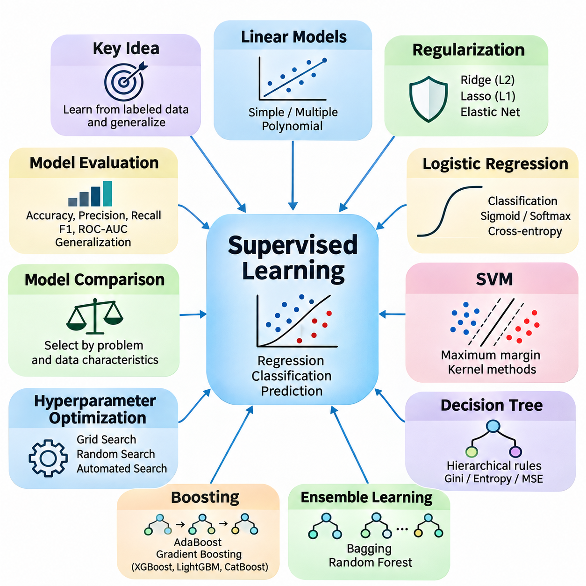
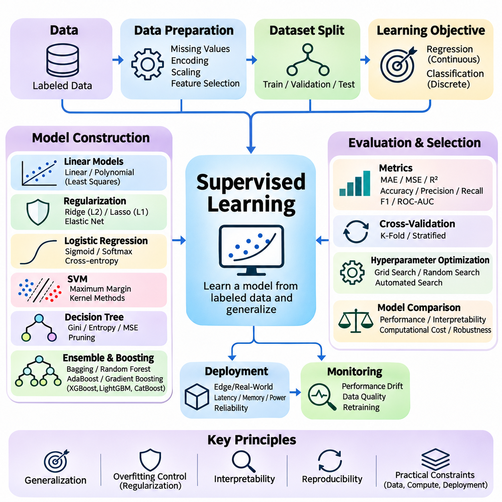
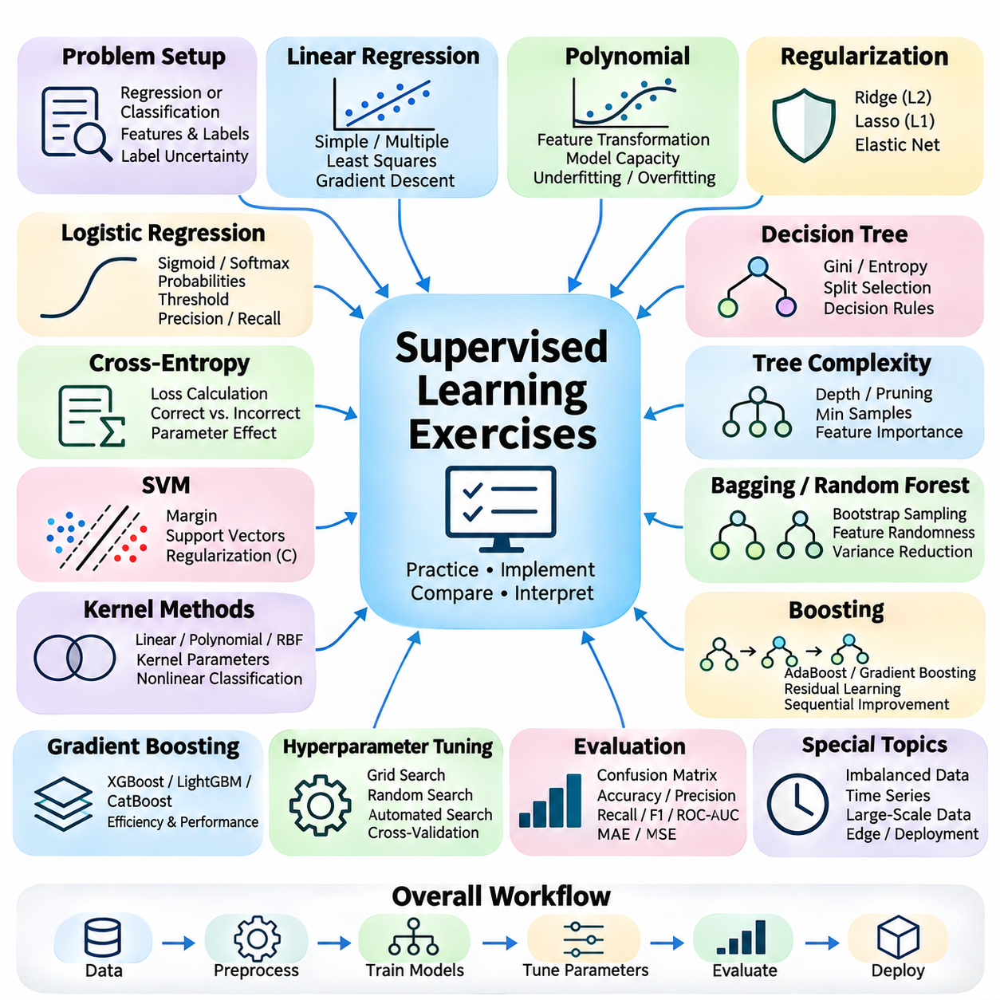
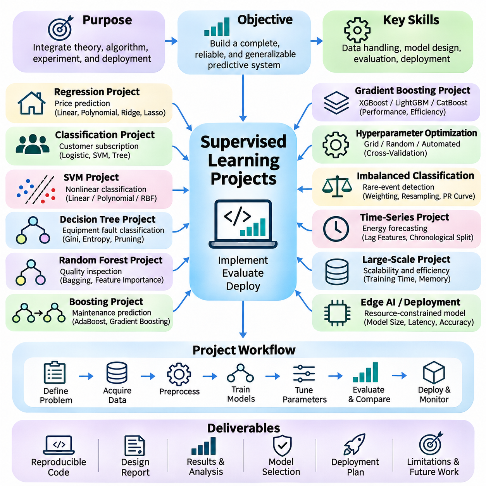

**Volume 08. Supervised Learning**


# 10. Summary and Exercises

## 10.00 Key Takeaways

{width="7.268055555555556in" height="7.268055555555556in"}

Supervised learning is a fundamental machine learning paradigm in which models learn relationships between input features and known target labels. Its primary objective is to generalize beyond observed training examples and make reliable predictions on previously unseen data. Understanding this principle provides the foundation for regression, classification, model evaluation, and practical artificial intelligence applications across scientific and industrial environments.

Linear models demonstrate how mathematical simplicity can support effective prediction. Simple linear regression estimates relationships between individual variables, while multiple linear regression extends the formulation to several features. Polynomial regression introduces nonlinear relationships through feature transformations. These approaches establish important connections between statistical estimation, geometric interpretation, optimization, and the practical limitations of predictive modeling.

Regularization improves the generalization of linear models by controlling model complexity. Ridge regression penalizes large coefficients through an L2 constraint, while Lasso encourages sparse solutions through an L1 penalty. Elastic Net combines both approaches to balance coefficient shrinkage and feature selection. These techniques illustrate how predictive accuracy must be considered alongside stability, interpretability, and resistance to overfitting.

Logistic regression extends linear decision functions to classification problems by transforming model outputs into probabilities. The sigmoid function supports binary classification, while softmax generalizes probability estimation to multiple classes. Cross-entropy provides a suitable optimization objective for probabilistic predictions. Decision boundaries, regularization, and probability thresholds determine how these models behave under different classification requirements.

Support Vector Machines introduce the principle of maximum-margin classification, emphasizing the separation between classes rather than merely minimizing classification errors. Hard-margin formulations assume perfect linear separability, while soft-margin approaches tolerate violations through regularization. Kernel methods extend SVMs to nonlinear relationships by computing similarities in transformed feature spaces without explicitly constructing those representations.

The effectiveness of Support Vector Machines depends on the interaction between kernel selection, regularization strength, and data characteristics. Linear kernels provide efficient solutions for approximately linear problems, while polynomial and radial basis function kernels capture more complex boundaries. The dual formulation reveals the importance of support vectors and demonstrates how optimization theory contributes directly to practical classification algorithms.

Decision trees approach prediction through hierarchical rules that partition the feature space into increasingly homogeneous regions. Classification trees commonly use Gini impurity or entropy to select informative splits, while regression trees minimize prediction errors within resulting partitions. Their structure makes individual decisions relatively easy to inspect, providing a useful foundation for understanding interpretable machine learning systems.

Although decision trees offer flexibility and intuitive decision rules, unrestricted growth can produce overfitting and unstable predictions. Pruning, depth constraints, and minimum sample requirements help control complexity. Missing values require explicit handling strategies, and feature importance measures must be interpreted carefully. These considerations demonstrate that interpretability alone does not guarantee robustness or reliable performance.

Ensemble learning improves predictive performance by combining multiple models rather than relying on a single estimator. Bagging trains models on bootstrap samples and aggregates their predictions, often reducing variance. Random forests extend this principle through randomized feature selection. These methods demonstrate how diversity among individual learners can improve stability, particularly when the underlying estimators are sensitive to training data variations.

Boosting constructs an ensemble sequentially, with successive learners emphasizing errors or optimization objectives not adequately addressed by earlier models. AdaBoost adjusts attention toward difficult training examples, while gradient boosting fits new learners to improve a differentiable loss function. Unlike bagging, which emphasizes independent model diversity, boosting develops a coordinated sequence of increasingly refined predictions.

Gradient Boosted Decision Trees represent an important family of high-performance methods for structured data. XGBoost emphasizes regularized optimization and computational efficiency, LightGBM introduces efficient histogram-based and leaf-wise learning strategies, and CatBoost provides specialized mechanisms for categorical features. Their effectiveness depends on appropriate preprocessing, validation, hyperparameter tuning, and control of model complexity.

Hyperparameter optimization determines how effectively an algorithm balances accuracy, computational cost, and generalization. Learning rates, tree depths, regularization strengths, kernel parameters, and ensemble sizes influence training behavior. Grid search, randomized search, and automated optimization can explore these choices systematically. However, every optimization procedure requires a sound validation strategy to avoid selecting models that merely exploit evaluation noise.

Model comparison should begin with the characteristics of the prediction problem rather than assumptions about algorithm superiority. Linear models offer simplicity and interpretability, SVMs provide margin-based learning, and tree ensembles capture complex feature interactions. Gradient boosting frequently performs strongly on tabular data, while neural networks may be advantageous for high-dimensional or unstructured inputs when suitable data and resources are available.

Evaluation metrics must correspond to the actual objectives and consequences of prediction errors. Regression tasks may use mean absolute error, mean squared error, or coefficient of determination. Classification tasks may require accuracy, precision, recall, F1 score, or area under a performance curve. No single metric fully describes model quality, especially when classes are imbalanced or error costs differ substantially.

Reliable evaluation requires separation between training, validation, and testing activities. Training data supports parameter estimation, validation data guides model selection, and held-out test data provides an independent final assessment. Cross-validation can reduce sensitivity to a particular data split. Data leakage, inappropriate preprocessing, and repeated test-set inspection undermine evaluation credibility, even when reported performance appears exceptionally strong.

Real-world supervised learning introduces challenges that are not always visible in controlled experiments. Tabular datasets may contain missing values, inconsistent categories, and correlated variables. Time-series applications require chronological validation and awareness of temporal dependencies. Imbalanced datasets demand careful metric selection and appropriate sampling strategies. Large-scale systems additionally introduce constraints involving memory, distributed processing, and data management.

Edge AI deployment highlights the relationship between predictive quality and operational feasibility. Models running on embedded computers or robotic platforms must satisfy requirements for latency, memory consumption, energy efficiency, and reliability. A slightly less accurate model may be preferable when it delivers predictable inference under strict resource constraints. Deployment decisions therefore require evaluation of the complete system rather than accuracy alone.

An end-to-end supervised learning project connects problem definition, data preparation, model training, comparison, selection, deployment, and performance analysis. Each stage influences subsequent decisions and should be documented for reproducibility. Consistent preprocessing between training and inference is especially important. Version control, experiment tracking, and clearly defined evaluation procedures help transform isolated experiments into maintainable engineering workflows.

Deployment does not mark the end of the machine learning lifecycle. Changes in input distributions, relationships between features and targets, or operational conditions can reduce predictive reliability over time. Monitoring should examine model performance, data quality, latency, and relevant failure patterns. Retraining and redeployment require controlled validation so that improvements in one operating condition do not unintentionally degrade performance elsewhere.

The central lesson of supervised learning is that successful prediction emerges from the interaction of data quality, mathematical formulation, algorithm selection, optimization, evaluation, and deployment engineering. Sophisticated algorithms cannot compensate automatically for misleading labels or poorly designed experiments. A disciplined workflow that prioritizes generalization, reproducibility, interpretability, and operational constraints provides the strongest foundation for dependable machine learning applications.

These principles also prepare learners to investigate more advanced artificial intelligence systems. Neural networks extend supervised learning through hierarchical representation learning, while foundation models frequently incorporate supervised adaptation alongside other training paradigms. The ability to construct reliable baselines, identify overfitting, interpret evaluation results, and compare computational tradeoffs remains essential even as model architectures become increasingly complex.

Ultimately, mastering supervised learning requires both conceptual understanding and practical experimentation. Implementing algorithms, comparing their behavior across datasets, analyzing errors, and examining deployment constraints reveal insights that mathematical descriptions alone cannot provide. The knowledge developed throughout these chapters establishes a systematic approach to designing predictive systems that are accurate, efficient, explainable, and adaptable to real-world requirements.

지도 학습(Supervised Learning)은 모델(Model)이 입력 특징(Input Features)과 알려진 목표 레이블(Target Labels) 사이의 관계를 학습하는 기본적인 기계 학습(Machine Learning) 패러다임(Paradigm)이다. 주요 목표는 관찰된 훈련 사례(Training Examples)를 넘어 일반화(Generalization)하고, 이전에 관찰하지 못한 데이터(Unseen Data)에 대해 신뢰할 수 있는 예측(Prediction)을 수행하는 것이다. 이러한 원리를 이해하는 것은 회귀(Regression), 분류(Classification), 모델 평가(Model Evaluation), 과학 및 산업 환경의 실용적인 인공지능(Artificial Intelligence) 응용을 위한 기초가 된다.

선형 모델(Linear Models)은 수학적 단순성(Mathematical Simplicity)이 효과적인 예측을 지원할 수 있음을 보여준다. 단순 선형 회귀(Simple Linear Regression)는 개별 변수 사이의 관계를 추정하며, 다중 선형 회귀(Multiple Linear Regression)는 여러 특징을 포함하도록 수식을 확장한다. 다항 회귀(Polynomial Regression)는 특징 변환(Feature Transformation)을 통해 비선형 관계(Nonlinear Relationships)를 도입한다. 이러한 접근법은 통계적 추정(Statistical Estimation), 기하학적 해석(Geometric Interpretation), 최적화(Optimization), 예측 모델링(Predictive Modeling)의 실질적인 한계 사이의 중요한 연관성을 확립한다.

정규화(Regularization)는 모델 복잡도(Model Complexity)를 제어하여 선형 모델(Linear Models)의 일반화(Generalization) 성능을 향상시킨다. 릿지 회귀(Ridge Regression)는 L2 제약(L2 Constraint)을 통해 큰 계수(Coefficients)에 페널티(Penalty)를 부여하며, 라쏘 회귀(Lasso Regression)는 L1 페널티(L1 Penalty)를 통해 희소한 해(Sparse Solutions)를 유도한다. 엘라스틱 넷(Elastic Net)은 두 접근법을 결합하여 계수 축소(Coefficient Shrinkage)와 특징 선택(Feature Selection)의 균형을 유지한다. 이러한 기법은 예측 정확도(Predictive Accuracy)를 안정성(Stability), 해석 가능성(Interpretability), 과적합(Overfitting)에 대한 저항성과 함께 고려해야 함을 보여준다.

로지스틱 회귀(Logistic Regression)는 선형 결정 함수(Linear Decision Functions)의 출력을 확률(Probability)로 변환하여 분류 문제(Classification Problems)에 적용한다. 시그모이드 함수(Sigmoid Function)는 이진 분류(Binary Classification)를 지원하며, 소프트맥스(Softmax)는 확률 추정(Probability Estimation)을 다중 클래스(Multiple Classes)로 일반화한다. 교차 엔트로피(Cross-Entropy)는 확률적 예측(Probabilistic Predictions)에 적합한 최적화 목적 함수(Optimization Objective)를 제공한다. 결정 경계(Decision Boundaries), 정규화(Regularization), 확률 임계값(Probability Thresholds)은 서로 다른 분류 요구사항에서 모델의 동작을 결정한다.

서포트 벡터 머신(Support Vector Machines, SVM)은 단순히 분류 오류(Classification Errors)를 최소화하는 것이 아니라 클래스 사이의 분리(Separation)를 강조하는 최대 마진 분류(Maximum-Margin Classification) 원리를 도입한다. 하드 마진(Hard Margin) 공식은 완전한 선형 분리 가능성(Linear Separability)을 가정하지만, 소프트 마진(Soft Margin)은 정규화(Regularization)를 통해 제약 위반을 허용한다. 커널 방법(Kernel Methods)은 변환된 특징 공간(Feature Spaces)에서 유사도(Similarities)를 계산하여 비선형 관계(Nonlinear Relationships)를 처리하며, 이러한 표현을 명시적으로 구성할 필요가 없다.

서포트 벡터 머신(Support Vector Machines)의 효과는 커널 선택(Kernel Selection), 정규화 강도(Regularization Strength), 데이터 특성(Data Characteristics)의 상호작용에 따라 달라진다. 선형 커널(Linear Kernels)은 대체로 선형적인 문제에 효율적인 해를 제공하며, 다항 커널(Polynomial Kernels)과 방사 기저 함수 커널(Radial Basis Function Kernels)은 더욱 복잡한 결정 경계(Decision Boundaries)를 포착한다. 쌍대 공식(Dual Formulation)은 서포트 벡터(Support Vectors)의 중요성을 드러내며, 최적화 이론(Optimization Theory)이 실제 분류 알고리즘에 직접 기여하는 방식을 보여준다.

의사결정나무(Decision Trees)는 특징 공간(Feature Space)을 점차 동질적인 영역(Homogeneous Regions)으로 분할하는 계층적 규칙(Hierarchical Rules)을 통해 예측을 수행한다. 분류 나무(Classification Trees)는 일반적으로 지니 불순도(Gini Impurity) 또는 엔트로피(Entropy)를 사용하여 정보성이 높은 분할을 선택하며, 회귀 나무(Regression Trees)는 분할된 영역 내부의 예측 오류(Prediction Errors)를 최소화한다. 이러한 구조는 개별 의사결정을 비교적 쉽게 분석할 수 있도록 하여 해석 가능한 기계 학습(Interpretable Machine Learning) 시스템을 이해하는 기반을 제공한다.

의사결정나무(Decision Trees)는 유연성과 직관적인 결정 규칙(Decision Rules)을 제공하지만, 제한 없는 성장은 과적합(Overfitting)과 불안정한 예측(Unstable Predictions)을 초래할 수 있다. 가지치기(Pruning), 깊이 제한(Depth Constraints), 최소 샘플 요구사항(Minimum Sample Requirements)은 복잡도를 제어하는 데 도움이 된다. 결측값(Missing Values)은 명시적인 처리 전략(Handling Strategies)이 필요하며, 특징 중요도(Feature Importance) 지표는 신중하게 해석해야 한다. 이러한 고려사항은 해석 가능성(Interpretability)만으로 강건성(Robustness)이나 신뢰할 수 있는 성능이 보장되지 않음을 보여준다.

앙상블 학습(Ensemble Learning)은 단일 추정기(Estimator)에 의존하는 대신 여러 모델을 결합하여 예측 성능(Predictive Performance)을 향상시킨다. 배깅(Bagging)은 부트스트랩 샘플(Bootstrap Samples)로 모델을 학습하고 예측을 집계하여 분산(Variance)을 줄이는 경우가 많다. 랜덤 포레스트(Random Forests)는 무작위 특징 선택(Randomized Feature Selection)을 통해 이 원리를 확장한다. 이러한 방법은 개별 학습기(Learners) 사이의 다양성이 안정성(Stability)을 향상시킬 수 있음을 보여주며, 특히 기본 추정기가 훈련 데이터 변화에 민감할 때 효과적이다.

부스팅(Boosting)은 이전 모델이 충분히 해결하지 못한 오류(Errors) 또는 최적화 목적(Optimization Objectives)에 후속 학습기가 집중하도록 앙상블(Ensemble)을 순차적으로 구성한다. 에이다부스트(AdaBoost)는 학습하기 어려운 훈련 사례(Training Examples)에 대한 가중치를 조정하며, 그래디언트 부스팅(Gradient Boosting)은 미분 가능한 손실 함수(Differentiable Loss Function)를 개선하도록 새로운 학습기를 적합시킨다. 독립적인 모델 다양성(Independent Model Diversity)을 강조하는 배깅(Bagging)과 달리, 부스팅은 점진적으로 정교해지는 예측을 위한 협력적인 학습기 시퀀스(Coordinated Sequence)를 개발한다.

그래디언트 부스팅 의사결정나무(Gradient Boosted Decision Trees, GBDT)는 구조화된 데이터(Structured Data)에 대해 높은 성능을 제공하는 중요한 방법 계열이다. XGBoost는 정규화된 최적화(Regularized Optimization)와 계산 효율성(Computational Efficiency)을 강조하고, LightGBM은 효율적인 히스토그램 기반(Histogram-Based) 및 리프 우선(Leaf-Wise) 학습 전략을 도입하며, CatBoost는 범주형 특징(Categorical Features)을 위한 특화된 메커니즘을 제공한다. 이러한 방법의 효과는 적절한 전처리(Preprocessing), 검증(Validation), 하이퍼파라미터 튜닝(Hyperparameter Tuning), 모델 복잡도 제어에 따라 달라진다.

하이퍼파라미터 최적화(Hyperparameter Optimization)는 알고리즘(Algorithm)이 정확도(Accuracy), 계산 비용(Computational Cost), 일반화(Generalization) 사이에서 얼마나 효과적으로 균형을 유지하는지를 결정한다. 학습률(Learning Rates), 나무 깊이(Tree Depths), 정규화 강도(Regularization Strengths), 커널 파라미터(Kernel Parameters), 앙상블 크기(Ensemble Sizes)는 훈련 동작에 영향을 미친다. 그리드 탐색(Grid Search), 무작위 탐색(Randomized Search), 자동 최적화(Automated Optimization)는 이러한 선택을 체계적으로 탐색할 수 있다. 그러나 모든 최적화 절차에는 평가 잡음(Evaluation Noise)을 이용하는 모델을 선택하지 않도록 건전한 검증 전략(Validation Strategy)이 필요하다.

모델 비교(Model Comparison)는 알고리즘의 우수성에 대한 가정보다 예측 문제(Prediction Problem)의 특성에서 출발해야 한다. 선형 모델(Linear Models)은 단순성과 해석 가능성(Interpretability)을 제공하고, 서포트 벡터 머신(SVM)은 마진 기반 학습(Margin-Based Learning)을 제공하며, 나무 앙상블(Tree Ensembles)은 복잡한 특징 상호작용(Feature Interactions)을 포착한다. 그래디언트 부스팅(Gradient Boosting)은 표 형식 데이터(Tabular Data)에서 높은 성능을 보이는 경우가 많으며, 신경망(Neural Networks)은 적절한 데이터와 자원이 확보되면 고차원(High-Dimensional) 또는 비정형 입력(Unstructured Inputs)에 유리할 수 있다.

평가 지표(Evaluation Metrics)는 예측 오류(Prediction Errors)의 실제 목표와 결과에 부합해야 한다. 회귀 작업(Regression Tasks)에서는 평균 절대 오차(Mean Absolute Error), 평균 제곱 오차(Mean Squared Error), 결정계수(Coefficient of Determination)를 사용할 수 있다. 분류 작업(Classification Tasks)에서는 정확도(Accuracy), 정밀도(Precision), 재현율(Recall), F1 점수(F1 Score), 성능 곡선 아래 면적(Area Under a Performance Curve)이 필요할 수 있다. 특히 클래스 불균형(Class Imbalance)이 존재하거나 오류 비용(Error Costs)이 크게 다른 경우에는 단일 지표만으로 모델 품질(Model Quality)을 완전히 설명할 수 없다.

신뢰할 수 있는 평가(Reliable Evaluation)를 위해서는 훈련(Training), 검증(Validation), 테스트(Testing) 활동을 분리해야 한다. 훈련 데이터(Training Data)는 파라미터 추정(Parameter Estimation)을 지원하고, 검증 데이터(Validation Data)는 모델 선택(Model Selection)을 안내하며, 별도로 보관된 테스트 데이터(Held-Out Test Data)는 독립적인 최종 평가를 제공한다. 교차 검증(Cross-Validation)은 특정 데이터 분할(Data Split)에 대한 민감도를 줄일 수 있다. 데이터 누출(Data Leakage), 부적절한 전처리(Inappropriate Preprocessing), 반복적인 테스트 세트 확인(Repeated Test-Set Inspection)은 보고된 성능이 매우 높더라도 평가의 신뢰성을 훼손한다.

실제 환경의 지도 학습(Supervised Learning)은 통제된 실험(Controlled Experiments)에서 항상 드러나지는 않는 문제를 수반한다. 표 형식 데이터셋(Tabular Datasets)에는 결측값(Missing Values), 일관되지 않은 범주(Inconsistent Categories), 상관관계가 있는 변수(Correlated Variables)가 포함될 수 있다. 시계열(Time-Series) 응용에는 시간 순서를 고려한 검증(Chronological Validation)과 시간적 의존성(Temporal Dependencies)에 대한 이해가 필요하다. 불균형 데이터셋(Imbalanced Datasets)은 신중한 지표 선택(Metric Selection)과 적절한 샘플링 전략(Sampling Strategies)이 요구된다. 대규모 시스템(Large-Scale Systems)은 메모리(Memory), 분산 처리(Distributed Processing), 데이터 관리(Data Management)와 관련된 제약도 수반한다.

엣지 인공지능(Edge AI) 배포는 예측 품질(Predictive Quality)과 운영 실현 가능성(Operational Feasibility) 사이의 관계를 강조한다. 임베디드 컴퓨터(Embedded Computers) 또는 로봇 플랫폼(Robotic Platforms)에서 실행되는 모델은 지연 시간(Latency), 메모리 사용량(Memory Consumption), 에너지 효율성(Energy Efficiency), 신뢰성(Reliability)에 대한 요구사항을 충족해야 한다. 자원 제약(Resource Constraints)이 엄격한 환경에서 예측 가능한 추론(Inference)을 제공한다면 정확도가 약간 낮은 모델이 더 적합할 수 있다. 따라서 배포 결정(Deployment Decisions)은 정확도만이 아니라 전체 시스템(Complete System)에 대한 평가를 요구한다.

종단 간 지도 학습 프로젝트(End-to-End Supervised Learning Project)는 문제 정의(Problem Definition), 데이터 준비(Data Preparation), 모델 훈련(Model Training), 비교(Comparison), 선택(Selection), 배포(Deployment), 성능 분석(Performance Analysis)을 연결한다. 각 단계는 후속 결정에 영향을 미치며 재현성(Reproducibility)을 위해 문서화해야 한다. 특히 훈련과 추론 사이에서 일관된 전처리(Consistent Preprocessing)를 유지하는 것이 중요하다. 버전 관리(Version Control), 실험 추적(Experiment Tracking), 명확하게 정의된 평가 절차(Evaluation Procedures)는 개별 실험을 유지 관리 가능한 엔지니어링 워크플로(Engineering Workflows)로 전환하는 데 도움이 된다.

배포(Deployment)가 기계 학습 생명주기(Machine Learning Lifecycle)의 끝을 의미하지는 않는다. 입력 분포(Input Distributions), 특징과 목표 사이의 관계(Relationships Between Features and Targets), 운영 조건(Operational Conditions)의 변화는 시간이 지남에 따라 예측 신뢰성(Predictive Reliability)을 저하시킬 수 있다. 모니터링(Monitoring)은 모델 성능(Model Performance), 데이터 품질(Data Quality), 지연 시간(Latency), 관련 실패 패턴(Failure Patterns)을 조사해야 한다. 재훈련(Retraining)과 재배포(Redeployment)에는 한 운영 조건에서의 개선이 다른 조건의 성능을 의도치 않게 저하시키지 않도록 통제된 검증(Controlled Validation)이 필요하다.

지도 학습(Supervised Learning)의 핵심 교훈은 성공적인 예측이 데이터 품질(Data Quality), 수학적 공식화(Mathematical Formulation), 알고리즘 선택(Algorithm Selection), 최적화(Optimization), 평가(Evaluation), 배포 엔지니어링(Deployment Engineering)의 상호작용에서 비롯된다는 것이다. 정교한 알고리즘도 잘못된 레이블(Misleading Labels)이나 부적절하게 설계된 실험(Poorly Designed Experiments)을 자동으로 보완할 수는 없다. 일반화(Generalization), 재현성(Reproducibility), 해석 가능성(Interpretability), 운영 제약(Operational Constraints)을 우선하는 체계적인 워크플로(Workflow)가 신뢰할 수 있는 기계 학습 응용의 가장 강력한 기반을 제공한다.

이러한 원리는 학습자가 더욱 발전된 인공지능(Artificial Intelligence) 시스템을 탐구할 수 있도록 준비시킨다. 신경망(Neural Networks)은 계층적 표현 학습(Hierarchical Representation Learning)을 통해 지도 학습을 확장하며, 파운데이션 모델(Foundation Models)은 다른 훈련 패러다임(Training Paradigms)과 함께 지도 기반 적응(Supervised Adaptation)을 활용하는 경우가 많다. 신뢰할 수 있는 기준 모델(Baselines)을 구성하고, 과적합(Overfitting)을 식별하며, 평가 결과(Evaluation Results)를 해석하고, 계산 자원의 상충관계(Computational Tradeoffs)를 비교하는 능력은 모델 아키텍처(Model Architectures)가 점점 복잡해지더라도 여전히 필수적이다.

궁극적으로 지도 학습(Supervised Learning)을 숙달하려면 개념적 이해(Conceptual Understanding)와 실용적인 실험(Practical Experimentation)이 모두 필요하다. 알고리즘(Algorithms)을 구현하고, 여러 데이터셋(Datasets)에서 동작을 비교하며, 오류(Errors)를 분석하고, 배포 제약(Deployment Constraints)을 검토하는 과정은 수학적 설명만으로는 얻기 어려운 통찰력을 제공한다. 이 장들에서 개발한 지식은 정확하고(Accurate), 효율적이며(Efficient), 설명 가능하고(Explainable), 실제 요구사항(Real-World Requirements)에 적응할 수 있는 예측 시스템(Predictive Systems)을 설계하기 위한 체계적인 접근법(Systematic Approach)을 확립한다.

## 10.01 Concept Map

{width="7.268055555555556in" height="7.268055555555556in"}

A concept map of supervised learning provides a unified understanding of how data, mathematical models, optimization methods, evaluation strategies, and deployment processes interact. Rather than treating algorithms as isolated techniques, it organizes them into a connected learning framework. The central relationship begins with labeled data, continues through predictive model construction, and concludes with generalization to unseen observations under practical operating constraints.

The foundation of supervised learning consists of input features, target variables, and a learning objective. Input features describe measurable properties of observations, while target variables represent the values or categories that a model must predict. Regression addresses continuous outputs, whereas classification predicts discrete categories. Both tasks depend on identifying relationships that remain sufficiently stable beyond the training dataset.

Data preparation connects raw observations to mathematical learning procedures. Missing-value treatment, categorical encoding, feature scaling, and feature selection determine how information enters a model. Dataset partitioning separates training, validation, and testing responsibilities. These operations are not independent preprocessing details because they influence optimization behavior, predictive performance, and the reliability of conclusions drawn from experimental results.

Linear regression represents the simplest major branch of the supervised learning framework. It models target values through weighted combinations of input features and estimates parameters by minimizing prediction errors. Simple and multiple linear regression establish the basic formulation, while polynomial feature transformations extend representational flexibility. These methods connect statistical estimation, matrix algebra, loss functions, and gradient-based optimization.

Regularized linear models introduce an explicit connection between predictive accuracy and model complexity. Ridge regression applies L2 penalties to discourage excessively large coefficients, while Lasso uses L1 penalties to encourage sparse parameter representations. Elastic Net combines both mechanisms. These approaches demonstrate how optimization objectives can incorporate structural preferences that improve stability and reduce sensitivity to irrelevant or correlated features.

Logistic regression connects linear prediction functions to probabilistic classification. A linear combination of features produces a score that is transformed through a sigmoid function for binary classification. Softmax extends the framework to mutually exclusive multiclass predictions. Cross-entropy measures disagreement between predicted probabilities and observed labels, establishing a direct connection between probability theory, optimization, and decision boundaries.

Support Vector Machines introduce a geometric perspective centered on maximizing separation margins between classes. Support vectors determine the location of the separating boundary, while soft-margin optimization balances margin width against classification violations. Kernel functions extend the approach to nonlinear patterns by evaluating similarities in implicit feature spaces. This connects geometry, constrained optimization, regularization, and high-dimensional representation.

Decision trees provide a complementary representation based on recursive partitioning of the feature space. Classification trees use impurity measures such as Gini impurity and entropy, while regression trees minimize prediction variation within partitions. Their hierarchical rules support interpretability, but unrestricted growth increases overfitting risk. Pruning and structural constraints connect tree construction to the broader principle of complexity control.

Ensemble methods connect individual predictive models through aggregation and cooperative learning. Bagging reduces variance by training estimators on bootstrap samples and combining their outputs. Random forests add feature randomness to encourage diversity among trees. Stacking combines predictions through a secondary learner. These methods demonstrate that combining imperfect models can improve reliability when their errors are sufficiently diverse.

Boosting forms another ensemble branch by constructing learners sequentially. AdaBoost modifies example weights to emphasize difficult observations, while gradient boosting trains successive models to improve an objective function. Residual learning provides an intuitive explanation for squared-error regression, where new learners approximate remaining prediction errors. This establishes a connection between additive modeling, iterative optimization, and ensemble construction.

Modern gradient boosting frameworks extend these principles through specialized computational strategies. XGBoost incorporates regularized objectives and efficient tree construction, LightGBM emphasizes histogram-based processing and leaf-wise growth, and CatBoost provides mechanisms for handling categorical variables. Their shared conceptual foundation involves sequential improvement of predictive functions, while their differences concern optimization efficiency, data representation, and generalization behavior.

Model selection connects algorithm capabilities with problem requirements. Linear models are attractive when simplicity and interpretability are important, while kernel methods address certain nonlinear relationships. Tree ensembles are effective for many structured datasets, and gradient boosting often provides strong tabular-data performance. Appropriate selection depends on data characteristics, computational resources, inference requirements, and acceptable model complexity.

Evaluation establishes the connection between training objectives and practical success criteria. Regression models may be assessed using mean absolute error, mean squared error, or coefficient of determination. Classification models require metrics such as precision, recall, F1 score, and area under performance curves. Metric selection must reflect class imbalance, prediction uncertainty, and the relative consequences of different errors.

Generalization provides the central organizing principle across all supervised learning algorithms. A model must capture useful relationships without memorizing incidental patterns in its training observations. Underfitting occurs when model capacity is insufficient, while overfitting arises when excessive flexibility captures noise or dataset-specific details. Regularization, cross-validation, and appropriate complexity control address these related challenges.

Hyperparameter tuning connects model design to systematic experimentation. Learning rates, regularization strengths, tree depths, kernel parameters, and ensemble sizes influence model behavior without being directly estimated as ordinary model parameters. Grid search, randomized search, and automated optimization explore alternative configurations. Reliable validation prevents the selection process from exploiting accidental patterns in evaluation data.

Real-world supervised learning extends the concept map beyond conventional independent observations. Time-series problems introduce temporal dependencies and require chronological evaluation. Imbalanced classification emphasizes precision-recall tradeoffs and class-sensitive objectives. Large-scale datasets create computational and memory challenges, while changing data distributions introduce risks of performance degradation after deployment.

Edge AI connects statistical learning with physical computing constraints. Models deployed on embedded processors, industrial controllers, or autonomous robots must satisfy latency, memory, power, and reliability requirements. Computational efficiency becomes part of model quality rather than merely an implementation concern. This perspective connects algorithm selection, hardware architecture, inference optimization, and operational safety.

An end-to-end supervised learning workflow integrates the entire conceptual structure into a repeatable engineering process. Problem formulation determines the target and evaluation criteria, data preparation establishes usable representations, and training produces candidate models. Validation supports comparison and selection, while deployment introduces operational requirements. Monitoring and performance analysis provide evidence for maintenance and subsequent improvement.

The relationship between interpretability and predictive performance is another important connection. Linear coefficients provide relatively direct descriptions of feature contributions, while decision trees express predictions through hierarchical rules. Ensembles may improve accuracy but require additional explanation techniques. Feature importance, local explanations, and error analysis help investigate model behavior, although explanatory methods do not automatically establish causal relationships.

The complete conceptual structure ultimately connects supervised learning with broader artificial intelligence research. Neural networks extend predictive modeling through learned representations, while foundation models can use supervised objectives during adaptation to specialized tasks. Regardless of architecture, reliable systems depend on appropriate data, meaningful objectives, sound evaluation, and controlled deployment. These shared principles provide continuity between classical machine learning and modern AI engineering.

지도 학습(Supervised Learning)의 개념도(Concept Map)는 데이터(Data), 수학적 모델(Mathematical Models), 최적화 방법(Optimization Methods), 평가 전략(Evaluation Strategies), 배포 프로세스(Deployment Processes)가 어떻게 상호작용하는지 통합적으로 이해할 수 있도록 한다. 알고리즘(Algorithms)을 독립적인 기법으로 취급하는 대신, 서로 연결된 학습 프레임워크(Learning Framework)로 구성한다. 핵심 관계는 레이블이 지정된 데이터(Labeled Data)에서 시작하여 예측 모델 구성(Predictive Model Construction)을 거쳐 실제 운영 제약(Operating Constraints) 아래에서 관찰하지 못한 데이터에 대한 일반화(Generalization)로 이어진다.

지도 학습(Supervised Learning)의 기초는 입력 특징(Input Features), 목표 변수(Target Variables), 학습 목적(Learning Objective)으로 구성된다. 입력 특징은 관측값(Observations)의 측정 가능한 속성을 설명하며, 목표 변수는 모델이 예측해야 하는 값이나 범주를 나타낸다. 회귀(Regression)는 연속적인 출력(Continuous Outputs)을 다루는 반면, 분류(Classification)는 이산적인 범주(Discrete Categories)를 예측한다. 두 작업 모두 훈련 데이터셋(Training Dataset)을 벗어나서도 충분히 안정적으로 유지되는 관계를 식별하는 데 의존한다.

데이터 준비(Data Preparation)는 원시 관측값(Raw Observations)을 수학적 학습 절차(Mathematical Learning Procedures)와 연결한다. 결측값 처리(Missing-Value Treatment), 범주형 인코딩(Categorical Encoding), 특징 스케일링(Feature Scaling), 특징 선택(Feature Selection)은 정보가 모델에 입력되는 방식을 결정한다. 데이터셋 분할(Dataset Partitioning)은 훈련(Training), 검증(Validation), 테스트(Testing)의 역할을 구분한다. 이러한 작업은 단순히 독립적인 전처리(Preprocessing) 세부사항이 아니라 최적화 동작(Optimization Behavior), 예측 성능(Predictive Performance), 실험 결과에서 도출한 결론의 신뢰성에 영향을 미친다.

선형 회귀(Linear Regression)는 지도 학습 프레임워크(Supervised Learning Framework)에서 가장 단순한 주요 분기를 나타낸다. 입력 특징(Input Features)의 가중 결합(Weighted Combinations)을 통해 목표값(Target Values)을 모델링하고 예측 오류(Prediction Errors)를 최소화하여 파라미터(Parameters)를 추정한다. 단순 선형 회귀(Simple Linear Regression)와 다중 선형 회귀(Multiple Linear Regression)는 기본 수식을 확립하며, 다항 특징 변환(Polynomial Feature Transformations)은 표현 유연성(Representational Flexibility)을 확장한다. 이러한 방법은 통계적 추정(Statistical Estimation), 행렬 대수(Matrix Algebra), 손실 함수(Loss Functions), 경사 기반 최적화(Gradient-Based Optimization)를 연결한다.

정규화된 선형 모델(Regularized Linear Models)은 예측 정확도(Predictive Accuracy)와 모델 복잡도(Model Complexity) 사이의 명시적인 관계를 도입한다. 릿지 회귀(Ridge Regression)는 L2 페널티(L2 Penalties)를 적용하여 지나치게 큰 계수(Coefficients)를 억제하며, 라쏘 회귀(Lasso)는 L1 페널티(L1 Penalties)를 사용하여 희소한 파라미터 표현(Sparse Parameter Representations)을 유도한다. 엘라스틱 넷(Elastic Net)은 두 메커니즘을 결합한다. 이러한 접근법은 최적화 목적 함수(Optimization Objectives)에 구조적 선호도(Structural Preferences)를 포함하여 안정성을 향상시키고 불필요하거나 상관관계가 있는 특징에 대한 민감도를 줄일 수 있음을 보여준다.

로지스틱 회귀(Logistic Regression)는 선형 예측 함수(Linear Prediction Functions)를 확률적 분류(Probabilistic Classification)와 연결한다. 특징의 선형 결합(Linear Combination)은 점수(Score)를 생성하며, 이 점수는 이진 분류(Binary Classification)를 위해 시그모이드 함수(Sigmoid Function)를 통해 변환된다. 소프트맥스(Softmax)는 상호 배타적인 다중 클래스 예측(Mutually Exclusive Multiclass Predictions)으로 프레임워크를 확장한다. 교차 엔트로피(Cross-Entropy)는 예측 확률(Predicted Probabilities)과 관측된 레이블(Observed Labels) 사이의 불일치를 측정하여 확률 이론(Probability Theory), 최적화(Optimization), 결정 경계(Decision Boundaries) 사이의 직접적인 연결을 확립한다.

서포트 벡터 머신(Support Vector Machines, SVM)은 클래스 사이의 분리 마진(Separation Margins)을 최대화하는 데 중점을 둔 기하학적 관점(Geometric Perspective)을 도입한다. 서포트 벡터(Support Vectors)는 분리 경계(Separating Boundary)의 위치를 결정하며, 소프트 마진 최적화(Soft-Margin Optimization)는 마진 폭(Margin Width)과 분류 제약 위반(Classification Violations) 사이의 균형을 유지한다. 커널 함수(Kernel Functions)는 암묵적 특징 공간(Implicit Feature Spaces)에서 유사도를 평가하여 비선형 패턴(Nonlinear Patterns)으로 접근법을 확장한다. 이는 기하학(Geometry), 제약 최적화(Constrained Optimization), 정규화(Regularization), 고차원 표현(High-Dimensional Representation)을 연결한다.

의사결정나무(Decision Trees)는 특징 공간(Feature Space)의 재귀적 분할(Recursive Partitioning)에 기반한 보완적인 표현 방식을 제공한다. 분류 나무(Classification Trees)는 지니 불순도(Gini Impurity)와 엔트로피(Entropy) 같은 불순도 척도(Impurity Measures)를 사용하며, 회귀 나무(Regression Trees)는 분할된 영역 내부의 예측 변동(Prediction Variation)을 최소화한다. 계층적 규칙(Hierarchical Rules)은 해석 가능성(Interpretability)을 지원하지만, 제한 없는 성장은 과적합 위험(Overfitting Risk)을 증가시킨다. 가지치기(Pruning)와 구조적 제약(Structural Constraints)은 나무 구성(Tree Construction)을 복잡도 제어(Complexity Control)라는 보다 광범위한 원리와 연결한다.

앙상블 방법(Ensemble Methods)은 예측 결과의 집계(Aggregation)와 협력적 학습(Cooperative Learning)을 통해 개별 예측 모델(Predictive Models)을 연결한다. 배깅(Bagging)은 부트스트랩 샘플(Bootstrap Samples)로 추정기(Estimators)를 훈련하고 출력을 결합하여 분산(Variance)을 줄인다. 랜덤 포레스트(Random Forests)는 특징 무작위성(Feature Randomness)을 추가하여 나무 사이의 다양성을 촉진한다. 스태킹(Stacking)은 2차 학습기(Secondary Learner)를 통해 예측을 결합한다. 이러한 방법은 개별 모델의 오류가 충분히 다양할 때 불완전한 모델들을 결합하여 신뢰성을 향상시킬 수 있음을 보여준다.

부스팅(Boosting)은 학습기(Learners)를 순차적으로 구성하여 또 다른 앙상블 분기(Ensemble Branch)를 형성한다. 에이다부스트(AdaBoost)는 어려운 관측값(Difficult Observations)을 강조하도록 사례 가중치(Example Weights)를 수정하며, 그래디언트 부스팅(Gradient Boosting)은 목적 함수(Objective Function)를 개선하도록 후속 모델을 훈련한다. 잔차 학습(Residual Learning)은 새로운 학습기가 남아 있는 예측 오류(Prediction Errors)를 근사하는 제곱 오차 회귀(Squared-Error Regression)에 대한 직관적인 설명을 제공한다. 이는 가산 모델링(Additive Modeling), 반복 최적화(Iterative Optimization), 앙상블 구성(Ensemble Construction) 사이의 관계를 확립한다.

현대적인 그래디언트 부스팅 프레임워크(Gradient Boosting Frameworks)는 특화된 계산 전략(Computational Strategies)을 통해 이러한 원리를 확장한다. XGBoost는 정규화된 목적 함수(Regularized Objectives)와 효율적인 나무 구성(Tree Construction)을 통합하고, LightGBM은 히스토그램 기반 처리(Histogram-Based Processing)와 리프 우선 성장(Leaf-Wise Growth)을 강조하며, CatBoost는 범주형 변수(Categorical Variables)를 처리하는 메커니즘을 제공한다. 이들의 공통적인 개념적 기반(Conceptual Foundation)은 예측 함수(Predictive Functions)의 순차적 개선에 있으며, 차이점은 최적화 효율성(Optimization Efficiency), 데이터 표현(Data Representation), 일반화 동작(Generalization Behavior)에 있다.

모델 선택(Model Selection)은 알고리즘의 능력(Algorithm Capabilities)을 문제 요구사항(Problem Requirements)과 연결한다. 선형 모델(Linear Models)은 단순성과 해석 가능성(Interpretability)이 중요할 때 매력적이며, 커널 방법(Kernel Methods)은 특정 비선형 관계(Nonlinear Relationships)를 처리한다. 나무 앙상블(Tree Ensembles)은 다양한 구조화된 데이터셋(Structured Datasets)에 효과적이며, 그래디언트 부스팅(Gradient Boosting)은 표 형식 데이터(Tabular Data)에서 높은 성능을 제공하는 경우가 많다. 적절한 선택은 데이터 특성(Data Characteristics), 계산 자원(Computational Resources), 추론 요구사항(Inference Requirements), 허용 가능한 모델 복잡도(Model Complexity)에 따라 달라진다.

평가(Evaluation)는 훈련 목적(Training Objectives)과 실제 성공 기준(Practical Success Criteria) 사이의 관계를 확립한다. 회귀 모델(Regression Models)은 평균 절대 오차(Mean Absolute Error), 평균 제곱 오차(Mean Squared Error), 결정계수(Coefficient of Determination)를 사용하여 평가할 수 있다. 분류 모델(Classification Models)에는 정밀도(Precision), 재현율(Recall), F1 점수(F1 Score), 성능 곡선 아래 면적(Area Under Performance Curves)과 같은 지표가 필요하다. 지표 선택(Metric Selection)은 클래스 불균형(Class Imbalance), 예측 불확실성(Prediction Uncertainty), 서로 다른 오류의 상대적인 결과를 반영해야 한다.

일반화(Generalization)는 모든 지도 학습 알고리즘(Supervised Learning Algorithms)을 관통하는 핵심적인 조직 원리(Organizing Principle)를 제공한다. 모델은 훈련 관측값(Training Observations)에 포함된 우연한 패턴(Incidental Patterns)을 암기하지 않으면서 유용한 관계를 포착해야 한다. 과소적합(Underfitting)은 모델 용량(Model Capacity)이 부족할 때 발생하며, 과적합(Overfitting)은 지나친 유연성으로 인해 잡음(Noise)이나 데이터셋에 특화된 세부사항을 학습할 때 발생한다. 정규화(Regularization), 교차 검증(Cross-Validation), 적절한 복잡도 제어(Complexity Control)는 이러한 관련 문제를 해결한다.

하이퍼파라미터 튜닝(Hyperparameter Tuning)은 모델 설계(Model Design)를 체계적인 실험(Systematic Experimentation)과 연결한다. 학습률(Learning Rates), 정규화 강도(Regularization Strengths), 나무 깊이(Tree Depths), 커널 파라미터(Kernel Parameters), 앙상블 크기(Ensemble Sizes)는 일반적인 모델 파라미터(Model Parameters)처럼 직접 추정되지 않으면서 모델 동작에 영향을 미친다. 그리드 탐색(Grid Search), 무작위 탐색(Randomized Search), 자동 최적화(Automated Optimization)는 대안적인 구성을 탐색한다. 신뢰할 수 있는 검증(Reliable Validation)은 선택 과정에서 평가 데이터(Evaluation Data)의 우연한 패턴을 이용하는 것을 방지한다.

실제 환경의 지도 학습(Real-World Supervised Learning)은 기존의 독립적인 관측값(Independent Observations)을 넘어 개념도(Concept Map)를 확장한다. 시계열 문제(Time-Series Problems)는 시간적 의존성(Temporal Dependencies)을 도입하며 시간 순서를 고려한 평가(Chronological Evaluation)가 필요하다. 불균형 분류(Imbalanced Classification)는 정밀도와 재현율의 상충관계(Precision-Recall Tradeoffs) 및 클래스 민감형 목적 함수(Class-Sensitive Objectives)를 강조한다. 대규모 데이터셋(Large-Scale Datasets)은 계산 및 메모리 문제를 발생시키며, 변화하는 데이터 분포(Data Distributions)는 배포 이후 성능 저하(Performance Degradation)의 위험을 초래한다.

엣지 인공지능(Edge AI)은 통계적 학습(Statistical Learning)을 물리적 컴퓨팅 제약(Physical Computing Constraints)과 연결한다. 임베디드 프로세서(Embedded Processors), 산업용 제어기(Industrial Controllers), 자율 로봇(Autonomous Robots)에 배포되는 모델은 지연 시간(Latency), 메모리(Memory), 전력(Power), 신뢰성(Reliability) 요구사항을 충족해야 한다. 계산 효율성(Computational Efficiency)은 단순한 구현상의 고려사항이 아니라 모델 품질(Model Quality)의 일부가 된다. 이러한 관점은 알고리즘 선택(Algorithm Selection), 하드웨어 아키텍처(Hardware Architecture), 추론 최적화(Inference Optimization), 운영 안전성(Operational Safety)을 연결한다.

종단 간 지도 학습 워크플로(End-to-End Supervised Learning Workflow)는 전체 개념 구조(Conceptual Structure)를 반복 가능한 엔지니어링 프로세스(Repeatable Engineering Process)로 통합한다. 문제 공식화(Problem Formulation)는 목표와 평가 기준(Evaluation Criteria)을 결정하고, 데이터 준비(Data Preparation)는 활용 가능한 표현을 확립하며, 훈련(Training)은 후보 모델(Candidate Models)을 생성한다. 검증(Validation)은 비교와 선택을 지원하고, 배포(Deployment)는 운영 요구사항(Operational Requirements)을 도입한다. 모니터링(Monitoring)과 성능 분석(Performance Analysis)은 유지 관리와 후속 개선을 위한 근거를 제공한다.

해석 가능성(Interpretability)과 예측 성능(Predictive Performance) 사이의 관계도 중요한 연결 요소이다. 선형 계수(Linear Coefficients)는 특징 기여도(Feature Contributions)를 비교적 직접적으로 설명하며, 의사결정나무(Decision Trees)는 계층적 규칙(Hierarchical Rules)을 통해 예측을 표현한다. 앙상블(Ensembles)은 정확도를 향상시킬 수 있지만 추가적인 설명 기법(Explanation Techniques)이 필요하다. 특징 중요도(Feature Importance), 국소적 설명(Local Explanations), 오류 분석(Error Analysis)은 모델 동작을 조사하는 데 도움이 되지만, 설명 방법이 자동으로 인과관계(Causal Relationships)를 확립하는 것은 아니다.

완전한 개념 구조(Conceptual Structure)는 궁극적으로 지도 학습(Supervised Learning)을 더 광범위한 인공지능 연구(Artificial Intelligence Research)와 연결한다. 신경망(Neural Networks)은 학습된 표현(Learned Representations)을 통해 예측 모델링(Predictive Modeling)을 확장하며, 파운데이션 모델(Foundation Models)은 특화된 작업(Specialized Tasks)에 적응하는 과정에서 지도 학습 목적 함수(Supervised Objectives)를 활용할 수 있다. 아키텍처(Architecture)와 관계없이 신뢰할 수 있는 시스템은 적절한 데이터, 의미 있는 목적 함수(Objectives), 건전한 평가(Sound Evaluation), 통제된 배포(Controlled Deployment)에 의존한다. 이러한 공통 원리는 고전적 기계 학습(Classical Machine Learning)과 현대 인공지능 엔지니어링(Modern AI Engineering) 사이의 연속성을 제공한다.

## 10.02 Exercises

{width="7.268055555555556in" height="7.268055555555556in"}

Exercises in supervised learning are designed to strengthen the connection between theoretical understanding and practical problem-solving. They encourage learners to examine mathematical assumptions, implement predictive algorithms, compare alternative models, and interpret experimental results. Effective exercises should develop the ability to explain why a method works, identify when it may fail, and determine whether its predictions can be trusted in unfamiliar operating conditions.

A foundational exercise begins with identifying the components of a supervised learning problem. Given a dataset containing observations, input variables, and target values, learners should determine whether the objective involves regression or classification. They should describe the meaning of each feature, identify potential sources of label uncertainty, and explain how the available data supports the intended prediction task.

Linear regression exercises provide opportunities to connect algebraic formulations with numerical estimation. Learners can construct a simple regression model, calculate predictions from selected coefficients, and evaluate residual errors. Extending the exercise to multiple features demonstrates how additional variables influence the model. Comparing analytical least-squares solutions with gradient-based optimization reveals alternative approaches to parameter estimation.

Polynomial regression exercises investigate the relationship between representational flexibility and generalization. Learners can transform a single input variable into polynomial features of increasing degree and observe changes in training and validation errors. They should explain why higher-degree models may capture nonlinear relationships while becoming more sensitive to noise. The exercise illustrates how model capacity influences underfitting and overfitting.

Regularization exercises examine the effects of coefficient penalties on predictive behavior. Learners should train Ridge, Lasso, and Elastic Net models using identical datasets and comparable validation procedures. By varying regularization strength, they can observe coefficient shrinkage, sparsity, and changes in predictive performance. The results should be interpreted in relation to correlated features, model stability, and generalization.

Logistic regression exercises introduce probabilistic reasoning into classification. Learners can calculate sigmoid outputs for selected linear scores, interpret the resulting probabilities, and examine how classification thresholds affect predictions. They should compare predicted labels with observed outcomes and explain the roles of precision and recall. Extending the exercise to softmax classification demonstrates how probability estimates support multiclass decisions.

Cross-entropy exercises connect probability estimation with optimization objectives. Learners should calculate binary cross-entropy for selected predicted probabilities and known labels, then compare penalties associated with confident correct and incorrect predictions. They can investigate how changing model parameters influences the loss. This exercise reinforces the distinction between producing a class label and estimating a meaningful probability distribution.

Support Vector Machine exercises focus on geometric separation and optimization constraints. Learners can examine a two-dimensional classification dataset, identify candidate separating boundaries, and reason about margin width. They should explain the influence of support vectors and investigate how the regularization parameter changes the tolerance for classification violations. The exercise connects geometric intuition with the practical behavior of soft-margin classifiers.

Kernel method exercises investigate nonlinear classification without explicitly constructing high-dimensional representations. Learners can compare linear, polynomial, and radial basis function kernels on datasets containing curved or overlapping class boundaries. They should examine how kernel parameters influence decision complexity and generalization. The objective is to understand why kernel selection depends on data geometry rather than algorithm popularity.

Decision tree exercises introduce recursive partitioning and information-based splitting. Learners should calculate Gini impurity and entropy for selected class distributions, then determine which candidate split provides the greatest impurity reduction. They can construct a small decision tree manually and compare its rules with an automatically trained model. This activity clarifies how local splitting decisions produce hierarchical prediction structures.

Tree complexity exercises examine the consequences of unrestricted growth. Learners can compare shallow and deep decision trees using training and validation performance, then apply pruning or minimum sample constraints. They should explain why a model with excellent training accuracy may perform poorly on unseen data. Additional analysis can investigate feature importance and the limitations of interpreting complex decision rules.

Bagging and Random Forest exercises demonstrate how model aggregation affects prediction variance. Learners should train individual decision trees on bootstrap samples and compare their predictions with those of a combined ensemble. Introducing random feature selection provides an opportunity to investigate diversity among learners. The exercise should emphasize the relationship between estimator instability, error correlation, and ensemble performance.

Boosting exercises explore sequential model improvement. Learners can construct a small additive regression model in which successive weak learners approximate residual errors. They should compare predictions before and after each stage and explain how the combined model reduces the selected loss. Extending the investigation to AdaBoost reveals how sample weighting differs from gradient-based residual fitting.

Gradient boosting exercises compare modern implementations such as XGBoost, LightGBM, and CatBoost. Learners should use consistent data partitions and evaluation metrics while examining predictive accuracy, training time, and memory requirements. Hyperparameters such as learning rate, tree depth, and ensemble size can be varied systematically. Conclusions should distinguish algorithmic behavior from differences caused by experimental configuration.

Model selection exercises require learners to evaluate competing algorithms under common conditions. Linear regression, logistic regression, Support Vector Machines, decision trees, and ensemble methods can be applied where their prediction objectives are appropriate. Learners should compare performance, interpretability, computational requirements, and robustness. Their final recommendation should be justified by the problem requirements rather than a single performance score.

Evaluation exercises develop the ability to interpret predictive errors. For classification, learners can construct confusion matrices and calculate accuracy, precision, recall, and F1 score. For regression, they can compare mean absolute error and mean squared error under different error distributions. They should explain how metric selection changes when false negatives, false positives, or large numerical deviations have different practical consequences.

Cross-validation exercises examine the reliability of experimental conclusions. Learners should compare a single train-validation split with repeated or stratified cross-validation and investigate variation in reported performance. They can introduce an intentionally incorrect preprocessing procedure to observe how data leakage creates misleading results. The exercise emphasizes that evaluation methodology is as important as algorithm implementation.

Imbalanced classification exercises explore situations in which one target category is much less frequent than another. Learners should compare accuracy with precision, recall, F1 score, and precision-recall analysis. They can investigate class weighting, resampling, and threshold adjustment while preserving an appropriate evaluation distribution. The objective is to understand why apparently high accuracy may conceal poor detection of important minority cases.

Time-series exercises introduce temporal dependencies into supervised learning. Learners should construct lagged features from sequential observations and compare chronological validation with randomly shuffled partitions. They should identify situations in which future information could leak into training features. This exercise demonstrates why conventional independent-sample assumptions may be inappropriate for forecasting and industrial monitoring applications.

Deployment exercises connect predictive models with operational constraints. Learners can measure inference latency, model size, and memory consumption for several candidate algorithms. They should evaluate whether the models satisfy hypothetical embedded or edge computing requirements. Comparing predictive accuracy with resource consumption encourages practical decisions based on system-level feasibility rather than isolated benchmark performance.

A final integrative exercise should require learners to complete a supervised learning workflow from problem definition to performance analysis. They should prepare data, establish a baseline, train alternative models, tune hyperparameters, evaluate generalization, and justify a final selection. The resulting analysis should explain limitations, reproducibility considerations, and potential deployment risks, demonstrating a coherent understanding of supervised learning as an engineering discipline.

지도 학습(Supervised Learning)의 연습문제(Exercises)는 이론적 이해(Theoretical Understanding)와 실질적인 문제 해결(Practical Problem-Solving) 사이의 연관성을 강화하도록 설계되었다. 학습자는 수학적 가정(Mathematical Assumptions)을 검토하고, 예측 알고리즘(Predictive Algorithms)을 구현하며, 대안적인 모델을 비교하고, 실험 결과(Experimental Results)를 해석하도록 유도된다. 효과적인 연습문제는 특정 방법이 작동하는 이유를 설명하고, 실패할 수 있는 조건을 식별하며, 익숙하지 않은 운영 환경(Operating Conditions)에서도 예측을 신뢰할 수 있는지 판단하는 능력을 개발해야 한다.

기초 연습문제(Foundational Exercise)는 지도 학습 문제(Supervised Learning Problem)의 구성 요소를 식별하는 것에서 시작한다. 관측값(Observations), 입력 변수(Input Variables), 목표값(Target Values)이 포함된 데이터셋(Dataset)이 주어지면 학습자는 목표가 회귀(Regression)인지 분류(Classification)인지 판단해야 한다. 또한 각 특징(Feature)의 의미를 설명하고, 레이블 불확실성(Label Uncertainty)의 잠재적 원인을 식별하며, 사용 가능한 데이터가 의도한 예측 작업(Prediction Task)을 어떻게 지원하는지 설명해야 한다.

선형 회귀(Linear Regression) 연습문제는 대수적 공식(Algebraic Formulations)과 수치적 추정(Numerical Estimation)을 연결할 기회를 제공한다. 학습자는 단순 회귀 모델(Simple Regression Model)을 구성하고, 선택한 계수(Coefficients)로 예측값을 계산하며, 잔차 오차(Residual Errors)를 평가할 수 있다. 연습문제를 여러 특징으로 확장하면 추가 변수가 모델에 미치는 영향을 확인할 수 있다. 해석적 최소제곱 해(Analytical Least-Squares Solutions)와 경사 기반 최적화(Gradient-Based Optimization)를 비교하면 파라미터 추정(Parameter Estimation)에 대한 서로 다른 접근법을 이해할 수 있다.

다항 회귀(Polynomial Regression) 연습문제는 표현 유연성(Representational Flexibility)과 일반화(Generalization) 사이의 관계를 조사한다. 학습자는 단일 입력 변수(Input Variable)를 차수가 증가하는 다항 특징(Polynomial Features)으로 변환하고, 훈련 오차(Training Errors)와 검증 오차(Validation Errors)의 변화를 관찰할 수 있다. 고차 모델(Higher-Degree Models)이 비선형 관계(Nonlinear Relationships)를 포착할 수 있으면서도 잡음(Noise)에 더욱 민감해지는 이유를 설명해야 한다. 이 연습문제는 모델 용량(Model Capacity)이 과소적합(Underfitting)과 과적합(Overfitting)에 미치는 영향을 보여준다.

정규화(Regularization) 연습문제는 계수 페널티(Coefficient Penalties)가 예측 동작(Predictive Behavior)에 미치는 영향을 검토한다. 학습자는 동일한 데이터셋(Datasets)과 비교 가능한 검증 절차(Validation Procedures)를 사용하여 릿지(Ridge), 라쏘(Lasso), 엘라스틱 넷(Elastic Net) 모델을 훈련해야 한다. 정규화 강도(Regularization Strength)를 변경하면서 계수 축소(Coefficient Shrinkage), 희소성(Sparsity), 예측 성능(Predictive Performance)의 변화를 관찰할 수 있다. 결과는 상관관계가 있는 특징(Correlated Features), 모델 안정성(Model Stability), 일반화(Generalization)와 연관 지어 해석해야 한다.

로지스틱 회귀(Logistic Regression) 연습문제는 확률적 추론(Probabilistic Reasoning)을 분류(Classification)에 도입한다. 학습자는 선택한 선형 점수(Linear Scores)에 대한 시그모이드 출력(Sigmoid Outputs)을 계산하고, 결과 확률(Probabilities)을 해석하며, 분류 임계값(Classification Thresholds)이 예측에 미치는 영향을 검토할 수 있다. 예측 레이블(Predicted Labels)을 관측 결과(Observed Outcomes)와 비교하고, 정밀도(Precision)와 재현율(Recall)의 역할을 설명해야 한다. 연습문제를 소프트맥스 분류(Softmax Classification)로 확장하면 확률 추정(Probability Estimates)이 다중 클래스 의사결정(Multiclass Decisions)을 지원하는 방식을 이해할 수 있다.

교차 엔트로피(Cross-Entropy) 연습문제는 확률 추정(Probability Estimation)을 최적화 목적 함수(Optimization Objectives)와 연결한다. 학습자는 선택한 예측 확률(Predicted Probabilities)과 알려진 레이블(Known Labels)에 대해 이진 교차 엔트로피(Binary Cross-Entropy)를 계산하고, 높은 확신을 가진 올바른 예측과 잘못된 예측에 부과되는 페널티(Penalties)를 비교해야 한다. 또한 모델 파라미터(Model Parameters)의 변화가 손실(Loss)에 미치는 영향을 조사할 수 있다. 이 연습문제는 클래스 레이블(Class Label)을 생성하는 것과 의미 있는 확률 분포(Probability Distribution)를 추정하는 것의 차이를 강조한다.

서포트 벡터 머신(Support Vector Machine, SVM) 연습문제는 기하학적 분리(Geometric Separation)와 최적화 제약(Optimization Constraints)에 중점을 둔다. 학습자는 2차원 분류 데이터셋(Two-Dimensional Classification Dataset)을 검토하고, 후보 분리 경계(Candidate Separating Boundaries)를 식별하며, 마진 폭(Margin Width)을 분석할 수 있다. 서포트 벡터(Support Vectors)의 영향을 설명하고, 정규화 파라미터(Regularization Parameter)가 분류 제약 위반(Classification Violations)의 허용 범위를 어떻게 변경하는지 조사해야 한다. 이 연습문제는 기하학적 직관(Geometric Intuition)을 소프트 마진 분류기(Soft-Margin Classifiers)의 실제 동작과 연결한다.

커널 방법(Kernel Methods) 연습문제는 고차원 표현(High-Dimensional Representations)을 명시적으로 구성하지 않고 비선형 분류(Nonlinear Classification)를 수행하는 방법을 조사한다. 학습자는 곡선 형태 또는 중첩된 클래스 경계(Class Boundaries)가 포함된 데이터셋에서 선형 커널(Linear Kernel), 다항 커널(Polynomial Kernel), 방사 기저 함수 커널(Radial Basis Function Kernel)을 비교할 수 있다. 커널 파라미터(Kernel Parameters)가 결정 복잡도(Decision Complexity)와 일반화(Generalization)에 미치는 영향을 검토해야 한다. 목표는 커널 선택(Kernel Selection)이 알고리즘의 인기도가 아니라 데이터 기하학(Data Geometry)에 따라 결정된다는 점을 이해하는 것이다.

의사결정나무(Decision Tree) 연습문제는 재귀적 분할(Recursive Partitioning)과 정보 기반 분할(Information-Based Splitting)을 도입한다. 학습자는 선택한 클래스 분포(Class Distributions)에 대해 지니 불순도(Gini Impurity)와 엔트로피(Entropy)를 계산하고, 어떤 후보 분할(Candidate Split)이 가장 큰 불순도 감소(Impurity Reduction)를 제공하는지 결정해야 한다. 작은 의사결정나무를 수동으로 구성하고, 그 규칙을 자동으로 훈련된 모델과 비교할 수 있다. 이 활동은 국소적 분할 결정(Local Splitting Decisions)이 계층적 예측 구조(Hierarchical Prediction Structures)를 형성하는 방식을 명확히 한다.

나무 복잡도(Tree Complexity) 연습문제는 제한 없는 성장(Unrestricted Growth)의 결과를 검토한다. 학습자는 훈련 성능(Training Performance)과 검증 성능(Validation Performance)을 사용하여 얕은 의사결정나무(Shallow Decision Trees)와 깊은 의사결정나무(Deep Decision Trees)를 비교하고, 가지치기(Pruning) 또는 최소 샘플 제약(Minimum Sample Constraints)을 적용할 수 있다. 훈련 정확도(Training Accuracy)가 매우 높은 모델이 관찰하지 못한 데이터(Unseen Data)에서 낮은 성능을 보일 수 있는 이유를 설명해야 한다. 추가 분석에서는 특징 중요도(Feature Importance)와 복잡한 결정 규칙(Decision Rules)을 해석하는 데 따르는 한계를 조사할 수 있다.

배깅(Bagging)과 랜덤 포레스트(Random Forest) 연습문제는 모델 집계(Model Aggregation)가 예측 분산(Prediction Variance)에 미치는 영향을 보여준다. 학습자는 부트스트랩 샘플(Bootstrap Samples)로 개별 의사결정나무(Decision Trees)를 훈련하고, 그 예측을 결합된 앙상블(Ensemble)의 예측과 비교해야 한다. 무작위 특징 선택(Random Feature Selection)을 도입하면 학습기(Learners) 사이의 다양성을 조사할 수 있다. 이 연습문제는 추정기 불안정성(Estimator Instability), 오류 상관관계(Error Correlation), 앙상블 성능(Ensemble Performance) 사이의 관계를 강조해야 한다.

부스팅(Boosting) 연습문제는 순차적 모델 개선(Sequential Model Improvement)을 탐구한다. 학습자는 연속적인 약한 학습기(Weak Learners)가 잔차 오차(Residual Errors)를 근사하는 작은 가산 회귀 모델(Additive Regression Model)을 구성할 수 있다. 각 단계 전후의 예측을 비교하고, 결합된 모델이 선택한 손실(Loss)을 어떻게 줄이는지 설명해야 한다. 에이다부스트(AdaBoost)로 조사를 확장하면 샘플 가중치 부여(Sample Weighting)가 경사 기반 잔차 적합(Gradient-Based Residual Fitting)과 어떻게 다른지 이해할 수 있다.

그래디언트 부스팅(Gradient Boosting) 연습문제는 XGBoost, LightGBM, CatBoost와 같은 현대적인 구현을 비교한다. 학습자는 일관된 데이터 분할(Data Partitions)과 평가 지표(Evaluation Metrics)를 사용하면서 예측 정확도(Predictive Accuracy), 훈련 시간(Training Time), 메모리 요구사항(Memory Requirements)을 검토해야 한다. 학습률(Learning Rate), 나무 깊이(Tree Depth), 앙상블 크기(Ensemble Size)와 같은 하이퍼파라미터(Hyperparameters)를 체계적으로 변경할 수 있다. 결론에서는 알고리즘 동작(Algorithmic Behavior)과 실험 구성(Experimental Configuration)의 차이로 발생한 결과를 구분해야 한다.

모델 선택(Model Selection) 연습문제에서는 학습자가 공통 조건(Common Conditions)에서 경쟁 알고리즘(Competing Algorithms)을 평가해야 한다. 선형 회귀(Linear Regression), 로지스틱 회귀(Logistic Regression), 서포트 벡터 머신(Support Vector Machines), 의사결정나무(Decision Trees), 앙상블 방법(Ensemble Methods)은 각각의 예측 목표(Prediction Objectives)에 적합한 경우에 적용할 수 있다. 학습자는 성능(Performance), 해석 가능성(Interpretability), 계산 요구사항(Computational Requirements), 강건성(Robustness)을 비교해야 한다. 최종 권고는 단일 성능 점수(Performance Score)가 아니라 문제 요구사항(Problem Requirements)을 근거로 정당화해야 한다.

평가(Evaluation) 연습문제는 예측 오류(Predictive Errors)를 해석하는 능력을 개발한다. 분류(Classification)의 경우 학습자는 혼동 행렬(Confusion Matrices)을 구성하고 정확도(Accuracy), 정밀도(Precision), 재현율(Recall), F1 점수(F1 Score)를 계산할 수 있다. 회귀(Regression)의 경우 서로 다른 오류 분포(Error Distributions)에서 평균 절대 오차(Mean Absolute Error)와 평균 제곱 오차(Mean Squared Error)를 비교할 수 있다. 거짓 음성(False Negatives), 거짓 양성(False Positives), 큰 수치적 편차(Large Numerical Deviations)가 서로 다른 실제 결과를 초래할 때 지표 선택(Metric Selection)이 어떻게 달라지는지 설명해야 한다.

교차 검증(Cross-Validation) 연습문제는 실험적 결론(Experimental Conclusions)의 신뢰성을 검토한다. 학습자는 단일 훈련-검증 분할(Train-Validation Split)을 반복 교차 검증(Repeated Cross-Validation) 또는 층화 교차 검증(Stratified Cross-Validation)과 비교하고, 보고된 성능(Reported Performance)의 변동을 조사해야 한다. 의도적으로 잘못된 전처리 절차(Incorrect Preprocessing Procedure)를 도입하여 데이터 누출(Data Leakage)이 어떻게 오해를 유발하는 결과(Misleading Results)를 생성하는지 관찰할 수 있다. 이 연습문제는 평가 방법론(Evaluation Methodology)이 알고리즘 구현(Algorithm Implementation)만큼 중요하다는 점을 강조한다.

불균형 분류(Imbalanced Classification) 연습문제는 하나의 목표 범주(Target Category)가 다른 범주보다 훨씬 적게 나타나는 상황을 탐구한다. 학습자는 정확도(Accuracy)를 정밀도(Precision), 재현율(Recall), F1 점수(F1 Score), 정밀도-재현율 분석(Precision-Recall Analysis)과 비교해야 한다. 적절한 평가 분포(Evaluation Distribution)를 유지하면서 클래스 가중치(Class Weighting), 재표본추출(Resampling), 임계값 조정(Threshold Adjustment)을 조사할 수 있다. 목표는 겉보기에 높은 정확도가 중요한 소수 클래스(Minority Classes)에 대한 낮은 탐지 성능을 감출 수 있는 이유를 이해하는 것이다.

시계열(Time-Series) 연습문제는 시간적 의존성(Temporal Dependencies)을 지도 학습(Supervised Learning)에 도입한다. 학습자는 순차적 관측값(Sequential Observations)에서 지연 특징(Lagged Features)을 구성하고, 시간 순서를 고려한 검증(Chronological Validation)을 무작위로 섞은 데이터 분할(Randomly Shuffled Partitions)과 비교해야 한다. 미래 정보(Future Information)가 훈련 특징(Training Features)에 누출될 수 있는 상황을 식별해야 한다. 이 연습문제는 일반적인 독립 표본 가정(Independent-Sample Assumptions)이 예측(Forecasting)과 산업 모니터링(Industrial Monitoring) 응용에 부적절할 수 있는 이유를 보여준다.

배포(Deployment) 연습문제는 예측 모델(Predictive Models)을 운영 제약(Operational Constraints)과 연결한다. 학습자는 여러 후보 알고리즘(Candidate Algorithms)에 대해 추론 지연 시간(Inference Latency), 모델 크기(Model Size), 메모리 사용량(Memory Consumption)을 측정할 수 있다. 모델이 가상의 임베디드 컴퓨팅(Embedded Computing) 또는 엣지 컴퓨팅(Edge Computing) 요구사항을 충족하는지 평가해야 한다. 예측 정확도(Predictive Accuracy)와 자원 소비(Resource Consumption)를 비교하면 독립적인 벤치마크 성능(Benchmark Performance)이 아니라 시스템 수준의 실현 가능성(System-Level Feasibility)을 기반으로 실용적인 결정을 내릴 수 있다.

최종 통합 연습문제(Final Integrative Exercise)에서는 학습자가 문제 정의(Problem Definition)부터 성능 분석(Performance Analysis)까지 지도 학습 워크플로(Supervised Learning Workflow)를 완성해야 한다. 데이터를 준비하고, 기준 모델(Baseline)을 수립하며, 대안 모델(Alternative Models)을 훈련하고, 하이퍼파라미터(Hyperparameters)를 튜닝하며, 일반화(Generalization)를 평가하고, 최종 선택(Final Selection)을 정당화해야 한다. 결과 분석(Resulting Analysis)은 한계(Limitations), 재현성 고려사항(Reproducibility Considerations), 잠재적인 배포 위험(Deployment Risks)을 설명해야 하며, 이를 통해 지도 학습을 엔지니어링 분야(Engineering Discipline)로서 일관되게 이해하고 있음을 보여주어야 한다.

## 10.03 Projects [w/Code]

{width="7.268055555555556in" height="7.268055555555556in"}

Projects in supervised learning provide opportunities to integrate mathematical foundations, algorithm implementation, experimental evaluation, and practical deployment into complete predictive systems. Unlike isolated exercises, projects require learners to manage dependencies between data preparation, model training, validation, and operational requirements. Each project should produce reproducible results, documented design decisions, and evidence that the selected model can generalize beyond its training observations.

A foundational regression project can investigate the prediction of residential property prices using numerical and categorical attributes. Learners should examine data quality, identify missing values, encode categorical variables, and establish a simple baseline. Linear regression, polynomial regression, Ridge, Lasso, and Elastic Net can then be compared. The project should evaluate prediction errors and explain how regularization influences coefficient stability and generalization.

A classification project can focus on predicting customer subscription decisions from demographic, behavioral, and transactional features. Logistic regression provides an interpretable baseline, while Support Vector Machines and tree-based classifiers introduce alternative decision boundaries. Learners should compare probability estimates, classification thresholds, and evaluation metrics. Particular attention should be given to class imbalance, data leakage, and the operational consequences of incorrect predictions.

A Support Vector Machine project can examine nonlinear classification using a synthetic dataset containing overlapping or curved class distributions. Learners should implement linear, polynomial, and radial basis function kernels under consistent experimental conditions. Kernel parameters and regularization strength can be varied to investigate decision complexity. The final analysis should explain how margin optimization and kernel selection influence generalization.

A decision tree project can address equipment fault classification using sensor measurements and operational status indicators. Learners should construct classification trees, calculate impurity-based splitting criteria, and examine the resulting decision rules. Tree depth, pruning, and minimum sample requirements can be adjusted to control overfitting. The project should evaluate whether the learned rules are understandable and sufficiently reliable for maintenance decision support.

A Random Forest project can investigate industrial quality inspection using structured measurements collected from manufacturing processes. Individual decision trees should be compared with bagged ensembles and Random Forest classifiers. Learners can examine prediction variance, feature importance, and performance stability across repeated experiments. The analysis should distinguish predictive associations from causal explanations of manufacturing defects.

A boosting project can focus on predicting equipment maintenance requirements from operating hours, temperature, vibration, and historical inspection records. AdaBoost and gradient boosting models can be trained against simpler baseline classifiers. Learners should investigate how sequential learning improves prediction performance and how learning rate, estimator count, and tree complexity affect results. Evaluation should consider the consequences of missed maintenance events.

A gradient boosting comparison project can evaluate XGBoost, LightGBM, and CatBoost on a common tabular dataset. Consistent training partitions, validation procedures, and evaluation metrics are essential for meaningful comparison. Learners should record predictive performance, training duration, memory usage, and inference latency. The project should explain how categorical encoding, model configuration, and computational efficiency influence the preferred algorithm.

A hyperparameter optimization project can investigate systematic model improvement through grid search, randomized search, and automated optimization. Learners should define search spaces for regularization strengths, tree depths, learning rates, and ensemble sizes. Cross-validation should guide configuration selection while an untouched test set provides final assessment. The project should examine optimization cost and the risk of overfitting validation results.

An imbalanced classification project can address rare-event detection in industrial monitoring or transaction analysis. Learners should establish the original class distribution and compare standard training with class weighting and resampling strategies. Precision, recall, F1 score, and precision-recall curves should guide evaluation. Threshold adjustment can then be investigated according to the relative costs of false alarms and missed detections.

A time-series regression project can predict future energy consumption using historical measurements and environmental variables. Learners should construct lagged features, rolling statistics, and calendar-based predictors while preventing future information from entering training data. Chronological validation should replace inappropriate random splitting. Linear models, Random Forests, and gradient boosting can be compared using consistent forecasting horizons.

A large-scale supervised learning project can investigate computational efficiency as dataset size increases. Learners should measure training time, memory consumption, and predictive performance across progressively larger subsets of structured data. Efficient preprocessing, parallel execution, and model complexity control should be examined. The project should identify situations in which additional training data improves generalization and situations in which computational costs dominate.

An Edge AI project can investigate the deployment of a supervised classifier on a resource-constrained computing platform. Learners should compare compact linear models, shallow decision trees, and selected ensemble configurations. Model size, inference latency, memory requirements, and predictive accuracy should be measured. The final selection should satisfy explicit operational constraints rather than maximize accuracy without considering hardware limitations.

A robotics-oriented project can classify terrain conditions or operational states from labeled sensor measurements. Features may include acceleration, angular velocity, wheel speed, and motor current, depending on available data. Learners should compare logistic regression, Support Vector Machines, Random Forests, and gradient boosting. Evaluation should account for temporal correlation, sensor noise, and changes between training and deployment environments.

A predictive maintenance project can combine classification and regression within a common industrial application. One model may estimate whether equipment requires inspection, while another predicts a continuous condition indicator or remaining operating interval when suitable labels are available. Learners should investigate feature consistency, evaluation metrics, and uncertainty. The project should demonstrate why different prediction objectives require different formulations and validation procedures.

A model interpretability project can compare how linear coefficients, decision tree rules, and ensemble feature importance describe predictive behavior. Learners should investigate local explanations and analyze cases where different methods identify different influential features. Correlated variables and unstable importance rankings should receive particular attention. The final discussion should distinguish predictive explanations from claims about underlying causal mechanisms.

A model selection benchmark project can establish a reproducible comparison framework for several supervised learning algorithms. Learners should implement common preprocessing pipelines, standardized evaluation metrics, and consistent experiment tracking. Linear models, Support Vector Machines, decision trees, Random Forests, and gradient boosting should be compared on appropriate datasets. Results should include accuracy, computational cost, interpretability, and robustness.

A deployment monitoring project can investigate how a trained model behaves when operational data gradually differs from its training distribution. Learners can introduce controlled changes in feature distributions and examine prediction confidence, error rates, and performance degradation. Monitoring thresholds and retraining criteria should be defined carefully. The project should distinguish observable data drift from confirmed changes in predictive relationships.

A complete end-to-end project should integrate problem definition, data acquisition, preprocessing, baseline development, model training, hyperparameter tuning, evaluation, and deployment. Learners should maintain separate training, validation, and testing responsibilities throughout the workflow. Reproducible code, configuration records, and documented model versions should accompany the implementation. Final results should include performance limitations and operational considerations.

Project assessment should emphasize methodological quality rather than predictive accuracy alone. A strong implementation demonstrates appropriate dataset handling, justified model selection, reliable validation, meaningful error analysis, and reproducible execution. Learners should explain unsuccessful experiments and unexpected results instead of reporting only favorable outcomes. This approach encourages scientific reasoning and disciplined machine learning engineering.

The overall objective of these projects is to transform supervised learning knowledge into practical engineering competence. By implementing regression, classification, kernel methods, decision trees, ensembles, and gradient boosting within realistic workflows, learners develop the ability to select and evaluate predictive systems systematically. The resulting experience establishes a foundation for advanced machine learning, Edge AI, industrial intelligence, and autonomous systems.

지도 학습(Supervised Learning) 프로젝트(Projects)는 수학적 기초(Mathematical Foundations), 알고리즘 구현(Algorithm Implementation), 실험적 평가(Experimental Evaluation), 실제 배포(Practical Deployment)를 완전한 예측 시스템(Predictive Systems)으로 통합할 기회를 제공한다. 개별 연습문제와 달리 프로젝트에서는 학습자가 데이터 준비(Data Preparation), 모델 훈련(Model Training), 검증(Validation), 운영 요구사항(Operational Requirements) 사이의 의존 관계를 관리해야 한다. 각 프로젝트는 재현 가능한 결과(Reproducible Results), 문서화된 설계 결정(Design Decisions), 선택한 모델이 훈련 관측값을 넘어 일반화(Generalization)할 수 있다는 근거를 제시해야 한다.

기초 회귀 프로젝트(Foundational Regression Project)는 수치형 및 범주형 속성(Numerical and Categorical Attributes)을 사용하여 주거용 부동산 가격(Residential Property Prices)을 예측하는 문제를 다룰 수 있다. 학습자는 데이터 품질(Data Quality)을 검토하고, 결측값(Missing Values)을 식별하며, 범주형 변수(Categorical Variables)를 인코딩하고, 단순한 기준 모델(Baseline)을 수립해야 한다. 이후 선형 회귀(Linear Regression), 다항 회귀(Polynomial Regression), 릿지(Ridge), 라쏘(Lasso), 엘라스틱 넷(Elastic Net)을 비교할 수 있다. 프로젝트에서는 예측 오차(Prediction Errors)를 평가하고 정규화(Regularization)가 계수 안정성(Coefficient Stability)과 일반화에 미치는 영향을 설명해야 한다.

분류 프로젝트(Classification Project)는 인구통계학적 특징(Demographic Features), 행동 특징(Behavioral Features), 거래 특징(Transactional Features)을 기반으로 고객의 서비스 가입 결정(Customer Subscription Decisions)을 예측하는 데 중점을 둘 수 있다. 로지스틱 회귀(Logistic Regression)는 해석 가능한 기준 모델(Interpretable Baseline)을 제공하며, 서포트 벡터 머신(Support Vector Machines)과 나무 기반 분류기(Tree-Based Classifiers)는 대안적인 결정 경계(Decision Boundaries)를 도입한다. 학습자는 확률 추정(Probability Estimates), 분류 임계값(Classification Thresholds), 평가 지표(Evaluation Metrics)를 비교해야 한다. 특히 클래스 불균형(Class Imbalance), 데이터 누출(Data Leakage), 잘못된 예측의 운영상 결과(Operational Consequences)에 주의를 기울여야 한다.

서포트 벡터 머신(Support Vector Machine) 프로젝트는 중첩되거나 곡선 형태의 클래스 분포(Class Distributions)를 포함하는 합성 데이터셋(Synthetic Dataset)을 사용하여 비선형 분류(Nonlinear Classification)를 검토할 수 있다. 학습자는 일관된 실험 조건(Experimental Conditions)에서 선형 커널(Linear Kernel), 다항 커널(Polynomial Kernel), 방사 기저 함수 커널(Radial Basis Function Kernel)을 구현해야 한다. 커널 파라미터(Kernel Parameters)와 정규화 강도(Regularization Strength)를 변경하여 결정 복잡도(Decision Complexity)를 조사할 수 있다. 최종 분석에서는 마진 최적화(Margin Optimization)와 커널 선택(Kernel Selection)이 일반화에 미치는 영향을 설명해야 한다.

의사결정나무(Decision Tree) 프로젝트는 센서 측정값(Sensor Measurements)과 운영 상태 지표(Operational Status Indicators)를 사용하여 장비 고장 분류(Equipment Fault Classification)를 수행할 수 있다. 학습자는 분류 나무(Classification Trees)를 구성하고, 불순도 기반 분할 기준(Impurity-Based Splitting Criteria)을 계산하며, 생성된 결정 규칙(Decision Rules)을 검토해야 한다. 나무 깊이(Tree Depth), 가지치기(Pruning), 최소 샘플 요구사항(Minimum Sample Requirements)을 조정하여 과적합(Overfitting)을 제어할 수 있다. 프로젝트에서는 학습된 규칙이 이해하기 쉽고 유지보수 의사결정 지원(Maintenance Decision Support)에 충분히 신뢰할 수 있는지 평가해야 한다.

랜덤 포레스트(Random Forest) 프로젝트는 제조 공정(Manufacturing Processes)에서 수집된 구조화된 측정값(Structured Measurements)을 사용하여 산업 품질 검사(Industrial Quality Inspection)를 조사할 수 있다. 개별 의사결정나무(Decision Trees)를 배깅 앙상블(Bagged Ensembles) 및 랜덤 포레스트 분류기(Random Forest Classifiers)와 비교해야 한다. 학습자는 반복 실험(Repeated Experiments)을 통해 예측 분산(Prediction Variance), 특징 중요도(Feature Importance), 성능 안정성(Performance Stability)을 검토할 수 있다. 분석에서는 예측적 연관성(Predictive Associations)과 제조 결함(Manufacturing Defects)에 대한 인과적 설명(Causal Explanations)을 구분해야 한다.

부스팅(Boosting) 프로젝트는 운영 시간(Operating Hours), 온도(Temperature), 진동(Vibration), 과거 검사 기록(Historical Inspection Records)을 기반으로 장비 유지보수 요구사항(Equipment Maintenance Requirements)을 예측하는 데 중점을 둘 수 있다. 에이다부스트(AdaBoost)와 그래디언트 부스팅(Gradient Boosting) 모델을 단순한 기준 분류기(Baseline Classifiers)와 비교하여 훈련할 수 있다. 학습자는 순차적 학습(Sequential Learning)이 예측 성능을 어떻게 개선하는지, 학습률(Learning Rate), 추정기 수(Estimator Count), 나무 복잡도(Tree Complexity)가 결과에 어떤 영향을 미치는지 조사해야 한다. 평가에서는 유지보수 필요 상황을 놓치는 경우(Missed Maintenance Events)의 결과를 고려해야 한다.

그래디언트 부스팅 비교 프로젝트(Gradient Boosting Comparison Project)는 공통의 표 형식 데이터셋(Tabular Dataset)에서 XGBoost, LightGBM, CatBoost를 평가할 수 있다. 의미 있는 비교를 위해 일관된 훈련 데이터 분할(Training Partitions), 검증 절차(Validation Procedures), 평가 지표(Evaluation Metrics)가 필수적이다. 학습자는 예측 성능(Predictive Performance), 훈련 시간(Training Duration), 메모리 사용량(Memory Usage), 추론 지연 시간(Inference Latency)을 기록해야 한다. 프로젝트에서는 범주형 인코딩(Categorical Encoding), 모델 구성(Model Configuration), 계산 효율성(Computational Efficiency)이 선호하는 알고리즘 선택에 어떤 영향을 미치는지 설명해야 한다.

하이퍼파라미터 최적화(Hyperparameter Optimization) 프로젝트는 그리드 탐색(Grid Search), 무작위 탐색(Randomized Search), 자동 최적화(Automated Optimization)를 통한 체계적인 모델 개선(Systematic Model Improvement)을 조사할 수 있다. 학습자는 정규화 강도(Regularization Strengths), 나무 깊이(Tree Depths), 학습률(Learning Rates), 앙상블 크기(Ensemble Sizes)에 대한 탐색 공간(Search Spaces)을 정의해야 한다. 교차 검증(Cross-Validation)은 구성 선택(Configuration Selection)을 안내하고, 별도로 보관된 테스트 세트(Untouched Test Set)는 최종 평가(Final Assessment)를 제공해야 한다. 프로젝트에서는 최적화 비용(Optimization Cost)과 검증 결과에 대한 과적합(Overfitting Validation Results) 위험을 검토해야 한다.

불균형 분류(Imbalanced Classification) 프로젝트는 산업 모니터링(Industrial Monitoring) 또는 거래 분석(Transaction Analysis)에서 희귀 사건 탐지(Rare-Event Detection)를 다룰 수 있다. 학습자는 원래의 클래스 분포(Class Distribution)를 확인하고, 표준 훈련(Standard Training)을 클래스 가중치(Class Weighting) 및 재표본추출 전략(Resampling Strategies)과 비교해야 한다. 정밀도(Precision), 재현율(Recall), F1 점수(F1 Score), 정밀도-재현율 곡선(Precision-Recall Curves)을 평가 기준으로 활용해야 한다. 이후 오경보(False Alarms)와 탐지 실패(Missed Detections)의 상대적 비용에 따라 임계값 조정(Threshold Adjustment)을 조사할 수 있다.

시계열 회귀(Time-Series Regression) 프로젝트는 과거 측정값(Historical Measurements)과 환경 변수(Environmental Variables)를 사용하여 미래 에너지 소비량(Future Energy Consumption)을 예측할 수 있다. 학습자는 미래 정보(Future Information)가 훈련 데이터에 유입되지 않도록 하면서 지연 특징(Lagged Features), 이동 통계량(Rolling Statistics), 달력 기반 예측 변수(Calendar-Based Predictors)를 구성해야 한다. 시간 순서를 고려한 검증(Chronological Validation)은 부적절한 무작위 분할(Random Splitting)을 대체해야 한다. 선형 모델(Linear Models), 랜덤 포레스트(Random Forests), 그래디언트 부스팅(Gradient Boosting)을 일관된 예측 기간(Forecasting Horizons)에서 비교할 수 있다.

대규모 지도 학습(Large-Scale Supervised Learning) 프로젝트는 데이터셋 크기(Dataset Size)가 증가함에 따른 계산 효율성(Computational Efficiency)을 조사할 수 있다. 학습자는 점진적으로 커지는 구조화된 데이터(Structured Data)의 부분집합(Subset)을 사용하여 훈련 시간(Training Time), 메모리 사용량(Memory Consumption), 예측 성능(Predictive Performance)을 측정해야 한다. 효율적인 전처리(Efficient Preprocessing), 병렬 실행(Parallel Execution), 모델 복잡도 제어(Model Complexity Control)를 검토해야 한다. 프로젝트에서는 추가 훈련 데이터(Additional Training Data)가 일반화를 개선하는 상황과 계산 비용(Computational Costs)이 지배적인 상황을 식별해야 한다.

엣지 인공지능(Edge AI) 프로젝트는 자원 제약이 있는 컴퓨팅 플랫폼(Resource-Constrained Computing Platform)에 지도 학습 분류기(Supervised Classifier)를 배포하는 과정을 조사할 수 있다. 학습자는 경량 선형 모델(Compact Linear Models), 얕은 의사결정나무(Shallow Decision Trees), 선택된 앙상블 구성(Ensemble Configurations)을 비교해야 한다. 모델 크기(Model Size), 추론 지연 시간(Inference Latency), 메모리 요구사항(Memory Requirements), 예측 정확도(Predictive Accuracy)를 측정해야 한다. 최종 선택은 하드웨어 제약(Hardware Limitations)을 고려하지 않고 정확도만 극대화하는 대신 명시적인 운영 제약(Operational Constraints)을 충족해야 한다.

로봇 지향 프로젝트(Robotics-Oriented Project)는 레이블이 지정된 센서 측정값(Labeled Sensor Measurements)을 사용하여 지형 조건(Terrain Conditions) 또는 운영 상태(Operational States)를 분류할 수 있다. 사용 가능한 데이터에 따라 특징(Features)에는 가속도(Acceleration), 각속도(Angular Velocity), 바퀴 속도(Wheel Speed), 모터 전류(Motor Current)가 포함될 수 있다. 학습자는 로지스틱 회귀(Logistic Regression), 서포트 벡터 머신(Support Vector Machines), 랜덤 포레스트(Random Forests), 그래디언트 부스팅(Gradient Boosting)을 비교해야 한다. 평가에서는 시간적 상관관계(Temporal Correlation), 센서 잡음(Sensor Noise), 훈련 환경과 배포 환경 사이의 변화(Changes Between Training and Deployment Environments)를 고려해야 한다.

예측 유지보수(Predictive Maintenance) 프로젝트는 하나의 산업 응용(Industrial Application)에서 분류(Classification)와 회귀(Regression)를 결합할 수 있다. 한 모델은 장비의 검사 필요 여부를 추정하고, 다른 모델은 적절한 레이블이 확보된 경우 연속적인 상태 지표(Continuous Condition Indicator) 또는 잔여 운전 시간(Remaining Operating Interval)을 예측할 수 있다. 학습자는 특징 일관성(Feature Consistency), 평가 지표(Evaluation Metrics), 불확실성(Uncertainty)을 조사해야 한다. 프로젝트에서는 서로 다른 예측 목표(Prediction Objectives)에 서로 다른 문제 공식화(Formulations)와 검증 절차(Validation Procedures)가 필요한 이유를 보여주어야 한다.

모델 해석 가능성(Model Interpretability) 프로젝트는 선형 계수(Linear Coefficients), 의사결정나무 규칙(Decision Tree Rules), 앙상블 특징 중요도(Ensemble Feature Importance)가 예측 동작(Predictive Behavior)을 어떻게 설명하는지 비교할 수 있다. 학습자는 국소적 설명(Local Explanations)을 조사하고, 서로 다른 방법이 서로 다른 영향력 있는 특징(Influential Features)을 식별하는 사례를 분석해야 한다. 상관관계가 있는 변수(Correlated Variables)와 불안정한 중요도 순위(Unstable Importance Rankings)에 특히 주의를 기울여야 한다. 최종 논의에서는 예측적 설명(Predictive Explanations)과 근본적인 인과 메커니즘(Underlying Causal Mechanisms)에 대한 주장을 구분해야 한다.

모델 선택 벤치마크(Model Selection Benchmark) 프로젝트는 여러 지도 학습 알고리즘(Supervised Learning Algorithms)을 위한 재현 가능한 비교 프레임워크(Reproducible Comparison Framework)를 구축할 수 있다. 학습자는 공통 전처리 파이프라인(Common Preprocessing Pipelines), 표준화된 평가 지표(Standardized Evaluation Metrics), 일관된 실험 추적(Consistent Experiment Tracking)을 구현해야 한다. 선형 모델(Linear Models), 서포트 벡터 머신(Support Vector Machines), 의사결정나무(Decision Trees), 랜덤 포레스트(Random Forests), 그래디언트 부스팅(Gradient Boosting)을 적절한 데이터셋에서 비교해야 한다. 결과에는 정확도(Accuracy), 계산 비용(Computational Cost), 해석 가능성(Interpretability), 강건성(Robustness)이 포함되어야 한다.

배포 모니터링(Deployment Monitoring) 프로젝트는 운영 데이터(Operational Data)가 훈련 분포(Training Distribution)와 점차 달라질 때 훈련된 모델의 동작을 조사할 수 있다. 학습자는 특징 분포(Feature Distributions)에 통제된 변화(Controlled Changes)를 도입하고, 예측 신뢰도(Prediction Confidence), 오류율(Error Rates), 성능 저하(Performance Degradation)를 검토할 수 있다. 모니터링 임계값(Monitoring Thresholds)과 재훈련 기준(Retraining Criteria)을 신중하게 정의해야 한다. 프로젝트에서는 관측 가능한 데이터 드리프트(Data Drift)와 예측 관계(Predictive Relationships)의 확인된 변화를 구분해야 한다.

완전한 종단 간 프로젝트(End-to-End Project)는 문제 정의(Problem Definition), 데이터 수집(Data Acquisition), 전처리(Preprocessing), 기준 모델 개발(Baseline Development), 모델 훈련(Model Training), 하이퍼파라미터 튜닝(Hyperparameter Tuning), 평가(Evaluation), 배포(Deployment)를 통합해야 한다. 학습자는 워크플로(Workflow) 전반에서 훈련(Training), 검증(Validation), 테스트(Testing)의 역할을 분리하여 유지해야 한다. 재현 가능한 코드(Reproducible Code), 구성 기록(Configuration Records), 문서화된 모델 버전(Model Versions)이 구현 결과와 함께 제공되어야 한다. 최종 결과에는 성능 한계(Performance Limitations)와 운영 고려사항(Operational Considerations)이 포함되어야 한다.

프로젝트 평가(Project Assessment)는 예측 정확도(Predictive Accuracy)만이 아니라 방법론적 품질(Methodological Quality)을 강조해야 한다. 우수한 구현(Implementation)은 적절한 데이터셋 처리(Dataset Handling), 정당화된 모델 선택(Justified Model Selection), 신뢰할 수 있는 검증(Reliable Validation), 의미 있는 오류 분석(Meaningful Error Analysis), 재현 가능한 실행(Reproducible Execution)을 보여준다. 학습자는 유리한 결과만 보고하는 대신 실패한 실험(Unsuccessful Experiments)과 예상하지 못한 결과(Unexpected Results)를 설명해야 한다. 이러한 접근법은 과학적 추론(Scientific Reasoning)과 체계적인 기계 학습 엔지니어링(Machine Learning Engineering)을 장려한다.

이러한 프로젝트의 전체적인 목표는 지도 학습 지식(Supervised Learning Knowledge)을 실질적인 엔지니어링 역량(Practical Engineering Competence)으로 전환하는 것이다. 학습자는 현실적인 워크플로(Realistic Workflows)에서 회귀(Regression), 분류(Classification), 커널 방법(Kernel Methods), 의사결정나무(Decision Trees), 앙상블(Ensembles), 그래디언트 부스팅(Gradient Boosting)을 구현함으로써 예측 시스템(Predictive Systems)을 체계적으로 선택하고 평가하는 능력을 개발한다. 이러한 경험은 고급 기계 학습(Advanced Machine Learning), 엣지 인공지능(Edge AI), 산업 지능(Industrial Intelligence), 자율 시스템(Autonomous Systems)을 위한 기반을 확립한다.
