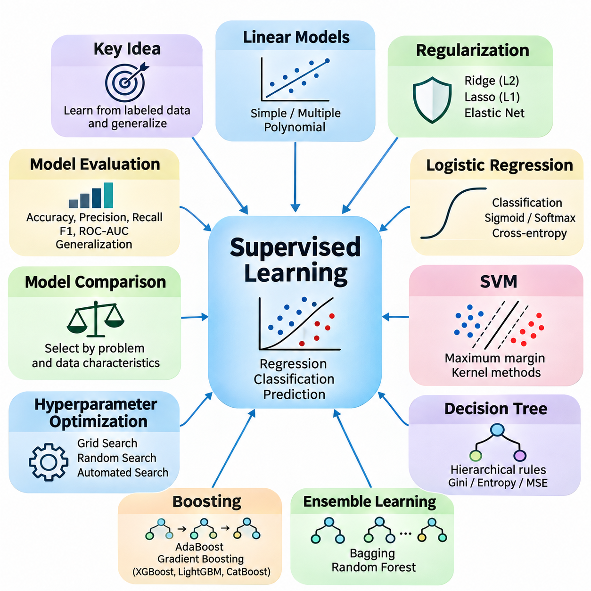
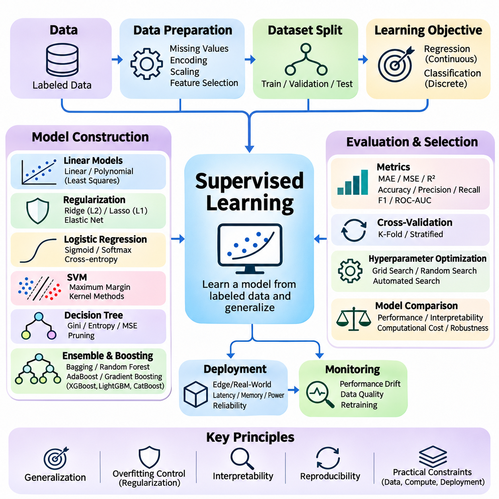
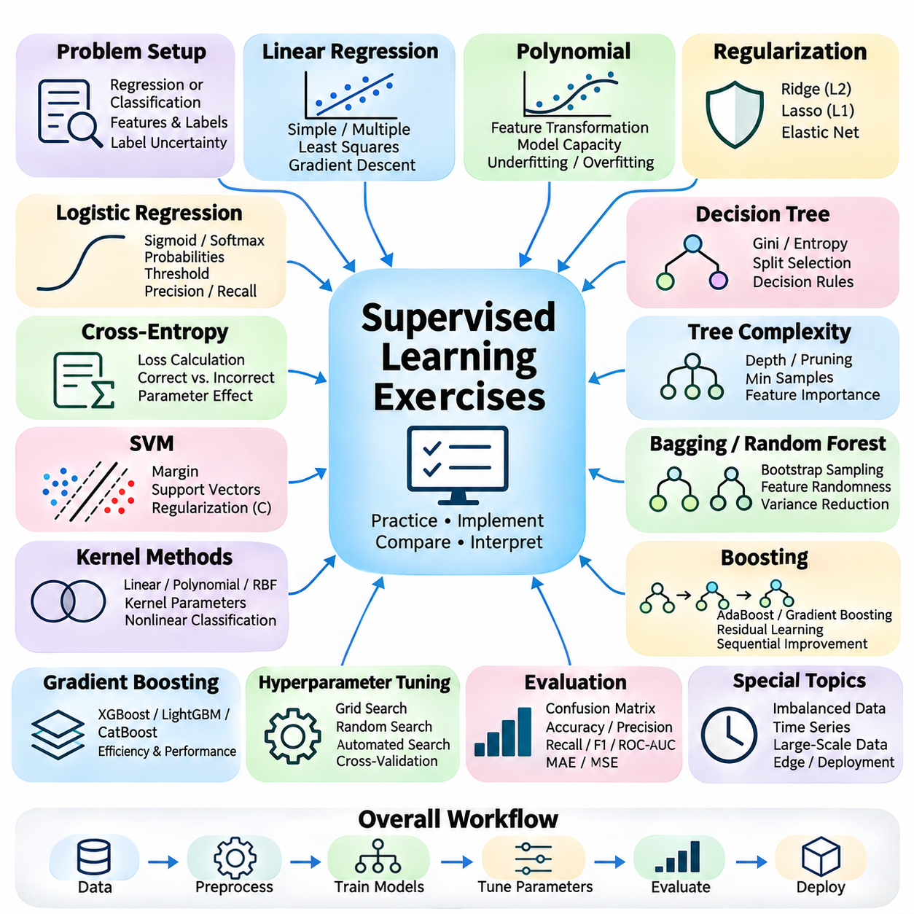
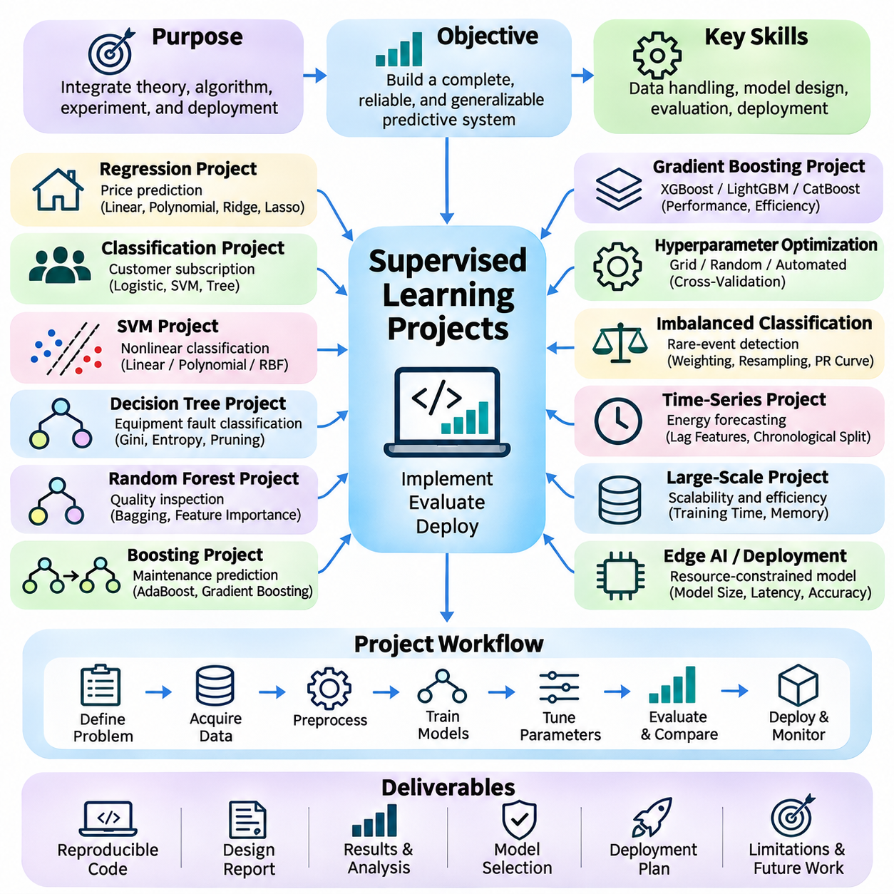

**Volume 08. Supervised Learning**

# 10. Summary and Exercises

## 10.00 Key Takeaways

{width="7.268055555555556in" height="7.268055555555556in"}

Supervised learning is a fundamental machine learning paradigm in which models learn relationships between input features and known target labels. Its primary objective is to generalize beyond observed training examples and make reliable predictions on previously unseen data. Understanding this principle provides the foundation for regression, classification, model evaluation, and practical artificial intelligence applications across scientific and industrial environments.

Linear models demonstrate how mathematical simplicity can support effective prediction. Simple linear regression estimates relationships between individual variables, while multiple linear regression extends the formulation to several features. Polynomial regression introduces nonlinear relationships through feature transformations. These approaches establish important connections between statistical estimation, geometric interpretation, optimization, and the practical limitations of predictive modeling.

Regularization improves the generalization of linear models by controlling model complexity. Ridge regression penalizes large coefficients through an L2 constraint, while Lasso encourages sparse solutions through an L1 penalty. Elastic Net combines both approaches to balance coefficient shrinkage and feature selection. These techniques illustrate how predictive accuracy must be considered alongside stability, interpretability, and resistance to overfitting.

Logistic regression extends linear decision functions to classification problems by transforming model outputs into probabilities. The sigmoid function supports binary classification, while softmax generalizes probability estimation to multiple classes. Cross-entropy provides a suitable optimization objective for probabilistic predictions. Decision boundaries, regularization, and probability thresholds determine how these models behave under different classification requirements.

Support Vector Machines introduce the principle of maximum-margin classification, emphasizing the separation between classes rather than merely minimizing classification errors. Hard-margin formulations assume perfect linear separability, while soft-margin approaches tolerate violations through regularization. Kernel methods extend SVMs to nonlinear relationships by computing similarities in transformed feature spaces without explicitly constructing those representations.

The effectiveness of Support Vector Machines depends on the interaction between kernel selection, regularization strength, and data characteristics. Linear kernels provide efficient solutions for approximately linear problems, while polynomial and radial basis function kernels capture more complex boundaries. The dual formulation reveals the importance of support vectors and demonstrates how optimization theory contributes directly to practical classification algorithms.

Decision trees approach prediction through hierarchical rules that partition the feature space into increasingly homogeneous regions. Classification trees commonly use Gini impurity or entropy to select informative splits, while regression trees minimize prediction errors within resulting partitions. Their structure makes individual decisions relatively easy to inspect, providing a useful foundation for understanding interpretable machine learning systems.

Although decision trees offer flexibility and intuitive decision rules, unrestricted growth can produce overfitting and unstable predictions. Pruning, depth constraints, and minimum sample requirements help control complexity. Missing values require explicit handling strategies, and feature importance measures must be interpreted carefully. These considerations demonstrate that interpretability alone does not guarantee robustness or reliable performance.

Ensemble learning improves predictive performance by combining multiple models rather than relying on a single estimator. Bagging trains models on bootstrap samples and aggregates their predictions, often reducing variance. Random forests extend this principle through randomized feature selection. These methods demonstrate how diversity among individual learners can improve stability, particularly when the underlying estimators are sensitive to training data variations.

Boosting constructs an ensemble sequentially, with successive learners emphasizing errors or optimization objectives not adequately addressed by earlier models. AdaBoost adjusts attention toward difficult training examples, while gradient boosting fits new learners to improve a differentiable loss function. Unlike bagging, which emphasizes independent model diversity, boosting develops a coordinated sequence of increasingly refined predictions.

Gradient Boosted Decision Trees represent an important family of high-performance methods for structured data. XGBoost emphasizes regularized optimization and computational efficiency, LightGBM introduces efficient histogram-based and leaf-wise learning strategies, and CatBoost provides specialized mechanisms for categorical features. Their effectiveness depends on appropriate preprocessing, validation, hyperparameter tuning, and control of model complexity.

Hyperparameter optimization determines how effectively an algorithm balances accuracy, computational cost, and generalization. Learning rates, tree depths, regularization strengths, kernel parameters, and ensemble sizes influence training behavior. Grid search, randomized search, and automated optimization can explore these choices systematically. However, every optimization procedure requires a sound validation strategy to avoid selecting models that merely exploit evaluation noise.

Model comparison should begin with the characteristics of the prediction problem rather than assumptions about algorithm superiority. Linear models offer simplicity and interpretability, SVMs provide margin-based learning, and tree ensembles capture complex feature interactions. Gradient boosting frequently performs strongly on tabular data, while neural networks may be advantageous for high-dimensional or unstructured inputs when suitable data and resources are available.

Evaluation metrics must correspond to the actual objectives and consequences of prediction errors. Regression tasks may use mean absolute error, mean squared error, or coefficient of determination. Classification tasks may require accuracy, precision, recall, F1 score, or area under a performance curve. No single metric fully describes model quality, especially when classes are imbalanced or error costs differ substantially.

Reliable evaluation requires separation between training, validation, and testing activities. Training data supports parameter estimation, validation data guides model selection, and held-out test data provides an independent final assessment. Cross-validation can reduce sensitivity to a particular data split. Data leakage, inappropriate preprocessing, and repeated test-set inspection undermine evaluation credibility, even when reported performance appears exceptionally strong.

Real-world supervised learning introduces challenges that are not always visible in controlled experiments. Tabular datasets may contain missing values, inconsistent categories, and correlated variables. Time-series applications require chronological validation and awareness of temporal dependencies. Imbalanced datasets demand careful metric selection and appropriate sampling strategies. Large-scale systems additionally introduce constraints involving memory, distributed processing, and data management.

Edge AI deployment highlights the relationship between predictive quality and operational feasibility. Models running on embedded computers or robotic platforms must satisfy requirements for latency, memory consumption, energy efficiency, and reliability. A slightly less accurate model may be preferable when it delivers predictable inference under strict resource constraints. Deployment decisions therefore require evaluation of the complete system rather than accuracy alone.

An end-to-end supervised learning project connects problem definition, data preparation, model training, comparison, selection, deployment, and performance analysis. Each stage influences subsequent decisions and should be documented for reproducibility. Consistent preprocessing between training and inference is especially important. Version control, experiment tracking, and clearly defined evaluation procedures help transform isolated experiments into maintainable engineering workflows.

Deployment does not mark the end of the machine learning lifecycle. Changes in input distributions, relationships between features and targets, or operational conditions can reduce predictive reliability over time. Monitoring should examine model performance, data quality, latency, and relevant failure patterns. Retraining and redeployment require controlled validation so that improvements in one operating condition do not unintentionally degrade performance elsewhere.

The central lesson of supervised learning is that successful prediction emerges from the interaction of data quality, mathematical formulation, algorithm selection, optimization, evaluation, and deployment engineering. Sophisticated algorithms cannot compensate automatically for misleading labels or poorly designed experiments. A disciplined workflow that prioritizes generalization, reproducibility, interpretability, and operational constraints provides the strongest foundation for dependable machine learning applications.

These principles also prepare learners to investigate more advanced artificial intelligence systems. Neural networks extend supervised learning through hierarchical representation learning, while foundation models frequently incorporate supervised adaptation alongside other training paradigms. The ability to construct reliable baselines, identify overfitting, interpret evaluation results, and compare computational tradeoffs remains essential even as model architectures become increasingly complex.

Ultimately, mastering supervised learning requires both conceptual understanding and practical experimentation. Implementing algorithms, comparing their behavior across datasets, analyzing errors, and examining deployment constraints reveal insights that mathematical descriptions alone cannot provide. The knowledge developed throughout these chapters establishes a systematic approach to designing predictive systems that are accurate, efficient, explainable, and adaptable to real-world requirements.

## 10.01 Concept Map

{width="7.268055555555556in" height="7.268055555555556in"}

A concept map of supervised learning provides a unified understanding of how data, mathematical models, optimization methods, evaluation strategies, and deployment processes interact. Rather than treating algorithms as isolated techniques, it organizes them into a connected learning framework. The central relationship begins with labeled data, continues through predictive model construction, and concludes with generalization to unseen observations under practical operating constraints.

The foundation of supervised learning consists of input features, target variables, and a learning objective. Input features describe measurable properties of observations, while target variables represent the values or categories that a model must predict. Regression addresses continuous outputs, whereas classification predicts discrete categories. Both tasks depend on identifying relationships that remain sufficiently stable beyond the training dataset.

Data preparation connects raw observations to mathematical learning procedures. Missing-value treatment, categorical encoding, feature scaling, and feature selection determine how information enters a model. Dataset partitioning separates training, validation, and testing responsibilities. These operations are not independent preprocessing details because they influence optimization behavior, predictive performance, and the reliability of conclusions drawn from experimental results.

Linear regression represents the simplest major branch of the supervised learning framework. It models target values through weighted combinations of input features and estimates parameters by minimizing prediction errors. Simple and multiple linear regression establish the basic formulation, while polynomial feature transformations extend representational flexibility. These methods connect statistical estimation, matrix algebra, loss functions, and gradient-based optimization.

Regularized linear models introduce an explicit connection between predictive accuracy and model complexity. Ridge regression applies L2 penalties to discourage excessively large coefficients, while Lasso uses L1 penalties to encourage sparse parameter representations. Elastic Net combines both mechanisms. These approaches demonstrate how optimization objectives can incorporate structural preferences that improve stability and reduce sensitivity to irrelevant or correlated features.

Logistic regression connects linear prediction functions to probabilistic classification. A linear combination of features produces a score that is transformed through a sigmoid function for binary classification. Softmax extends the framework to mutually exclusive multiclass predictions. Cross-entropy measures disagreement between predicted probabilities and observed labels, establishing a direct connection between probability theory, optimization, and decision boundaries.

Support Vector Machines introduce a geometric perspective centered on maximizing separation margins between classes. Support vectors determine the location of the separating boundary, while soft-margin optimization balances margin width against classification violations. Kernel functions extend the approach to nonlinear patterns by evaluating similarities in implicit feature spaces. This connects geometry, constrained optimization, regularization, and high-dimensional representation.

Decision trees provide a complementary representation based on recursive partitioning of the feature space. Classification trees use impurity measures such as Gini impurity and entropy, while regression trees minimize prediction variation within partitions. Their hierarchical rules support interpretability, but unrestricted growth increases overfitting risk. Pruning and structural constraints connect tree construction to the broader principle of complexity control.

Ensemble methods connect individual predictive models through aggregation and cooperative learning. Bagging reduces variance by training estimators on bootstrap samples and combining their outputs. Random forests add feature randomness to encourage diversity among trees. Stacking combines predictions through a secondary learner. These methods demonstrate that combining imperfect models can improve reliability when their errors are sufficiently diverse.

Boosting forms another ensemble branch by constructing learners sequentially. AdaBoost modifies example weights to emphasize difficult observations, while gradient boosting trains successive models to improve an objective function. Residual learning provides an intuitive explanation for squared-error regression, where new learners approximate remaining prediction errors. This establishes a connection between additive modeling, iterative optimization, and ensemble construction.

Modern gradient boosting frameworks extend these principles through specialized computational strategies. XGBoost incorporates regularized objectives and efficient tree construction, LightGBM emphasizes histogram-based processing and leaf-wise growth, and CatBoost provides mechanisms for handling categorical variables. Their shared conceptual foundation involves sequential improvement of predictive functions, while their differences concern optimization efficiency, data representation, and generalization behavior.

Model selection connects algorithm capabilities with problem requirements. Linear models are attractive when simplicity and interpretability are important, while kernel methods address certain nonlinear relationships. Tree ensembles are effective for many structured datasets, and gradient boosting often provides strong tabular-data performance. Appropriate selection depends on data characteristics, computational resources, inference requirements, and acceptable model complexity.

Evaluation establishes the connection between training objectives and practical success criteria. Regression models may be assessed using mean absolute error, mean squared error, or coefficient of determination. Classification models require metrics such as precision, recall, F1 score, and area under performance curves. Metric selection must reflect class imbalance, prediction uncertainty, and the relative consequences of different errors.

Generalization provides the central organizing principle across all supervised learning algorithms. A model must capture useful relationships without memorizing incidental patterns in its training observations. Underfitting occurs when model capacity is insufficient, while overfitting arises when excessive flexibility captures noise or dataset-specific details. Regularization, cross-validation, and appropriate complexity control address these related challenges.

Hyperparameter tuning connects model design to systematic experimentation. Learning rates, regularization strengths, tree depths, kernel parameters, and ensemble sizes influence model behavior without being directly estimated as ordinary model parameters. Grid search, randomized search, and automated optimization explore alternative configurations. Reliable validation prevents the selection process from exploiting accidental patterns in evaluation data.

Real-world supervised learning extends the concept map beyond conventional independent observations. Time-series problems introduce temporal dependencies and require chronological evaluation. Imbalanced classification emphasizes precision-recall tradeoffs and class-sensitive objectives. Large-scale datasets create computational and memory challenges, while changing data distributions introduce risks of performance degradation after deployment.

Edge AI connects statistical learning with physical computing constraints. Models deployed on embedded processors, industrial controllers, or autonomous robots must satisfy latency, memory, power, and reliability requirements. Computational efficiency becomes part of model quality rather than merely an implementation concern. This perspective connects algorithm selection, hardware architecture, inference optimization, and operational safety.

An end-to-end supervised learning workflow integrates the entire conceptual structure into a repeatable engineering process. Problem formulation determines the target and evaluation criteria, data preparation establishes usable representations, and training produces candidate models. Validation supports comparison and selection, while deployment introduces operational requirements. Monitoring and performance analysis provide evidence for maintenance and subsequent improvement.

The relationship between interpretability and predictive performance is another important connection. Linear coefficients provide relatively direct descriptions of feature contributions, while decision trees express predictions through hierarchical rules. Ensembles may improve accuracy but require additional explanation techniques. Feature importance, local explanations, and error analysis help investigate model behavior, although explanatory methods do not automatically establish causal relationships.

The complete conceptual structure ultimately connects supervised learning with broader artificial intelligence research. Neural networks extend predictive modeling through learned representations, while foundation models can use supervised objectives during adaptation to specialized tasks. Regardless of architecture, reliable systems depend on appropriate data, meaningful objectives, sound evaluation, and controlled deployment. These shared principles provide continuity between classical machine learning and modern AI engineering.

## 10.02 Exercises

{width="7.268055555555556in" height="7.268055555555556in"}

Exercises in supervised learning are designed to strengthen the connection between theoretical understanding and practical problem-solving. They encourage learners to examine mathematical assumptions, implement predictive algorithms, compare alternative models, and interpret experimental results. Effective exercises should develop the ability to explain why a method works, identify when it may fail, and determine whether its predictions can be trusted in unfamiliar operating conditions.

A foundational exercise begins with identifying the components of a supervised learning problem. Given a dataset containing observations, input variables, and target values, learners should determine whether the objective involves regression or classification. They should describe the meaning of each feature, identify potential sources of label uncertainty, and explain how the available data supports the intended prediction task.

Linear regression exercises provide opportunities to connect algebraic formulations with numerical estimation. Learners can construct a simple regression model, calculate predictions from selected coefficients, and evaluate residual errors. Extending the exercise to multiple features demonstrates how additional variables influence the model. Comparing analytical least-squares solutions with gradient-based optimization reveals alternative approaches to parameter estimation.

Polynomial regression exercises investigate the relationship between representational flexibility and generalization. Learners can transform a single input variable into polynomial features of increasing degree and observe changes in training and validation errors. They should explain why higher-degree models may capture nonlinear relationships while becoming more sensitive to noise. The exercise illustrates how model capacity influences underfitting and overfitting.

Regularization exercises examine the effects of coefficient penalties on predictive behavior. Learners should train Ridge, Lasso, and Elastic Net models using identical datasets and comparable validation procedures. By varying regularization strength, they can observe coefficient shrinkage, sparsity, and changes in predictive performance. The results should be interpreted in relation to correlated features, model stability, and generalization.

Logistic regression exercises introduce probabilistic reasoning into classification. Learners can calculate sigmoid outputs for selected linear scores, interpret the resulting probabilities, and examine how classification thresholds affect predictions. They should compare predicted labels with observed outcomes and explain the roles of precision and recall. Extending the exercise to softmax classification demonstrates how probability estimates support multiclass decisions.

Cross-entropy exercises connect probability estimation with optimization objectives. Learners should calculate binary cross-entropy for selected predicted probabilities and known labels, then compare penalties associated with confident correct and incorrect predictions. They can investigate how changing model parameters influences the loss. This exercise reinforces the distinction between producing a class label and estimating a meaningful probability distribution.

Support Vector Machine exercises focus on geometric separation and optimization constraints. Learners can examine a two-dimensional classification dataset, identify candidate separating boundaries, and reason about margin width. They should explain the influence of support vectors and investigate how the regularization parameter changes the tolerance for classification violations. The exercise connects geometric intuition with the practical behavior of soft-margin classifiers.

Kernel method exercises investigate nonlinear classification without explicitly constructing high-dimensional representations. Learners can compare linear, polynomial, and radial basis function kernels on datasets containing curved or overlapping class boundaries. They should examine how kernel parameters influence decision complexity and generalization. The objective is to understand why kernel selection depends on data geometry rather than algorithm popularity.

Decision tree exercises introduce recursive partitioning and information-based splitting. Learners should calculate Gini impurity and entropy for selected class distributions, then determine which candidate split provides the greatest impurity reduction. They can construct a small decision tree manually and compare its rules with an automatically trained model. This activity clarifies how local splitting decisions produce hierarchical prediction structures.

Tree complexity exercises examine the consequences of unrestricted growth. Learners can compare shallow and deep decision trees using training and validation performance, then apply pruning or minimum sample constraints. They should explain why a model with excellent training accuracy may perform poorly on unseen data. Additional analysis can investigate feature importance and the limitations of interpreting complex decision rules.

Bagging and Random Forest exercises demonstrate how model aggregation affects prediction variance. Learners should train individual decision trees on bootstrap samples and compare their predictions with those of a combined ensemble. Introducing random feature selection provides an opportunity to investigate diversity among learners. The exercise should emphasize the relationship between estimator instability, error correlation, and ensemble performance.

Boosting exercises explore sequential model improvement. Learners can construct a small additive regression model in which successive weak learners approximate residual errors. They should compare predictions before and after each stage and explain how the combined model reduces the selected loss. Extending the investigation to AdaBoost reveals how sample weighting differs from gradient-based residual fitting.

Gradient boosting exercises compare modern implementations such as XGBoost, LightGBM, and CatBoost. Learners should use consistent data partitions and evaluation metrics while examining predictive accuracy, training time, and memory requirements. Hyperparameters such as learning rate, tree depth, and ensemble size can be varied systematically. Conclusions should distinguish algorithmic behavior from differences caused by experimental configuration.

Model selection exercises require learners to evaluate competing algorithms under common conditions. Linear regression, logistic regression, Support Vector Machines, decision trees, and ensemble methods can be applied where their prediction objectives are appropriate. Learners should compare performance, interpretability, computational requirements, and robustness. Their final recommendation should be justified by the problem requirements rather than a single performance score.

Evaluation exercises develop the ability to interpret predictive errors. For classification, learners can construct confusion matrices and calculate accuracy, precision, recall, and F1 score. For regression, they can compare mean absolute error and mean squared error under different error distributions. They should explain how metric selection changes when false negatives, false positives, or large numerical deviations have different practical consequences.

Cross-validation exercises examine the reliability of experimental conclusions. Learners should compare a single train-validation split with repeated or stratified cross-validation and investigate variation in reported performance. They can introduce an intentionally incorrect preprocessing procedure to observe how data leakage creates misleading results. The exercise emphasizes that evaluation methodology is as important as algorithm implementation.

Imbalanced classification exercises explore situations in which one target category is much less frequent than another. Learners should compare accuracy with precision, recall, F1 score, and precision-recall analysis. They can investigate class weighting, resampling, and threshold adjustment while preserving an appropriate evaluation distribution. The objective is to understand why apparently high accuracy may conceal poor detection of important minority cases.

Time-series exercises introduce temporal dependencies into supervised learning. Learners should construct lagged features from sequential observations and compare chronological validation with randomly shuffled partitions. They should identify situations in which future information could leak into training features. This exercise demonstrates why conventional independent-sample assumptions may be inappropriate for forecasting and industrial monitoring applications.

Deployment exercises connect predictive models with operational constraints. Learners can measure inference latency, model size, and memory consumption for several candidate algorithms. They should evaluate whether the models satisfy hypothetical embedded or edge computing requirements. Comparing predictive accuracy with resource consumption encourages practical decisions based on system-level feasibility rather than isolated benchmark performance.

A final integrative exercise should require learners to complete a supervised learning workflow from problem definition to performance analysis. They should prepare data, establish a baseline, train alternative models, tune hyperparameters, evaluate generalization, and justify a final selection. The resulting analysis should explain limitations, reproducibility considerations, and potential deployment risks, demonstrating a coherent understanding of supervised learning as an engineering discipline.

## 10.03 Projects [w/Code]

{width="7.268055555555556in" height="7.268055555555556in"}

Projects in supervised learning provide opportunities to integrate mathematical foundations, algorithm implementation, experimental evaluation, and practical deployment into complete predictive systems. Unlike isolated exercises, projects require learners to manage dependencies between data preparation, model training, validation, and operational requirements. Each project should produce reproducible results, documented design decisions, and evidence that the selected model can generalize beyond its training observations.

A foundational regression project can investigate the prediction of residential property prices using numerical and categorical attributes. Learners should examine data quality, identify missing values, encode categorical variables, and establish a simple baseline. Linear regression, polynomial regression, Ridge, Lasso, and Elastic Net can then be compared. The project should evaluate prediction errors and explain how regularization influences coefficient stability and generalization.

A classification project can focus on predicting customer subscription decisions from demographic, behavioral, and transactional features. Logistic regression provides an interpretable baseline, while Support Vector Machines and tree-based classifiers introduce alternative decision boundaries. Learners should compare probability estimates, classification thresholds, and evaluation metrics. Particular attention should be given to class imbalance, data leakage, and the operational consequences of incorrect predictions.

A Support Vector Machine project can examine nonlinear classification using a synthetic dataset containing overlapping or curved class distributions. Learners should implement linear, polynomial, and radial basis function kernels under consistent experimental conditions. Kernel parameters and regularization strength can be varied to investigate decision complexity. The final analysis should explain how margin optimization and kernel selection influence generalization.

A decision tree project can address equipment fault classification using sensor measurements and operational status indicators. Learners should construct classification trees, calculate impurity-based splitting criteria, and examine the resulting decision rules. Tree depth, pruning, and minimum sample requirements can be adjusted to control overfitting. The project should evaluate whether the learned rules are understandable and sufficiently reliable for maintenance decision support.

A Random Forest project can investigate industrial quality inspection using structured measurements collected from manufacturing processes. Individual decision trees should be compared with bagged ensembles and Random Forest classifiers. Learners can examine prediction variance, feature importance, and performance stability across repeated experiments. The analysis should distinguish predictive associations from causal explanations of manufacturing defects.

A boosting project can focus on predicting equipment maintenance requirements from operating hours, temperature, vibration, and historical inspection records. AdaBoost and gradient boosting models can be trained against simpler baseline classifiers. Learners should investigate how sequential learning improves prediction performance and how learning rate, estimator count, and tree complexity affect results. Evaluation should consider the consequences of missed maintenance events.

A gradient boosting comparison project can evaluate XGBoost, LightGBM, and CatBoost on a common tabular dataset. Consistent training partitions, validation procedures, and evaluation metrics are essential for meaningful comparison. Learners should record predictive performance, training duration, memory usage, and inference latency. The project should explain how categorical encoding, model configuration, and computational efficiency influence the preferred algorithm.

A hyperparameter optimization project can investigate systematic model improvement through grid search, randomized search, and automated optimization. Learners should define search spaces for regularization strengths, tree depths, learning rates, and ensemble sizes. Cross-validation should guide configuration selection while an untouched test set provides final assessment. The project should examine optimization cost and the risk of overfitting validation results.

An imbalanced classification project can address rare-event detection in industrial monitoring or transaction analysis. Learners should establish the original class distribution and compare standard training with class weighting and resampling strategies. Precision, recall, F1 score, and precision-recall curves should guide evaluation. Threshold adjustment can then be investigated according to the relative costs of false alarms and missed detections.

A time-series regression project can predict future energy consumption using historical measurements and environmental variables. Learners should construct lagged features, rolling statistics, and calendar-based predictors while preventing future information from entering training data. Chronological validation should replace inappropriate random splitting. Linear models, Random Forests, and gradient boosting can be compared using consistent forecasting horizons.

A large-scale supervised learning project can investigate computational efficiency as dataset size increases. Learners should measure training time, memory consumption, and predictive performance across progressively larger subsets of structured data. Efficient preprocessing, parallel execution, and model complexity control should be examined. The project should identify situations in which additional training data improves generalization and situations in which computational costs dominate.

An Edge AI project can investigate the deployment of a supervised classifier on a resource-constrained computing platform. Learners should compare compact linear models, shallow decision trees, and selected ensemble configurations. Model size, inference latency, memory requirements, and predictive accuracy should be measured. The final selection should satisfy explicit operational constraints rather than maximize accuracy without considering hardware limitations.

A robotics-oriented project can classify terrain conditions or operational states from labeled sensor measurements. Features may include acceleration, angular velocity, wheel speed, and motor current, depending on available data. Learners should compare logistic regression, Support Vector Machines, Random Forests, and gradient boosting. Evaluation should account for temporal correlation, sensor noise, and changes between training and deployment environments.

A predictive maintenance project can combine classification and regression within a common industrial application. One model may estimate whether equipment requires inspection, while another predicts a continuous condition indicator or remaining operating interval when suitable labels are available. Learners should investigate feature consistency, evaluation metrics, and uncertainty. The project should demonstrate why different prediction objectives require different formulations and validation procedures.

A model interpretability project can compare how linear coefficients, decision tree rules, and ensemble feature importance describe predictive behavior. Learners should investigate local explanations and analyze cases where different methods identify different influential features. Correlated variables and unstable importance rankings should receive particular attention. The final discussion should distinguish predictive explanations from claims about underlying causal mechanisms.

A model selection benchmark project can establish a reproducible comparison framework for several supervised learning algorithms. Learners should implement common preprocessing pipelines, standardized evaluation metrics, and consistent experiment tracking. Linear models, Support Vector Machines, decision trees, Random Forests, and gradient boosting should be compared on appropriate datasets. Results should include accuracy, computational cost, interpretability, and robustness.

A deployment monitoring project can investigate how a trained model behaves when operational data gradually differs from its training distribution. Learners can introduce controlled changes in feature distributions and examine prediction confidence, error rates, and performance degradation. Monitoring thresholds and retraining criteria should be defined carefully. The project should distinguish observable data drift from confirmed changes in predictive relationships.

A complete end-to-end project should integrate problem definition, data acquisition, preprocessing, baseline development, model training, hyperparameter tuning, evaluation, and deployment. Learners should maintain separate training, validation, and testing responsibilities throughout the workflow. Reproducible code, configuration records, and documented model versions should accompany the implementation. Final results should include performance limitations and operational considerations.

Project assessment should emphasize methodological quality rather than predictive accuracy alone. A strong implementation demonstrates appropriate dataset handling, justified model selection, reliable validation, meaningful error analysis, and reproducible execution. Learners should explain unsuccessful experiments and unexpected results instead of reporting only favorable outcomes. This approach encourages scientific reasoning and disciplined machine learning engineering.

The overall objective of these projects is to transform supervised learning knowledge into practical engineering competence. By implementing regression, classification, kernel methods, decision trees, ensembles, and gradient boosting within realistic workflows, learners develop the ability to select and evaluate predictive systems systematically. The resulting experience establishes a foundation for advanced machine learning, Edge AI, industrial intelligence, and autonomous systems.
